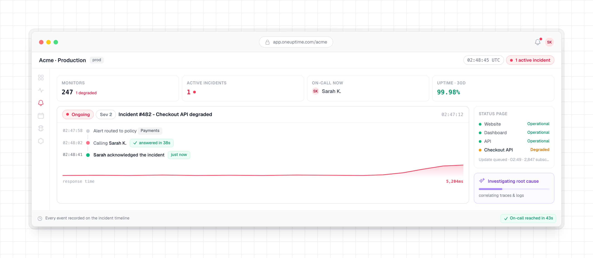

<!-- markdownlint-disable MD033 MD041 -->
<p align="center">
  <a href="/README.md">English</a>&nbsp;·
  <a href="/Docs/translations/README.zh-CN.md">简&#8288;体&#8288;中&#8288;文</a>&nbsp;·
  <a href="/Docs/translations/README.zh-TW.md">繁&#8288;體&#8288;中&#8288;文</a>&nbsp;·
  <a href="/Docs/translations/README.ja.md">日&#8288;本&#8288;語</a>&nbsp;·
  <a href="/Docs/translations/README.ko.md">한&#8288;국&#8288;어</a>&nbsp;·
  <a href="/Docs/translations/README.es.md">Español</a>&nbsp;·
  <a href="/Docs/translations/README.fr.md">Français</a>&nbsp;·
  <a href="/Docs/translations/README.de.md">Deutsch</a>&nbsp;·
  <a href="/Docs/translations/README.pt.md">Português</a>&nbsp;·
  <a href="/Docs/translations/README.it.md">Italiano</a>&nbsp;·
  <a href="/Docs/translations/README.ru.md">Русский</a>&nbsp;·
  <a href="/Docs/translations/README.hi.md">हिन्दी</a>&nbsp;·
  <a href="/Docs/translations/README.fa.md">فارسی</a>&nbsp;·
  <a href="/Docs/translations/README.nl.md">Nederlands</a>&nbsp;·
  <a href="/Docs/translations/README.da.md">Dansk</a>&nbsp;·
  <a href="/Docs/translations/README.sv.md">Svenska</a>&nbsp;·
  <a href="/Docs/translations/README.no.md">Norsk</a>
</p>

<p align="center">
  <a href="https://oneuptime.com"><picture><source media="(prefers-color-scheme: dark)" srcset="/packages/App/FeatureSet/Docs/Static/images/logo-dark.svg"></picture></a>
</p>

<p align="center">
  <a href="https://github.com/OneUptime/oneuptime/blob/main/LICENSE"></a>
  <a href="https://github.com/OneUptime/oneuptime/releases"></a>
</p>

‏OneUptime یک پلتفرم متن‌باز مشاهده‌پذیری است. بررسی می‌کند که وب‌سایت‌ها، APIها و سرورهای شما کار می‌کنند، لاگ‌ها، متریک‌ها و ترِیس‌هایی را که برنامه‌هایتان می‌فرستند جمع‌آوری می‌کند، وقتی چیزی خراب می‌شود هر کسی را که آنکال است خبر می‌کند، و در یک صفحه وضعیت به مشتریانتان اطلاع می‌دهد. همه این‌ها در یک محصول اتفاق می‌افتد، بنابراین همان ابزاری که مشکل را می‌بیند تیم شما را خبر می‌کند.

می‌توانید از [OneUptime Cloud](https://oneuptime.com) استفاده کنید یا آن را روی سرورهای خودتان اجرا کنید.

<p align="center">
  
</p>

## کارهایی که OneUptime انجام می‌دهد

- **[پایش](https://oneuptime.com/docs/fa/monitor/create-monitor)**: وب‌سایت‌ها، APIها، پورت‌ها، DNS و گواهی‌ها را از پراب‌هایی در سراسر جهان یا از داخل شبکه خودتان بررسی کنید. OneUptime سرورها، Kubernetes، Docker، VMware، پایگاه‌های داده و تجهیزات شبکه را هم زیر نظر می‌گیرد.
- **[حوادث و آنکال](https://oneuptime.com/docs/fa/incidents/index)**: هر حادثه را روی یک خط زمانی پیش ببرید. هر کسی را که آنکال است با تماس تلفنی، پیامک، ایمیل، اعلان، Slack یا Microsoft Teams خبر کنید، و تا وقتی کسی پاسخ دهد تشدید کنید.
- **[صفحات وضعیت](https://oneuptime.com/docs/fa/status-pages/index)**: مشتریان را در صفحات وضعیت عمومی یا خصوصی در جریان بگذارید، و تعمیر و نگهداری زمان‌بندی‌شده را همان‌جا اعلام کنید.
- **[لاگ‌ها، متریک‌ها و ترِیس‌ها](https://oneuptime.com/docs/fa/telemetry/open-telemetry)**: آن‌ها را با OpenTelemetry بفرستید، در آن‌ها جستجو کنید و داشبورد بسازید. استثناها، پروفایل‌ها، پایش کاربر واقعی و رویدادهای امنیتی هم در همین‌جا هستند.
- **[گردش‌های کاری و رانبوک‌ها](https://oneuptime.com/docs/fa/workflows/index)**: کارهای تکراری را خودکار کنید، و Jira، ServiceNow و ابزارهای دیگری را که تیمتان از قبل به کار می‌برد وصل کنید.
- **[‏OneUptime AI](https://oneuptime.com/docs/fa/ai/ai-sre)**: حوادث و هشدارهای تازه را بررسی می‌کند و یک تحلیل علت ریشه‌ای با منبع منتشر می‌کند. وقتی اصلاح را روشن کنید، می‌تواند یک Pull Request با یک اصلاح باز کند تا تیمتان آن را بازبینی کند.
- **[‏API، CLI و Terraform](https://oneuptime.com/docs/fa/api-reference/api-reference)**: OneUptime را از اسکریپت‌ها و CI خود خودکار کنید، و مانیتورها، صفحات وضعیت و آنکال را به‌صورت کد مدیریت کنید.
- **[سرور MCP](https://oneuptime.com/docs/fa/ai/mcp-server)** (`https://oneuptime.com/mcp`): Claude، Cursor، VS Code همراه با GitHub Copilot یا هر کلاینت دیگری از Model Context Protocol (MCP) را وصل کنید و از آن بخواهید یک حادثه را بررسی کند، لاگ‌ها و ردیابی‌ها را جست‌وجو کند، یک هشدار را تأیید کند یا یک مانیتور راه بیندازد.

راهنماهای گام‌به‌گام یک کار را از ابتدا تا انتها پیش می‌برند، در OneUptime Cloud یا روی سرور خودتان: [بدانید چه زمانی وب‌سایت یا API شما از کار می‌افتد](https://oneuptime.com/docs/fa/guides/website-down)، [با تماس، پیامک یا پوش خبر شوید](https://oneuptime.com/docs/fa/guides/paging) و [یک صفحه وضعیت منتشر کنید](https://oneuptime.com/docs/fa/guides/status-page).

باقی چیزها در [مستندات](https://oneuptime.com/docs/fa/introduction/getting-started) آمده است.

## شروع کنید

### ‏OneUptime Cloud

[ثبت‌نام کنید](https://oneuptime.com/accounts/register) و یک پروژه بسازید. طرح رایگان به کارت اعتباری نیاز ندارد.

### میزبانی روی سرور خودتان با Docker Compose

به یک سرور Linux با دست‌کم ۸ GB حافظه نیاز دارید. روی یک سرور تازهٔ Ubuntu، Debian یا مبتنی بر RHEL، یک فرمان Docker، Git و Node.js را هر جا نباشند نصب می‌کند، نشانی‌ای را که دیگران به کار می‌برند می‌پرسد و OneUptime را راه‌اندازی می‌کند:

```bash
curl -fsSL https://oneuptime.com/install.sh | bash
```

یا گام‌به‌گام پیش بروید، با Docker، Docker Compose، Git و Node.js نصب‌شده. در گام ۳، به جای `<your-address>`‎ نام دامنه یا نشانی IP‌ای را بنویسید که دیگران برای رسیدن به OneUptime به کار می‌برند، بدون `http://`‎: این همان `HOST` در `config.env` است. فقط برای امتحان OneUptime روی رایانهٔ خودتان `localhost` را نگه دارید.

```bash
# 1. Clone the release branch
git clone --depth 1 --single-branch --branch release https://github.com/OneUptime/oneuptime.git
cd oneuptime

# 2. Create your config
cp config.example.env config.env

# 3. Set HOST to the address people will use
sed -i.bak "s/^HOST=.*/HOST=<your-address>/" config.env && rm config.env.bak

# 4. Start everything
npm start
```

فرمان `npm start` سرور را بررسی می‌کند، به هر رمز در `config.env` مقدار تصادفی جداگانه‌ای می‌دهد و OneUptime را راه‌اندازی می‌کند. وقتی `npm start` پیام **OneUptime is up!‎** را نشان داد، `http://localhost` یا نشانی سرورتان را باز کنید و ثبت‌نام کنید. نخستین حساب، مدیر نمونه می‌شود.

سپس [راهنمای خودمیزبانی](https://oneuptime.com/docs/fa/installation/self-hosting-guide) را از HTTPS، ایمیل و پیامک دنبال کنید تا OneUptime بتواند به شما هشدار بدهد. [راهنمای Docker Compose](https://oneuptime.com/docs/fa/installation/docker-compose) اندازه سرور، پشتیبان‌گیری و به‌روزرسانی را پوشش می‌دهد.

### نصب روی Kubernetes با Helm

برای محیط تولید در مقیاس بزرگ، یا دسترس‌پذیری بالا، چارت Helm را نصب کنید. `host` را روی نام دامنه یا نشانی IP بگذارید که دیگران با آن به OneUptime می‌رسند:

```bash
helm repo add oneuptime https://helm-chart.oneuptime.com/
helm install my-oneuptime oneuptime/oneuptime --set host=oneuptime.example.com
```

‏[README چارت](/HelmChart/Public/oneuptime/README.md) ذخیره‌سازی، HTTPS، پایگاه‌های داده و ارتقا را پوشش می‌دهد.

## نسخه‌های Community و Enterprise

- **‏Community Edition**: رایگان و متن‌باز، با همه موارد بالا، از جمله ورود یکپارچه SAML و OIDC.
- **‏Enterprise Edition**: تأمین SCIM، گزارش‌های ممیزی، انطباق تیم و داشبوردهای سلامت نمونه را همراه با پشتیبانی اولویت‌دار اضافه می‌کند. استفاده در محیط تولید به مجوز نیاز دارد: [تماس با فروش](mailto:sales@oneuptime.com).

مستندات [این دو نسخه را مقایسه می‌کند](https://oneuptime.com/docs/fa/self-hosted/enterprise).

## کمک گرفتن

- در [انجمن OneUptime در Slack](https://join.slack.com/t/oneuptimesupport/shared_invite/zt-2pz5p1uhe-Fpmc7bv5ZE5xRMe7qJnwmA) سؤال بپرسید.
- باگ‌ها را گزارش کنید و قابلیت‌ها را در [issueهای GitHub](https://github.com/OneUptime/oneuptime/issues) درخواست کنید.
- آسیب‌پذیری‌های امنیتی را به‌صورت خصوصی گزارش کنید، همان‌طور که [SECURITY.md](/.github/SECURITY.md) توضیح می‌دهد.
- برای هر چیز دیگری به [support@oneuptime.com](mailto:support@oneuptime.com) ایمیل بزنید.

## مشارکت

از رفع باگ، قابلیت تازه، مستندات و تست استقبال می‌کنیم. [راهنمای توسعه محلی](https://oneuptime.com/docs/fa/installation/local-development) نشان می‌دهد چطور OneUptime را از کد منبع اجرا کنید، و [رهنمودهای مشارکت](/.github/CONTRIBUTING.md) توضیح می‌دهند Pull Requestها و مجوزها چطور کار می‌کنند. issueهایی با برچسب [good first issue](https://github.com/OneUptime/oneuptime/labels/good%20first%20issue) جای خوبی برای شروع هستند.

اگر OneUptime برایتان مفید است، به این مخزن ستاره بدهید یا [از پروژه حمایت مالی کنید](https://github.com/sponsors/OneUptime).

## مجوز

‏OneUptime تحت [مجوز Apache نسخه ۲.۰](/LICENSE) متن‌باز است، به‌جز پوشه [`ee/`](/ee)‎. این پوشه Enterprise Edition را در بر دارد و تحت [OneUptime Enterprise License](/ee/LICENSE) منتشر شده است. ایمیج Community Edition هیچ کدی از `ee/`‎ ندارد. فایل [`LICENSE`](/LICENSE) در ریشه مخزن این تقسیم را مشخص می‌کند.
