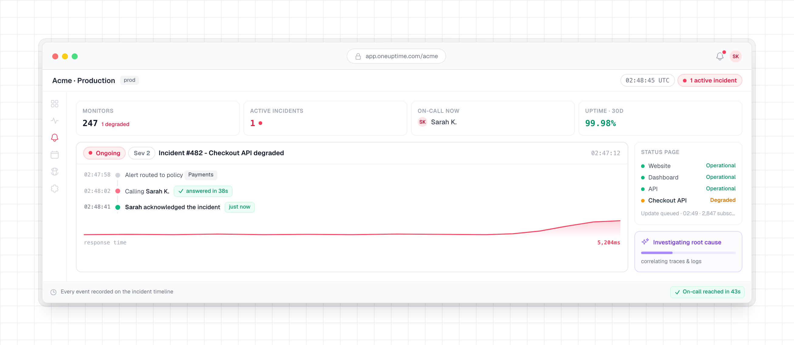

<!-- markdownlint-disable MD033 MD041 -->
<p align="center">
  <a href="/README.md">English</a>&nbsp;·
  <a href="/Docs/translations/README.zh-CN.md">简&#8288;体&#8288;中&#8288;文</a>&nbsp;·
  <a href="/Docs/translations/README.zh-TW.md">繁&#8288;體&#8288;中&#8288;文</a>&nbsp;·
  <a href="/Docs/translations/README.ja.md">日&#8288;本&#8288;語</a>&nbsp;·
  <a href="/Docs/translations/README.ko.md">한&#8288;국&#8288;어</a>&nbsp;·
  <a href="/Docs/translations/README.es.md">Español</a>&nbsp;·
  <a href="/Docs/translations/README.fr.md">Français</a>&nbsp;·
  <a href="/Docs/translations/README.de.md">Deutsch</a>&nbsp;·
  <a href="/Docs/translations/README.pt.md">Português</a>&nbsp;·
  <a href="/Docs/translations/README.it.md">Italiano</a>&nbsp;·
  <a href="/Docs/translations/README.ru.md">Русский</a>&nbsp;·
  <a href="/Docs/translations/README.hi.md">हिन्दी</a>&nbsp;·
  <a href="/Docs/translations/README.fa.md">فارسی</a>&nbsp;·
  <a href="/Docs/translations/README.nl.md">Nederlands</a>&nbsp;·
  <a href="/Docs/translations/README.da.md">Dansk</a>&nbsp;·
  <a href="/Docs/translations/README.sv.md">Svenska</a>&nbsp;·
  <a href="/Docs/translations/README.no.md">Norsk</a>
</p>

<p align="center">
  <a href="https://oneuptime.com"><picture><source media="(prefers-color-scheme: dark)" srcset="/packages/App/FeatureSet/Docs/Static/images/logo-dark.svg"></picture></a>
</p>

<p align="center">
  <a href="https://github.com/OneUptime/oneuptime/blob/main/LICENSE"></a>
  <a href="https://github.com/OneUptime/oneuptime/releases"></a>
</p>

OneUptime è una piattaforma di osservabilità open source. Controlla che i tuoi siti web, le tue API e i tuoi server funzionino, raccoglie i log, le metriche e le tracce che le tue applicazioni inviano, avvisa chi è reperibile quando qualcosa si guasta e informa i tuoi clienti su una pagina di stato. Tutto avviene in un solo prodotto: lo strumento che nota un problema è lo stesso che avvisa il tuo team.

Puoi usarlo su [OneUptime Cloud](https://oneuptime.com) oppure eseguirlo sui tuoi server.

<p align="center">
  
</p>

## Cosa fa

- **[Monitoraggio](https://oneuptime.com/docs/it/monitor/create-monitor)**: Controllare siti web, API, porte, DNS e certificati da sonde in tutto il mondo o dall'interno della tua rete. OneUptime tiene sotto controllo anche server, Kubernetes, Docker, VMware, database e dispositivi di rete.
- **[Incidenti e reperibilità](https://oneuptime.com/docs/it/incidents/index)**: Gestire ogni incidente su un'unica cronologia. Avvisare chi è reperibile con chiamata, SMS, email, push, Slack o Microsoft Teams, ed eseguire l'escalation finché qualcuno risponde.
- **[Pagine di stato](https://oneuptime.com/docs/it/status-pages/index)**: Tenere informati i clienti su pagine di stato pubbliche o private, e annunciarvi la manutenzione programmata.
- **[Log, metriche e tracce](https://oneuptime.com/docs/it/telemetry/open-telemetry)**: Inviarli con OpenTelemetry, cercarli e creare dashboard. Eccezioni, profili, Real User Monitoring ed eventi di sicurezza sono nello stesso posto.
- **[Workflow e runbook](https://oneuptime.com/docs/it/workflows/index)**: Automatizzare il lavoro di routine e collegare Jira, ServiceNow e gli altri strumenti che il tuo team usa già.
- **[OneUptime AI](https://oneuptime.com/docs/it/ai/ai-sre)**: Indaga sui nuovi incidenti e avvisi e pubblica un'analisi della causa principale con fonti. Quando attivi la correzione, può aprire una pull request con una correzione che il tuo team esaminerà.
- **[API, CLI e Terraform](https://oneuptime.com/docs/it/api-reference/api-reference)**: Automatizzare OneUptime dai tuoi script e dalla tua CI, e gestire monitor, pagine di stato e reperibilità come codice.
- **[Server MCP](https://oneuptime.com/docs/it/ai/mcp-server)** (`https://oneuptime.com/mcp`): Collega Claude, Cursor, VS Code con GitHub Copilot o qualsiasi altro client del Model Context Protocol (MCP), e chiedigli di esaminare un incidente, interrogare log e tracce, confermare un avviso o configurare un monitor.

Le guide passo passo ti accompagnano in un'attività dall'inizio alla fine, su OneUptime Cloud o sul tuo server: [Sapere quando il tuo sito web o la tua API smette di funzionare](https://oneuptime.com/docs/it/guides/website-down), [Essere avvisati per chiamata, SMS o push](https://oneuptime.com/docs/it/guides/paging) e [Pubblicare una pagina di stato](https://oneuptime.com/docs/it/guides/status-page).

Tutto il resto è nella [documentazione](https://oneuptime.com/docs/it/introduction/getting-started).

## Per iniziare

### OneUptime Cloud

[Registrati](https://oneuptime.com/accounts/register) e crea un progetto. Il piano gratuito non richiede una carta di credito.

### Self-hosting con Docker Compose

Ti serve un server Linux con almeno 8 GB di memoria. Su un server nuovo con Ubuntu, Debian o una distribuzione basata su RHEL, un solo comando installa Docker, Git e Node.js dove mancano, chiede l'indirizzo che verrà usato e avvia OneUptime:

```bash
curl -fsSL https://oneuptime.com/install.sh | bash
```

Oppure procedi passo per passo, con Docker, Docker Compose, Git e Node.js installati. Al passaggio 3, metti al posto di `<your-address>` il nome di dominio o l'indirizzo IP che verrà usato per raggiungere OneUptime, senza `http://`: è `HOST` in `config.env`. Lascia `localhost` solo per provare OneUptime sul tuo computer.

```bash
# 1. Clone the release branch
git clone --depth 1 --single-branch --branch release https://github.com/OneUptime/oneuptime.git
cd oneuptime

# 2. Create your config
cp config.example.env config.env

# 3. Set HOST to the address people will use
sed -i.bak "s/^HOST=.*/HOST=<your-address>/" config.env && rm config.env.bak

# 4. Start everything
npm start
```

`npm start` controlla il server, dà a ogni segreto di `config.env` un valore casuale tutto suo e avvia OneUptime. Quando `npm start` stampa **OneUptime is up!**, apri `http://localhost`, o l'indirizzo del tuo server, e registrati. Il primo account diventa l'amministratore dell'istanza.

Poi segui la [Guida al self-hosting](https://oneuptime.com/docs/it/installation/self-hosting-guide) attraverso HTTPS, email e SMS, finché OneUptime non può avvisarti. La [guida a Docker Compose](https://oneuptime.com/docs/it/installation/docker-compose) copre le dimensioni del server, i backup e gli aggiornamenti.

### Kubernetes con Helm

Per la produzione su larga scala, o l'alta disponibilità, installa il chart Helm. Imposta `host` sul nome di dominio o sull'indirizzo IP con cui si raggiungerà OneUptime:

```bash
helm repo add oneuptime https://helm-chart.oneuptime.com/
helm install my-oneuptime oneuptime/oneuptime --set host=oneuptime.example.com
```

Il [README del chart](/HelmChart/Public/oneuptime/README.md) copre storage, HTTPS, database e aggiornamenti.

## Community ed Enterprise

- **Community Edition**: Gratuita e open source, con tutto quanto sopra, compreso il single sign-on SAML e OIDC.
- **Enterprise Edition**: Aggiunge il provisioning SCIM, i log di audit, la conformità dei team e le dashboard sullo stato dell'istanza, con supporto prioritario. L'uso in produzione richiede una licenza: [contatta il team vendite](mailto:sales@oneuptime.com).

La documentazione [confronta le due edizioni](https://oneuptime.com/docs/it/self-hosted/enterprise).

## Ottenere aiuto

- Fai domande nella [community di OneUptime su Slack](https://join.slack.com/t/oneuptimesupport/shared_invite/zt-2pz5p1uhe-Fpmc7bv5ZE5xRMe7qJnwmA).
- Segnala bug e richiedi funzionalità nelle [issue di GitHub](https://github.com/OneUptime/oneuptime/issues).
- Segnala una vulnerabilità di sicurezza in privato, come spiega [SECURITY.md](/.github/SECURITY.md).
- Per tutto il resto, scrivi a [support@oneuptime.com](mailto:support@oneuptime.com).

## Contribuire

Correzioni di bug, funzionalità, documentazione e test sono tutti benvenuti. La [guida allo sviluppo locale](https://oneuptime.com/docs/it/installation/local-development) mostra come eseguire OneUptime dal codice sorgente, e le [linee guida per contribuire](/.github/CONTRIBUTING.md) spiegano come funzionano le pull request e le licenze. Le issue con l'etichetta [good first issue](https://github.com/OneUptime/oneuptime/labels/good%20first%20issue) sono un buon punto di partenza.

Se OneUptime ti è utile, aggiungi una stella a questo repository o [sponsorizza il progetto](https://github.com/sponsors/OneUptime).

## Licenza

OneUptime è open source sotto la [Apache License 2.0](/LICENSE), ad eccezione della directory [`ee/`](/ee). Quella directory contiene l'Enterprise Edition ed è rilasciata sotto la [OneUptime Enterprise License](/ee/LICENSE). L'immagine della Community Edition non contiene codice di `ee/`. Il file [`LICENSE`](/LICENSE) nella radice del repository stabilisce questa suddivisione.
