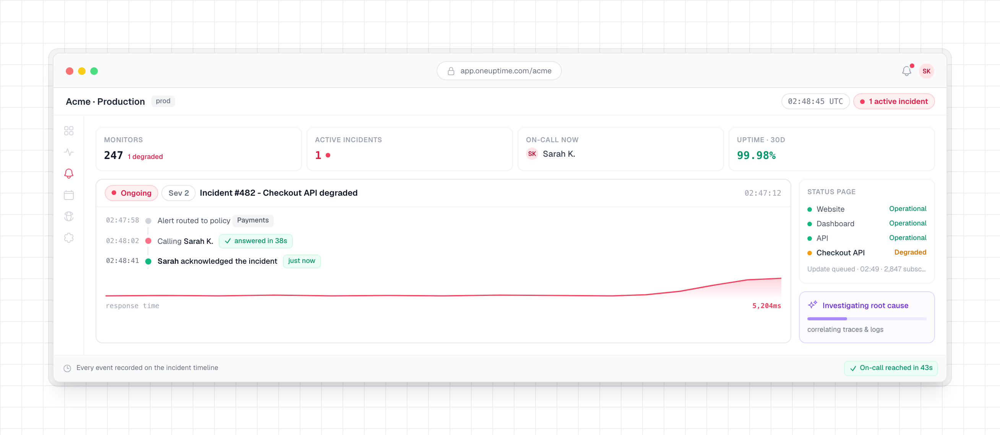

<!-- markdownlint-disable MD033 MD041 -->
<p align="center">
  <a href="/README.md">English</a>&nbsp;·
  <a href="/Docs/translations/README.zh-CN.md">简&#8288;体&#8288;中&#8288;文</a>&nbsp;·
  <a href="/Docs/translations/README.zh-TW.md">繁&#8288;體&#8288;中&#8288;文</a>&nbsp;·
  <a href="/Docs/translations/README.ja.md">日&#8288;本&#8288;語</a>&nbsp;·
  <a href="/Docs/translations/README.ko.md">한&#8288;국&#8288;어</a>&nbsp;·
  <a href="/Docs/translations/README.es.md">Español</a>&nbsp;·
  <a href="/Docs/translations/README.fr.md">Français</a>&nbsp;·
  <a href="/Docs/translations/README.de.md">Deutsch</a>&nbsp;·
  <a href="/Docs/translations/README.pt.md">Português</a>&nbsp;·
  <a href="/Docs/translations/README.it.md">Italiano</a>&nbsp;·
  <a href="/Docs/translations/README.ru.md">Русский</a>&nbsp;·
  <a href="/Docs/translations/README.hi.md">हिन्दी</a>&nbsp;·
  <a href="/Docs/translations/README.fa.md">فارسی</a>&nbsp;·
  <a href="/Docs/translations/README.nl.md">Nederlands</a>&nbsp;·
  <a href="/Docs/translations/README.da.md">Dansk</a>&nbsp;·
  <a href="/Docs/translations/README.sv.md">Svenska</a>&nbsp;·
  <a href="/Docs/translations/README.no.md">Norsk</a>
</p>

<p align="center">
  <a href="https://oneuptime.com"><picture><source media="(prefers-color-scheme: dark)" srcset="/packages/App/FeatureSet/Docs/Static/images/logo-dark.svg"></picture></a>
</p>

<p align="center">
  <a href="https://github.com/OneUptime/oneuptime/blob/main/LICENSE"></a>
  <a href="https://github.com/OneUptime/oneuptime/releases"></a>
</p>

OneUptime은 오픈 소스 옵저버빌리티 플랫폼입니다. 웹사이트, API, 서버가 제대로 동작하는지 확인하고, 앱이 보내는 로그, 메트릭, 트레이스를 수집하며, 무언가 고장 나면 온콜 담당자를 호출하고, 상태 페이지로 고객에게 알립니다. 이 모든 일이 하나의 제품 안에서 일어나므로, 문제를 알아챈 도구가 곧바로 팀을 호출합니다.

[OneUptime Cloud](https://oneuptime.com)에서 사용하거나 자체 서버에서 실행할 수 있습니다.

<p align="center">
  
</p>

## 하는 일

- **[모니터링](https://oneuptime.com/docs/ko/monitor/create-monitor)**: 전 세계의 프로브나 자체 네트워크 안에서 웹사이트, API, 포트, DNS, 인증서를 확인합니다. 서버, Kubernetes, Docker, VMware, 데이터베이스, 네트워크 장비도 지켜봅니다.
- **[인시던트와 온콜](https://oneuptime.com/docs/ko/incidents/index)**: 각 인시던트를 하나의 타임라인에서 처리합니다. 전화, SMS, 이메일, 푸시, Slack, Microsoft Teams로 온콜 담당자를 호출하고, 누군가 응답할 때까지 에스컬레이션합니다.
- **[상태 페이지](https://oneuptime.com/docs/ko/status-pages/index)**: 공개 또는 비공개 상태 페이지로 고객에게 상황을 알리고, 예정된 유지 관리도 그곳에서 공지합니다.
- **[로그, 메트릭, 트레이스](https://oneuptime.com/docs/ko/telemetry/open-telemetry)**: OpenTelemetry로 보내고, 검색하고, 대시보드를 만듭니다. 예외, 프로파일, 실제 사용자 모니터링, 보안 이벤트도 같은 곳에 있습니다.
- **[워크플로와 런북](https://oneuptime.com/docs/ko/workflows/index)**: 반복 작업을 자동화하고, Jira, ServiceNow 등 팀이 이미 쓰는 도구와 연결합니다.
- **[OneUptime AI](https://oneuptime.com/docs/ko/ai/ai-sre)**: 새 인시던트와 경고를 조사하고, 출처가 달린 근본 원인 분석을 게시합니다. 수정을 켜면 팀이 검토할 수정 사항을 풀 리퀘스트로 열 수 있습니다.
- **[API, CLI, Terraform](https://oneuptime.com/docs/ko/api-reference/api-reference)**: 스크립트와 CI에서 OneUptime을 자동화하고, 모니터, 상태 페이지, 온콜을 코드로 관리합니다.
- **[MCP 서버](https://oneuptime.com/docs/ko/ai/mcp-server)** (`https://oneuptime.com/mcp`): Claude, Cursor, GitHub Copilot이 있는 VS Code 또는 Model Context Protocol(MCP)의 다른 클라이언트를 연결한 뒤, 인시던트를 살펴보고, 로그와 트레이스를 조회하고, 알림을 확인하고, 모니터를 설정해 달라고 요청하세요.

단계별 가이드는 OneUptime Cloud에서든 자체 서버에서든 한 가지 작업을 처음부터 끝까지 안내합니다: [웹사이트나 API가 다운되면 알기](https://oneuptime.com/docs/ko/guides/website-down), [전화, SMS, 푸시로 호출 받기](https://oneuptime.com/docs/ko/guides/paging), [상태 페이지 게시하기](https://oneuptime.com/docs/ko/guides/status-page).

나머지는 모두 [문서](https://oneuptime.com/docs/ko/introduction/getting-started)에 있습니다.

## 시작하기

### OneUptime Cloud

[가입](https://oneuptime.com/accounts/register)하고 프로젝트를 만듭니다. 무료 요금제에는 신용카드가 필요하지 않습니다.

### Docker Compose로 자체 호스팅

메모리가 8 GB 이상인 Linux 서버가 필요합니다. 새 Ubuntu, Debian 또는 RHEL 계열 서버에서는 명령 하나로 없는 Docker, Git, Node.js를 설치하고, 사람들이 쓸 주소를 묻고, OneUptime을 시작합니다:

```bash
curl -fsSL https://oneuptime.com/install.sh | bash
```

단계별로 하려면 Docker, Docker Compose, Git, Node.js를 설치해 두세요. 3단계에서 `<your-address>` 대신 사람들이 OneUptime에 접근할 때 쓸 도메인 이름이나 IP 주소를 `http://` 없이 넣습니다. 이것이 `config.env`의 `HOST`입니다. `localhost`는 자신의 컴퓨터에서 OneUptime을 시험해 볼 때만 그대로 두세요.

```bash
# 1. Clone the release branch
git clone --depth 1 --single-branch --branch release https://github.com/OneUptime/oneuptime.git
cd oneuptime

# 2. Create your config
cp config.example.env config.env

# 3. Set HOST to the address people will use
sed -i.bak "s/^HOST=.*/HOST=<your-address>/" config.env && rm config.env.bak

# 4. Start everything
npm start
```

`npm start`는 서버를 확인하고, `config.env`의 모든 시크릿에 각자의 무작위 값을 넣은 다음 OneUptime을 시작합니다. `npm start`에서 **OneUptime is up!** 메시지가 나오면 `http://localhost`나 서버 주소를 열고 가입합니다. 첫 계정이 인스턴스의 관리자가 됩니다.

그런 다음 [자체 호스팅 가이드](https://oneuptime.com/docs/ko/installation/self-hosting-guide)를 따라 OneUptime이 알림을 보낼 수 있을 때까지 HTTPS, 이메일, SMS를 설정하세요. 서버 크기, 백업, 업데이트는 [Docker Compose 가이드](https://oneuptime.com/docs/ko/installation/docker-compose)에서 다룹니다.

### Helm으로 Kubernetes에 설치

대규모 프로덕션이나 고가용성이 필요하다면 Helm 차트를 설치합니다. `host`는 사람들이 OneUptime에 접속할 도메인 이름이나 IP 주소로 설정합니다.

```bash
helm repo add oneuptime https://helm-chart.oneuptime.com/
helm install my-oneuptime oneuptime/oneuptime --set host=oneuptime.example.com
```

스토리지, HTTPS, 데이터베이스, 업그레이드는 [차트의 README](/HelmChart/Public/oneuptime/README.md)에서 다룹니다.

## Community와 Enterprise

- **Community Edition**: 무료 오픈 소스이며, 위의 모든 기능과 SAML 및 OIDC 싱글 사인온을 포함합니다.
- **Enterprise Edition**: SCIM 프로비저닝, 감사 로그, 팀 컴플라이언스, 인스턴스 상태 대시보드와 우선 지원을 더합니다. 프로덕션에서 사용하려면 라이선스가 필요합니다: [영업팀 문의](mailto:sales@oneuptime.com).

두 에디션의 비교는 [문서](https://oneuptime.com/docs/ko/self-hosted/enterprise)에 있습니다.

## 도움 받기

- [Slack의 OneUptime 커뮤니티](https://join.slack.com/t/oneuptimesupport/shared_invite/zt-2pz5p1uhe-Fpmc7bv5ZE5xRMe7qJnwmA)에서 질문합니다.
- 버그 신고와 기능 요청은 [GitHub 이슈](https://github.com/OneUptime/oneuptime/issues)에 남깁니다.
- 보안 취약점은 [SECURITY.md](/.github/SECURITY.md)에 설명된 대로 비공개로 신고합니다.
- 그 밖의 문의는 [support@oneuptime.com](mailto:support@oneuptime.com)으로 이메일을 보냅니다.

## 기여하기

버그 수정, 기능, 문서, 테스트 모두 환영합니다. 소스에서 OneUptime을 실행하는 방법은 [로컬 개발 가이드](https://oneuptime.com/docs/ko/installation/local-development)에, 풀 리퀘스트와 라이선스가 어떻게 동작하는지는 [기여 가이드라인](/.github/CONTRIBUTING.md)에 있습니다. 처음이라면 [good first issue](https://github.com/OneUptime/oneuptime/labels/good%20first%20issue) 레이블이 붙은 이슈부터 시작해 보세요.

OneUptime이 유용하다면 이 저장소에 별을 주거나 [프로젝트를 후원](https://github.com/sponsors/OneUptime)해 주세요.

## 라이선스

OneUptime은 [Apache License 2.0](/LICENSE)에 따른 오픈소스이며, [`ee/`](/ee) 디렉터리만 예외입니다. 이 디렉터리에는 Enterprise Edition이 들어 있으며 [OneUptime Enterprise License](/ee/LICENSE)에 따라 라이선스가 부여됩니다. Community Edition 이미지에는 `ee/`의 코드가 포함되지 않습니다. 이 구분은 저장소 루트의 [`LICENSE`](/LICENSE) 파일에 명시되어 있습니다.
