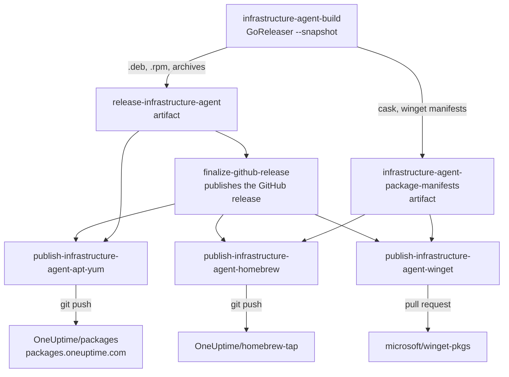

# The infrastructure agent in package managers

Every release puts the OneUptime infrastructure agent
(`agents/InfrastructureAgent`, the agent of Server / VM monitors) in the
package managers that fleet tools such as Ansible, Intune and SCCM install
from. It is also on each GitHub release and behind the install script, as
before.

| Package manager | Where | How people install it |
| --- | --- | --- |
| apt (Debian, Ubuntu) | `https://packages.oneuptime.com/deb`, the GitHub Pages site of `OneUptime/packages` | `apt-get install oneuptime-infrastructure-agent` |
| yum and dnf (RHEL, Rocky, Alma, Fedora, Amazon Linux) | `https://packages.oneuptime.com/rpm` | `dnf install oneuptime-infrastructure-agent` |
| Homebrew (macOS) | the `oneuptime-infrastructure-agent` cask in `OneUptime/homebrew-tap` | `brew install oneuptime/tap/oneuptime-infrastructure-agent` |
| winget (Windows) | `OneUptime.InfrastructureAgent` in `microsoft/winget-pkgs` | `winget install --id OneUptime.InfrastructureAgent` |

Windows fleets managed with Intune, Configuration Manager or Group Policy
deploy the MSI on each GitHub release instead
(`agents/InfrastructureAgent/windows/oneuptime-infrastructure-agent.wxs`):
it installs per machine and a newer MSI upgrades the agent in place. The
"Infrastructure Agent MSI Test" workflow installs and upgrades it on Windows.

The install commands people follow are on the
[Server / VM Monitor](../../packages/App/FeatureSet/Docs/Content/en/monitor/server-monitor.md)
docs page.

## How a release gets there



- `agents/InfrastructureAgent/.goreleaser.yaml` builds the `.deb` and `.rpm`
  packages (nfpm) and writes the Homebrew cask (`homebrew_casks`) and the
  winget manifests (`winget`). GoReleaser runs with `--snapshot`, so it
  publishes none of them. GoReleaser OSS cannot publish from an earlier run,
  and nothing can be published before the release it downloads from exists.
- The three `publish-infrastructure-agent-*` jobs in
  `.github/workflows/release.yml` run after `finalize-github-release`, so only
  for a release that passed its e2e jobs and was published. Each skips a
  version its package manager already has, so a re-run publishes nothing
  twice. Each is skipped with a notice, not failed, while its secrets are not
  set.
- `BuildPackageRepository.sh` adds a release to the apt and yum tree:
  `InRelease` and `repomd.xml.asc` signed, each RPM signed, the indexes served
  by hash and the previous generation kept (so a cached index never meets
  newer files), and the newest ten versions kept.
  `PublishPackageRepository.sh` runs it in a clone of `OneUptime/packages` and
  pushes the result as one commit with no parent, in place of the last one.
  Pages serves only the newest tree, and history would keep every package
  ever published.
- `PublishHomebrewCask.sh` commits the cask to the tap. A tap holds one
  version of a cask, so it never replaces a newer one.
- `PublishWingetManifests.sh` opens the pull request to `microsoft/winget-pkgs`
  from a fork, through the GitHub API (winget-pkgs is too big to clone).
  Microsoft's checks validate it, and a bot or a moderator merges it.

## One-time setup

Until each step is done, its job is skipped with a notice on the release run,
and the release itself is unaffected. The secrets can be repository secrets,
or secrets of the `package-managers` environment, which only these three jobs
use (GitHub creates the environment on the first run that names it).

### apt and yum: packages.oneuptime.com

1. Create the public repository `OneUptime/packages`. Leave it empty: the
   first publish creates `main`.
2. Make a deploy key for it:
   `ssh-keygen -t ed25519 -N "" -C "release.yml: packages" -f packages_deploy_key`.
   Add `packages_deploy_key.pub` to the repository's deploy keys with write
   access. Store `packages_deploy_key` (the private key) as the
   `PACKAGE_REPOSITORY_DEPLOY_KEY` secret, then delete both files.
3. Leave `main` unprotected, or let the deploy key force-push to it: every
   publish replaces the branch's one commit.
4. After the first release publishes, open the repository's Settings → Pages.
   Deploy from a branch, `main`, `/ (root)`. Set the custom domain
   `packages.oneuptime.com` and tick Enforce HTTPS. The publish writes the
   `CNAME` file Pages keeps the domain in.
5. In oneuptime.com's DNS, point `packages.oneuptime.com` at
   `oneuptime.github.io` with a CNAME record.

The repositories are signed with `GPG_PRIVATE_KEY`, the release key
(`key@oneuptime.com`) the Helm charts and the Terraform provider are already
signed with, so there is no new secret for it. Its public key is published as
`https://packages.oneuptime.com/gpg.key`. It must stay an RSA key: rpm on RHEL
8 and older cannot verify any other kind. Machines that installed the agent
trust this key, so replacing it means telling them to fetch the new
`gpg.key`.

GitHub Pages limits a site to 1 GB and asks for under 100 GB of traffic a
month. Ten versions are about 140 MB. If the traffic outgrows Pages, move the
same tree to S3 behind CloudFront and keep the domain: only
`PublishPackageRepository.sh` knows where it lives.

### Homebrew: OneUptime/homebrew-tap

1. Create the public repository `OneUptime/homebrew-tap`. Homebrew finds
   `oneuptime/tap` there by its name. It can start empty, or with a README
   that says `brew install oneuptime/tap/oneuptime-infrastructure-agent`.
2. Add a deploy key with write access, as for `OneUptime/packages`, and store
   the private key as the `HOMEBREW_TAP_DEPLOY_KEY` secret.

### winget: microsoft/winget-pkgs

1. Choose the GitHub account the pull requests come from: a bot account, or
   a maintainer's. Fork `microsoft/winget-pkgs` into it. If the fork belongs
   to an organization instead, set the repository variable
   `WINGET_FORK_OWNER` to that organization.
2. Create a classic personal access token for that account with the
   `public_repo` scope, and store it as the `WINGET_GITHUB_TOKEN` secret. A
   fine-grained token cannot open a pull request on a repository its owner
   does not own.
3. Watch the first pull request ("New package: OneUptime.InfrastructureAgent
   version ..."). Microsoft's CLA bot asks the account to agree once, by
   commenting `@microsoft-github-policy-service agree company="HackerBay, Inc."`,
   and a moderator reviews a new package. Later versions merge once they pass
   validation.

## Checking a release

```bash
# apt
curl -fsSL https://packages.oneuptime.com/deb/dists/stable/InRelease | head -n 20
# yum
curl -fsSL https://packages.oneuptime.com/rpm/repodata/repomd.xml | head -n 5
# Homebrew
brew update && brew info oneuptime/tap/oneuptime-infrastructure-agent
# winget
winget show --id OneUptime.InfrastructureAgent --versions
```

## Tests

- `Tests/Ops/InfrastructureAgentPackageManagers.test.js` (in `npm test` of
  `Tests/Ops`) reads the GoReleaser config and the jobs, runs
  `PublishHomebrewCask.sh` against a local git repository and
  `PublishWingetManifests.sh` against a fake `gh`.
- `Tests/Ops/package-repository-e2e.sh` (Docker) publishes two releases with
  `PublishPackageRepository.sh` and runs the docs page's apt and dnf commands
  against the result on Ubuntu and Rocky Linux 8. The "Ops Config Test"
  workflow runs it on every pull request.

Chocolatey is not set up: the community repository moderates every version by
hand, and packing needs `choco` on the Linux runner. The CLI (`@oneuptime/cli`)
stays on npm only. It needs Node.js, so a Homebrew formula for it would depend
on `node`, and winget would need a standalone executable.
