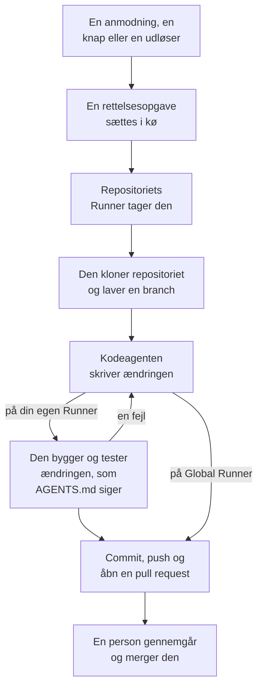

# Kode

Kode er stedet, hvor du beder OneUptime AI om at arbejde i dine repositorier, sådan som du ville bede en kodeagent: rette en fejl, skrive tests, forklare koden, lave en ændring. Kode åbner på feltet, hvor du spørger, med repositoriet og branchen valgt i det og alle opgaver under det; en opgaves side er en samtale, du kan svare i. OneUptime starter også selv opgaver, fra undtagelser, spor og undersøgelser. En [Runner](/docs/runbooks/agents) kloner repositoriet, skriver ændringen på en ny branch, bygger og tester den og åbner en pull request. En person gennemgår og merger hver eneste: Runneren kan pushe branches og åbne pull requests, intet andet.

:::cards
- [Bed AI om noget i et repositorie](#bed-ai-om-noget-i-et-repositorie): En anmodning med dine egne ord og den kontekst, den har brug for.
- [En opgaves samtale](#en-opgaves-samtale): Hvad AI gjorde, hvad den ændrede, og dit svar.
- [Sådan forløber en rettelseskørsel](#sådan-forløber-en-rettelseskørsel): Fra et klik til en pull request, trin for trin.
- [Hvor rettelsesopgaver starter](#hvor-rettelsesopgaver-starter): Opgaverne, OneUptime starter, og hvad hver pull request gør.
- [Produktionstelemetri i en rettelse](#produktionstelemetri-i-en-rettelse): Hvad en rettelse læser fra produktionen, mens den skriver ændringen.
- [Produktionsgennemgang af pull requests](#produktionsgennemgang-af-pull-requests): Hvad produktionen siger om den kode, hver pull request ændrer.
- [Forbind et repositorie](#forbind-et-repositorie): GitHub, GitLab, Forgejo eller Gitea, eller enhver Git-server.
- [Før du begynder](#før-du-begynder): En model, et forbundet repositorie og en Runner.
- [Når en rettelse mislykkes](#når-en-rettelse-mislykkes): Hvad der sker med en kørsel, der fejler, går i stå eller venter.
:::

> [!TIP]
> Du kan også starte dette fra GitHub. Nævn OneUptime GitHub App i et issue eller en pull request, så implementerer, reviderer eller gennemgår den lige dér: se [GitHub App](/docs/ai/github-app). Det er den samme agent, den samme Runner og de samme budgetter; kun udløseren er en anden.

## Bed AI om noget i et repositorie

:::steps
### Åbn Kode

Åbn **Produkter → Kode**. Kode åbner på **Hvad skal AI gøre?**: feltet, hvor du spørger, med alle opgaver under det, de nyeste først. Er der endnu intet repositorie, tilbyder Kode i stedet **Forbind GitHub** med GitLab, Forgejo eller Gitea og enhver Git-server nedenunder (se [Forbind et repositorie](#forbind-et-repositorie)). **Repositorier** i sidemenuen viser de repositorier, AI kan arbejde i, og samler dem, som OneUptime ikke længere når, under **Ikke forbundet**. Hvert repositories side har det samme felt til det repositorie.

### Vælg repositoriet og branchen

Feltet starter på det repositorie, du valgte sidst. Vælg et andet i dets nederste række og ved siden af den branch, opgaven starter fra: repositoriets hovedbranch, markeret med **Standard**, indtil du vælger en anden. AI laver sin branch ud fra den, du vælger, og åbner sin pull request mod den.

### Sig, hvad du vil

Skriv ændringen, fejlen eller spørgsmålet med dine egne ord. Indtil der er spurgt om noget, foreslår Kode et par stykker under **Prøv at spørge**.

### Tilføj kontekst

Klik på **Tilføj kontekst** for at give AI det, den har brug for: en fil eller mappe i repositoriet, en note, et link eller en post i projektet. OneUptime læser hver post, når du sender anmodningen, med dine tilladelser, og gemmer, hvad AI fik.

### Start opgaven

Klik på **Start opgave**, eller tryk på Enter. Opgavens side åbner, og AI's arbejde vises dér, mens det sker.
:::

| Kontekst | Hvad AI får |
| --- | --- |
| **Fil eller mappe** | En sti i repositoriet, som AI læser først. |
| **Note** | Tekst, du indsætter: en fejl, en specifikation, en logline. |
| **Link** | En webadresse, som reference. |
| **Hændelse** eller **Advarsel** | Dens tilstand, beskrivelse og grundlæggende årsag, som de er, når du sender anmodningen. |
| **Undtagelse** | Dens meddelelse og stack trace. |
| **Overvågning** | Dens type, status og beskrivelse. |
| **Spor** | Dets spans: deres navne, tider og fejl. |
| **Protokoller** | De seneste 20 loglinjer, der indeholder din søgning, fra den seneste time, dag eller uge. |
| **Ydeevneprofil** | Hvor en funktions tid går hen i dens tjenestes profiler: hvem der kalder den, hvad den kalder, og dens varmeste linjer. |

En anmodning bærer højst 10 stykker kontekst. Tokens, nøgler, adgangskoder og e-mailadresser i det, OneUptime læser, sløres, før AI ser dem, som overalt, hvor OneUptime AI læser dine data.

## En opgaves samtale

En opgaves side er en samtale: hvad der blev spurgt om, og den tilføjede kontekst, derefter AI's tur – de trin, den tager, mens den tager dem (filerne, den læste og redigerede, hvad den søgte efter, kommandoerne, den kørte), dens svar, filerne, den ændrede, med deres diff, og pull requesten. Øverst på siden står, hvor opgaven arbejder (dens repositorie og den branch, den startede fra), hvor mange linjer den ændrede, med en knap til dens pull request, og hvordan det går med opgaven:

| Tilstand | Hvad det betyder |
| --- | --- |
| **I kø** | Den venter på, at en Runner tager den. |
| **Arbejder…** | AI arbejder på den. **Stands** stopper den; det, den har pushet, bliver på branchen. |
| **Venter på dig** | AI har stillet et spørgsmål. Svar på det i feltet nedenfor. |
| **Færdig** | AI er færdig: dens svar og pull requesten, når den ændrede kode. |
| **Mislykkedes** | Turen kunne ikke gøres færdig og siger hvorfor. **Prøv igen** beder om det samme igen. |
| **Stoppet** | Nogen stoppede den. **Prøv igen** beder om det samme igen. |

For at følge op skriver du i feltet nederst, som bliver synligt, mens samtalen ruller: svar AI, tilføj kontekst, eller bed om ændringer. Hvert svar er den næste tur i samme opgave: den arbejder på samme branch og pusher til samme pull request, så længe den er åben. En opgave tager én tur ad gangen, så feltet venter, mens AI arbejder. Hver turs **Log** er den ordrette optegnelse af, hvad den gjorde. På en opgave med mere end én tur skifter en vælger øverst på siden **Log** mellem dens ture.

Den, der kan læse et repositorie, læser dets opgaver. At bede AI om noget, svare og stoppe en opgave kræver tilladelse til at redigere repositoriet, og det samme gør det at se en ændrings diff: alle andre ser, hvilke filer der er ændret. Opgaverne, OneUptime selv starter (nedenfor), står også i deres repositorie, som samtaler, du kan svare i.

## Sådan forløber en rettelseskørsel



1. Du klikker på **Start opgave** i Kode, eller på **Ret med AI** på en uløst undtagelse, eller en anden knap eller udløser starter en opgave (se [Hvor rettelsesopgaver starter](#hvor-rettelsesopgaver-starter)).
2. Opgaven sættes i kø på sit repositorie, og den Runner, som repositoriet arbejder på, tager den: den, det vælger, ellers projektets standard-Runner, ellers en global Runner (se [Vælg repositoriets Runner](#vælg-repositoriets-runner)).
3. Runneren henter opgavens kontekst. For en anmodning er det dens ord, den tilføjede kontekst og samtalen indtil nu; for en undtagelse dens type, dens meddelelse og dens stack trace.
4. Den kloner repositoriet til sit eget arbejdsområde og laver en branch. En rettelse af en undtagelse hedder `oneuptime-fix-exception-` efterfulgt af de første tegn i kørslens id. En anmodning starter fra den branch, der blev valgt, da den blev stillet, og dens pull request åbnes mod den. Et svar arbejder i stedet på branchen for opgavens åbne pull request.
5. En kodeagent, drevet af dit projekts LLM-udbyder, læser koden og skriver ændringen. OneUptime-serveren foretager LLM-kaldene, så Runneren aldrig har din udbyders API-nøgle, og hvert kald måles og vises i AI-loggene. En rettelse af en undtagelse, et langsomt spor eller en hændelse læser også fra produktionen, mens den arbejder: undtagelser, spor, logs og metrikker fra repositoriets tjenester (se [Produktionstelemetri i en rettelse](#produktionstelemetri-i-en-rettelse)).
6. På din egen Runner bygger og tester kodeagenten sin ændring, sådan som repositoriets `AGENTS.md` siger, før noget committes, og retter det, der fejler (se [Kontrol før pull requesten](#kontrol-før-pull-requesten)).
7. Runneren committer, pusher branchen, åbner pull requesten (for en anmodning kun, når den ændrede kode) og sletter arbejdsområdet.

Siden, opgaven blev startet fra, viser dens status live. Alle opgaver står i deres repositorie under **Produkter → Kode**: opgavens side er dens samtale, og hver turs **Log** har en linje for hver fil, Runneren læste eller skrev, og hver kommando, den kørte.

Hver kørsel holdes inden for budgetter, som serveren håndhæver: højst **40 LLM-kald** og **100.000 output-tokens**. En kørsels forespørgsler til produktionstelemetrien tæller med i de samme 40 kald. En kørsel, der når et af dem, afslutter med et resumé af arbejdet indtil da i stedet for at køre i ring. Rettelseskørsler tæller også med i projektets daglige AI-grænser, når projektet har sat dem.

## Hvor rettelsesopgaver starter

| Hvor | Klik | Pull requesten |
| --- | --- | --- |
| En undtagelses side **AI Assistance** | **Ret med AI** | Retter fejlen bag undtagelsen. |
| En undtagelses side **AI Assistance** | **Generate Regression Test** | Tilføjer en test, der genskaber undtagelsen og fejler, indtil fejlen er rettet. |
| En undtagelses side **AI Assistance** | **Forbedr fejlhåndtering** | Til en forventet fejl, som ugyldigt input: fjerner brugerdata fra meddelelsen, validerer inputtet tidligere og markerer fejlen som håndteret uden at ændre adfærden. |
| En hændelses eller advarsels kort **AI Investigation** | **Open Fix PR from this analysis** | Retter den grundlæggende årsag, som undersøgelsen offentliggjorde (se [Automatiske koderettelser fra undersøgelser](#automatiske-koderettelser-fra-undersøgelser)). |
| Et spor, der er værd at rette | **Ret ydeevnen med AI** | Retter det langsomme mønster, som knappen nævner, som en N+1-forespørgsel eller kald, der kunne køre parallelt. |
| En tjenestes side **Protokoller** | **Forbedr logning** | Gør tjenestens logs strukturerede, med den rette alvorlighed og knyttet til dens spor, uden at ændre adfærden. |
| En tjenestes side **Spor** | **Forbedr sporing** | Tilføjer spans og attributter, hvor tjenestens tracing mangler, uden at ændre adfærden. |
| En funktion i **Ydeevneprofiler** | **Ret med AI** | Får funktionen til at udføre det samme arbejde med mindre tid eller hukommelse, med dens profil som bevis. |

Disse knapper vises kun, hvor de kan starte en opgave. Er AI slået fra for projektet, vises ingen af dem, og en undtagelses sidemenu har ingen **AI Assistance**. **Forbedr logning** og **Forbedr sporing** vises, så snart et repository er forbundet, og intet forhindrer AI i at arbejde i det (som abonnementet, opbrugte AI-kreditter eller ingen Runner online), og **Ret ydeevnen med AI** kun på et spor, der er værd at rette (se [Sporudforsker](/docs/telemetry/traces-explorer)). En funktions **Ret med AI** vises kun for applikationens egen kode, der tager mindst 5 % af profilens tid eller hukommelse, eller hvis andel er vokset med 3 point eller mere siden det vindue, den sammenlignes med (se [Kontinuerlig profilering](/docs/telemetry/profiles)).

For at åbne en undtagelses side **AI Assistance** skal du åbne undtagelsen under **Produkter → Observabilitet → Undtagelser** og vælge **AI Assistance** i dens sidemenu. En løst eller arkiveret undtagelse skal først markeres som uløst.

OneUptime AI starter også rettelsesopgaver af sig selv: fra en undersøgelse, der finder en kodeændring, fra en, der ender uden konklusion, fordi telemetri manglede, og fra AI-indsigter om undtagelser og langsomme spor. Hver har sin egen kontakt; se [Automatiske koderettelser](/docs/ai/ai-sre#automatiske-koderettelser).

## Produktionstelemetri i en rettelse

OneUptime har data om, hvad din kode gør i produktion, så en rettelse ikke behøver at arbejde ud fra en stack trace alene. Mens kodeagenten arbejder, kan den forespørge produktionstelemetrien for de tjenester, der hører til repositoriet:

| Den læser | Til hvad |
| --- | --- |
| **Undtagelser** | De undtagelsesgrupper, der kastes i bestemte filer eller i en funktion: hvor ofte i de seneste dage, siden hvilken release, og sporet fra en nylig forekomst. |
| **Spor** | Latens- og fejlprofilen for et endpoint eller en operation, og spans i et enkelt spor. |
| **Protokoller** | En tjenestes loglinjer, efter tid, alvorlighed, tekst eller spor. |
| **Metrikker** | En metrik, som en tjeneste rapporterer, over tid; uden et navn de metrikker, den rapporterer. |
| **Hændelser** | Hændelser, der ramte tjenesterne, eller som en OneUptime-rettelse i dette repositorie blev åbnet for, med deres grundlæggende årsag og postmortem. |
| **Udrulninger** | Nylige udrulninger og andre ændringer af tjenesterne, hver med OneUptimes vurdering af, om den skadede sin tjeneste. |

| Opgave | Hvad den tjekker |
| --- | --- |
| **Ret med AI** på en undtagelse | Hvor ofte den kastes nu og siden hvilken release, loggene og sporet fra en forekomst. |
| **Ret ydeevnen med AI** | Hvor belastet og hvor langsom operationen er på tværs af alle dens spor, ikke kun det analyserede. Den ændrer intet, når operationen ikke længere er langsom. |
| **Open Fix PR from this analysis** og rettelser, der åbnes automatisk fra undersøgelser | Udrulningerne før hændelsen, dens fejl, logs og langsomme operationer, og om årsagen har slået til før. |
| `@oneuptime review` fra GitHub | Hvad produktionen siger om den ændrede kode (se [Gennemgange med produktionskontekst](/docs/ai/github-app#gennemgange-med-produktionskontekst)). |

Pull requestens beskrivelse fortæller, hvad agenten forespurgte, og hvad det viste. Andre opgaver, såsom regressionstests og forbedringer af logning eller sporing, forespørger ikke produktionen.

Hvad agenten kan læse, afgøres af OneUptime-serveren ud fra selve opgaven:

- **Kun læsning.** Forespørgslerne kører på OneUptime-serveren, aldrig på Runneren, som ikke har nogen legitimationsoplysninger, der kan læse telemetri. Intet, de gør, kan ændre dit projekt.
- **Dette projekt, og kun de tjenester, der hører til dette repositorie.** Du tilknytter dem ikke: det er de tjenester, som OneUptime finder dette repositorie for, på samme måde som den finder repositoriet til en rettelse - deres undtagelsers stack traces går gennem dets filer, de hedder som det, eller det er projektets eneste repositorie. En anden tjenestes telemetri kan ikke læses.
- **Ingen private hændelser**, og tokens, nøgler, adgangskoder og e-mailadresser sløres, før agenten ser et resultat, som overalt, hvor OneUptime AI læser dine data.
- **Begrænset.** Højst **12** forespørgsler pr. kørsel, som hver tæller med i kørslens 40 kald.

Når ingen tjeneste hører til repositoriet, kører opgaven uden produktionstelemetri, som før.

## Produktionsgennemgang af pull requests

OneUptime ved, hvad din kode gør i produktion, så den kan gennemgå en pull request med det, ingen kan se ved at læse diffen. Slå **Gennemgå pull requests i forhold til produktion** til under **Yderligere indstillinger** på et repositories side **Indstillinger** i Kode, så får hver pull request, som en person med skriveadgang åbner eller pusher til, én kommentar, der siger, hvad produktionen viser om den kode, den ændrer. Kommentaren redigeres på stedet ved hvert push, og repositoriets side **Produktionsgennemgange** i Kode gemmer hver gennemgang med **Gennemgå igen**.

| Den læser | Om den kode, pull requesten ændrer |
| --- | --- |
| **Undtagelser** | De undtagelser, der er kastet i de ændrede linjer, funktioner og filer de seneste 7 dage, med nye og ikke-håndterede markeret. |
| **Operationer** | De sporede operationer, der kører den ændrede kode i den seneste time: deres spans, fejl og p95. |
| **Tunge funktioner** | Den ændrede kodes funktioner, der tager en del af tjenesternes profiler i den seneste time. |
| **Hændelser** | Tjenesternes hændelser fra de seneste 30 dage, der stadig er åbne, eller hvis grundlæggende årsag eller postmortem nævner den ændrede kode. Aldrig en privat hændelse. |
| **Udrulninger** | Tjenesternes udrulninger fra de seneste 7 dage, som OneUptime mistænker for en regression. |

Når produktionen viser noget, læser OneUptime AI det ved siden af diffen og tilføjer **Hvad du skal holde øje med**: nogle få korte punkter, der hver bygger på fakta. Det sker med projektets standard-LLM-udbyder, medmindre **LLM-udbyder til produktionsgennemgang** under **Yderligere indstillinger** på repositoriets side **Indstillinger** vælger en anden af projektets udbydere eller en global. Det kører kun, mens AI er slået til for projektet, højst 10 gange om dagen for en pull request og 100 for et repositorie, og måles som ethvert AI-kald; fakta læses hver gang uden det. Når produktionen ikke viser noget om ændringen, slår OneUptime intet op.

- **Kun samlede tal.** Kommentaren indeholder antal, varigheder og navne på kode: aldrig en undtagelses besked, en loglinje, en hændelses titel eller personoplysninger.
- **Offentlige repositorier får et link.** Alle kan læse et offentligt repositories pull requests, så dér linker kommentaren kun til gennemgangen i OneUptime, som kun projektets medlemmer kan åbne. **Kommentar fra produktionsgennemgang** under **Yderligere indstillinger** på repositoriets side **Indstillinger** kan slå **Kun et link til gennemgangen** op overalt eller **Gennemgangen, også i et offentligt repositorium**.
- **Eksterne bidragydere kan ikke starte en.** En pull request gennemgås kun af sig selv, når dens forfatter, og den, der har pushet til den, kan skrive til repositoriet. En fra alle andre - en ekstern bidragyder, en fork, en bot - gennemgås, når en person med skriveadgang kommenterer `@oneuptime production review` på den eller klikker på **Gennemgå igen** i Kode.
- **Kun læsning.** En gennemgang kloner intet og kører intet fra pull requesten. Dens diff og titel er data for OneUptime AI, aldrig instruktioner: AI'en har ingen værktøjer, og det, den skriver, sættes ind i kommentaren som tekst.

Kontakten er slået til for de repositorier, som GitHub App forbinder fra nu af. Et repositorie, der blev forbundet, før den fandtes, beholder den slået fra, indtil du slår den til.

## Kontrol før pull requesten

Et repositorie beskriver, hvordan det bygges og testes, i en `AGENTS.md` i roden, den fil kodeagenter læser. Før kodeagenten ændrer noget, læser den repositoriets `AGENTS.md` (eller dets `CLAUDE.md`, når det ikke har nogen `AGENTS.md`) fra den branch, opgaven starter fra, og arbejder, som filen siger. Uden nogen af dem finder den ud af det fra repositoriets `CONTRIBUTING.md`, README, pakkescripts, `Makefile` eller CI-workflows. Der er intet at sætte op i OneUptime.

| Hvor AI arbejder | Hvad den gør med repositoriets build og tests |
| --- | --- |
| En af dine Runnere | Bygger og tester sin ændring, før pull requesten åbnes, retter det, der fejler, tjekker igen og skriver i sin opsummering, hvilke tjek den kørte. Hver kommando, den kører, får 2 minutter, eller op til 10 til en langsom installation, build eller testsuite, uden Runnerens egne loginoplysninger i sit miljø. |
| **Global Runner** | Kører ingen kommando: den skriver ændringen og åbner pull requesten, og dit repositoriums egen CI tjekker den. |

Intet fra en pull request, der kommer fra en fork, læses nogensinde som repositoriets instruktioner: en revision afviser sådan en pull request, og en gennemgang læser basisbranchen.

### Kommandoer sat på et repositorie

Kode beder ikke længere om setup-, build- og testkommandoer, men et repositorie, der har dem, sat tidligere eller via API'et eller Terraform, beholder dem. De vises skrivebeskyttet på kortet **Build- og testkommandoer** under **Yderligere indstillinger** på repositoriets side **Indstillinger**, og **Fjern kommandoer** fjerner alle tre. Så længe en af dem er sat, kontrollerer hver rettelseskørsel på din egen Runner også sin ændring med dem, før pull requesten åbnes:

1. Når kodeagenten er færdig, kører kommandoerne i rækkefølge i roden af repositoriet, på Runneren, i det klonede arbejdsområde. Hver får op til 15 minutter og kører med `CI=true`, så intet venter på et input; den første fejl stopper gennemløbet.
2. Ved en fejl går slutningen af den fejlende kommandos output tilbage til den samme kodeagent som en reparationsopgave, med besked om at rette sin egen ændring i stedet for at svække eller springe tests over, og kommandoerne kører igen. Den gør højst **2** reparationsforsøg. De deler kørslens LLM-budget, og deres ændringer lander i samme commit som rettelsen.
3. Resultatet, bestået, fejlet eller sprunget over (ingen kommandoer sat, eller en global Runner), skrives i et Verification-afsnit i pull requestens beskrivelse og registreres på opgavens pull request.

En ændring, der stadig ikke består kontrollen, smides ikke væk: pull requesten åbnes alligevel med et tydeligt markeret afsnit "Verification failed", der nævner den fejlende kommando og slutter med dens output. Arbejdet bevares, og den, der gennemgår, beslutter. Et repositorie uden kommandoer rapporteres som sprunget over i stedet for at antyde et grønt build.

Kommandoerne er repositorieindstillinger, som dit team skriver, og de kører på din egen Runner: samme tillidsmodel som et runbooks Bash-trin. AI'en skriver eller ændrer dem aldrig. En global Runner, som OneUptime kører for alle projekter, kører dem aldrig: på en global Runner bliver rettelsen skrevet og åbnet til gennemsyn, kontrollen rapporteres som sprunget over, og dit repositoriums egen CI tjekker ændringen. [Kør din egen Runner](#kør-din-egen-runner) for at få rettelser bygget og testet, før pull requesten åbner.

## Efter en rettelse er flettet

At flette en rettelse retter intet, før den kører. Når en pull request med en rettelse er flettet, venter OneUptime på en registreret udrulning, der indeholder den (se [Udrulninger og ændringer](/docs/telemetry/change-events)), og holder i den udrulning øje med det, rettelsen var til. Opgavens pull request i Code siger, hvordan det gik, og det gør undtagelsens side **AI Assistance**, hændelsens AI-logs og den AI-indsigt, rettelsen kom fra, også:

| En rettelse af | Det, der holdes øje med | Det virkede | Det virkede ikke |
| --- | --- | --- | --- |
| En undtagelse | Om undtagelsen sker igen | **Rettet i produktion** | **Sker stadig efter rettelsen** |
| Et langsomt trace eller en latens-indsigt | p99 for den operation, rettelsen nævner | **Hurtigere i produktion** | **Stadig langsom efter rettelsen** |
| Den grundlæggende årsag til en hændelse eller en advarsel | Om dens monitor udløser en til | **Rettet i produktion** | **Skete igen efter rettelsen** |
| Manglende telemetri, logning eller tracing | Det, rettelsen tilføjer, og resten af tjenestens telemetri | **Ankommer i produktion** | **Telemetri stoppede efter rettelsen** |

Indtil en udrulning leverer den, står der **Merget, venter på et deploy** ved rettelsen, derefter **Deployet, overvåges i produktion**, mens der holdes øje med den. En rettelse, som ingen registreret udrulning indeholder inden for 14 dage, eller som produktionen ikke kan sige noget om, står som **Ikke verificeret i produktion**. [Automatiske koderettelser](/docs/ai/ai-sre#automatiske-koderettelser) har reglerne. En regressionstest, bedre fejlhåndtering, en gennemgang og en anmodning i Code holdes der ikke øje med: produktionen kan ikke vise, hvad de ændrer.

## Forbind et repositorie

Åbn **Repositorier** i Kodes sidemenu, og klik på **Forbind repositorier**: Kode spørger, hvor din kode ligger, og forbinder hvert sted på sin egen måde. Hvad AI gør i et repositorie, afhænger af, hvor det ligger:

| Hvor koden ligger | Sådan forbindes den | Hvad AI gør der |
| --- | --- | --- |
| **GitHub** | OneUptime GitHub App, installeret på de repositorier, den vælger. | Alt på denne side, med kommandoer fra GitHub (se [GitHub App](/docs/ai/github-app)) og [produktionsgennemgange](#produktionsgennemgang-af-pull-requests). |
| **GitLab**, på GitLab.com eller dit eget | Et adgangstoken: et personligt token, et gruppe- eller projekttoken med scopes `api` og `write_repository` og mindst rollen Developer. | Opgaver og rettelser, hver ændring i en merge request; grenvælgeren; den kode, et stakspor eller en profil går gennem; om en rettelse blev merget, og hvad produktionen viste, da den var udrullet. |
| **Forgejo eller Gitea**, på Codeberg eller dit eget | Et adgangstoken med læse- og skriveadgang til repositorier og læseadgang til brugeren. | Det samme som på GitLab, hver ændring i en pull request. |
| **Enhver Git-server**, over HTTPS | Den adresse, du kloner repositoriet med, et brugernavn og en adgangskode eller et adgangstoken, der kan læse repositoriet og pushe til det. | AI kloner repositoriet og pusher hver ændring til en ny gren, som dens svar nævner: du åbner pull requesten. På Bitbucket og Azure DevOps linker den til, hvor du åbner den. |

Kommandoer fra kommentarer og produktionsgennemgange kræver GitHub App, så indtil videre virker de kun i GitHub-repositorier, og repositoriets **Indstillinger** siger det.

For GitLab, Forgejo eller Gitea angiver du serverens adresse (GitLab.com og Codeberg er udfyldt på forhånd) og tokenet og vælger så de repositorier, der skal forbindes: listen viser kun dem, tokenet kan pushe til, og når du forbinder flere senere, kan tokenet bruges igen. OneUptime tjekker hvert token hos dets server, før det gemmer det, gemmer det krypteret og viser det aldrig igen. Repositoriets **Indstillinger** viser dets server, kontoen og tokenets sidste tegn, med **Erstat adgangstoken**. Når serveren afviser et udløbet eller tilbagekaldt token, viser dets repositorier **Token afvist**, og AI holder op med at arbejde i dem, indtil en erstatning af tokenet forbinder hvert repositorie, der bruger det, igen. På et GitLab-repositorie siger indstillingerne merge requests, som GitLab gør: **Merge requests**, **AI-rettelses-merge requests** og **Maks. åbne rettelses-merge requests**.

### En Git-server på et privat netværk

OneUptime Cloud når kun Git-servere på internettet, aldrig en privat, loopback- eller link-local-adresse. Forbind en server, som kun dit netværk når, som **Enhver Git-server**: Kode siger, at den ikke kan nå den, og **Forbind alligevel** forbinder den til en af dine egne Runnere på det netværk. Vælg den Runner på repositoriets **Runner**-kort (se [Vælg repositoriets Runner](#vælg-repositoriets-runner)). En global Runner arbejder aldrig i det, og OneUptime læser intet fra det på serveren, så grenvælgeren viser kun dets hovedgren. En selvhostet OneUptime og dens globale Runner når Git-serverne på sit eget netværk.

## Før du begynder

En opgave kræver tre ting. Kodes anmodningsfelt og undtagelsens side **AI Assistance** kontrollerer alle tre, før de tilbyder at starte, og fortæller, hvad der mangler.

| Hvad | OneUptime Cloud | Selvhostet |
| --- | --- | --- |
| En LLM-udbyder | Intet at sætte op: et projekt uden egen udbyder bruger den globale udbyder, betalt af projektets AI-kreditter. En udbyder af din egen under **Projektindstillinger → AI → LLM-udbydere** går forud. | Sæt miljøvariablerne `GLOBAL_LLM_PROVIDER_*` én gang på serveren, eller føj en udbyder til projektet. |
| Et repositorie forbundet via GitHub App | **Produkter → Kode**, derefter **Forbind GitHub**. Hvis appen allerede er installeret på GitHub-kontoen, så klik i stedet på **Forbind en eksisterende installation**: den bliver ikke forbundet af at installere den igen. Kræver Growth-planen. | Det samme, når din instans har en GitHub App (se [GitHub-integration](/docs/self-hosted/github-integration)). |
| Eller et repositorie på GitLab, Forgejo eller Gitea eller enhver Git-server | **Repositorier** i Kode, derefter **Forbind repositorier** (se [Forbind et repositorie](#forbind-et-repositorie)). Kræver Growth-planen. | Det samme, uden en GitHub App at sætte op. |
| En Runner, der kører AI-koderettelser | Intet at drive: et repositorie, der ikke vælger nogen, arbejder på projektets standard-Runner eller, uden en, på OneUptimes globale Runnere. | Intet at drive: den medfølgende globale Runner (`global-runner` i Docker Compose, `globalRunner` i Helm-chartet, slået til som standard) og hver global Runner, en masteradministrator tilføjer, kører AI-koderettelser i hvert repositorie, der arbejder på en global Runner. |

På en selvhostet instans er den globale udbyder én blok i `config.env` (Docker Compose) eller i dine Helm-værdier. Til en selvhostet Ollama:

```bash
GLOBAL_LLM_PROVIDER_TYPE=Ollama
# An address the OneUptime server can reach, never localhost.
GLOBAL_LLM_PROVIDER_BASE_URL=http://ollama:11434
GLOBAL_LLM_PROVIDER_MODEL_NAME=llama3.1
# No GLOBAL_LLM_PROVIDER_API_KEY needed — Ollama is keyless.
```

Enhver understøttet udbyder virker: se [LLM-udbydere](/docs/ai/llm-provider) for dem alle og hver miljøvariabel.

Du tilknytter ikke repositorier til tjenester. Når en opgave starter, finder OneUptime repositoriet ved at matche filstierne i undtagelsens stack trace mod dine forbundne repositorier. Når intet matcher, falder den tilbage på et repositorie, der hedder som tjenesten, og derefter på projektets eneste repositorie, når der kun er ét. Siden **AI Assistance** viser, hvilket repositorie den fandt.

### Vælg repositoriets Runner

Hvert repositorie vælger den Runner, AI arbejder i det på: på dets side **Indstillinger** i Kode skal du åbne **Yderligere indstillinger**, klikke på **Rediger** på kortet **Runner** og vælge en. Et repositorie, der ikke vælger nogen, arbejder på projektets [standard-Runner](/docs/runbooks/agents#projektets-standard-runner), det første valg, markeret **Projektstandard**, og flytter med, når en anden Runner bliver standard. I et projekt uden standard-Runner arbejder det på **Global Runner**, som OneUptime kører for alle projekter. Vælg **Global Runner** for at holde et repositorie på den, mens projektet har en standard-Runner.

| Runner | Hvad den gør med en opgave |
| --- | --- |
| **Global Runner** | Skriver ændringen og åbner pull requesten uden at bygge eller teste den: dit repositoriums egen CI tjekker ændringen. |
| En af dine Runnere | Bygger og tester også ændringen, sådan som repositoriets `AGENTS.md` siger, på en vært, du styrer. |

Kun den Runner, et repositorie arbejder på, får dets opgaver og et token til det. I et projekt, der slår **Brug globale Runnere** fra under **Runbooks → Runbook-agenter**, skal hvert repositorie bruge en af projektets egne Runnere: den, det vælger, eller projektets standard-Runner. En Runners side viser de repositorier, der arbejder på den.

### Kør din egen Runner

Sådan kører du en Runner et andet sted, for eksempel på en maskine tæt på dine repositorier:

:::steps
### Opret Runneren

Opret en Runner under **Runbooks → Runbook-agenter**, og klik på **Vis opsætningsvejledning** i dens række. Kommandoen indeholder Runnerens hemmelige nøgle, som kun en Project Owner, Project Admin eller Runbook Admin kan læse. Den ser sådan ud:

```bash
docker run --name oneuptime-runner --restart unless-stopped \
  -e ONEUPTIME_RUNNER_ID=<runner-id> \
  -e ONEUPTIME_RUNNER_KEY=<runner-key> \
  -e ONEUPTIME_URL=<your-oneuptime-url> \
  -d oneuptime/runner:release
```

### Vælg den til repositoriet

På repositoriets side **Indstillinger** i Kode skal du åbne **Yderligere indstillinger**, klikke på **Rediger** på kortet **Runner** og vælge Runneren. Runneren opfanger ændringen ved sit næste heartbeat, inden for omkring et minut; der er intet at genstarte.

### Kontrollér, at den forbinder

Runneren vises som forbundet på siden **Runbooks → Runbook-agenter** inden for et minut eller to. Hvis den ikke gør, så læs containerens log (`docker logs oneuptime-runner`) for en fejl med legitimationsoplysninger eller netværk.
:::

Enhver måde at køre containeren på virker (Docker Compose, Kubernetes og så videre), så længe den har disse variabler og kan nå din OneUptime-instans over HTTPS:

| Variabel | Hvad den er |
| --- | --- |
| `ONEUPTIME_RUNNER_ID` | Runnerens id, fra dashboardet. |
| `ONEUPTIME_RUNNER_KEY` | Runnerens hemmelige nøgle. |
| `ONEUPTIME_URL` | Din OneUptime-instans' adresse (`https://oneuptime.com` på OneUptime Cloud). |

> [!NOTE]
> Før OneUptime 12 kørte AI-koderettelser på en separat AI Agent-komponent (imaget `oneuptime/ai-agent` med `AI_AGENT_*`-variabler). Den er gået op i Runneren: hvis du stadig kører en, fortæller [opgraderingsguiden fra v11 til v12](/docs/installation/upgrading), hvordan du erstatter den.

## Automatiske koderettelser fra undersøgelser

Når en [AI-undersøgelse](/docs/ai/ai-sre) offentliggør en årsagsanalyse på en hændelse eller en advarsel, og dens omhyggelige klassificering anbefaler en ændring i koden, tilbyder undersøgelseskortet **Open Fix PR from this analysis**: en rettelsesopgave, hvis hele kontekst er den offentliggjorte analyse. Knappen er skjult, når afhjælpningen er driftsmæssig, kun handler om infrastruktur, er ekstern, er en forventet afvisning, en brugerfejl eller uden konklusion. Egnede rettelser sker uden klikket, så længe **Ret nye hændelser automatisk** er slået til på **Hændelser → AI → Indstillinger** (og **Ret nye advarsler automatisk** på **Advarsler → AI → Indstillinger**). Rettelse starter slået fra, også for nye projekter. Uden AI-regler åbnes hver egnet rettelse; med regler kun en for det, en regel matcher, når reglen har **Pull requests med rettelser** slået til (det har en ny regel), i de koderepositorier, den nævner.

Mens rettelse er slået til, sætter en undersøgelse, der ender med en sikker, underbygget grundlæggende årsag, som en kodeændring kan rette, den samme rettelsesopgave i kø, som knappen opretter. Beslutningen er en afgrænset klassificering, som serveren kontrollerer, aldrig et mønster, der matches mod analysens tekst: kun en positiv dom om en koderettelse åbner en pull request. Manglende belæg, en afhjælpning uden for koden og en mislykket klassificering ender alle med, at intet sker.

Alt andet svarer til knappen:

- Pull requesten åbnes klar til gennemgang, skrevet ud fra den offentliggjorte analyse, og kræver et forbundet repositorie, et af dem, de matchende regler nævner, når de nævner nogen, og en Runner, der er online til at arbejde i det: den, repositoriet vælger, eller en global Runner.
- Den tæller med i signalets daglige grænse for rettelsesopgaver (**Daily Incident AI Fix Task Limit** eller **Daily Alert AI Fix Task Limit**, under **Yderligere indstillinger** på dets AI-indstillingsside) og i repositoriets loft over åbne pull requests, når et af dem er sat. Uden at være sat begrænser ingen af dem noget.
- Hver udløser leder først efter en rettelsesopgave, der allerede står i kø eller kører for den samme hændelse eller advarsel, så en automatisk udløser og et klik normalt bliver til én opgave, ikke to pull requests. Kontrollen er en læsning før skrivningen, ikke en lås, så to udløsere i præcis samme øjeblik stadig begge kan komme igennem.
- Kørslen skrives af systemet, krediteres ingen, og intet merges af sig selv.

## Når en rettelse mislykkes

:::details Kørslen fejler
Rettelsen kunne ikke anvendes, repositoriet eller den branch, en anmodning startede fra, kunne ikke nås, eller LLM-kaldet mislykkedes. Opgavens samtale og siden, den blev startet fra, viser årsagen og tilbyder at prøve igen. Turens **Log** har hele kørselsloggen.
:::

:::details Runneren stopper midt i en kørsel
En kørsel, hvis heartbeat har været tavs i mere end 12 minutter, afsluttes med en fejl. Den sættes aldrig i kø igen af sig selv, fordi Runneren allerede kan have pushet en del af en rettelsesbranch; start den igen dér, hvor du startede den. En kommando, kodeagenten kører, holder heartbeatet i gang, mens den kører, så et langt build eller en lang testsuite ikke tages for en stoppet Runner.
:::

:::details Ingen Runner tager opgaven
En opgave, der venter mere end 30 minutter, mens den Runner, der skal tage den, ikke er forbundet - den, dens repositorie vælger, projektets standard-Runner for et repositorie, der ikke vælger nogen, eller en global Runner - mislykkes med en besked, der siger hvilken, så den aldrig vises som i gang for evigt. Når en Runner er online, men optaget, venter opgaver i kø på deres tur. En Runner, der er ældre end Kode, får aldrig en anmodning fra Kode: opdater en Runner, du selv kører, sammen med serveren.
:::

## Privatliv

Klonen af dit repositorie ligger i et arbejdsområde i Runnerens container og slettes, når kørslen slutter, uanset om den lykkedes eller ej. Runneren har aldrig din LLM-udbyders API-nøgle: OneUptime-serveren foretager LLM-kaldene for den og kører også forespørgslerne til produktionstelemetrien. OneUptime beholder ikke dit repositorie og træner ikke på din kode. Opgavens log beholder de første 300 tegn af hvert trins output, så du kan kontrollere, hvad Runneren gjorde, og det kan indeholde kodestykker. Kør en selvhostet Runner med din egen LLM-udbyder (lokal Ollama inklusive), og din kode forlader aldrig din infrastruktur.

## Næste trin

:::cards
- [GitHub App](/docs/ai/github-app): Bed om en ændring, en revision eller en gennemgang direkte fra GitHub.
- [AI SRE](/docs/ai/ai-sre): Undersøgelserne, hvis analyser rettelsesopgaver kan forvandle til pull requests.
- [Runbook-agenter](/docs/runbooks/agents): Workeren, der udfører hver rettelseskørsel.
:::
