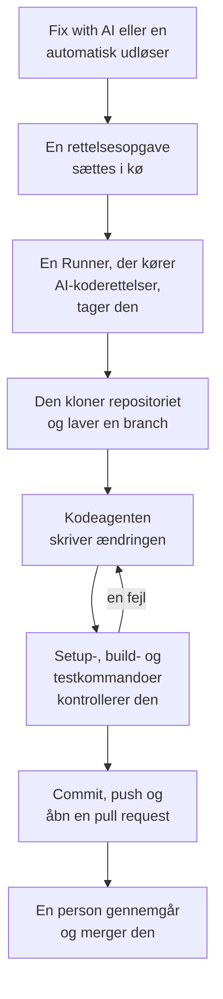

# Rettelsesopgaver

En rettelsesopgave er en pull request, som OneUptime AI skriver i din kode. Du starter en fra en undtagelse, et spor, en tjeneste eller en undersøgelse, eller OneUptime starter en af sig selv; en [Runner](/docs/runbooks/agents) kloner repositoriet, skriver ændringen på en ny branch, bygger og tester den og åbner en pull request. En person gennemgår og merger hver eneste: Runneren kan pushe branches og åbne pull requests, intet andet.

:::cards
- [Sådan forløber en rettelseskørsel](#sådan-forløber-en-rettelseskørsel): Fra et klik til en pull request, trin for trin.
- [Hvor rettelsesopgaver starter](#hvor-rettelsesopgaver-starter): Knapperne, der starter en, og hvad hver pull request gør.
- [Før du begynder](#før-du-begynder): En model, et forbundet repositorie og en Runner.
- [Når en rettelse mislykkes](#når-en-rettelse-mislykkes): Hvad der sker med en kørsel, der fejler, går i stå eller venter.
:::

> [!TIP]
> Du kan også starte dette fra GitHub. Nævn OneUptime GitHub App i et issue eller en pull request, så implementerer, reviderer eller gennemgår den lige dér: se [GitHub App](/docs/ai/github-app). Det er den samme agent, den samme Runner og de samme budgetter; kun udløseren er en anden.

## Sådan forløber en rettelseskørsel



1. Du klikker på **Fix with AI** på en uløst undtagelse, eller en anden knap eller udløser starter en opgave (se [Hvor rettelsesopgaver starter](#hvor-rettelsesopgaver-starter)).
2. Opgaven sættes i kø, og en ledig Runner med **Kører AI-koderettelser** slået til tager den.
3. Runneren henter opgavens kontekst. For en undtagelse er det dens type, dens meddelelse og dens stack trace.
4. Den kloner repositoriet til sit eget arbejdsområde og laver en branch. En rettelse af en undtagelse hedder `oneuptime-fix-exception-` efterfulgt af de første tegn i kørslens id.
5. En kodeagent, drevet af dit projekts LLM-udbyder, læser koden og skriver ændringen. OneUptime-serveren foretager LLM-kaldene, så Runneren aldrig har din udbyders API-nøgle, og hvert kald måles og vises i AI-loggene.
6. Hvis repositoriet har kontrolkommandoer, bygger og tester Runneren ændringen, før den committer noget, og giver en fejl tilbage til kodeagenten, så den kan rette den (se [Kontrol før pull requesten](#kontrol-før-pull-requesten)).
7. Runneren committer, pusher branchen, åbner pull requesten og sletter arbejdsområdet.

Siden, opgaven blev startet fra, viser dens status live. Alle opgaver står under **Produkter → Kode → Opgaver**: åbn en for at se dens **Oversigt**, dens **Protokoller** (en linje for hver fil, Runneren læste eller skrev, og hver kommando, den kørte) og dens **Pull requests**.

Hver kørsel holdes inden for budgetter, som serveren håndhæver: højst **40 LLM-kald** og **100.000 output-tokens**. En kørsel, der når et af dem, afslutter med et resumé af arbejdet indtil da i stedet for at køre i ring. Rettelseskørsler tæller også med i projektets daglige AI-grænser, når projektet har sat dem.

## Hvor rettelsesopgaver starter

| Hvor | Klik | Pull requesten |
| --- | --- | --- |
| En undtagelses side **AI Assistance** | **Fix with AI** | Retter fejlen bag undtagelsen. |
| En undtagelses side **AI Assistance** | **Generate Regression Test** | Tilføjer en test, der genskaber undtagelsen og fejler, indtil fejlen er rettet. |
| En undtagelses side **AI Assistance** | **Improve Error Handling** | Til en forventet fejl, som ugyldigt input: fjerner brugerdata fra meddelelsen, validerer inputtet tidligere og markerer fejlen som håndteret uden at ændre adfærden. |
| En hændelses eller advarsels kort **AI Investigation** | **Open Fix PR from this analysis** | Retter den grundlæggende årsag, som undersøgelsen offentliggjorde (se [Automatiske koderettelser fra undersøgelser](#automatiske-koderettelser-fra-undersøgelser)). |
| Et spor | **Fix performance with AI** | Retter det langsomme mønster, der blev fundet i sporet, som N+1-forespørgsler eller et enkelt dominerende langsomt span. |
| En tjenestes side **Protokoller** | **Improve Logging** | Gør tjenestens logs strukturerede, med den rette alvorlighed og knyttet til dens spor, uden at ændre adfærden. |
| En tjenestes side **Spor** | **Improve Tracing** | Tilføjer spans og attributter, hvor tjenestens tracing mangler, uden at ændre adfærden. |

For at åbne en undtagelses side **AI Assistance** skal du åbne undtagelsen under **Produkter → Observabilitet → Undtagelser** og vælge **AI Assistance** i dens sidemenu. En løst eller arkiveret undtagelse skal først markeres som uløst.

OneUptime AI starter også rettelsesopgaver af sig selv: fra en undersøgelse, der finder en kodeændring, fra en, der ender uden konklusion, fordi telemetri manglede, og fra AI-indsigter om undtagelser og langsomme spor. Hver har sin egen kontakt; se [Automatiske koderettelser](/docs/ai/ai-sre#automatic-code-fixes).

## Kontrol før pull requesten

Et koderepositorie kan have op til tre kontrolkommandoer på sin side **Indstillinger** under **Koderepositorier**:

| Kommando | Eksempel | Hvornår den kører |
| --- | --- | --- |
| **Setup Command** | `npm ci` | Først, for at installere afhængigheder. |
| **Build Command** | `npm run build` | Efter opsætningen. |
| **Test Command** | `npm test` | Til sidst. |

Når en af dem er sat, kontrollerer hver rettelseskørsel sin ændring, før pull requesten åbnes:

1. Når kodeagenten er færdig, kører kommandoerne i rækkefølge i roden af repositoriet, på Runneren, i det klonede arbejdsområde. Hver får op til 15 minutter og kører med `CI=true`, så intet venter på et input; den første fejl stopper gennemløbet.
2. Ved en fejl går slutningen af den fejlende kommandos output tilbage til den samme kodeagent som en reparationsopgave, med besked om at rette sin egen ændring i stedet for at svække eller springe tests over, og kommandoerne kører igen. Den gør højst **2** reparationsforsøg. De deler kørslens LLM-budget, og deres ændringer lander i samme commit som rettelsen.
3. Resultatet, bestået, fejlet eller sprunget over (ingen kommandoer sat), skrives i et Verification-afsnit i pull requestens beskrivelse og registreres på opgavens pull request.

En ændring, der stadig ikke består kontrollen, smides ikke væk: pull requesten åbnes alligevel med et tydeligt markeret afsnit "Verification failed", der nævner den fejlende kommando og slutter med dens output. Arbejdet bevares, og den, der gennemgår, beslutter. Et repositorie uden kommandoer rapporteres som sprunget over i stedet for at antyde et grønt build.

Kommandoerne er repositorieindstillinger, som dit team skriver, og de kører på din egen Runner: samme tillidsmodel som et runbooks Bash-trin. AI'en skriver eller ændrer dem aldrig.

## Før du begynder

En rettelsesopgave kræver tre ting. Undtagelsens side **AI Assistance** kontrollerer alle tre, før den tilbyder at starte, og fortæller, hvad der mangler.

| Hvad | OneUptime Cloud | Selvhostet |
| --- | --- | --- |
| En LLM-udbyder | Intet at sætte op: et projekt uden egen udbyder bruger den globale udbyder, betalt af projektets AI-kreditter. En udbyder af din egen under **Projektindstillinger → AI → LLM-udbydere** går forud. | Sæt miljøvariablerne `GLOBAL_LLM_PROVIDER_*` én gang på serveren, eller føj en udbyder til projektet. |
| Et repositorie forbundet via GitHub App | **Produkter → Kode → Opgaver**, derefter **Koderepositorier** og **Connect with GitHub App**. Kræver Growth-planen. | Det samme, når din instans har en GitHub App (se [GitHub-integration](/docs/self-hosted/github-integration)). |
| En Runner, der kører AI-koderettelser | Intet at drive: OneUptimes delte Runners gør det. | Docker Compose-tjenesten `runner` eller Helm-chartets Runner (`runner.enabled`, slået til som standard) registrerer sig selv og kører AI-koderettelser. |

På en selvhostet instans er den globale udbyder én blok i `config.env` (Docker Compose) eller i dine Helm-værdier. Til en selvhostet Ollama:

```bash
GLOBAL_LLM_PROVIDER_TYPE=Ollama
# An address the OneUptime server can reach, never localhost.
GLOBAL_LLM_PROVIDER_BASE_URL=http://ollama:11434
GLOBAL_LLM_PROVIDER_MODEL_NAME=llama3.1
# No GLOBAL_LLM_PROVIDER_API_KEY needed — Ollama is keyless.
```

Enhver understøttet udbyder virker: se [LLM-udbydere](/docs/ai/llm-provider) for dem alle og hver miljøvariabel.

Du tilknytter ikke repositorier til tjenester. Når en opgave starter, finder OneUptime repositoriet ved at matche filstierne i undtagelsens stack trace mod dine forbundne repositorier. Når intet matcher, falder den tilbage på et repositorie, der hedder som tjenesten, og derefter på projektets eneste repositorie, når der kun er ét. Siden **AI Assistance** viser, hvilket repositorie den fandt.

### Kør din egen Runner

Sådan kører du en Runner et andet sted, for eksempel på en maskine tæt på dine repositorier:

:::steps
### Opret Runneren

Opret en Runner under **Runbooks → Runbook-agenter**, og klik på **Vis opsætningsvejledning** i dens række. Kommandoen indeholder Runnerens hemmelige nøgle, som kun en Project Owner, Project Admin eller Runbook Admin kan læse. Den ser sådan ud:

```bash
docker run --name oneuptime-runner --restart unless-stopped \
  -e ONEUPTIME_RUNNER_ID=<runner-id> \
  -e ONEUPTIME_RUNNER_KEY=<runner-key> \
  -e ONEUPTIME_URL=<your-oneuptime-url> \
  -d oneuptime/runner:release
```

### Slå AI-koderettelser til

Slå **Kører AI-koderettelser** til på Runneren. Den er slået fra som standard, og Runneren opfanger ændringen ved sit næste heartbeat, inden for omkring et minut; der er intet at genstarte.

### Kontrollér, at den forbinder

Runneren vises som forbundet på siden **Runbooks → Runbook-agenter** inden for et minut eller to. Hvis den ikke gør, så læs containerens log (`docker logs oneuptime-runner`) for en fejl med legitimationsoplysninger eller netværk.
:::

Enhver måde at køre containeren på virker (Docker Compose, Kubernetes og så videre), så længe den har disse variabler og kan nå din OneUptime-instans over HTTPS:

| Variabel | Hvad den er |
| --- | --- |
| `ONEUPTIME_RUNNER_ID` | Runnerens id, fra dashboardet. |
| `ONEUPTIME_RUNNER_KEY` | Runnerens hemmelige nøgle. |
| `ONEUPTIME_URL` | Din OneUptime-instans' adresse (`https://oneuptime.com` på OneUptime Cloud). |

> [!NOTE]
> Før OneUptime 12 kørte AI-koderettelser på en separat AI Agent-komponent (imaget `oneuptime/ai-agent` med `AI_AGENT_*`-variabler). Den er gået op i Runneren: hvis du stadig kører en, fortæller [opgraderingsguiden fra v11 til v12](/docs/installation/upgrading), hvordan du erstatter den.

## Automatiske koderettelser fra undersøgelser

Når en [AI-undersøgelse](/docs/ai/ai-sre) offentliggør en årsagsanalyse på en hændelse eller en advarsel, og dens omhyggelige klassificering anbefaler en ændring i koden, tilbyder undersøgelseskortet **Open Fix PR from this analysis**: en rettelsesopgave, hvis hele kontekst er den offentliggjorte analyse. Knappen er skjult, når afhjælpningen er driftsmæssig, kun handler om infrastruktur, er ekstern, er en forventet afvisning, en brugerfejl eller uden konklusion. Egnede rettelser sker uden klikket, så længe kontakten **Åbn en pull request med en rettelse, når en undersøgelse finder en kodeændring** er slået til. Den hører til rettelse: den ligger under **Ret nye hændelser automatisk** på **Hændelser → AI → Indstillinger** (og under **Ret nye advarsler automatisk** på **Advarsler → AI → Indstillinger**), slås til, når rettelse slås til, og åbner kun pull requests, mens rettelse er slået til. Begge starter slået fra, også for nye projekter.

Mens den er slået til, sætter en undersøgelse, der ender med en sikker, underbygget grundlæggende årsag, som en kodeændring kan rette, den samme rettelsesopgave i kø, som knappen opretter. Beslutningen er en afgrænset klassificering, som serveren kontrollerer, aldrig et mønster, der matches mod analysens tekst: kun en positiv dom om en koderettelse åbner en pull request. Manglende belæg, en afhjælpning uden for koden og en mislykket klassificering ender alle med, at intet sker.

Alt andet svarer til knappen:

- Pull requesten åbnes klar til gennemgang, skrevet ud fra den offentliggjorte analyse, og kræver et repositorie forbundet via GitHub App og en Runner med **Kører AI-koderettelser** slået til.
- Den tæller med i signalets daglige grænse for rettelsesopgaver (**Daily Incident AI Fix Task Limit** eller **Daily Alert AI Fix Task Limit**, under **Yderligere indstillinger** på dets AI-indstillingsside) og i repositoriets loft over åbne pull requests, når et af dem er sat. Uden at være sat begrænser ingen af dem noget.
- Hver udløser leder først efter en rettelsesopgave, der allerede står i kø eller kører for den samme hændelse eller advarsel, så en automatisk udløser og et klik normalt bliver til én opgave, ikke to pull requests. Kontrollen er en læsning før skrivningen, ikke en lås, så to udløsere i præcis samme øjeblik stadig begge kan komme igennem.
- Kørslen skrives af systemet, krediteres ingen, og intet merges af sig selv.

## Når en rettelse mislykkes

:::details Kørslen fejler
Rettelsen kunne ikke anvendes, repositoriet kunne ikke nås, eller LLM-kaldet mislykkedes. Siden, opgaven blev startet fra, viser årsagen og tilbyder at prøve igen. Opgavens side **Protokoller** har hele kørselsloggen.
:::

:::details Runneren stopper midt i en kørsel
En kørsel, hvis heartbeat har været tavs i mere end 12 minutter, afsluttes med en fejl. Den sættes aldrig i kø igen af sig selv, fordi Runneren allerede kan have pushet en del af en rettelsesbranch; start den igen dér, hvor du startede den.
:::

:::details Ingen Runner tager opgaven
En opgave, der venter mere end 30 minutter, mens ingen Runner med **Kører AI-koderettelser** er forbundet, mislykkes med en besked om at kontrollere Runneren, så den aldrig vises som i gang for evigt. Når en Runner er online, men optaget, venter opgaver i kø på deres tur.
:::

## Privatliv

Klonen af dit repositorie ligger i et arbejdsområde i Runnerens container og slettes, når kørslen slutter, uanset om den lykkedes eller ej. Runneren har aldrig din LLM-udbyders API-nøgle: OneUptime-serveren foretager LLM-kaldene for den. OneUptime beholder ikke dit repositorie og træner ikke på din kode. Opgavens log beholder de første 300 tegn af hvert trins output, så du kan kontrollere, hvad Runneren gjorde, og det kan indeholde kodestykker. Kør en selvhostet Runner med din egen LLM-udbyder (lokal Ollama inklusive), og din kode forlader aldrig din infrastruktur.

## På køreplanen

Planlagt og **ikke tilgængeligt i dag**:

- **Understøttelse af GitLab.** Repositorier forbindes kun via GitHub App.
- **Mere telemetri i en rettelse.** At føre spor, logs og metrikker omkring en undtagelse ind i dens rettelse, ud over stack tracen.

## Næste trin

:::cards
- [GitHub App](/docs/ai/github-app): Bed om en ændring, en revision eller en gennemgang direkte fra GitHub.
- [AI SRE](/docs/ai/ai-sre): Undersøgelserne, hvis analyser rettelsesopgaver kan forvandle til pull requests.
- [Runbook-agenter](/docs/runbooks/agents): Workeren, der udfører hver rettelseskørsel.
:::
