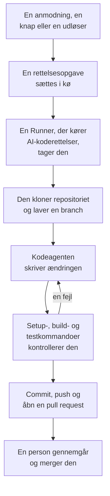

# Kode

Kode er stedet, hvor du beder OneUptime AI om at arbejde i dine repositorier, sådan som du ville bede en kodeagent: rette en fejl, skrive tests, forklare koden, lave en ændring. Kode åbner på dine forbundne repositorier; et repositories side rummer dets opgaver og feltet, hvor du spørger; en opgaves side er en samtale, du kan svare i. OneUptime starter også selv opgaver, fra undtagelser, spor og undersøgelser. En [Runner](/docs/runbooks/agents) kloner repositoriet, skriver ændringen på en ny branch, bygger og tester den og åbner en pull request. En person gennemgår og merger hver eneste: Runneren kan pushe branches og åbne pull requests, intet andet.

:::cards
- [Bed AI om noget i et repositorie](#bed-ai-om-noget-i-et-repositorie): En anmodning med dine egne ord og den kontekst, den har brug for.
- [En opgaves samtale](#en-opgaves-samtale): Hvad AI gjorde, hvad den ændrede, og dit svar.
- [Sådan forløber en rettelseskørsel](#sådan-forløber-en-rettelseskørsel): Fra et klik til en pull request, trin for trin.
- [Hvor rettelsesopgaver starter](#hvor-rettelsesopgaver-starter): Opgaverne, OneUptime starter, og hvad hver pull request gør.
- [Før du begynder](#før-du-begynder): En model, et forbundet repositorie og en Runner.
- [Når en rettelse mislykkes](#når-en-rettelse-mislykkes): Hvad der sker med en kørsel, der fejler, går i stå eller venter.
:::

> [!TIP]
> Du kan også starte dette fra GitHub. Nævn OneUptime GitHub App i et issue eller en pull request, så implementerer, reviderer eller gennemgår den lige dér: se [GitHub App](/docs/ai/github-app). Det er den samme agent, den samme Runner og de samme budgetter; kun udløseren er en anden.

## Bed AI om noget i et repositorie

:::steps
### Åbn et repositorie

Åbn **Produkter → Kode**. Her står projektets repositorier, hvert med de opgaver, AI arbejder på, dem, der venter på dig, og dets åbne pull requests. Er der endnu ingen, tilbyder Kode **Forbind GitHub** (se [Før du begynder](#før-du-begynder)).

### Sig, hvad du vil

Skriv på repositoriets side ændringen, fejlen eller spørgsmålet med dine egne ord. Et repositorie uden opgaver foreslår et par stykker under **Prøv at spørge**.

### Tilføj kontekst

Klik på **Tilføj kontekst** for at give AI det, den har brug for: en fil eller mappe i repositoriet, en note, et link eller en post i projektet. OneUptime læser hver post, når du sender anmodningen, med dine tilladelser, og gemmer, hvad AI fik.

### Start opgaven

Klik på **Start opgave**, eller tryk på Enter. Opgavens side åbner, og AI's arbejde vises dér, mens det sker.
:::

| Kontekst | Hvad AI får |
| --- | --- |
| **Fil eller mappe** | En sti i repositoriet, som AI læser først. |
| **Note** | Tekst, du indsætter: en fejl, en specifikation, en logline. |
| **Link** | En webadresse, som reference. |
| **Hændelse** eller **Advarsel** | Dens tilstand, beskrivelse og grundlæggende årsag, som de er, når du sender anmodningen. |
| **Undtagelse** | Dens meddelelse og stack trace. |
| **Overvågning** | Dens type, status og beskrivelse. |
| **Spor** | Dets spans: deres navne, tider og fejl. |
| **Protokoller** | De seneste 20 loglinjer, der indeholder din søgning, fra den seneste time, dag eller uge. |
| **Ydeevneprofil** | Hvor en funktions tid går hen i dens tjenestes profiler: hvem der kalder den, hvad den kalder, og dens varmeste linjer. |

En anmodning bærer højst 10 stykker kontekst. Tokens, nøgler, adgangskoder og e-mailadresser i det, OneUptime læser, sløres, før AI ser dem, som overalt, hvor OneUptime AI læser dine data.

## En opgaves samtale

En opgaves side er en samtale: hvad der blev spurgt om, og den tilføjede kontekst, derefter AI's tur – de trin, den tager, mens den tager dem (filerne, den læste og redigerede, hvad den søgte efter, kommandoerne, den kørte), dens svar, filerne, den ændrede, med deres diff, og pull requesten. Øverst på siden står, hvordan det går med opgaven:

| Tilstand | Hvad det betyder |
| --- | --- |
| **I kø** | Den venter på, at en Runner tager den. |
| **Arbejder…** | AI arbejder på den. **Stands** stopper den; det, den har pushet, bliver på branchen. |
| **Venter på dig** | AI har stillet et spørgsmål. Svar på det i feltet nedenfor. |
| **Færdig** | AI er færdig: dens svar og pull requesten, når den ændrede kode. |
| **Mislykkedes** | Turen kunne ikke gøres færdig og siger hvorfor. **Prøv igen** beder om det samme igen. |
| **Stoppet** | Nogen stoppede den. **Prøv igen** beder om det samme igen. |

For at følge op skriver du i feltet nederst: svar AI, tilføj kontekst, eller bed om ændringer. Hvert svar er den næste tur i samme opgave: den arbejder på samme branch og pusher til samme pull request, så længe den er åben. En opgave tager én tur ad gangen, så feltet venter, mens AI arbejder. Hver turs **Log** er den ordrette optegnelse af, hvad den gjorde.

Den, der kan læse et repositorie, læser dets opgaver. At bede AI om noget, svare og stoppe en opgave kræver tilladelse til at redigere repositoriet, og det samme gør det at se en ændrings diff: alle andre ser, hvilke filer der er ændret. Opgaverne, OneUptime selv starter (nedenfor), står også i deres repositorie, som samtaler, du kan svare i.

## Sådan forløber en rettelseskørsel



1. Du klikker på **Start opgave** i et repositorie, eller på **Ret med AI** på en uløst undtagelse, eller en anden knap eller udløser starter en opgave (se [Hvor rettelsesopgaver starter](#hvor-rettelsesopgaver-starter)).
2. Opgaven sættes i kø på sit repositorie, og den Runner, som repositoriet vælger, tager den: en af dine Runnere, eller en global Runner, når det ikke vælger nogen (se [Vælg repositoriets Runner](#vælg-repositoriets-runner)).
3. Runneren henter opgavens kontekst. For en anmodning er det dens ord, den tilføjede kontekst og samtalen indtil nu; for en undtagelse dens type, dens meddelelse og dens stack trace.
4. Den kloner repositoriet til sit eget arbejdsområde og laver en branch. En rettelse af en undtagelse hedder `oneuptime-fix-exception-` efterfulgt af de første tegn i kørslens id. Et svar arbejder i stedet på branchen for opgavens åbne pull request.
5. En kodeagent, drevet af dit projekts LLM-udbyder, læser koden og skriver ændringen. OneUptime-serveren foretager LLM-kaldene, så Runneren aldrig har din udbyders API-nøgle, og hvert kald måles og vises i AI-loggene.
6. Hvis repositoriet har kontrolkommandoer, bygger og tester din egen Runner ændringen, før den committer noget, og giver en fejl tilbage til kodeagenten, så den kan rette den (se [Kontrol før pull requesten](#kontrol-før-pull-requesten)).
7. Runneren committer, pusher branchen, åbner pull requesten (for en anmodning kun, når den ændrede kode) og sletter arbejdsområdet.

Siden, opgaven blev startet fra, viser dens status live. Alle opgaver står i deres repositorie under **Produkter → Kode**: opgavens side er dens samtale, og hver turs **Log** har en linje for hver fil, Runneren læste eller skrev, og hver kommando, den kørte.

Hver kørsel holdes inden for budgetter, som serveren håndhæver: højst **40 LLM-kald** og **100.000 output-tokens**. En kørsel, der når et af dem, afslutter med et resumé af arbejdet indtil da i stedet for at køre i ring. Rettelseskørsler tæller også med i projektets daglige AI-grænser, når projektet har sat dem.

## Hvor rettelsesopgaver starter

| Hvor | Klik | Pull requesten |
| --- | --- | --- |
| En undtagelses side **AI Assistance** | **Ret med AI** | Retter fejlen bag undtagelsen. |
| En undtagelses side **AI Assistance** | **Generate Regression Test** | Tilføjer en test, der genskaber undtagelsen og fejler, indtil fejlen er rettet. |
| En undtagelses side **AI Assistance** | **Forbedr fejlhåndtering** | Til en forventet fejl, som ugyldigt input: fjerner brugerdata fra meddelelsen, validerer inputtet tidligere og markerer fejlen som håndteret uden at ændre adfærden. |
| En hændelses eller advarsels kort **AI Investigation** | **Open Fix PR from this analysis** | Retter den grundlæggende årsag, som undersøgelsen offentliggjorde (se [Automatiske koderettelser fra undersøgelser](#automatiske-koderettelser-fra-undersøgelser)). |
| Et spor, der er værd at rette | **Ret ydeevnen med AI** | Retter det langsomme mønster, som knappen nævner, som en N+1-forespørgsel eller kald, der kunne køre parallelt. |
| En tjenestes side **Protokoller** | **Forbedr logning** | Gør tjenestens logs strukturerede, med den rette alvorlighed og knyttet til dens spor, uden at ændre adfærden. |
| En tjenestes side **Spor** | **Forbedr sporing** | Tilføjer spans og attributter, hvor tjenestens tracing mangler, uden at ændre adfærden. |
| En funktion i **Ydeevneprofiler** | **Ret med AI** | Får funktionen til at udføre det samme arbejde med mindre tid eller hukommelse, med dens profil som bevis. |

Disse knapper vises kun, hvor de kan starte en opgave. Er AI slået fra for projektet, vises ingen af dem, og en undtagelses sidemenu har ingen **AI Assistance**. **Forbedr logning** og **Forbedr sporing** vises, så snart et repository er forbundet, og **Ret ydeevnen med AI** kun på et spor, der er værd at rette (se [Sporudforsker](/docs/telemetry/traces-explorer)). En funktions **Ret med AI** vises kun for applikationens egen kode, der tager mindst 5 % af profilens tid eller hukommelse, eller hvis andel er vokset med 3 point eller mere siden det vindue, den sammenlignes med (se [Kontinuerlig profilering](/docs/telemetry/profiles)).

For at åbne en undtagelses side **AI Assistance** skal du åbne undtagelsen under **Produkter → Observabilitet → Undtagelser** og vælge **AI Assistance** i dens sidemenu. En løst eller arkiveret undtagelse skal først markeres som uløst.

OneUptime AI starter også rettelsesopgaver af sig selv: fra en undersøgelse, der finder en kodeændring, fra en, der ender uden konklusion, fordi telemetri manglede, og fra AI-indsigter om undtagelser og langsomme spor. Hver har sin egen kontakt; se [Automatiske koderettelser](/docs/ai/ai-sre#automatiske-koderettelser).

## Kontrol før pull requesten

Et repositorie kan have op til tre kontrolkommandoer på sin side **Indstillinger** i Kode:

| Kommando | Eksempel | Hvornår den kører |
| --- | --- | --- |
| **Setup Command** | `npm ci` | Først, for at installere afhængigheder. |
| **Build Command** | `npm run build` | Efter opsætningen. |
| **Test Command** | `npm test` | Til sidst. |

Når en af dem er sat, kontrollerer hver rettelseskørsel sin ændring, før pull requesten åbnes:

1. Når kodeagenten er færdig, kører kommandoerne i rækkefølge i roden af repositoriet, på Runneren, i det klonede arbejdsområde. Hver får op til 15 minutter og kører med `CI=true`, så intet venter på et input; den første fejl stopper gennemløbet.
2. Ved en fejl går slutningen af den fejlende kommandos output tilbage til den samme kodeagent som en reparationsopgave, med besked om at rette sin egen ændring i stedet for at svække eller springe tests over, og kommandoerne kører igen. Den gør højst **2** reparationsforsøg. De deler kørslens LLM-budget, og deres ændringer lander i samme commit som rettelsen.
3. Resultatet, bestået, fejlet eller sprunget over (ingen kommandoer sat, eller en global Runner), skrives i et Verification-afsnit i pull requestens beskrivelse og registreres på opgavens pull request.

En ændring, der stadig ikke består kontrollen, smides ikke væk: pull requesten åbnes alligevel med et tydeligt markeret afsnit "Verification failed", der nævner den fejlende kommando og slutter med dens output. Arbejdet bevares, og den, der gennemgår, beslutter. Et repositorie uden kommandoer rapporteres som sprunget over i stedet for at antyde et grønt build.

Kommandoerne er repositorieindstillinger, som dit team skriver, og de kører på din egen Runner: samme tillidsmodel som et runbooks Bash-trin. AI'en skriver eller ændrer dem aldrig. En global Runner, som OneUptime kører for alle projekter, kører dem aldrig: på en global Runner bliver rettelsen skrevet og åbnet til gennemsyn, kontrollen rapporteres som sprunget over, og dit repositoriums egen CI tjekker ændringen. [Kør din egen Runner](#kør-din-egen-runner) for at få rettelser bygget og testet, før pull requesten åbner.

## Efter en rettelse er flettet

At flette en rettelse retter intet, før den kører. Når en pull request med en rettelse er flettet, venter OneUptime på en registreret udrulning, der indeholder den (se [Udrulninger og ændringer](/docs/telemetry/change-events)), og holder i den udrulning øje med det, rettelsen var til. Opgavens pull request i Code siger, hvordan det gik, og det gør undtagelsens side **AI Assistance**, hændelsens AI-logs og den AI-indsigt, rettelsen kom fra, også:

| En rettelse af | Det, der holdes øje med | Det virkede | Det virkede ikke |
| --- | --- | --- | --- |
| En undtagelse | Om undtagelsen sker igen | **Rettet i produktion** | **Sker stadig efter rettelsen** |
| Et langsomt trace eller en latens-indsigt | p99 for den operation, rettelsen nævner | **Hurtigere i produktion** | **Stadig langsom efter rettelsen** |
| Den grundlæggende årsag til en hændelse eller en advarsel | Om dens monitor udløser en til | **Rettet i produktion** | **Skete igen efter rettelsen** |
| Manglende telemetri, logning eller tracing | Det, rettelsen tilføjer, og resten af tjenestens telemetri | **Ankommer i produktion** | **Telemetri stoppede efter rettelsen** |

Indtil en udrulning leverer den, står der **Merget, venter på et deploy** ved rettelsen, derefter **Deployet, overvåges i produktion**, mens der holdes øje med den. En rettelse, som ingen registreret udrulning indeholder inden for 14 dage, eller som produktionen ikke kan sige noget om, står som **Ikke verificeret i produktion**. [Automatiske koderettelser](/docs/ai/ai-sre#automatiske-koderettelser) har reglerne. En regressionstest, bedre fejlhåndtering, en gennemgang og en anmodning i Code holdes der ikke øje med: produktionen kan ikke vise, hvad de ændrer.

## Før du begynder

En opgave kræver tre ting. Et repositories side i Kode og undtagelsens side **AI Assistance** kontrollerer alle tre, før de tilbyder at starte, og fortæller, hvad der mangler.

| Hvad | OneUptime Cloud | Selvhostet |
| --- | --- | --- |
| En LLM-udbyder | Intet at sætte op: et projekt uden egen udbyder bruger den globale udbyder, betalt af projektets AI-kreditter. En udbyder af din egen under **Projektindstillinger → AI → LLM-udbydere** går forud. | Sæt miljøvariablerne `GLOBAL_LLM_PROVIDER_*` én gang på serveren, eller føj en udbyder til projektet. |
| Et repositorie forbundet via GitHub App | **Produkter → Kode**, derefter **Forbind GitHub**. Hvis appen allerede er installeret på GitHub-kontoen, så klik i stedet på **Forbind en eksisterende installation**: den bliver ikke forbundet af at installere den igen. Kræver Growth-planen. | Det samme, når din instans har en GitHub App (se [GitHub-integration](/docs/self-hosted/github-integration)). |
| En Runner, der kører AI-koderettelser | Intet at drive: et repositorie, der ikke vælger nogen, arbejder på OneUptimes globale Runnere. | Docker Compose-tjenesten `runner` eller Helm-chartets Runner (`runner.enabled`, slået til som standard) registrerer sig selv og kører AI-koderettelser i hvert repositorie, der ikke vælger nogen Runner. |

På en selvhostet instans er den globale udbyder én blok i `config.env` (Docker Compose) eller i dine Helm-værdier. Til en selvhostet Ollama:

```bash
GLOBAL_LLM_PROVIDER_TYPE=Ollama
# An address the OneUptime server can reach, never localhost.
GLOBAL_LLM_PROVIDER_BASE_URL=http://ollama:11434
GLOBAL_LLM_PROVIDER_MODEL_NAME=llama3.1
# No GLOBAL_LLM_PROVIDER_API_KEY needed — Ollama is keyless.
```

Enhver understøttet udbyder virker: se [LLM-udbydere](/docs/ai/llm-provider) for dem alle og hver miljøvariabel.

Du tilknytter ikke repositorier til tjenester. Når en opgave starter, finder OneUptime repositoriet ved at matche filstierne i undtagelsens stack trace mod dine forbundne repositorier. Når intet matcher, falder den tilbage på et repositorie, der hedder som tjenesten, og derefter på projektets eneste repositorie, når der kun er ét. Siden **AI Assistance** viser, hvilket repositorie den fandt.

### Vælg repositoriets Runner

Hvert repositorie vælger den Runner, AI arbejder i det på: på dets side **Indstillinger** i Kode skal du klikke på **Rediger indstillinger** og vælge en i trinnet **Runner**. Et repositorie, der ikke vælger nogen, arbejder på **Global Runner**, som OneUptime kører for alle projekter.

| Runner | Hvad den gør med en opgave |
| --- | --- |
| **Global Runner** | Skriver ændringen og åbner pull requesten uden dine setup-, build- og testkommandoer: dit repositoriums egen CI tjekker ændringen. |
| En af dine Runnere | Kører også dine setup-, build- og testkommandoer på en vært, du styrer. |

Kun den Runner, et repositorie vælger, får dets opgaver og et token til det. I et projekt, der slår **Brug globale Runnere** fra under **Runbooks → Runbook-agenter**, skal hvert repositorie bruge en af projektets egne Runnere. En Runners side viser de repositorier, der vælger den.

### Kør din egen Runner

Sådan kører du en Runner et andet sted, for eksempel på en maskine tæt på dine repositorier:

:::steps
### Opret Runneren

Opret en Runner under **Runbooks → Runbook-agenter**, og klik på **Vis opsætningsvejledning** i dens række. Kommandoen indeholder Runnerens hemmelige nøgle, som kun en Project Owner, Project Admin eller Runbook Admin kan læse. Den ser sådan ud:

```bash
docker run --name oneuptime-runner --restart unless-stopped \
  -e ONEUPTIME_RUNNER_ID=<runner-id> \
  -e ONEUPTIME_RUNNER_KEY=<runner-key> \
  -e ONEUPTIME_URL=<your-oneuptime-url> \
  -d oneuptime/runner:release
```

### Vælg den til repositoriet

På repositoriets side **Indstillinger** i Kode skal du klikke på **Rediger indstillinger** og vælge Runneren i trinnet **Runner**. Runneren opfanger ændringen ved sit næste heartbeat, inden for omkring et minut; der er intet at genstarte.

### Kontrollér, at den forbinder

Runneren vises som forbundet på siden **Runbooks → Runbook-agenter** inden for et minut eller to. Hvis den ikke gør, så læs containerens log (`docker logs oneuptime-runner`) for en fejl med legitimationsoplysninger eller netværk.
:::

Enhver måde at køre containeren på virker (Docker Compose, Kubernetes og så videre), så længe den har disse variabler og kan nå din OneUptime-instans over HTTPS:

| Variabel | Hvad den er |
| --- | --- |
| `ONEUPTIME_RUNNER_ID` | Runnerens id, fra dashboardet. |
| `ONEUPTIME_RUNNER_KEY` | Runnerens hemmelige nøgle. |
| `ONEUPTIME_URL` | Din OneUptime-instans' adresse (`https://oneuptime.com` på OneUptime Cloud). |

> [!NOTE]
> Før OneUptime 12 kørte AI-koderettelser på en separat AI Agent-komponent (imaget `oneuptime/ai-agent` med `AI_AGENT_*`-variabler). Den er gået op i Runneren: hvis du stadig kører en, fortæller [opgraderingsguiden fra v11 til v12](/docs/installation/upgrading), hvordan du erstatter den.

## Automatiske koderettelser fra undersøgelser

Når en [AI-undersøgelse](/docs/ai/ai-sre) offentliggør en årsagsanalyse på en hændelse eller en advarsel, og dens omhyggelige klassificering anbefaler en ændring i koden, tilbyder undersøgelseskortet **Open Fix PR from this analysis**: en rettelsesopgave, hvis hele kontekst er den offentliggjorte analyse. Knappen er skjult, når afhjælpningen er driftsmæssig, kun handler om infrastruktur, er ekstern, er en forventet afvisning, en brugerfejl eller uden konklusion. Egnede rettelser sker uden klikket, så længe kontakten **Åbn en pull request med en rettelse, når en undersøgelse finder en kodeændring** er slået til. Den hører til rettelse: den ligger under **Ret nye hændelser automatisk** på **Hændelser → AI → Indstillinger** (og under **Ret nye advarsler automatisk** på **Advarsler → AI → Indstillinger**), slås til, når rettelse slås til, og åbner kun pull requests, mens rettelse er slået til. Begge starter slået fra, også for nye projekter.

Mens den er slået til, sætter en undersøgelse, der ender med en sikker, underbygget grundlæggende årsag, som en kodeændring kan rette, den samme rettelsesopgave i kø, som knappen opretter. Beslutningen er en afgrænset klassificering, som serveren kontrollerer, aldrig et mønster, der matches mod analysens tekst: kun en positiv dom om en koderettelse åbner en pull request. Manglende belæg, en afhjælpning uden for koden og en mislykket klassificering ender alle med, at intet sker.

Alt andet svarer til knappen:

- Pull requesten åbnes klar til gennemgang, skrevet ud fra den offentliggjorte analyse, og kræver et repositorie forbundet via GitHub App og en Runner, der er online til at arbejde i det: den, repositoriet vælger, eller en global Runner.
- Den tæller med i signalets daglige grænse for rettelsesopgaver (**Daily Incident AI Fix Task Limit** eller **Daily Alert AI Fix Task Limit**, under **Yderligere indstillinger** på dets AI-indstillingsside) og i repositoriets loft over åbne pull requests, når et af dem er sat. Uden at være sat begrænser ingen af dem noget.
- Hver udløser leder først efter en rettelsesopgave, der allerede står i kø eller kører for den samme hændelse eller advarsel, så en automatisk udløser og et klik normalt bliver til én opgave, ikke to pull requests. Kontrollen er en læsning før skrivningen, ikke en lås, så to udløsere i præcis samme øjeblik stadig begge kan komme igennem.
- Kørslen skrives af systemet, krediteres ingen, og intet merges af sig selv.

## Når en rettelse mislykkes

:::details Kørslen fejler
Rettelsen kunne ikke anvendes, repositoriet kunne ikke nås, eller LLM-kaldet mislykkedes. Opgavens samtale og siden, den blev startet fra, viser årsagen og tilbyder at prøve igen. Turens **Log** har hele kørselsloggen.
:::

:::details Runneren stopper midt i en kørsel
En kørsel, hvis heartbeat har været tavs i mere end 12 minutter, afsluttes med en fejl. Den sættes aldrig i kø igen af sig selv, fordi Runneren allerede kan have pushet en del af en rettelsesbranch; start den igen dér, hvor du startede den.
:::

:::details Ingen Runner tager opgaven
En opgave, der venter mere end 30 minutter, mens den Runner, der skal tage den, ikke er forbundet - den, dens repositorie vælger, eller en global Runner for et repositorie, der ikke vælger nogen - mislykkes med en besked, der siger hvilken, så den aldrig vises som i gang for evigt. Når en Runner er online, men optaget, venter opgaver i kø på deres tur. En Runner, der er ældre end Kode, får aldrig en anmodning fra Kode: opdater en Runner, du selv kører, sammen med serveren.
:::

## Privatliv

Klonen af dit repositorie ligger i et arbejdsområde i Runnerens container og slettes, når kørslen slutter, uanset om den lykkedes eller ej. Runneren har aldrig din LLM-udbyders API-nøgle: OneUptime-serveren foretager LLM-kaldene for den. OneUptime beholder ikke dit repositorie og træner ikke på din kode. Opgavens log beholder de første 300 tegn af hvert trins output, så du kan kontrollere, hvad Runneren gjorde, og det kan indeholde kodestykker. Kør en selvhostet Runner med din egen LLM-udbyder (lokal Ollama inklusive), og din kode forlader aldrig din infrastruktur.

## På køreplanen

Planlagt og **ikke tilgængeligt i dag**:

- **Understøttelse af GitLab.** Repositorier forbindes kun via GitHub App.
- **Mere telemetri i en rettelse.** At føre spor, logs og metrikker omkring en undtagelse ind i dens rettelse, ud over stack tracen.

## Næste trin

:::cards
- [GitHub App](/docs/ai/github-app): Bed om en ændring, en revision eller en gennemgang direkte fra GitHub.
- [AI SRE](/docs/ai/ai-sre): Undersøgelserne, hvis analyser rettelsesopgaver kan forvandle til pull requests.
- [Runbook-agenter](/docs/runbooks/agents): Workeren, der udfører hver rettelseskørsel.
:::
