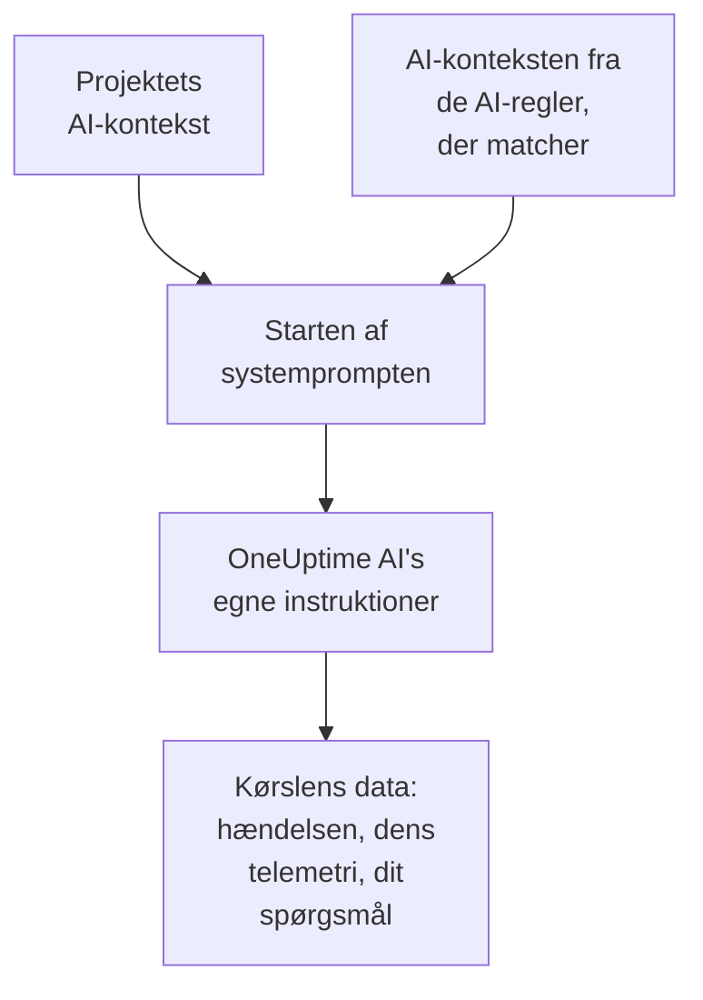

# AI-kontekst

AI-konteksten er det, dit team skriver ned til OneUptime AI om jeres egne systemer: hvordan de hænger sammen, hvem der ejer hvilket symptom, hvor logs ligger, og hvilke ord dit team bruger. OneUptime AI læser den først i hver undersøgelse, hver rettelse, hvert postmortem-udkast og hver samtale i Spørg AI, så den starter med det, dit team allerede ved.

:::cards
- [Skriv AI-konteksten](#skriv-ai-konteksten): Ét kort i projektets AI-indstillinger.
- [En AI-regels egne noter](#en-ai-regels-egne-noter): Noter om det, én regel matcher.
- [Hvad der læser den](#hvad-der-læser-den): De funktioner, der læser den, og dem, der ikke gør.
- [Hvad en kørsel læste](#hvad-en-kørsel-læste): Hver kørsel viser de noter, den fik.
:::

## Sådan fungerer det

OneUptime AI sætter AI-konteksten helt i starten af sin systemprompt, før sine egne instruktioner og kørslens data: først projektets noter, derefter noterne fra de AI-regler, der matcher. Den læser dem som baggrundsviden fra dit team. De er ikke bevis for, hvad der sker lige nu, og de ændrer aldrig OneUptime AI's egne regler.

Fordi noterne kommer først og er de samme fra den ene kørsel til den næste, hører de til den start af prompten, som udbydere cacher. Hos Anthropic markerer OneUptime systemprompten til caching; OpenAI, Azure OpenAI og de andre udbydere, der cacher en gentaget start af en prompt, gør det af sig selv. Noter, der ikke er ændret, koster mindre at læse igen.

## Skriv AI-konteksten

:::steps
### Åbn AI Features
Åbn **Projektindstillinger → AI → AI Features**. Kortet **AI-kontekst** ligger under **Aktivér AI**.

### Skriv noterne
Klik på **Tilføj AI-kontekst**, eller på **Rediger**, når der er noter. Skriv i Markdown, eller klik på **Start med en disposition** for at få en overskrift til hver slags note.

### Gem dem
Klik på **Gem ændringer**. Kortet viser noterne, hvor lange de er, og omtrent hvor mange tokens en model læser dem som.
:::

Skriv det, du ville fortælle en, der lige er startet på teamet:

| Slags note | For eksempel |
| --- | --- |
| Hvordan jeres systemer hænger sammen | `checkout-api` leverer betalingssiden og afhænger af `payments-db`. |
| Hvem der ejer hvilket symptom | En 502 på betalingssiden hører til Betalings-teamet: tjek `payments-db` først. |
| Hvor logs ligger | Betalingens logs ligger i Loki under `app=checkout`. |
| Jeres teams egne ord | PSP er vores betalingsudbyder. |

> [!WARNING]
> Udelad hemmeligheder: alle, der kan se, hvad en AI-kørsel gjorde, kan læse de noter, den fik.

## En AI-regels egne noter

En AI-regel kan have sine egne noter om de hændelser eller advarsler, den matcher: ét produkts tjenester, hvem der ejer dem, hvor deres logs ligger. Skriv dem i reglens **AI-kontekst** under **Flere felter**, efter **LLM-udbyder**. En regel, der kun kører sine runbooks hver gang, spørger ikke OneUptime AI om noget og har derfor ingen AI-kontekst at skrive.

- En undersøgelse læser projektets noter og derefter noterne fra hver aktiveret AI-regel, der undersøger og matcher hændelsen eller advarslen, i rækkefølge efter reglernes navne.
- En rettelse læser projektets noter og derefter sin egen regels.
- Samtalen om en hændelse eller en advarsel læser de samme noter som dens undersøgelse.

## Hvad der læser den

| Funktion | Hvad den læser |
| --- | --- |
| Undersøgelser fra AI SRE, og deres nye tjek, når en ny advarsel åbner | Projektets noter og noterne fra de AI-regler, der matcher |
| De rettelser, en AI-regel starter: deres planer, kommandoer og MCP-servere | Projektets noter og reglens |
| Spørg AI, og samtalen om en hændelse eller en advarsel | Projektets noter; ved en hændelse eller en advarsel også noterne fra de AI-regler, der matcher |
| Svar i Slack og Microsoft Teams | Projektets noter |
| Postmortem-udkast, til hændelser og episoder | Projektets noter |
| Triage i AI Insights og triage af sikkerhedssager | Projektets noter |

Kald, der kun omformulerer eller vurderer det, de får, læser den ikke: udkast til noter og offentlige noter, opkaldsresuméer, en undersøgelses resumé, hvor sikker den er og dens karakter, og en samtales titel. Det gør de prompts, folk selv skriver, heller ikke, i et workflows eller en runbooks AI-trin.

## Grænser

| Hvad | Højst |
| --- | --- |
| Projektets AI-kontekst | 20.000 tegn |
| En AI-regels AI-kontekst | 5.000 tegn |
| Al den AI-kontekst, én kørsel læser | 30.000 tegn |

Formularen tæller tegnene, mens du skriver, og afviser at gemme over grænsen, og det gør API'et også. En kørsel læser først projektets noter og derefter hver matchende regels i rækkefølge efter deres navne. En regel, hvis noter ville bringe kørslen over 30.000 tegn, udelades helt, og kørslens aktivitet siger det.

Antallet af tokens er et skøn: noternes størrelse i UTF-8-bytes delt med 4, rundet op. Hver model tæller tokens på sin egen måde, så en udbyders optælling kan afvige, mest for tekst, der ikke er på engelsk.

## Hvad en kørsel læste

Hver kørsel gemmer ord for ord de noter, den læste. Dens aktivitet siger **Læste projektets AI-kontekst**, eller hvor mange AI-reglers noter den også læste, med omtrent hvor mange tokens det blev til. **Vis** åbner noterne, sådan som kørslen læste dem: først projektets, derefter hver regels under dens navn, også efter at de er blevet ændret. Når en regels noter blev udeladt på grund af kørslens grænse, siger en meddelelse det.

## Hvem der kan ændre den

- **Projektejer** og **Projektadministrator** kan ændre projektets AI-kontekst. **Projektmedlem**, **Seer** og **Read Project** kan læse den.
- En AI-regels noter er en del af reglen: den, der kan ændre reglen, kan ændre dem.
- Noterne læses kun nogensinde for deres eget projekt: ingen kørsel læser et andet projekts AI-kontekst.

Gennem API'et eller Terraform er projektets noter projektets `aiContext`, og en AI-regels er reglens egen `aiContext`.

## Næste trin

:::cards
- [AI SRE](/docs/ai/ai-sre): Lad OneUptime AI undersøge hver ny hændelse og advarsel.
- [Spørg AI](/docs/ai/ask-ai): Spørg om dit projekts data i en samtale.
- [LLM-udbydere](/docs/ai/llm-provider): Vælg den model, der læser noterne.
:::
