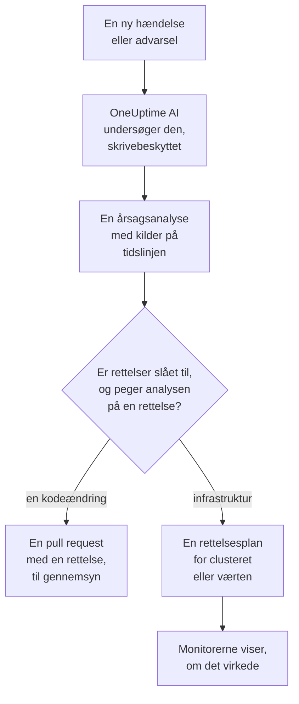
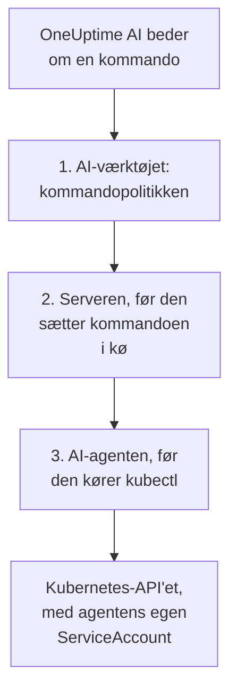

# AI SRE

OneUptime AI er din AI-drevne Site Reliability Engineer. I det øjeblik en ny hændelse eller advarsel bliver erklæret, går den i gang, undersøger den ud fra din egen telemetri (logs, metrikker, traces, undtagelser, monitorer og nylige ændringer) og lægger en årsagsanalyse med kildehenvisninger på hændelsens eller advarslens tidslinje, som regel før den vagthavende er færdig med at læse tilkaldet.

Hver påstand i analysen har en kildehenvisning, der linker direkte til de præcise data, der understøtter den, og selve undersøgelsen er **strengt skrivebeskyttet**: OneUptime AI kan aldrig ændre noget i dit projekt, mens den undersøger.

:::cards
- [Sådan fungerer det](#sådan-fungerer-det): Fra en ny hændelse til en analyse med kilder, og til en rettelse, når du tillader det.
- [Aktivér AI-undersøgelser](#aktivér-ai-undersøgelser): Kontakterne, og hvad de kræver.
- [Clusteradgang: lad OneUptime AI køre kubectl](#clusteradgang-lad-oneuptime-ai-køre-kubectl): Undersøg, og ret, inde i Kubernetes.
- [Omkostningsstyring](#omkostningsstyring): Grænser for hændelser, for advarsler og for hele projektet.
:::

## Sådan fungerer det

OneUptime AI gør tre ting for en ny hændelse eller advarsel, og hver af dem har sin egen kontakt:

- **Den undersøger** (slået til som standard). Den læser din telemetri og de clustre og værter, hvor en AI-agent kører, og lægger en årsagsanalyse med kilder op. En undersøgelse ændrer intet.
- **Den retter** (slået fra som standard). Når rettelser er slået til, bliver en sikker analyse til en rettelse: en pull request med en ændring i din kode eller en plan med kommandoer for et cluster eller en vært, kørt sådan som det clusters eller den værts AI-agent tillader.
- **Den lærer.** Siderne i AI Insights fortæller, hvad der bliver ved med at gå galt, udledt af alt det, der er registreret.



En analyse, der ikke finder nogen årsag, lægges stille op uden at tilkalde nogen (se [Stille tilstand](#stille-tilstand)), og intet bliver rettet uden en årsag.

## Hvad undersøgelsen lægger op

Når en undersøgelse er færdig, lægger OneUptime AI en årsagsanalyse op med disse afsnit:

- **Summary**: en eller to sætninger, som en tilkaldt person kan læse på fem sekunder.
- **Most likely root cause**: hypotesen, kun med den sikkerhed, beviserne giver, og med kilde til hver faktuel påstand. Er telemetrien utilstrækkelig, siger AI det klart og lister, hvad den har tjekket, i stedet for at gætte.
- **Evidence**: de vigtigste fund, der understøtter eller udelukker hypotesen, hver med kilde.
- **Suggested next steps**: konkrete handlinger for den vagthavende.

For hændelser lægges analysen op i hændelsens feed **og** som en intern note på hændelsen (hvor dem, der håndterer den, samarbejder). For advarsler lægges den op i advarslens feed.

Mens undersøgelsen kører, viser hændelsens eller advarslens side et live-panel **AI Investigation**, der fortæller om hvert trin (hvilke værktøjer der kørte, hvad de fandt, og hvor lang tid de tog), så du kan følge dens tankegang. Hvis en undersøgelse mislykkes, viser panelet årsagen i stedet for et tavst hul.

En undersøgelse kører, til den er færdig: den har **ingen tidsgrænse** og intet lille forespørgselsbudget, så den kan køre alle de forespørgsler og kubectl- eller infrastrukturkommandoer, den har brug for. Et langt kommando-output (en `kubectl describe node` for en travl node, en pods logs) bliver aldrig skåret af: OneUptime AI læser det én side ad gangen. Vil du have et hårdt stop, så angiv en **tidsgrænse for undersøgelser** for hver signaltype (se **Omkostningsstyring** nedenfor).

## Hvad en undersøgelse læser

En undersøgelse starter ved hændelsen eller advarslen og ved den infrastruktur, den er knyttet til: de værter, Docker- og Podman-værter, Kubernetes-clustre, databaser og tjenester, dens overvågninger holder øje med. En website-, API- eller syntetisk overvågning holder øje med det, du knytter den til under **Overvågning → Oversigt → Tilknyttede ressourcer**, så knyt den til de værter, der leverer det, den tjekker, og hver undersøgelse af dens hændelser starter der. Før alt det læser den projektets [AI-kontekst](/docs/ai/ai-context): det, dit team har skrevet ned til OneUptime AI om jeres egne systemer, med noterne fra de AI-regler, der matcher.

- Advarslerne på den infrastruktur, der blev åbnet i de 30 minutter før hændelsen eller stadig er åbne, de nyeste først, som advarslen om høj CPU på værten bag et langsomt site. Private advarsler udelades.
- Infrastrukturens egne metrikker, læst sådan som mennesker læser dem. Værtsmetrikker som `system.cpu.utilization` og `system.memory.utilization` rapporteres én gang pr. tilstand, og tilstandene giver tilsammen 100 %, så ét gennemsnit over dem alle siger intet. OneUptime AI læser dem én tilstand ad gangen (optaget CPU er user plus system), og enhver metrik pr. container, pr. monteringspunkt eller efter enhver anden attribut.
- Containerne på en Docker- eller Podman-vært: de travleste efter CPU, hukommelse eller genstarter, og dem, der holdt op med at rapportere. En stoppet container sender intet i stedet for nul, så tallene for hele værten skjuler den.
- De ændringer, der er registreret i de 2 timer før hændelsen eller advarslen (udrulninger, Kubernetes-rollouts, konfigurationsændringer og de rettelser, OneUptime kørte), og hvilke af dem dens tjenesters telemetri gør til mistænkte: en tjeneste, der blev målbart dårligere lige efter en ændring. Se [Udrulninger og ændringer](/docs/telemetry/change-events).

Undersøgelsens aktivitet på kortet **AI Investigation** fortæller, hvor mange åbne eller nye advarsler den læste, og på hvilke ressourcer.

### Tjekket igen, når en ny advarsel åbnes

En undersøgelse starter i det øjeblik, en hændelse erklæres, og en værtsadvarsel, der kræver et par minutters metrikker, kan åbnes bagefter. Når en advarsel åbnes på hændelsens tilknyttede infrastruktur inden for 30 minutter efter hændelsen, efter at undersøgelsen læste den, og hændelsen stadig er åben, tjekker OneUptime AI hændelsen én gang til med den advarsel i hånden. Den nye analyse begynder med **Checked again** og den advarsel, der udløste tjekket, og dens aktivitet siger det også. Hvis en AI-regel fik OneUptime AI til at vente, før den undersøgte hændelsen, tælles de minutter i stedet fra, da dens undersøgelse sluttede (se [Vent før undersøgelsen](#vent-før-undersøgelsen)).

Det sker højst én gang pr. hændelse, med de samme kontakter og grænser som en ny undersøgelse: **Aktivér AI**, _Undersøg nye hændelser_, AI-kreditterne samt de daglige grænser og grænserne for samtidighed. Der er intet at slå til. Et opfølgende tjek kører aldrig automatisk afhjælpning igen og bliver aldrig selv fulgt op, og en advarsels undersøgelse tjekkes ikke igen.

## Tal med OneUptime AI om hændelsen

Kortet **AI Investigation** slutter med en samtale, **Ask OneUptime AI**, som deles af alle, der kan se hændelsen eller advarslen. Det er ét kort, uanset hvad der skete ovenover: under en rapport stiller du opfølgende spørgsmål, og når ingen automatisk undersøgelse kørte (eller den stoppede før rapporten), er det første forslag **What is the root cause?**, som får OneUptime AI til at undersøge efter behov.

- **Stil opfølgende spørgsmål**: "hvilke pods bruger mest hukommelse?", "hvad ændrede sig lige før det her begyndte?", "er andet ramt?". OneUptime AI bygger videre på sin rapport, henter friske data (og kører skrivebeskyttede kubectl- eller infrastrukturkommandoer, hvor den har adgang, på de clustere og ressourcer, du må se) og angiver kilde til hver påstand.
- **Bed den om at handle**: "kvittér for denne hændelse", "læg en statusopdatering op om, at vi undersøger sagen", "tilkald databasevagten", "hæv alvorligheden". Den bruger de samme handlinger som Spørg AI og handler altid **med dine egne tilladelser**, så den kan aldrig gøre mere, end du kunne.
- **Vælg, hvordan den handler**, med kontakten i beskedfeltet, som ved siden af fortæller, hvad den valgte tilstand betyder: _Auto-run_ (standarden: den handler med det samme på en klar anmodning), _Ask to act_ (den viser først et godkendelseskort, som alle på hændelsen kan godkende eller afvise) eller _Skrivebeskyttet_.
- **Én fælles tråd.** Hvert spørgsmål viser, hvem der stillede det, alle ser den samme samtale live, og alle kan stoppe et svar undervejs. Diagrammer og tabeller i et svar vises for den, der spurgte; alle andre ser svaret med kilder. Hvert svar lister sine **Kilder**, og en kilde med sin egen side (logs, metrikker, en monitor) åbner den. En lang tråd åbner ved de nyeste beskeder, med en knap ovenover (for eksempel **Show 6 earlier messages**), der henter resten frem.

En hændelse eller advarsel, som OneUptime AI hverken undersøgte eller rettede, fordi AI var slået fra for den – slået fra for projektet, _Undersøg nye hændelser_ (eller advarsler) slået fra, da den blev oprettet, ingen AI-regel, der undersøger, matchede den, eller dens alvorlighed var under minimum – får i stedet et kort på én linje: **AI-undersøgelse er slået fra** (eller **AI er slået fra for dette projekt**, så længe det er), og hvorfor. Dens pil, **Det kan du gøre**, åbner, hvad der skal slås til, med et link til, hvor det ændres, for dem, der må ændre det, og hvem der kan ændre det, for alle andre; en ændring gælder kun nye hændelser og advarsler, ikke denne. Så længe AI er slået til, åbner **Ask OneUptime AI** på linjen samtalen, og en samtale, som nogen allerede har startet, vises af sig selv under linjen. Kortet **Afhjælpning** udelades så: linjen siger, hvorfor intet blev rettet.

## Aktivér AI-undersøgelser

Autonome undersøgelser er **slået til som standard for nye projekter**. Det er udkast til postmortems og AI Insights også. Rettelser starter slået fra, og de pull requests, der hører til, åbnes kun, så længe rettelser er slået til (se [Automatiske koderettelser](#automatiske-koderettelser)). Et projekt, der blev oprettet før denne standard, beholder sin indstilling; slå undersøgelser til som i trin 3, eller med **Slå til** på siden **AI-agent** for et hvilket som helst Kubernetes-cluster (Project Owner eller Project Admin). Sådan tjekker eller ændrer du dem:

:::steps
1. **Konfigurer en LLM-udbyder.** Selvhostede installationer bruger deres egen nøgle (eller kører helt isoleret med en lokal Ollama): se [LLM-udbydere](/docs/ai/llm-provider). Brugere af OneUptime Cloud kan bruge den forudkonfigurerede globale udbyder, der faktureres som målte AI-tokens, så projektet har brug for AI-kreditter: en projektejer eller en med **Manage Billing** tilføjer dem på **Projektindstillinger → AI → AI-kreditter**, hvor **Automatisk genopfyldning** sørger for, at de ikke slipper op.
2. **Sørg for, at AI er aktiveret for projektet** (det er det som standard): **Aktivér AI** på **Projektindstillinger → AI → AI Features**.
3. **Vælg for hver signaltype** (begge slået til for nye projekter):
   - Hændelser: **Hændelser → AI → Indstillinger**: slå _Undersøg nye hændelser_ til.
   - Advarsler: **Advarsler → AI → Indstillinger**: slå _Undersøg nye advarsler_ til.
:::

Hver AI-adfærd på de sider er en kontakt, der gemmes, så snart du slår den om; der er ingen Gem-knap. Hændelsessiden har tre under **Hvad OneUptime AI gør**: _Undersøg nye hændelser_, _Ret nye hændelser automatisk_ og _Skriv et udkast til en postmortem, når en hændelse er løst_. Advarselssiden har de samme, uden postmortem. _Ret nye hændelser automatisk_ (og _Ret nye advarsler automatisk_) starter **slået fra**, også for nye projekter: den lader OneUptime AI ændre din infrastruktur, så et projekt slår den selv til; se [Hvilke hændelser der undersøges og rettes](#hvilke-hændelser-der-undersøges-og-rettes). De pull requests, den åbner, en rettelse af din kode og den telemetri, en undersøgelse manglede, hører til, og hver AI-regel bestemmer dem: uden regler åbnes begge, og en regel kan slå hver af dem fra under **Flere felter** (se [Automatiske koderettelser](#automatiske-koderettelser)). Project Owners og Project Admins kan ændre dem; for alle andre er hver kontakt låst og fortæller, hvilken tilladelse den kræver.

Siderne siger kun to ting, når de er sande. Er **Aktivér AI** slået fra, kører intet på dem, og siden siger det øverst, med selve kontakten Aktivér AI for dem, der må ændre den (Project Owners og alle med Manage Billing); alle andre får at vide, hvem der kan. Har projektet ingen LLM-udbyder, som OneUptime AI kan bruge (slet ingen, eller udbydere men ingen sat som standard), siger siden også det, med et link til **Projektindstillinger → AI → LLM-udbydere**. På OneUptime Cloud tæller den globale udbyder med, så der står intet om det der.

Hændelser og advarsler konfigureres uafhængigt af hinanden, så du kan give hver signaltype sin egen grænse for samtidighed, sit eget daglige tokenbudget, sit eget budget for rettelsesopgaver og sine egne regler. Ingen af de grænser gælder, før du sætter dem: de er foldet sammen under **Yderligere indstillinger** nederst på hver side; se **Omkostningsstyring** nedenfor. At ændre en AI-indstilling for advarsler ændrer ikke den tilsvarende indstilling for hændelser, og omvendt.

Rettelser bygger oven på undersøgelser: så længe **Ret nye hændelser automatisk** (eller advarsler) er slået til, åbner en undersøgelse, der med sikkerhed finder en kodeændring i et repository, automatisk en pull request med en rettelse; se **Automatiske koderettelser** nedenfor.

## Clusteradgang: lad OneUptime AI køre kubectl

Fra start kan en undersøgelse kun bruge den telemetri, dine agenter sender. For et Kubernetes-signal er det ofte ikke nok: "pods, der sidder fast i Pending" er et planlægningsproblem, som du diagnosticerer ved at beskrive poden og læse dens hændelser, ikke ved at se på en metrik. **Kubernetes-AI-agenten** lader OneUptime AI gøre præcis det og, hvis du tillader det, rette det, den finder.

Hvert clusters side har et afsnit **AI** i sidemenuen:

- **Agent**: clusterets side **AI-agent**: om agenten er forbundet, hvad AI må gøre på clusteret, og alt, der kræver opmærksomhed, hver med det trin, der løser det. Samme forklaring vises i hændelsens undersøgelsespanel, når AI måtte undersøge med OneUptimes data alene.
- **Indsigter**: clusterets side **AI-indsigter**: hvad OneUptime AI har fundet ud af om clusteret, hvad der bliver ved med at gå galt og hvorfor, og hvad der kan gøres ved det (se [Hvad AI har lært på et cluster](#hvad-ai-har-lært-på-et-cluster)).
- **Protokoller**: clusterets side **AI-logs**: alt, hvad OneUptime AI har gjort på clusteret, nyeste først (se [Alt, hvad AI har gjort på et cluster](#alt-hvad-ai-har-gjort-på-et-cluster)).

Clusterets **Oversigt** slutter med et kort **AI-agent**, der opsummerer AI-agentens side: om agenten er forbundet, om **Undersøg med kubectl** er slået til, hvordan rettelser køres (**Fra**, **Bed om godkendelse**, **Automatisk** eller **Spring godkendelse over**), og hvad der kræver opmærksomhed, med et link til AI-agentens side, hvor de ændres.

### Kubernetes-AI-agenten: slået til som standard, skrivebeskyttet

Chartet til [OneUptimes Kubernetes-agent](/docs/telemetry/kubernetes-agent) kører som standard Kubernetes-AI-agenten: én lille pod (`component=ai-agent`, image `oneuptime/kubernetes-ai-agent`) med en **skrivebeskyttet** ServiceAccount. Den forbinder med den API-nøgle, chartet allerede bruger, så der er intet at sætte op i dashboardet: inden for et minut viser clusterets AI-agentside den som **Forbundet**, og **Undersøg med kubectl** er slået til, medmindre nogen allerede har valgt AI-indstillinger for clusteret der, som så bevares, som de er.

På en agent, der blev installeret, før Kubernetes-AI-agenten fandtes, skal du først opdatere dit chartindeks og derefter opgradere:

```bash
helm repo update
helm upgrade kubernetes-agent oneuptime/kubernetes-agent \
  --namespace oneuptime-agent --reset-then-reuse-values \
  --set aiAgent.enabled=true
```

`kubernetes-agent` i `oneuptime-agent` er det releasenavn og det namespace, som dashboardets installationsvejledning bruger; installerede du agenten med andre navne, så brug dine (`helm list -A | grep kubernetes-agent` viser dem). Uden `helm repo update` kan Helm bruge det chart, du installerede fra, som ikke kender `aiAgent` og fejler med `Additional property aiAgent is not allowed`. På en selvhostet OneUptime opgraderer du OneUptime før chartet: se [Opgrader agenten](/docs/telemetry/kubernetes-agent#opgradering-af-agenten). For at køre chartet uden AI-agenten angiver du `--set aiAgent.enabled=false`.

**Test forbindelse** i menuen **⋯** ved siden af agentens status på AI-agentens side kører `kubectl version` og `kubectl auth can-i --list` gennem agenten og viser resultaterne: hvad den kan nå, og hvad den må gøre. Siger siden, at agenten ikke er forbundet, så læs dens log med `kubectl logs -n oneuptime-agent -l component=ai-agent --tail=100`. En nøgle med et **Fastgjort tjenestenavn** kan ikke registrere agenten: giv chartet en nøgle uden. Når serveren afviser en registrering, siger loggen, om afvisningen forsvinder af sig selv (en tidligere agent-pod, der stadig melder sig, eller den gamle Runner i clusteret, der stadig er ved at lukke ned under en opgradering), eller hvad der skal ændres. **Nulstil agent** i samme menu får serveren til at glemme agentens nøgle, når du bekræfter; poden forbinder af sig selv igen inden for få minutter.

Kubernetes-AI-agenten er ikke en Runner og vises aldrig under Runbooks → Runbook-agenter. Den bruger kun sin egen ServiceAccount, så OneUptime giver den aldrig loginoplysninger, den bruges aldrig som Bash/SSH-vært for runbooks, og den accepteres aldrig som kommando-Runner for en AI-regel.

### Hvad AI må gøre: bestemt af agenten

Hvad OneUptime AI må gøre på et cluster, bestemmes der, hvor agenten kører, i chartet, med to værdier:

- `aiAgent.investigation`: `true`: AI må køre skrivebeskyttet kubectl på clusteret, mens den undersøger. `false`: den undersøger stadig, med de data, OneUptime allerede har.
- `aiAgent.fixes`: hvordan AI anvender en rettelse: `off`, `ask-for-approval`, `automatic` eller `bypass-approval` (se [Sådan fungerer rettelser](#sådan-fungerer-rettelser)). Alle niveauer undtagen `off` giver AI-agenten skriveadgang; med `off` har den ingen og afviser selv alle skrivninger.

AI-agenten rapporterer begge til OneUptime ved hvert heartbeat, og OneUptime anvender dem på clusteret. **Hvad AI må gøre** på clusterets AI-agentside viser dem (**Til** og rettelsesniveauet, i grønt, når de er slået til) uden mulighed for at ændre dem der; **Skift** viser hver mulighed med den præcise `helm upgrade`, der sætter den. En ændring foretaget andre steder (på AI-agentens side, via API'et eller Terraform) afvises, så længe agenten bestemmer dem.

En release, der ikke sætter nogen af de to værdier, lader agenten bruge sine standarder (undersøgelse slået til; rettelser slået fra, eller ask-for-approval med den ældre `aiAgent.remediation.enabled=true`). OneUptime anvender kun de standarder på et cluster, hvis AI-indstillinger ingen har valgt på dets AI-agentside: indstillinger, der er valgt der, bevares, som de er, og siden viser den kommando, der flytter dem over i chartet. Det samme gælder et cluster, hvis AI-agent er for gammel til at rapportere dem: en opgradering af chartet med de to værdier flytter dem.

### Lad AI rette det, den finder

Rettelser er slået fra, indtil du slår dem til med `aiAgent.fixes`, som også giver AI-agenten skriveadgang, helst kun i de namespaces, AI må rette, og med nodeoperationer slået fra:

```bash
helm repo update
helm upgrade kubernetes-agent oneuptime/kubernetes-agent \
  --namespace oneuptime-agent --reset-then-reuse-values \
  --set aiAgent.enabled=true \
  --set aiAgent.investigation=true \
  --set aiAgent.fixes=ask-for-approval \
  --set "aiAgent.remediation.namespaces={web,api}" \
  --set aiAgent.remediation.nodeOperations=false
```

Eller for hele clusteret:

```bash
helm repo update
helm upgrade kubernetes-agent oneuptime/kubernetes-agent \
  --namespace oneuptime-agent --reset-then-reuse-values \
  --set aiAgent.enabled=true \
  --set aiAgent.investigation=true \
  --set aiAgent.fixes=ask-for-approval \
  --set-json 'aiAgent.remediation.namespaces=[]'
```

Erstat `{web,api}` med de namespaces, AI må rette. Hvert namespace på listen skal findes i forvejen: chartet opretter én RoleBinding i hvert af dem og opretter aldrig et namespace, så et manglende får hele installationen eller opgraderingen (collectoren inklusive) til at fejle med `namespaces "api" not found`. Opret det først, eller tag det af listen; tag et namespace af listen, før du sletter det. Udelader du flaget ved en opgradering, bevares den liste, der er gemt i releasen, så for at gå tilbage til hele clusteret angiver du `--set-json 'aiAgent.remediation.namespaces=[]'` (Helm 3.10+), som den anden kommando gør, og ikke `={}`, som Helm læser som ét tomt navn, og som chartet afviser. `--set aiAgent.remediation.namespaces=null` nulstiller ikke en gemt liste under `--reuse-values`: Helm beholder den gemte liste. `aiAgent.remediation.nodeOperations=false` holder rettelser væk fra noder; sæt den til `true` for at lade AI afspærre, genåbne, tømme og påsætte taints på noder (et drain, et taint eller et patch af en node venter stadig på et menneske).

Brug `automatic` eller `bypass-approval` i stedet for `ask-for-approval` for mere autonomi, og `--set aiAgent.fixes=off` for at slå rettelser fra igen, hvilket også fjerner skriveadgangen. Rettelser kræver også to projektkontakter. **Ret nye hændelser automatisk** (på **Hændelser → AI → Indstillinger**) og **Ret nye advarsler automatisk** (på **Advarsler → AI → Indstillinger**) starter slået fra: indtil en af dem er slået til, rettes intet nyt af den slags. **Aktivér AI** (**Projektindstillinger → AI → AI Features**) er slået til, medmindre nogen har slået den fra; den slår al AI fra for projektet, uanset hvad en agents konfiguration siger.

### Hvilke hændelser et clusters rettelser virker på

Så længe **Ret nye hændelser automatisk** er slået til, og der ikke er sat nogen AI-regel op, retter OneUptime AI hver ny hændelse, som clusteret er knyttet til, i den tilstand, som dets AI-agentside angiver, og det samme for advarsler med **Ret nye advarsler automatisk**. Med regler retter den kun de hændelser, som en regel, der retter med OneUptime AI, matcher (se [Hvilke hændelser der undersøges og rettes](#hvilke-hændelser-der-undersøges-og-rettes)). Det, den ikke er knyttet til, rører den ikke, uanset hvor tydeligt årsagen ligger i clusteret. En hændelse eller advarsel er knyttet til et cluster, når:

- den telemetri, den blev udløst af, nævner clusteret (en metrik-, log- eller trace-monitor på clusterets data);
- dens monitor er en Kubernetes-monitor for clusteret;
- dens monitor er knyttet til clusteret under **Overvågning → Oversigt → Tilknyttede ressourcer**, som er måden at knytte en website-, API- eller syntetisk monitor til det cluster, der leverer det, den tjekker;
- nogen valgte clusteret under **Andre berørte ressourcer**, da den blev erklæret (at vælge en tilknyttet monitor tilføjer det der for dig).

Hver hændelse og advarsel fortæller på sit kort **Afhjælpning**, om den var knyttet til et cluster, og hvad clusterets rettelser gjorde; se [Hvad den automatiske afhjælpning gjorde](#hvad-den-automatiske-afhjælpning-gjorde). Det samme gælder en infrastrukturressource og dens AI-agent.

### Hvem der må ændre det

Så længe Kubernetes-AI-agenten bestemmer undersøgelse og rettelser, er det den, der må ændre chartets værdier på clusteret, der ændrer dem; OneUptime afviser en ændring, der er foretaget andre steder. Reglerne nedenfor gælder for det, der bliver i OneUptime (kubectl-tilladelseslisten og bindingen til clusterets tidligere Runner i clusteret), og for undersøgelse og rettelser på et cluster, hvis indstillinger stadig sættes i OneUptime (se [Hvad AI må gøre: bestemt af agenten](#hvad-ai-må-gøre-bestemt-af-agenten)).

At slå rettelser til (ethvert skift fra **Fra** til en anden tilstand) og at løsne dem (skifte til **Automatisk** eller **Spring godkendelse over**, skrive kubectl-tilladelseslisten eller binde en Runner) kræver en Project Owner, en Project Admin eller tilladelsen **Edit AI Rule**, altså de samme personer, der må oprette en AI-regel, der retter uden at spørge. **Nulstil agent** kræver de samme personer som at slå rettelser til. At stramme dem (**Fra**, tilbage til **Bed om godkendelse**, rydde tilladelseslisten eller Runner-bindingen) er åbent for alle, der må redigere clusteret, og det samme gælder **Test forbindelse** og at godkende en rettelse, som OneUptime AI foreslår til det. Alt dette kræver tilladelse til at redigere netop det cluster: en tilladelse, der er begrænset til bestemte labels eller til de clustere, som du eller dine teams ejer, når kun de clustere, og en blokeringspost med labels fjerner de clustere, der bærer dem.

### Hvad en undersøgelse må køre

Med adgang kører en undersøgelse **skrivebeskyttet** kubectl gennem AI-agenten (`get`, `describe`, `logs`, `events`, `top`, `rollout status/history`, `auth can-i`), så mange kommandoer som den har brug for, og angiver hver kommando som kilde ligesom ethvert andet bevis. Outputtet skæres aldrig af: agenten gemmer op til en megabyte af det, og OneUptime AI læser et langt output én side ad gangen. Tre uafhængige kontroller holder den skrivebeskyttet: politikken, der inddeler hver kommando, serveren, der nægter at sætte noget andet i kø for en undersøgelse, og AI-agenten, der kontrollerer den samme politik igen, før den starter kubectl. "Skrivebeskyttet: intet i dine systemer blev ændret" forbliver bogstaveligt sandt.



### Sådan fungerer rettelser

**Rettelser** på AI-agentens side har fire indstillinger (chartets `aiAgent.fixes`: `off`, `ask-for-approval`, `automatic`, `bypass-approval`):

- **Fra**: AI undersøger kun.
- **Bed om godkendelse**: efter årsagsanalysen stiller OneUptime AI en diagnose med kubectl og sammensætter den mindste kubectl-plan, der adresserer årsagen, for eksempel `kubectl rollout restart deployment/web -n web`. Planen vises på hændelsen med begrundelse, forventet effekt og rollback; et menneske godkender den med ét klik, og OneUptime kører præcis de kommandoer. Kommer monitorerne sig ikke, kører rollbacken, og OneUptime AI sammensætter én plan mere, igen til godkendelse, med det mislykkede forsøg foran sig, så den vælger en anden tilgang eller siger, hvad et menneske bør se på.
- **Automatisk**: sikre ændringer kører af sig selv; en mere risikabel ændring aldrig. Kunne runden kun finde mere risikable rettelser, slutter den med at foreslå præcis dem til godkendelse med ét klik. Kørte den også en sikker rettelse, bliver den mere risikable i analysen og foreslås kun, hvis verifikationen viser, at den sikre rettelse ikke fik monitorerne til at komme sig, af opfølgningsrunden, som beder om godkendelse. Sæt formen på en mere risikabel kommando på tilladelseslisten på AI-agentens side, så kører den også af sig selv. Den automatiske tilstand løser også signalet, når verifikationen bekræfter, at monitorerne er kommet sig, og den har en sikring på tre rettelser uden opsyn pr. cluster i timen: ud over det, eller mens en anden runde uden opsyn fra OneUptime AI stadig ændrer eller verificerer det samme cluster, foreslår en runde sin plan til godkendelse i stedet for at køre den.
- **Spring godkendelse over**: AI spørger ikke. Hver ændring, politikken tillader, også de mere risikable, kører af sig selv, og det gør opfølgningsrunden efter en mislykket verifikation også; signalet løser sig selv, når verifikationen bekræfter, at alt er kommet sig. Det, der kræver et menneske i alle tilstande (nedenfor), venter stadig på et. En runde foreslår også sin plan til godkendelse i stedet for at køre den, og siger hvorfor på hændelsen, når:
  - sikringen pr. time (tre rettelser uden opsyn pr. cluster i timen) er udløst eller ikke kan kontrolleres;
  - en anden runde uden opsyn fra OneUptime AI stadig ændrer det samme cluster eller stadig verificerer en rettelse på det (en advarsel og en hændelse fra samme monitor er det typiske tilfælde), eller det ikke kan kontrolleres;
  - det er opfølgningsrunden efter en rettelse, hvis rollback ikke blev fuldført.

**Rollback først.** Når OneUptime har markeret en Kubernetes-rollout på clusteret som mistænkt for hændelsen (se [Udrulninger og ændringer](/docs/telemetry/change-events)), forsøger OneUptime AI at rulle den tilbage før enhver anden rettelse. OneUptime bygger `kubectl rollout undo` ud fra den registrerede ændring, aldrig ud fra det, modellen skriver, og den kører eller venter på godkendelse som enhver sikker ændring i clusterets tilstand. Den tilbydes ikke, når Deploymentet er blevet ændret igen efter den rollout, fordi tilbagerulningen så også ville rulle den senere ændring tilbage.

**Workloads, som Argo CD, Flux eller Helm deklarerer.** Mange klynger deklarerer deres workloads i git og lader Argo CD eller Flux anvende det, eller installerer dem med Helm, og en kubectl-ændring af det, der er deklareret der, holder ikke: Argo CD sætter den tilbage inden for sekunder, når Application har self-heal slået til (ellers ved næste synkronisering), Flux ved sin næste reconciliation og en Helm-release ved sin næste opgradering. Derfor læser OneUptime, før OneUptime AI kører eller foreslår en kubectl-ændring, med skrivebeskyttet kubectl gennem klyngens AI-agent det objekt, ændringen ændrer (for et ReplicaSet dets Deployment), og hvem der deklarerer det: Argo CD (annotationen `argocd.argoproj.io/tracking-id`, labelen `argocd.argoproj.io/instance` eller dens field manager), Flux (labelerne `kustomize.toolkit.fluxcd.io/*` eller `helm.toolkit.fluxcd.io/*`) eller en Helm-release (annotationen `meta.helm.sh/release-name` eller labelen `app.kubernetes.io/managed-by: Helm`). En ændring, som Argo CD eller Flux sætter tilbage (`rollout undo`, også tilbagerulning først, `scale` når git fastlægger antallet af replikaer, `set image/env/resources`, `patch`, sletning af en workload), kører aldrig af sig selv, i nogen tilstand, heller ikke med Spring godkendelse over eller via tilladelseslisten: den foreslås til godkendelse med ét klik som en **midlertidig løsning**, og planen nævner den varige løsning, den samme ændring i git (manifestet, Helm-values eller det Kustomize-overlay, workloaden bygges af). Argo CD og Helm lader det være, som git ikke deklarerer, såsom en `rollout restart`, en `rollout pause` eller en tilføjet annotation, så sådan en ændring kører, som klyngens tilstand siger. En Flux Kustomization fjerner også det ved sin næste reconciliation, så dér er en pause, en label eller en annotation også en midlertidig løsning. En genstart kører stadig, som tilstanden siger, med Flux: når dens annotation fjernes, genstartes podsene én gang til, men genstarten fortrydes ikke. Sletning af en fejlende pod kører, som tilstanden siger, uanset hvem der deklarerer workloaden: git deklarerer aldrig en pod, og dens ReplicaSet erstatter den. En Helm-release sætter først en ændring tilbage ved sin næste opgradering, så der kører ændringen også, som klyngens tilstand siger, og planen siger, at den er midlertidig.

**Verifikationen opdager en rettelse, der blev sat tilbage.** OneUptime læser det objekt, en kubectl-rettelse ændrer, lige før og lige efter den kører, og igen hvert par minutter, mens verifikationsvinduet er åbent. En rettelse, der står på sine gamle værdier igen (sat tilbage af Argo CD, Flux, en Helm-opgradering, en operator eller en autoscaler), får verifikationen til at mislykkes med det samme, og noten siger, hvem der satte den tilbage, og hvor den varige ændring hører hjemme. Dens tilbagerulning køres ikke: klyngen har allerede fortrudt den, og at fortryde den kunne anvende rettelsen igen. En ændring, som Argo CD eller Flux sætter tilbage, bedømmes ved slutningen af sit vindue, ikke så snart monitorerne kommer sig. En genstart efterlader intet at overvåge: dens pods er blevet erstattet, uanset hvad der senere sker med dens annotation.

En **sikker** ændring rører præcis ét navngivet objekt: `rollout restart/undo/pause/resume`, `scale` (til alt undtagen 0), sletning af en navngivet pod, `cordon`/`uncordon` og `label`/`annotate` på én navngiven Pod, Deployment, StatefulSet, DaemonSet, ReplicaSet, Job eller CronJob med en almindelig nøgle (ikke en reserveret som `*.kubernetes.io/…` eller `*.k8s.io/…`). Alt andet, politikken tillader, er **mere risikabelt**: de samme verber på en bar ressourcetype (`rollout restart deployment`), på flere objekter, med en selektor eller med `--all`; `scale` til 0; sletning af et job; `taint`; `drain`; `patch`; `set image/env/resources`; `create`; sletning med `--force`; og labels eller annotationer på enhver anden type eller med en reserveret nøgle.

Nogle grænser gælder i **alle** tilstande, Spring godkendelse over inklusive, og ingen post på tilladelseslisten ændrer dem:

- En skrivning i **kube-system**, **kube-public** eller **kube-node-lease** kræver altid et menneske. En custom resource vurderes efter det namespace, den skrives i, også en, hvis navn ligner en indbygget clusterdækkende type (`nodes.example.com`, `namespaces.example.com`).
- Et `drain`, et `taint` eller et `patch` af en node kræver altid et menneske. At tømme en node smider pods ud i alle namespaces (de tre ovenfor og agentens eget inklusive), og et `NoExecute`-taint smider dem også ud, uanset om `kubectl taint` sætter det, eller et `patch` af noden gør.
- AI-agenten ændrer aldrig noget i sit eget namespace (en rettelse der kunne skalere Kubernetes-agenten, eller AI-agenten selv, væk), intet uden for de namespaces, som dens chart lader den skrive i (`aiAgent.remediation.namespaces`), og ingen node, når dens chart har slået nodeoperationer fra (`aiAgent.remediation.nodeOperations=false`). OneUptime læser det omfang ud fra det, AI-agenten rapporterer, og afviser en sådan rettelse, når OneUptime AI foreslår den, og igen, når nogen godkender den, så den når aldrig frem til AI-agenten som en mislykket rettelse; AI-agenten afviser den også, før den starter `kubectl`.
- Destruktive kommandoer (nedenfor) kører aldrig, heller ikke med et menneskes godkendelse.

Den automatiske tilstands tilladelsesliste sammenlignes ord for ord med den fortolkede kommando, ikke som fri tekst: `*` står for præcis ét ord (et image, et navn), aldrig for ekstra objekter, flag eller et ekstra `-n`, og hvert flag, kommandoen bruger, skal stå skrevet i posten. `kubectl set image deployment/web * -n web` tillader et nyt image til `web` i `web`, intet andet. En post skal skrive sit verbum ud (og underkommandoen til `rollout`, `set` eller `create`) i stedet for at bruge `*` til det, og skal have mere end ét ord efter det valgfrie `kubectl` i starten; en post, der bryder disse regler, som `scale` eller `kubectl *`, kunne aldrig forhåndsgodkende en ændring og afvises, når du gemmer den.

:::details Kommandoer, der aldrig kører, og hvordan en kommando læses
Nogle kommandoer kører **aldrig**, uanset tilstand og selv med et menneskes godkendelse. Kommandopolitikken afviser dem, og den håndhæves tre gange (af serverens værktøj, af det knudepunkt, hvor serveren sætter i kø, og af AI-agenten, før den starter `kubectl`): `exec`, `attach`, `cp`, `port-forward`, `proxy`, `debug`, `run`, `edit`, `apply`, `replace`, `diff`, kubectl-plugins og ethvert andet verbum, der ikke står på dens liste, ethvert input fra fil (`-f`, `-k`) eller outputformat, der læser en fil (`-o jsonpath-file=`, `-o go-template-file=`, `-o custom-columns-file=`, `--template` og et bart `-o jsonpath`/`go-template`/`custom-columns` uden sin inline-skabelon), flag for loginoplysninger, for at udgive sig for en anden (`--as`, `--as-group`, `--as-uid`, `--as-user-extra`), for valg af cluster, `--kuberc`, for den rå API og for udførlig logning, Secret-objekter med **ethvert** verbum (OneUptime AI læser, ændrer, sletter eller opretter aldrig en Secret, og `create secret`, `create token` og `set env --resolve` afvises sammen med dem), alt, der tildeler RBAC (`create role`, `create clusterrole`, `create rolebinding`, `create clusterrolebinding`, `set subject`), `certificate approve`, `set serviceaccount`, `create deployment`, `create cronjob` eller `create job` med `--image` (`create job --from=cronjob/…` forbliver en mere risikabel ændring), `expose --overrides` eller `--override-type` (overskrivningen kan få kubectl til at oprette et Job, en ClusterRoleBinding eller enhver anden type objekt i stedet for en Service), en `patch`-krop, der ikke er JSON (kubectl ville læse den som YAML, hvis tags kan skrive et felt, som ingen kontrol ser), patches, der ændrer en pod-skabelons ServiceAccount, volumes eller sikkerhedsindstillinger (værtsporte, fravalget af brugernamespace `hostUsers` og runtime-klassen `runtimeClassName` inklusive), patches, der erstatter en hel del af en pod-skabelon i stedet for at sætte felter i den (en strategic-merge `$patch: replace`, en merge patch, der sætter en hel `containers`-liste, eller en JSON patch, der erstatter eller fjerner pod-specifikationen), hvilket ville droppe de indstillinger uden at nævne dem, en label eller annotation på Namespace-objekter valgt med `--all` eller en selektor i stedet for ved navn, enhver skrivning (`patch`, `label`, `annotate`, `set`) til RBAC-objekter, CustomResourceDefinitions, APIServices, konfigurationer af admission-webhooks eller admission-politikker, skrivninger med `--all-namespaces`, `delete --all` og sletning af namespaces, noder, volumes, CRD'er eller clusterroller. Flag fortolkes, som kubectl fortolker dem, så et forbudt flag eller en forbudt type ikke kan gemme sig bag en anden: kombinerede korte flag deles bogstav for bogstav (`-As` fanges), flag med valgfri værdi (`--cascade`, `--dry-run`, `--validate`) sluger aldrig det næste ord, og ethvert flag undtagen `-n`/`--namespace`, `--request-timeout` og `--match-server-version` skal komme efter verbet (og efter underkommandoen til `rollout`, `set`, `create`, `auth`, `cluster-info` og `top`), fordi kubectl vælger kommandoen, før den fortolker flag. AI-agenten leveres med sin egen fastlåste kubectl (v1.36.5) og slår kuberc fra, så en kuberc-fil ikke kan tilføje standarder eller aliasser til en kommando, efter at politikken har kontrolleret den. Den giver hver kommando en privat kubeconfig for sin egen ServiceAccount, der peger på den monterede tokenfil, aldrig en kopi af tokenet.
:::

### Hvad AI-agentens RBAC begrænser, og hvad den ikke begrænser

:::details Hvad chartets RBAC tildeler
Chartets RBAC er et separat lag ved siden af politikken, og den begrænser, **hvor** AI-agenten må skrive, ikke hvad en skrivning må gøre. Skrivebeskyttet adgang (get/list/watch, pod-logs) tildeles for hele clusteret. `aiAgent.remediation.enabled` tilføjer patch/update på Deployments, StatefulSets, DaemonSets, ReplicaSets og deres scale-underressource, Jobs, CronJobs, Pods og HPA'er; create på Jobs og HPA'er; og delete kun på Pods og Jobs. `aiAgent.remediation.nodeOperations` (slået til som standard) tilføjer cordon, uncordon, taint og drain på noder for hele clusteret; sæt den til `false`, så tildeler chartet ingen node-RBAC og fortæller det til AI-agenten (`ONEUPTIME_KUBECTL_ALLOW_NODE_OPERATIONS=false`), som så afviser cordon, uncordon, drain, taint og label/annotate/patch på en node, før den starter kubectl; og da AI-agenten rapporterer kontakten, afviser OneUptime en sådan rettelse allerede, når den foreslås eller godkendes. Den tildeler aldrig Secrets, `exec`, `attach`, `port-forward`, ServiceAccount-tokens, udgivelse som en anden, CRD'er eller RBAC-skrivninger, så sletning af enhver anden type eller labeling af en Service, et ConfigMap, en Ingress, et Namespace eller en PVC fejler hos API-serveren med `Forbidden`, også når et menneske har godkendt det. De to lag er ikke kopier af hinanden: for RBAC er `apply`, `edit`, `replace`, skrivninger med `--all-namespaces` og `delete --all` almindelige patch-, update- og delete-kald, og kun politikken stopper dem.
:::

:::warning Hvad skriveadgang betyder
Vær dog klar over, hvad den skriveadgang betyder: **patch/update på workloads, pods og CronJobs samt create på Jobs i et namespace svarer til at køre et hvilket som helst image som en hvilken som helst ServiceAccount i det namespace og læse dets Secrets.** En pod-skabelon kan nævne et hvilket som helst image, en hvilken som helst ServiceAccount og et hvilket som helst Secret-volume, og RBAC har intet verbum for "patch, men ikke pod-skabelonen"; at ingen regel nævner `exec` eller Secrets, ændrer ikke på det. Derfor afviser politikken at ændre, hvilken ServiceAccount, hvilke sikkerhedsindstillinger, volumes, kommando eller Secret-tilknytning en pod kører med (sikkerheds-patches af pod-skabelonen, patches, der erstatter pod-specifikationen eller en hel `containers`-liste, `set serviceaccount`, `create … --image`, `expose --overrides`, patch-kroppe, der ikke er JSON), derfor kræver de beskyttede namespaces altid et menneske, og derfor findes `aiAgent.remediation.namespaces`. Politikken afviser **ikke** at ændre et image: `set image`, eller et patch af et image-felt, er en mere risikabel ændring (det nye image kører som workloadens egen ServiceAccount, med dens Secrets), som et menneske godkender, medmindre clusteret springer godkendelser over, eller dets tilladelsesliste nævner kommandoen. Uden `aiAgent.remediation.namespaces` er skriverollen bundet til hele clusteret (kube-system, kube-public, kube-node-lease og agentens eget namespace inklusive, da RBAC ikke kan udelade namespaces fra en binding for hele clusteret), og dér er det politikken og AI-agenten, der holder linjen, ikke RBAC. Med den binder chartet rollen i præcis de namespaces, du lister, OneUptime afviser en skrivning andre steder, når den foreslås eller godkendes, og AI-agenten afviser den igen, før den starter kubectl.
:::

### Hvad AI har lært på et cluster

Clusterets side **AI-indsigter** (AI → Indsigter) fortæller dig, hvad der er værd at vide om clusteret ud fra de seneste 30 dage: ikke en oversigt over, hvad AI har gjort, men hvad den har fundet ud af:

- **Hvad OneUptime AI fandt**: de få ting, der betyder mest, det vigtigste først, hver med de hændelser og advarsler, der ligger bag, og ét næste skridt:
  - et problem, der bliver ved med at vende tilbage: hvor ofte (hver hændelse og advarsel, det har udløst, tæller med, undersøgt eller ej), og hvor stor en del af det hele det er, om det er nyt i denne uge eller bliver værre, det tidspunkt på dagen, hvor det plejer at begynde (i din egen tidszone), de dele af clusteret, det rammer, hvad den seneste undersøgelse fandt, og det første skridt, dens rapport foreslår;
  - en rettelse, der ikke løste sit problem, og rettelser, der venter på din godkendelse;
  - en risiko, der blev opdaget, før nogen blev tilkaldt: en åben [indsigt](#indsigter-proaktiv-detektion) med alvorlighed High eller Medium om clusterets egen telemetri;
  - den node, pod, det namespace eller den workload, der ligger bag flere forskellige problemer, med link til dens egen side i clusteret;
  - hvad AI har rettet på egen hånd, og om rettelsen holdt, og (når dit team har godkendt alle de rettelser, AI foreslog) at AI kunne anvende rettelser som disse på egen hånd;
  - et problem, der blev ved med at vende tilbage og holdt op efter en rettelse.

  Når intet skiller sig ud, siger siden det.
- **Andre problemer**: alt det andet, AI har set på, grupperet efter det, der udløste det (én monitor er ét problem, uanset hvor mange pods eller noder den blev udløst for), det hyppigste først: hvor ofte, hvilke namespaces, workloads, pods eller noder det rammer, hvad den seneste undersøgelse fandt og foreslår, hvad der skete med de rettelser, AI foreslog, og hvad dit team og bedømmelsen sagde om fundene. Et problem, der er dukket op mere end én gang, markeres som **Tilbagevendende**, **Nyt i denne uge** eller **Bliver værre**.
- **Hvor problemerne opstår**: de dele af clusteret, der oftest dukkede op, og i hvor mange forskellige problemer.
- **Opdaget, før nogen blev tilkaldt**: de andre åbne indsigter, som detektorerne har registreret om clusterets egen telemetri.
- **Hvad OneUptime AI gjorde her**: fodnoten: hvor mange undersøgelser, rettelser og kommandoer der var, og hvor mange af dem der mislykkedes, undersøgelser pr. dag, hvor de rettelser, AI foreslog, endte, og om de anvendte løste problemet, og hvad der gik galt i AI's eget arbejde (mislykkede undersøgelser, kommandoer, som agenten aldrig hentede, fund, som dit team afviste), hver med, hvor du skal kigge.

Med **Aktivér AI** slået fra for projektet, eller uden en LLM-udbyder, som OneUptime AI kan bruge, siger siden det øverst: intet nyt bliver undersøgt, så intet nyt dukker op.

Alt på siden kommer fra det, OneUptime allerede har registreret (hændelserne og advarslerne, deres undersøgelser og hvad de konkluderede, vurderingerne af dem, rettelserne og kommandoerne), og der kaldes ingen model for at bygge den: de ord, der er AI's egne (et fund, et foreslået skridt), blev skrevet af den undersøgelse, der fandt dem, og vises som dens. Alle, der kan se clusteret, kan se siden, og den nævner kun hændelser og advarsler, som personen må læse.

### Alt, hvad AI har gjort på et cluster

Clusterets side **AI-logs** (AI → Protokoller) er oversigten over alt, hvad OneUptime AI har gjort der, nyeste først: hver undersøgelse med dens hændelse eller advarsel og dens resumé, hver rettelse, den har foreslået eller kørt, med dens status, og hver kubectl-kommando (til undersøgelse eller rettelse) med kommandoen, dens status og hvornår den kørte. En undersøgelses resumé er dens TL;DR eller, når der ikke kunne skrives en TL;DR, det resumé, dens rapport begynder med. Denne side hed tidligere AI Insights; et bogmærke til dens gamle adresse åbner nu siden AI Insights, som linker hertil.

### Via den tidligere Runner i clusteret

Clustre, der blev sat op med et tidligere chart (`aiAccess.enabled=true`), når OneUptime AI gennem den tidligere Runner i clusteret, indtil chartet opgraderes. Opgraderingen erstatter den Runner med Kubernetes-AI-agenten og overfører dens indstillinger: se [Opgrader agenten](/docs/telemetry/kubernetes-agent#opgradering-af-agenten).

En Runner uden for clusteret når det ikke længere: Den gjorde det med Kubernetes-runbook-loginoplysninger, og runbook-loginoplysninger er fjernet. Et cluster, der ikke kører Kubernetes-agentens chart, får OneUptime AI's kubectl ved at installere det: chartets Kubernetes-AI-agent er vejen ind.

## Infrastrukturadgang: Docker, Podman, Swarm, Proxmox, VMware, Ceph, databaser og værter

Den samme slags adgang findes for resten af din infrastruktur. En ressource-AI-agent (image `oneuptime/resource-ai-agent`) kører ved siden af collectoren for en Docker- eller Podman-vært, et Docker Swarm-cluster, et Proxmox-cluster, et VMware vCenter, et Ceph-cluster eller en databaseserver (eller alene på en Linux-vært) og lader OneUptime AI køre skrivebeskyttede kommandoer der, mens den undersøger (`docker logs`, `pvesh get`, `govc vm.info`, `ceph health detail`, et fast katalog af databasediagnoser, `systemctl status`, `journalctl`, …) og, kun når du starter agenten med `ONEUPTIME_AI_ALLOW_WRITES=true` og et rettelsesniveau (`ONEUPTIME_AI_FIXES`), anvende rettelser med de samme fire tilstande og de samme tre kontroller som et Kubernetes-cluster. Ligesom for et cluster bestemmes det, hvad AI må gøre på sådan en ressource, dér, hvor dens agent kører (`ONEUPTIME_AI_INVESTIGATION`, `ONEUPTIME_AI_FIXES`), og det vises skrivebeskyttet på dens AI-agentside. Hver sådan ressource har de samme sider **AI-agent**, **Indsigter** og **Protokoller**. Se [AI-agenter til infrastruktur](/docs/ai/infrastructure-ai-agents) for, hvordan du installerer dem, hvad hver af dem må køre, og deres sikkerhedsmodel.

## Stille tilstand

En undersøgelse, der ikke kan fastslå en årsag, lægger sin analyse på tidslinjen **uden** at pinge dit Slack- eller Teams-workspace eller den vagthavende. Et ikke-svar bør aldrig tilkalde nogen: analysen er der, når nogen kigger, men ingen bliver vækket for et "ikke-entydigt". Sikre analyser giver workspacet besked som normalt.

Om en analyse tæller som sikker, afgøres af et signal, som serveren har verificeret, ikke af hvad analysens tekst siger: en undersøgelse, der ikke indsamlede nogen beviser (ingen vellykkede telemetriforespørgsler, ingen kildehenvisninger), behandles altid som ikke-entydig, og ellers inddeler en separat, begrænset kontrol analysen. Mislykkes den kontrol selv, vælger OneUptime AI i tvivlstilfælde at give besked: den stille tilstand fejler med mere larm, aldrig lydløst.

## Automatiske koderettelser

En sikker analyse, der anbefaler en kodeændring i et repository, kan gå et skridt videre end at give besked: den åbner rettelsen. Pull requests med rettelser hører til rettelser: de åbnes kun, så længe **Ret nye hændelser automatisk** (på **Hændelser → AI → Indstillinger**) eller **Ret nye advarsler automatisk** (på **Advarsler → AI → Indstillinger**) er slået til, og rettelser starter **slået fra**, også for nye projekter. Uden AI-regler åbnes de for hver undersøgelse, der kvalificerer sig; med regler bestemmer hver regel det for det, den matcher, med **Pull requests med rettelser** under **Flere felter**, slået til for en ny regel. Intet åbnes, før projektet har et forbundet repository og en Runner med evnen til koderettelser. En undersøgelse, der kvalificerer sig, sætter automatisk den samme rettelsesopgave i kø som knappen **Open Fix PR from this analysis** i undersøgelsespanelet: en AI-agentopgave, der gør den offentliggjorte analyse til en pull request, klar til gennemsyn. Knappen bruger den samme anbefaling og er skjult for analyser, hvis afhjælpning er operationel, kun handler om infrastruktur, er ekstern, er en forventet afvisning, en brugerfejl eller ikke-entydig.

**Pull requests med telemetri**, ved siden af under en regels **Flere felter** og også slået til for en ny regel, er til de undersøgelser, der ender ikke-entydigt, fordi de logs, traces eller metrikker, de havde brug for, manglede: OneUptime AI åbner en pull request, der tilføjer den instrumentering i de berørte kodestier, så dit team kan gennemse den. De kræver et forbundet repositorie (se [Forbind et repositorie](/docs/ai/ai-agent#forbind-et-repositorie)) og åbnes også kun, så længe rettelser er slået til.

En pull request ændrer intet, før dit team merger den, men rettelser gør mere end at åbne dem. For at få pull requests, uden at OneUptime AI ændrer dine clustre eller værter, slår du rettelser til, lader **Rettelser** være slået fra på siden **AI-agent** for hvert Kubernetes-cluster og hver vært (fra er deres standard) og tilføjer ingen AI-regel: med rettelser slået til og ingen regel retter OneUptime AI kun der, hvor en AI-agentside tillader det. Med regler sat op åbnes en pull request kun for en hændelse (eller advarsel), som en regel matcher, når en matchende regel har den pull request slået til, og kun i de koderepositorier, de matchende regler nævner; en matchende regel, der ikke nævner nogen, tillader alle forbundne repositorier.

Via API'et eller Terraform er rettelser projektets felt `enableAutomaticIncidentRemediation` (`enableAutomaticAlertRemediation` for advarsler), og hver AI-regel har `openCodeFixPullRequests` og `openTelemetryPullRequests`, begge `true`, medmindre du sætter dem, og `codeRepositories`, tom for alle forbundne repositorier. Projektfelterne, der før holdt de to pull requests, findes ikke længere; se [opgraderingsnoten](/docs/installation/upgrading#pull-request-kontakterne-er-flyttet-ind-i-reglerne-for-automatisk-afhjælpning).

Den samme begrænsede klassificering, som serveren verificerer, og som afgør sikkerheden, afgør også, om en ændring i repositoryet er passende. Kun en positiv klassificering som koderettelse tilbyder eller åbner pull requesten automatisk. En undersøgelse, der ikke indsamlede beviser, som serveren har verificeret, som anbefaler en afhjælpning uden kode, eller hvis klassificering mislykkedes, åbner aldrig en: oprettelsen af PR'er fejler altid i retning af at gøre ingenting. Alt andet svarer til den manuelle knap: pull requesten åbnes klar til gennemsyn, kræver et forbundet repository og en Runner med evnen til koderettelser, tæller med i den daglige grænse for rettelsesopgaver for den signaltype og i repositoryets loft for åbne PR'er, når en af dem er sat, og der kan højst være én aktiv rettelsesopgave ad gangen pr. hændelse eller advarsel. Selve undersøgelsen forbliver skrivebeskyttet: rettelsen kører som en separat, fuldt logget agentopgave. Se [Kode](/docs/ai/ai-agent) for, hvordan pull requests med rettelser fungerer, herunder den build- og testverifikation, der kører, før hver pull request åbnes.

**Verificeret i produktion.** At merge en rettelse retter ikke undtagelsen; at køre den gør. Når en AI-rettelse af en undtagelse er merget, venter OneUptime på en registreret udrulning af undtagelsens tjeneste, der indeholder rettelsens commit (se [Udrulninger og ændringer](/docs/telemetry/change-events)), og holder derefter øje med undtagelsen i den udrulning. Sker undtagelsen igen, markeres rettelsen som **Sker stadig efter rettelsen**, og undtagelsen genåbnes. Udebliver den i mindst en dag, og længe nok til, at den med sin rate i ugen før rettelsen ville være sket mindst 3 gange, markeres rettelsen som **Rettet i produktion**, og undtagelsen løses. En rettelse, som ingen registreret udrulning indeholder inden for 14 dage, eller en undtagelse, der er for sjælden til, at 7 stille dage betyder noget, markeres som **Ikke verificeret i produktion**. Undtagelsens rettelsesopgave viser hvilken.

**De andre rettelser bedømmes ud fra det, de retter.** En rettelse af et langsomt trace eller af en latens-indsigt, en rettelse af den grundlæggende årsag, en undersøgelse fandt, og en forbedring af telemetrien venter på den samme udrulning og bedømmes derefter ud fra det, de var til:

- **En langsom operation** — dens p99 i den udrullede rettelse sammenlignet med ugen før sammenfletningen, når rettelsen har kørt en dag på mindst 100 spans, læst i udrulningens version, når tjenestens telemetri melder den. Mindst en femtedel hurtigere er **Hurtigere i produktion**, og latens-indsigten, der bad om rettelsen, løses; slet ikke hurtigere er **Stadig langsom efter rettelsen**, og indsigten kræver igen opmærksomhed.
- **Den grundlæggende årsag til en hændelse eller en advarsel** — monitoren, der udløste den. Enhver hændelse eller advarsel, den udløser efter udrulningen, er **Skete igen efter rettelsen**, noteret i begges feed; stille i en dag, og længe nok til at den med sin rate i de 30 dage før rettelsen ville have udløst 3, er **Rettet i produktion**, noteret i den undersøgte hændelses feed. Så længe en af dens hændelser forbliver åben, udløser en monitor ingen anden, så den tid tæller ikke.
- **Manglende telemetri, logning eller tracing** — det, rettelsens ændringer tilføjer, og som ugen før sammenfletningen ikke indeholdt: navnet på et span, nøglen til en attribut, beskeden i en log. Så snart noget af det ankommer fra den udrullede rettelse, eller en tjeneste, der ikke sendte spans eller logs, begynder at sende dem, og rettelsen har kørt en dag, er den **Ankommer i produktion**; en tjeneste, der sendte spans eller logs jævnt og ingen sender efter udrulningen, er **Telemetri stoppede efter rettelsen**.

En rettelse, der ikke kan siges noget om inden for 7 dage efter dens udrulning (14 for den grundlæggende årsag til en hændelse), er **Ikke verificeret i produktion**. Code viser dommen over hver pull request med en rettelse, og det gør hændelsens AI-logs og indsigten, der bad om rettelsen, også.

## Hvilke hændelser der undersøges og rettes

To kontakter på hver signaltypes side med AI-indstillinger afgør, hvad OneUptime AI gør af sig selv med en ny hændelse: _Undersøg nye hændelser_ (slået til som standard) og _Ret nye hændelser automatisk_ (slået fra som standard); advarsler har deres eget par. **AI-regler**, foldet sammen under **Yderligere indstillinger** på samme side, indsnævrer begge: hvilke nye hændelser OneUptime AI arbejder på, og hvad den gør med hver. De fleste projekter har ikke brug for nogen.

- Uden regler undersøger OneUptime AI hver ny hændelse med det samme og retter, så længe _Ret nye hændelser automatisk_ er slået til, hver af dem på de Kubernetes-clustre og værter, den er knyttet til, i den tilstand, som hver deres AI-agentside angiver, og kan vælge den runbook i projektet, der passer, som den foreslår til din godkendelse.
- Med regler undersøger OneUptime AI kun de hændelser, der matcher mindst én aktiveret regel, og retter kun dem, som en regel, der retter, matcher, hver på den måde, de matchende regler siger. De andre siger det: en hændelse uden for reglerne på sit kort **AI Investigation** (**This incident was outside the AI rules that investigate at creation**), hvor du stadig kan spørge OneUptime AI om den, og en, som kun regler, der ikke retter, matchede, på sit kort **Afhjælpning**. Regler, der ikke kan læses, stopper aldrig en undersøgelse: hændelsen undersøges, som om der ikke var nogen.

En AI-regel stiller tre spørgsmål, ét pr. trin:

1. **Match**: hvilke hændelser den matcher: **Alle hændelser**, som en ny regel starter på, eller **Kun hændelser, der opfylder betingelserne** på monitorer, alvorligheder, labels, monitorlabels, titel og beskrivelse, de samme betingelser som projektets andre regler for hændelser og advarsler.
2. **Undersøge**: hvornår OneUptime AI undersøger det, reglen matcher: **Med det samme** eller **Kun hvis stadig åben efter en ventetid** (se [Vent før undersøgelsen](#vent-før-undersøgelsen)).
3. **Rettelse**: hvad OneUptime AI gør, når den har undersøgt. **Ret ikke**: den offentliggør, hvad den finder, og ændrer intet. **Spørg, før der rettes**: intet kører, før nogen godkender rettelsen med ét klik. **Ret uden at spørge**: OneUptime AI retter med det samme, hvor end AI-agentens indstillinger tillader det (et cluster eller en vært, der er sat til at bede om godkendelse, spørger stadig), og starter de runbooks, du har valgt. En ny regel spørger, før der rettes.

Der er ingen rettelse uden undersøgelse, så hver regel, der oprettes i dashboardet, undersøger. En regel, der var en regel for automatisk afhjælpning, før de to slags regler blev til én, eller som en API- eller Terraform-klient opretter uden at sige det, kan kun rette: dens kolonne **Undersøger og retter** siger **Undersøger ikke**, dens trin **Undersøge** siger det, og **Undersøg også** gør den til en regel som alle andre. En sådan regel afgør aldrig, hvilke hændelser der undersøges: OneUptime AI undersøger det, den matcher, når en anden regel gør det, eller når ingen aktiveret regel undersøger. En regel, der hverken undersøger eller retter, afvises.

OneUptime AI retter gennem AI-agenten på det cluster eller den vært, hændelsen berører, med den runbook i projektet, der passer til den, hvis der er en, og med en pull request, når rettelsen er en ændring af din kode. Det, de fleste regler aldrig ændrer, er foldet ind under **Flere felter**, sidst i reglens sidste trin; runbooks, Runneren og de to pull requests findes kun for en regel, der retter:

- **Koderepositorier**: de repositorier, OneUptime AI må læse, mens den undersøger og retter, og åbne pull requests i. Er ingen valgt (**Alle forbundne repositorier**), må den bruge alle repositorier, der er forbundet til projektet.
- **MCP-servere**: de [eksterne MCP-servere](/docs/ai/external-mcp-servers), som OneUptime AI må bruge for reglen: kun deres værktøjer, der læser, mens den undersøger, og også de andre, når den retter. Er ingen valgt (**Alle MCP-servere**), må den bruge alle projektets servere, der er slået til, og hver ændring via dem venter på godkendelse; vælg nogle, så den kun bruger dem, og så en regel, der retter uden at spørge, selv kan foretage deres ændringer.
- **LLM-udbyder**: den LLM-udbyder, som OneUptime AI bruger for reglen: undersøgelsen samt de runbooks, den vælger, de kommandoer, den sammensætter, dens rettelser gennem MCP-servere, dens pull requests og AI-agentens arbejde på clusteret eller værten. Med ingen valgt er det projektets standardudbyder, ellers den globale (se [Hvilken LLM-udbyder en regel bruger](#hvilken-llm-udbyder-en-regel-bruger)). En regel, der kun retter og er sat til **Kør dem hver gang**, bruger ingen AI og har derfor ingen.
- **Runbooks**: de runbooks, OneUptime AI må køre for reglen. Med ingen valgt (**Enhver runbook**) må den vælge enhver aktiveret runbook i projektet; vælg nogle, så den kun kører dem. En runbook, den vælger blandt dem alle, foreslås altid til godkendelse. En, den vælger blandt reglens egne runbooks, starter med det samme for en regel, der retter uden at spørge, medmindre en anden matchende regel spørger først, AI-agenten allerede retter hændelsen på et cluster eller en vært, eller reglen allerede har startet det højeste antal runbooks, den må starte på en time.
- **Kør dem hver gang**: reglen starter hver runbook, den nævner, for hver hændelse, den matcher, på samme måde hver gang, i stedet for at OneUptime AI bestemmer. Den vises, så snart reglen nævner runbooks.
- **Runner**: hvor OneUptime AI kører Bash-kommandoer for reglen. Listen viser dine egne Runners og **Global Runner**: en ny regel starter på projektets standard-Runner, der står først, eller på **Global Runner**, når projektet ikke har nogen standard. En global Runner deles af alle projekter og kører aldrig en shell, så på **Global Runner** kører OneUptime AI ingen Bash-kommandoer af sig selv for reglen; vælg en af dine Runners for at få dem kørt i dit netværk. I et projekt, der ikke bruger globale Runners, eller på en server, der ikke kører nogen, viser feltet i stedet **Ingen Runner**. Kommandoer på det berørte Kubernetes-cluster eller den berørte vært går altid gennem dens AI-agent, uanset hvad reglen vælger. Det er valget af en af dine Runners, der lader OneUptime AI køre kommandoer på den: En Runner har ingen kontakt til det.
- **Pull requests med rettelser** og **Pull requests med telemetri**: om OneUptime AI åbner en pull request med en rettelse, eller en der tilføjer manglende telemetri, for de hændelser, reglen matcher (se [Automatiske koderettelser](#automatiske-koderettelser)). Begge er slået til for en ny regel.

Når flere regler matcher, kører hver af dem: OneUptime AI undersøger hændelsen én gang, efter den korteste af deres ventetider, og retter den én gang, og hver regel, der kører sine runbooks hver gang, kører dem. Spørger en matchende regel, der retter med OneUptime AI, før der rettes, spørger hver rettelse fra OneUptime AI for hændelsen først, og dens linje på kortet **Afhjælpning** nævner den regel. En matchende regel, der ikke retter, tilføjer intet til rettelsen.

En regel, der blev gemt, før reglerne blev forenklet, bliver ved med at gøre, hvad den gjorde. En, der lod AI sammensætte kommandoer på Runners eller vælge en af projektets runbooks, vises som **OneUptime AI: kommandoer på Runners** eller **OneUptime AI: vælger en runbook** og gør det stadig; den slår ikke rettelserne på clustre og værter til og får dem ikke til at spørge. Dens andre indstillinger (kommando-tilladelseslisten, kommando-Runners, verifikationsvinduet) bevares og sættes via API'et eller Terraform. Når du redigerer den, står der, hvad den gør, og **Ret som en ny regel** får den til at rette som en ny regel og spørge først, indtil du vælger andet.

Gennem API'et er en AI-regel en `AutoRemediationRule` på `/api/auto-remediation-rule`: den rute, de tilladelser og de id'er, som reglerne for automatisk afhjælpning havde. `investigates` og `fixes` siger, hvad den gør (`false` og `true`, medmindre du sætter dem, så en ældre klient stadig opretter regler, der kun retter), og `onlyIfOpenAfterMinutes` er dens ventetid. I Terraform er den `oneuptime_ai_rule`; `oneuptime_auto_remediation_rule` virker stadig, men er forældet. Undersøgelsesreglernes egen rute og Terraform-ressource findes ikke længere: se [opgraderingsnoten](/docs/installation/upgrading#undersøgelsesregler-og-regler-for-automatisk-afhjælpning-er-nu-ai-regler).

**Kommandoer på Runners.** En kommando, som OneUptime AI sammensætter for en regel, der vælger en **Runner**, eller for en regel, der er gemt til at sammensætte kommandoer på Runners, er en Bash-kommando, der kører på Runnerens egen vært med det, værten må nå. OneUptime AI sammensætter ikke længere SSH-kommandoer: En sådan nåede en anden vært med runbook-loginoplysninger, og runbook-loginoplysninger er fjernet, så en gemt plan, der stadig indeholder en, godkendes ikke og kører aldrig. En kubectl-kommando kører gennem clusterets Kubernetes-AI-agent, eller dets tidligere Runner i clusteret, med dens egen ServiceAccount (se [Clusteradgang](#clusteradgang-lad-oneuptime-ai-køre-kubectl)).

### Hvilken LLM-udbyder en regel bruger

Hver OneUptime AI-regel – AI-regler og postmortem-regler – kan under **Flere felter** vælge den **LLM-udbyder**, som OneUptime AI bruger til det, reglen starter: en af projektets egne udbydere eller en global. De fleste regler vælger ingen. Det, en regel starter, bruger i denne rækkefølge:

1. den udbyder, reglen vælger;
2. uden en sådan projektets standardudbyder, den der er sat som standard under **Projektindstillinger → AI → LLM-udbydere**;
3. uden standard den globale udbyder.

Et tomt felt nævner den udbyder, det står for, og det gør reglens sammenfoldede linje **Flere felter** også, når der er mere end én udbyder at vælge imellem.

- **Alt, hvad reglen starter.** Udbyderen for en AI-regel skriver undersøgelsen, den fornyede kontrol, når en ny advarsel åbner, og bedømmelsen, når hændelsen løses; **Undersøg nu**, og at bede OneUptime AI om at starte en undersøgelse, bruger den også. For en regel, der retter, udarbejder den også reglens rettelser og åbner dens pull requests, og en senere runde af en rettelse bruger udbyderen fra runden før. Udbyderen for en postmortem-regel skriver udkastet og vælger dets skabelon.
- **Flere regler.** Når flere regler, der undersøger, matcher, afgør den første af dem efter navn, der vælger en udbyder. Når flere regler, der retter, matcher, udarbejder hver sine egne rettelser med sin egen udbyder, og det, de deler – AI-agentens arbejde på clusteret eller værten og pull requests – bruger den første af dem efter navn, der vælger en. En matchende regel, der ikke vælger nogen, skjuler aldrig en andens valg. For et postmortem afgør den regel, der afgør skabelonerne, også udbyderen.
- **En udbyder, der ikke længere kan bruges.** Når en udbyder slettes, fjernes den fra hver regel, der valgte den. Arbejde, der blev sat i kø før da, og en udbyder, som projektet ikke længere kan bruge, falder tilbage til projektets standardudbyder, ellers den globale. En global udbyder, der betales med AI-kreditter, falder kun tilbage til projektets egen standardudbyder, når kreditterne er brugt op, eller projektets daglige AI-forbrugsgrænse stopper den; uden en egen standard stopper arbejdet.
- **Kørslen siger hvilken.** En kørsel, hvis regel valgte en udbyder, siger i sin aktivitet, hvilken udbyder den brugte, eller hvilken den brugte i stedet, og hvorfor. Et postmortem-udkast siger det i hændelsens feed.
- **Hvem der må vælge en.** At vælge en udbyder kræver tilladelse til at læse projektets LLM-udbydere. En brugerdefineret rolle, der redigerer regler, men ikke læser nogen udbydere, kan ikke vælge en, og en redigering, den laver, beholder den udbyder, reglen har valgt.

Via API'en eller Terraform er hver regels udbyder dens `llmProviderId`, tom for ingen, og en AI-kørsel registrerer den udbyder, dens regel valgte, i sin egen `llmProviderId`.

### Vent før undersøgelsen

Mange hændelser er overstået inden for få minutter: et tjek, der svinger, en udrulning, der kommer sig af sig selv. En AI-regel kan få OneUptime AI til at vente, før den undersøger de hændelser, reglen matcher, og kun undersøge dem, der stadig er åbne, når ventetiden slutter. Under **Hvornår der undersøges** vælger hver regel ét af to svar:

- **Med det samme**: OneUptime AI starter, så snart hændelsen erklæres. En ny regel starter her, og enhver regel, der blev gemt, før regler kunne vente, beholder det.
- **Kun hvis stadig åben efter en ventetid**: OneUptime AI venter reglens **Ventetid (minutter)**, fra 1 til 1440 (et døgn), regnet fra hændelsen erklæres. En hændelse, der løses under ventetiden, undersøges ikke, og dens kort **AI Investigation** siger hvorfor: **Resolved before the investigation started**. I API'et og Terraform er ventetiden reglens felt `onlyIfOpenAfterMinutes`; tomt betyder ingen ventetid.

Mens en hændelse venter, viser dens kort **AI Investigation** **Venter** og tidspunktet, hvor OneUptime AI undersøger den, hvis den stadig er åben, og regeltabellens kolonne **Undersøger og retter** siger, hvornår hver regel undersøger. En, der må redigere hændelsen, kan starte undersøgelsen tidligere med **Undersøg nu** på kortet eller ved at bede OneUptime AI om at starte den. Den starter med det samme, uanset hvad reglerne, alvorlighedsbunden eller pausen siger, så længe AI er slået til, har en LLM-udbyder og AI-kredit, og ingen grænse er nået.

- **Flere regler.** Når flere aktiverede regler matcher, afgør den korteste ventetid, og en matchende regel, der undersøger med det samme, betyder med det samme.
- **Ændringer under ventetiden.** Når hændelsens alvorlighed, etiketter, monitorer, titel eller beskrivelse ændres, mens den venter, følger ventetiden de regler, den så matcher: en alvorlighed, hvis regel venter kortere eller slet ikke, afslutter ventetiden tidligere.
- **Når ventetiden slutter.** Hændelsen tjekkes, som en ny hændelse bliver: kontakterne, reglerne, alvorlighedsbunden, pausen og grænserne. Venter de regler, den matcher nu, længere, venter den videre indtil da. Matcher den ikke længere nogen regel, eller stopper noget andet den, undersøges den ikke, og dens kort siger hvorfor, markeret med **Beslutning registreret, da ventetiden sluttede**.
- **Rettelser venter ikke.** Automatisk afhjælpning starter, når hændelsen erklæres, som når ingen undersøgelse sættes i kø, og undersøgelsen efter ventetiden starter den aldrig igen (se [Automatisk afhjælpning venter på analysen](#automatisk-afhjælpning-venter-på-analysen)).
- **En ny advarsel bagefter.** Opfølgningstjekket tæller sine 30 minutter fra, da undersøgelsen sluttede, ikke fra, da hændelsen blev erklæret (se [Tjekket igen, når en ny advarsel åbnes](#tjekket-igen-når-en-ny-advarsel-åbnes)).

Advarsler fungerer på samme måde, på **Advarsler → AI → Indstillinger**, regnet fra advarslen oprettes.

## Automatisk afhjælpning venter på analysen

Når projektet retter nye hændelser eller advarsler automatisk (**Ret nye hændelser automatisk** og **Ret nye advarsler automatisk**, med AI-reglerne under **Yderligere indstillinger** på **Hændelser → AI → Indstillinger** og **Advarsler → AI → Indstillinger**), venter rettelser på undersøgelsen, **årsagsanalysen først**:

- Når en ny hændelse eller advarsel **sætter en AI-undersøgelse i kø**, udskydes den automatiske afhjælpning af den hændelse eller advarsel, indtil undersøgelsen **er afsluttet**, med ethvert endeligt udfald: analysen er lagt op, kørslen fejler efter sine genforsøg, den udløber i køen, eller den bliver forældet. Først da kører AI-reglerne, så afhjælpningsplanlæggeren altid har den offentliggjorte årsagsanalyse som input i stedet for at kappes med den.
- Når **ingen undersøgelse sættes i kø** (undersøgelser slået fra, eller en alvorlighedsbund, en pause eller et budget, du har sat, sprang den over), udløses afhjælpningen med det samme, når hændelsen eller advarslen oprettes, præcis som før. Automatisk afhjælpning afhænger aldrig af, at sporet for AI-undersøgelser er slået til.
- Når en AI-regel får OneUptime AI til at **vente før undersøgelsen** (se [Vent før undersøgelsen](#vent-før-undersøgelsen)), venter afhjælpningen ikke med: den udløses, når hændelsen eller advarslen oprettes, som når ingen undersøgelse sættes i kø.
- En hændelse eller advarsel, der **blev oprettet allerede løst**, bliver hverken undersøgt eller afhjulpet: den var overstået, før den blev registreret. Dens kort **AI Investigation** siger det, og du kan stadig spørge OneUptime AI om den. Se [Erklæret allerede kvitteret eller løst](/docs/incidents/declaring-incidents#erklæret-allerede-bekræftet-eller-løst).

En undersøgelse, der mislykkes, udløber eller bliver forældet, frigiver stadig afhjælpningen: udskydelsen forsinker afhjælpningen, indtil udfaldet kendes; den annullerer den aldrig.

Mens afhjælpningen venter, siger hændelsens eller advarslens kort **Afhjælpning** det, og viser, hvad der skete, når undersøgelsen er afsluttet.

Automatisk afhjælpning afhænger af to kontakter. **Ret nye hændelser automatisk** (eller advarsler), slået fra, indtil projektet slår den til: når den er slået fra, rettes ingen ny hændelse (eller advarsel). Og **Aktivér AI** (**Projektindstillinger → AI → AI Features**), projektets hovedkontakt for AI: når den er slået fra, kører ingen AI-regel (heller ikke en, der starter en runbook uden AI), og intet cluster eller nogen ressource bliver rettet.

## Hvad den automatiske afhjælpning gjorde

Hver hændelse og advarsel har et kort **Afhjælpning**, der fortæller, hvad den automatiske afhjælpning gjorde med den, også når den ikke gjorde noget. Hver gang motoren vurderer hændelsen eller advarslen, registrerer den én linje pr. måde, den kan rettes på:

- **Hvert Kubernetes-cluster, den er knyttet til**: OneUptime AI startede en rettelse (og om den beder om godkendelse eller kører af sig selv); rettelser er slået fra på clusteret; rettelser er slået til men blokeret, med årsagen og det næste skridt, som clusterets AI-agentside angiver; clusteret har allerede en rettelse til den; eller rettelsen kunne ikke starte.
- **Hver infrastrukturressource, den er knyttet til**: det samme, og at en anden tilknyttet ressource fik den ene AI-rettelse, som en hændelse får.
- **AI-reglerne**: med opsatte regler matchede ingen (og hvor mange der blev tjekket), eller kun regler, der ikke retter, så intet blev rettet; eller hvad hver matchende regel gjorde: lod OneUptime AI rette hændelsen (med eller uden at spørge først), foreslog eller startede en runbook, lod AI sammensætte kommandoer eller vælge en runbook, eller kunne ikke, og hvorfor.
- **Projektet**: **Ret nye hændelser automatisk** (eller advarsler) er slået fra; **Aktivér AI** er slået fra, så intet kører; hændelsen har allerede det højeste antal rettelser, den kan få; eller vurderingen stoppede ved en fejl.

Når hændelsen slet ikke er knyttet til noget cluster eller nogen infrastrukturressource, siger kortet det i én linje (den mest almindelige årsag til, at intet blev rettet), med et link til hver af dens monitorer, hvor du kan knytte dem til det, de overvåger, så den næste hændelse, de udløser, er knyttet. Hver linje linker til, hvor det ændres: clusterets eller ressourcens AI-agentside, hændelsens (eller advarslens) AI-indstillinger, hvor dens rettelseskontakt og dens regler er, **Aktivér AI** eller LLM-udbyderne. Hændelser og advarsler, der blev oprettet, før dette blev registreret, viser kun kortet, når noget blev foreslået. Når AI var helt slået fra for en hændelse, siger linjen på kortet **AI Investigation**, hvorfor intet blev rettet, og kortet **Afhjælpning** udelades.

## Hvad OneUptime AI har lært, og alt, hvad den har gjort

Afsnittet **AI** i sidemenuerne for Hændelser og Advarsler åbner på to sider, der ser tilbage på, hvad OneUptime AI har gjort for den signaltype. Ingen af dem ændrer noget: begge viser kun det, der er registreret, og kun for de hændelser (eller advarsler), du må se.

- **Indsigter** (**Hændelser → AI → Indsigter**, **Advarsler → AI → Indsigter**): den samme side AI Insights, som et cluster har (se [Hvad AI har lært på et cluster](#hvad-ai-har-lært-på-et-cluster)), over hændelserne (eller advarslerne) fra de seneste 30 dage, beregnet på serveren ud fra det, der er registreret:
  - **Hvad OneUptime AI fandt**: de få ting, der betyder mest, hver med de hændelser, der ligger bag, og ét næste skridt: en hændelse, der bliver ved med at vende tilbage (hvor ofte og hvor stor en del af det hele det er, om den er ny i denne uge eller bliver værre, hvornår den plejer at begynde, de monitorer, der udløste den, hvad AI fandt, og det skridt, den foreslår), en rettelse, der ikke hjalp eller venter på godkendelse, de hændelser, AI ikke så på, og hvorfor (med vejen til den indstilling, der afgør det, for dem, der må ændre den), den tjeneste eller monitor, der ligger bag flere forskellige problemer, hvad AI har rettet på egen hånd, og (når dit team har godkendt alle de rettelser, AI foreslog) måden at lade AI anvende rettelser som disse på egen hånd.
  - **Andre problemer**: resten af det, AI har set på, grupperet efter den monitor, der udløste det (efter titel, når der ikke er nogen), det hyppigste først: hvor ofte, monitorerne bag, hvilke værter, pods eller andre dele det rammer, hvad den seneste undersøgelse fandt og foreslår, hvad der skete med de rettelser, AI foreslog, og hvad dit team og den automatiske bedømmelse mente om fundene.
  - **Monitorer, der bliver ved med at fejle** og **Tjenester, der bliver ved med at fejle**: de monitorer, der ligger bag, og de tjenester, der er ramt af, flest hændelser i de 30 dage, undersøgt eller ej.
  - **Hvad OneUptime AI gjorde her**: fodnoten: hvor mange undersøgelser der var, og hvor mange af de hændelser, der blev oprettet i de 30 dage, AI undersøgte, rettelserne og kommandoerne og hvor mange af dem der mislykkedes, undersøgelser pr. dag, hvor rettelserne og pull requests med rettelser endte, og hvorfor AI ikke undersøgte de andre, med vejen til de AI-indstillinger, der afgør det.

  Det kræver tilladelse til at læse forslag til automatisk afhjælpning at se tallene for rettelser; uden den udelades de, de vises ikke som nul.
- **Protokoller** (**Hændelser → AI → Protokoller**, **Advarsler → AI → Protokoller**): hver undersøgelse, rettelse, pull request med en rettelse og kommando, nyeste først, hver med link til sin hændelse eller advarsel. En undersøgelses resumé er dens TL;DR eller, når der ikke kunne skrives en TL;DR, det resumé, dens rapport begynder med. Filtrér på én slags, og brug **Indlæs ældre poster** til at bladre tilbage. Kommandoer kræver tilladelse til at læse Runner-jobs, og rettelser kræver tilladelse til at læse forslag til automatisk afhjælpning; siden siger, hvilke slags den udelader for din rolle.

AI-indstillingerne og AI-reglerne lå tidligere på `…/settings/ai` og `…/settings/auto-remediation-rules`, og reglerne derefter på `…/ai/auto-remediation-rules`; de adresser virker stadig og åbner **AI → Indstillinger**, hvor reglerne er nu, under **Yderligere indstillinger**.

## Omkostningsstyring

Alle grænser nedenfor er valgfrie, og ingen af dem gælder, før du sætter dem: med automatisk undersøgelse slået til bliver hver ny hændelse og advarsel undersøgt, uanset alvorlighed, og intet begrænser, hvor mange undersøgelser eller rettelsesopgaver der kører. Mængden af advarsler kan være langt større end mængden af hændelser, så det er disse kontroller, du skal gribe til, når du vil have et loft.

De er foldet sammen under **Yderligere indstillinger** nederst på hver signaltypes side med AI-indstillinger, sammen med AI-reglerne (se [Hvilke hændelser der undersøges og rettes](#hvilke-hændelser-der-undersøges-og-rettes)) og, på siden for hændelser, postmortem-reglerne (se [Automatisk postmortem](#automatisk-postmortem)), på **Hændelser → AI → Indstillinger** og **Advarsler → AI → Indstillinger**, i tre afsnit, der hver redigeres på én side: **Hvilke hændelser der undersøges** (eller advarsler: alvorlighedsbunden og pausen), **Grænser for undersøgelser** (grænsen for samtidighed og tidsgrænsen) og **Daglige grænser** (grænserne for tokens og rettelsesopgaver). Foldet sammen nævner **Yderligere indstillinger** sine regeltabeller og de tre afsnit og siger, hvad standarderne gør (hver hændelse eller advarsel undersøges, uanset alvorlighed, hver rettes, så længe rettelser er slået til, hver løst hændelse får et udkast til en postmortem, og intet begrænser, hvor meget OneUptime AI gør), og viser, så snart en regel eller en grænse er sat, den tabel eller det afsnit, der indeholder den. Foldet ud er det ét kort: hver tabel og hvert sæt grænser er et afsnit i det, med sin egen titel og sin egen knap **Rediger** eller **Opret**, adskilt fra det næste med en skillelinje.

| Kontrol | Adfærd |
| --- | --- |
| Alvorlighedsbund | Kun hændelser eller advarsler med en mindste alvorlighed eller højere undersøges. Ikke sat (standarden) betyder **enhver alvorlighed**. |
| Pause før ny undersøgelse | En gentaget hændelse eller advarsel fra en monitor, der blev undersøgt inden for pausen, undersøges ikke igen: den første analyse står ved magt. Ikke sat (standarden) eller 0 betyder **ingen pause**: hver hændelse og advarsel undersøges. Højst 1440 minutter (et døgn). |
| Grænse for samtidighed | Hvor mange undersøgelser af denne signaltype der kører på én gang. Hændelser og advarsler har separate puljer. Ikke sat (standarden) betyder **ingen grænse**: hver undersøgelse starter med det samme. En grænse, du sætter, er mindst 1, uden maksimum; først da venter undersøgelser i kø på en ledig plads, og de udløber efter 30 minutter. |
| Tidsgrænse for undersøgelser | Valgfri. Stopper en undersøgelse efter så mange minutter og rapporterer, hvad den fandt. Ikke sat (standarden) betyder **ingen tidsgrænse**: undersøgelsen kører, til den er færdig, kun med et værn mod løbskhed på 100 LLM-kald og 300 værktøjskald. En gennemført undersøgelse bruger desuden ét lillebitte kald til klassificering af sikkerheden (højst 20 output-tokens), målt og talt med i den daglige tokengrænse. |
| Daglig tokengrænse | Valgfrit maksimum af tokens pr. UTC-døgn for autonomt AI-arbejde knyttet til denne signaltype, inklusive undersøgelser, afhjælpning og opfølgende rettelsesopgaver. Forbrug for hændelser og for advarsler tælles hver for sig. Når en grænse er nået, sættes kun den signaltypes AI-arbejde på pause til næste dag: interaktiv AI-chat blokeres aldrig. Ikke sat (standarden) betyder **ingen grænse**; sæt **0** for at sætte det spor på pause. |
| Daglig grænse for rettelsesopgaver | Højeste antal rettelsesopgaver knyttet til hændelser eller advarsler, der oprettes pr. UTC-døgn. Hver signaltype har sin egen grænse. Ikke sat (standarden) betyder **ingen grænse**; sæt 0 for at sætte det spors rettelsesopgaver på pause. |

AI-arbejde uden for hændelser og advarsler (triage af indsigter og rettelsesopgaver for undtagelser, indsigter og ydelsesregressioner) har ingen egen indstilling og ingen af grænserne i tabellen; kun projektets egne daglige grænser (nedenfor) gælder for det. Dets pull requests tæller med i et repositorys **Maks. åbne pull requests med rettelser** (på repositoryets side **Indstillinger**), så snart du sætter en; ikke sat betyder intet loft, og 0 blokerer AI-pull requests med rettelser for det repository.

### Sådan tælles tokens

Hver tokengrænse på denne side tæller et kalds tokens efter, hvad de koster, og det samme gør AI-logs og, på OneUptime Cloud, AI-kreditterne. Et token, som modellen læser for første gang, og hvert token, den skriver, tæller som ét. En undersøgelse eller et svar fra Spørg AI består af mange kald, og hvert kald sender hele samtalen igen: udbyderen leverer den del, den allerede har set, fra sin prompt-cache til en brøkdel af prisen. Et token, der læses fra den cache, tæller som en tiendedel token, og et token, der skrives til den, som en og en kvart.

AI-logs (**Projektindstillinger → AI → AI-logs**) viser hvert kald med de tokens, der tæller, og under dem, hvor mange tokens det brugte i alt, og hvor mange af dem der kom fra cachen eller blev skrevet til den. Med Anthropic, inklusive Claude i Microsoft Foundry, markerer OneUptime systemprompten, værktøjerne og samtalen til cachen, så hvert kald i en undersøgelse læser alt før sine nyeste værktøjsresultater fra den. OpenAI og Azure OpenAI cacher selv en gentaget prompt.

### Projektets egne daglige grænser

Over alle grænserne i tabellen kan et projekt sætte loft over, hvad OneUptime AI bruger på et døgn, uanset hvad den laver: Spørg AI, undersøgelser, udkast til postmortems, pull requests med rettelser, triage af indsigter, workflows, runbooks og spørgsmål i Slack eller Microsoft Teams, alt sammen. Grænserne findes på **Projektindstillinger → AI → AI Features**, foldet sammen under **Yderligere indstillinger**, i afsnittet **Daglige grænser**:

- **Daglig AI-tokengrænse**: det højeste antal tokens, projektets AI må bruge hvert døgn, gennem en hvilken som helst LLM-udbyder.
- **Daglig AI-forbrugsgrænse (USD)**, på OneUptime Cloud: det højeste antal AI-kreditter, i hele amerikanske dollars, som projektets AI må bruge hvert døgn. Kun AI, der faktureres til projektets AI-kreditter, tæller med, så den stopper aldrig AI, der kører på projektets egen LLM-udbyder. Selvhostede installationer fakturerer ikke AI, så de tilbyder den ikke.

Ikke sat (standarden) betyder **ingen grænse**. En grænse er et helt tal på mindst 1; for at slå AI fra bruger du **Aktivér AI**. Et døgn er et UTC-døgn, ligesom for grænserne for hændelser og advarsler: forbruget tælles fra midnat UTC, og tællingen starter forfra ved næste midnat UTC. Foldet sammen siger afsnittet, hvad der gælder, og hvad AI har brugt i dag, for eksempel "Højst 200.000 tokens om dagen. Brugt i dag: 45.210 tokens." Kun en projektejer eller en med **Manage Billing** kan ændre grænserne: de samme personer, der kan slå AI fra.

Når en grænse er nået, stopper nyt AI-arbejde indtil midnat UTC. Et kald, der allerede kører, gøres færdigt, og hvert kald derefter afvises med én sætning, der siger, hvilken grænse der er nået, hvor meget der er brugt, og hvem der kan ændre den og hvor: "A project owner or someone with Manage Billing can raise or remove the limit in Project Settings → AI → AI Features → More settings." Spørg AI, en knap **Generate with AI**, et workflow, et runbooktrin samt Slack og Microsoft Teams svarer med den sætning, og hvert afvist kald står i AI-logs (**Projektindstillinger → AI → AI-logs**) med status **Budget Exceeded**. Automatiske undersøgelser, udkast til postmortems og triage af indsigter startes slet ikke. En hændelse eller advarsel, der oprettes i mellemtiden, siger det på sit kort for AI-undersøgelsen, med et link til grænserne for dem, der kan ændre dem. De daglige tokengrænser for hændelser og advarsler gælder stadig under projektets egen: AI stopper ved den, der nås først.

#### Når en grænse er nået

**Projektets ejere får en e-mail.** Første gang en grænse stopper OneUptime AI i et UTC-døgn, får hver projektejer én e-mail: hvilken grænse, hvor meget projektet har brugt af den i dag, hvornår den nulstilles, og et link til **Projektindstillinger → AI → AI Features**, hvor de kan hæve eller fjerne den. Den kommer én gang om dagen for hver grænse: tokengrænsen og forbrugsgrænsen sender hver deres, og der sendes ikke mere den dag, uanset hvor mange kald der afvises. Det er den samme e-mail, ejerne får om fakturering, og den vises ligesom dem i projektets e-mail-logs.

**Oversprungne hændelser og advarsler undersøges efter nulstillingen.** En hændelse eller advarsel, der ikke blev undersøgt, fordi en grænse var nået, undersøges, så snart grænsen ikke længere stopper AI: efter midnat UTC, eller så snart en ejer hæver eller fjerner grænsen. Kun så længe den stadig er åben og er under et døgn gammel, og kun én gang. Indstillingerne i øjeblikket gælder, som for en ny hændelse eller advarsel: så længe Aktivér AI eller automatisk undersøgelse er slået fra, der ikke er nogen LLM-udbyder eller AI-kredit, eller den daglige tokengrænse for hændelser eller advarsler er nået, venter den fortsat; alvorlighedsbunden og pausen kan stadig springe den over, og dens kort siger så hvorfor. En post, der blev løst i mellemtiden, eller som nogen i mellemtiden har bedt OneUptime AI om at undersøge, undersøges ikke igen. Nogle få tages op hvert femte minut, de nyeste først, og kun så længe projektets undersøgelseskø ikke har andet, der venter, så nye hændelser og advarsler kommer først; nås grænsen igen, venter resten på den næste nulstilling.

### Når AI-kreditterne slipper op

På OneUptime Cloud betales OneUptime AI på den globale udbyder af projektets AI-kreditter, på **Projektindstillinger → AI → AI-kreditter**. Hvad der sker, når de slipper op, afhænger af **Automatisk genopfyldning** på samme side:

- **Automatisk genopfyldning slået til**: det AI-kald, der først finder kreditterne brugt op, tilføjer det beløb, som automatisk genopfyldning er sat til, trækker det på projektets kort og kører derefter. Kald, der kommer i samme øjeblik, trækker kun på kortet én gang. At slå automatisk genopfyldning til, mens kreditterne er under dens tærskel, fylder dem op med det samme, sådan som automatisk genopfyldning af saldoen til sms og opkald gør.
- **Automatisk genopfyldning slået fra**: OneUptime AI stopper. Hvert AI-kald afvises med besked om, hvem der kan tilføje kreditter, og hvor: "A project owner or someone with Manage Billing can add AI credits in Project Settings → AI → AI Credits." Hvert afvist kald står i AI-logs (**Projektindstillinger → AI → AI-logs**) med status **Insufficient Balance**. Automatiske undersøgelser og udkast til postmortems startes ikke, og AI-agentsiderne og Kode siger, at projektet er løbet tør for AI-kreditter.
- **Automatisk genopfyldning kunne ikke trække på kortet** (der er ingen betalingsmetode, eller kortet blev afvist): OneUptime AI stopper på samme måde, og ejerne får den e-mail, der siger, at genopfyldningen mislykkedes. Automatisk genopfyldning prøver kortet igen en time senere. At tilføje kreditter manuelt, eller at gemme automatisk genopfyldning igen, prøver med det samme. Indtil da siger **AI-kreditter** det øverst til alle, der åbner den: en projektejer eller en med **Manage Billing** bliver bedt om at tjekke betalingsmetoden eller tilføje kreditter, og alle andre får at vide, hvem der kan.

**Projektets ejere får en e-mail** første gang OneUptime AI stopper på grund af manglende kreditter: når det kald, der bruger de sidste, er færdigt, eller når et AI-kald afvises, eller en undersøgelse springes over. E-mailen siger, hvad der skal gøres, og linker til **AI-kreditter**. Den kommer én gang, hver gang kreditterne slipper op; når der er tilføjet kreditter, sender næste gang, de slipper op, en ny.

## Tillid og sikkerhed

- **Altid skrivebeskyttet.** Autonome undersøgelser kører med et udvalgt sæt skrivebeskyttede værktøjer (forespørgsler på metrikker, logs, traces, undtagelser og ændringer, inklusive `baseline_anomaly`, der vurderer en metrik op imod dens indlærte normalområde for hver time i ugen). AI kan ikke kvittere for, løse, tilkalde eller ændre noget fra en undersøgelse.
- **Kildehenvisninger dannes på serveren** ud fra værktøjskald, der faktisk blev udført: modellen kan ikke opdigte en kildehenvisning til data, den aldrig har læst.
- **Fuldt revisionsspor.** Hver undersøgelse registreres som en AI-kørsel med et ordnet hændelsesspor (hvert LLM-kald og hvert værktøjskald), og hvert LLM-kald måles på siden AI-logs (**Projektindstillinger → AI → AI-logs**) med antal tokens og omkostning.
- **Hemmeligheder sløres** i værktøjsresultater, før noget sendes til LLM'en (tokens, loginoplysninger, nøglemønstre).
- **Billeder holdes uden for det, modellen læser.** Et billede, der er indlejret i en hændelses eller advarsels tekst - en syntetisk monitors skærmbillede i beskrivelsen, et billede indsat i en note - er hundredvis af kilobyte base64, som modellen ikke kan læse, og som ville blive faktureret ved hvert kald. Det erstattes af en kort note, såsom `[image omitted: JPEG, 340 KB]`, og undersøgelsens aktivitet siger, hvad der blev udeladt. En beskrivelse, grundårsag eller note på mere end 4.000 tegn afkortes på samme måde og slutter med en note om, hvor meget der mangler (16.000 tegn i et udkast til en postmortem eller note). Mennesker ser stadig alle billeder: kun det, modellen læser, ændres.
- **Selvhostet = ingen data til tredjeparter.** Med din egen LLM-udbyder (inklusive en lokal Ollama) forlader telemetrien aldrig din infrastruktur.
- **Det, den skriver, virker ikke på noget.** OneUptime AI skriver ud fra din telemetri, og telemetri kan indeholde tekst, der er beregnet på at styre den. Hvor end dens Markdown havner - rapporten i feedet og den interne note, et udkast til en postmortem, de noter, statusopdateringer og hændelsesbeskrivelser, den skriver, og dens svar i Slack og Microsoft Teams - beholder den sine overskrifter, lister, tabeller og kode, men en Slack-omtale som `<!channel>` i den giver ingen besked, et billede vises som et link, et link viser sine ord og sin adresse, som de er skrevet (en bar adresse forbliver et link, der viser, hvor det fører hen), og et HTML-tag vises som tekst.

## Automatisk postmortem

Uafhængigt af undersøgelser kan OneUptime AI automatisk skrive et udkast til en postmortem, når en hændelse er løst. Det er en kontakt for sig (**Skriv et udkast til en postmortem, når en hændelse er løst** på siden med AI-indstillinger for hændelser, **Hændelser → AI → Indstillinger**), så du kan undersøge uden at skrive udkast eller skrive udkast uden at undersøge. Den er **slået til som standard for nye projekter**; et projekt, der blev oprettet før denne standard, beholder sin indstilling. Udkastet overskriver aldrig en eksisterende postmortem-note og skrives ikke ind i en postmortem, hvor **Offentliggør på statussiden** allerede er slået til: dér ville det komme på statussiden uden gennemsyn, og abonnenterne ville få besked om det. Det skrives med projektets LLM-udbyder eller med den, som den matchende postmortem-regel vælger (se [Hvilken LLM-udbyder en regel bruger](#hvilken-llm-udbyder-en-regel-bruger)), og vises i hændelsens postmortem-fane, så et menneske kan gennemse det.

**Postmortem-regler**, foldet sammen under **Yderligere indstillinger** på samme side, afgør, hvilke løste hændelser der får et udkast, og hvilke postmortem-skabeloner det må følge. Uden regler får hver løst hændelse et udkast i OneUptime AI's standardopbygning. Med regler afgør den første aktiverede regel, der matcher hændelsen, regnet fra toppen af listen; en hændelse, som ingen regel matcher, får intet udkast, og ingen hændelse får et, så længe reglerne ikke kan læses. Se [Vælg, hvilke hændelser der får et udkast, og dets skabelon](/docs/incidents/postmortems#vælg-hvilke-hændelser-der-får-et-udkast-og-dets-skabelon).

## Indsigter: proaktiv detektion

Undersøgelser reagerer på hændelser og advarsler. **AI-indsigter** holder øje med problemer, før nogen bliver tilkaldt: hvert 15. minut gennemsøger deterministiske detektorer din telemetri efter problemer, der (endnu) ikke har udløst en monitor. Der er **ingen AI i overvågningsløkken**: detektorerne er statistiske kontroller med faste tærskler, så den del af funktionen, der altid kører, bruger ingen tokens og kan ikke hallucinere et fund. Tærsklerne er bevidst forsigtige: en indsigt betyder, at noget virkelig har flyttet sig, ikke at et tal har vippet.

Hvad detektorerne holder øje med:

| Detektor | Udløses, når | Alvorlighed |
| ------------------------- | ------------------------------------------------------------------------------------------------------------------------------------------------------------------------------------------------------------------------------------------------------------------------------------------ | ------------------------------------------------------------------------------------------------------- |
| Nye undtagelser | En undtagelse, der første gang blev set inden for de seneste 24 timer, er allerede forekommet 3+ gange | Medium; High ved 50+ forekomster |
| Spidser i undtagelser | En kendt undtagelse springer til 10+ forekomster i den seneste time, med 5×+ dens normale rate pr. time, inklusive en undtagelse, der længe har ligget i dvale og vågner | Medium; High ved 10× |
| Spidser i fejllogs | Mængden af Error/Fatal-logs for hele projektet når 100+ i den seneste time, med 3×+ det forrige døgns gennemsnit pr. time; indsigten nævner de tjenester, der bidrager mest | Medium; High ved 10× |
| Latensregressioner i traces | En tjenestes p99-latens over den seneste time er mindst 1 sekund og 2×+ dens p99 for de forudgående 24 timer, med nok trafik til at være meningsfuld. Detektoren dykker ned i en repræsentativ langsom trace og registrerer, hvad den fandt (N+1-forespørgselsmønstre, dominerende langsomme spans), som bevis på indsigten | Medium; High ved 4× |
| Drift i metrikker | En metriks gennemsnit i denne uge har flyttet sig 50%+ i forhold til den samme metrik sidste uge | Altid Low: driftens retning siger intet om, hvorvidt ændringen er dårlig, så drift rettes aldrig automatisk |
| Regressioner efter udrulning | En tjeneste blev målbart dårligere i de 30 minutter efter en registreret udrulning end i de 30 minutter før, efter de tærskler, der får en undersøgelse til at kalde en ændring mistænkt (se [Udrulninger og ændringer](/docs/telemetry/change-events)). Indsigten nævner udrulningen: dens version, dens commit og hvad der flyttede sig | Medium; High når to signaler flyttede sig, eller en tiendedel af spans fejlede |

Hvert fund bliver til en **indsigt** i en rolig indbakke: **Produkter → AI → Insights** i dashboardet. Indbakken begynder med det, du skal se på først: det åbne fund, der betyder mest (det mest alvorlige, det senest sete), med konklusionen fra dets triage, den tjeneste, der ligger bag de fleste åbne fund, når én skiller sig ud, og hvor mange der er nye i denne uge. Indsigter **tilkalder aldrig nogen og åbner aldrig hændelser**; de venter, til nogen kigger. Et tilbagevendende fund opdaterer sin eksisterende indsigt (senest set, antal forekomster) i stedet for at hobe dubletter op, et fund, du lukker, holdes ude af din indbakke i 7 dage, og hver scanning registrerer højst 10 nye indsigter pr. projekt.

Når en LLM-udbyder er konfigureret, får hver ny indsigt også en **triage-analyse**: en skrivebeskyttet AI-undersøgelse med kilder (samme motor, samme revisionsspor og samme budget pr. kørsel som autonome undersøgelser), der vurderer den sandsynlige grundårsag, rækkevidden og den ene næste handling, der er værd at tage. Triage af indsigter er ikke knyttet til en hændelse eller advarsel, så den bruger aldrig af tokenbudgettet for hverken hændelser eller advarsler. Resultatet gemmes på indsigtens side. Uden en udbyder får du stadig indsigterne; du springer bare AI-triagen over.

Valgfrit kan OneUptime AI også åbne en **pull request med en rettelse** for de typer indsigter, der har de stærkeste beviser: nye undtagelser og spidser i undtagelser (gennem den eksisterende pipeline til rettelse af undtagelser) og latensregressioner i traces (baseret på de beviser fra spans, der er registreret på indsigten). Spidser i fejllogs, drift i metrikker og regressioner efter udrulning rettes aldrig automatisk. Hver automatisk rettelses-PR åbnes klar til gennemsyn og kræver et menneskes gennemsyn: automatisk merge findes ikke. AI-arbejde uden for hændelser og advarsler har ingen daglig grænse for rettelsesopgaver, så det eneste loft, disse pull requests møder, er repositoryets loft for åbne PR'er, hvis du sætter et. Mens Undtagelsers egen AI-sektion er slået til, undersøges og rettes nye og hastigt stigende undtagelser i stedet dér, som dens AI-regler siger: se [Undtagelsessporing](/docs/telemetry/exceptions#find-og-ret-nye-og-stigende-undtagelser-med-ai).

Alle tre indstillinger er **slået til som standard for nye projekter** (et projekt, der blev oprettet før denne standard, beholder sin indstilling), på **Produkter → AI → Insights → Indstillinger**. Hver af dem er en kontakt, der gemmes, så snart du slår den om:

1. **Overvåg telemetri for problemer**: slår overvågningsløkken, indbakken og triagen til.
2. **Åbn en pull request med en rettelse, når en indsigt peger på din kode**: slår oprettelse af rettelsesopgaver til for kvalificerede indsigter. Det kræver den samme opsætning som det manuelle forløb "Fix with AI": et forbundet repository og en LLM-udbyder.
3. **Arkivér forventede undtagelser**: grupper af undtagelser, som triagen klassificerer som forventede afvisninger (afviste logins, plangrænser, scannere, der udløser bevidst validering), arkiveres, så de ikke længere vises som uløste. Brugerfejl og infrastrukturtilstande bliver det aldrig, og du kan hente en arkiveret gruppe tilbage fra fanen **Arkiveret**.

Med **Aktivér AI** slået fra findes indsigter stadig (detektorerne bruger ingen AI), men ingen får triage, arkiveres eller rettes; siden med indstillinger siger det øverst. Uden en LLM-udbyder, som OneUptime AI kan bruge, siger den, at indsigter ikke får triage.

Hver indsigt har knapperne **Bekræft** og **Luk**: brug dem, også når du ikke handler på fundet. Dine stemmer med bekræft og luk er det, hver detektors præcision måles med, og den målte præcision er det, der afgør, hvilke typer indsigter der med tiden fortjener mere automatisering. At lukke holder også det samme fund ude af din indbakke de næste 7 dage.

## Krav og grænser

- Der skal være konfigureret en LLM-udbyder (projektspecifik eller den globale udbyder i skyen).
- Undersøgelser udløses kun af **nyoprettede** hændelser og advarsler: at slå kontakterne til undersøger ikke tidligere signaler.
- Kontrollen `baseline_anomaly` skal have omkring to ugers metrikhistorik, før dens basislinjer for hver time i ugen er pålidelige; før det melder den "insufficient baseline data" i stedet for at gætte.
- På OneUptime Cloud med den globale udbyder bruger undersøgelser målte AI-tokens (se **Projektindstillinger → AI → AI-kreditter**). Brug din egen udbydernøgle for umålt brug, eller sæt loft over, hvad AI må bruge hver dag, med en daglig AI-forbrugsgrænse (Projektindstillinger → AI → AI Features → Yderligere indstillinger).

## Fejlfinding

:::details En hændelse blev ikke undersøgt
Dens kort **AI Investigation** siger hvorfor: AI er slået fra for projektet, der er ingen LLM-udbyder eller ingen AI-kredit, en grænse er nået, hændelsen lå uden for AI-reglerne eller under alvorlighedsbunden, dens monitor blev undersøgt inden for pausen, den blev oprettet allerede løst, eller den blev løst under en AI-regels ventetid. Mens en regel får OneUptime AI til at vente, siger kortet i stedet, hvornår den undersøger. Bed OneUptime AI på kortet om at undersøge den nu. Når AI var slået fra for hændelsen, og intet heller blev rettet, er kortet én linje: åbn **Det kan du gøre** på det for at se, hvad der skal slås til.
:::

:::details Analysen siger, at den ikke kunne finde en årsag
Undersøgelsen fandt for få beviser: den siger, hvad den tjekkede. Sørg for, at tjenesten sender de logs, traces eller metrikker, som årsagen ville vise sig i, og giv clusteret eller værten en AI-agent, så OneUptime AI kan se indenfor. Så længe rettelser er slået til, åbner OneUptime AI en pull request, der tilføjer det, der manglede, medmindre de matchende AI-regler slår **Pull requests med telemetri** fra.
:::

:::details Intet blev rettet
Hændelsens kort **Afhjælpning** har en linje for hver måde, den kunne være blevet rettet på, med årsagen til, at den ikke blev det, og et link til, hvor det ændres: rettelser slået fra, intet cluster eller ingen vært knyttet til hændelsen, rettelser slået fra på AI-agentens side, eller ingen matchende AI-regel. Når AI var helt slået fra for hændelsen, siger linjen på kortet **AI Investigation** det i stedet.
:::

:::details OneUptime AI holdt op med at arbejde for i dag
En daglig grænse eller AI-kreditterne slap op. Afvisningen siger hvilken, og hvem der kan ændre den; se [Omkostningsstyring](#omkostningsstyring).
:::

## Næste skridt

:::cards
- [AI-agenter til infrastruktur](/docs/ai/infrastructure-ai-agents): Lad OneUptime AI se ind i Docker, Proxmox, VMware, Ceph, databaser og værter.
- [Kode](/docs/ai/ai-agent): Sådan bliver en pull request med en rettelse skrevet og kontrolleret.
- [Spørg AI](/docs/ai/ask-ai): Spørg om alt i dit projekt, fra enhver side.
:::
