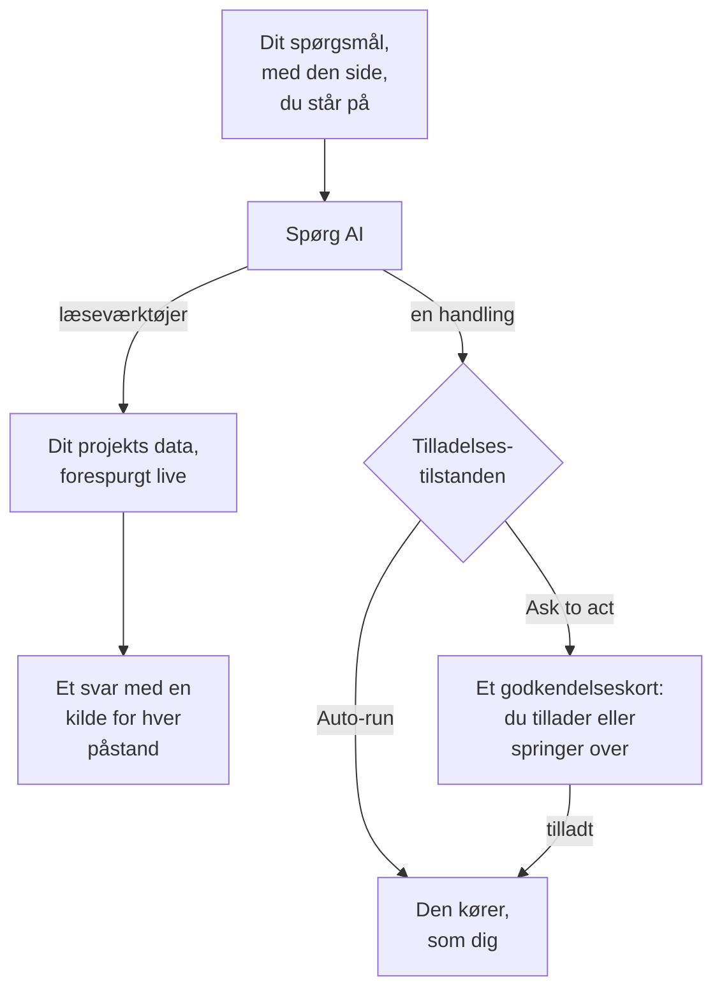

# Spørg AI

Spørg AI er OneUptimes chat over dit projekts data. Spørg om logs, traces, metrikker, undtagelser, hændelser, advarsler, monitorer, vagtordning, statussider, SLO'er, runbooks eller workflows: chatten forespørger dit projekt live, underbygger hver påstand med en kilde og handler for dig, når du tillader det.

:::cards
- [Åbn Spørg AI](#åbn-spørg-ai): Fra topbjælken, tastaturet, et diagram eller produktmenuen.
- [Hvad den kan se](#hvad-den-kan-se): De data, den læser for at svare dig.
- [Handlinger og tilladelsestilstande](#handlinger-og-tilladelsestilstande): Vælg, om den må handle, og hvornår den spørger først.
- [Handlinger udføres som dig](#handlinger-udføres-som-dig): Dine tilladelser, dit navn på hver ændring.
:::

## Sådan svarer Spørg AI

Spørg AI svarer kun ud fra det, dens værktøjer returnerer: den kører forespørgsler mod dit projekt i stedet for at svare ud fra hukommelsen. Hvert faktum i et svar har en kildechip, der viser forespørgslen bag det og åbner de data, den læste. Når du beder den ændre noget, afgør samtalens tilladelsestilstand, om den spørger dig først. Før dit spørgsmål læser den projektets [AI-kontekst](/docs/ai/ai-context): det, dit team har skrevet ned til OneUptime AI om jeres egne systemer.

I tilstanden **Skrivebeskyttet** tilbydes modellen aldrig handlingerne, så samtalen kun læser.

## Åbn Spørg AI

| Hvor | Hvordan |
| --- | --- |
| Enhver side | Klik på **Spørg AI** i topbjælken, eller tryk `Ctrl` + `I` (`Cmd` + `I` på en Mac). Mens du skriver i et tekstfelt eller en editor, forbliver tasterne editorens genvej til kursiv. |
| Kommandopaletten | Tryk `Ctrl` + `K` (`Cmd` + `K` på en Mac), og vælg **Spørg AI**. |
| Et fejlmønster i logs eller et diagrams fund | Klik på **Explain with AI**: Spørg AI åbner med beviserne som et spørgsmål, du kan redigere, før du sender det. |
| Produktmenuen | Åbn **Produkter → AI → Chat**. Spørg AI åbner over den side, du var på. Hver samtale har sin egen adresse, så du kan bogmærke den og vende tilbage til den. |

Spørg AI åbner midt på skærmen, over den side, du var på, og på en telefon fylder den hele skærmen. Tryk på `Esc`, eller klik ved siden af, for at gå tilbage til siden. Samtalen bliver, hvor du forlod den: åbn Spørg AI igen for at fortsætte. Lukker du den, mens den stadig svarer, siger en påmindelse i hjørnet, hvornår svaret er klar, og åbner det.

På en hændelse eller en advarsel har kortet **AI Investigation** sin egen samtale, **Ask OneUptime AI**, som deles af alle, der kan se hændelsen eller advarslen: se [Tal med OneUptime AI om hændelsen](/docs/ai/ai-sre#tal-med-oneuptime-ai-om-hændelsen).

## Hvad den kan se

Spørg AI læser dit projekt med dine egne tilladelser, så den ser det, du må se, og intet mere.

| Område | Hvad Spørg AI læser |
| --- | --- |
| Telemetri | Logsøgning og histogrammer, trace-aggregeringer og span-træer, metrikker, undtagelser, sikkerhedshændelser, real user monitoring og Web Vitals, nylige ændringer og anomalitjek mod indlærte baselines. |
| Infrastruktur | Hosts, Docker, Podman, Kubernetes, Docker Swarm, Proxmox, VMware vCenter, Ceph, lagersystemer, serverless-funktioner, cloudmiljøer, IoT-flåder og netværksenheder: hvad der er i inventaret, deres rapporterede forbindelsestilstand, metriktrends, antal logs pr. alvorlighed og resuméer af trace-operationer. En forespørgsel dækker både telemetri, der nævner en tjeneste, og telemetri, der nævner en infrastrukturressource. |
| Hændelseshåndtering | Hændelser og advarsler med tilstandsfiltre ("hvad er aktivt lige nu?"), deres aktivitetstidslinjer (tilstandsskift, interne og offentlige noter, feedet) og ejere samt en søgning i tidligere hændelser for at genbruge, hvordan de blev løst. |
| Vagter | Hvem der har vagt nu, politikker og eskaleringskæder, og om de seneste udkald blev leveret og kvitteret. |
| AI'ens eget arbejde | Resultaterne af AI SRE-undersøgelser og AI-indsigter, så "hvad fandt AI'en?" besvares ud fra den offentliggjorte analyse i stedet for at blive udledt igen. |
| Platform | Monitorer (med statusfiltre), planlagt vedligeholdelse, statussider og deres meddelelser, SLO'er, runbooks, workflow-kørsler, probernes sundhed, teams og koden i forbundne repositories. |

## Sidekontekst

Spørg AI ved, hvilken side du åbnede den fra. På en hændelsesside betyder "hvorfor skete det?" netop den hændelse: indtastningsfeltet viser en chip med sidens emne, og de spørgsmål, den foreslår, er sidens egne. Fjern chippen for at spørge om hele projektet i stedet, og tilføj den igen på samme måde. Åbn Spørg AI på en anden side, så følger konteksten med. Samtalen husker også sit første emne på serveren, så et opfølgende spørgsmål dage senere stadig forstår "denne hændelse".

Infrastrukturlister og ressourcesider tilbyder spørgsmål til den slags ressource, du ser på. Åbn en Kubernetes-klynge og spørg "Hvilke metrikker har ændret sig de seneste 24 timer?", eller åbn en Docker-host og spørg "Opsummér logalvorlighed og trace-fejl de seneste seks timer." Bevislinks fører tilbage til ressourcens side. Læsninger respekterer dine tilladelser til projekt, ressourcer og telemetri, inklusive begrænsninger på ejerskab og labels.

På en underside registrerer konteksten også den pod, container, VM, proces eller anden underressource, du valgte. Infrastrukturværktøjerne læser den overordnede ressources telemetri; de kan ikke måle én underressource ud fra dens navn alene. Spørg AI siger det og gætter ikke på et Kubernetes-namespace, som siden ikke angiver. En forbindelsestilstand er ikke en workloads sundhed, og manglende telemetri betyder ikke, at en ressource er sund.

## Kommandoer på din infrastruktur

Åbnet på siden for en ressource, hvis AI-agent er forbundet (en vært, en Docker- eller Podman-vært, et Docker Swarm-cluster, et Proxmox-cluster, et VMware vCenter, et Ceph-cluster, en databaseserver eller et Kubernetes-cluster), kører Spørg AI kommandoer på den gennem den agent, når du beder om det: "kør `uptime` på denne vært" eller "vis de sidste 100 linjer af `journalctl -u nginx`". Den svarer med det, der kom tilbage, med kildehenvisning ligesom al anden dokumentation. Åbnet på en hændelse eller en advarsel når den de ressourcer, der er knyttet til den.

- Den kører kun de skrivebeskyttede kommandoer, som en AI-undersøgelse må køre på den slags ressource (se [AI-agenter til infrastruktur](/docs/ai/infrastructure-ai-agents)), højst 30 for ét svar gennem hver slags agent, kontrolleret af OneUptime og igen af agenten, i alle tilladelsestilstande. En ændring gennem agenten, for eksempel at genstarte en tjeneste, kører aldrig fra Spørg AI: den giver dig i stedet den præcise kommando, og agenten foretager kun ændringer, når OneUptime AI udbedrer en hændelse eller advarsel, efter ressourcens egne indstillinger for rettelser. Spørg AI's egne handlinger, for eksempel at køre en runbook, følger samtalens tilladelsestilstand, som beskrevet nedenfor.
- Den når kun de ressourcer, du må se, og kun mens AI-undersøgelse er slået til for ressourcen.
- Når den ikke kan køre en kommando der (ingen agent er forbundet, agenten er offline, eller AI-undersøgelse er slået fra for ressourcen), siger den det sammen med, hvad der skal ændres, og svarer i stedet ud fra dit projekts data.

## Handlinger og tilladelsestilstande

Hver samtale har en tilladelsestilstand, som du vælger i indtastningsfeltet ved siden af tekstboksen:

| Tilstand | Hvad der sker |
| --- | --- |
| **Spørg før handling** | Standard. Spørg AI foreslår hver handling på et godkendelseskort, og intet kører, før du vælger **Tillad** eller **Spring over** for den, eller **Afvis alle**. |
| **Kør automatisk** | Handlinger kører, så snart modellen beder om dem, stadig begrænset til det, din rolle må. Brug den med omtanke. |
| **Skrivebeskyttet** | Handlingerne tilbydes slet ikke modellen: Spørg AI kan kun læse. |

Hvad Spørg AI kan gøre, når en tilstand tillader det:

- Oprette en hændelse eller en advarsel, kvittere for eller løse hændelser og advarsler og ændre en hændelses alvorlighed.
- Knytte en hændelse eller en advarsel til den infrastruktur og de tjenester, den drejer sig om. En hændelse eller en advarsel, den opretter på en ressources side, fx en værts, knyttes til den ressource, og godkendelseskortet nævner, hvad hver handling knytter til. OneUptime AI undersøger og retter det, en hændelse eller advarsel er knyttet til.
- Skrive en intern note på en hændelse eller en advarsel. Interne noter vises aldrig på en statusside.
- Offentliggøre en statusopdatering på en hændelse. Det er en særskilt handling, fordi den giver statussidens abonnenter besked.
- Kalde en vagtpolitik ud, køre en runbook eller starte en AI-undersøgelse af en hændelse eller advarsel.
- Foreslå en kodeændring: committe til en ny branch i et forbundet repository og åbne en pull request. Den skriver aldrig til standardbranchen eller en beskyttet branch, så en person stadig merger ændringen.

Bed om en hændelse, når brugere er berørt, og om en advarsel, når noget først kræver dit teams opmærksomhed, fx en værts hukommelse, der bliver ved med at stige. Begge oprettes én gang og overvåger intet: For at blive advaret, hver gang en værts hukommelse kommer over 75 %, skal du oprette en [værts-monitor](/docs/monitor/host-monitor#færdige-advarselsskabeloner) ud fra dens hukommelsesskabelon med 75 % som tærskel. Spørg AI kan ikke oprette monitorer. Bliver den bedt om en, siger den det, tjekker den aktuelle værdi og tilbyder at oprette en advarsel, hvis den allerede er over.

## Handlinger udføres som dig

Enhver handling, Spørg AI udfører, sker som dig: den foretager den samme ændring, som dashboardet foretager for samme handling, med dine egne tilladelser i projektet, og ændringen tilskrives dig. Kvitteres en hændelse fra chatten, opstår det samme tilstandsskift som fra hændelsens tilstandspanel, så hændelsens tidslinje og feed viser, at du ændrede dens tilstand. Et udkald sendt fra chatten viser dig som den, der udløste det.

- **Hvad hver handling kræver.** Den tilladelse, dashboardet kræver for samme ændring. At oprette en hændelse eller en advarsel kræver tilladelse til at oprette dem: en rolle, der må, eller **Create Incident** eller **Create Alert** i en brugerdefineret rolle. At kvittere for eller løse en hændelse kræver tilladelse til at ændre dens tilstand: **Projektejer**, **Projektadministrator**, **Projektmedlem**, **Hændelsesadministrator** og **Hændelsesmedlem**, eller **Create Incident State Timeline** i en brugerdefineret rolle; en advarsel kræver samme tilladelse for advarsler (**Create Alert State Timeline**). At kalde en vagtpolitik ud kræver tilladelse til at udføre den (**Create On-Call Duty Policy Execution Log**), og at køre en runbook kræver tilladelse til at starte runbook-kørsler: en rolle, der kører runbooks, for de runbooks, dens labels når, eller **Create Runbook Execution** i en brugerdefineret rolle, som når alle projektets runbooks. At ændre en hændelses alvorlighed, starte en AI-undersøgelse af en hændelse eller advarsel og skrive kode til et forbundet repository kræver tilladelse til at ændre den hændelse, advarsel eller det repository. En handling, du ikke må udføre, afvises, og AI'en fortæller dig, hvilken tilladelse den kræver. Har du tilladelsen, men et team, du er med i, blokerer den, fortæller AI'en dig det i stedet: en blokering på visse labels afviser handlingen i Spørg AI for alle poster, ikke kun for poster med de labels.
- **Hvilke poster.** Dem, du må ændre, som overalt i OneUptime: med en rolle, der er begrænset til visse labels eller til de poster, du ejer, ændrer en handling på enhver anden post intet. En runbook kører kun, når din tilladelse til at starte runbook-kørsler når den. I OneUptime Cloud afvises en handling, som projektets abonnement ikke omfatter, med det abonnement, den kræver.
- **Når en handling afvises.** Intet ændres, og AI'en siger klart, at handlingen ikke blev udført, og hvorfor, i stedet for at prøve igen.
- **Slack, Microsoft Teams og AI-undersøgelser.** AI'ens svar i Slack og Microsoft Teams og autonome AI-undersøgelser læser kun: de udfører ingen af disse handlinger. For at handle fra Slack eller Microsoft Teams skal du bruge knapperne på OneUptimes beskeder, som også handler som dig (se [Slack](/docs/workspace-connections/slack#handl-på-hændelser-advarsler-og-begivenheder-fra-slack) og [Microsoft Teams](/docs/workspace-connections/microsoft-teams#handl-på-hændelser-advarsler-og-begivenheder-fra-microsoft-teams)).

## Styr en samtale

- **Stop den.** Mens Spørg AI arbejder, bliver send-knappen til en stopknap. Stop en kørsel når som helst, og spørg straks om noget andet.
- **Følg dens arbejde.** Mens den svarer, siger én linje, hvad den gør nu, for eksempel søger i logs. Klik på antallet af trin ved siden af for at se hvert trin.
- **Vælg modellen.** Når dit projekt kan bruge mere end én LLM-udbyder, viser udbydervælgeren i indtastningsfeltet dit projekts LLM-udbydere og de globale, med standarden markeret. En ny samtale bruger standarden.
- **Bedøm et svar.** **Godt svar** og **Dårligt svar** gemmes sammen med beskeden, så svarenes kvalitet kan måles over tid.
- **Se prisen.** Under hvert svar åbner kilderne sig i de forespørgsler, det kørte, og kilderne til det nyeste svar siger også, hvor mange forespørgsler det kørte, dets tokens og dets pris. Hver kildechip i et svar åbner dataene bag den.
- **Gem en kopi.** **Download samtale** gemmer tråden med **Download som Markdown**, til at læse eller indsætte i en sag, eller **Download som PDF**, til at give videre.
- **Fortsæt, hvor du slap.** **Alle samtaler**, i Spørg AI's topbjælke, viser dine samtaler, nyeste først, så du kan åbne dem igen eller slette dem. Starten på en ny samtale viser de seneste tre.

## Krav

- **En LLM-udbyder.** Spørg AI bruger projektets standard-LLM-udbyder (se [LLM-udbydere](/docs/ai/llm-provider)). I OneUptime Cloud virker den med det samme med den globale udbyder, betalt af projektets AI-kreditter; en selvhostet installation konfigurerer en udbyder eller miljøvariablerne for den globale udbyder. Svarene er kun så gode som modellen: en lille selvhostet model uden pålidelige værktøjskald svarer dårligt.
- **Growth-abonnementet, i OneUptime Cloud.** Et projekt på et lavere abonnement ser, at AI ikke er med i abonnementet, med et link til **Projektindstillinger → Fakturering og fakturaer → Fakturering**.
- **AI slået til for projektet.** **Aktivér AI** på **Projektindstillinger → AI → AI Features** slår alle projektets AI-funktioner fra, Spørg AI inklusive. Den er slået til, medmindre nogen har slået den fra.

Spørg AI tæller med i projektets egne daglige AI-grænser, når projektet sætter dem (Projektindstillinger → AI → AI Features → Yderligere indstillinger): når en er nået, viser Spørg AI en sætning om, hvilken grænse der blev nået, at OneUptime AI starter igen ved midnat UTC, og hvem der kan hæve eller fjerne grænsen. Projektets ejere får en e-mail, første gang en grænse nås hver dag. De daglige grænser for hændelser og advarsler stopper aldrig Spørg AI. Se [projektets egne daglige grænser](/docs/ai/ai-sre#projektets-egne-daglige-grænser).

## Fejlfinding

:::details Spørg AI siger, at AI ikke er tilgængelig
Spørg AI siger hvorfor, før du skriver: projektets abonnement omfatter ikke AI, **Aktivér AI** er slået fra, eller projektet har ingen LLM-udbyder. Hver besked linker til den side, hvor det ændres.
:::

:::details En handling blev afvist
Spørg AI siger, hvilken tilladelse handlingen kræver, eller hvilket team der blokerer den. Bed en, der må foretage ændringen, eller bed en projektejer give din rolle tilladelsen. Intet blev ændret.
:::

:::details Svarene er vage eller bruger aldrig data
Tjek modellen bag udbyderen. Spørg AI har brug for en model, der kalder værktøjer pålideligt; små lokale modeller svarer ofte uden at køre en eneste forespørgsel. Se [LLM-udbydere](/docs/ai/llm-provider).
:::

## Næste trin

:::cards
- [AI SRE](/docs/ai/ai-sre): Lad OneUptime AI undersøge hver ny hændelse og advarsel.
- [LLM-udbydere](/docs/ai/llm-provider): Vælg den model, Spørg AI og de andre AI-funktioner bruger.
- [MCP-server](/docs/ai/mcp-server): Spørg om OneUptime fra Claude, Cursor eller VS Code i stedet.
:::
