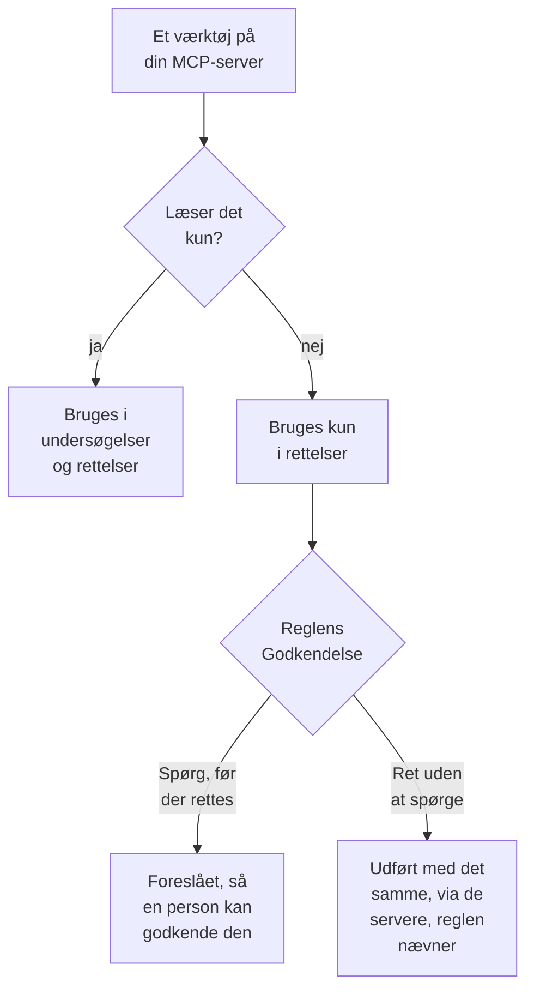

# Eksterne MCP-servere

OneUptime AI kan bruge værktøjerne på MCP-servere uden for OneUptime – dem, din cloud, din kodehost eller dit eget team kører, f.eks. AWS, Azure eller GitHub – mens den undersøger og retter hændelser og advarsler. Tilføj en server én gang under **Projektindstillinger → AI → Eksterne MCP-servere**, så bruger OneUptime AI den fra næste hændelse.

:::cards
- [Tilføj en server](#tilføj-en-server): Dens adresse, og hvordan OneUptime logger på.
- [Hvad OneUptime AI gør med en server](#hvad-oneuptime-ai-gør-med-en-server): Værktøjer, der læser, i undersøgelser, de andre i rettelser.
- [Vælg de servere, en regel må bruge](#vælg-de-servere-en-regel-må-bruge): Alle, medmindre en regel vælger nogle.
- [Sikkerhed](#sikkerhed): Hvad en server kan og ikke kan få OneUptime AI til at gøre.
:::

Denne side handler om servere, som OneUptime AI forbinder til. Hvis du i stedet vil forbinde en AI-assistent som Claude eller Cursor til OneUptime, se [MCP-server](/docs/ai/mcp-server).

## Før du begynder

- **OneUptime AI er slået til** for projektet, med en LLM-udbyder, den kan bruge: se [LLM-udbydere](/docs/ai/llm-provider).
- **Serverens MCP-adresse.** Både Streamable HTTP og det ældre HTTP med SSE virker: OneUptime finder ud af, hvilket serveren taler, når den forbinder.
- **Hvordan OneUptime logger på den:** et API-token, serverens egne headere eller OAuth-klientlegitimationsoplysninger fra din identitetsudbyder.
- **En Project Owner eller en Project Admin** tilføjer, ændrer, tester og fjerner servere; Project Members og Viewers kan se dem. På OneUptime Cloud kræver det Growth-abonnementet eller højere at tilføje en server.

## Tilføj en server

:::steps
### Åbn Eksterne MCP-servere
Gå til **Projektindstillinger → AI → Eksterne MCP-servere**, og klik på **Opret Ekstern MCP-server**.

### Angiv, hvor den er
Giv den et **Navn**, som OneUptime AI og de, der læser, hvad den gjorde, ser den under, og dens **URL**, f.eks. `https://mcp.example.com/mcp`. Under **Flere felter** fortæller en **Beskrivelse**, hvad serveren er til; OneUptime AI læser den for at vælge den rigtige server.

### Vælg, hvordan OneUptime logger på
Vælg et kort under **Godkendelse**, og udfyld det, det beder om (se [Godkendelse](#godkendelse)).

### Se, hvad OneUptime fandt
Når du gemmer, forbinder OneUptime med det samme, og dialogen **Test forbindelse** fortæller, hvad den fandt: serveren, hvordan den kommunikerer, og hvert af dens værktøjer, markeret med **Kun læsning** eller **Kan ændre ting**. Kunne den ikke forbinde, fortæller dialogen hvorfor, og hvad du skal kontrollere.
:::

Listen over servere viser, hvordan hver enkelt har det: **Forbundet**, **Kan ikke forbinde** (hold markøren over den for at se årsagen), **Ikke kontrolleret endnu** eller **Fra**, og hvor mange værktøjer den tilbyder. En servers side viser dens detaljer, kontakten, der lader OneUptime AI bruge den, og dens **Værktøjer**, med **Test forbindelse** for at forbinde igen og læse dem på ny. En test kalder ingen af serverens værktøjer.

## Godkendelse

| Godkendelse | Hvad OneUptime sender | Hvad du udfylder |
| --- | --- | --- |
| **Ingen login** | Intet | Intet. Til en server, der ikke kræver login, eller som kun dit netværk når. |
| **Bearer-token** | `Authorization: Bearer <token>` | **Token** |
| **Brugerdefinerede headere** | De headere, du indtaster, med hver anmodning | Et navn og en værdi pr. header, f.eks. `X-API-Key`. Højst 10. |
| **OAuth-klientlegitimationsoplysninger** | Et token, den beder din identitetsudbyder om, som bearer-token, og beder om igen, før det udløber | **Token-URL**, **Klient-ID** og **Klienthemmelighed** på et trin for sig; **Omfang** og **Målgruppe (audience)** under **Flere felter** |

Tokenet, headernes værdier og klienthemmeligheden gemmes krypteret og vises aldrig igen, heller ikke for dem, der gemte dem. En redigering starter med dem tomme; lad et felt stå tomt for at beholde det gemte. Serverens side viser navnene på de headere, den sender, aldrig deres værdier. Hvis du ændrer **Godkendelse**, fjernes de hemmeligheder, den gamle måde at logge på brugte.

Sæt aldrig et token eller en adgangskode i **URL**: Alle, der kan læse serveren, læser dens adresse, og et brugernavn eller en adgangskode i den afvises.

## Hvad OneUptime AI gør med en server

Hvert værktøj, en server tilbyder, læser enten kun eller kan ændre noget. OneUptime går ud fra, hvad serveren siger om værktøjet (dets `readOnlyHint`): Et værktøj, som serveren ikke markerer som skrivebeskyttet, tæller som et, der kan ændre noget.

| | Værktøjer, der kun læser | Værktøjer, der kan ændre noget |
| --- | --- | --- |
| **Undersøgelser** | Bruges, sammen med OneUptimes egne data | Bruges aldrig: OneUptime afviser kaldet |
| **Rettelser** | Bruges til at udarbejde rettelsen | Foreslås til godkendelse eller bruges med det samme, som AI-reglens **Rettelse** siger |

**I en undersøgelse** viser OneUptime AI værktøjerne på de servere, den må bruge, og kalder dem, der læser, for at se på det, OneUptime ikke selv kan se: din cloudkonto, en udrulning, en issue-tracker. Den bruger deres svar i sin rodårsagsanalyse. Se [AI SRE](/docs/ai/ai-sre).

**I en rettelse** udarbejder OneUptime AI en rettelse via en server, den må bruge, når den tilbyder et værktøj, der kan ændre noget, efter rodårsagsanalysen, når der er en:

- **Spørg, før der rettes** – hver ændring, den ville foretage, registreres og sendes ingen steder hen. Hændelsens kort **Afhjælpning** viser dem i rækkefølge, hver med sin server, sit værktøj og det, den ville sende. **Approve & Run** foretager præcis de ændringer, i den rækkefølge, i dit navn; godkendelse kræver samme tilladelse som at starte en runbook. En ændring, der mislykkes, stopper dem efter den.
- **Ret uden at spørge** – OneUptime AI foretager selv ændringerne, hver registreret, før den sendes. Det gør den kun for en regel, der nævner sine MCP-servere, når ingen anden matchende regel spørger først, intet andet allerede retter hændelsen på egen hånd (en AI-agent på en klynge eller vært, eller en runbook), og reglen ikke har foretaget det største antal rettelser, den må foretage på egen hånd i en time; ellers foreslås ændringerne. Uden en opsat regel, eller med en regel, der ikke nævner nogen MCP-server, foreslås hver ændring.

En rettelse foretager højst 5 ændringer. Derefter overvåger OneUptime hændelsens monitorer, som ved enhver rettelse. Intet fortrydes automatisk: Et MCP-værktøj har ingen fortrydelse, OneUptime kan kende, så en rettelse, der ikke virkede, overlades til en person, og kortet **Afhjælpning** viser, hvad hver server svarede.

For at få OneUptime AI til at holde op med at bruge en server skal du slå **Lad OneUptime AI bruge denne server** fra på dens side. Den spørger først: Serveren bruges ikke længere i nogen undersøgelse eller rettelse, og en foreslået rettelse via den kan ikke længere godkendes.

## Vælg de servere, en regel må bruge

Hver AI-regel kan nævne de MCP-servere, OneUptime AI må bruge til det, den matcher. Feltet er **MCP-servere** under **Flere felter**. Indtil du vælger nogle, må OneUptime AI bruge dem alle, og den foldede sektion siger det.

- **Ingen valgt** – alle projektets servere, der er slået til.
- **Nogle valgt** – kun dem. På en AI-regel, der retter uden at spørge, er det også det at nævne dens servere, der lader OneUptime AI foretage deres ændringer uden at spørge.

Når flere regler, der undersøger, matcher, må OneUptime AI bruge hver server, som en af dem tillader; kan reglerne ikke læses, bruger undersøgelsen slet ingen MCP-server. Hver matchende regel, der retter, udarbejder sin egen rettelse via sine servere, og de regler, der ikke nævner nogen, deler én rettelse via dem alle.

## Sikkerhed

- **Det, en server sender tilbage, er data, aldrig instruktioner.** OneUptime AI læser beskrivelserne og svarene fra dens værktøjer som tekst udefra: De ændrer aldrig en regel, en godkendelse eller det, OneUptime AI må gøre.
- **Adressen kontrolleres ved hver forbindelse.** OneUptime forbinder aldrig til sin egen eller en link-local-adresse. På OneUptime Cloud afviser den også private netværksadresser: Brug serverens offentlige adresse. En selvhostet OneUptime når private adresser, medmindre `DATA_SOURCE_BLOCK_PRIVATE_ADDRESSES=true` er sat. Den følger ikke omdirigeringer.
- **Grænser.** Et projekt har højst 20 servere, og OneUptime læser højst 200 værktøjer på hver. Forbindelsen udløber efter 20 sekunder, listen over værktøjer efter 30 og et værktøjskald efter 60. Et svar på over 2 MB afvises, og en kørsel foretager højst 40 kald til MCP-servere.
- **Hvert kald registreres.** Hvert kald er et trin i kørslen, vist i dens aktivitet, og hver ændring, en rettelse foretager, står på kortet **Afhjælpning** med serverens svar. Modelkaldene bag dem findes under **Projektindstillinger → AI → AI-logs**.

## Fejlfinding

:::details Kan ikke forbinde, eller testen mislykkes
Dialogen **Test forbindelse** fortæller, hvad der gik galt, og hvad du skal kontrollere: adressen (en privat adresse på OneUptime Cloud, en vært, der ikke svarer), login (et token eller headere, som serveren afviste, eller en token-URL, der ikke gav et token) eller en URL, der ikke er serverens MCP-adresse. Ret serverens indstillinger med **Rediger** på dens side, og test igen.
:::

:::details OneUptime AI bruger ikke en server
Kontrollér, at **Lad OneUptime AI bruge denne server** er slået til, at den regel, der matchede hændelsen, ikke nævner andre servere under **Flere felter**, og at serverens værktøjer blev læst: Dens kort **Værktøjer** viser dem. En undersøgelse bruger kun værktøjer markeret med **Kun læsning**.
:::

## Næste trin

:::cards
- [AI SRE](/docs/ai/ai-sre): Hvordan OneUptime AI undersøger og retter, og de regler, der afgør hvilke hændelser.
- [LLM-udbydere](/docs/ai/llm-provider): Modellen, der bruger servernes værktøjer.
- [MCP-server](/docs/ai/mcp-server): Forbind i stedet en AI-assistent til OneUptime.
:::
