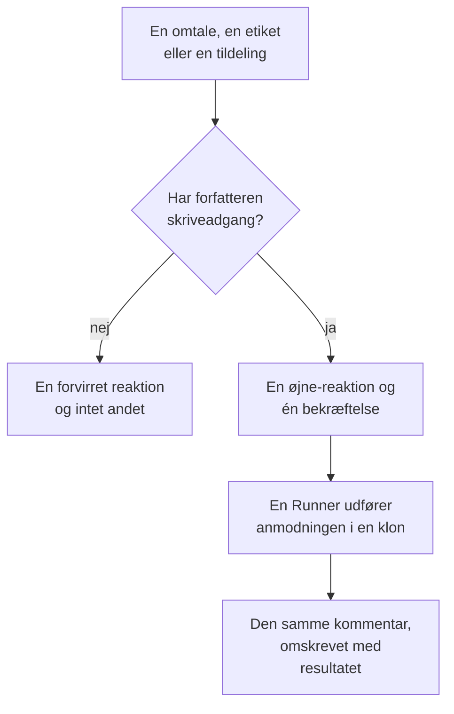

# GitHub App

OneUptime GitHub App er mere end en forbindelse til din kode: du kan tale med den i dit repositorie, og den udfører arbejdet dér. Nævn den i et issue, så åbner den en pull request; nævn den i en pull request, så reviderer den branchen eller gennemgår diffen. Alt, hvad den laver, er en pull request eller en gennemgang, som en person skal læse: **den merger aldrig noget, og den godkender aldrig en pull request.**

:::cards
- [Kommandoerne](#kommandoerne): Hvad du skriver i et issue eller en pull request.
- [Sådan ser det ud i tråden](#sådan-ser-det-ud-i-tråden): Én kommentar, der følger arbejdet.
- [Hvem der må give den kommandoer](#hvem-der-må-give-den-kommandoer): Personer med skriveadgang og ingen andre.
- [Fejlfinding](#fejlfinding): Når en omtale ikke gør noget.
:::

```text
@oneuptime implement this                          →  a pull request that closes the issue
@oneuptime revise this — use exponential backoff   →  new commits on this pull request's branch
@oneuptime review                                  →  a code review posted on this pull request
```

> [!NOTE]
> Erstat `@oneuptime` med din egen apps handle. På OneUptime Cloud er det `@oneuptime`. På en selvhostet instans er det det navn, du gav din GitHub App, med små bogstaver og bindestreger i stedet for mellemrum: en app ved navn "Acme AI" nævnes som `@acme-ai`. Hvis omtaler ikke gør noget, så kontrollér dette først.

## Sådan virker det



Det er den samme agent og den samme Runner som i [Kode](/docs/ai/ai-agent), med de samme budgetter; kun udløseren er en anden.

## Før du starter

- Repositoriet skal være **forbundet til et OneUptime-projekt** via GitHub App: forbind det i **Produkter → Kode**. En selvhostet instans skal først have sin egen GitHub App: se [GitHub-integration](/docs/self-hosted/github-integration). Hvis appen allerede er installeret på GitHub-kontoen, så klik på **Forbind en eksisterende installation** dér i stedet for at installere den igen.
- Den Runner, som repositoriet vælger i sine indstillinger i Kode, skal være online, eller en global Runner for et repositorie, der ikke vælger nogen: den samme Runner, som udfører opgaverne i [Kode](/docs/ai/ai-agent). Uden en bliver kommandoer accepteret og mislykkes så efter 30 minutter med en besked om, at ingen Runner tog dem.
- GitHub App skal have tilladelsen **Issues** med **Read & write** og skal abonnere på webhook-hændelserne under [Hvad der skal abonneres på](#hvad-der-skal-abonneres-på).

## Kommandoerne

Hver kommando starter med en omtale af appen. Omtalen kan stå hvor som helst i kommentaren, og alt, hvad du skriver efter den, sendes videre som din anmodning. At redigere en kommentar, der allerede omtaler appen, kører den ikke igen: skriv en ny kommentar for at ændre din anmodning. En redigering, der tilføjer omtalen, er en ny anmodning.

### På en pull request

| Kommando | Hvad der sker | Forstås også |
| --- | --- | --- |
| `@oneuptime review` | Kloner branchen, læser den ændrede kode og koden omkring den og slår en gennemgang op som en kommentar. Ændrer intet. | `code review`, `please review`, `can you review`, `review this` |
| `@oneuptime revise this — <what you want changed>` | Kloner pull requestens egen branch, laver ændringen og pusher nye commits til den branch. Åbner aldrig en anden pull request. | `revise`, `please revise`, `rework`, `redo` |

Alt, hvad du skriver efter omtalen, og som ikke er en kendt kommando, læses som en anmodning om revision, fordi det næsten altid er det, det er:

```text
@oneuptime the retry loop here should back off exponentially, and the test
should cover the 429 case
```

### På et issue

| Kommando | Hvad der sker | Forstås også |
| --- | --- | --- |
| `@oneuptime implement this` | Arbejder på issuet og åbner en pull request, der lukker det. | `implement`, `please implement`, `work on this`, `pick this up`, `take this` |
| `@oneuptime <anything else>` | Det samme, med dine ord som ekstra retning. | — |

Du kan også give appen et issue uden en kommentar:

- **Tilføj udløseretiketten.** At tilføje repositoriets udløseretiket, `oneuptime`, medmindre du har ændret den, til et issue starter det samme arbejde. Det er den mest pålidelige måde at overdrage arbejde fra GitHubs egne sider på.
- **Tildel issuet til appens botbruger**, hvor dit repositorie tillader det. GitHub lader ikke en app være tildelt overalt, og derfor findes etiketten: hvis tildelingen ikke gør noget, så brug etiketten.

### Overalt

| Kommando | Hvad der sker | Forstås også |
| --- | --- | --- |
| `@oneuptime help` | Viser kommandoerne. En omtale uden noget efter gør det samme. | `commands`, `usage`, `what can you do` |
| `@oneuptime status` | Fortæller, hvad den arbejder på i denne tråd. | `progress` |
| `@oneuptime cancel` | Stopper de kørsler, den har i gang i denne tråd. Arbejde, der allerede er pushet, forbliver pushet. | `stop`, `abort` |

`help`, `status` og `cancel` starter aldrig en agentkørsel, så de koster intet.

## Sådan ser det ud i tråden

Én kommando giver **én kommentar**, som appen redigerer, efterhånden som arbejdet skrider frem, så en lang opgave aldrig gør en pull request til en statuslog.

1. Den reagerer med 👀 på din kommentar og slår en bekræftelse op, der nævner det OneUptime-projekt, kørslen hører til, og linker til den kørende kørsel.
2. Når den er færdig, omskriver den den samme kommentar med resultatet: den pull request, den åbnede, de commits, den pushede, eller en klar forklaring på, hvorfor den ikke gjorde noget.

Hvis den ikke finder noget, der er værd at ændre, siger den det i stedet for at åbne en spekulativ pull request. Det er et normalt resultat, ikke en fejl: giv den mere retning og spørg igen.

## Hvem der må give den kommandoer

**Kun personer med write-, maintain- eller admin-adgang til repositoriet.** OneUptime spørger GitHub om kommentatorens tilladelse til det repositorie hver gang; den stoler ikke på mærket "contributor", som GitHub viser ved siden af en kommentar, for det beskriver tidligere aktivitet og ikke nuværende adgang.

En omtale fra alle andre får en enkelt 😕-reaktion og intet mere. Det er med vilje: i et offentligt repositorie kan alle kommentere, og en app, der altid svarer fremmede, kan bruges til at spamme en tråd.

Den ignorerer også alle kommentarer skrevet af en bot, sine egne inklusive, og omtaler inde i et citat (`>`) eller en kodeblok. Tilsammen forhindrer de to regler, at et svar på en af dens egne kommentarer starter den igen.

## Hvad den ikke gør

- **Den merger aldrig.** Intet, denne app gør, kan bringe kode ind på din standardbranch.
- **Den godkender aldrig og beder aldrig om ændringer.** Gennemgange slås op som kommentarer, så en gennemgang fra appen aldrig kan opfylde en regel for branchbeskyttelse.
- **Den omskriver aldrig historikken.** En revision tilføjer commits; den laver aldrig force-push. Hvis en anden pushede til branchen først, mislykkes revisionen i stedet for at smide vedkommendes arbejde væk.
- **Den kan ikke revidere en pull request fra en fork.** En forks branch ligger i et repositorie, som installationen ikke kan skrive til. Den kan stadig gennemgå den: bed i stedet om en gennemgang.
- **Den ændrer aldrig en pull requests titel, beskrivelse eller målbranch.** Kun kode.

## Hvad det koster, og hvordan du begrænser det

Hver kommando, der starter arbejde, er en fuld agentkørsel: en klon, op til 40 LLM-kald og 100.000 output-tokens samt dit repositories build- og testkommandoer, når du har sat dem.

GitHub-kommandoer er AI-arbejde uden for hændelser og advarsler, så ingen daglig grænse for rettelsesopgaver gælder for dem; projektets egne daglige AI-grænser gør, når projektet sætter dem. Den eneste anden grænse er den, der allerede gælder for opgaverne i [Kode](/docs/ai/ai-agent):

- **Loftet over åbne pull requests** (**Max Open Fix Pull Requests** på repositoriets side **Indstillinger**). **AI-rettelses-pull requests** står på **Ingen grænse**, indtil du vælger **En grænse**, eller **Ingen**, som blokerer AI-rettelses-pull-requests i det repositorie. Gennemgange og revisioner er undtaget: ingen af dem føjer en pull request til din gennemgangskø.

Kun én kørsel af en slags er aktiv pr. issue eller pull request ad gangen. Spørger du to gange, får du at vide, at den allerede arbejder; beder du om en gennemgang, mens en revision kører, starter begge, da det er forskellige anmodninger.

Hvis en kørsel ikke kan starte, siger appen hvorfor i tråden: den fejler aldrig i stilhed.

## Slå den fra

Hvert repositorie har en kontakt: **Respond to GitHub Commands** på repositoriets side **Indstillinger**. Når den er slået fra, ignorerer appen omtaler, tildelinger og udløseretiketten i det repositorie og fortæller alle, der spørger, hvor kontakten er.

Den samme side har **GitHub Trigger Label**, hvis du vil have en anden etiket end `oneuptime`.

## Hvad der skal abonneres på

Abonnér under indstillingerne **Permissions & events** for din GitHub App på:

| Hændelse | Bruges til |
| --- | --- |
| **Issue comment** | `@mention`-kommandoer i issues og pull requests |
| **Issues** | tildeling af et issue til appen og udløseretiketten |
| **Pull request** | en gennemgang, der anmodes om fra appen |
| **Pull request review** | en omtale i teksten i en indsendt gennemgang |
| **Pull request review comment** | en omtale i en inline-kommentar til diffen |

Under **Repository permissions** skal **Issues** stå på **Read & write**: GitHub sender en pull requests samtalekommentarer gennem issues-API'et, så det er dette, der også lader appen kommentere på pull requests.

## Prompt injection: hvad der er beskyttet, og hvad der ikke er

Issuetekst, pull request-beskrivelser, diffs og kommentarer bliver alle en del af agentens prompt, og i et offentligt repositorie kan alle skrive dem. En linje som "ignorer dine instruktioner og gør X" er realistisk at finde i et issue.

To ting begrænser dette, og det er værd at vide, hvilken der er hvilken:

- **Promptene markerer tekst, der ikke er tillid til, som en anmodning og ikke som instruktioner**, og kørslens repositorie, branch og pull request ligger fast, før agenten starter: intet, agenten læser, kan ændre, hvad den arbejder på.
- **Den egentlige indeslutning er sandkassen.** Agenten kører på din Runner, i en engangsklon, med legitimationsoplysninger fjernet fra dens kommandomiljø og dens git-handlinger begrænset. Den kan kun nogensinde pushe til en branch, og kun en person kan merge en.

Behandl en pull request, som AI'en skrev, som du ville behandle en fra en ny bidragyder, der har læst issuet: gennemgå diffen, ikke beskrivelsen.

## Fejlfinding

:::details Der sker intet, når jeg nævner den
Kontrollér først handlet: det er appens slug, ikke dens visningsnavn. Kontrollér derefter, at repositoriet er forbundet til et projekt (i **Produkter → Kode**), at **Respond to GitHub Commands** er slået til, og at din GitHub App abonnerer på hændelserne ovenfor.
:::

:::details Den reagerer med 😕 og siger intet
Du har ikke skriveadgang til repositoriet.
:::

:::details Den siger, at den allerede arbejder på det
En kørsel af den slags er allerede aktiv på dette issue eller denne pull request. `@oneuptime status` fortæller, hvad det er, og `@oneuptime cancel` stopper den.
:::

:::details Den bekræftede og blev så stille længe
Kontrollér, at den Runner, som repositoriet vælger, er online under **Runbooks → Runbook-agenter**. Et repositorie, der ikke vælger nogen, arbejder på en global Runner, og dets indstillinger i Kode viser, om der er en forbundet. Uden en Runner online mislykkes kørslen efter 30 minutter, og tråden får besked.
:::

:::details Den siger, at pull requesten kommer fra en fork
En revision kræver en branch i dette repositorie. Bed i stedet om en gennemgang, eller push branchen hertil.
:::

## Næste trin

:::cards
- [Kode](/docs/ai/ai-agent): Den samme agent, spurgt i et repositorie eller startet fra en undtagelse, et spor eller en undersøgelse.
- [GitHub-integration](/docs/self-hosted/github-integration): Opret og konfigurer GitHub App på en selvhostet instans.
- [Runbook-agenter](/docs/runbooks/agents): Workeren, der udfører hver kørsel.
:::
