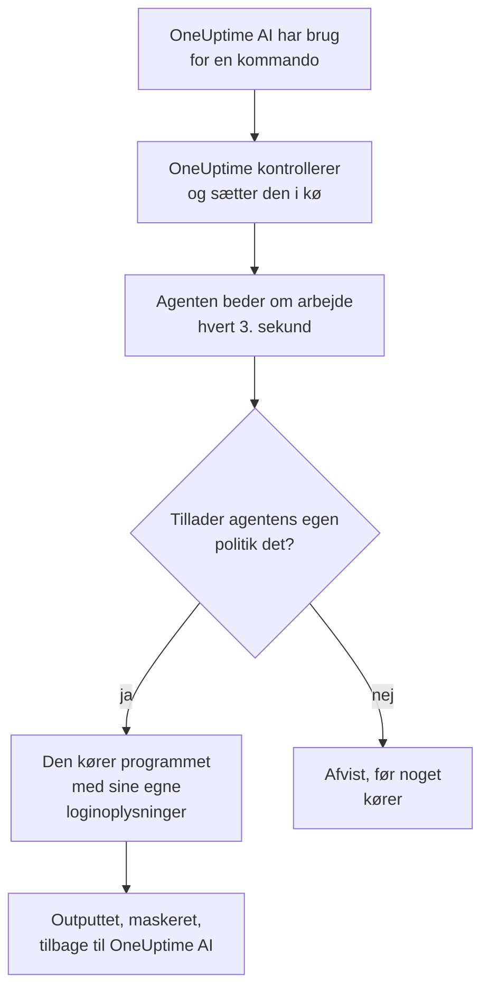

# AI-agenter til infrastruktur

OneUptime AI kan se på mere end din telemetri, mens den undersøger en hændelse eller advarsel. En lille agent, der er installeret ved siden af en af dine ressourcer (en Docker- eller Podman-vært, et Docker Swarm-cluster, et Proxmox-cluster, et VMware vCenter, et Ceph-cluster, en databaseserver eller en Linux-vært), kører de skrivebeskyttede kommandoer, som OneUptime AI beder om, for eksempel `docker logs --tail 200 web`, `pvesh get /cluster/status`, `ceph health detail`, `db long-queries --min-seconds 30` eller `journalctl -u nginx -n 200 --no-pager`, og sender outputtet tilbage, så årsagsanalysen citerer, hvad ressourcen selv siger. Hvis du tillader det, anvender den samme agent også rettelser (genstarter en container, starter en VM, markerer en OSD som in igen), hver især placeret i et niveau af en kommandopolitik og, medmindre du vælger andet, godkendt af et menneske først.

Disse agenter er **ressource-AI-agenterne**. Hver ressources side i dashboardet har en **AI**-sektion med tre sider:

- **Indsigter**: hvad OneUptime AI har fundet ud af om ressourcen de seneste 30 dage, altså de problemer, der bliver ved med at vende tilbage, og hvorfor, med hvad AI fandt og det trin, den foreslår, de dele af ressourcen, der står bag de fleste af dem, rettelser, der ikke hjalp eller venter på godkendelse, hvad AI selv har rettet, og de risici, der blev opdaget, før nogen blev tilkaldt, med hvad AI selv gjorde der som fodnote. Den fungerer som et clusters; se [Hvad AI har lært på et cluster](/docs/ai/ai-sre#hvad-ai-har-lært-på-et-cluster).
- **Protokoller**: alt, hvad OneUptime AI har gjort på ressourcen, nyeste først: hver undersøgelse med dens hændelse eller advarsel og dens resumé, hver rettelse, den foreslog eller kørte, og hver kommando, den sendte gennem agenten. (Denne side hed tidligere Indsigter.)
- **AI-agent**: om agenten er forbundet, hvad AI må gøre på ressourcen (undersøge, og hvordan rettelser kører), alt, der kræver opmærksomhed, med det trin, der løser det, og i menuen **⋯** ved siden af agentens status **Test forbindelse** og **Nulstil agent**.

Ressourcens **Oversigt** slutter med et **AI-agent**-kort, der opsummerer AI-agentens side: om agenten er forbundet, om undersøgelse er slået til, hvordan rettelser kører (**Fra**, **Bed om godkendelse**, **Automatisk** eller **Spring godkendelse over**), og hvad der kræver opmærksomhed, med et link til AI-agentens side, hvor de ændres.

:::cards
- [Understøttede ressourcer](#understøttede-ressourcer): Otte slags ressourcer, ét image.
- [Installer en AI-agent](#installer-en-ai-agent): Ved siden af en collector, du allerede kører, eller på en Linux-vært.
- [Sådan fungerer rettelser](#sådan-fungerer-rettelser): Hvad der må køre af sig selv, hvad der venter på et menneske, og hvad der aldrig kører.
- [Sikkerhedsmodel](#sikkerhedsmodel): Tre kontroller af hver kommando og ingen loginoplysninger fra OneUptime.
:::

## Sådan fungerer det

Agenten venter aldrig på en forbindelse fra OneUptime: den kalder selv OneUptime, beder om arbejde og kører kun det, som dens egen kopi af kommandopolitikken tillader, med de loginoplysninger, den allerede har.



## Forholdet til Kubernetes-AI-agenten

Kubernetes-clustre har deres egen agent, Kubernetes-AI-agenten, som installeres af Kubernetes-agentens Helm-chart; se [Clusteradgang: lad OneUptime AI køre kubectl](/docs/ai/ai-sre#clusteradgang-lad-oneuptime-ai-køre-kubectl). Intet på denne side ændrer den. Ressource-AI-agenterne følger det samme design:

- **De samme niveauer og tilstande.** Hver kommando er **Read**, **SafeWrite**, **RiskyWrite** eller **Denied**, og rettelser er **Fra**, **Bed om godkendelse**, **Automatisk** eller **Spring godkendelse over**, med samme betydning som på et cluster.
- **De samme tre kontroller.** Den samme kommandopolitik håndhæves af OneUptimes AI-værktøjer, igen når OneUptime sætter kommandoen i kø, og igen af agenten, før den kører noget.
- **Den samme regel om loginoplysninger.** Agenten bruger kun det, dens eget miljø og dens mounts giver den. OneUptime sender den aldrig loginoplysninger.
- **De samme standarder.** AI-undersøgelser er slået til som standard: en ressource starter med undersøgelse slået til og rettelser slået fra, ligesom et cluster, så OneUptime AI undersøger med sin agent, så snart den forbinder, og ændrer intet, før nogen tillader rettelser (se [Forbind til OneUptime](#forbind-til-oneuptime)).

Hvad der er anderledes:

- **Ét image til alle ressourcer.** `oneuptime/resource-ai-agent` betjener alle otte slags ressourcer, og `ONEUPTIME_AI_AGENT_RESOURCE_TYPE` angiver, hvilken en agent betjener. Den kører ved siden af ressourcens collector som én container mere, ikke fra et Helm-chart.
- **Skriveadgang er en miljøvariabel.** Først `ONEUPTIME_AI_ALLOW_WRITES=true` på agenten lader den overhovedet anvende rettelser, og `ONEUPTIME_AI_WRITE_TARGETS` begrænser, hvilke containere, tjenester, VM'er, OSD'er, sessioner eller units de må røre. På et cluster gør chartets RBAC og `aiAgent.remediation.namespaces` dette.

Ligesom Kubernetes-AI-agenten er en ressource-AI-agent ikke en Runner. Den vises aldrig under Runbooks → Runbook-agenter, og den bruges aldrig som Bash- eller SSH-vært til runbooks.

## Understøttede ressourcer

| Ressource | `ONEUPTIME_AI_AGENT_RESOURCE_TYPE` | Agent | Registrerer sig som (collectorens variabel) | Kører | Når ressourcen via |
| -------------------- | ---------------------------------- | --------------------- | ----------------------------------------------------------------------------------------------- | -------------------------------------------------------------------------------------------------------------------------------------------------- | -------------------------------------------------------------------------- |
| Docker-vært | `docker` | Docker-AI-agent | `DOCKER_HOST_NAME` | `docker` | Docker-socketten, `/var/run/docker.sock` |
| Podman-vært | `podman` | Podman-AI-agent | `PODMAN_HOST_NAME` | `docker`, gennem Podmans Docker-kompatible API | Podman-socketten, `/run/podman/podman.sock` |
| Docker Swarm-cluster | `docker-swarm` (eller `swarm`) | Docker Swarm-AI-agent | `DOCKER_SWARM_CLUSTER_NAME` | `docker` | en managernodes Docker-socket |
| Proxmox-cluster | `proxmox` | Proxmox-AI-agent | `PROXMOX_CLUSTER_NAME` | `pvesh`-kommandoer, sendt til Proxmox VE-API'et (der er ingen `pvesh`-binær i agenten) | `https://PVE_HOST:8006/api2/json`, med et Proxmox-API-token |
| VMware vCenter | `vmware` (eller `vcenter`) | VMware-AI-agent | `VMWARE_VCENTER_NAME` | `govc` | vCenters API, med en vSphere-bruger |
| Ceph-cluster | `ceph` | Ceph-AI-agent | `CEPH_CLUSTER_NAME` | `ceph` | monitorerne, med en `ceph.conf` og keyringen til agentens egen klient |
| Databaseserver | `database` (eller `db`) | Database-AI-agent | `DATABASE_SERVER_ID`, eller `DATABASE_SYSTEM` + `DATABASE_SERVER_ADDRESS` + `DATABASE_SERVER_PORT` | `db`: én operation fra et fast diagnostisk katalog, aldrig SQL | databasens egen driver, med et databaselogin |
| Vært | `host` | Værts-AI-agent | `HOST_NAME` (tom: værtens eget værtsnavn) | `systemctl`, `journalctl`, `df`, `free`, `uptime`, `ps`, `ss`, `ip`, `dmesg`, `lsblk`, `cat`, `top`, `uname`, `hostnamectl`, `timedatectl`, `kill` | `nsenter` ind i værtens namespaces, fra en privilegeret container |

Databaseservere: Database-AI-agenten har diagnostik til PostgreSQL, MySQL (og MariaDB og Percona Server), Redis (og Valkey, KeyDB og Dragonfly) og MongoDB. For enhver anden motor kører den intet og siger det på databasens AI-agent-side.

**Test forbindelse**, i menuen **⋯** ved siden af agentens status på AI-agentens side, kører disse skrivebeskyttede kommandoer gennem agenten og viser deres output i agentens kort:

| Ressource | Hvad Test forbindelse kører |
| -------------------- | ---------------------------------------------------- |
| Docker-vært | `docker version`, `docker info` |
| Podman-vært | `docker version`, `docker info` |
| Docker Swarm-cluster | `docker version`, `docker node ls` |
| Proxmox-cluster | `pvesh get /version`, `pvesh get /cluster/status` |
| VMware vCenter | `govc about` |
| Ceph-cluster | `ceph health`, `ceph versions` |
| Databaseserver | `db ping`, `db version` |
| Vært | `uptime`, `systemctl list-units --failed --no-pager` |

På en Docker Swarm-worker fejler `docker node ls`: Docker Swarm-AI-agenten skal køre på en managernode. En agent, der er startet på en worker, registrerer sig først for clusteret, når dens node er en manager, og Docker Swarm-installationsprogrammet udelader den på en node, der ikke er manager.

## Installer en AI-agent

Hver ressource-AI-agent er det samme image, `oneuptime/resource-ai-agent:release`. Den har ikke brug for noget i dashboardet: så snart den kører, registrerer den sig hos OneUptime og dukker op på ressourcens AI-agent-side inden for et minut.

### Ved siden af en collector

For Docker, Podman, Docker Swarm, Proxmox, VMware, Ceph og databaseservere kører agenten ved siden af den collector, du allerede bruger til den ressource, og deler dens `.env`: den har allerede `ONEUPTIME_URL`, ingestionsnøglen og ressourcens navn. Hver collectors `docker-compose.yml` leverer agenten som én tjeneste mere, og dens `install.sh` starter den.

| Ressource | Collector | AI-agentens tjeneste (og container) | Hvor den sættes op |
| -------------------- | ----------------------------------------------------------- | --------------------------------- | ------------------------------------------------------------------------------------- |
| Docker-vært | [Docker-agent](/docs/telemetry/docker-host#ai-agent) | `oneuptime-docker-ai-agent` | `agents/DockerAgent/docker-compose.yml`; `install.sh` starter den som en anden container |
| Podman-vært | [Podman-agent](/docs/telemetry/podman-host#ai-agent) | `oneuptime-podman-ai-agent` | `agents/PodmanAgent/docker-compose.yml`; `install.sh` starter den som en anden container |
| Docker Swarm-cluster | [Docker Swarm-agent](/docs/telemetry/docker-swarm#ai-agent) | `oneuptime-docker-swarm-ai-agent` | `agents/DockerSwarmAgent/docker-compose.yml`, på en managernode |
| Proxmox-cluster | [Proxmox-agent](/docs/telemetry/proxmox#ai-agent) | `oneuptime-proxmox-ai-agent` | `agents/ProxmoxAgent/docker-compose.yml` |
| VMware vCenter | [VMware-agent](/docs/telemetry/vmware#ai-agent) | `oneuptime-vmware-ai-agent` | `agents/VMwareAgent/docker-compose.yml` |
| Ceph-cluster | [Ceph-agent](/docs/telemetry/ceph#ai-agent) | `oneuptime-ceph-ai-agent` | `agents/CephAgent/docker-compose.yml`, med agentens egen Ceph-klient i `./ceph` |
| Databaseserver | [Database-agent](/docs/telemetry/databases#ai-agent) | `oneuptime-database-ai-agent` | `agents/DatabaseAgent/docker-compose.yml` |

En collector, der blev installeret, før AI-agenten fandtes, kører den ikke endnu. Kør dens `install.sh` igen: den starter nu også AI-agenten (installationsprogrammerne til Proxmox, VMware, Ceph, databaser og Docker Swarm henter den aktuelle `docker-compose.yml`, som har AI-agentens tjeneste). Hvis du selv styrer filerne, så tilføj tjenesten fra collectorens `docker-compose.yml` til din egen og kør `docker compose up -d`. Ressourcens AI-agent-side viser den præcise tjeneste til den ressource med navnet allerede udfyldt.

Uden installationsprogrammerne er Docker-AI-agenten én `docker run`:

```bash
docker run -d \
  --name oneuptime-docker-ai-agent \
  --user 0:0 \
  --restart unless-stopped \
  --read-only --tmpfs /tmp \
  -v /var/run/docker.sock:/var/run/docker.sock:ro \
  -e ONEUPTIME_URL="https://oneuptime.com" \
  -e ONEUPTIME_SERVICE_TOKEN="YOUR_TELEMETRY_INGESTION_TOKEN" \
  -e ONEUPTIME_AI_AGENT_RESOURCE_TYPE=docker \
  -e DOCKER_HOST_NAME="my-docker-host" \
  oneuptime/resource-ai-agent:release
```

`DOCKER_HOST_NAME` skal være det navn, Docker-agenten rapporterer. Installationsprogrammerne til Docker og Podman tager `--no-ai-agent` (eller `ONEUPTIME_INSTALL_AI_AGENT=false`) for at udelade AI-agenten, og det gør Docker Swarm-installationsprogrammet også. Vil du senere køre en collector uden den, så slet dens AI-agent-tjeneste fra `docker-compose.yml`, eller fjern dens container med `docker rm -f`.

### Værts-AI-agent

En Linux-vært, der rapporterer gennem [OpenTelemetry-collector på værten](/docs/telemetry/host-otel-collector), har ingen OneUptime-container at stå ved siden af, så Værts-AI-agenten kommer med sit eget installationsprogram (`agents/HostAIAgent`):

```bash
curl -fsSL https://raw.githubusercontent.com/OneUptime/oneuptime/master/agents/HostAIAgent/install.sh -o install.sh
sudo bash install.sh
```

Det beder om din OneUptime-URL, projektets telemetri-ingestionsnøgle og værtens navn, skriver `/opt/oneuptime-host-ai-agent/.env` og `docker-compose.yml` og starter containeren `oneuptime-host-ai-agent`. Tilføj `--systemd` for i stedet at køre den under systemd-unitten `oneuptime-host-ai-agent`. Den kræver Docker (systemmotoren, ikke rootless Docker) med Compose-pluginet; rootful Podman kan køre den samme container.

Værts-AI-agenten kører **værtens egne** programmer: hver kommando kører som `nsenter --target 1 --mount --uts --ipc --net --pid -- PROGRAM ARGS`, der går ind i namespaces for værtens init. Det kræver `pid: host`, `privileged: true` og root; se [Docker-socketten og Værts-AI-agenten er root på værten](#docker-socketten-og-værts-ai-agenten-er-root-på-værten). Lad `HOST_NAME` være tom for at bruge maskinens værtsnavn, som er det, collectoren rapporterer som `host.name`, medmindre du har ændret det; ellers skal du sætte det til det navn, der vises under **Værter**.

### Forbind til OneUptime

Agenten registrerer sig med **den samme identitet, som collectoren rapporterer** (`DOCKER_HOST_NAME`, `PROXMOX_CLUSTER_NAME`, `CEPH_CLUSTER_NAME`, …; `ONEUPTIME_AI_AGENT_RESOURCE_NAME` tilsidesætter den), så den betjener præcis den ressource, som collectorens telemetri oprettede. Når OneUptime endnu ikke har nogen ressource med det navn, opretter registreringen den, så et navn, der afviger fra collectorens, giver dig en anden, tom ressource i stedet for en fejl. En database registrerer sig med `DATABASE_SERVER_ID`, når den er sat, og ellers med sin motor, adresse og port; et `DATABASE_SERVER_ID`, der ikke er en database i dette projekt, afvises.

Hvis collectoren stadig bruger sit standardnavn (`docker-host`, `podman-host`, `docker-swarm`, `proxmox-cluster`, `vmware-vcenter`, `ceph`), rapporterer hver ressource, der er installeret med den standard, til den samme ressource i OneUptime, og kommandoer til den kan nå en hvilken som helst af dem. Agenten advarer om dette i sin log; giv hver ressource et unikt navn, både på collectoren og på agenten.

Den godkender sig med projektets telemetri-ingestionsnøgle (den første, der er sat, af `ONEUPTIME_API_KEY`, `ONEUPTIME_TELEMETRY_INGESTION_KEY` og `ONEUPTIME_SERVICE_TOKEN`, som collectorerne allerede sætter) og modtager sin egen nøgle. Alle dens kald er HTTPS-`POST`s til `<ONEUPTIME_URL>/resource-ai-agent-ingest/…`: den registrerer sig én gang ved start, sender et heartbeat hvert 30. sekund (den regnes som online i 5 minutter efter det seneste), beder om arbejde hvert 3. sekund og melder sig af, når den stopper. En anden agent med samme identitet afvises, så længe den første er online: en container, der stopper pænt, melder sig af, så dens afløser bliver lukket ind med det samme, og efter et nedbrud eller et kill overtager afløseren, så snart den gamle ikke har sendt noget i 40 sekunder efter den første afvisning. Afvises den stadig efter 10 minutter, bruger en anden aktiv agent samme identitet: agenten logger en fejl, der siger det, og spørger kun hvert 5. minut, indtil du giver hver ressource sit eget navn eller stopper den anden agent. Et projekt rummer højst 250 ressource-AI-agenter, og højst 30 nye registrerer sig i timen. Når de 250 er nået, fjernes agenter, der ikke har været hørt fra i 7 dage, for at gøre plads til en ny (ressourcen beholder sine AI-indstillinger, og en sådan agent, der vender tilbage, registrerer sig bare igen).

**Undersøgelse** er slået til for hver ressource fra starten, så OneUptime AI undersøger med agenten, så snart den forbinder. Derudover er det, AI må gøre på ressourcen, agentens egen indstilling (se [Hvad AI må gøre, sat af agenten](#hvad-ai-må-gøre-sat-af-agenten)). En agent, der ikke nævner nogen af de to indstillinger, bruger sine standarder: den slår **undersøgelse** til for sin ressource og sætter, hvis den tillader skrivninger (`ONEUPTIME_AI_ALLOW_WRITES=true`), **Rettelser** til **Bed om godkendelse** og ellers til **Fra**. Dens standarder gælder kun for en ressource, hvis AI-indstillinger ingen har valgt på AI-agentens side: indstillinger, som nogen har gemt der, forbliver, som de er, indtil agentens konfiguration nævner dem, så en ressource, hvis **Undersøge**-kontakt nogen har slået fra, forbliver slået fra. En agent, der er ældre end disse indstillinger, rapporterer ingen af dem, og AI-agentens side sætter dem som før.

**Nulstil agent**, i den samme menu **⋯** på AI-agentens side, får OneUptime til at glemme agentens nøgle, når du bekræfter; den, der havde den, er låst ude, og den rigtige agent registrerer sig igen inden for få minutter. Agenten kræver en OneUptime-server i samme version som dens image eller nyere.

### Hvad AI må gøre, sat af agenten

Undersøgelse og rettelser sættes der, hvor agenten kører (i den `.env`, den deler med collectoren, eller i dens containers miljø), og OneUptime følger dem:

| Variabel | Standard | Hvad den gør |
| ---------------------------- | ------- | ----------------------------------------------------------------------------------------------------------------------------------------------------------------------------------------------------------------------------------------------------- |
| `ONEUPTIME_AI_INVESTIGATION` | tom | `true` lader AI køre de skrivebeskyttede kommandoer nedenfor, mens den undersøger; `false` holder den til de data, OneUptime allerede har. Tom: slået til. |
| `ONEUPTIME_AI_FIXES` | tom | Hvordan AI må anvende en rettelse: `off`, `ask-for-approval`, `automatic` eller `bypass-approval` (se [Rettelsestilstande](#rettelsestilstande)). Enhver tilstand undtagen `off` kræver også `ONEUPTIME_AI_ALLOW_WRITES=true`, og `off` holder agenten skrivebeskyttet selv med den. Tom: `ask-for-approval`, når agenten tillader skrivninger, ellers `off`. |

For eksempel for at lade AI anvende rettelser, hvor et menneske godkender hver enkelt:

```bash
ONEUPTIME_AI_INVESTIGATION=true
ONEUPTIME_AI_FIXES=ask-for-approval
ONEUPTIME_AI_ALLOW_WRITES=true
```

Genstart derefter agenten (`docker compose up -d`, eller kør collectorens `install.sh` igen med dem sat for en Docker- eller Podman-vært). Agenten rapporterer begge, når den registrerer sig, og ved hvert heartbeat, og OneUptime anvender dem på ressourcen med det samme. Ressourcens AI-agent-side viser dem så skrivebeskyttet: **Skift** viser disse linjer for den mulighed, du vælger, i stedet for at gemme noget, og OneUptime afviser en ændring, der foretages andre steder (API'et, Terraform, en master-administrator), så længe agenten sætter dem. Listen over tilladte kommandoer bliver på siden. En værdi, agenten ikke kan læse, holder den indstilling slået fra, og agenten logger hvilken.

## Hvad en undersøgelse må køre

En undersøgelse kører kun **Read**-kommandoer: de kigger på ressourcen og ændrer intet. OneUptime AI ser de ressourcer, der er knyttet til hændelsen eller advarslen (gennem deres monitorer og telemetri, højst 10 pr. signal), hvis AI-agent er forbundet, og hvis **Undersøge**-kontakt er slået til, og kører så mange kommandoer, som undersøgelsen har brug for (op til 200 pr. undersøgelse, en beskyttelse mod en løbsk løkke), hver citeret som ethvert andet bevis. Hver kommando er ét program med sine argumenter, aldrig gennem en shell, så pipes, omdirigeringer, `;`, `&&`, `$(…)` og `sudo` afvises med en besked, der siger det. En kommando får 30 sekunder som standard og højst 2 minutter, og dens output er begrænset til 1024 KB på agenten. Intet af det output skæres af, før OneUptime AI ser det: et langt output vises en side ad gangen (de første 40.000 tegn og derefter resten på forespørgsel). Hvis en agent ikke henter en kommando, holder OneUptime AI op med at sende kommandoer til den ressource i resten af undersøgelsen.

Hvad hver slags ressource må læse, står nedenfor. Det er den samme liste, som AI selv får; alt, der ikke står på den, afvises.

### Docker- og Podman-værter

- Containere: `docker ps -a` (også `-q`, `-n`, `-l`, `-s`, `--no-trunc`, `--filter`, `--format json`), `docker container inspect web`, `docker inspect --type container web`, `docker top web`, `docker port web`, `docker diff web`. Miljøværdier i inspect-outputtet kommer maskeret tilbage.
- Logs og aktivitet: `docker logs --tail 200 web` eller `docker logs --since 30m web`; en `--tail` på højst 2000 eller en `--since` er påkrævet (uden `--tail` skal `--since` være en varighed på højst 24h), og `-f` er aldrig tilladt; `docker stats --no-stream`; `docker events --since 30m --until 0s` (begge grænser er påkrævet, `--until` som varighed, så vinduet altid lukker i fortiden).
- Motoren: `docker info`, `docker version`, `docker system df` (`-v` kun som tabel: `-v --format json` udskriver kommandolinjen for hvert build-trin), `docker images`, `docker image inspect nginx:1.27`, `docker network ls`, `docker network inspect bridge`, `docker volume ls`, `docker volume inspect data`.
- Kun `--format json` (eller `table` til lister), aldrig en Go-skabelon, og ingen af dockers globale flag (`-H`, `--context`, `--config`, …): de ville pege CLI'en mod en anden motor.

En Podman-vært kører den samme `docker`-CLI og den samme politik gennem Podmans Docker-kompatible API.

### Docker Swarm-clustre

- Noder: `docker node ls`, `docker node ps node-1`, `docker node inspect node-1 --pretty`.
- Tjenester: `docker service ls`, `docker service ps web --no-trunc`, `docker service inspect web --pretty` (miljøværdier kommer maskeret tilbage), `docker service logs --tail 200 web` (en `--tail` på højst 2000 eller en `--since` er påkrævet, og alene skal den være en varighed på højst 24h; aldrig `-f`).
- Stakke: `docker stack ls`, `docker stack ps shop`, `docker stack services shop`.
- Managerens egen motor: `docker ps -a`, `docker container inspect web`, `docker logs --tail 200 web`, `docker stats --no-stream`, `docker info`, `docker version`, `docker network ls` og resten af en Docker-værts læsninger.

### Proxmox-clustre

Der er ingen `pvesh` i agenten. En kommando skrives i `pvesh`-grammatik (`get` eller `ls` og en API-sti, med valgmuligheder som `--name value`), og agenten gør den til præcis én `GET` til Proxmox VE-API'et med sit eget token. `--output-format json|json-pretty|text` vælger outputtet; forespørgselsstrenge accepteres ikke, og en skrivning skal nævne sin node (aldrig `localhost`).

- Clusteret: `pvesh get /version`, `pvesh get /cluster/status`, `pvesh get /cluster/resources --type vm`, `pvesh get /cluster/ha/status/current`, `pvesh get /cluster/log --max 50`, `pvesh get /cluster/tasks`, `pvesh get /nodes` og listerne over replikering, backup, pools og lagring.
- En node: `pvesh get /nodes/pve1/status`, `pvesh get /nodes/pve1/services`, `pvesh get /nodes/pve1/storage`, `pvesh get /nodes/pve1/disks/list`, `pvesh get /nodes/pve1/rrddata --timeframe hour` plus dens netværk, replikering, APT-opdateringer og Ceph-status.
- Opgaver og logs: `pvesh get /nodes/pve1/tasks --errors 1 --limit 20`, en opgaves status og log, `pvesh get /nodes/pve1/syslog --limit 200`, `pvesh get /nodes/pve1/journal --lastentries 200`.
- Gæster (`qemu` for VM'er, `lxc` for containere): `pvesh get /nodes/pve1/qemu`, `pvesh get /nodes/pve1/lxc`, `pvesh get /nodes/pve1/qemu/101/status/current`, `pvesh get /nodes/pve1/qemu/101/config` (hemmeligheder som cloud-init-adgangskoder kommer maskeret tilbage), ventende ændringer, snapshots, `pvesh get /nodes/pve1/qemu/101/rrddata --timeframe hour` og oplysninger fra QEMU-gæsteagenten som `pvesh get /nodes/pve1/qemu/101/agent/get-fsinfo`.
- Aldrig: noget under `/access` (brugere, API-tokens, ACL'er), konsoller (`vncproxy`, `termproxy`, `spiceproxy`), QEMU-monitoren, gæsteagentens exec- og filkald.

### VMware vCenter

Kommandoen kommer først, så dens flag og derefter navne eller inventarstier (govc ignorerer flag, der står efter et argument); `-dc DATACENTER` vælger et datacenter.

- `govc about`, `govc datacenter.info`, `govc ls /DC/vm`, `govc find . -type m -runtime.powerState poweredOff`: vCenterets version og inventar (`find` filtrerer kun på navne, typer, tilstand og runtime-egenskaber; `ls -json` afvises, fordi den indlæser alle egenskaber for hvert objekt, den lister).
- `govc vm.info web-01`, `govc host.info esx-01`, `govc datastore.info datastore1`, `govc pool.info /DC/host/cluster1/Resources`: strømtilstand, vært, gæste-OS, IP-adresse, VMware Tools, kapacitet. `vm.info` er kun tekst: `-json` og `-e` afvises, fordi de udskriver VM'ens `extraConfig`, hvor cloud-init-data og adgangskoder ligger.
- `govc events -n 50 /DC/vm/web-01`, `govc tasks -n 50`: nylige hændelser og opgaver (højst 500, aldrig `-f`).
- `govc metric.sample -n 12 /DC/vm/web-01 cpu.usage.average`, `govc metric.ls /DC/vm/web-01`, `govc object.collect -s /DC/vm/web-01 runtime.powerState` (kun runtime- og tilstandsegenskaber), `govc host.service.ls -host esx-01`, `govc host.date.info -host esx-01`, `govc tags.ls`.
- Aldrig: flagene til forbindelse, loginoplysninger, TLS og fejlfinding (`-u`, `-k`, `-cert`, `-debug`, `-dump`, …), gæsteoperationer (`guest.*`), filadgang til datastores, `esxcli`, `env` og enhver kommando, der ikke står på listen.

### Ceph-clustre

- Clusteret: `ceph status` (eller `ceph -s`), `ceph health detail`, `ceph df detail`, `ceph versions`, `ceph progress`, `ceph quorum_status`, `ceph log last 100`.
- OSD'er: `ceph osd tree`, `ceph osd df`, `ceph osd perf`, `ceph osd stat`, `ceph osd dump`, `ceph osd blocked-by`, `ceph osd find 3`, `ceph osd metadata 3`, `ceph osd ok-to-stop 3`, `ceph osd safe-to-destroy 3`.
- Pools og placement groups: `ceph osd pool ls detail`, `ceph osd pool stats`, `ceph osd pool get rbd size`, `ceph pg stat`, `ceph pg dump_stuck`, `ceph pg 1.2f query`, `ceph pg ls-by-osd 3`.
- Dæmoner, nedbrud og cephadm: `ceph mon stat`, `ceph mgr services`, `ceph mgr module ls`, `ceph fs status`, `ceph mds stat`, `ceph balancer status`, `ceph crash ls`, `ceph crash stat`, `ceph orch ps`, `ceph orch ls`, `ceph orch host ls`, `ceph orch device ls`.
- Tilføj `--format json` (eller `-f json`, `json-pretty`, `plain`) for struktureret output. Ingen anden valgmulighed accepteres (aldrig `-c`, `--keyring`, `--id`, `--admin-daemon`, `-i`, `-o` eller `-w`), og `auth`, `config-key`, `config`, `tell` og `daemon` kører aldrig.

### Databaseservere

`db` er ikke et program: det navngiver én operation fra et fast diagnostisk katalog, som agenten kører gennem databasens egen driver i en skrivebeskyttet session med en tidsgrænse på hver sætning. OneUptime AI skriver aldrig SQL, en Redis-kommando eller MongoDB-shellkode. Flag findes kun i lang form (`--limit 20` eller `--limit=20`).

- `db ping`, `db version`: om serveren svarer, dens version og oppetid.
- `db sessions --limit 20` (også `--state active`, `--user`, `--database`; `db current-ops` er det samme): sessionerne, og hvad hver enkelt kører.
- `db long-queries --min-seconds 30`, `db blocking`, `db locks`: langsomme sætninger, og hvem der venter på en lås, og hvem der holder den.
- `db replication`, `db connections`, `db database-sizes`, `db table-sizes --limit 20`, `db top-statements --limit 10`: replikeringsforsinkelse, forbindelser i forhold til grænsen, hvor pladsen og tiden går hen.
- `db settings work_mem` (eller alle indstillinger): aldrig en indstilling med loginoplysninger som `requirepass`.
- Motorens rapporter: `db slowlog`, `db info memory`, `db innodb-status`, `db memory`, `db keyspace`.

Forespørgselstekst i outputtet normaliseres (hver streng- og tal-literal bliver til `?`), så dine kunders data i en sætning aldrig når OneUptime.

### Værter

- Tjenester: `systemctl status nginx --no-pager -n 50`, `systemctl is-active nginx`, `systemctl list-units --failed --no-pager`, `systemctl list-timers --all`, `systemctl show nginx -p ActiveState,SubState,Result,NRestarts` (`-p` er påkrævet, og kun egenskaber for unit-tilstanden er tilladt: aldrig `Environment` og aldrig en unit-fil).
- Logs: `journalctl -u nginx -n 200 --no-pager`; hver læsning kræver `-n` (højst 2000) eller `--since`, aldrig `-f`; også `-p err`, `-k`, `-b`, `--until`, `-g`, `-t`, `-o short-iso|json`; `journalctl --list-boots`, `journalctl --disk-usage`.
- Ressourcer: `uptime`, `free -m`, `df -h`, `df -i`, `lsblk -f`, `uname -a`, `hostnamectl`, `timedatectl`, `dmesg -T --level=err,warn`.
- Processer: `ps aux --sort=-%cpu`, `top -b -n 1 -o %MEM`. Adgangskoder på kommandolinjer kommer maskeret tilbage.
- Netværk: `ss -tulpn`, `ss -s`, `ip -br addr`, `ip route`, `ip route get 1.1.1.1`.
- Kernetællere: `cat /proc/loadavg`, `cat /proc/meminfo`, `cat /proc/pressure/memory`, `cat /etc/os-release`; `cat` læser kun en kort liste over `/proc`-filer og `/etc/os-release`, intet andet.
- Ét program pr. kommando, navngivet uden sti: aldrig en shell, `sudo` eller noget andet program.

## Sådan fungerer rettelser

Rettelser er slået fra, indtil du slår dem til, og det kræver to indstillinger på agenten: `ONEUPTIME_AI_FIXES` sat til en anden tilstand end `off` (se [Hvad AI må gøre, sat af agenten](#hvad-ai-må-gøre-sat-af-agenten)) og `ONEUPTIME_AI_ALLOW_WRITES=true` (se [Skriveadgang på agenten](#skriveadgang-på-agenten)). Den ene alene ændrer intet. En agent, der er ældre end `ONEUPTIME_AI_FIXES`, tager i stedet **Rettelser** fra ressourcens AI-agent-side. Rettelser kræver også, at AI er slået til for projektet (**Aktivér AI** under Projektindstillinger → AI → AI Features), hvilket den er, medmindre nogen har slået den fra.

### Rettelsestilstande

Rettelser har de samme fire tilstande som på et Kubernetes-cluster; `ONEUPTIME_AI_FIXES` skriver dem som `off`, `ask-for-approval`, `automatic` og `bypass-approval`:

- **Fra**: AI undersøger kun.
- **Bed om godkendelse**: efter årsagsanalysen stiller OneUptime AI en diagnose med læsekommandoer og sammensætter den mindste plan, der adresserer årsagen, for eksempel `docker restart web`. Planen vises på hændelsen eller advarslen med sin begrundelse, forventede effekt og rollback; et menneske godkender den med ét klik, og OneUptime kører præcis de kommandoer.
- **Automatisk**: sikre ændringer (**SafeWrite**) kører af sig selv; en mere risikabel ændring (**RiskyWrite**) foreslås til godkendelse, medmindre ressourcens liste over tilladte kommandoer nævner dens præcise form.
- **Spring godkendelse over**: hver ændring, som politikken tillader, inklusive de mere risikable, kører af sig selv. Det, der altid kræver et menneske, venter stadig på et.

Når en rettelse har kørt, holder OneUptime øje med hændelsens eller advarslens monitorer. Kommer de sig ikke, kører planens rollback, og OneUptime AI sammensætter én plan mere med det mislykkede forsøg for øje: højst to runder pr. hændelse eller advarsel. I tilstanden **Automatisk** beder den anden runde om godkendelse; med **Spring godkendelse over** kører den også af sig selv. Uovervågede rettelser har en sikring på tre pr. ressource pr. time: ud over det, eller mens en anden uovervåget runde fra OneUptime AI stadig ændrer eller verificerer den samme ressource, foreslår en runde sin plan til godkendelse i stedet for at køre den.

En hændelse eller advarsel får ét AI-rettelsesspor. Når den er knyttet til et Kubernetes-cluster med rettelser slået til, kører clusterets runde og ingen ressourcerunde. Ellers får den første knyttede ressource med rettelser slået til og en klar agent runden, i denne rækkefølge: Docker-vært, Podman-vært, Docker Swarm-cluster, Proxmox-cluster, VMware vCenter, Ceph-cluster, databaseserver, vært. Runden ændrer kun den ressource.

### Sikker, mere risikabel og aldrig

| Niveau | Hvad det betyder | Kører |
| -------------- | ------------------------------------------------------------------------------------------------------------------------------------- | ------------------------------------------------------------------------------------------------------------ |
| **Read** | Kigger på ressourcen og ændrer intet | I undersøgelser og rettelsesrunder, altid |
| **SafeWrite** | En reversibel ændring af præcis ét navngivet objekt: genstart én container, start én VM, markér én OSD som in, genstart én unit | Af sig selv i **Automatisk** og **Spring godkendelse over**; efter godkendelse i **Bed om godkendelse** |
| **RiskyWrite** | En ændring, der kan tage noget ned eller ændre, hvad der kører: stop, kill, nedlukning, skalering til nul, et nyt image, flere objekter på én gang | Af sig selv i **Spring godkendelse over** eller i **Automatisk**, når listen over tilladte kommandoer nævner den; ellers efter godkendelse |
| **Denied** | Alt andet, især alt, der kører kode, sletter data, læser loginoplysninger, eller som politikken ikke kender | Aldrig, heller ikke når et menneske godkender det |

Nogle mere risikable ændringer **kræver altid et menneske** i alle tilstande, også Spring godkendelse over, og ingen post på listen over tilladte kommandoer ændrer det; de er markeret som sådan i tabellerne nedenfor.

### Rettelser på Docker- og Podman-værter

| | Kommandoer |
| ------------------- | ----------------------------------------------------------------------------------------------------------------------------------------------------------------------------------------------------------------------------------------------------------------------------------------------------- |
| **Sikker** | `docker restart web` (`-t 30` er fint), `docker start web`, `docker unpause web`: én container |
| **Mere risikabel** | `docker stop web`, `docker kill -s TERM web` (TERM, INT, HUP, QUIT, USR1, USR2 eller KILL), `docker pause web`, `docker update --memory 1g web` (også `--memory-swap`, `--memory-reservation`, `--cpus`, `--cpu-shares`, `--restart`, `--pids-limit`) og `docker restart web api` (flere containere) |
| **Altid et menneske** | — |
| **Aldrig** | `docker exec web sh`, `docker run nginx`, `docker rm web`, `docker system prune`, `docker cp web:/etc/passwd .`, `docker compose up -d`, create, build, pull, push, login, commit, save, load, ændringer af netværk og volumes, swarm-kommandoer og ethvert andet `update`-flag |

### Rettelser på Docker Swarm-clustre

| | Kommandoer |
| ------------------- | --------------------------------------------------------------------------------------------------------------------------------------------------------------------------------------------------------------------------------------------------------------------------------------------------------------------------------------- |
| **Sikker** | `docker service update --force web` (en rullende genstart), `docker service rollback web`, `docker service scale web=3` (til 1 eller flere): én tjeneste |
| **Mere risikabel** | `docker service scale web=0`, `docker service update --image nginx:1.27 web`, `docker service update --replicas 5 web`, `docker service update --limit-memory 1g web` (også CPU-grænser, reservationer og opdateringspolitikken), `docker node update --availability active node-1` |
| **Altid et menneske** | `docker node update --availability drain node-1`, `docker node update --availability pause node-1` |
| **Aldrig** | `docker service rm web`, `docker stack deploy -c stack.yml shop`, `docker secret ls`, `docker node rm node-1`, `docker service update --env-add A=b web` (miljø, mounts, secrets, netværk, porte, bruger), configs, forfremmelse og labels på noder samt `docker restart web`: at ændre én container på manageren er ikke en Swarm-rettelse |

Lige før en ændring kører, slår Docker-, Podman- og Docker Swarm-AI-agenterne dens mål op i motoren og afviser en ændring, hvis mål gør den til mere, end dens niveau siger: at stoppe eller kille en container, der er startet med `--rm` (docker ville slette den og dens anonyme volumes), at starte en stoppet engangscontainer oprettet af `docker compose run` (dens job ville køre igen), og enhver opdatering, skalering eller rollback af en Swarm-jobtjeneste (`replicated-job` eller `global-job`: hver af dem kører jobbet igen). En sådan ændring overlades til et menneske, uanset hvem der godkendte den.

### Rettelser på Proxmox-clustre

En rettelse er `create` og en API-sti: én `POST` til Proxmox VE-API'et. `{type}` er `qemu` for en VM og `lxc` for en container. Agenten følger den opgave, en rettelse starter, til den stopper, så en gæst, der ikke vil starte, rapporteres som en mislykket rettelse med opgavens log.

| | Kommandoer |
| ------------------- | -------------------------------------------------------------------------------------------------------------------------------------------------------------------------------------------------------------------------------------------------------------------------------------------------------------------------------------------------------------------------------------------------------------------------------------------------------------------------------------------------------------------------- |
| **Sikker** | `pvesh create /nodes/pve1/qemu/101/status/start`, `pvesh create /nodes/pve1/lxc/102/status/start`, `pvesh create /nodes/pve1/qemu/101/status/resume`, `pvesh create /nodes/pve1/qemu/101/status/reboot`: én gæst |
| **Mere risikabel** | `pvesh create /nodes/pve1/qemu/101/status/shutdown`, `pvesh create /nodes/pve1/qemu/101/status/stop`, `pvesh create /nodes/pve1/qemu/101/status/suspend`, `pvesh create /nodes/pve1/qemu/101/status/reset` og `pvesh create /nodes/pve1/services/pveproxy/restart` (start, genstart eller genindlæsning af pveproxy, pvedaemon, pvestatd, pve-ha-lrm, pve-ha-crm, spiceproxy, pvescheduler, pve-firewall, chrony, cron eller postfix) |
| **Altid et menneske** | `pvesh create /nodes/pve1/qemu/101/migrate --target pve2`, `pvesh create /nodes/pve1/services/corosync/restart` (og start, genstart eller genindlæsning af `pve-cluster`) |
| **Aldrig** | `pvesh set /nodes/pve1/qemu/101/config --memory 4096` (enhver konfigurationsændring), `pvesh delete /nodes/pve1/qemu/101`, `pvesh create /nodes/pve1/services/pveproxy/stop` (stop af en nodetjeneste), `pvesh create /nodes/pve1/status --command reboot` (genstart eller nedlukning af noden), `pvesh create /nodes/pve1/stopall`, `pvesh create /nodes/pve1/qemu/101/snapshot --snapname before`, `pvesh get /access/users`, `pvesh create /nodes/pve1/qemu/101/vncproxy`, `pvesh create /nodes/pve1/qemu/101/agent/exec --command ls` |

### Rettelser på VMware vCenter

Hver VM navngives præcist (helst med dens fulde inventarsti, da govc anvender et bart navn på hver VM, der har det, i enhver mappe) og hver ESXi-vært kun med sit navn, da en sti kan navngive et helt cluster. Ingen jokertegn og ingen managed object-referencer (`vm-42`), og flagene står før navnene.

| | Kommandoer |
| ------------------- | -------------------------------------------------------------------------------------------------------------------------------------------------------------------------------------------------------------------------------------------------------------------------------------------------------------------------------------------------------------- |
| **Sikker** | `govc vm.power -on /DC/vm/web-01`, `govc vm.power -r /DC/vm/web-01` (en pæn genstart af gæsten gennem VMware Tools): én VM, navngivet med sin inventarsti |
| **Mere risikabel** | `govc vm.power -s web-01` (nedlukning af gæsten), `govc vm.power -off web-01`, `govc vm.power -reset web-01`, `govc vm.power -suspend web-01` (`-force` kun med `-off` eller `-reset`), `govc vm.power -on web-01 web-02` (flere VM'er), `govc vm.power -on web-01` (et bart navn: hver VM, der hedder web-01), `govc host.maintenance.exit esx-01` |
| **Altid et menneske** | `govc vm.migrate -host esx-02 web-01`, `govc host.maintenance.enter esx-01` |
| **Aldrig** | `govc vm.destroy web-01` (og create, clone, change, register), `govc snapshot.create -vm web-01 before`, `govc guest.run -vm web-01 ls`, `govc vm.info -e web-01`, `govc env`, `govc host.esxcli -host esx-01 system version get`, enheder og diske, filadgang til datastores, tilføjelse, fjernelse, genstart og nedlukning af værter, tilladelser, roller, sessioner og licenser |

### Rettelser på Ceph-clustre

Hver rettelse navngiver én OSD (`3` eller `osd.3`), PG (`1.2f`), dæmon (som `ceph orch ps` lister den), tjeneste eller nedbrudsrapport.

| | Kommandoer |
| ------------------- | -------------------------------------------------------------------------------------------------------------------------------------------------------------------------------------------------------------------------------------------------------------------------------------------------------------------------------------------- |
| **Sikker** | `ceph osd in 3`, `ceph osd unset noout` (også norebalance, nobackfill, norecover, noscrub, nodeep-scrub, pause), `ceph orch daemon restart osd.3`, `ceph pg scrub 1.2f`, `ceph pg deep-scrub 1.2f` og arkivering af én nedbrudsrapport |
| **Mere risikabel** | `ceph osd out 3`, `ceph osd down 3`, `ceph osd set noout`, `ceph osd reweight 3 0.8`, `ceph pg repair 1.2f`, `ceph mgr fail`, `ceph orch daemon stop osd.3`, `ceph orch restart rgw.default`, `ceph crash archive-all`, `ceph balancer on` |
| **Altid et menneske** | `ceph osd set pause` (den stopper al klient-I/O), `ceph osd pool set rbd size 3` (og `min_size`) |
| **Aldrig** | `ceph osd purge 3` (og destroy, rm, lost, ændringer af CRUSH-kortet), `ceph osd pool delete rbd` (og oprettelse, omdøbning eller enhver anden pool-indstilling), `ceph auth ls`, `ceph config-key ls`, `ceph tell osd.3 injectargs --debug-osd 20`, `ceph --id admin status`, `config`, `daemon`, ændringer af fs og mon, `mgr module enable`, `orch apply`, `crash rm` |

### Rettelser på databaseservere

`12345` nedenfor er et sessions-id, som `db sessions` udskriver det: PostgreSQL-pid'et, MySQL-processlist-id'et, Redis-klient-id'et eller MongoDB-opid'et. Agenten slår først sessionen op og rører aldrig sin egen forbindelse, en server- eller replikeringstråd eller en session, der ikke findes.

| | Kommandoer |
| ------------------- | ----------------------------------------------------------------------------------------------------------------------------------------------------------------------------------------------------- |
| **Sikker** | `db cancel-query 12345`: annullerer den sætning, én session kører; sessionen forbliver forbundet (PostgreSQL, MySQL/MariaDB, MongoDB) |
| **Mere risikabel** | `db terminate-session 12345`: afbryder én session og ruller dens åbne transaktion tilbage (PostgreSQL, MySQL/MariaDB, Redis) |
| **Altid et menneske** | — |
| **Aldrig** | `db query "SELECT 1"`, `db sql DROP TABLE users`: ingen SQL, ingen ændringer af indstillinger (`ALTER SYSTEM`, `SET GLOBAL`, `CONFIG SET`), ingen `FLUSHALL`, ingen `SHUTDOWN`, ingen ændring af skema, data, brugere eller replikering |

### Rettelser på værter

Units navngives med deres fulde navn: `systemctl restart nginx` genstarter `nginx.service`.

| | Kommandoer |
| ------------------- | -------------------------------------------------------------------------------------------------------------------------------------------------------------------------------------------------------------------------------------------------------------------------------------------------------------------------------------------------------------------- |
| **Sikker** | `systemctl restart nginx`, `systemctl start nginx`, `systemctl reload nginx`, `systemctl reset-failed nginx` (også `try-restart` og `reload-or-restart`): én service-, socket-, timer- eller path-unit |
| **Mere risikabel** | `systemctl stop nginx`, `systemctl restart nginx php-fpm` (flere units), `journalctl --vacuum-size=500M` (også `--vacuum-time`, `--vacuum-files`) og `systemctl reset-failed` uden en unit |
| **Altid et menneske** | `systemctl restart sshd` og enhver anden ændring af en beskyttet unit (ssh, `systemd-*`, udev, dbus, polkit, NetworkManager, networking, getty og autovt, docker, containerd, podman, kubelet, firewallen, `user@` og pakkeopgraderings-units som `apt-daily-upgrade` og `unattended-upgrades`), `systemctl restart docker`, `systemctl restart local-fs.target` (enhver `.target`-, `.mount`-, `.automount`- eller `.swap`-unit), `kill -TERM 4242` (at sende et signal til en proces) |
| **Aldrig** | `systemctl enable nginx` (og disable, mask, edit), `systemctl daemon-reload`, `systemctl reboot` (og poweroff, halt, suspend, rescue og deres units som `reboot.target` og `runlevel6.target`), `systemctl start debug-shell` (en root-shell uden adgangskode), `systemctl cat nginx`, `systemctl show nginx -p Environment`, `journalctl -f -u nginx`, `ip link set eth0 down`, `kill -9 1`, `cat /etc/shadow`, `bash -c uptime`, `sudo systemctl restart nginx`, `dmesg --clear`, `ss -K` |

### Listen over tilladte kommandoer

I tilstanden **Automatisk** lader ressourcens **Tilladte kommandoer** på AI-agentens side de mere risikable kommandoer, du nævner, køre uden godkendelse. Listen matches ord for ord mod kommandoen, ikke som tekst:

- `*` står for præcis **ét helt ord** (et navn, et id, en værdi), aldrig en del af et ord og aldrig ekstra ord eller flag. `docker update --memory * web` tillader enhver hukommelsesgrænse for `web`; `docker stop web-*` matcher intet, fordi `*` aldrig står for en del af et ord.
- Hvert ord i kommandoen skal stå i posten, flag inklusive, og posten skal have mindst to ord efter programmet. `*` må ikke stå for verbet: `docker *` og `docker * web` afvises, når du gemmer dem.
- En post, der aldrig kan forhåndsgodkende en ændring, afvises: en skrivebeskyttet kommando (læsninger kræver aldrig godkendelse), en kommando, politikken nægter, eller en til en anden slags ressource. En liste rummer højst 50 poster på højst 500 tegn.
- En post med en `*` dér, hvor målet står (`docker stop *` forhåndsgodkender at stoppe **hver** container), beder dig bekræfte, før den gemmes.
- En Proxmox-sti er ét ord, så den kan ikke indeholde en `*`: skriv én post pr. gæst, for eksempel `pvesh create /nodes/pve1/qemu/100/status/shutdown`.
- Intet på listen tilsidesætter en ændring, der altid kræver et menneske, eller en kommando, politikken nægter.

Én gyldig post pr. ressource: `docker stop web` (Docker og Podman), `docker service update --image nginx:1.27 web` (Docker Swarm), `pvesh create /nodes/pve1/qemu/100/status/shutdown` (Proxmox), `govc vm.power -off web-01` (VMware), `ceph osd out 3` (Ceph), `db terminate-session 12345` (databaser), `systemctl stop nginx` (værter).

### Hvem der må ændre den

Så længe agenten sætter undersøgelse og rettelser, ændres de der, hvor den kører, uanset hvem du er, og det følgende gælder kun listen over tilladte kommandoer. For en agent, der er ældre end disse indstillinger og overlader dem til AI-agentens side: at slå rettelser til (ethvert skift væk fra **Fra**, også til **Bed om godkendelse**) og at løsne dem (skifte til **Automatisk** eller **Spring godkendelse over** eller tilføje en post til listen) kræver en Project Owner, en Project Admin eller tilladelsen **Edit AI Rule**, de samme personer, der må oprette en AI-regel, der retter uden at spørge. **Nulstil agent** kræver de samme personer. At stramme op (**Fra**, en mindre autonom tilstand, at fjerne poster fra listen) og **Undersøge**-kontakten er åbne for alle, der må redigere ressourcen, og det samme gælder **Test forbindelse** og at godkende en rettelse, som OneUptime AI foreslår til den. Alt dette kræver tilladelse til at redigere netop den ressource: en tilladelse, der er begrænset til bestemte labels eller til de ressourcer, som du eller dine teams ejer, når kun de ressourcer, og en blokeringspost med labels fjerner de ressourcer, der bærer dem.

## Skriveadgang på agenten

Uanset hvad AI-agentens side siger, afviser agenten selv enhver ændring, medmindre den blev startet med skriveadgang. Dens miljø afgør det:

| Variabel | Standard | Hvad den gør |
| -------------------------------- | ------- | -------------------------------------------------------------------------------------------------------------------------------------------------------------------------------------------------------------------------------------------------- |
| `ONEUPTIME_AI_ALLOW_WRITES` | `false` | Først `true` lader agenten overhovedet køre ændringer. Alt andet (ikke sat, `false`, en slåfejl, `yes`) holder den skrivebeskyttet, og agenten logger en advarsel for en værdi, der hverken er `true` eller `false`. |
| `ONEUPTIME_AI_WRITE_TARGETS` | tom | Kommaseparerede globs over de mål, en ændring må røre; `*` matcher en vilkårlig række tegn, og matchet skelner mellem store og små bogstaver. Tom betyder ethvert mål undtagen de beskyttede. Når den er sat, afvises en ændring, der ikke navngiver sine mål. |
| `ONEUPTIME_AI_PROTECTED_TARGETS` | tom | Kommaseparerede globs over mål, OneUptime AI aldrig må ændre, ud over dem, agenten selv beskytter. Sammenlignes uden skelnen mellem store og små bogstaver. |

Sæt dem i den `.env`, agenten deler med collectoren (eller i dens containers miljø), og genstart den med `docker compose up -d`. En liste på mere end 64 poster, eller med en post på mere end 256 tegn, holder agenten skrivebeskyttet, indtil den er rettet.

Agenten rapporterer disse indstillinger til OneUptime ved hvert heartbeat, så OneUptime allerede afviser en rettelse uden for dem, når OneUptime AI foreslår den, og igen når nogen godkender den; den når aldrig agenten som en mislykket rettelse. Agenten afviser den også, før den kører noget.

### Skrivemål pr. ressource

| Ressource | En ændrings mål, som `ONEUPTIME_AI_WRITE_TARGETS` ser dem | Eksempel |
| ----------------------- | ---------------------------------------------------------------------------------------------------------------------------------------------------------------------------------------------------- | ----------------------- |
| Docker- og Podman-værter | containernavne eller -id'er, som kommandoen skriver dem | `web-*,api-*` |
| Docker Swarm-clustre | tjenestenavne (`web`, ikke `web=3`) og nodenavne | `web_*,api_*` |
| Proxmox-clustre | en gæsts VMID (`101`); en nodetjeneste som `<node>/<service>` (`pve1/pveproxy`) | `100,101,pve1/pveproxy` |
| VMware vCenter | VM- og værtsnavne eller inventarstier, præcis som kommandoen skriver dem; angiv begge former, hvis du bruger stier | `web-*,/DC/vm/web/*` |
| Ceph-clustre | `osd.3` (uanset om kommandoen skrev `3` eller `osd.3`), et poolnavn, et PG-id, et dæmonnavn, et tjenestenavn, `mgr.NAME`, `crash/ID` og `cluster` for ændringer på tværs af clusteret som `ceph osd set noout` | `osd.*,cluster` |
| Databaseservere | `session:<id>` | `session:*` |
| Værter | fulde unit-navne (`nginx.service`), `pid:<pid>` for en proces, `journal` for oprydning i journalen | `nginx.service,app-*` |

### Hvad agenten selv beskytter

OneUptime AI ændrer aldrig agenten selv eller det, den kører i, uanset hvad `ONEUPTIME_AI_WRITE_TARGETS` siger:

- **Docker, Podman og Docker Swarm:** agentens egen container (efter navn og id) og dens Swarm-tjeneste samt containerne for OneUptimes Docker-, Podman- og Docker Swarm-agenter, altså collectorerne, Swarm-inventarpolleren og deres AI-agenter. Indtil agenten har fundet sin egen container, afviser den enhver ændring.
- **VMware vCenter:** den VM, der er opkaldt efter værten i `VCENTER_ENDPOINT` (og dens korte navn), normalt selve vCenter-appliancen, uanset hvilken inventarsti en kommando navngiver den med. Agenten kender kun appliancen under det navn: når `VCENTER_ENDPOINT` er en IP-adresse (agenten advarer så ved opstart), eller appliancens VM har et andet navn, så sæt den VM i `ONEUPTIME_AI_PROTECTED_TARGETS`.
- **Databaseservere:** agentens egen session.
- **Værter:** hver OneUptime-unit (`oneuptime-*`, inklusive Værts-AI-agentens egen), OpenTelemetry-collectoren (`otelcol-contrib.service`, `otelcol.service`), den Docker-motor, den kører i (`docker.service`, `docker.socket`, `containerd.service`), samt agentens egen proces og processerne over den.
- **Proxmox:** agenten kan ikke se, hvilken gæst den kører i. Kører den i en VM eller container i det samme cluster, så sæt det VMID i `ONEUPTIME_AI_PROTECTED_TARGETS`; gør det samme med agentens VM på VMware.

## Loginoplysninger og mindste rettighed

Agenten bruger kun loginoplysningerne i sit eget miljø og sine mounts, for det meste collectorens fra den samme `.env`. Et job, der medbringer loginoplysninger, afvises: OneUptime sender aldrig nogen. Uanset hvad kommandopolitikken tillader, lader ressourcen selv kun agenten gøre det, som de loginoplysninger må, så loginoplysningerne er den hårde grænse. Giv undersøgelser en skrivebeskyttet identitet og rettelser en separat identitet med præcis de rettigheder, de har brug for.

| Ressource | Hvad agenten bruger | Til undersøgelser | Til rettelser |
| ---------------------------- | --------------------------------------------------------------------------------------------------------------------------------------------------------------------------------------------------------------------------------------- | --------------------------------------------------------------------- | ---------------------------------------------------------------------------------------------------------------------------------------------------------------------------------------------------------------------------- |
| Docker, Podman, Docker Swarm | Motorens socket, mountet i containeren (`DOCKER_HOST` tilsidesætter, hvor den ligger) | Der findes ingen skrivebeskyttet socket: lad `ONEUPTIME_AI_ALLOW_WRITES` være usat | `ONEUPTIME_AI_WRITE_TARGETS` til de containere eller tjenester, AI må ændre |
| Proxmox-cluster | `PVE_API_TOKEN_ID` / `PVE_API_TOKEN_SECRET` (collectorens token) eller `ONEUPTIME_AI_PVE_API_TOKEN_ID` / `ONEUPTIME_AI_PVE_API_TOKEN_SECRET`, når de er sat; `PVE_HOST`, `PVE_PORT`, `PVE_VERIFY_SSL`, `PVE_CA_FILE` | Collectorens `PVEAuditor`-token | Et token, der tilhører agenten selv, med `VM.PowerMgmt` (for eksempel rollen `PVEVMUser`) på `/vms`, eller bedre på en pool eller enkelte VMID'er; `Sys.Modify` på en node kun, hvis AI må genstarte nodetjenester |
| VMware vCenter | `VCENTER_USERNAME` / `VCENTER_PASSWORD` (collectorens bruger) eller `ONEUPTIME_AI_VCENTER_USERNAME` / `ONEUPTIME_AI_VCENTER_PASSWORD`, når de er sat; `VCENTER_ENDPOINT`, `VCENTER_INSECURE_SKIP_VERIFY`, `VCENTER_CA_FILE`, `GOVC_DATACENTER` | Collectorens bruger med rollen **Read-Only** | En bruger, der tilhører agenten selv, med `VirtualMachine.Interact.PowerOn`, `PowerOff`, `Reset` og `Suspend`, kun tildelt på de mapper, AI må rette; `Host.Config.Maintenance` og migreringsrettigheder kun, hvis du vil have de rettelser |
| Ceph-cluster | Keyringen til dens egen klient, `client.oneuptime-ai`, og en minimal `ceph.conf`, mountet på `/etc/ceph` (`CEPH_CLIENT_ID`, `CEPH_CONF`, `CEPH_KEYRING`) | `mon 'allow r' mgr 'allow r' osd 'allow r'`, aldrig admin-keyringen | Læse-caps plus `allow command`-poster for præcis rettelserne (Ceph-agentens README lister dem) |
| Databaseserver | `DATABASE_USERNAME` / `DATABASE_PASSWORD` (collectorens login) eller `ONEUPTIME_AI_DATABASE_USERNAME` / `ONEUPTIME_AI_DATABASE_PASSWORD`, når de er sat; `DATABASE_ENDPOINT` og TLS-indstillingerne | Collectorens overvågningslogin (`pg_monitor` på PostgreSQL) | Et login, der tilhører agenten selv, og som må sende signaler til andre sessioner: `pg_signal_backend` (PostgreSQL), `CONNECTION_ADMIN` (MySQL 8), `+client\|kill` (Redis-ACL), handlingen `killop` (MongoDB) |
| Vært | Intet: den kører privilegeret som root i værtens namespaces | Lad `ONEUPTIME_AI_ALLOW_WRITES` være usat | `ONEUPTIME_AI_WRITE_TARGETS` til de units, AI må ændre |

Collectorernes README'er har de præcise kommandoer: `pveum`-kommandoerne til et Proxmox-token til rettelser ([ProxmoxAgent](https://github.com/OneUptime/oneuptime/tree/master/agents/ProxmoxAgent)), vSphere-rollen til rettelser ([VMwareAgent](https://github.com/OneUptime/oneuptime/tree/master/agents/VMwareAgent)), Ceph-caps til læsning og rettelser ([CephAgent](https://github.com/OneUptime/oneuptime/tree/master/agents/CephAgent)) og databaserettighederne pr. motor ([DatabaseAgent](https://github.com/OneUptime/oneuptime/tree/master/agents/DatabaseAgent)).

## Sikkerhedsmodel

### Tre håndhævelsespunkter

Hver kommando er en argumentliste, aldrig en shell-linje, og den samme kommandopolitik (én kopi i OneUptime, en byte-identisk kopi i agenten) afgør dens niveau tre steder:

1. **OneUptime AI's værktøjer.** Undersøgelsesværktøjet afviser alt andet end en Read; rettelsesværktøjerne afviser Denied-kommandoer, anvender tilstanden, listen over tilladte kommandoer og agentens rapporterede skriveadgang og sender en ændring, der kræver et menneske, til godkendelse.
2. **Når OneUptime sætter den i kø.** Hver kommando kontrolleres igen: en Denied-kommando afvises, en undersøgelse må kun sætte Reads i kø, ressourcen skal tilhøre dette projekt og dens agent være online, kontakten for undersøgelse eller rettelser skal være slået til, jobbet må ikke medbringe loginoplysninger, og en ændring skal passe til agentens rapporterede skriveadgang. Et projekt må højst sætte 240 undersøgelseskommandoer og 30 rettelseskommandoer i kø i timen.
3. **På agenten, før noget kører.** Agenten afviser et job, der ikke er en AI-kommando til dens egen ressource (den identitet, den registrerede sig med, og dens OneUptime-id), et program, dens ressource ikke kører, en kommando, dens egen politik nægter eller placerer højere end det niveau, OneUptime sendte, alt andet end en Read i en undersøgelse og en ændring, så længe `ONEUPTIME_AI_ALLOW_WRITES` ikke er `true`, eller uden for dens skrivemål.

### Sådan kører en kommando

- Ét program, som en argumentliste, aldrig gennem en shell: pipes, omdirigeringer, `;`, `&&` og `$(…)` afvises, før noget kører, og det samme gør `sudo`.
- Et miljø, der bygges til den ene kommando: intet af agentens eget (hverken dens ingestionsnøgle eller dens proxyindstillinger) når programmet, og `docker`, `govc` og `ceph` får til den ene kommando en privat, tom hjemmemappe under `/tmp`. `docker`-CLI'en får en tom privat `DOCKER_CONFIG`, så ingen kontekst eller credential helper kan ændre, hvor den peger hen; `govc` får sine loginoplysninger i sit miljø, aldrig på sin kommandolinje; `ceph` får agentens egne `--conf`, `--keyring` og `--id`, og en kommando må ikke vælge andre.
- En tidsgrænse (højst 2 minutter), hvorefter programmet dræbes; output begrænset til 50 KB.
- Hemmeligheder i outputtet (miljøværdier i `docker inspect`, Proxmox' cloud-init-adgangskoder, nøgler, tokens og adgangskoder i logs og kommandolinjer) maskeres på agenten, før outputtet forlader den, og igen af OneUptime, før det gemmes eller vises for modellen.
- Containerne kører med et skrivebeskyttet rodfilsystem. AI-agenterne til Proxmox, VMware, Ceph og databaser kører som UID 1000 uden capabilities.

### Docker-socketten og Værts-AI-agenten er root på værten

Vær klar over, hvad to af disse agenter har i hænderne:

- **Docker- og Podman-socketten er root på værten.** Den, der kan tale med den, kan starte en privilegeret container, der mounter værtens filsystem. At mounte den skrivebeskyttet (`:ro`) ændrer ikke på det: en proces kan stadig forbinde til en socket på et skrivebeskyttet mount, og hvert API-kald går igennem. På en Docker Swarm-manager styrer socketten hele swarmen. Docker-, Podman- og Docker Swarm-AI-agenterne kører som root, fordi socketten ejes af root.
- **Værts-AI-agenten er root på værten.** Den kører privilegeret, som root, i værtens pid-namespace og går ind i værtens namespaces for hver kommando.

Der findes ingen mere finkornede loginoplysninger til nogen af dem, så for disse fire agenter er kommandopolitikken, `ONEUPTIME_AI_ALLOW_WRITES` og `ONEUPTIME_AI_WRITE_TARGETS` grænsen, ikke kontoen. Politikken kører aldrig `exec`, `run`, `rm`, `prune`, en shell eller et program uden for sin liste, og agenten ændrer aldrig sig selv eller sin collector. Hvis det er mere tillid, end du vil vise den, så lad `ONEUPTIME_AI_ALLOW_WRITES` være usat (undersøgelser virker stadig), eller kør ikke agenten på den vært.

### Hvad OneUptime aldrig sender

OneUptime sender en agent en kommando (programmet, dets argumenter og dets niveau) og intet andet. Den sender aldrig en adgangskode, et token, en nøgle eller en forbindelsesindstilling; et job, der medbringer en sådan, afvises, når det sættes i kø, når agenten henter det, og af agenten selv. Agentens egen nøgle udstedes ved registreringen, og kun dens hash gemmes. OneUptimes API viser kun en agent for personer, der må læse dens ressource.

## Fejlfinding

### Logs og status

Start med agentens log og derefter dens status. Hver agent svarer på port `3877` (Kubernetes-AI-agenten bruger 3876, så begge kan køre på én maskine), kun på `127.0.0.1` i sit eget netværk (`ONEUPTIME_AI_AGENT_HEALTH_HOST=0.0.0.0` udstiller den på alle interfaces, så porten kan publiceres), med `/status/live`, `/status/ready` (ingen af dem venter på OneUptime) og `/status`: om den har registreret sig, den ressource, den betjener, dens seneste heartbeat og fejl, om den kan nå ressourcen og hvorfor ikke, og om din OneUptime er for gammel til den:

```bash
docker logs --tail 100 oneuptime-docker-ai-agent
docker exec oneuptime-docker-ai-agent wget -qO- http://127.0.0.1:3877/status
```

Brug containernavnet for din ressource: `oneuptime-docker-ai-agent`, `oneuptime-podman-ai-agent` (med `podman` i stedet for `docker`), `oneuptime-docker-swarm-ai-agent`, `oneuptime-proxmox-ai-agent`, `oneuptime-vmware-ai-agent`, `oneuptime-ceph-ai-agent`, `oneuptime-host-ai-agent`. Database-agentens tjeneste har intet fast containernavn, så brug `docker compose logs --tail=100 oneuptime-database-ai-agent` og `docker compose exec oneuptime-database-ai-agent wget -qO- http://127.0.0.1:3877/status` i `/opt/oneuptime-database-agent`. Værts-AI-agenten bruger værtens netværk, så `curl -s http://127.0.0.1:3877/status` virker på selve værten.

En manglende indstilling får ikke agenten til at gå ned: den forbliver kørende og sund, siger, hvad der mangler, i sin log og i `/status` og gør ikke andet, så containeren aldrig genstarter i en løkke.

### Almindelige fejl

| Hvad du ser | Hvad du gør |
| ------------------------------------------------------------------------------------- | --------------------------------------------------------------------------------------------------------------------------------------------------------------------------- |
| `ONEUPTIME_AI_AGENT_RESOURCE_TYPE is not set` (eller en anden påkrævet indstilling) | Sæt den i den `.env`, agenten deler med collectoren, og kør derefter `docker compose up -d`. |
| `This OneUptime server does not have the resource AI agent API` | Opgrader OneUptime, eller kør den version af agentens image, der passer til din server. Agenten tjekker igen hvert 5. minut. |
| `OneUptime refused the agent's API key` | Brug en telemetri-ingestionsnøgle fra projektet, der ikke er fastlåst. |
| `OneUptime refused the registration: …` | Læs resten af linjen: en ukendt ressourcetype, en tom eller for lang identitet, et `DATABASE_SERVER_ID` fra et andet projekt eller projektets grænse for agenter. |
| `Waiting for this …'s previous AI agent to go offline` | Den gamle container meldte sig ikke af (et nedbrud eller et kill), så den nye overtager, så snart den gamle ikke har sendt noget i 40 sekunder. Varer det længere, bruger en anden agent denne identitet. |
| En advarsel om, at navnet er collectorens standardnavn | Giv ressourcen et unikt navn på collectoren og agenten. |
| `The agent cannot reach this … right now` | Tjek socket-mountet, adressen, loginoplysningerne eller keyringen, som beskeden nævner. AI-agentens side viser den samme årsag. |
| `Refused by the …: … this agent is read-only` | Sæt `ONEUPTIME_AI_ALLOW_WRITES=true` og `ONEUPTIME_AI_FIXES` til en anden tilstand end `off`, og genstart agenten. |
| `ONEUPTIME_AI_FIXES="…" is not one of …, so AI fixes stay off` | Brug `off`, `ask-for-approval`, `automatic` eller `bypass-approval` (og `true` eller `false` til `ONEUPTIME_AI_INVESTIGATION`); indtil da forbliver den indstilling slået fra. |
| `ONEUPTIME_AI_FIXES=…, but … is not "true": the agent stays read-only` | Sæt også `ONEUPTIME_AI_ALLOW_WRITES=true`, eller `ONEUPTIME_AI_FIXES=off`. |
| En gemning, der blev afvist, fordi det, OneUptime AI må gøre, sættes af agenten | Agenten sætter undersøgelse og rettelser: ændr dem der, hvor den kører. **Skift** på AI-agentens side viser linjerne for hver mulighed. |
| En rettelse, der blev afvist som `outside the targets`, eller fordi agenten beskytter et mål (`protects`) | Justér `ONEUPTIME_AI_WRITE_TARGETS` eller `ONEUPTIME_AI_PROTECTED_TARGETS`, eller overlad den ændring til et menneske. |
| `OneUptime sent … as …, but this agent's policy reads it as …` | Agenten og OneUptime kører forskellige versioner: kør den version af agentens image, der passer til din server. |
| `pipes and redirects are not supported; run one command` | Forventet: kommandoer kører aldrig gennem en shell. Afvisningen beder OneUptime AI køre én kommando ad gangen. |
| `Killed (timeout …)` | Ressourcen svarede ikke i tide; uden noget output overhovedet kan agenten ikke nå den: tjek netværket imellem dem. |
| En fejl fra Proxmox, vCenter, Ceph eller databasen om, at en rettighed, rolle eller cap mangler | Loginoplysningerne er den hårde grænse: tildel det, beskeden nævner (se [Loginoplysninger og mindste rettighed](#loginoplysninger-og-mindste-rettighed)), eller overlad den ændring til et menneske. |

README'erne for agenterne til [Proxmox](https://github.com/OneUptime/oneuptime/tree/master/agents/ProxmoxAgent), [VMware](https://github.com/OneUptime/oneuptime/tree/master/agents/VMwareAgent), [Ceph](https://github.com/OneUptime/oneuptime/tree/master/agents/CephAgent) og [databaser](https://github.com/OneUptime/oneuptime/tree/master/agents/DatabaseAgent) samt for [Værts-AI-agenten](https://github.com/OneUptime/oneuptime/tree/master/agents/HostAIAgent) har en fejlfindingstabel for deres egne forbindelsesfejl.

## Hvad der ikke er dækket

Kubernetes-clustre bruger Kubernetes-AI-agenten. Serverless-funktioner og andre cloudressourcer, IoT-flåder og netværksenheder har ingen AI-agent: at handle på dem kræver cloud- eller enhedsloginoplysninger, som OneUptime AI kun bruger gennem en Runner, du selv kører.

## Næste trin

:::cards
- [AI SRE](/docs/ai/ai-sre): Hvad OneUptime AI gør med en hændelse, og hvordan der besluttes om rettelser.
- [Docker-agent](/docs/telemetry/docker-host): Installer den collector, Docker-AI-agenten kører ved siden af.
- [OpenTelemetry-collector på værten](/docs/telemetry/host-otel-collector): Lad en Linux-vært rapportere, og tilføj derefter Værts-AI-agenten.
:::
