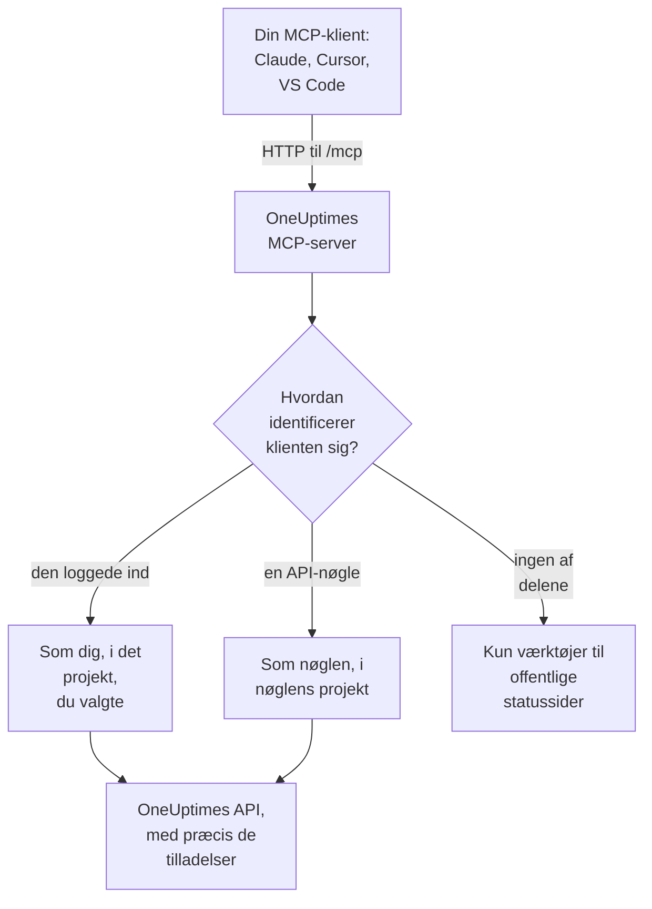

# MCP-server

OneUptimes MCP-server lader en AI-assistent arbejde direkte med dit OneUptime-projekt. Forbind Claude, Cursor, VS Code med GitHub Copilot eller en anden klient til Model Context Protocol (MCP), og bed den om at se på en hændelse, forespørge logs og spor, kvittere for en advarsel eller oprette en monitor: den kalder OneUptimes værktøjer med dine tilladelser eller med en API-nøgles.

:::cards
- [Forbind en klient](#forbind-en-klient): Giv din klient serverens adresse, og log ind.
- [Log ind med OneUptime](#log-ind-med-oneuptime): Hvad en forbundet klient må, og hvordan du afbryder den.
- [Få din API-nøgle](#få-din-api-nøgle): Til en agent, der kører uden opsyn.
- [Fejlfinding](#fejlfinding): Problemer med login, tilladelser og forbindelse.
:::

## Sådan virker det

MCP-serveren er en del af hver OneUptime-instans, på `/mcp` på samme adresse som dashboardet, og taler streamable HTTP-transporten. Der er intet at installere.

- **OneUptime Cloud**: `https://oneuptime.com/mcp`
- **Selvhostet**: `https://your-oneuptime-domain.com/mcp`



Serveren er tilstandsløs: den udsteder ingen sessions-id'er, og hver anmodning står for sig selv, så den virker bag load balancere og med flere replikaer.

## Hvad værktøjerne dækker

- **Monitorer**: opret og konfigurer monitorer, tjek deres status og se deres historik.
- **Hændelseshåndtering**: opret, kvitter for og løs hændelser, tilføj interne eller offentlige noter, og følg dem til løsning.
- **Advarsler**: kvitter for og løs advarsler, tilføj noter, og administrer advarslers tilstande og alvorlighedsgrader.
- **Teams og vagt**: administrer teams og vagtpolitikker.
- **Statussider**: administrer statussider, og slå meddelelser op.
- **Planlagt vedligeholdelse**: opret og administrer vedligeholdelseshændelser.
- **Telemetri**: forespørg logs, metrikker, spor, undtagelser, monitorlogs, sikkerhedshændelser og mere, kun læsning.

Der er værktøjer til at oprette, hente, liste, opdatere, slette og tælle for 30 slags poster, værktøjer til at liste og tælle for 9 slags telemetri og værktøjer lavet til hændelseshåndtering. Skrivebeskyttede værktøjer har `readOnlyHint`, alle værktøjer, der ændrer noget, har `destructiveHint`, og kun værktøjerne til offentlige statussider har `openWorldHint`, så en klient selv kan køre skrivebeskyttede kald og spørge dig før enhver ændring. Et mislykket værktøjskald kommer tilbage som et værktøjsresultat (`isError: true`) med en `statusCode`, detaljerne og et forslag, ikke som en MCP-protokolfejl, så agenten kan læse fejlen og rette sig selv.

## Før du begynder

- En OneUptime-instans: OneUptime Cloud eller selvhostet.
- En MCP-klient, såsom Claude Code, Claude, VS Code med GitHub Copilot eller Cursor.
- En OneUptime-konto at logge ind med eller en OneUptime API-nøgle til en agent, der kører uden opsyn. Værktøjerne til offentlige statussider kræver ingen af delene.
- På OneUptime Cloud Growth-planen eller højere: at forbinde en MCP-klient er tilgængeligt på de samme planer som API-nøgler.

## Forbind en klient

Giv klienten serverens adresse og intet andet. Første gang den har brug for dine data, åbner den OneUptime i din browser, så du kan logge ind (se [Log ind med OneUptime](#log-ind-med-oneuptime)). På en selvhostet instans bruger du `https://your-oneuptime-domain.com/mcp` i stedet for `https://oneuptime.com/mcp`.

:::tabs
@tab Claude Code
```bash
claude mcp add --transport http oneuptime https://oneuptime.com/mcp
```
Kør derefter `/mcp` i Claude Code, og vælg **oneuptime** for at logge ind.
@tab Claude
Åbn **Customize → Connectors** i Claude, vælg **Add custom connector**, og indtast `https://oneuptime.com/mcp`. Claude beder dig logge ind på OneUptime, første gang den har brug for dine data.
@tab VS Code
Føj dette til din MCP-konfiguration (se [VS Code med GitHub Copilot](#vs-code-med-github-copilot) for, hvor den ligger). VS Code åbner OneUptime, så du kan logge ind, når du starter serveren:
```json
{
  "servers": {
    "oneuptime": {
      "type": "http",
      "url": "https://oneuptime.com/mcp"
    }
  }
}
```
@tab Cursor
```json
{
  "mcpServers": {
    "oneuptime": {
      "url": "https://oneuptime.com/mcp"
    }
  }
}
```
:::

Enhver anden klient, der understøtter MCP-autorisation, fungerer på samme måde: giv den adressen, så finder den selv resten. Se [Log ind (OAuth 2.1)](#log-ind-oauth-21) for protokollen.

Dashboardet har også disse trin, med din instans' adresse udfyldt: **Projektindstillinger → AI → MCP-server**. Og fra enhver ressource (en monitor, en hændelse, en statusside og så videre) folder du **Udvikler** ud i dens sidemenu og vælger **AI-assistenter**: den side foreslår også prompts, der nævner ressourcen og dens id, så assistenten finder den med det samme. For en ressource, som MCP-serveren endnu ikke har værktøjer til, såsom et workflow, viser siden, hvordan en assistent, der kan køre kommandoer, i stedet kan arbejde med den gennem REST API'et.

## Log ind med OneUptime

Den enkleste måde at forbinde på er at give din MCP-klient serverens adresse og intet andet. Første gang klienten har brug for dine data, åbner den en OneUptime-side i din browser:

:::steps
1. Log ind på OneUptime, hvis du ikke allerede er logget ind.
2. Vælg det projekt, klienten skal arbejde i.
3. Vælg **Læse- og skriveadgang** eller **Kun læseadgang**.
4. Klik på **Godkend**.
:::

Klienten handler derefter som dig i det projekt. Der er ingen API-nøgle at oprette, kopiere eller rotere, og intet hemmeligt gemmes i en konfigurationsfil.

Hvad en forbundet klient kan:

- **Den har dine tilladelser og aldrig flere.** Det, dine teams tillader dig i projektet, er det, klienten kan. Hvis din rolle ændres, eller du forlader projektet, gælder det fra klientens næste anmodning. At forlade projektet afbryder også klienten: dens autorisation slettes, og du forbinder den igen, hvis du vender tilbage til projektet.
- **Kun læsning betyder kun læsning.** En klient, der er godkendt til kun læsning, kan bruge værktøjerne `get_`, `list_` og `count_`. Værktøjer, der opretter, opdaterer, sletter, kvitterer eller løser, afvises af MCP-serveren og af OneUptime API'et bag den. Du kan aldrig give en klient mere adgang, end den bad om.
- **Den gælder ét projekt.** For at bruge et andet projekt forbinder du klienten igen og vælger det projekt.
- **Den virker kun gennem MCP-serveren.** Klientens adgangstoken accepteres af MCP-endpointet og ingen andre steder. Det kan ikke bruges til at kalde OneUptimes REST API direkte.
- **Instansadministratorer får ingen særbehandling.** En klient, som en master-admin har forbundet, har det, personens teams giver i projektet, ikke adgang til hele instansen.

### Administrer forbundne klienter

Hver klient, der er forbundet ved login, står under **Projektindstillinger → AI → MCP-server** under **Forbundne MCP-klienter**, med hvem der forbandt den, hvad den må, og hvornår den sidst blev brugt. Du ser de klienter, du har forbundet; projektets ejere og administratorer ser alles.

Klik på **Disconnect** for at logge en klient ud. Den holder op med at virke med det samme.

En klient forbliver forbundet, så længe den bruges. En klient, der ikke er brugt i 30 dage, skal logge ind igen.

### Styr, hvem der kan forbinde klienter

Alle projektmedlemmer kan som standard forbinde en MCP-klient. For at forhindre et teams medlemmer i det åbner du teamets side **Tilladelser**, åbner **Yderligere indstillinger** nederst og tilføjer tilladelsen **Authorize MCP Client** under **Bloker tilladelser**. Klienter, som de medlemmer allerede har forbundet, holder op med at virke med det samme.

Hvis projektet kræver single sign-on, så log ind på projektet med SSO i din browser, før du godkender en klient. Klientens forbindelse varer lige så længe som det SSO-login; når det udløber, eller den SSO-udbyder, du loggede ind med, slås fra eller slettes, forbinder du klienten igen.

På OneUptime Cloud er det at forbinde en MCP-klient tilgængeligt på de samme planer som API-nøgler (Growth og højere).

I Enterprise Edition registreres hver ændring, en forbundet klient laver, i revisionsloggen under den person, der forbandt den, med klientens navn. Ændringer lavet med en API-nøgle viser nøglens navn.

## Få din API-nøgle

Brug en API-nøgle til en agent, der kører uden opsyn, såsom et planlagt job eller en CI-pipeline, hvor ingen er til stede for at logge ind.

:::steps
### Opret nøglen

Gå til **Projektindstillinger → Avanceret → API-nøgler**, og klik på **Opret API-nøgle**. Giv den et navn, såsom "MCP Server".

### Vælg, hvad den må

Under **Adgang** vælger du **Viewer** til en agent, der kun læser, eller **Project Admin** til en, der også opretter, opdaterer og sletter (se [Tilladelser for API-nøgler](#tilladelser-for-api-nøgler)).

### Kopier nøglen

Klik på **Opret API-nøgle**: nøglens side åbnes. Kopier nøglen derfra.
:::

API-nøgler hører til ét projekt: MCP-serveren tager projektet fra nøglen, så oprettelsesværktøjer aldrig har brug for et `projectId`-argument.

> [!WARNING]
> Giv aldrig en AI-agent en masternøgle. En OneUptime master-API-nøgle accepteres også i denne header og giver administratoradgang til hele instansen. Brug altid en projekt-API-nøgle med det mindste, agenten har brug for: en skrivebeskyttet nøgle er nok til alle værktøjerne `get_`, `list_` og `count_`.

## Forbind med en API-nøgle

Send nøglen i headeren `x-api-key`. En anmodning, der har en API-nøgle med, bliver aldrig bedt om at logge ind. På en selvhostet instans bruger du dit eget domæne i stedet for `oneuptime.com`.

:::tabs
@tab Claude Code
```bash
claude mcp add --transport http oneuptime https://oneuptime.com/mcp --header "x-api-key: your-api-key-here"
```
@tab Claude Desktop
Føj dette til `claude_desktop_config.json`, i `~/Library/Application Support/Claude/` på macOS, `%APPDATA%\Claude\` på Windows eller `~/.config/Claude/` på Linux:
```json
{
  "mcpServers": {
    "oneuptime": {
      "transport": "streamable-http",
      "url": "https://oneuptime.com/mcp",
      "headers": {
        "x-api-key": "your-api-key-here"
      }
    }
  }
}
```
@tab VS Code
Inputvariablen med `"password": true` spørger efter nøglen, når serveren starter, i stedet for at gemme den i klartekst:
```json
{
  "servers": {
    "oneuptime": {
      "type": "http",
      "url": "https://oneuptime.com/mcp",
      "headers": {
        "x-api-key": "${input:oneuptime-api-key}"
      }
    }
  },
  "inputs": [
    {
      "type": "promptString",
      "id": "oneuptime-api-key",
      "description": "OneUptime API Key",
      "password": true
    }
  ]
}
```
@tab Cursor
```json
{
  "mcpServers": {
    "oneuptime": {
      "url": "https://oneuptime.com/mcp",
      "headers": {
        "x-api-key": "your-api-key-here"
      }
    }
  }
}
```
:::

## VS Code med GitHub Copilot

VS Code 1.99 og nyere understøtter MCP-servere direkte i GitHub Copilot Chat.

:::steps
### Tjek, hvad du har brug for

VS Code 1.99 eller nyere med GitHub Copilot-udvidelsen installeret og logget ind og GitHub Copilot Chat slået til.

### Åbn MCP-konfigurationen

Tryk på `Ctrl+Shift+P` (`Cmd+Shift+P` på macOS), skriv "MCP: Open User Configuration", og tryk på Enter. Det åbner eller opretter filen `mcp.json`. Til kun ét workspace opretter du i stedet `.vscode/mcp.json` i det.

### Tilføj OneUptime

Indsæt VS Code-konfigurationen ovenfor: den uden nøgle til login eller den med en API-nøgle.

### Start serveren

Tryk på `Ctrl+Shift+P` (`Cmd+Shift+P` på macOS), skriv "MCP: List Servers", og vælg **oneuptime** for at starte den. VS Code beder dig første gang om at stole på serveren og derefter om at logge ind eller indtaste din API-nøgle.

### Spørg Copilot

Åbn GitHub Copilot Chat i agenttilstand, og spørg for eksempel "Hvilke monitorer har jeg i OneUptime?", "Vis mig de seneste hændelser" eller "Opret en ny monitor for https://example.com".
:::

## Godkendelse

MCP-serveren fungerer på tre måder.

### Offentlige værktøjer (ingen godkendelse påkrævet)

Uden en API-nøgle eller et login kan en klient bruge de offentlige værktøjer:

- **`oneuptime_help`**: hjælp og vejledning om OneUptimes MCP-værktøjer
- **`oneuptime_list_resources`**: ressourcerne, og hvad du kan gøre med hver
- **`get_public_status_page_overview`**: oversigten over en offentlig statusside
- **`get_public_status_page_incidents`**: hændelserne på en offentlig statusside
- **`get_public_status_page_scheduled_maintenance`**: dens planlagte vedligeholdelseshændelser
- **`get_public_status_page_announcements`**: dens meddelelser

Værktøjerne til offentlige statussider tager en statussides id (et UUID) eller dens domænenavn. For kun at bruge dem forbinder du med adressen og uden legitimationsoplysninger:

```json
{
  "mcpServers": {
    "oneuptime": {
      "transport": "streamable-http",
      "url": "https://oneuptime.com/mcp"
    }
  }
}
```

En statussides ejere kan slå MCP-adgang fra for den side: åbn **MCP** i afsnittet **AI** i statussidens sidemenu, og slå **Aktivér MCP-server** fra. Kontakten gemmer, så snart den slås om. MCP-adgang er slået til som standard. Mens den er slået fra, returnerer de fire værktøjer `get_public_status_page_*` en fejl for den statusside; statussidens websted, dens RSS-feed og dens offentlige JSON-API påvirkes ikke, og de statussideværktøjer, der kræver login (`get_status_page`, `list_status_pages` og så videre), virker fortsat for sidens eget projekt.

### Log ind (OAuth 2.1)

Alle andre værktøjer skal vide, hvem der kalder. En klient, der ikke sender legitimationsoplysninger og kalder et af dem, får `401 Unauthorized` med en `WWW-Authenticate`-header, der peger på serverens metadata for den beskyttede ressource. Det er signalet, en MCP-klient reagerer på for at logge dig ind; `initialize`, `tools/list` og de offentlige værktøjer beder aldrig om det.

Serveren implementerer [MCP-autorisationsspecifikationen](https://modelcontextprotocol.io/specification/latest/basic/authorization):

- **Flow**: OAuth 2.1 authorization code med PKCE (kun `S256`). Adgangstokens sendes som `Authorization: Bearer`.
- **Opdagelse**: metadata for beskyttet ressource (RFC 9728) og metadata for autorisationsserver (RFC 8414). Udsteder og ressource er begge `https://<host>/mcp`.
- **Klientidentitet**: et Client ID Metadata Document (klient-id'et er en `https`-URL, som serveren henter) eller Dynamic Client Registration (RFC 7591). Ingen klient skal registreres af en administrator.
- **Omfang**: `mcp:read` for værktøjerne `get_`, `list_` og `count_`; `mcp:write` tilføjer alle værktøjer, der ændrer noget, og omfatter `mcp:read`. Et skrivebeskyttet token, der kalder et skriveværktøj, får `403` med `error="insufficient_scope"`.
- **Tokens' levetid**: et adgangstoken varer én time. Et refresh-token varer 30 dage og udskiftes, hver gang det bruges; at bruge et refresh-token, der allerede er udskiftet, afslutter forbindelsen.
- **Ressourceindikatorer** (RFC 8707): et token udstedes til `https://<host>/mcp` og accepteres ingen andre steder.
- **Tilbagekaldelse** (RFC 7009): tilbagekaldelse af et af de to tokens afslutter forbindelsen.

### API-nøgle

En agent, der kører uden opsyn, sender en OneUptime API-nøgle i en af disse headere:

- `x-api-key`: din OneUptime API-nøgle
- `Authorization`: et bearer-token med din API-nøgle (f.eks. `Bearer your-api-key-here`)

Skemaet `Bearer` skelner ikke mellem store og små bogstaver. En anmodning, der har en API-nøgle med, bliver aldrig bedt om at logge ind.

På OneUptime Cloud virker API-nøgler kun, mens projektet er på **Growth** eller højere. Under det svarer alle værktøjer, der kræver nøglen, `402` med en besked, der nævner planen, og agenten får besked om ikke at prøve igen. Intet slettes: nøglen virker igen, som den er, når projektet er tilbage på Growth, uden at noget skal forbindes igen. En klient, der er forbundet ved login, handler som en person og virker fortsat ([API-nøgler og SCIM under deres plan](/docs/api-reference/api-reference#api-nøgler-og-scim-under-deres-abonnement)).

## Tilgængelige endpoints

| Endpoint | Metode | Beskrivelse |
| --- | --- | --- |
| `/mcp` | POST | JSON-RPC-anmodninger til værktøjskald og andre handlinger |
| `/mcp` | GET | Uden en SSE-`Accept`-header: en kort JSON-beskrivelse af serveren. Med en: `405`, fordi den tilstandsløse server ikke tilbyder en selvstændig SSE-strøm (klienter, der følger specifikationen, fortsætter uden den) |
| `/mcp` | DELETE | Gør intet: serveren er tilstandsløs, så der er ingen session at afslutte |
| `/mcp/health` | GET | Sundhedstjek |
| `/mcp/tools` | GET | Listen over værktøjer, som almindeligt REST |

MCP-klienter, der logger ind, bruger også OAuth-endpointsene nedenfor. En klient finder dem selv; de er listet for folk, der skriver en klient eller sætter en proxy op.

| Endpoint | Metode | Beskrivelse |
| --- | --- | --- |
| `/mcp/.well-known/oauth-protected-resource` | GET | Metadata for beskyttet ressource (RFC 9728). Også på `/.well-known/oauth-protected-resource/mcp` |
| `/.well-known/oauth-authorization-server/mcp` | GET | Metadata for autorisationsserver (RFC 8414). Også på `/mcp/.well-known/oauth-authorization-server` |
| `/mcp/oauth/authorize` | GET | Autorisations-endpoint: hvor klienten sender din browser hen for at logge ind |
| `/mcp/oauth/token` | POST | Token-endpoint: veksler en autorisationskode eller et refresh-token |
| `/mcp/oauth/register` | POST | Dynamisk klientregistrering (RFC 7591) |
| `/mcp/oauth/revoke` | POST | Tilbagekaldelse af tokens (RFC 7009) |

For at tjekke, at serveren kører, og liste dens værktøjer:

```bash
curl https://oneuptime.com/mcp/health
curl https://oneuptime.com/mcp/tools
```

## Værktøjer til hændelseshåndtering

Ud over værktøjerne for hver slags post har serveren værktøjer lavet til at håndtere hændelser og advarsler:

- **`acknowledge_incident`** / **`resolve_incident`**: flyt en hændelse til projektets tilstand Acknowledged eller Resolved, ligesom dashboardets knap gør
- **`acknowledge_alert`** / **`resolve_alert`**: det samme for advarsler
- **`add_incident_note`**: tilføj en note til en hændelse med `visibility: "internal"` (kun teamet, standarden) eller `visibility: "public"` (slået op på statussiden). Markdown understøttes
- **`add_alert_note`**: tilføj en intern note til en advarsel

Et typisk forløb: `list_incidents` → `acknowledge_incident` → undersøg med `list_logs` → `add_incident_note` (offentlig) → `resolve_incident`.

Værktøjet **`oneuptime_whoami`** returnerer det projekt, dine legitimationsoplysninger hører til (dets id og navn). For en klient, der loggede ind, siger det også, hvem den er logget ind som, og om den må lave ændringer. Det er et godt første kald, så en agent kan orientere sig, og da oprettelsesværktøjer tager `projectId` fra legitimationsoplysningerne, behøver agenten aldrig at angive et projekt-id.

## Forespørgsel på telemetri

Logs, metrikker, spor (spans), undtagelser, monitorlogs og de andre slags telemetri findes som skrivebeskyttede værktøjer `list_` og `count_` (`list_logs`, `list_metrics`, `list_spans`, `list_exception_instances`, `list_monitor_logs` og deres `count_`-modstykker). Telemetri kommer ind gennem OpenTelemetry, så der er ingen oprettelsesværktøjer.

Forespørg altid telemetri med et tidsinterval. Et forespørgselsfelt tager en værdi eller et operatorobjekt:

```json
{
  "query": {
    "time": { "_type": "GreaterThan", "value": "2026-07-04T00:00:00.000Z" }
  },
  "sort": { "time": "DESC" },
  "limit": 50
}
```

Operatorerne er `EqualTo`, `NotEqual`, `IsNull`, `NotNull`, `EqualToOrNull`, `GreaterThan`, `LessThan`, `GreaterThanOrEqual`, `LessThanOrEqual`, `InBetween`, `Search` og `Includes`. Sorteringsværdier er `"ASC"` eller `"DESC"`.

## Feltvalg og paginering

Værktøjerne `get_` og `list_` tager et valgfrit `select`-array med feltnavne. Som standard kommer alle læsbare felter tilbage undtagen de tunge (JSON, meget lang tekst og HTML-kolonner), som skal bedes om i `select`.

Listeværktøjer bladrer med `limit` (10 som standard, højst 100) og `skip`, og hvert listesvar siger præcis, hvad det returnerede:

```json
{
  "returnedCount": 10,
  "totalCount": 42,
  "skip": 0,
  "limit": 10,
  "hasMore": true,
  "data": ["..."]
}
```

## Eksempler på brug

### Hverdagsspørgsmål

```text
"What's the current status of all my monitors?"
"Show me incidents from the last 24 hours"
"List the teams in this project"
"Show me our on-call policies"
```

### Monitorer og hændelser

```text
"Create a new website monitor for https://example.com that checks every 5 minutes"
"Set up an API monitor for https://api.example.com/health with a 30-second timeout"
"Disable the monitor for staging.example.com while we're doing maintenance"
"Create a high-priority incident for the database outage affecting user authentication"
"Add a note to incident #123 saying 'Database connection restored, monitoring for stability'"
"Mark incident #456 as resolved"
```

### Statussider

```text
"Update our status page to show 'Investigating Payment Issues' for the payment service"
"Create a status page announcement about scheduled maintenance this weekend"
```

### Forespørgsler på offentlige statussider (ingen API-nøgle påkrævet)

Disse virker uden legitimationsoplysninger, alene med værktøjerne til offentlige statussider:

```text
"What's the current status of status.example.com?"
"Show me recent incidents from the OneUptime status page"
"Are there any scheduled maintenance events on status.acme.com?"
"Get the latest announcements from my public status page with ID abc123-..."
```

### Flere trin på én gang

```text
"Create a scheduled maintenance window for Saturday 2-4 AM, disable all monitors for api.example.com during that time, and update the status page"
"Show me all monitors that have been down in the last hour, create incidents for any that don't already have one"
```

## Tilladelser for API-nøgler

| Hvad agenten gør | Vælg under **Adgang** |
| --- | --- |
| Læser kun | **Viewer**, eller tilføj læsetilladelser på nøglens side |
| Opretter, opdaterer og sletter også | **Project Admin**, eller tilføj rollen Project Admin på nøglens side |

Giv hver nøgle det mindste, den har brug for, roter nøgler jævnligt, hav en separat nøgle til hvert miljø, og hold øje med, hvad hver nøgle gør i OneUptime.

## Konfiguration ved selvhosting

Login virker direkte på en selvhostet instans. To indstillinger ændrer det:

| Miljøvariabel | Helm-værdi | Hvad den gør |
| --- | --- | --- |
| `DISABLE_MCP_OAUTH` | `mcpOAuth.disabled` | Sæt til `true` for at slå login fra. OAuth-endpointsene leveres ikke længere, og MCP-serveren accepterer kun API-nøgler. Intet slettes; forbundne klienter virker igen, når det slås til igen. |
| `DISABLE_MCP_OAUTH_CLIENT_ID_METADATA_DOCUMENTS` | `mcpOAuth.disableClientIdMetadataDocuments` | Sæt til `true` på en instans, der ikke kan nå internettet. En klient kan identificere sig med en URL, som OneUptime henter; med denne indstilling registrerer klienter sig i stedet direkte hos din instans, hvilket ikke kræver nogen udgående anmodning. |

Hvis du kører din egen reverse proxy foran OneUptime, så send `/.well-known/oauth-protected-resource` og `/.well-known/oauth-authorization-server` (og alt under dem) videre til OneUptime sammen med `/mcp`. Den medfølgende ingress gør det allerede.

Serveren bygger hver OAuth-URL ud fra indstillingerne `HOST` og `HTTP_PROTOCOL`, så de skal passe til den adresse, folk bruger til at nå din instans.

## Fejlfinding

### Problemer med login

- **Klienten beder mig aldrig om at logge ind**: klienten understøtter måske ikke MCP-autorisation, eller den er konfigureret med en API-nøgle-header, som har forrang. Fjern headeren for i stedet at logge ind.
- **Mit projekt er gråt på autorisationssiden**: siden siger hvorfor ved siden af projektnavnet: projektets plan omfatter ikke forbindelse af MCP-klienter, projektet kræver SSO, og denne browser har ikke logget ind på det med SSO, eller dit team er blokeret fra at forbinde klienter.
- **Et værktøj afvises som "read-only"**: klienten blev godkendt til kun læsning. Forbind den igen, og vælg **Læse- og skriveadgang**.
- **Klienten holdt op med at virke**: den blev afbrudt, blev ikke brugt i 30 dage, du blev fjernet fra projektet, eller projektets SSO-login udløb, eller dets udbyder blev slået fra. Forbind den igen.
- **Selvhostet - klienten siger, at den ikke kan finde autorisationsserveren**: tjek, at `HOST` og `HTTP_PROTOCOL` passer til din offentlige adresse, og at din proxy sender stierne `/.well-known/oauth-*` videre.

### Tilladelsesfejl

API-nøglen, eller for en klient, der loggede ind, din egen konto, skal have de rette tilladelser: læseadgang for at liste poster, skriveadgang for at oprette og opdatere dem og sletteadgang for at fjerne dem.

### Forbindelsesproblemer

Tjek, at OneUptime-adressen er korrekt og kan nås, at API-nøglen er gyldig, og at sundhedsendpointet svarer (se [Tilgængelige endpoints](#tilgængelige-endpoints)).

### Ugyldig API-nøgle

- Tjek API-nøglen i dine OneUptime-indstillinger, uden ekstra mellemrum eller tegn
- Tjek, at nøglen ikke er udløbet
- På OneUptime Cloud betyder en `402`, der siger, at API-nøgler kræver Growth-planen, at projektet ligger under den: opgrader projektet under **Projektindstillinger → Fakturering og fakturaer → Fakturering**, så virker den samme nøgle igen

### Sessionsfejl

MCP-serveren er tilstandsløs: den hverken udsteder eller sporer sessions-id'er, så hver anmodning virker mod enhver replika. En klient, der sender en `mcp-session-id`-header fra en ældre serverversion, kan udelade den; den ignoreres. Opdater en ældre klientkonfiguration, der forventer, at serveren returnerer et sessions-id.

## Tilgængelige ressourcer

| Område | Poster med værktøjer til at oprette, hente, liste, opdatere, slette og tælle |
| --- | --- |
| Overvågning | Monitor, Monitor Status, Monitor Status Event |
| Hændelser | Incident, Incident State, Incident Severity, Incident State Timeline, Incident Public Note, Incident Internal Note, Incident Alert, Postmortem Status |
| Advarsler | Alert, Alert State, Alert Severity, Alert State Timeline, Alert Internal Note |
| Statussider | Status Page, Status Page Announcement |
| Planlagt vedligeholdelse | Scheduled Maintenance Event, Scheduled Maintenance State, Scheduled Maintenance State Timeline |
| Teams og vagt | Team, On-Call Policy |
| Etiketter | Label |
| Sikkerhed | Security Case, Security Case Note, Security Case Priority, Security Case Status, Security Detection, Security Playbook |

| Område | Telemetri med kun værktøjer til at liste og tælle |
| --- | --- |
| Observabilitet | Log, Metric, Span, Exception Instance, Monitor Log |
| Sikkerhed | Security Event, Threat Intel Indicator |
| Ændringer og omkostninger | Change Event, Kubernetes Cost Allocation |

Værktøjerne er navngivet i snake case: `create_incident`, `get_incident`, `list_incidents`, `update_incident`, `delete_incident` og `count_incidents`, eller `list_logs` og `count_spans` for telemetri.

## Næste trin

:::cards
- [Spørg AI](/docs/ai/ask-ai): Spørg i stedet om dit projekt inde i OneUptime.
- [OneUptimes API-reference](/docs/api-reference/api-reference): REST API'et bag hvert værktøj.
- [Tilladelser](/docs/permissions/index): Hvad en rolle, et team eller en API-nøgle må.
:::
