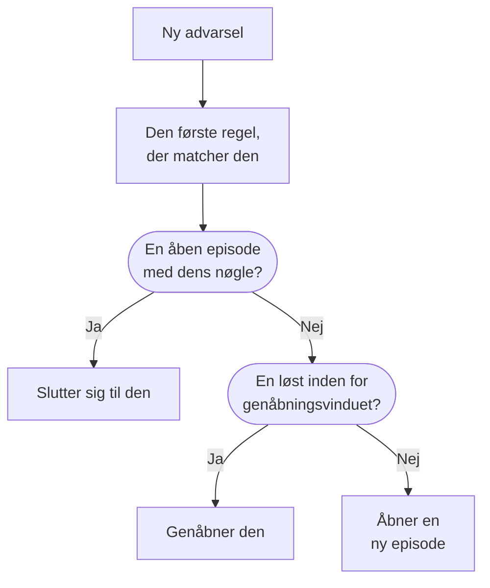

# Advarselsepisoder og grupperingsregler

Når en database går ned, kan tyve monitorer udløse tyve advarsler inden for få minutter. En episode samler dem i én post, som dit team bekræfter og løser samlet, og en grupperingsregel afgør, hvilke advarsler der hører til i den. Denne side viser, hvordan gruppering fungerer, hvordan du sætter en regel op, og hvordan en episode opfører sig, når den er åben.

:::cards
- [Sådan fungerer gruppering](#sådan-fungerer-gruppering): Regler, grupperingsnøgler og tidsvinduer.
- [Opret en grupperingsregel](#opret-en-grupperingsregel): Fra en skabelon med ét klik, eller din egen.
- [Sådan opfører en episode sig](#sådan-opfører-en-episode-sig): Dens alvorsgrad, dens tilstande og hvornår den løses.
- [Hvem en episode tilkalder](#hvem-en-episode-tilkalder): Reglens vagtpolitikker og advarslernes egne.
:::

## Sådan fungerer gruppering

Gruppering kører én gang for hver ny advarsel, lige efter at dens vagtpolitikker har kørt. Advarslen kontrolleres mod dine aktiverede grupperingsregler, oppefra og ned i listen, og den første regel, der matcher den, afgør dens episode. En advarsel, som ingen regel matcher, forbliver alene.



- **Reglens betingelser** afgør, hvilke advarsler den gælder for. En regel uden betingelser gælder for hver ny advarsel.
- **Grupperingsnøglen** afgør, hvilke advarsler der deler en episode: dem med samme monitor, samme alvorsgrad, samme titel eller den kombination, reglen grupperer efter. En regel, der ikke grupperer efter noget, lægger hver advarsel, den matcher, i én episode.
- **Tidsvinduet** afgør, hvor længe en episode bliver ved med at tage imod advarsler. Når det er slået til, slutter en advarsel sig kun til, hvis den kommer inden for vinduet efter episodens seneste advarsel. Når det er slået fra, bliver matchende advarsler ved med at slutte sig til, indtil episoden er løst.

Gruppering sker, når en advarsel oprettes. En regel, du tilføjer i dag, grupperer de advarsler, der oprettes efter den; den omgrupperer ikke dem, der allerede findes.

> [!NOTE]
> En advarsel, der oprettes allerede bekræftet, kan slutte sig til en åben episode, men åbner aldrig en, og en advarsel, der oprettes løst, grupperes slet ikke. Se [Oprettet allerede bekræftet eller løst](/docs/alerts/index#oprettet-allerede-bekræftet-eller-løst).

## Opret en grupperingsregel

Gå til **Advarsler → Regler → Grupperingsregler**. Sidemenuens sektion **Regler** er foldet sammen fra start, så fold den ud først.

### Start fra en skabelon

Et projekt uden grupperingsregler ser fire færdige regler i stedet for en tom liste; når du har regler, åbner **Opret fra skabelon** på kortet dem. **Tilføj regel** gemmer en med ét klik, aktiveret, sidst i listen og gældende for hver ny advarsel. Rediger den bagefter som enhver anden regel.

| Skabelon                                      | Grupperer                                                                     | Tidsvindue  |
| --------------------------------------------- | ----------------------------------------------------------------------------- | ----------- |
| **Gruppér advarsler fra samme overvågning**   | Én episode pr. monitor                                                        | 30 minutter |
| **Gruppér advarsler, der sker samtidig**      | Én fælles episode, uanset monitor                                             | 10 minutter |
| **Gruppér advarsler efter alvorlighed**       | Én episode pr. alvorsgrad                                                     | 30 minutter |
| **Gruppér gentagelser af samme advarsel**     | Én episode pr. advarselstitel, uden hensyn til tal og store/små bogstaver     | 1 time      |

### Opret din egen

:::steps
#### Svar på, hvordan der skal grupperes

Klik på **Opret brugerdefineret regel** under skabelonerne eller på **Opret grupperingsregel for advarsler** på kortet, når du har regler. På trinnet **Gruppering** stiller **Gruppér advarsler efter** ét spørgsmål: **Overvågning**, **Alt samlet**, **Alvorlighed**, **Titel** eller **Brugerdefineret**. **Navn** følger dit svar, indtil du skriver dit eget.

#### Indstil tidsvinduet

**Gruppér kun advarsler, der kommer tæt efter hinanden** er slået til med et vindue på 30 minutter. Skift minutterne, eller slå det fra for at holde én episode åben, indtil den er løst.

#### Kombinér felter, for Brugerdefineret

**Brugerdefineret** tilføjer et trin **Gruppér efter** med fem kontakter: **Gruppér efter overvågning**, **Gruppér efter advarselsalvorlighed**, **Gruppér efter advarselstitel**, **Gruppér efter advarselsetiketter** og **Gruppér efter overvågningsetiketter**. Etiketter grupperer efter deres nøjagtige sæt.

#### Afgræns den

På **Hvilke advarsler** grupperer **Alle advarsler**, som en ny regel starter på, hver ny advarsel. For at indsnævre reglen vælger du **Kun advarsler, der opfylder betingelserne** og tilføjer betingelser for monitorer, alvorsgrader, etiketter, titler og beskrivelser. Klik derefter på **Opret grupperingsregel for advarsler**.
:::

Alt andet, en regel kan gøre, er foldet sammen under **Flere felter** sidst på trinnet **Gruppering**, i tre grupper. Sammenfoldet nævner dets overskrift, hvad det rummer, og siger, hvad hver indstilling, reglen bruger, er sat til, så det aldrig skjules, hvad en regel gør, når du redigerer den.

| Gruppe                    | Indstillinger                                                                                              |
| ------------------------- | ---------------------------------------------------------------------------------------------------------- |
| **Vagt og ejerskab**      | **Vagtpolitikker**, der skal køre, når reglen åbner en episode, og **Episodeejere**.                       |
| **Episodens livscyklus**  | **Genåbn nyligt løste episoder**, **Vent, før en episode løses** og **Løs stille episoder**, hver en kontakt med sine minutter. |
| **Detaljer**              | Reglens **Beskrivelse**, **Skabelon for episodetitel**, **Skabelon for episodebeskrivelse** og **Episodeetiketter**. |

Regler kontrolleres oppefra og ned i listen, og det første match vinder: Træk en regel for at ændre dens plads. Sæt specifikke regler over brede. Listens kolonne **Gruppering** siger med én sætning, hvad hver regel gør, for eksempel "Én episode pr. overvågning".

## Episodetitler

Uden en skabelon navngives en episode efter monitoren for dens første advarsel eller efter de første 50 tegn af advarslens titel, når den ikke har nogen monitor. Med en **Skabelon for episodetitel** eller en **Skabelon for episodebeskrivelse** udfyldes disse variabler. Skriv `{{` i et af felterne for at vælge en.

| Variabel               | Udfyldes med                                                                                        |
| ---------------------- | --------------------------------------------------------------------------------------------------- |
| `{{alertTitle}}`       | Den første advarsels titel.                                                                         |
| `{{alertDescription}}` | Den første advarsels beskrivelse.                                                                   |
| `{{alertSeverity}}`    | Den første advarsels alvorsgrad.                                                                    |
| `{{monitorName}}`      | Navnet på den første advarsels monitor.                                                             |
| `{{alertCount}}`       | Hvor mange advarsler episoden rummer, skrevet igen, når advarsler slutter sig til eller forlader den. |

En variabel, som den første advarsel ikke har en værdi for, eller en, der ikke står på denne liste, udelades. Når den første advarsel er privat, står der "Private alert" i `{{alertTitle}}` og `{{alertDescription}}`, fordi episoden ikke er privat.

## Sådan opfører en episode sig

En episode går gennem dine advarselstilstande, den samme liste, som advarsler bruger, og har sine egne ejere, noter, grundårsag og afhjælpningsnoter.

- **Dens alvorsgrad stiger med dens advarsler.** Den starter med den første advarsels alvorsgrad og overtager alvorsgraden fra enhver mere alvorlig advarsel, der slutter sig til den, hvor "mere alvorlig" betyder højere oppe under **Advarsler → Indstillinger → Advarselsalvor**.
- **Dens tilstand flytter dens advarsler.** Bekræft eller løs en episode, eller flyt den til en af dine egne tilstande, og hver advarsel i den flytter med, undtagen en advarsel, der allerede er i den tilstand eller efter den.
- **Den løser sig selv**, når hver advarsel i den er løst. **Vent, før en episode løses** holder den åben i så mange minutter først, hvis nu en advarsel kommer tilbage.
- **Den kan genåbne.** Med **Genåbn nyligt løste episoder** slået til genåbner en matchende advarsel, der kommer inden for minutterne efter, at episoden blev løst, den i stedet for at åbne en ny. Det er det eneste skift tilbage op ad listen over tilstande, og det genåbner ikke episodens advarsler.

> [!WARNING]
> **Løs stille episoder** løser en episode, når ingen ny advarsel har sluttet sig til den i det antal minutter, du har sat, og løser også hver advarsel, der stadig er åben i den. Brug det til støj, som du er sikker på ikke kræver et svar.

## Hvem en episode tilkalder

En advarsels egne vagtpolitikker kører, når den oprettes, før gruppering, uanset om den slutter sig til en episode. En episode tilføjer sine egne:

```mermaid title="En advarsel, der åbner en episode, tilkalder to gange; en, der slutter sig til, én gang"
flowchart TB
    alert["Ny advarsel"] --> own["Advarslens egne<br/>politikker kører"]
    own --> grouped{"Gruppering"}
    grouped -->|"Åbner en episode"| ep["Episodens politikker<br/>kører også"]
    grouped -->|"Slutter sig til en episode"| none["Intet mere kører"]
```

- **En ny episode** kører reglens **Vagtpolitikker** plus dem fra enhver matchende regel på fanen **Episode Rules** under **Advarsler → Regler → Vagtregler**.
- **En advarsel, der slutter sig til en åben episode**, kører kun sine egne politikker. Episodens kører ikke igen.
- **Svarer man på en episodes tilkaldelse**, bekræftes episoden og dermed hver advarsel i den.

> [!TIP]
> For at tilkalde én gang pr. problem i stedet for én gang pr. advarsel lægger du vagtpolitikker på dine grupperingsregler og lader dem være væk fra advarslerne: fra monitorens kriterier, oprettelsesformularen og dine vagtregler for advarsler.

Episodens ejere hører også om det: **Advarselsepisode oprettet**, **Tilstand for advarselsepisode ændret** og **Advarsel tilføjet til advarselsepisode** er slået til via e-mail som standard under **Brugerindstillinger → Notifikationsindstillinger** på fanen **Advarsler**. Reglens **Episodeejere** bliver ejere af hver episode, den åbner, og får besked som enhver anden ejer.

## Opret en episode i hånden

:::steps
### Åbn formularen

Gå til **Advarsler → Alle episoder**, og klik på **Opret episode**. Formularen **Opret ny advarselsepisode** åbner.

### Beskriv episoden

På **Episodedetaljer** udfylder du **Titel** og, hvis du vil, en **Advarselsalvor** og en **Beskrivelse**. **Indledende tilstand** og **Etiketter** venter under **Flere felter**.

### Vælg, hvem der tilkaldes, og hvem der ejer den

På **Vagt og ejere** vælger du en **Vagtpolitik**, der skal køre, når episoden oprettes, og dens **Ejere**. Klik derefter på **Opret episode**.

Hvert team, du er medlem af, er et enkelt klik væk under **Ejere**, og oversigten nævner de ejerregler, der tilføjer flere.

### Tilføj advarslerne

Åbn episodens side **Medlemsadvarsler**, klik på **Tilføj advarsler**, og sæt flueben ved de advarsler, der hører til den, så mange du har brug for på én gang. Vil du hellere starte fra advarslerne, så vælg dem på listen **Advarsler**, og vælg **Tilføj til ny episode** under **Massehandlinger** (se [Episoder](/docs/incidents/episodes)).
:::

En episode, du opretter, har ingen grupperingsregel, så listen viser dens **Grupperingsregel** som **Manuel**, og ingen livscyklusindstilling gælder for den. Den løser stadig sig selv, når hver advarsel i den er løst.

## Hvad hver side af en episode viser

| Sektion i sidemenuen | Sider                                                                       |
| -------------------- | --------------------------------------------------------------------------- |
| **Oversigt** | **Oversigt**, **Tilstandstidslinje** |
| **Undersøgelse** | **Beskrivelse**, **Grundårsag**, **Afhjælpningsnoter** |
| **Team** | **Ejere** |
| **Advarsler** | **Medlemsadvarsler** |
| **Noter** | **Private noter** |
| **Udvikler** | **Terraform**, **API**, **AI-assistenter** |
| **Avanceret** | **Auditlogs**, **Slet episode** |

**Udvikler** og **Avanceret** er foldet sammen fra start. På **Oversigt** nævner hovedet episodens **Ejere**, teams først, og det første felt, **Oprettet**, siger, hvornår episoden blev oprettet — **Automatisk**, når en grupperingsregel åbnede den. Kortet **Hvad der skete** står øverst på siden — episodens beskrivelse og dens **Grundårsag** — derefter **Alerts in this episode** og **Episodefeed**, ved siden af kortet **Episodedetaljer**: dens nummer, tilstand, alvorsgrad, antal advarsler, grupperingsregel og vagtpolitikker. Dens hoved har **Bekræft** og **Løs** og **Flyt episode til** i menuen **⋯**.

**Advarsler → Aktive episoder** viser de episoder, der endnu ikke er løst, og mærket ved siden af tæller dem.

## Fejlfinding

:::details En ny advarsel sluttede sig ikke til den episode, jeg forventede
Kontrollér i denne rækkefølge: Reglen er aktiveret; ingen regel over den matchede advarslen først; advarslen matcher reglens betingelser; den har samme grupperingsnøgle som episodens advarsler, for eksempel samme monitor; og med tidsvinduet slået til kom den inden for vinduet efter episodens seneste advarsel. En advarsel, der oprettes allerede bekræftet, åbner aldrig en episode, og en, der oprettes løst, grupperes aldrig.
:::

:::details Vi blev tilkaldt to gange for ét problem
Advarslens egen vagtpolitik kørte, og den nye episodes politik kørte også. Behold politikkerne på grupperingsreglen, og fjern dem fra advarslens kriterier, formular eller vagtregler.
:::

:::details En episode blev løst af sig selv
Hver advarsel i den var løst, så episoden blev løst, da dens ventetid var forbi. Når **Løs stille episoder** er slået til, løser den også en episode, der ikke har taget imod en ny advarsel i så lang tid.
:::

## Næste skridt

:::cards
- [Advarselsregler og indstillinger](/docs/alerts/settings): De andre regler, der handler på nye advarsler og episoder.
- [Advarselstilstande og alvorsgrader](/docs/alerts/states-and-severities): De tilstande, en episode går igennem.
- [Eskaleringsregler](/docs/on-call/escalation-rules): Hvordan de politikker, en episode kører, tilkalder mennesker.
- [Hændelsesindstillinger og automatisering](/docs/incidents/settings): Grupperingsregler for hændelser.
:::
