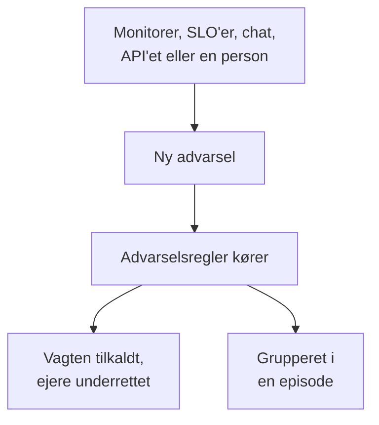

# Advarsler – Oversigt

En advarsel gør dit team opmærksom på et problem, der skal undersøges, før dine brugere opdager det: en disk, der er ved at blive fuld, et certifikat, der snart udløber, en fejlrate, der kryber op. Den kan tilkalde den, der har vagt, og give dens ejere besked, men den vises aldrig på en statusside og giver aldrig dine abonnenter besked. Denne side forklarer, hvor advarsler kommer fra, hvor de findes i dashboardet, og hvordan dit team arbejder med dem.

:::cards
- [Advarsler og hændelser](#advarsler-og-hændelser): Hvilken af dem et problem skal være, og hvordan de to hænger sammen.
- [Hvor advarsler kommer fra](#hvor-advarsler-kommer-fra): Monitorer, SLO'er, chat, API'et eller i hånden.
- [Opret en advarsel i hånden](#opret-en-advarsel-i-hånden): To trin i dashboardet.
- [Reager på en advarsel](#reager-på-en-advarsel): Bekræft den, løs den eller erklær en hændelse.
:::

## Sådan fungerer det

De fleste advarsler udløses af en monitor, hvis kriterier matcher. Nogle kommer fra en SLO, der bruger sit fejlbudget, en sikkerhedsregel, en tilkaldelse sendt fra Slack eller Microsoft Teams eller en person. Uanset hvordan den kommer, er en advarsel den samme post, og de samme regler kører på den.

- **Regler former den.** Privatlivs-, ejer-, etiket- og vagtregler kører i det øjeblik, en advarsel oprettes, og runbook-regler starter de procedurer, der matcher. Se [Advarselsregler og indstillinger](/docs/alerts/settings).
- **Vagtpolitikker tilkalder mennesker.** De politikker, advarslen nævner, plus dem, dens vagtregler tilføjer, tilkalder deres personer, indtil nogen bekræfter advarslen.
- **Episoder samler støjen.** En grupperingsregel samler relaterede advarsler i én episode, så tyve advarsler fra ét udfald er én opgave. Se [Advarselsepisoder og grupperingsregler](/docs/alerts/episodes).

## Advarsler og hændelser

Begge registrerer et problem, og begge kan tilkalde den, der har vagt. Forskellen er, hvem problemet rammer.

|                              | Advarsel                                               | Hændelse                                          |
| ---------------------------- | ------------------------------------------------------ | ------------------------------------------------- |
| **Hvad det er**              | Et problem, dit team skal undersøge, før brugerne rammes | Et problem, der rammer dine brugere, som et udfald |
| **På statussider**           | Aldrig                                                 | Kan vises og giver abonnenter besked              |
| **Noter**                    | Private noter, kun for dit team                        | Offentlige noter til kunder og private noter      |
| **Starttilstande**           | **Identificeret**, **Bekræftet**, **Løst**                | **Identificeret**, **Bekræftet**, **Løst**           |
| **Startalvorsgrader**        | **Høj**, **Lav**                                      | Critical Incident, Major Incident, Minor Incident |
| **Numre i et nyt projekt**   | `ALT-42` og `AE-42` for episoder                       | `INC-42` og `IE-42` for episoder                  |

Udløs en advarsel, når dit team bør kigge, før nogen udenfor opdager noget, og erklær en hændelse, når brugerne rammes. Viser det sig, at en advarsel er en del af et udfald, så erklær en hændelse fra den, eller knyt den til den hændelse, der forklarer den: se [Tilknyttede advarsler](/docs/incidents/linked-alerts).

## Hvor advarsler kommer fra

- **En monitors kriterier.** Under et kriteriums **Handlinger** slår du **Når filtre matcher, oprettes en advarsel.** til og udfylder den advarsel, det opretter: **Advarselstitel** og **Alvorlighed**, derefter, hver foldet sammen, **Beskrivelse**, **Ejerskab og etiketter**, **Vagt** og **Flere felter**, som rummer **Løs advarsel automatisk**, **Privat advarsel** og **Afhjælpningsnoter**. Et kriterium holder én åben advarsel ad gangen, én pr. serie på en monitor, der grupperer efter et felt, og **Løs advarsel automatisk** løser den, når kriteriet holder op med at matche. Se [Opret en monitor](/docs/monitor/create-monitor) og [Hændelse- og advarselsskabeloner](/docs/monitor/incident-alert-templating).
- **I hånden.** Klik på **Opret advarsel** på listen over advarsler eller på fanen **Advarsler** for en monitor, en host, en netværksenhed eller en anden ressource, som vælger den ressource for dig. Se [Opret en advarsel i hånden](#opret-en-advarsel-i-hånden).
- **En SLO's forbrugsrate.** En forbrugsrateregel kan oprette en advarsel, når en SLO bruger sit fejlbudget for hurtigt. Se [Forbrugsrateadvarsler og -hændelser](/docs/slo/burn-rate-alerts).
- **Netværkslokationer og sikkerhedsbegivenheder.** En netværkslokation, der er sat til at advare, når den er usund, åbner en advarsel, når dens samlede tilstand ikke længere er operationel, og dine detektionsregler for sikkerhedsbegivenheder åbner også advarsler. Se [Netværkslokationer (tilstandsoversigt og oppetid)](/docs/monitor/network-sites) og [Sikkerhedsbegivenheder (SIEM)](/docs/telemetry/security-events).
- **En tilkaldelse.** `/oneuptime page` i Slack eller Microsoft Teams, alle steder undtagen en hændelses eller en advarsels egen kanal, åbner en advarsel med din besked som titel og tilkalder de personer, du nævner. Et workflows tilkaldelsesblokke gør det samme med den titel og besked, du giver dem. Se [Tilkald nogen fra Slack](/docs/workspace-connections/slack#tilkald-nogen-fra-slack) og [Paging](/docs/workflows/components#paging).
- **API'et, Terraform og workflows.** Advarsler er en almindelig ressource: `/api/alert`, Terraform-ressourcen `oneuptime_alert` og et workflows trin **Create One Alert**.

## Hvor advarsler findes i dashboardet

Åbn **Advarsler** fra menuen **Produkter** i topbjælken. Listen over advarsler ligger på `/dashboard/{projectId}/alerts`, og dens sidemenu rummer alt om advarsler:

| Sektion           | Hvad du gør der                                                                                                           |
| ----------------- | ------------------------------------------------------------------------------------------------------------------------- |
| **Advarsler**     | **Alle advarsler** og **Aktive advarsler**, hvis røde mærke tæller de advarsler, der endnu ikke er løst.                    |
| **Episoder** | **Alle episoder** og **Aktive episoder**: relaterede advarsler samlet i ét problem at arbejde på. |
| **AI**            | **Indsigter**, **Protokoller** og **Indstillinger**: hvad OneUptime AI har lært af dine advarsler, alt, hvad den har gjort, og hvad den må gøre. |
| **Arbejdsområde** | **Slack** og **Microsoft Teams**, alt efter hvad projektet har forbundet, eller **Forbind Slack eller Teams**, når det har ingen af dem. |
| **Regler**        | **Grupperingsregler**, **Vagtregler**, **Ejerregler**, **Runbook-regler**, **Privatlivsregler**, **Etiketregler**, **Reminder Rules**. |
| **Indstillinger** | **Advarselsstatus**, **Advarselsalvor**, **Noteskabeloner**, **Brugerdefinerede felter**, **Målinger**, **Medlemskab af episoder**, **Nummerering**. |

**Advarsler** og **Episoder** er åbne; **AI**, **Arbejdsområde**, **Regler**, **Indstillinger** og **Udvikler** er foldet sammen fra start, og en sektion åbner af sig selv, når du er på en af dens sider. Konfigurationen af advarsler ligger her, ikke i **Projektindstillinger**.

Listen viser **Advarselsnummer**, **Titel**, **Tilstand**, **Alvorlighed**, **Berørte ressourcer** (advarslens monitor først), **Oprettet**, **Varighed**, **Etiketter** og **Ejere**. Vælg advarsler for at handle på flere på én gang: **Bekræft**, **Løs**, **Skift tilstand**, **Skift alvorlighed**, **Tildel til mig**, **Tilføj ejer**, **Fjern ejer**, **Tilføj etiketter**, **Fjern etiketter**, **Tilknyt til hændelse**, **Erklær hændelse** eller slet dem.

Menuen **⋯** for enden af hver advarsels række gør det samme for netop den advarsel: **Bekræft** og **Løs**, så længe advarslen kan tage det skridt, **Skift tilstand**, **Skift alvorlighed**, **Tildel til mig**, indtil du ejer den, og **Tilføj ejer** for at give den videre til en anden.

## Opret en advarsel i hånden

:::steps
### Åbn formularen

Gå til **Advarsler → Alle advarsler**, og klik på **Opret advarsel**. Formularen **Opret ny advarsel** åbner på sit første trin, **Advarselsdetaljer**.

### Beskriv advarslen

Udfyld **Titel**, og vælg en **Advarselsalvor**; begge er påkrævede. Tilføj en **Beskrivelse**, hvis det hjælper. Under **Flere felter**, foldet sammen, kan du vælge en **Indledende tilstand**, tilføje **Etiketter** eller slå **Privat advarsel** til. Der venter også **Ejere**: du bliver alligevel ejer af den advarsel, du opretter, og hvert team, du er medlem af, er et enkelt klik væk under vælgeren. En master-admin, der driver hele installationen, er den eneste undtagelse: vedkommende bliver ikke ejer af det, vedkommende opretter.

### Vælg, hvad den berører, og hvem der tilkaldes

Klik på **Næste** for at komme til **Ressourcer og vagt**. Vælg den **Overvågning**, den handler om, og eventuelle **Andre berørte ressourcer**, som hosts, netværksenheder, Kubernetes-klynger eller tjenester. Under **Vagtpolitik** vælger du de politikker, der skal køre, når advarslen oprettes.

### Opret den

Klik på **Næste** for at gennemse oversigten og derefter på **Opret advarsel**. Advarslens egen side åbner, og reglerne begynder at køre. I oversigten nævner rækken **Ejere** hver ejerregel, der vil tilføje nogen, og hvem: se [Hvem der ejer den](/docs/incidents/declaring-incidents#hvem-der-ejer-den).
:::

Lader du **Indledende tilstand** være tom, starter advarslen, hvor enhver ny advarsel gør: i din oprettelsestilstand, **Identificeret** i et nyt projekt. Vælger du en senere tilstand, registrerer du en advarsel, som nogen allerede håndterer, eller som allerede er overstået; se [Oprettet allerede bekræftet eller løst](#oprettet-allerede-bekræftet-eller-løst).

## Hvad der sker, når en advarsel oprettes

I det øjeblik en advarsel oprettes, gennemgår OneUptime disse trin i denne rækkefølge:

1. **Den får et nummer og en tilstand.** Advarselsnummeret kommer fra en tæller pr. projekt og vises med dit præfiks (`ALT-42`). Advarslen starter i din oprettelsestilstand, medmindre formularen, API'et eller et workflow valgte en anden.
2. **Privatlivsregler kører først**, så alt efter dem ved, om advarslen er privat.
3. **Feedet og dine chatværktøjer hører om den.** En post **Advarsel oprettet** skrives i **Advarsel Feed**, og de kanaler, dine Slack- og Microsoft Teams-regler nævner, får besked; en regel kan oprette en kanal til advarslen.
4. **Ejere og etiketter tilføjes**: dem, monitorens kriterier eller forespørgslen nævner, derefter dem fra matchende ejer- og etiketregler.
5. **Vagtregler tilføjer deres politikker**, derefter starter runbook-regler de runbooks, der matcher.
6. **Vagtpolitikker kører.** Hver politik på advarslen tilkalder sine personer parallelt; at én fejler, stopper ikke de andre.
7. **Grupperingsregler lægger den i en episode**, når en af dem matcher. Se [Advarselsepisoder og grupperingsregler](/docs/alerts/episodes).
8. **Påmindelser planlægges**, når en påmindelsesregel matcher, og **OneUptime AI** undersøger advarslen, når **Undersøg nye advarsler** er slået til under **Advarsler → AI → Indstillinger**, og retter den, når **Ret nye advarsler automatisk** er slået til. Se [AI SRE](/docs/ai/ai-sre).

Et baggrundsjob giver advarslens ejere besked inden for et minut, og workflow-udløseren **On Create Alert** starter ethvert workflow, der bygger på den.

### Oprettet allerede bekræftet eller løst

En advarsel, der starter i en senere tilstand, registrerer et problem, som nogen allerede tager sig af, så den behandles ikke som en ny nødsituation:

- **I eller efter din bekræftede tilstand** kører ingen vagtpolitik. Advarslen beholder sine politikker, og dens feed siger på én linje, hvorfor ingen blev tilkaldt. Den kan slutte sig til en åben episode, men åbner aldrig en, for det ville tilkalde via episodens politikker.
- **I eller efter din løste tilstand** er advarslen overstået: Den grupperes ikke i en episode, ingen runbook eller automatisk afhjælpning handler på den, OneUptime AI undersøger den ikke, og der oprettes ingen Slack- eller Microsoft Teams-kanal til den.

Dens regler, dens ejere, dens feed og dens første tilstand sker stadig i begge tilfælde. Hændelser følger samme regel: se [Erklæret allerede bekræftet eller løst](/docs/incidents/declaring-incidents#erklæret-allerede-bekræftet-eller-løst).

## Reager på en advarsel

Åbn advarslen. Dens hoved viser dens tilstand, dens alvorsgrad, hvor længe den har varet, dens ejere og den monitor og episode, den hører til, med de knapper, dit næste skridt kræver:

- **Bekræft** siger, at nogen tager sig af den. Det forhindrer advarslens vagtpolitikker i at tilkalde det næste niveau.
- **Løs** lukker den. Advarslen forlader **Aktive advarsler**, og dens påmindelser stopper.
- **Skift tilstand til**, i menuen **⋯** ved siden af dem, flytter den til en af dine egne tilstande, som "Under undersøgelse".
- **Erklær hændelse** åbner en ny hændelse, udfyldt på forhånd fra advarslen, når det viser sig, at problemet rammer brugerne. Se [Tilknyttede advarsler](/docs/incidents/linked-alerts).

Et skift til en anden tilstand beder dig bekræfte, med en valgfri privat note foldet sammen under **Tilføj en privat note**. Hvad hver tilstand gør, står på [Advarselstilstande og alvorsgrader](/docs/alerts/states-and-severities).

Mens du arbejder med den, skriver du det, du lærer, ned som **Private noter**, udfylder dens sider **Grundårsag** og **Afhjælpning** og tilføjer **Ejere**. Menuen **Handlinger** i **Advarsel Feed** kører også en runbook med **Execute Runbook** eller tilkalder flere personer med **Udfør vagtpolitik**.

## Hvad hver side af en advarsel viser

| Sektion i sidemenuen | Sider                                                                                                       |
| -------------------- | ----------------------------------------------------------------------------------------------------------- |
| **Oversigt** | **Oversigt** og **Tilstandstidslinje** |
| **Undersøgelse** | **Beskrivelse**, **Grundårsag**, **Afhjælpning**, **Runbooks**, **Tilknyttede hændelser** |
| **Team** | **Vagtudførelser** og **Ejere**: hvem der blev tilkaldt for advarslen, og hvem der ejer den |
| **Notifikationer**      | **Notifikationslogs** og **AI-logs**: hver besked, der er sendt om advarslen, og alt, hvad AI gjorde for den |
| **Noter**   | **Private noter**                                                                                           |
| **Udvikler**         | **Terraform**, **API** og **AI-assistenter**: advarslen styret fra kode                                     |
| **Avanceret** | **Brugerdefinerede felter**, **Indstillinger**, **Auditlogs**, **Slet advarsel** |

**Oversigt**, **Undersøgelse**, **Team** og **Noter** er åbne; de andre sektioner er foldet sammen, indtil du klikker på dem.

- **Oversigt** — hovedet nævner advarslens **Ejere**, teams først, ved siden af dens monitor og episode. Feltet **Oprettet** viser, hvornår og af hvad den blev oprettet, to andre, hvor lang tid det tog at bekræfte og løse advarslen; hvor længe den har varet, står først i hovedet. Kortet **Hvad der skete** står øverst på siden — advarslens beskrivelse og dens **Grundårsag** — derefter kortet **OneUptime AI** med **Ask OneUptime AI** nederst, og **Advarsel Feed** registrerer alt, hvad der skete med advarslen. Ved siden af dem står kortet **Berørte ressourcer**, kortet **Advarselsdetaljer** og advarslens målinger.
- **Tilstandstidslinje** — hver tilstand, advarslen har været i, hvornår og hvor længe. Se [Tilstandstidslinjen](/docs/alerts/states-and-severities#tilstandstidslinjen).
- **Tilknyttede hændelser** — de hændelser, advarslen er en del af, med **Tilknyt hændelse** og **Erklær hændelse**.
- **Indstillinger** — **Hvem kan se denne advarsel** med kontakten **Privat advarsel** og **Påmindelser** med **Send påmindelser**. Hver kontakt gemmer i det øjeblik, du slår den om.

## Private advarsler

En privat advarsel ses kun af dens ejere, det vil sige ejerbrugerne og medlemmerne af dens ejerteams, og af dit projekts administratorer og ejere. Ingen andre i projektet kan åbne den.

Gør en advarsel privat med **Privat advarsel** under **Flere felter** på oprettelsesformularen eller i en monitors kriterier, med **Advarsler → Regler → Privatlivsregler** eller senere på dens side **Indstillinger**, som spørger **Gør denne advarsel privat?**, før den skjuler advarslen. Er du ikke en af de personer, mister du også selv adgangen.

En episode, som en privat advarsel åbner, er ikke privat, så den viser aldrig advarslens titel eller beskrivelse: Hvor dens titel eller beskrivelse ville indeholde dem, står der "Private alert".

## Hvem der hører om en advarsel

- **Vagten.** Advarslens vagtpolitikker tilkalder deres personer, hver på den måde, de har sat det op under **Brugerindstillinger → Vagtregler** på fanen **Advarsler**. Svarer man på tilkaldelsen, bekræftes advarslen, og tilkaldelsen stopper.
- **Dens ejere.** Via e-mail, medmindre de har valgt andre kanaler under **Brugerindstillinger → Notifikationsindstillinger** på fanen **Advarsler**: **Advarsel oprettet**, **Advarselstilstand ændret** og **Alert reminder** er slået til som standard, og **Advarselsnote offentliggjort** og **Tilføjet som advarselsejer** er slået fra, indtil nogen slår dem til. En advarsel uden ejere giver i stedet projektets ejere besked.
- **Dine chatværktøjer.** **Advarsler → Arbejdsområde** rummer de Slack- og Microsoft Teams-regler, der slår advarsler og episoder op i kanaler. Se [Slack](/docs/workspace-connections/slack) og [Microsoft Teams](/docs/workspace-connections/microsoft-teams).

## Fejlfinding

:::details Ingen blev tilkaldt for en ny advarsel
Åbn advarslens side **Vagtudførelser**. Er den tom, havde advarslen ingen vagtpolitik: Der blev ikke valgt nogen på formularen eller i monitorens kriterier, og ingen vagtregel matchede den. Blev advarslen oprettet allerede bekræftet eller løst, siger dens feed, at ingen blev tilkaldt, og hvorfor.
:::

:::details Monitoren bliver ved med at fejle, men der kommer ingen ny advarsel
Et kriterium holder én åben advarsel ad gangen. Indtil den advarsel er løst, tilføjer monitoren intet nyt for det samme kriterium. Løs den, eller slå **Løs advarsel automatisk** til, så monitoren løser den, når kriteriet holder op med at matche.
:::

:::details En kollega kan åbne en advarsel, som jeg ikke kan finde
Advarslen er sandsynligvis privat. Bed en projektadministrator om at tilføje dig som ejer eller om at slå **Privat advarsel** fra på advarslens side **Indstillinger**.
:::

## Næste skridt

:::cards
- [Advarselstilstande og alvorsgrader](/docs/alerts/states-and-severities): Hvad bekræftelse og løsning gør, og hvordan du tilføjer dine egne tilstande.
- [Advarselsepisoder og grupperingsregler](/docs/alerts/episodes): Gør en flod af advarsler til én opgave.
- [Advarselsregler og indstillinger](/docs/alerts/settings): Tilkald, tildel ejere, sæt etiketter og påmind automatisk.
- [Tilknyttede advarsler](/docs/incidents/linked-alerts): Knyt advarsler til den hændelse, der forklarer dem.
:::
