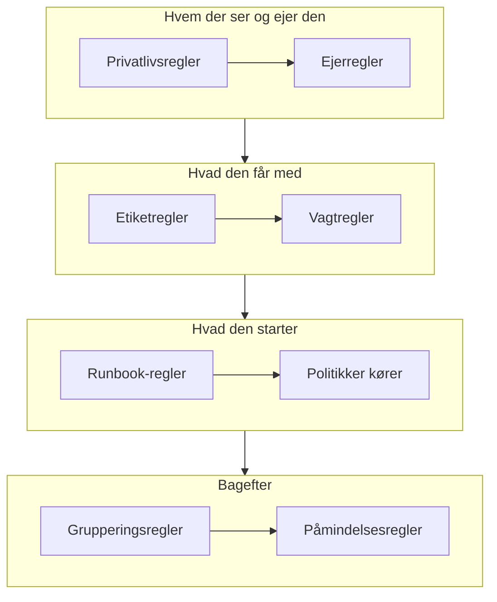

# Advarselsregler og indstillinger

Konfigurationen af advarsler ligger under **Advarsler**, ikke i **Projektindstillinger**: de regler, der handler på hver ny advarsel, og de indstillinger, der former hver advarsel i projektet. Denne side er opslagsværket for hver af dem og for det, der kører af sig selv, når en advarsel oprettes.

:::cards
- [De regler, en ny advarsel passerer](#de-regler-en-ny-advarsel-passerer): I rækkefølge, og hvad hver af dem gør.
- [Vagtregler](#vagtregler): Tilkald de rigtige personer uden at vælge en politik hver gang.
- [Påmindelsesregler](#påmindelsesregler): Påmind ejere, mens en advarsel forbliver åben.
- [Indstillinger](#indstillinger): Noteskabeloner, brugerdefinerede felter, målinger, medlemskab af episoder og nummerering.
:::

## Hvor advarselsindstillingerne ligger

Åbn **Advarsler** fra menuen **Produkter** i topbjælken. Sektionerne **Regler** og **Indstillinger** i dens sidemenu er foldet sammen fra start, så fold dem ud først. Hver side her gælder for hele projektet, på adresser, der begynder med `/dashboard/{projectId}/alerts/settings/`.

| Regelside             | Hvad den gør                                                                                   |
| --------------------- | ---------------------------------------------------------------------------------------------- |
| **Grupperingsregler** | Samler relaterede advarsler i episoder. Se [Advarselsepisoder og grupperingsregler](/docs/alerts/episodes). |
| **Vagtregler**        | Kører vagtpolitikker for matchende advarsler og episoder.                                      |
| **Ejerregler**        | Tilføjer ejere til matchende advarsler og episoder.                                            |
| **Runbook-regler**    | Starter runbooks for matchende advarsler.                                                      |
| **Privatlivsregler**  | Gør matchende advarsler og episoder private.                                                   |
| **Etiketregler**      | Tilføjer etiketter til matchende advarsler og episoder.                                        |
| **Reminder Rules**    | Påminder ejere med et interval, mens en advarsel er åben.                                      |

Sektionen **Indstillinger** rummer **Advarselsstatus** og **Advarselsalvor**, som er beskrevet på [Advarselstilstande og alvorsgrader](/docs/alerts/states-and-severities), og derefter **Noteskabeloner**, **Brugerdefinerede felter**, **Målinger**, **Medlemskab af episoder** og **Nummerering**, som er beskrevet nedenfor.

To andre sektioner handler på advarsler. **Advarsler → AI → Indstillinger** afgør, hvad OneUptime AI gør af sig selv: **Undersøg nye advarsler**, slået til for nye projekter, og **Ret nye advarsler automatisk**, slået fra, indtil du slår det til. Se [AI SRE](/docs/ai/ai-sre). **Advarsler → Arbejdsområde** rummer de Slack- og Microsoft Teams-regler, der slår advarsler og episoder op i kanaler, og dens fane **Oversigt**. Se [Slack](/docs/workspace-connections/slack).

## De regler, en ny advarsel passerer

Reglerne adskiller sig i, hvordan flere match afgøres:

- **Grupperingsregler** og **Reminder Rules** kontrolleres oppefra og ned i deres liste, og det første match vinder. Træk en regel for at ændre dens plads; en ny regel kommer sidst.
- **Vagtregler**, **Ejerregler**, **Etiketregler**, **Privatlivsregler** og **Runbook-regler** handler alle, når de matcher. Vagtpolitikker, ejere og etiketter, som flere regler tilføjer, tilføjes én gang.

**Vagtregler**, **Ejerregler**, **Etiketregler** og **Privatlivsregler** har to faner: **Alert Rules** for advarsler og **Episode Rules**, som handler på samme måde på hver ny advarselsepisode. En ny regel starter aktiveret; slå **Aktiveret** fra på dens redigeringsformular for at sætte den på pause, og listen viser et grønt **Aktiveret** eller et rødt **Deaktiveret** for hver regel.

De fleste regler handler på advarsler og episoder, der oprettes, efter at du har gemt dem. For at anvende en ejer-, etiket- eller privatlivsregel på dem, du allerede har, bruger du **Kør nu**: se [Kør regler på eksisterende ressourcer](/docs/configuration/run-rules-now). Påmindelsesregler er undtagelsen: Når du gemmer en, matches hver åben advarsel igen.

### Betingelser

En regels betingelser afgør, hvilke advarsler den handler på, og læses som sætninger: "Hvis **Advarselstitel** indeholder `database`", "Og **Overvågningsetiketter** har en af *Production*". En regel uden betingelser matcher hver advarsel.

| Betingelse                                                    | Sammenligner med                                                                                               |
| ------------------------------------------------------------- | -------------------------------------------------------------------------------------------------------------- |
| **Monitorer**, **Advarsel Alvorligheder**, **Advarselsmærkater**, **Overvågningsetiketter** | **Har en af**, **Har alle** eller **Har ingen af** de værdier, du vælger.                    |
| **Advarselstitel**, **Beskrivelse af advarsel**, **Overvågningsnavn**, **Overvågningsbeskrivelse** | **Indeholder**, **Indeholder ikke**, **Er lig med**, **Er ikke lig med**, **Starter med**, **Slutter med**, uden hensyn til store og små bogstaver, eller **Matcher mønster** og **Matcher ikke mønster** for et regulært udtryk eller et `*`-jokertegn. |

Med to eller flere betingelser vælger du **Alle skal matche**, hvor hver skal holde, eller **Én skal matche**, hvor én er nok. Episoderegler matcher i stedet en episodes alvorsgrad, etiketter, titel og beskrivelse.

## Vagtregler

**Advarsler → Regler → Vagtregler** gør tilkaldelse automatisk. Hver matchende regel tilføjer sine politikker til den nye advarsel, og advarslen kører dem sammen med de politikker, den allerede havde, hver én gang.

:::steps
### Vælg advarslerne

Klik på **Opret Alert On-Call Rule**. Under **Match** matcher **Alle advarsler**, som en ny regel starter på, hver ny advarsel. For at indsnævre reglen vælger du **Kun advarsler, der opfylder betingelserne** og tilføjer de betingelser, en advarsel skal opfylde.

### Vælg politikkerne

Under **Vagtpolitikker** vælger du de **Vagtpolitikker**, reglen tilkalder. Dens **Navn** følger dem, for eksempel "Tilkald Platform on-call", indtil du skriver dit eget, og en **Beskrivelse** venter under **Flere felter**. Opret derefter reglen.
:::

En alvorsgrad tilkalder ingen af sig selv: En vagtregel, der matcher på **Advarsel Alvorligheder**, er måden at sætte "tilkald databaseteamet ved hver High-advarsel" op på. For at se, hvad der kørte for én advarsel, åbner du dens side **Vagtudførelser**. Hver person nås derefter på den måde, de har sat op under **Brugerindstillinger → Vagtregler** på fanen **Advarsler**; se [Eskaleringsregler](/docs/on-call/escalation-rules).

En regel tilkalder, så snart en advarsel matcher den. For at lade den vente på arbejdstiden i stedet, svarer du **Kun i arbejdstiden** på **Hvornår skal denne regel tilkalde?** under **Flere felter**. **Arbejdstid** starter som mandag til fredag, 09:00 til 17:00, i din egen tidszone: vælg andre dage, et andet **Starttidspunkt** eller **Sluttidspunkt** eller en anden **Tidszone**, og en sætning under valget fortæller, hvad der sker. På listen viser reglen sin arbejdstid under navnet. En advarsel, der matcher uden for de tider, får en kørsel, der venter og ikke tilkalder nogen; når arbejdstiden begynder, tilkalder politikken sin første eskaleringsregel og eskalerer som normalt. Bliver advarslen bekræftet eller løst først, bliver ingen tilkaldt. Ændrer advarslen sig, mens den venter, så den nu matcher en regel, der tilkalder med det samme, for eksempel fordi dens alvorlighed hæves, begynder kørslen at tilkalde straks, og advarslens feed fortæller hvorfor. To regler, der tilkalder den samme politik, tilkalder den, så snart en af dem tillader det: en regel for dine højeste alvorligheder, der tilkalder med det samme, ved siden af en regel for resten, der venter på arbejdstiden, holder nætterne rolige.

## Ejer- og etiketregler

**Ejerregler** tilføjer ejerbrugere og -teams til nye advarsler, der matcher, og **Etiketregler** tilføjer etiketter. At oprette en tager to trin: **Match**, betingelserne, og derefter **Ejere** eller **Etiketter**, det, reglen tilføjer. Reglens **Navn** følger det, du vælger, indtil du skriver dit eget.

- **En regel kan nedarve.** Foldet sammen under **Nedarv ejere** eller **Nedarv etiketter** giver seks kontakter ejerne eller etiketterne videre fra advarslens monitor, hosts, Kubernetes-klynger, Docker-hosts, Podman-hosts og tjenester. Episoderegler har ingen sådanne kontakter. En ejerregels **Nedarv ejere** slutter med **Opretterens team**: af de teams, der står der, bliver hvert team, som personen, der opretter advarslen, er med i, også ejer.
- **En ny regel skal tilføje noget**: Vælg mindst én ejer eller etiket, eller slå en kontakt til. På en ejerregel for hændelser eller advarsler er et team under **Opretterens team** også nok.
- **Underret ejere**, under **Flere felter** på en ejerregel, afgør, om de tilføjede personer får besked.

[Etiket- og ejerregler](/docs/configuration/label-and-owner-rules) gennemgår formularen trin for trin for alle typer ressourcer.

## Privatlivs- og runbook-regler

**Privatlivsregler** gør nye advarsler, der matcher, private, før noget andet kører: Kun deres ejere og projektets administratorer og ejere kan se dem. En regel har to trin: **Match**, de advarsler, den gør private, og derefter **Navn**, allerede udfyldt som "Gør advarsler private". Se [Private advarsler](/docs/alerts/index#private-advarsler).

**Runbook-regler** starter en runbook, når en ny advarsel matcher, medmindre advarslen blev oprettet løst. Se [Runbook-regler](/docs/runbooks/rules).

## Påmindelsesregler

**Advarsler → Regler → Reminder Rules** påminder en advarsels ejere, mens den forbliver åben. Hver ny advarsel får den første regel, der matcher den, oppefra og ned i listen.

:::steps
### Vælg, hvilke advarsler der skal påmindes om

Klik på **Opret Alert Reminder Rule**. Under **Match** lader du **Alle advarsler** være valgt for at påminde om hver advarsel, eller du vælger **Kun advarsler, der opfylder betingelserne** og derefter de **Advarsel Alvorligheder** og **Etiketter**, den gælder for.

### Indstil intervallet

Under **Påmindelser** indstiller du **Påmindelsesinterval (minutter)**, hvor ofte ejere påmindes, og **Stop påmindelser, når**: **Løst**, standarden, eller **Bekræftet**. Dens **Navn** følger begge dele, for eksempel "Påmind hver 30 minutter, indtil løst", indtil du skriver dit eget. Opret derefter reglen.
:::

Ejere får hver påmindelse som **Alert reminder**, som er slået til via e-mail som standard. En advarsels regel matches igen, når dens alvorsgrad eller etiketter ændres. For at stoppe påmindelserne for én advarsel slår du **Send påmindelser** fra på dens side **Indstillinger**; den gemmer i det øjeblik, du slår den om.

## Indstillinger

### Noteskabeloner

**Advarsler → Indstillinger → Noteskabeloner** rummer færdig tekst til private noter. Kortet **Skabeloner til private noter for advarsler** viser dem; **Opret Advarsel Note Skabelon** beder om et **Skabelonnavn**, en **Skabelonbeskrivelse** og **Note**. En skabelon tilbydes, når nogen skriver en privat note på en advarsel eller en episode, og når de bekræfter eller løser en, og dens tekst kan redigeres, før den slås op. Noteskabeloner for advarsler er ren tekst: I modsætning til noteskabeloner for hændelser udfylder de ingen variabler.

### Brugerdefinerede felter

**Advarsler → Indstillinger → Brugerdefinerede felter** tilføjer dine egne felter til hver advarsel, for eksempel et kundeniveau eller en sagsreference. Udfyld dem på advarslens side **Brugerdefinerede felter** eller via API'et som `customFields`. Et felt kan kopiere sin værdi fra et brugerdefineret felt på en monitor i stedet for at blive skrevet ind: se [Felter, der kopieres fra en monitor](/docs/incidents/settings#felter-der-kopieres-fra-en-monitor), som fungerer på samme måde for advarsler.

### Målinger

**Advarsler → Indstillinger → Målinger** tager tid på, hvor længe ting tager for hver advarsel. Vælg **Tid til bekræftelse** eller **Tid til løsning** eller to tidspunkter efter eget valg, for eksempel når **Advarslen bliver oprettet**, og når den går ind i en tilstand, du vælger. Hver måling vises på advarslens side og i diagrammer som `oneuptime.alert.measurement.<key>`. Se [Målinger](/docs/incidents/settings#målinger), som fungerer på samme måde for advarsler.

**Tid til bekræftelse efter tilkald** tæller fra **Nogen bliver tilkaldt første gang**, når en vagtpolitik eller et direkte tilkald første gang gav nogen besked om advarslen, i stedet for fra det tidspunkt, hvor den blev oprettet: en advarsel, der opstår om natten, men først fører til et tilkald om morgenen, får ikke natten regnet med. En advarsel, hvor ingen blev tilkaldt, har ingen værdi. Se [Tid til bekræftelse efter tilkald](/docs/incidents/settings#tid-til-bekræftelse-efter-tilkald).

### Medlemskab af episoder

**Advarsler → Indstillinger → Medlemskab af episoder** afgør, om en advarsel kan være i mere end én episode. Slå **En advarsel kan kun være i én episode** til, så bliver en advarsel, der er i en episode, ikke føjet til nogen anden, hverken fra dashboardet eller via API'et, en arbejdsgang eller en grupperingsregel, før den er taget ud af den episode. Kontakten er slået fra, indtil du slår den til, og kun Project Owners og Project Admins kan ændre den. At slå den til tager ingen advarsel ud af en episode. Se [Én episode pr. hændelse](/docs/incidents/episodes#én-episode-pr-hændelse), som fungerer på samme måde for advarsler.

### Nummerering

**Advarsler → Indstillinger → Nummerering** angiver teksten foran advarsels- og episodenumre: `ALT-` og `AE-` i et nyt projekt, eller `#` uden præfiks. **Opdater** åbner **Nummerpræfiks for advarsel** og **Nummerpræfiks for advarselsepisode** med en forhåndsvisning, mens du skriver. Kun advarsler og episoder, der oprettes bagefter, får det nye præfiks. Reglerne for et præfiks står under [Nummerpræfikser](/docs/incidents/settings#nummerpræfikser).

Kortet **Næste nummer** nedenunder sætter det nummer, den næste advarsel og den næste episode får, for at fortsætte et andet værktøjs numre: **Opdater** åbner **Næste advarselsnummer** og **Næste nummer for advarselsepisode**, hver højere end det højeste indtil nu. Se [Næste numre](/docs/incidents/settings#næste-numre).

> [!NOTE]
> På OneUptime Cloud kræver noteskabeloner og brugerdefinerede felter planen **Growth** eller højere.

## Workflows

Hver advarselsmodel har workflow-udløsere og -handlinger, opkaldt efter den: **On Create Alert**, **On Update Alert**, **On Create or Update Alert** og **On Delete Alert**, det samme for **Advarsel Episode**, **Advarsel Tilstand Tidslinje** og de andre, og handlinger som **Create One Alert** og **Update One Alert**. Definitionerne af brugerdefinerede felter for advarsler er den eneste undtagelse: De har ingen workflow-udløsere. Se [Workflows – Oversigt](/docs/workflows/index).

## Hvem der kan ændre dem

Regler, brugerdefinerede felter og målinger kræver en Project Owner eller Project Admin eller en brugerdefineret rolle med reglens egen tilladelse. **Advarselsmedlem** arbejder med advarsler og episoder, deres noter, ejere og tilstandstidslinjer og noteskabeloner, og **Advarselsadministrator** administrerer også advarselstilstande og alvorsgrader. Se [Brugere, teams og tilladelser](/docs/permissions/index).

## Næste skridt

:::cards
- [Advarselsepisoder og grupperingsregler](/docs/alerts/episodes): Grupperingsreglerne i dybden.
- [Eskaleringsregler](/docs/on-call/escalation-rules): Hvad der sker, når en vagtregel kører en politik.
- [Etiket- og ejerregler](/docs/configuration/label-and-owner-rules): Regelformularen trin for trin.
- [AI SRE](/docs/ai/ai-sre): Undersøg og ret nye advarsler af sig selv.
:::
