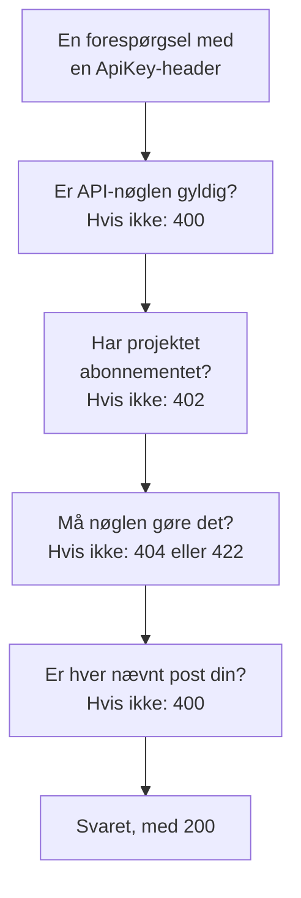

# OneUptime API-reference

Alt, hvad du kan gøre i OneUptime-dashboardet, kan du også gøre via dets REST API: automatisere gentaget arbejde, forbinde OneUptime med dine andre værktøjer eller bygge dine egne integrationer. Denne side viser, hvordan du laver din første forespørgsel, og de regler, hver forespørgsel følger. Hvert endpoint og hvert felt står i den [fulde API-reference](/reference).

:::cards
- [Lav din første forespørgsel](#lav-din-første-forespørgsel): En API-nøgle, én header og en curl-kommando.
- [Forespørgsler og svar](#forespørgsler-og-svar): De seks forespørgsler, hver ressource har, og hvad hver statuskode betyder.
- [Abonnementer og API'et](#abonnementer-og-apiet): Hvad et abonnement sælger, og hvad der stadig virker under det.
- [Navngiv og skriv poster](#navngiv-og-skriv-poster): ID'er, referencer, kontakter og de felter, OneUptime udfylder.
- [Tilstande og episoder](#tilstande-og-episoder): Den tilstand, en post starter i og bevæger sig igennem.
- [Hvad en forespørgsel kan nå](#hvad-en-forespørgsel-kan-nå): Læsninger, ændringer og sletninger, ét projekt ad gangen.
:::

## Sådan besvares en forespørgsel

API'et er bygget op efter REST: standard-HTTP-metoder og -statuskoder, JSON ind og JSON ud. Hver forespørgsel bærer en API-nøgle og passerer nogle få kontroller. Den første kontrol, den fejler, svarer med en statuskode og `{ "message": "..." }`, så beskeden siger, hvad der stoppede den.



## Lav din første forespørgsel

Alle API-forespørgsler godkendes med en API-nøgle. En nøgle hører til ét projekt og gør det, dens tilladelser tillader.

:::steps
### Opret en API-nøgle

Åbn **Projektindstillinger → Avanceret → API-nøgler**, og klik på **Opret API-nøgle**. Giv den et **Navn**, og vælg under **Adgang**, hvad den må: **Projektadministrator**, **Projektmedlem**, **Seer** eller **Vælg tilladelser senere** for at tilføje enkelte tilladelser på nøglens side. Nøglen udløber om et år, medmindre du vælger en anden dato under **Avanceret**.

### Kopiér nøglen

Nøglens side åbnes. Kopiér **API-nøgle** fra kortet **API-nøgledetaljer**, og hold den ude af din kode:

```bash
export ONEUPTIME_API_KEY="your-api-key"
```

### Send en forespørgsel

Vis de første ti monitorer. Nøglen læser sit eget projekt, så forespørgslen nævner intet projekt:

```bash
curl -X POST 'https://oneuptime.com/api/monitor/get-list?skip=0&limit=10' \
  -H "ApiKey: $ONEUPTIME_API_KEY" \
  -H 'Content-Type: application/json' \
  -d '{ "select": { "name": true } }'
```

Svaret er `{ "data": [...], "count": ... }`: monitorerne, og hvor mange der er i alt. På en selvhostet installation bruger du din egen OneUptime-adresse i stedet for `https://oneuptime.com`.
:::

### Eksempler for hver ressource

Hver ressource i OneUptime-dashboardet har en sektion **Udvikler** i sin sidemenu, foldet sammen indtil du åbner den. Dens side **API** har kørselsklare `curl`-kommandoer for den ressource, rettet mod dit OneUptime og udfyldt fra dit eget projekt: læs, ændr og slet den fra ressourcens egen side, eller vis, tæl og opret fra en listeside (for eksempel **Monitorer**). Kommandoerne læser din API-nøgle fra miljøvariablen `ONEUPTIME_API_KEY`.

Eksemplerne er skrevet til ressourcen. På listen **Hændelser** viser listeforespørgslen for eksempel sit svar med din første hændelse, filtrene finder hændelser, der ikke er løst, af én alvorlighed, om én monitor eller fra de sidste syv dage, med dine egne tilstande, alvorligheder og monitorer, og oprettelsesforespørgslen erklærer en hændelse med en af dine alvorligheder, med en linje om, hvad hvert felt er til. En hændelses egen side læser den med dens rigtige svar, flytter den til en anden af dine alvorligheder og har dens almindelige opgaver: kvittér for den og løs den (med dit projekts egne tilstande), og tilføj interne eller offentlige noter. Hver API-side slutter med ressourcens endpoints.

## Forespørgsler og svar

Hver ressource har de samme forespørgsler, under `https://oneuptime.com/api` og ressourcens sti, som `/monitor` eller `/incident`:

| Forespørgsel | Metode og sti | Hvad bodyen indeholder |
| --- | --- | --- |
| Vis liste | `POST /api/<resource>/get-list` | `query`, `select` og `sort` |
| Tæl | `POST /api/<resource>/count` | `query` |
| Læs én | `POST /api/<resource>/<id>/get-item` | `select` |
| Opret | `POST /api/<resource>` | `{ "data": { ... } }` |
| Ændr én | `PUT /api/<resource>/<id>` | `{ "data": { ... } }`, de felter, der skal ændres |
| Slet én | `DELETE /api/<resource>/<id>` | Intet |

`POST /api/<resource>/<id>/update-item` og `POST /api/<resource>/<id>/delete-item` ændrer og sletter også én post, for klienter, der kun sender `POST`.

### Filtrér, sortér og bladr

En liste eller en optælling tager en `query`. Et felt med en værdi matcher den værdi; et objekt med en `_type` sammenligner:

| `_type` | Matcher |
| --- | --- |
| `Search` | Tekst, der indeholder `value` |
| `NotEqual` | Alt undtagen `value` |
| `GreaterThan`, `LessThan` | Senere datoer eller større tal, eller tidligere og mindre |
| `InBetween` | Datoer eller tal mellem `startValue` og `endValue` |
| `Includes` | En hvilken som helst af værdierne i `value` |
| `IsNull`, `NotNull` | Ingen værdi, eller en hvilken som helst værdi |

Et felt i en post, som ressourcen nævner, filtreres under dens relation: `"user": { "name": { "_type": "Search", "value": "ada" } }` finder de teammedlemmer, hvis brugers navn indeholder »ada«. At filtrere på et felt kræver tilladelse til at læse det, gennem en relation som på selve ressourcen: et filter på et felt, du ikke må læse, afvises med en `422`, der nævner feltet.

`select` nævner de felter, der skal returneres, og `_id` kommer altid med. `sort` ordner dem, `ASC` eller `DESC`; uden sortering kommer de nyeste først. En liste returnerer 10 poster, medmindre du sætter `limit`, op til 10.000, og `skip` springer først så mange over: bliv ved med at hæve `skip` med `limit`, indtil du har `count` af dem. Tilføj `?output-type=csv` til en listeforespørgsel for at få CSV i stedet for JSON.

For eksempel de monitorer, hvis navn indeholder »checkout«, oprettet siden starten af 2026, de nyeste først:

```bash
curl -X POST 'https://oneuptime.com/api/monitor/get-list' \
  -H "ApiKey: $ONEUPTIME_API_KEY" \
  -H 'Content-Type: application/json' \
  -d '{
    "query": {
      "name": { "_type": "Search", "value": "checkout" },
      "createdAt": { "_type": "GreaterThan", "value": "2026-01-01T00:00:00.000Z" }
    },
    "select": { "name": true, "createdAt": true },
    "sort": { "createdAt": "DESC" },
    "limit": 100
  }'
```

Datoer og id'er ud over `_id` kommer pakket ind, som `{ "_type": "DateTime", "value": "..." }` og `{ "_type": "ObjectID", "value": "..." }`: læs dem fra `value`.

Hvert id, en anmodning filtrerer efter eller skriver - `_id`, et felt som `monitorId` og hver post, en relation oplister, som `"labels": [{ "_id": "..." }]` - er et UUID, sendt som tekst eller pakket ind, sådan som det kommer tilbage. Alt andet, som tekst, der ikke er et UUID, eller et objekt i stedet for et id, afvises med en `400`, der navngiver feltet og siger, om det stod i `query` eller i `data`, og intet bliver læst eller skrevet:

```text
Invalid ID for "currentIncidentStateId" in the query: "resolved". An ID is a UUID, such as "550e8400-e29b-41d4-a716-446655440000".
```

### Statuskoder

| Kode | Hvad den betyder | Læs mere |
| --- | --- | --- |
| `200` | Den gik igennem. En liste eller en optælling svarer med de poster, du må læse, ingen når der ikke er nogen. | [Læs én post ud fra dens ID](#læs-én-post-ud-fra-dens-id) |
| `400` | Forespørgslen er forkert: API-nøglen er ugyldig, en værdi er ikke tilladt, et felt kan ikke skrives, en nævnt post er ikke din, eller den ændrer flere projekter på én gang. Beskeden siger, hvad der er galt. | [Poster, som en forespørgsel nævner](#poster-som-en-forespørgsel-nævner) |
| `402` | Projektets abonnement indeholder ikke det, forespørgslen bruger. Beskeden nævner abonnementet. | [Funktioner, dit abonnement ikke indeholder](#funktioner-dit-abonnement-ikke-indeholder) |
| `404` | Posten findes ikke, ligger i et andet projekt eller er en, du ikke må læse: samme svar i hvert tilfælde. | [Ændre eller slette en post, du ikke må læse](#ændre-eller-slette-en-post-du-ikke-må-læse) |
| `422` | Du må ikke gøre dette: API-nøglen har ingen tilladelse til denne slags post, du må læse posten, men ikke ændre den, eller en tilladelses etiketter udelukker den. Beskeden siger hvorfor. | [Ændre eller slette en post, du ikke må læse](#ændre-eller-slette-en-post-du-ikke-må-læse) |
| `500` | Noget fejlede på serveren. Når ejeren af en ny post ikke kan skrives, fjernes posten igen, så oprettelsen kan prøves igen. | [Poster, som en forespørgsel nævner](#poster-som-en-forespørgsel-nævner) |

## Abonnementer og API'et

### Funktioner, dit abonnement ikke indeholder

I OneUptime Cloud sælges nogle ressourcer i et abonnement: single sign-on-udbydere og SCIM-forbindelser i **Scale**; API-nøgler, vagtplaner samt notifikationsregler og opsummeringer til Slack og Microsoft Teams i **Growth**, blandt andre. At oprette en, ændre den eller slå den til kræver det abonnement. Under det afvises forespørgslen med `402 Payment Required`, og beskeden nævner abonnementet.

Nogle indstillinger for en ressource sælges i et abonnement på samme måde. For eksempel: en statusside, der er privat, der skjuler en af sine lister, eller som har brugerdefineret HTML, CSS eller JavaScript, e-mailrapporter, abonnenter via SMS, Slack, Microsoft Teams eller webhook, eller en IP-tilladelsesliste; et dashboard, der deles offentligt, eller dets IP-tilladelsesliste; en formulars IP-tilladelsesliste; et projekts auditlogs. Vejledningen til hver af dem og dashboardet ved siden af indstillingen nævner det abonnement, den kræver. En sådan indstilling kræver sit abonnement, hver gang den skrives - når ressourcen oprettes med den, ligesom når den ændres senere -, så en oprettelse, der slår en af dem til under abonnementet, også afvises med `402`. En indstilling, der står på sin standardværdi eller sættes tilbage til den, virker på alle abonnementer: en oprettelse, der lader disse indstillinger være, går igennem, og det samme gør en Terraform-konfiguration, der ikke sætter dem.

Det, et projekt allerede har, kan stadig administreres uanset abonnement, for eksempel når en prøveperiode slutter, eller abonnementet går ned:

- du kan slette de poster;
- du kan slå en fra, på en ressource med et felt `isEnabled`, ved at sende `"isEnabled": false` og intet andet;
- du kan vise og læse dem, et projekt skal finde, efter at abonnementet er gået ned - for at slå dem fra eller for at se, hvad der er stoppet: single sign-on-udbydere, SCIM-forbindelser, API-nøgler og deres tilladelser, vagtplaner samt notifikationsregler og opsummeringer til Slack og Microsoft Teams.

De sædvanlige tilladelser afgør stadig, hvem der må hvad, præcis som på abonnementet. At læse de andre ressourcer, et abonnement sælger, som skabeloner, brugerdefinerede felter, monitorgrupper, vagtlogs og formularindsendelser, kræver stadig abonnementet: at læse dem er at bruge funktionen. En API-nøgles tilladelser slettes ikke én ad gangen under **Growth**, fordi sletning af en blokeringstilladelse ville give nøglen mere adgang; slet i stedet nøglen.

### API-nøgler og SCIM under deres abonnement

I OneUptime Cloud virker et projekts API-nøgler kun, mens projektet er på **Growth** eller derover, og dets SCIM-forbindelser - projektets egne og dets statussiders - virker kun fuldt ud, mens det er på **Scale** eller derover. Når projektet kommer under det abonnement:

- Hver forespørgsel, der laves med en af projektets API-nøgler, afvises med `402 Payment Required`, uanset hvad den beder om: REST API'et og alt, der kalder det med en API-nøgle - Terraform, `oneuptime`-CLI'en, MCP-klienter, der er forbundet med en API-nøgle, workflows, der sender en i en forespørgselsheader, og dine egne scripts. Beskeden nævner abonnementet: `API keys need the Growth plan. This project's plan does not include them, so its API keys stopped working. The keys are kept: upgrade the project to Growth in Project Settings > Billing and Invoices > Billing and they work again.`
- Dets SCIM-forbindelser fjerner kun personer. At deaktivere og slette personer og fjerne dem fra grupper virker stadig, så alle, der rejser, stadig mister deres adgang; hver SCIM-forespørgsel, der ville tilføje eller ændre personer eller grupper, afvises med `402` i SCIM-fejlformatet, så din identitetsudbyder viser hvorfor ([SCIM under abonnementet Scale](/docs/identity/scim#under-planen-scale)).

Intet slettes eller slås fra. Nøglerne og forbindelserne bevares, og de virker fuldt ud igen, som de er, så snart projektet er tilbage på abonnementet: ingen nye nøgler at lave, intet at sætte op igen i din identitetsudbyder. En abonnementsændring træder i kraft inden for et minut.

Under **Growth** viser **Projektindstillinger** > **Avanceret** > **API-nøgler** de nøgler, projektet stadig har, og siger, at de er stoppet, så enhver af dem kan slettes (tilbagekaldes) på alle abonnementer. At oprette eller ændre nøgler kræver **Growth**. **Projektindstillinger** > **Fakturering og fakturaer** > **Fakturering** angiver, hvor mange API-nøgler et lavere abonnement stopper, og hvor mange SCIM-forbindelser det begrænser, på hvert abonnement, du kan vælge, og hvad projektets abonnement har stoppet; projektets ejere får en e-mail, når en abonnementsændring stopper dem. Ejerne af projekter, der allerede lå under disse abonnementer, da dette begyndte, får én e-mail, der siger, hvad der er stoppet, og hvordan det slås til igen.

Kun et projekts API-nøgler og SCIM-forbindelser berøres. Personer berøres ikke: at logge ind på dashboardet og MCP-klienter, der er forbundet ved at logge ind, virker som før. Indtagelsesnøgler til telemetri, probenøgler og agentnøgler er ikke API-nøgler og bliver ved med at virke. Selvhostede installationer har ingen abonnementer, så for dem ændres intet.

## Navngiv og skriv poster

### Find en ressources ID

Forespørgsler, der læser, ændrer eller sletter én ressource, nævner den ved dens ID, et UUID. På ressourcens egen side slutter dens detaljekort med en lille linje **ID**, der viser begyndelsen af ID'et: klik på ID'et, eller på kopiknappen ved siden af, for at kopiere hele ID'et. Lister, der tilbyder det, har **Vis ID** i en rækkes menu **⋯**, og ID'et er også den sidste del af sidens adresse. Dit projekts ID er det første på kortet **Projektdetaljer** under **Projektindstillinger → Projekt**.

### Poster, som en forespørgsel nævner

Mange ressourcer nævner andre poster: en monitor sine etiketter og prober, en abonnent på en statusside sin statusside, en netværksenhed sit site, et medlem af en hændelse hændelsen og rollen. Hver regel nedenfor gælder ens for API'et, Terraform og workflows:

| Når en forespørgsel | skal den | Ellers |
| --- | --- | --- |
| nævner en post ved dens ID | nævne en post i dit projekt | `400` |
| opretter en post, der læses via en anden, som en note | oprette den under en, du må læse | `400`, eller `422` uden tilladelse til at læse den slags post |
| flytter en post ind under en anden | flytte den ind under en, du må læse | `400` |
| viser poster, eller nævner en i et eget felt | nævne poster, som din læsetilladelse når | `400` |
| nævner en indstilling, der indeholder legitimationsoplysninger | komme fra en, der må læse den slags indstilling | `400` |
| opretter eller giver en post nye etiketter med en tilladelse, der er begrænset til etiketter | give posten en af de etiketter | `422` |
| nævner én post på to måder | nævne den samme post begge gange | `400` |

#### Hvert ID skal høre til dit projekt

Hvert ID, du sender for en post, som en ressource nævner, skal være en post i dit projekt — dashboardets vælgere tilbyder intet andet — og forespørgsler fra Terraform og workflows holdes til det samme. Et ID for en post i et andet projekt og et ID, der ikke findes, afvises ens, med en `400`, der nævner feltet og ID'et:

```text
This network device references records that are not in this project: Network Site "…". Please pick values from this project and try again.
```

Personer kontrolleres ud fra medlemskab: en, der ikke er medlem af projektet, afvises på samme måde. En global probe, som alle projekter kan bruge, tæller som dit projekts. En ændring af en ressource kontrollerer kun de ID'er, ændringen tilføjer, så en ressource, der nævner noget, som siden er forsvundet, stadig kan gemmes.

#### Poster, der læses via en anden

En post, der læses via en anden - en hændelses eller en advarsels noter og tilstandstidslinje, en statussides meddelelser, domæner og grupper - skal også nævne en, du må læse, efter den regel, en læsning af den følger: en hændelse uden for de etiketter eller ejere, din tilladelse til at læse hændelser når, med en etiket, som en blokering af læsning af hændelser fjerner, eller markeret som privat, uden at du er blandt dens ejere, direkte eller via et team (projektejere og -administratorer ser hver privat hændelse, advarsel og episode), afvises med samme `400`, og intet skrives. Hver statusside, en meddelelse nævner, skal være en, du må læse, og en nøgle, hvis tilladelse til at læse statussider kun når nogle af dem, skal nævne mindst én. En tilladelse til at oprette en sådan post kræver en til at læse den post, den oprettes under; uden den afvises oprettelsen med en `422`, der nævner de tilladelser, der ville lade den komme igennem:

```text
You do not have permissions to create Incident Internal Note. It is read through its Incident, and you need one of these permissions to read Incidents: …
```

En ændring, der flytter en sådan post, følger samme regel: hver post, den tilføjer som overordnet - en anden statusside for en meddelelse, en anden tjeneste for en post, der læses via sin tjeneste - skal være en, du må læse, ellers afvises ændringen med samme `400`, og intet skrives. De overordnede poster, en post allerede har, kontrolleres ikke igen, og en ændring, der efterlader den under ingen, kræver en tilladelse til at læse den slags post, der når dem alle, ligesom en oprettelse, der ikke nævner nogen.

#### Ejere

En ressources ejere - bruger- og teamejerposterne for en monitor, en vagtpolitik, et dashboard og enhver anden ressource med ejere - læses på samme måde via den ressource, de ejer: at vise, læse, tilføje og fjerne dem kræver en tilladelse til at læse den ressource, under dens etiketter og ejere, og en ejerpost for en ressource, du ikke må læse, besvares, som om den ikke fandtes. At tilføje og fjerne dem holder sig også til omfanget af den tilladelse, der giver lov til det: en med omfanget `Owned` når kun ejerne af ressourcer, som du eller et af dine teams ejer, og at tilføje en ejer til en hvilken som helst anden ressource afvises med en `422`, der siger det.

#### Poster, en skrivning viser eller nævner

De poster, en oprettelse eller ændring viser - en hændelses monitorer og vagtpolitikker, en advarsels tjenester, en planlagt vedligeholdelsesbegivenheds statussider, en regels runbooks - holder sig til din tilladelse til at læse den slags post, når du har en, og under alle omstændigheder til en blokering med etiketter af læsningen: en uden for dem afvises med samme `400`. En ændring kontrollerer kun de poster, den tilføjer til en liste, så dem, listen allerede indeholder, bliver.

Den ene post, en oprettelse eller ændring nævner i et eget felt - en advarsels monitor, den monitor, en statussideressource viser, et omkostningsbudgets tjeneste, den hændelse, en runbook-kørsel er knyttet til - følger samme regel, under begge sine navne: en uden for din tilladelse til at læse den slags post, eller med en etiket, som en blokering af læsningen fjerner, afvises med samme `400`. En ændring kontrollerer den kun, når den nævner en anden post end den, feltet allerede indeholder. OneUptimes globale prober og AI-agenter, som alle projekter kan bruge, forbliver åbne for alle projekter. De poster, en skabelon udfylder for dig, kontrolleres på samme måde, når de er udfyldt, før noget gemmes: de monitorer, statussider og vagtpolitikker, en hændelsesskabelon tilføjer til en hændelse, der erklæres ud fra den, skal være nogle, du må læse, som om du selv havde valgt dem.

#### Indstillinger, der indeholder legitimationsoplysninger

En indstilling, der indeholder legitimationsoplysninger - en SMTP-server, en udbyder af opkald og SMS, SNMP-legitimationer, en videoopkaldsforbindelse, en API-nøgle, en ekstern MCP-server - nævnes kun af en, der må læse den slags indstilling: en statussides `smtpConfig` og `callSmsConfig`, en politik for indgående opkalds `projectCallSMSConfig`, en netværksenheds eller et sites `snmpCredentialProfile`, en hændelses eller advarsels videoopkaldsforbindelse `videoCallConnection`, en API-nøgletilladelses `apiKey` og `externalMcpServers` i en AI-regel. At nævne en uden tilladelse til at læse den slags indstilling - eller med en, som en blokering uden etiketter fjerner - afvises med samme `400`, under begge dens navne; en ændring, der beholder den indstilling, en post allerede nævner, spørges der ikke om. Nummersøgningen og listen over egne numre i en politik for indgående opkald kræver samme læsning af den opkalds- og SMS-konfiguration, de nævner.

#### Etiketter og ejere ved oprettelse

En oprettelsestilladelse, der er begrænset til etiketter, opretter kun poster, der bærer en af dens etiketter - for en post uden egne etiketter poster under en, der bærer en -, medmindre en anden tilladelse til at oprette den slags post når hele projektet, og en blokering med etiketter på en oprettelsestilladelse afviser en post, der bærer en af dens etiketter. En oprettelse uden for dem afvises med en `422`, der nævner etiketterne:

```text
Your access lets you create Status Pages only with one of these labels: Production. Add one of them and try again.
```

En oprettelsestilladelse med omfanget **Owned** opretter kun en monitor, en statusside eller en anden post med egne ejere for en person, som bliver en af dens ejere, og en note eller en anden post, der tager sine ejere fra den post, den hører til, kun under en, som du eller et af dine teams ejer.

Opretteren gøres til ejer lige efter, at posten er gemt, før der sker noget andet med den. Hvis ejerrækken ikke kan skrives, fjernes posten igen, og oprettelsen afvises med en `500`, så der ikke efterlades nogen post, som dens opretter ikke kunne nå.

#### En ændring af etiketter

En ændring af de etiketter, en post bærer - dens egne etiketter eller, for en post uden egne etiketter, de poster, den nævner - holder sig på samme måde til din tilladelse til at ændre den slags post: med en, der er begrænset til etiketter, beholder posten mindst én af dem, medmindre en anden tilladelse til at ændre den når hele projektet, og en blokering med etiketter på en ændringstilladelse afviser at give den en af dens etiketter. En sådan ændring afvises med en `422`, der nævner etiketterne:

```text
Your access lets you change Monitors only with one of these labels: Production. Keep one of them and try again.
```

#### Nævn en post på to måder

En post kan nævnes på to måder: ved sit ID-felt (`monitorId`) eller ved relationen (`"monitor": { "_id": "…" }`), som er det, dashboardets formularer sender. Send en af dem. Hvis en forespørgsel sender begge, skal de nævne den samme post: en forespørgsel, hvor de to ikke stemmer overens — to forskellige ID'er, eller et ID og en tom værdi — afvises med en `400`, der nævner begge felter:

```text
Conflicting Monitor references were provided. monitorId and monitor are names for the same field and must hold the same value: send only one of them, or the same id in each.
```

Begge navne kontrolleres på samme måde. Reglerne for den post, du nævner, gælder, uanset hvilket navn du sender den under: en statussidegruppes overordnede gruppe skal ligge på samme statusside, en statusside tager højst tre headerlinks, og en gruppes navn skal være unikt på dens statusside.

### Kontakter

Et felt, der er til eller fra - `isEnabled`, `isVisibleOnStatusPage`, `isArchived` og ethvert andet `true`- eller `false`-felt - tager `true` eller `false`. Tekst og tal, som databasen læser som en af dem, tages som den værdi, på samme måde for API'et, Terraform og workflows: `"true"`, `"yes"`, `"on"`, `"1"` og `1` er `true`, og `"false"`, `"no"`, `"off"`, `"0"` og `0` er `false`, uanset store og små bogstaver. Alt, hvad OneUptime gør med posten, behandler den også som den værdi: en planlagt vedligeholdelsesbegivenhed, der sendes med `"isVisibleOnStatusPage": "true"`, viser sine billeder på statussiden, og `"isEnabled": "false"` slår en ressource fra under dens abonnement, ligesom `false` gør. Enhver anden værdi, som `"maybe"`, `""` eller `2`, afvises med en `400`, der nævner feltet:

```text
isVisibleOnStatusPage must be true or false.
```

En opdatering, der skriver en posts værdier, som de allerede er, ændrer intet: den starter ikke postens **On Update**-workflows, sender ikke liveopdateringer og tilføjer ikke en post i auditloggen. `false` skrevet over `false` tæller som den samme værdi, og det samme gør `"false"` skrevet over `false`, et tal skrevet som tekst, et tidspunkt skrevet som samme øjeblik i et andet format og etiketter skrevet som de samme etiketter i vilkårlig rækkefølge. Når en opdatering ændrer nogle værdier og skriver andre tilbage, som de er, viser dens auditlogpost kun de værdier, der ændrede sig, og et workflows **Fields to watch** hører kun dem.

### Hvor et projekt blev købt

Et projekts forhandler, forhandlerabonnement og forhandlerlicens (`resellerId`, `resellerPlanId`, `resellerLicenseId` og relationerne `reseller` og `resellerPlan`) sættes alene af OneUptime: når et projekt oprettes med en forhandlers kampagnekode, og når forhandleren ændrer abonnementet. En oprettelse eller ændring af et projekt, der sender en af dem, afvises med en `400`, der nævner feltet, uanset hvem der sender den:

```text
User is not allowed to create on resellerId column of Project. No permission allows it: the column is set by the server, not by a request.
```

### Hvem der oprettede en post

OneUptime registrerer, hvem der oprettede en post — og hvem der arkiverede den, løste den, kvitterede for den eller udløste den — ud fra selve forespørgslen: den person, der er logget ind, eller ingen, når forespørgslen kommer med en API-nøgle eller fra et workflow. Disse felter (`createdByUserId` og de andre felter, der ender på `ByUserId`, med deres relationer som `createdByUser`) er skrivebeskyttede, og det samme er tidspunktet, hvor en post blev arkiveret eller løst (`archivedAt`, `markedAsResolvedAt`, `markedAsArchivedAt`): at slå `isArchived` eller `isResolved` til registrerer, hvem der gjorde det og hvornår, og at slå det fra rydder begge. At sende en kontakt, som den allerede står, beholder, hvem der slog den om, og hvornår.

API-referencen markerer disse felter som skrivebeskyttede. En værdi, en forespørgsel sender for et af dem ved siden af andre ændringer, ignoreres, så resten af ændringen går igennem; en opdatering, der ikke sender andet, afvises med en besked, der nævner felterne. Poster, som OneUptime selv opretter på vegne af nogen — en note, der er sendt fra Slack eller Microsoft Teams, en konto, der er oprettet via en invitation — nævner den person.

## Tilstande og episoder

### Den tilstand, en ny post starter i

En hændelse, en advarsel, en hændelsesepisode og en advarselsepisode kan oprettes i en hvilken som helst af dit projekts tilstande, som feltet **Indledende tilstand** i deres oprettelsesformularer gør: send `currentIncidentStateId` (hændelser og hændelsesepisoder) eller `currentAlertStateId` (advarsler og advarselsepisoder), eller relationen. Posten starter i den tilstand, og dens tilstandstidslinje begynder med den. Udelader du den, starter den i dit projekts oprettelsestilstand, den, der er markeret med `isCreatedState` — eller, for en hændelse, der erklæres ud fra en skabelon med en indledende tilstand, i skabelonens. En tilstand fra et andet projekt afvises som enhver anden post. Terraforms `current_incident_state_id` og `current_alert_state_id` virker på samme måde. En post, der oprettes i din kvitteret-tilstand eller senere, tilkalder ingen, og en, der oprettes løst, bliver desuden hverken grupperet, afhjulpet automatisk eller undersøgt af AI og får ingen kanal i Slack eller Microsoft Teams — se [Erklæret allerede kvitteret eller løst](/docs/incidents/declaring-incidents#erklæret-allerede-bekræftet-eller-løst).

### Ændre en posts tilstand

En posts tilstand ændres med en række i dens tilstandstidslinje - `POST /api/incident-state-timeline`, `/api/alert-state-timeline`, `/api/incident-episode-state-timeline`, `/api/alert-episode-state-timeline` eller `/api/scheduled-maintenance-state-timeline` - eller med en opdatering, der skriver dens aktuelle tilstand (`currentIncidentStateId`, `currentAlertStateId`, `currentScheduledMaintenanceStateId` eller relationen), hvilket registrerer samme række. Uanset hvad gælder én regel for skiftet, for en episode som for en hændelse, en advarsel eller en planlagt vedligeholdelsesbegivenhed: en tilstand, der ligger før postens aktuelle i dit projekts rækkefølge, afvises, før noget gemmes, og det samme gør den tilstand, den allerede er i:

```text
Episode cannot transition to Acknowledged state from Resolved state because Acknowledged is before Resolved in the order of incident states.
```

En tilstand, der er sat ved en fejl, rettes ved at slette dens række fra postens tilstandstidslinje. Se [Rækkefølgen er en reel begrænsning](/docs/incidents/states-and-severities#rækkefølgen-er-en-reel-begrænsning-ikke-en-visningspræference).

### Den episode, en hændelse eller advarsel er i

En hændelses `incidentEpisodeId` og en advarsels `alertEpisodeId` — og deres relationer `incidentEpisode` og `alertEpisode` — nævner den seneste episode, den blev tilføjet til og stadig er medlem af, eller intet. De er skrivebeskyttede: OneUptime sætter dem ud fra episodens medlemmer. For at sætte en hændelse ind i en episode opretter du et Incident Episode Member (`POST /api/incident-episode-member` med `incidentEpisodeId` og `incidentId`); for at tage den ud sletter du det medlem, og hændelsen nævner så den seneste episode, den stadig er i, eller ingen. Advarsler virker på samme måde via Alert Episode Members (`/api/alert-episode-member`, med `alertEpisodeId` og `alertId`). Grupperingsregler tilføjer hændelser og advarsler til episoder på samme måde. En oprettelse eller opdatering af en hændelse eller advarsel, der sender dens episode, afvises, uanset hvem der sender den — API'et, Terraform, MCP-værktøjerne eller et workflow. I Terraform kan `incident_episode_id` og `alert_episode_id` læses, men ikke sættes; ressourcerne `oneuptime_incident_episode_member` og `oneuptime_alert_episode_member` styrer medlemskabet.

## Hvad en forespørgsel kan nå

### Ændre eller slette en post, du ikke må læse

En ændring eller sletning når kun de poster, API-nøglen - eller den person, der er logget ind - må læse. En post uden for dens etiketter eller ejere, bag en blokering af læsning, eller læst via en anden post, den ikke må læse (en hændelses note, en statussides meddelelse), kan heller ikke ændres eller slettes. En tilladelse til at ændre eller slette en slags post virker sammen med tilladelsen til at læse den, og en til at ændre en hændelses noter sammen med en til at læse hændelser.

En forespørgsel, der ændrer eller sletter én post ud fra dens ID - `PUT /api/<resource>/<id>` eller `POST /api/<resource>/<id>/update-item`, `DELETE /api/<resource>/<id>` eller `POST /api/<resource>/<id>/delete-item` - og intet når, svarer:

- `404`, når posten ikke findes, ligger i et andet projekt eller er en, du ikke må læse - samme svar i hvert tilfælde:

```text
Incident not found.
```

- `422`, når du må læse posten, men ikke ændre eller slette den, med begrundelsen:

```text
You do not have permission to update this incident.
```

En sletning, der ikke nåede noget, svarede tidligere `200`. Opdateringer og sletninger via forespørgsel, som et workflows opdaterings- og sletningstrin, svarer med, hvor mange poster de ændrede, `0` når de ikke nåede nogen. Terraform læser en `404` ved `terraform destroy` som en ressource, der allerede er væk.

Telemetri følger samme regel. En sletning af logs, traces, metrikker, undtagelser, profiler eller sessionsoptagelser når rækkerne for de ressourcer - tjenester, værter, klynger og lignende -, hvis telemetri du både må læse og slette, og foretages ét projekt ad gangen: en forespørgsel på tværs af alle dine projekter afvises. En sletning af én række ud fra dens ID, der intet når, svarer `404` eller `422` som ovenfor.

### Ændringer foretages ét projekt ad gangen

En opdatering eller sletning af et projekts poster foretages i det projekt, forespørgslen nævner: headeren `tenantid` eller, for en API-nøgle, nøglens eget projekt. En opdatering eller sletning fra en indlogget bruger, der ikke nævner noget projekt, eller som spørger på tværs af alle brugerens projekter med headeren `is-multi-tenant-query`, afvises med `400`:

```text
Changes to incidents are made in one project at a time. Please pass the project ID in the 'tenantid' header.
```

En sådan forespørgsel fejlede tidligere med `500`. Læsninger må stadig spørge på tværs af alle dine projekter.

### Læs én post ud fra dens ID

En læsning af én post ud fra dens ID - `POST /api/<resource>/<id>/get-item` - svarer `404`, når posten ikke findes, ligger i et andet projekt eller er en, du ikke må læse, samme svar i hvert tilfælde:

```text
Incident not found.
```

Tidligere svarede den `200` med en tom body. En liste (`get-list`) og en optælling svarer stadig `200` med de poster, du må læse, ingen når der ikke er nogen. Terraform-provideren læser en `404` ved opdatering som en ressource, der er væk, og fjerner den fra state, så næste plan opretter den igen: giv den API-nøgle, den bruger, tilladelserne og etiketterne til at læse hver ressource, den styrer. MCP-værktøjerne svarer på en `404` med en fejl, der peger på det tilsvarende listeværktøj, og CLI'en afslutter med koden `3`.

## Den fulde endpoint-reference

Hver ressource, hvert endpoint og hvert felt står i [OneUptime API-referencen](/reference). Den findes på flere sprog: dit sprog hentes fra din browser, og du kan til enhver tid skifte med vælgeren øverst på siden.

## Fejlfinding

:::details Hver forespørgsel svarer 400 Invalid API Key
Headeren `ApiKey` er tom, er ikke en nøgle eller nævner en nøgle, der er udløbet eller nulstillet. Kopiér nøglen igen fra dens side under **Projektindstillinger → Avanceret → API-nøgler**, hvor dens dato under **Udløber** også står.
:::

:::details Hver forespørgsel svarer 402 Payment Required
I OneUptime Cloud virker API-nøgler kun, mens projektet er på abonnementet **Growth** eller derover. Nøglerne bevares og virker igen, som de er, så snart projektet er tilbage på abonnementet: se [API-nøgler og SCIM under deres abonnement](#api-nøgler-og-scim-under-deres-abonnement).
:::

:::details Hver forespørgsel svarer 422 You do not have permissions
API-nøglen har ingen tilladelse til den slags post. En nøgle oprettet med **Vælg tilladelser senere** kan intet, før den får en: åbn den under **Projektindstillinger → Avanceret → API-nøgler**, og klik derefter på **Tilføj rolle** eller **Tilføj tilladelse**. Beskeden nævner de tilladelser, der ville lade forespørgslen komme igennem.
:::

:::details En post, jeg kan se i dashboardet, svarer 404
API-nøglen læser kun det, dens tilladelser og deres etiketter når, og en nøgle kan nå mindre end din egen konto. Giv nøglen en tilladelse, der når posten: se [Læs én post ud fra dens ID](#læs-én-post-ud-fra-dens-id).
:::

:::details En opdatering svarer 400 Invalid request body
En opdatering sender de felter, der skal ændres, inden i `data`, som `{ "data": { "name": "New name" } }`. En body uden det afvises i stedet for at svare `200` og ikke ændre noget:

```text
Invalid request body. The update payload should be an object of the form { "data": { ...fields to update... } }.
```
:::

:::details En skrivning svarer 400 og nævner et felt og et ID
ID'et nævner en post i et andet projekt, en, der ikke findes, eller en, som dine tilladelser ikke når. Se [Poster, som en forespørgsel nævner](#poster-som-en-forespørgsel-nævner).
:::

## Næste trin

:::cards
- [Brugere, teams og tilladelser](/docs/permissions/index): Hvad en API-nøgles tilladelser og etiketter når.
- [Terraform-provider](/docs/terraform/index): Styr OneUptime-ressourcer som kode via det samme API.
- [OneUptime-CLI](/docs/cli/index): Kald API'et fra din terminal og dine scripts.
- [MCP-server](/docs/ai/mcp-server): Lad AI-assistenter arbejde med dit projekt.
:::
