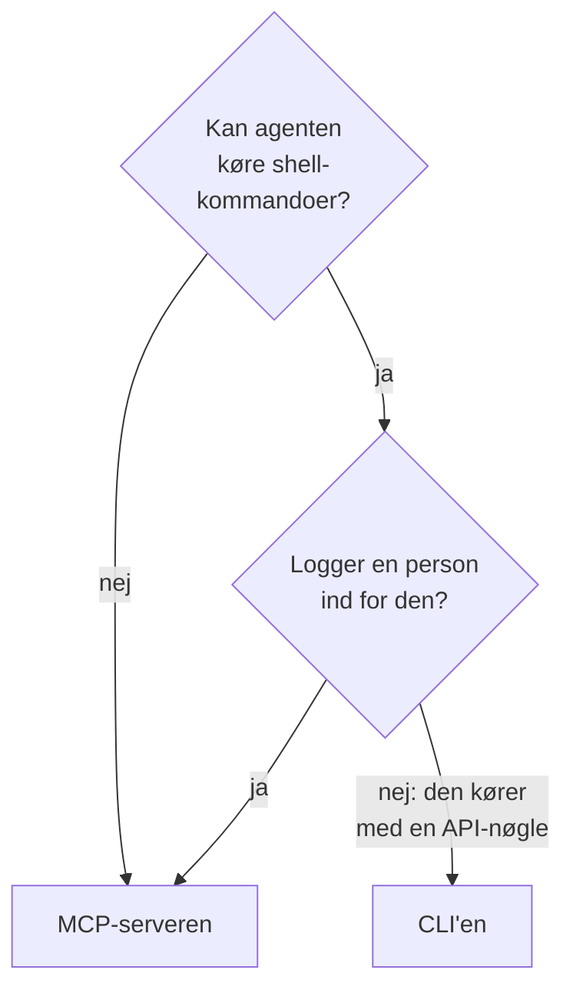

# CLI til AI-agenter

En AI-agent, der kan køre shell-kommandoer, for eksempel en kodeagent i din editor eller et job i din pipeline, kan arbejde med OneUptime gennem CLI'en i stedet for [MCP-serveren](/docs/ai/mcp-server). Denne side fortæller, hvornår hvad passer, og hvordan en agent installerer CLI'en, finder rundt og læser dens svar.

:::cards
- [CLI'en eller MCP-serveren](#clien-eller-mcp-serveren): Hvad en agent bør bruge.
- [Sæt den op til en agent](#sæt-den-op-til-en-agent): Installér den, og giv den en nøgle i miljøet.
- [Sådan finder en agent rundt](#sådan-finder-en-agent-rundt): Ressourcerne, deres felter og hjælpen.
- [Læs svarene](#læs-svarene): JSON fra hver kommando, fejl inklusive.
:::

## CLI'en eller MCP-serveren

Begge når OneUptime-API'et og gør det, deres legitimationsoplysninger tillader. De er forskellige i, hvad agenten skal bruge for at nå dem:



| | CLI'en | MCP-serveren |
| --- | --- | --- |
| Agenten skal bruge | En shell og Node.js 22 eller nyere | En MCP-klient, for eksempel Claude eller Cursor |
| Den logger ind med | En API-nøgle til projektet i `ONEUPTIME_API_KEY` | Din OneUptime-konto eller en API-nøgle |
| Den når | Hver ressource i API'et, 450 og flere | De poster og den telemetri, den har værktøjer til, og værktøjer til hændelsesrespons |
| Den passer til | Scripts, som agenten skriver, så folk kan beholde dem, tjek i en pipeline og arbejde med mange poster | En samtale: at undersøge en hændelse, at sætte en monitor op |

Brug CLI'en, når agenten allerede kører kommandoer, som en kodeagent gør, eller når det, den bygger, skal blive ved med at køre uden den: et script i et repository, et trin i en pipeline. Brug MCP-serveren, når en person taler med agenten i en chatklient, så agenten arbejder med personens tilladelser, og klienten spørger før en ændring.

## Sæt den op til en agent

Hver OneUptime stiller CLI'ens installationsscript til rådighed for sin egen udgivelse: kommandoerne nedenfor henter det fra `https://oneuptime.com`, så på en selvhostet OneUptime skal du erstatte den med din URL. Scriptet gemmes først som `install.sh`, så du kan læse det, før du kører det:

```bash
curl -fsSL https://oneuptime.com/install/cli -o install.sh
ONEUPTIME_URL=https://oneuptime.com bash install.sh
```

Giv agenten en API-nøgle til projektet med kun den adgang, dens arbejde kræver, i miljøet i stedet for på kommandolinjen, og lad den tjekke nøglen først:

```bash
export ONEUPTIME_API_KEY="your-api-key"
export ONEUPTIME_URL=https://oneuptime.com
oneuptime whoami --check -o json
```

Opret nøglen under **Projektindstillinger → Avanceret → API-nøgler**: se [Opret en API-nøgle](/docs/api-reference/api-reference#opret-en-api-nøgle). En nøgle, der kun må læse, lader agenten kigge og intet andet.

## Sådan finder en agent rundt

CLI'en fortæller, hvad den kan, uden API-nøgle og uden anmodning:

| Kommando | Hvad den svarer |
| --- | --- |
| `oneuptime resources -o json` | Hver ressource: dens kommando, dens navne, dens API-sti, dens operationer og dens handlinger |
| `oneuptime incident fields -o json` | En ressources felter: hvad hvert bruges til, dets type, om en oprettelse kræver det, og dets flag |
| `oneuptime incident create --help` | En kommandos argumenter og flag |

Et felt, der indeholder et ID, fortæller, hvilken ressources ID det tager, så agenten viser den ressource først: `incidentSeverityId` tager et ID fra `oneuptime incident-severity list`. Et felt, der nævner en person, tager også personens e-mailadresse, for eksempel med `--user-email`.

## Læs svarene

Lad agenten tilføje `-o json` eller `--json` til hver kommando. Så svarer hver kommando med JSON, også dem, hvis svar er en sætning, og en fejl er ét JSON-objekt på standard-fejl:

```bash
oneuptime incident acknowledge 6f1c2a40-3b1e-4c55-9a0b-3e2f8d7c1a11 -o json
```

```json
{
  "_id": "6f1c2a40-3b1e-4c55-9a0b-3e2f8d7c1a11",
  "action": "acknowledge",
  "changed": true,
  "state": {
    "_id": "0b7d5e2c-8f4a-4d1b-9c3e-5a6f7b8c9d0e",
    "name": "Acknowledged"
  }
}
```

Exitkoden fortæller, hvad der skete: `0`, når det lykkedes, `1`, når det mislykkedes, `2`, når API-nøglen mangler eller afvises, og `3`, når posten ikke findes. En fejls JSON har den samme kode i `exitCode` og i `hint`, hvad der skal gøres som det næste. Se [Outputformater](/docs/cli/output-formats#json) og [Exitkoder](/docs/cli/scripting#exitkoder).

## Næste skridt

:::cards
- [Ressourceoperationer](/docs/cli/resource-operations): Hver operation med dens flag og filtre.
- [Kommandoreference](/docs/cli/command-reference): Hver kommando, indstilling og standardværdi.
- [MCP-server](/docs/ai/mcp-server): Forbind i stedet en chatklient med OneUptime.
:::
