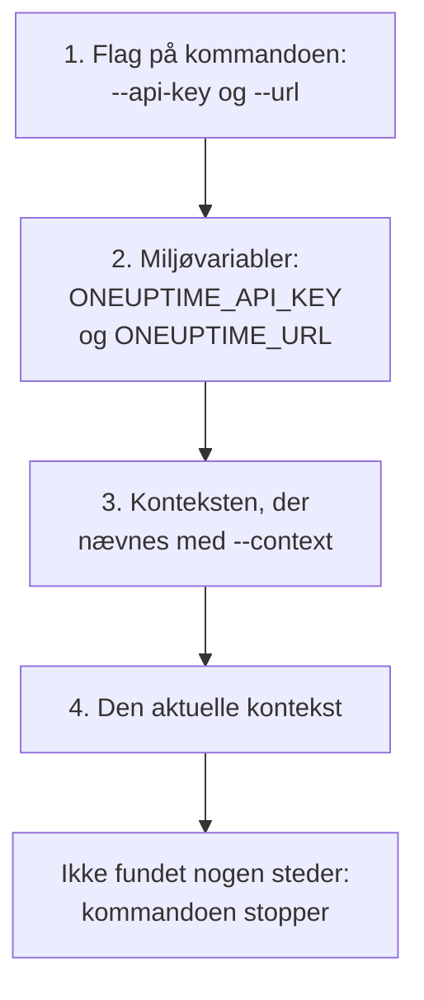

# Godkendelse

Hver anmodning, CLI'en sender, bærer en API-nøgle til dit projekt. Gem nøgler én gang med `oneuptime login`, én kontekst til hvert miljø, eller giv dem til en kommando i flag eller miljøvariabler, som scripts gør. Denne side viser hver måde, og hvilken en kommando bruger, når der er flere.

:::cards
- [Log ind](#log-ind): Gem en API-nøgle og adressen på din OneUptime.
- [Kontekster](#kontekster): Et gemt login til hvert projekt eller miljø, og skift mellem dem.
- [Hvilke legitimationsoplysninger en kommando bruger](#hvilke-legitimationsoplysninger-en-kommando-bruger): Først flag, så miljøvariabler, så kontekster.
- [Fejlfinding](#fejlfinding): Ingen legitimationsoplysninger fundet, ugyldige nøgler og afvisninger.
:::

## Før du begynder

Du skal bruge en API-nøgle til dit projekt. Opret en under **Projektindstillinger → Avanceret → API-nøgler** med **Opret API-nøgle**, og giv den den adgang, dine kommandoer har brug for: se [Opret en API-nøgle](/docs/api-reference/api-reference#opret-en-api-nøgle). En nøgle gør, hvad dens tilladelser tillader: en nøgle, der kun må læse poster, kan vise og læse dem, men ikke ændre dem.

På OneUptime Cloud virker API-nøgler kun, mens projektet har abonnementet **Growth** eller højere. Under det svarer hver kommando med `API error (402)` og en meddelelse, der nævner abonnementet, indtil projektet opgraderes; så virker den samme nøgle igen. Se [API-nøgler og SCIM under deres abonnement](/docs/api-reference/api-reference#api-nøgler-og-scim-under-deres-abonnement).

## Log ind

`oneuptime login` gemmer en API-nøgle og adressen på din OneUptime som en kontekst og gør den til den aktuelle kontekst:

```bash
oneuptime login <api-key> <instance-url> [--context-name <name>]
```

| Argument eller indstilling | Hvad det er |
| --- | --- |
| `<api-key>` | En API-nøgle til dit projekt |
| `<instance-url>` | Adressen på din OneUptime: `https://oneuptime.com`, eller din egen servers, for eksempel `https://oneuptime.example.com` |
| `--context-name <name>` | Navnet, konteksten gemmes under. Standard: `default` |

For eksempel en kontekst ved navn `production`:

```bash
oneuptime login <api-key> https://oneuptime.com --context-name production
```

Den svarer `Logged in successfully. Context "production" is now active.` En skråstreg i slutningen af adressen fjernes, og et nyt login under det samme navn erstatter den kontekst.

> [!NOTE]
> `login` gemmer nøglen uden at spørge OneUptime om den. Kør en kommando, for eksempel `oneuptime incident count`, for at se, at nøglen virker.

## Kontekster

En kontekst er et gemt login: et navn, en adresse og en API-nøgle. Gem én til hvert projekt eller miljø, og vælg så én til alle de kommandoer, der følger, eller til en enkelt kommando.

:::steps
### Gem en kontekst til hvert miljø

```bash
oneuptime login <production-api-key> https://oneuptime.com --context-name production
oneuptime login <staging-api-key> https://oneuptime.example.com --context-name staging
```

Hvert login gør sin kontekst til den aktuelle, så nu er `staging` den aktuelle.

### Vis dem

```bash
oneuptime context list
```

```text
┌───┬────────────┬───────────────────────────────┐
│   │ Name       │ URL                           │
├───┼────────────┼───────────────────────────────┤
│   │ production │ https://oneuptime.com         │
├───┼────────────┼───────────────────────────────┤
│ * │ staging    │ https://oneuptime.example.com │
└───┴────────────┴───────────────────────────────┘
```

`*` markerer den aktuelle kontekst. API-nøgler vises aldrig.

### Skift til en anden kontekst

```bash
oneuptime context use production
```

Den svarer `Switched to context "production".` og de kommandoer, der følger, bruger den.

### Brug en kontekst til én kommando

```bash
oneuptime incident list --context staging
```

Den aktuelle kontekst forbliver, som den var.
:::

| Kommando | Hvad den gør |
| --- | --- |
| `oneuptime context list` | Viser de gemte kontekster; `*` markerer den aktuelle. Med `-o json` hver konteksts `name`, `apiUrl` og `isCurrent`, aldrig dens nøgle |
| `oneuptime context use <name>` | Gør en gemt kontekst til den aktuelle |
| `oneuptime context current` | Viser den aktuelle konteksts navn, URL og API-nøgle, med nøglen skjult bortset fra de første fire og sidste fire tegn |
| `oneuptime context delete <name>` | Sletter en gemt kontekst. Var det den aktuelle, bliver den første tilbageværende kontekst den aktuelle |

## Hvilke legitimationsoplysninger en kommando bruger

En kommando skal bruge en API-nøgle og en URL. Den tager hver af de to fra det første af disse steder, der har den:



Du kan altså blande dem: for eksempel en API-nøgle fra en miljøvariabel med URL'en fra den aktuelle kontekst. Miljøvariabler passer til scripts og CI-job, som ikke har gemte kontekster:

:::tabs
@tab Linux
```bash
export ONEUPTIME_API_KEY=<api-key>
export ONEUPTIME_URL=https://oneuptime.com
oneuptime incident list
```
@tab macOS
```bash
export ONEUPTIME_API_KEY=<api-key>
export ONEUPTIME_URL=https://oneuptime.com
oneuptime incident list
```
@tab Windows
```powershell
$env:ONEUPTIME_API_KEY = "<api-key>"
$env:ONEUPTIME_URL = "https://oneuptime.com"
oneuptime incident list
```
:::

Flag går forud for alt andet, for én kommando:

```bash
oneuptime --api-key <api-key> --url https://oneuptime.com incident list
```

> [!WARNING]
> En nøgle, der gives som flag, havner i din shell-historik, og andre brugere af maskinen kan se den i proceslisten. Brug i stedet en kontekst eller en miljøvariabel på en delt maskine.

## Tjek, hvad CLI'en vil bruge

`oneuptime whoami` viser den URL og API-nøgle, den næste kommando vil bruge, og den kontekst, de kommer fra:

```bash
oneuptime whoami
```

```text
URL:     https://oneuptime.com
API Key: 4f1c****0a13
Context: production
```

Kun nøglens første fire og sidste fire tegn vises. Linjen `Context` vises kun, når URL'en og nøglen er kontekstens egne, ikke værdier, som et flag eller en miljøvariabel har erstattet. `whoami` læser dine indstillinger uden at kalde OneUptime: den viser, hvad en kommando vil sende, ikke om OneUptime accepterer det. Er intet gemt eller sat, svarer den:

```text
Not authenticated. Run `oneuptime login` to authenticate.
```

## Konfigurationsfilen

`oneuptime login` gemmer kontekster i `~/.oneuptime/config.json` i din hjemmemappe (`%USERPROFILE%\.oneuptime\config.json` på Windows). CLI'en opretter den, så kun din bruger kan læse og skrive den (tilstand `0600`):

```json title="~/.oneuptime/config.json"
{
  "currentContext": "production",
  "contexts": {
    "production": {
      "name": "production",
      "apiUrl": "https://oneuptime.com",
      "apiKey": "<api-key>"
    },
    "staging": {
      "name": "staging",
      "apiUrl": "https://oneuptime.example.com",
      "apiKey": "<api-key>"
    }
  }
}
```

Filen indeholder API-nøglerne, som de er: hold den ude af delte mapper, sikkerhedskopier og repositories. Log ud af én kontekst ved at slette den med `oneuptime context delete <name>`; log ud af alle ved at slette filen. En nøgle, der kan være lækket, er gyldig, indtil du sletter den i OneUptime under **Projektindstillinger → Avanceret → API-nøgler**.

Outputformater og listestørrelser gemmes ikke her: giv `-o` og `--limit` til hver kommando.

## Fejlfinding

:::details Meddelelsen "No credentials found"
`Authentication error: No credentials found.` betyder, at intet flag, ingen miljøvariabel og ingen gemt kontekst gav kommandoen dens API-nøgle og URL. Kør `oneuptime login`, eller sæt både `ONEUPTIME_API_KEY` og `ONEUPTIME_URL`. Kommandoen afslutter med koden `2`.
:::

:::details Meddelelsen "API error (400): Invalid API Key"
Nøglen er ikke en API-nøgle til OneUptime, er udløbet eller er blevet nulstillet. Kopiér den igen fra dens side under **Projektindstillinger → Avanceret → API-nøgler**, hvor dens dato også står under **Udløber**, og log ind igen under det samme kontekstnavn. Kommandoen afslutter med koden `2`.
:::

:::details Meddelelsen "API error (402): API keys need the Growth plan"
På OneUptime Cloud er projektet under abonnementet **Growth**, så dets API-nøgler holdt op med at virke. Opgradér projektet, og den samme nøgle virker igen: der er intet at ændre i CLI'en.
:::

:::details Meddelelsen "API error (422): You do not have permissions"
Nøglens tilladelser rækker ikke til det, kommandoen beder om. Giv nøglen en rolle eller en tilladelse på dens side under **Projektindstillinger → Avanceret → API-nøgler**: meddelelsen nævner de tilladelser, der ville lukke anmodningen igennem.
:::

:::details Meddelelsen "Context "staging" does not exist"
Der er ikke gemt nogen kontekst med det navn. `oneuptime context list` viser de navne, der findes.
:::

:::details whoami viser en anden URL eller nøgle end konteksten
En miljøvariabel eller et flag erstatter kontekstens værdi. `env | grep ONEUPTIME` viser de variabler, der er sat, og `unset ONEUPTIME_API_KEY ONEUPTIME_URL` fører dig tilbage til dine kontekster.
:::

:::details Anmodningen til adressen mislykkes
`Error: Request failed to https://...` betyder, at CLI'en ikke kunne nå OneUptime på den adresse. Tjek URL'en med `oneuptime whoami`: det er den adresse, du åbner OneUptime på, med `https://`, for eksempel `https://oneuptime.com`.
:::

## Næste skridt

:::cards
- [Ressourceoperationer](/docs/cli/resource-operations): Vis, læs, opret, ændr, slet og tæl poster.
- [Scripting og CI/CD](/docs/cli/scripting): Giv en pipeline dens nøgle i miljøvariabler.
- [OneUptime API-reference](/docs/api-reference/api-reference): Hvad en API-nøgle må gøre, og hvad hvert svar betyder.
:::
