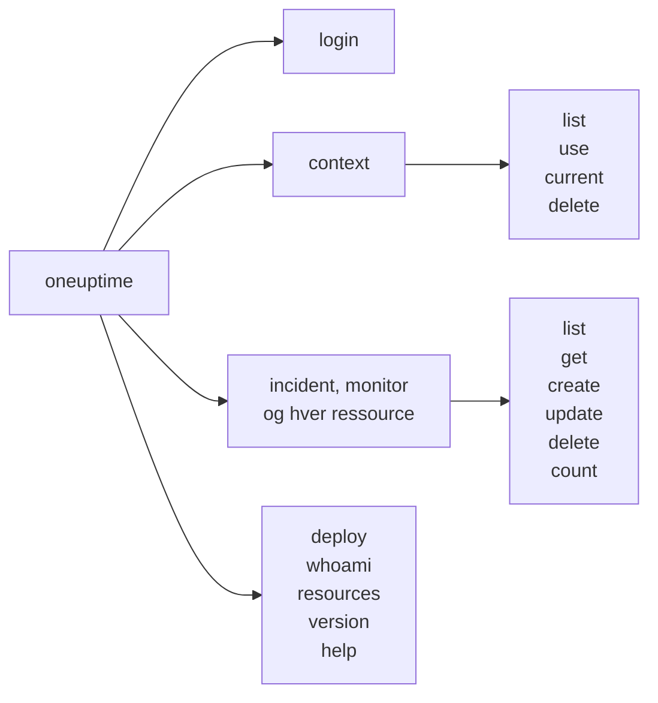

# Kommandoreference

Hver kommando i CLI'en `oneuptime` med dens argumenter, indstillinger og standardværdier. Føj `--help` til en hvilken som helst kommando for at se det samme i din terminal.

:::cards
- [Globale indstillinger](#globale-indstillinger): De indstillinger, hver kommando tager.
- [Login og kontekster](#login-og-kontekster): login og context-kommandoerne.
- [Ressourcekommandoer](#ressourcekommandoer): list, get, create, update, delete og count.
- [Andre kommandoer](#andre-kommandoer): deploy, whoami, resources, version og help.
:::

## Kommandoerne



## Globale indstillinger

| Indstilling | Hvad den gør | Standard |
| --- | --- | --- |
| `--api-key <key>` | API-nøglen til denne kommando | `ONEUPTIME_API_KEY`, derefter kontekstens nøgle |
| `--url <url>` | Adressen på din OneUptime til denne kommando | `ONEUPTIME_URL`, derefter kontekstens URL |
| `--context <name>` | Den gemte kontekst, der bruges til denne kommando | Den aktuelle kontekst |
| `-o, --output <format>` | `json`, `table` eller `wide` | `table` i en terminal, `json` i en pipe |
| `--no-color` | Udskriver uden farver | Farver, medmindre `NO_COLOR` er sat |
| `-V, --version` | Udskriver CLI'ens version | |
| `-h, --help` | Viser hjælpen til en kommando | |

Indstillingerne står før eller efter kommandoen: `oneuptime --context staging incident list` og `oneuptime incident list --context staging` gør det samme.

## Login og kontekster

### `oneuptime login`

Gemmer en API-nøgle og en adresse som en kontekst og gør den til den aktuelle. Se [Log ind](/docs/cli/authentication#log-ind).

```bash
oneuptime login <api-key> <instance-url> [--context-name <name>]
```

| Argument eller indstilling | Påkrævet | Hvad det er | Standard |
| --- | --- | --- | --- |
| `<api-key>` | Ja | En API-nøgle til dit projekt | |
| `<instance-url>` | Ja | Adressen på din OneUptime, for eksempel `https://oneuptime.com` | |
| `--context-name <name>` | Nej | Navnet, konteksten gemmes under | `default` |

### `oneuptime context list`

Viser de gemte kontekster; `*` markerer den aktuelle. API-nøgler vises aldrig.

```bash
oneuptime context list [-o <format>]
```

| Indstilling | Påkrævet | Hvad det er |
| --- | --- | --- |
| `-o, --output <format>` | Nej | `json`, `table` eller `wide`. JSON giver hver konteksts `name`, `apiUrl` og `isCurrent` |

### `oneuptime context use`

Gør en gemt kontekst til den aktuelle.

```bash
oneuptime context use <name>
```

| Argument | Påkrævet | Hvad det er |
| --- | --- | --- |
| `<name>` | Ja | Navnet på en gemt kontekst |

### `oneuptime context current`

Viser den aktuelle konteksts navn og URL og dens API-nøgle, skjult bortset fra de første fire og sidste fire tegn.

```bash
oneuptime context current
```

### `oneuptime context delete`

Sletter en gemt kontekst. Var det den aktuelle, bliver den første tilbageværende kontekst den aktuelle.

```bash
oneuptime context delete <name>
```

| Argument | Påkrævet | Hvad det er |
| --- | --- | --- |
| `<name>` | Ja | Navnet på en gemt kontekst |

## Ressourcekommandoer

`<resource>` er kommandoen til en slags post fra tabellerne under [Ressourcer](#ressourcer), for eksempel `incident` eller `monitor`. Se [Ressourceoperationer](/docs/cli/resource-operations) for eksempler.

### `oneuptime <resource> list`

Viser poster, de nyeste først. Etiketter vises i stedet efter navn, nummererede etiketter først (`2. Team` før `10. Owner`).

```bash
oneuptime <resource> list [--query <json>] [--limit <n>] [--skip <n>] [--sort <json>] [-o <format>]
```

| Indstilling | Hvad den gør | Standard |
| --- | --- | --- |
| `--query <json>` | Et filter som JSON | Hver post, nøglen må læse |
| `--limit <n>` | Det største antal poster, der returneres, op til 10.000 | `10` |
| `--skip <n>` | Hvor mange poster der springes over først | `0` |
| `--sort <json>` | Rækkefølgen som JSON: `{"<field>":"ASC"}` eller `{"<field>":"DESC"}` | De nyeste først |
| `-o, --output <format>` | `json`, `table` eller `wide` | `table` i en terminal, `json` i en pipe |

### `oneuptime <resource> get`

Læser én post. Kun poster: telemetri har ingen `get`.

```bash
oneuptime <resource> get <id> [-o <format>]
```

| Argument eller indstilling | Påkrævet | Hvad det er |
| --- | --- | --- |
| `<id>` | Ja | Postens ID, et UUID |
| `-o, --output <format>` | Nej | `json`, `table` eller `wide` |

### `oneuptime <resource> create`

Opretter en post og udskriver den.

```bash
oneuptime <resource> create (--data <json> | --file <path>) [-o <format>]
```

| Indstilling | Påkrævet | Hvad det er |
| --- | --- | --- |
| `--data <json>` | Én af de to | Posten som JSON |
| `--file <path>` | Én af de to | En JSON-fil med posten. Angivet sammen med `--data` bruges filen |
| `-o, --output <format>` | Nej | `json`, `table` eller `wide` |

### `oneuptime <resource> update`

Ændrer de felter, du angiver. Kun poster: telemetri har ingen `update`.

```bash
oneuptime <resource> update <id> --data <json> [-o <format>]
```

| Argument eller indstilling | Påkrævet | Hvad det er |
| --- | --- | --- |
| `<id>` | Ja | Postens ID |
| `--data <json>` | Ja | De felter, der skal ændres, som JSON |
| `-o, --output <format>` | Nej | `json`, `table` eller `wide` |

### `oneuptime <resource> delete`

Sletter en post med det samme uden at spørge. Kun poster: telemetri har ingen `delete`.

```bash
oneuptime <resource> delete <id> [--force]
```

| Argument eller indstilling | Påkrævet | Hvad det er |
| --- | --- | --- |
| `<id>` | Ja | Postens ID |
| `--force` | Nej | Accepteres og ændrer intet: `delete` beder aldrig om bekræftelse |

### `oneuptime <resource> count`

Tæller poster og udskriver tallet.

```bash
oneuptime <resource> count [--query <json>] [-o <format>]
```

| Indstilling | Påkrævet | Hvad det er |
| --- | --- | --- |
| `--query <json>` | Nej | Et filter som JSON. Uden et filter hver post, nøglen må læse |
| `-o, --output <format>` | Nej | `json`, `table` eller `wide` |

### Ressourcer

Poster tager `list`, `get`, `create`, `update`, `delete` og `count`:

| Område | Kommandoer |
| --- | --- |
| Overvågning | `monitor`, `monitor-status`, `monitor-status-event` |
| Hændelser | `incident`, `incident-state`, `incident-severity`, `incident-state-timeline`, `incident-public-note`, `incident-internal-note`, `incident-alert`, `postmortem-status` |
| Advarsler | `alert`, `alert-state`, `alert-severity`, `alert-state-timeline`, `alert-internal-note` |
| Statussider | `status-page`, `status-page-announcement` |
| Planlagt vedligeholdelse | `scheduled-maintenance-event`, `scheduled-maintenance-state`, `scheduled-maintenance-state-timeline` |
| Teams og vagt | `team`, `on-call-policy` |
| Sikkerhed | `security-case`, `security-case-evidence`, `security-case-note`, `security-case-priority`, `security-case-status`, `security-case-task`, `security-detection`, `security-playbook` |
| Etiketter | `label` |

Telemetri tager `list`, `create` og `count`:

| Område | Kommandoer |
| --- | --- |
| Observerbarhed | `log`, `metric`, `span`, `exception-instance`, `monitor-log` |
| Sikkerhed | `security-event`, `threat-intel-indicator` |
| Ændringer og omkostninger | `change-event`, `kubernetes-cost-allocation` |

CLI'en udgives sammen med OneUptime, så `oneuptime resources` viser kommandoerne i den version, du har installeret.

### API-anmodninger

Hver operation er én anmodning til API'et med nøglen i headeren `APIKey`. `<path>` er ressourcens API-sti fra `oneuptime resources`: `/incident` for `incident`, `/on-call-duty-policy` for `on-call-policy`.

| Operation | Anmodning | Body |
| --- | --- | --- |
| `list` | `POST /api/<path>/get-list` | `query`, `select`, `skip`, `limit` og `sort` |
| `get` | `POST /api/<path>/<id>/get-item` | `select` |
| `create` | `POST /api/<path>` | `{"data": ...}` |
| `update` | `PUT /api/<path>/<id>/` | `{"data": ...}` |
| `delete` | `DELETE /api/<path>/<id>/` | Ingen |
| `count` | `POST /api/<path>/count` | `query` |

## Andre kommandoer

### `oneuptime deploy`

Registrerer en udrulning eller en anden ændring fra en pipeline: den tegnes på tjenestens grafer og læses af OneUptime AI, når den undersøger en hændelse. Den skriver med en telemetri-indtagelsesnøgle, ikke en API-nøgle. Se [Udrulninger og ændringer](/docs/telemetry/change-events).

```bash
oneuptime deploy [--service <name>] [--service-version <version>] [--previous-version <version>] [--commit <sha>] [--repository <url>] [--branch <name>] [--pull-request <number>] [--environment <name>] [--title <title>] [--description <text>] [--type <type>] [--time <time>] [--attribute <key=value...>] [--ingestion-key <key>]
```

| Indstilling | Påkrævet | Hvad det er | Standard |
| --- | --- | --- | --- |
| `--service <name>` | Nej | Den tjeneste, der blev udrullet | En ændring for hele projektet |
| `--service-version <version>` | Nej | Den udrullede version | |
| `--previous-version <version>` | Nej | Den version, den erstattede | |
| `--commit <sha>` | Nej | Den udrullede commit | |
| `--repository <url>` | Nej | Det repository, committen ligger i | |
| `--branch <name>` | Nej | Den udrullede branch | |
| `--pull-request <number>` | Nej | Den udrullede pull request | |
| `--environment <name>` | Nej | Det miljø, der blev udrullet til | |
| `--title <title>` | Nej | Ændringens titel; en anden slags end en udrulning skal have en | `Deploy <version>` |
| `--description <text>` | Nej | Detaljer om ændringen | |
| `--type <type>` | Nej | Typen af ændring, for eksempel `config-change` eller `rollback` | `deployment` |
| `--time <time>` | Nej | Hvornår det skete, for eksempel `2026-10-19T10:00:00Z` | Nu |
| `--attribute <key=value...>` | Nej | Flere attributter som `key=value`, én eller flere | |
| `--ingestion-key <key>` | Nej | En telemetri-indtagelsesnøgle til projektet | `ONEUPTIME_TELEMETRY_INGESTION_KEY` |

### `oneuptime whoami`

Viser den URL og API-nøgle, den næste kommando vil bruge, med nøglen maskeret, og den kontekst, de kommer fra. Den kalder ikke OneUptime. Se [Tjek, hvad CLI'en vil bruge](/docs/cli/authentication#tjek-hvad-clien-vil-bruge).

```bash
oneuptime whoami
```

### `oneuptime resources`

Viser hver slags post, CLI'en har en kommando til: dens kommando, navne i ental og flertal, type og API-sti samt det samlede antal.

```bash
oneuptime resources [--type <type>] [-o <format>]
```

| Indstilling | Påkrævet | Hvad det er | Standard |
| --- | --- | --- | --- |
| `--type <type>` | Nej | `database` for poster, `analytics` for telemetri | Begge |
| `-o, --output <format>` | Nej | `json`, `table` eller `wide`. JSON giver hver enkelts `name`, `singularName`, `pluralName`, `modelType` og `apiPath` | `table` i en terminal, `json` i en pipe |

### `oneuptime version`

Udskriver CLI'ens version, ligesom `oneuptime --version` gør.

```bash
oneuptime version
```

### `oneuptime help`

Viser hjælpen til CLI'en eller til en kommando.

```bash
oneuptime help [command]
```

## Miljøvariabler

| Variabel | Hvad den gør |
| --- | --- |
| `ONEUPTIME_API_KEY` | API-nøglen, når intet `--api-key`-flag giver en |
| `ONEUPTIME_URL` | Adressen på din OneUptime, når intet `--url`-flag giver en |
| `ONEUPTIME_TELEMETRY_INGESTION_KEY` | Den telemetri-indtagelsesnøgle, `oneuptime deploy` skriver med, når intet `--ingestion-key`-flag giver en |
| `NO_COLOR` | Sat til en vilkårlig værdi slår den farver fra |

## Filer

| Fil | Hvad den indeholder |
| --- | --- |
| `~/.oneuptime/config.json` | De gemte kontekster, deres API-nøgler og den aktuelle kontekst |

## Exitkoder

| Kode | Betydning |
| --- | --- |
| `0` | Det lykkedes |
| `1` | Det mislykkedes: OneUptime afviste anmodningen, eller kommandoen var forkert |
| `2` | Ingen brugbar API-nøgle: ingen fundet, ugyldig eller under sit abonnement |
| `3` | Ikke fundet: OneUptime svarede `404` |

Se [Exitkoder](/docs/cli/scripting#exitkoder) for eksempler.

## Næste skridt

:::cards
- [CLI – Oversigt](/docs/cli/index): Installér CLI'en, og kør dine første kommandoer.
- [Ressourceoperationer](/docs/cli/resource-operations): Eksempler på hver operation.
- [Scripting og CI/CD](/docs/cli/scripting): CLI'en i scripts og pipelines.
:::
