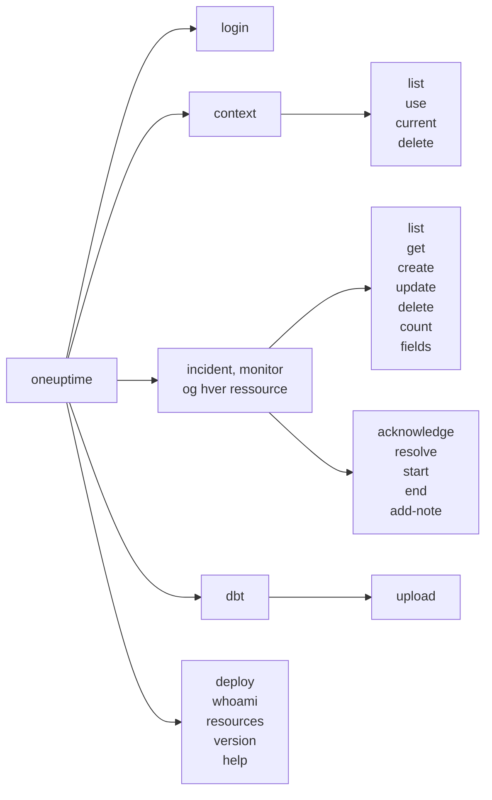

# Kommandoreference

Hver kommando i CLI'en `oneuptime` med dens argumenter, indstillinger og standardværdier. Føj `--help` til en hvilken som helst kommando for at se det samme i din terminal.

:::cards
- [Globale indstillinger](#globale-indstillinger): De indstillinger, hver kommando tager.
- [Login og kontekster](#login-og-kontekster): login og context-kommandoerne.
- [Ressourcekommandoer](#ressourcekommandoer): Hver ressources operationer, felter og handlinger.
- [Andre kommandoer](#andre-kommandoer): deploy, dbt upload, data-checks apply, whoami, resources, version og help.
:::

## Kommandoerne



## Globale indstillinger

| Indstilling | Hvad den gør | Standard |
| --- | --- | --- |
| `--api-key <key>` | API-nøglen til denne kommando | `ONEUPTIME_API_KEY`, derefter kontekstens nøgle |
| `--url <url>` | Adressen på din OneUptime til denne kommando | `ONEUPTIME_URL`, derefter kontekstens URL |
| `--context <name>` | Den gemte kontekst, der bruges til denne kommando | Den aktuelle kontekst |
| `-o, --output <format>` | `json`, `table` eller `wide` | `table` i en terminal, `json` i en pipe |
| `--json` | Det samme som `-o json` | |
| `--no-color` | Udskriver uden farver | Farver, medmindre `NO_COLOR` er sat |
| `-V, --version` | Udskriver CLI'ens version | |
| `-h, --help` | Viser hjælpen til en kommando | |

Indstillingerne står før eller efter kommandoen: `oneuptime --context staging incident list` og `oneuptime incident list --context staging` gør det samme.

Hver kommando tager `-o` og `--json`, så tabellerne nedenfor udelader dem. En kommando, hvis svar er en sætning, for eksempel `delete`, udskriver sætningen, medmindre `-o json` eller `--json` beder om JSON: se [Outputformater](/docs/cli/output-formats#json).

## Login og kontekster

### `oneuptime login`

Gemmer en API-nøgle og en adresse som en kontekst og gør den til den aktuelle. Se [Log ind](/docs/cli/authentication#log-ind).

```bash
oneuptime login <api-key> <instance-url> [--context-name <name>]
```

| Argument eller indstilling | Påkrævet | Hvad det er | Standard |
| --- | --- | --- | --- |
| `<api-key>` | Ja | En API-nøgle til dit projekt | |
| `<instance-url>` | Ja | Adressen på din OneUptime, for eksempel `https://oneuptime.com` | |
| `--context-name <name>` | Nej | Navnet, konteksten gemmes under | `default` |

### `oneuptime context list`

Viser de gemte kontekster; `*` markerer den aktuelle. API-nøgler vises aldrig: JSON giver hver konteksts `name`, `apiUrl` og `isCurrent`.

```bash
oneuptime context list
```

### `oneuptime context use`

Gør en gemt kontekst til den aktuelle.

```bash
oneuptime context use <name>
```

| Argument | Påkrævet | Hvad det er |
| --- | --- | --- |
| `<name>` | Ja | Navnet på en gemt kontekst |

### `oneuptime context current`

Viser den aktuelle konteksts navn og URL og dens API-nøgle, skjult bortset fra de første fire og sidste fire tegn.

```bash
oneuptime context current
```

### `oneuptime context delete`

Sletter en gemt kontekst. Var det den aktuelle, bliver den første tilbageværende kontekst den aktuelle.

```bash
oneuptime context delete <name>
```

| Argument | Påkrævet | Hvad det er |
| --- | --- | --- |
| `<name>` | Ja | Navnet på en gemt kontekst |

## Ressourcekommandoer

`<resource>` er kommandoen til en slags post fra tabellen under [Ressourcer](#ressourcer), for eksempel `incident` eller `monitor`. En ressource har de operationer, som API'et tager for den, de fleste alle seks, og `oneuptime <resource> --help` viser dens egne. Se [Ressourceoperationer](/docs/cli/resource-operations) for eksempler.

### `oneuptime <resource> list`

Viser poster, de nyeste først. Etiketter vises i stedet efter navn, nummererede etiketter først (`2. Team` før `10. Owner`).

```bash
oneuptime <resource> list [--query <json>] [--limit <n>] [--skip <n>] [--sort <json>] [--fields <names>] [--all]
```

| Indstilling | Hvad den gør | Standard |
| --- | --- | --- |
| `--query <json>` | Et filter som JSON | Hver post, nøglen må læse |
| `--limit <n>` | Det største antal poster, der returneres, op til 10.000 | `10` |
| `--skip <n>` | Hvor mange poster der springes over først | `0` |
| `--sort <json>` | Rækkefølgen som JSON: `{"<field>":"ASC"}` eller `{"<field>":"DESC"}` | De nyeste først |
| `--fields <names>` | De felter, der skal returneres, adskilt af kommaer; et felt i en tilknyttet post efter et punktum, som i `currentIncidentState.name` | Hvert felt, nøglen må læse |
| `--all` | Hver post, der matcher, 100 ad gangen, op til 100.000, i stedet for `--limit` og `--skip`. Kun poster: telemetri har ingen `--all` | |

### `oneuptime <resource> get`

Læser én post.

```bash
oneuptime <resource> get <id> [--fields <names>]
```

| Argument eller indstilling | Påkrævet | Hvad det er |
| --- | --- | --- |
| `<id>` | Ja | Postens ID, et UUID |
| `--fields <names>` | Nej | De felter, der skal returneres, adskilt af kommaer. Standard: hvert felt, nøglen må læse |

### `oneuptime <resource> create`

Opretter en post og udskriver den.

```bash
oneuptime <resource> create [--<field> <value>]... [--data <json>] [--file <path>]
```

| Indstilling | Påkrævet | Hvad det er |
| --- | --- | --- |
| `--<field> <value>` | De felter, en oprettelse skal angive | Et felts værdi: `--title <text>`, `--incident-severity-id <id>`, `--labels <ids>`. `oneuptime <resource> create --help` viser dem. Kun poster |
| `--data <json>` | Nej | Posten som JSON |
| `--file <path>` | Nej | En JSON-fil med posten. Angivet sammen med `--data` bruges filen |

Flagene lægges oven på `--data` eller `--file`. Et felt, der nævner en person ved bruger-ID, har også et flag, der nævner personen ved e-mailadresse: `--user-email` ved siden af `--user-id`.

### `oneuptime <resource> update`

Ændrer de felter, du angiver.

```bash
oneuptime <resource> update <id> [--<field> <value>]... [--data <json>] [--file <path>]
```

| Argument eller indstilling | Påkrævet | Hvad det er |
| --- | --- | --- |
| `<id>` | Ja | Postens ID |
| `--<field> <value>` | Nej | Et felt, der skal ændres: `oneuptime <resource> update --help` viser dem. Kun poster |
| `--data <json>` | Nej | De felter, der skal ændres, som JSON |
| `--file <path>` | Nej | En JSON-fil med de felter, der skal ændres. Angivet sammen med `--data` bruges filen |

### `oneuptime <resource> delete`

Sletter en post med det samme, uden at spørge.

```bash
oneuptime <resource> delete <id> [--force]
```

| Argument eller indstilling | Påkrævet | Hvad det er |
| --- | --- | --- |
| `<id>` | Ja | Postens ID |
| `--force` | Nej | Accepteres og ændrer intet: `delete` beder aldrig om bekræftelse |

### `oneuptime <resource> count`

Tæller poster og udskriver tallet.

```bash
oneuptime <resource> count [--query <json>]
```

| Indstilling | Påkrævet | Hvad det er |
| --- | --- | --- |
| `--query <json>` | Nej | Et filter som JSON. Uden et filter hver post, nøglen må læse |

### `oneuptime <resource> fields`

Viser ressourcens felter: hvad hvert bruges til, dets type, om en oprettelse skal angive det, og det flag, der sætter det. Den læser dem fra selve CLI'en, uden API-nøgle og uden anmodning.

```bash
oneuptime <resource> fields
```

### `oneuptime <resource> acknowledge`

Flytter en hændelse, en advarsel eller en episode af en af dem til dit projekts bekræftet-tilstand, som knappen i dashboardet gør. En post, der allerede er bekræftet eller videre, forbliver, som den er.

```bash
oneuptime <resource> acknowledge <id>
```

| Argument | Påkrævet | Hvad det er |
| --- | --- | --- |
| `<id>` | Ja | Postens ID |

### `oneuptime <resource> resolve`

Flytter en hændelse, en advarsel eller en episode af en af dem til dit projekts løst-tilstand.

```bash
oneuptime <resource> resolve <id>
```

| Argument | Påkrævet | Hvad det er |
| --- | --- | --- |
| `<id>` | Ja | Postens ID |

### `oneuptime <resource> start`

Flytter en vedligeholdelseshændelse til dit projekts igangværende tilstand.

```bash
oneuptime <resource> start <id>
```

| Argument | Påkrævet | Hvad det er |
| --- | --- | --- |
| `<id>` | Ja | Begivenhedens ID |

### `oneuptime <resource> end`

Flytter en vedligeholdelseshændelse til dit projekts afsluttet-tilstand.

```bash
oneuptime <resource> end <id>
```

| Argument | Påkrævet | Hvad det er |
| --- | --- | --- |
| `<id>` | Ja | Begivenhedens ID |

### `oneuptime <resource> add-note`

Tilføjer en note til en hændelse, en advarsel, en episode af en af dem eller en vedligeholdelseshændelse.

```bash
oneuptime <resource> add-note <id> --note <markdown> [--public]
```

| Argument eller indstilling | Påkrævet | Hvad det er |
| --- | --- | --- |
| `<id>` | Ja | Postens ID |
| `--note <markdown>` | Ja | Noten i Markdown |
| `--public` | Nej | Slår den op på postens statussider, hvor dens abonnenter får besked. Kun hændelser, deres episoder og planlagt vedligeholdelse |

### Ressourcer

Hver ressource i OneUptime-API'et er en kommando med de operationer, som API'et tager for den, `fields` og handlingerne for de poster, der har dem:

{{CLI_RESOURCE_COMMANDS}}

CLI'en udgives sammen med OneUptime, så `oneuptime resources` viser kommandoerne i den version, du har installeret.

### API-anmodninger

Hver operation er én anmodning til API'et med nøglen i headeren `APIKey`. `<path>` er ressourcens API-sti fra `oneuptime resources`: `/incident` for `incident`, `/on-call-duty-policy` for `on-call-policy`.

| Operation | Anmodning | Body |
| --- | --- | --- |
| `list` | `POST /api/<path>/get-list` | `query`, `select`, `skip`, `limit` og `sort` |
| `get` | `POST /api/<path>/<id>/get-item` | `select` |
| `create` | `POST /api/<path>` | `{"data": ...}` |
| `update` | `PUT /api/<path>/<id>/` | `{"data": ...}` |
| `delete` | `DELETE /api/<path>/<id>/` | Ingen |
| `count` | `POST /api/<path>/count` | `query` |

En handling læser dit projekts tilstande og posten og opretter så en række i postens tilstandstidslinje, som knappen i dashboardet gør: `acknowledge` på en hændelse opretter en `incident-state-timeline`. `add-note` opretter en `incident-internal-note`, eller med `--public` en `incident-public-note`. Et e-mailflag viser først projektets teammedlemmer med den adresse. Når OneUptime afviser et felt, som nøglen ikke må læse, spørger en liste eller en læsning igen uden feltet.

## Andre kommandoer

### `oneuptime deploy`

Registrerer en udrulning eller en anden ændring fra en pipeline: den tegnes på tjenestens grafer og læses af OneUptime AI, når den undersøger en hændelse. Den skriver med en telemetri-indtagelsesnøgle, ikke en API-nøgle. Se [Udrulninger og ændringer](/docs/telemetry/change-events).

```bash
oneuptime deploy [--service <name>] [--service-version <version>] [--previous-version <version>] [--commit <sha>] [--repository <url>] [--branch <name>] [--pull-request <number>] [--environment <name>] [--title <title>] [--description <text>] [--type <type>] [--time <time>] [--attribute <key=value...>] [--ingestion-key <key>]
```

| Indstilling | Påkrævet | Hvad det er | Standard |
| --- | --- | --- | --- |
| `--service <name>` | Nej | Den tjeneste, der blev udrullet | En ændring for hele projektet |
| `--service-version <version>` | Nej | Den udrullede version | |
| `--previous-version <version>` | Nej | Den version, den erstattede | |
| `--commit <sha>` | Nej | Den udrullede commit | |
| `--repository <url>` | Nej | Det repository, committen ligger i | |
| `--branch <name>` | Nej | Den udrullede branch | |
| `--pull-request <number>` | Nej | Den udrullede pull request | |
| `--environment <name>` | Nej | Det miljø, der blev udrullet til | |
| `--title <title>` | Nej | Ændringens titel; en anden slags end en udrulning skal have en | `Deploy <version>` |
| `--description <text>` | Nej | Detaljer om ændringen | |
| `--type <type>` | Nej | Typen af ændring, for eksempel `config-change` eller `rollback` | `deployment` |
| `--time <time>` | Nej | Hvornår det skete, for eksempel `2026-10-19T10:00:00Z` | Nu |
| `--attribute <key=value...>` | Nej | Flere attributter som `key=value`, én eller flere | |
| `--ingestion-key <key>` | Nej | En telemetri-indtagelsesnøgle til projektet | `ONEUPTIME_TELEMETRY_INGESTION_KEY` |

### `oneuptime dbt upload`

Sender et dbt-projekts artefakter efter et build, fra CI eller et dbt Cloud-job, til Dataobservabilitet. Projektets modeller vises på de tabeller, de bygger, med deres afstamning, dets tests vises ved siden af OneUptimes tjek og kan udløse advarsler, og hvert build er en kørsel af projektets pipeline. Den læser `manifest.json` og `run_results.json` fra dbt's målmappe, sender kun det, som Dataobservabilitet læser af dem, og skriver med en telemetri-indtagelsesnøgle, ikke en API-nøgle. Siden Dokumentation under Dataobservabilitet i dit dashboard viser den i et CI-job.

```bash
oneuptime dbt upload [--target-path <dir>] [--manifest <file>] [--run-results <file>] [--project <name>] [--ingestion-key <key>]
```

| Indstilling | Påkrævet | Hvad det er | Standard |
| --- | --- | --- | --- |
| `--target-path <dir>` | Nej | Den mappe, som dbt skrev sine artefakter til | `target` |
| `--manifest <file>` | Nej | Det manifest, der sendes | `manifest.json` i målmappen |
| `--run-results <file>` | Nej | De kørselsresultater, der sendes | `run_results.json` i målmappen |
| `--project <name>` | Nej | dbt-projektets navn, kun nødvendigt, når der ikke sendes et manifest | Manifestets projekt |
| `--ingestion-key <key>` | Nej | En telemetri-indtagelsesnøgle til projektet | `ONEUPTIME_TELEMETRY_INGESTION_KEY` |

### `oneuptime data-checks apply`

Får projektets datatjek til at matche en YAML-fil, så de opbevares i et repository og gennemgås som kode. En fejl et vilkårligt sted i filen anvender intet og afslutter med en fejl. Filens format står i [Kontroller og afstemninger](/docs/data-observability/checks).

```bash
oneuptime data-checks apply <file> [--dry-run] [--prune]
```

| Indstilling | Påkrævet | Hvad det er | Standard |
| --- | --- | --- | --- |
| `--dry-run` | Nej | Viser, hvad der ville ændre sig, og ændrer intet | Fra |
| `--prune` | Nej | Sletter tjek, som en tidligere apply har oprettet, og som filen ikke længere nævner | Fra |

### `oneuptime whoami`

Viser den URL og den API-nøgle, som den næste kommando vil bruge, med nøglen maskeret, og den kontekst, de kommer fra. Uden `--check` kalder den ikke OneUptime. Se [Tjek, hvad CLI'en vil bruge](/docs/cli/authentication#tjek-hvad-clien-vil-bruge).

```bash
oneuptime whoami [--check]
```

| Indstilling | Påkrævet | Hvad det er |
| --- | --- | --- |
| `--check` | Nej | Spørger OneUptime, om den tager imod nøglen, og viser nøglens projekt, din OneUptimes version og CLI'ens |

### `oneuptime resources`

Viser hver slags post, som CLI'en har en kommando til: dens kommando, navne i ental og flertal, type og API-sti og det samlede antal. JSON giver for hver `name`, `singularName`, `pluralName`, `modelType`, `apiPath`, `operations` og `actions`.

```bash
oneuptime resources [--type <type>]
```

| Indstilling | Påkrævet | Hvad det er | Standard |
| --- | --- | --- | --- |
| `--type <type>` | Nej | `database` for poster, `analytics` for telemetri | Begge |

### `oneuptime version`

Udskriver CLI'ens version, ligesom `oneuptime --version` gør.

```bash
oneuptime version
```

### `oneuptime help`

Viser hjælpen til CLI'en eller til en kommando.

```bash
oneuptime help [command]
```

## Miljøvariabler

| Variabel | Hvad den gør |
| --- | --- |
| `ONEUPTIME_API_KEY` | API-nøglen, når intet `--api-key`-flag giver en |
| `ONEUPTIME_URL` | Adressen på din OneUptime, når intet `--url`-flag giver en |
| `ONEUPTIME_TELEMETRY_INGESTION_KEY` | Den telemetri-indtagelsesnøgle, `oneuptime deploy` skriver med, når intet `--ingestion-key`-flag giver en |
| `NO_COLOR` | Sat til en vilkårlig værdi slår den farver fra |

## Filer

| Fil | Hvad den indeholder |
| --- | --- |
| `~/.oneuptime/config.json` | De gemte kontekster, deres API-nøgler og den aktuelle kontekst |

## Exitkoder

| Kode | Betydning |
| --- | --- |
| `0` | Det lykkedes |
| `1` | Det mislykkedes: OneUptime afviste anmodningen, eller kommandoen var forkert |
| `2` | Ingen brugbar API-nøgle: ingen fundet, ugyldig eller under sit abonnement |
| `3` | Ikke fundet: OneUptime svarede `404` |

Se [Exitkoder](/docs/cli/scripting#exitkoder) for eksempler.

## Næste skridt

:::cards
- [CLI – Oversigt](/docs/cli/index): Installér CLI'en, og kør dine første kommandoer.
- [Ressourceoperationer](/docs/cli/resource-operations): Eksempler på hver operation.
- [Scripting og CI/CD](/docs/cli/scripting): CLI'en i scripts og pipelines.
:::
