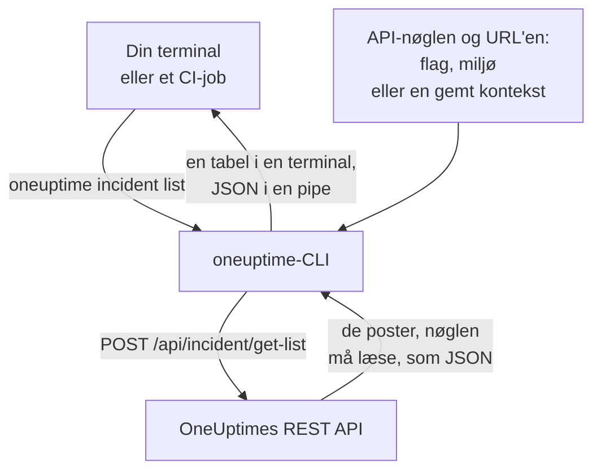

# CLI – Oversigt

OneUptime-CLI'en, `oneuptime`, administrerer dit OneUptime-projekt fra en terminal eller et script. Den viser, læser, opretter, ændrer, sletter og tæller monitorer, hændelser, advarsler, statussider og de andre poster, som OneUptime-API'et tilbyder, med en API-nøgle til dit projekt.

:::cards
- [Sådan virker CLI'en](#sådan-virker-clien): Én kommando, én API-anmodning, ét svar.
- [Installér CLI'en](#installér-clien): Én npm-kommando, og hvilken version du skal vælge.
- [Kør dine første kommandoer](#kør-dine-første-kommandoer): Gem din API-nøgle, og vis så dine hændelser.
- [Kommandoerne på et øjeblik](#kommandoerne-på-et-øjeblik): Hver kommando, og siden der forklarer den.
:::

## Sådan virker CLI'en

Hver kommando sender én anmodning til OneUptimes REST API og udskriver svaret. CLI'en tager API-nøglen og adressen på din OneUptime fra flag, miljøvariabler eller en kontekst, som `oneuptime login` har gemt. Nøglen afgør, hvad en kommando må læse og ændre, præcis som for API'et.



Kommandoerne til poster følger med CLI'en: hver slags post, som OneUptime-API'et åbner for værktøjer, har én, de samme poster, som [MCP-serveren](/docs/ai/mcp-server) har værktøjer til. Kør `oneuptime resources` for at vise dem.

## Før du begynder

- **Node.js og npm**, i en aktuel LTS-version, til at installere CLI'en.
- **En API-nøgle til dit projekt.** Opret en under **Projektindstillinger → Avanceret → API-nøgler** med **Opret API-nøgle**: se [Opret en API-nøgle](/docs/api-reference/api-reference#opret-en-api-nøgle).
- **På OneUptime Cloud abonnementet Growth eller højere.** Et projekts API-nøgler virker kun på det: se [API-nøgler og SCIM under deres abonnement](/docs/api-reference/api-reference#api-nøgler-og-scim-under-deres-abonnement).

## Installér CLI'en

Installér pakken `@oneuptime/cli` fra npm. Den tilføjer kommandoen `oneuptime`, og `--version` udskriver den version, du har installeret:

```bash
npm install -g @oneuptime/cli
oneuptime --version
```

CLI'en udgives sammen med OneUptime og har det samme versionsnummer. På en selvhostet OneUptime skal du installere CLI'en i din OneUptimes version, så dens kommandoer passer til de poster, din server har:

```bash
npm install -g @oneuptime/cli@<your-oneuptime-version>
```

> [!WARNING]
> CLI-versioner før 14.0.64 stopper, så snart de starter, med en fejl som `Cannot find module 'Common/Models/DatabaseModels/Index'`. Installér 14.0.64 eller nyere med `npm install -g @oneuptime/cli@latest`. På en selvhostet OneUptime, der er ældre end 14.0.64, skal du først [opgradere OneUptime](/docs/installation/upgrading#sådan-opgraderer-du) og derefter installere CLI'en i den version, du opgraderede til.

## Kør dine første kommandoer

:::steps
### Gem din API-nøgle

Log ind med nøglen og adressen på din OneUptime. CLI'en gemmer dem som en kontekst ved navn `default` og bruger den fremover:

```bash
oneuptime login <your-api-key> https://oneuptime.com
```

Den svarer `Logged in successfully. Context "default" is now active.` På en selvhostet OneUptime bruger du dens adresse i stedet for `https://oneuptime.com`.

### Vis dine hændelser

```bash
oneuptime incident list
```

De ti nyeste hændelser vises som en tabel. `login` gemmer nøglen uden at tjekke den, så dette er den første kommando, der viser, at nøglen virker: bliver den afvist, så se [Fejlfinding](/docs/cli/authentication#fejlfinding).

### Se, hvad du ellers kan administrere

```bash
oneuptime resources
```

Listen viser hver slags post, du kan arbejde med, og dens kommando, for eksempel `monitor`, `status-page` eller `on-call-policy`.
:::

## Kommandoerne på et øjeblik

| Kommando | Hvad den gør | Læs mere |
| --- | --- | --- |
| `oneuptime login <api-key> <instance-url>` | Gemmer en API-nøgle og en adresse som en kontekst | [Godkendelse](/docs/cli/authentication#log-ind) |
| `oneuptime context list`, `use`, `current`, `delete` | Viser, skifter, oplyser og sletter gemte kontekster | [Godkendelse](/docs/cli/authentication#kontekster) |
| `oneuptime whoami` | Viser den URL og API-nøgle, som den næste kommando vil bruge | [Godkendelse](/docs/cli/authentication#tjek-hvad-clien-vil-bruge) |
| `oneuptime deploy` | Registrerer en udrulning eller en anden ændring til grafer og OneUptime AI | [Udrulninger og ændringer](/docs/telemetry/change-events) |
| `oneuptime <resource> list`, `get`, `create`, `update`, `delete`, `count` | Arbejder med én slags post | [Ressourceoperationer](/docs/cli/resource-operations) |
| `oneuptime resources` | Viser slagsene af poster med deres kommandoer | [Kommandoreference](/docs/cli/command-reference#oneuptime-resources) |
| `oneuptime version` | Udskriver CLI'ens version | [Kommandoreference](/docs/cli/command-reference#oneuptime-version) |
| `oneuptime help [command]` | Viser hjælpen til en kommando | [Få hjælp](#få-hjælp) |

## Globale indstillinger

Disse indstillinger virker med alle kommandoer, før eller efter dem:

| Indstilling | Hvad den gør |
| --- | --- |
| `--api-key <key>` | API-nøglen til denne kommando, i stedet for den gemte |
| `--url <url>` | Adressen på din OneUptime til denne kommando |
| `--context <name>` | En gemt kontekst til denne kommando, i stedet for den aktuelle |
| `-o, --output <format>` | `table`, `json` eller `wide`: se [Outputformater](/docs/cli/output-formats) |
| `--no-color` | Udskriver uden farver |
| `-V, --version` | Udskriver CLI'ens version |
| `-h, --help` | Viser hjælpen til kommandoen |

## Få hjælp

Hver kommando har sin egen hjælp med sine argumenter, indstillinger og standardværdier:

```bash
oneuptime --help
oneuptime help incident
oneuptime incident list --help
```

## Næste skridt

:::cards
- [Godkendelse](/docs/cli/authentication): Kontekster for hvert miljø, og hvilken nøgle en kommando bruger.
- [Ressourceoperationer](/docs/cli/resource-operations): Vis, læs, opret, ændr, slet og tæl poster.
- [Outputformater](/docs/cli/output-formats): Tabeller til mennesker, JSON til scripts.
- [Scripting og CI/CD](/docs/cli/scripting): Exitkoder, jq og pipelines.
- [Kommandoreference](/docs/cli/command-reference): Hver kommando, indstilling og standardværdi.
:::
