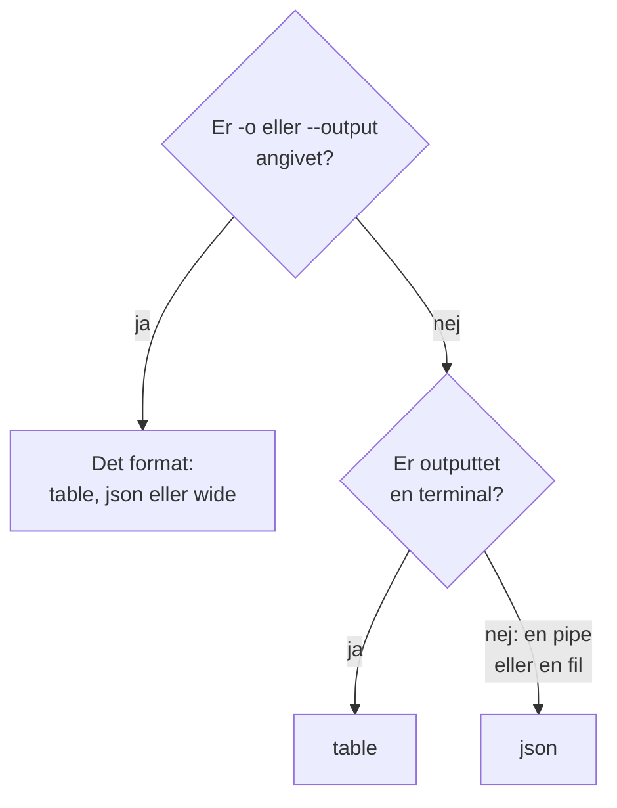

# Outputformater

CLI'en udskriver en tabel, når du læser dens svar i en terminal, og JSON, når et script eller et andet program læser det. Vælg formatet for enhver kommando med `-o` eller `--output`.

:::cards
- [Sådan vælges formatet](#sådan-vælges-formatet): En terminal får en tabel, en pipe får JSON.
- [Tabel](#tabel): Seks kolonner, hver værdi skåret af ved 60 tegn.
- [JSON](#json): Hvert felt, helt, til scripts og jq.
- [Bred](#bred): En tabel med alle kolonner.
:::

## Sådan vælges formatet



| Format | Hvad det udskriver | Bedst til |
| --- | --- | --- |
| `table` | En tabel med op til seks kolonner; én post som én række pr. felt | At læse i en terminal |
| `json` | Svaret, som OneUptime sendte det, indrykket med to mellemrum | Scripts, `jq` og filer |
| `wide` | En tabel med en kolonne til hvert felt | At sammenligne mange felter på et øjeblik |

`-o` virker på hver kommando, der udskriver poster: `list`, `get`, `create`, `update` og `count` for en ressource, `oneuptime resources` og `oneuptime context list`. Det kan stå hvor som helst på kommandolinjen. Enhver anden værdi afvises, før der sendes en anmodning:

```text
error: option '-o, --output <format>' argument 'yaml' is invalid. Allowed choices are json, table, wide.
```

## Tabel

En tabel er standard i en terminal. `oneuptime resources --type analytics` udskriver for eksempel denne:

```text
┌────────────────────────────┬────────────────────────────┬─────────────────────────────┬───────────┬─────────────────────────────┐
│ Command                    │ Singular                   │ Plural                      │ Type      │ API Path                    │
├────────────────────────────┼────────────────────────────┼─────────────────────────────┼───────────┼─────────────────────────────┤
│ log                        │ Log                        │ Logs                        │ analytics │ /logs                       │
├────────────────────────────┼────────────────────────────┼─────────────────────────────┼───────────┼─────────────────────────────┤
│ span                       │ Span                       │ Spans                       │ analytics │ /span                       │
├────────────────────────────┼────────────────────────────┼─────────────────────────────┼───────────┼─────────────────────────────┤
│ metric                     │ Metric                     │ Metrics                     │ analytics │ /metrics                    │
├────────────────────────────┼────────────────────────────┼─────────────────────────────┼───────────┼─────────────────────────────┤
│ exception-instance         │ Exception Instance         │ Exception Instances         │ analytics │ /exceptions                 │
├────────────────────────────┼────────────────────────────┼─────────────────────────────┼───────────┼─────────────────────────────┤
│ monitor-log                │ Monitor Log                │ Monitor Logs                │ analytics │ /monitor-log                │
├────────────────────────────┼────────────────────────────┼─────────────────────────────┼───────────┼─────────────────────────────┤
│ kubernetes-cost-allocation │ Kubernetes Cost Allocation │ Kubernetes Cost Allocations │ analytics │ /kubernetes-cost-allocation │
├────────────────────────────┼────────────────────────────┼─────────────────────────────┼───────────┼─────────────────────────────┤
│ security-event             │ Security Event             │ Security Events             │ analytics │ /security-events            │
├────────────────────────────┼────────────────────────────┼─────────────────────────────┼───────────┼─────────────────────────────┤
│ change-event               │ Change Event               │ Change Events               │ analytics │ /change-events              │
├────────────────────────────┼────────────────────────────┼─────────────────────────────┼───────────┼─────────────────────────────┤
│ threat-intel-indicator     │ Threat Intel Indicator     │ Threat Intel Indicators     │ analytics │ /threat-intel-indicators    │
└────────────────────────────┴────────────────────────────┴─────────────────────────────┴───────────┴─────────────────────────────┘

Total: 9 resources
```

For en liste af poster viser en tabel op til seks kolonner: først `_id`, `name`, `title`, `status`, `createdAt` og `updatedAt`, dem af dem, posterne har, og derefter posternes næste felter i rækkefølge. Kolonnerne tages fra den første post. En værdi, der er længere end 60 tegn, skæres ned til sine første 57, efterfulgt af `...`.

Én post, som `get` og `create` udskriver den, er en tabel med to kolonner: feltets navn og dets værdi, én række pr. felt.

OneUptime sender datoer og andre posters ID'er som objekter, for eksempel `{"_type":"DateTime","value":"2026-10-14T09:12:44.000Z"}`, og en tabel viser dem som den tekst. Deres værdi står i `value`: se [JSON](#json).

## JSON

JSON er svaret, som OneUptime sendte det, indrykket med to mellemrum: en liste er et array af poster, og én post er et objekt.

```bash
oneuptime incident list --limit 1 -o json
```

```json
[
  {
    "_id": "6f1c2a40-3b1e-4c55-9a0b-3e2f8d7c1a11",
    "createdAt": {
      "_type": "DateTime",
      "value": "2026-10-14T09:12:44.000Z"
    },
    "title": "Checkout API is down",
    "currentIncidentStateId": {
      "_type": "ObjectID",
      "value": "0b7d5e2c-8f4a-4d1b-9c3e-5a6f7b8c9d0e"
    }
  }
]
```

En post har hvert felt, nøglen må læse; denne er skåret ned til fire. En posts egen `_id` er tekst, og de andre ID'er og datoerne er objekter, hvis `value` indeholder dem:

```bash
oneuptime incident list -o json | jq -r '.[] | "\(.createdAt.value)  \(.title)"'
```

Når outputtet ikke er en terminal, som i `oneuptime incident list | jq '.[].title'`, udskriver CLI'en JSON uden `-o json`. Skriv alligevel `-o json` i scripts, så de ikke afhænger af det.

## Bred

`-o wide` er en tabel med en kolonne til hvert felt i posterne. Hver værdi skæres stadig af ved 60 tegn, og poster har mange felter, så en bred tabel er meget bred: bladr gennem den med `less -S`.

```bash
oneuptime incident list -o wide | less -S
```

## Farver

Tabeloverskrifter er cyan; meddelelser er grønne, når noget lykkedes, blå for information og røde for fejl. Slå farver fra med `--no-color`, eller ved at sætte `NO_COLOR` til en vilkårlig værdi:

```bash
oneuptime incident list --no-color
NO_COLOR=1 oneuptime incident list
```

## Hvad hver kommando udskriver

Poster og antal går til standard-output, og fejl til standard-fejl, så en pipe kun læser svaret.

| Kommando | I en tabel | I JSON |
| --- | --- | --- |
| En `list`, der ikke finder noget | `No results found.` | `[]` |
| En `get` eller en `create` | En række pr. felt | Posten |
| En `count` | Tallet | Tallet |
| En `update` | En tom linje | `{}` |
| En `delete` | `Monitor <id> deleted successfully.` | Den samme linje |

## Næste skridt

:::cards
- [Scripting og CI/CD](/docs/cli/scripting): Læs JSON'en med jq i scripts og pipelines.
- [Ressourceoperationer](/docs/cli/resource-operations): De operationer, som dette er svarene fra.
- [Kommandoreference](/docs/cli/command-reference): Hver kommando og hver indstilling.
:::
