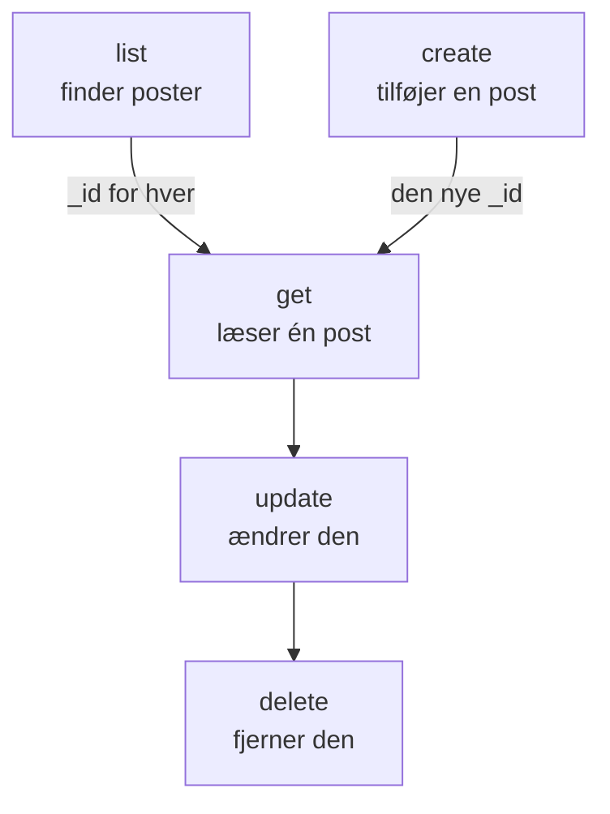

# Ressourceoperationer

Hver slags post er sin egen kommando, for eksempel `incident`, `monitor` eller `status-page`, og hver tager de samme operationer: `list`, `get`, `create`, `update`, `delete` og `count`. Denne side viser hver operation med filtre, sider og den JSON, en post skrives i.

:::cards
- [Find kommandoen til en post](#find-kommandoen-til-en-post): oneuptime resources viser dem alle.
- [Vis poster](#vis-poster): Filtrér, sortér og bladr.
- [Opret en post](#opret-en-post): Fra JSON på kommandolinjen eller i en fil.
- [Slet en post](#slet-en-post): Med det samme og uden fortryd.
:::

## Sådan hænger operationerne sammen

At læse, ændre og slette en post kræver dens ID. At vise, tælle og oprette kræver ingen, og en liste eller en oprettelse giver dig de ID'er, de andre tager:



Et ID er et UUID, for eksempel `6f1c2a40-3b1e-4c55-9a0b-3e2f8d7c1a11`. Du kan også kopiere et fra postens side i OneUptime: se [Find en ressources ID](/docs/api-reference/api-reference#find-en-ressources-id).

## Find kommandoen til en post

```bash
oneuptime resources
```

Listen viser hver slags post med dens kommando, dens navne, dens type og dens API-sti. Der er to typer:

| Type | Hvad den indeholder | Operationer |
| --- | --- | --- |
| `database` | Poster, du administrerer: monitorer, hændelser, advarsler, statussider, teams og mere | `list`, `get`, `create`, `update`, `delete`, `count` |
| `analytics` | Telemetri: logs, spans, målinger, undtagelser og andre begivenheder | `list`, `create`, `count` |

Vis én type med `oneuptime resources --type database` eller `--type analytics`. [Kommandoreference](/docs/cli/command-reference#ressourcer) viser hver kommando.

## Vis poster

```bash
oneuptime <resource> list [--query <json>] [--limit <n>] [--skip <n>] [--sort <json>] [-o <format>]
```

| Indstilling | Hvad den gør | Standard |
| --- | --- | --- |
| `--query <json>` | Returnerer kun de poster, der matcher: se [Filtrér en liste](#filtrér-en-liste) | Hver post, nøglen må læse |
| `--limit <n>` | Det største antal poster, der returneres, op til 10.000 | `10` |
| `--skip <n>` | Hvor mange matchende poster der springes over først | `0` |
| `--sort <json>` | Rækkefølgen, for eksempel `{"createdAt":"ASC"}`, eller `"DESC"` for de nyeste først | De nyeste først |
| `-o, --output <format>` | `table`, `json` eller `wide` | `table` i en terminal, `json` i en pipe |

```bash
# The ten newest incidents
oneuptime incident list

# The oldest monitors first, 50 at a time: the second page
oneuptime monitor list --sort '{"createdAt":"ASC"}' --limit 50 --skip 50

# Every field of each incident, as JSON
oneuptime incident list -o json
```

En liste beder OneUptime om hvert felt i hver post, som nøglen må læse. En tabel viser seks af dem; JSON viser dem alle (se [Outputformater](/docs/cli/output-formats)). For at bladre gennem alle poster øger du `--skip` med `--limit`, indtil en side kommer tom tilbage; `count` fortæller, hvor mange der er.

Etiketter vises efter navn i stedet for de nyeste først: etiketter, hvis navn begynder med et tal, kommer først, i rækkefølge efter tallet (`2. Team` før `10. Owner`), derefter de øvrige alfabetisk. Vil du have dem i en anden rækkefølge, så angiv `--sort`.

### Filtrér en liste

`--query` tager det samme filter som API'et: et felt med en værdi matcher den værdi, og et objekt med en `_type` sammenligner.

| Filter | Matcher |
| --- | --- |
| `{"title":"Checkout API is down"}` | Poster med præcis den værdi |
| `{"title":{"_type":"Search","value":"checkout"}}` | Tekst, der indeholder værdien |
| `{"createdAt":{"_type":"GreaterThan","value":"2026-10-01T00:00:00.000Z"}}` | Senere datoer eller større tal |
| `{"currentIncidentState":{"isResolvedState":false}}` | Et felt i en post, som ressourcen nævner: her hændelser, der ikke er løst |

```bash
oneuptime incident list --query '{"title":{"_type":"Search","value":"checkout"}}'
```

[Filtrér, sortér og bladr](/docs/api-reference/api-reference#filtrér-sortér-og-bladr) i API-referencen viser hver `_type`.

## Læs en post

```bash
oneuptime <resource> get <id> [-o <format>]
```

```bash
oneuptime incident get 6f1c2a40-3b1e-4c55-9a0b-3e2f8d7c1a11
```

En tabel viser én række for hvert felt i posten, med hver værdi skåret af ved 60 tegn; `-o json` viser værdierne hele. Et ID, der ikke nævner nogen post, din nøgle må læse, får svaret `Not found`, og kommandoen afslutter med koden `3`.

## Opret en post

```bash
oneuptime <resource> create --data <json> [-o <format>]
oneuptime <resource> create --file <path> [-o <format>]
```

`--data` tager posten som JSON, og `--file` læser den fra en JSON-fil. Angiv én af de to; angiver du begge, bruges filen. Felterne er API'ets, og [API-referencen](/reference) viser hver ressources. Projektet kommer fra API-nøglen, så en post nævner det aldrig.

```bash
# A manual monitor
oneuptime monitor create --data '{"name":"Checkout API","monitorType":"Manual"}'

# An incident with one of your severities
oneuptime incident create --data '{"title":"Checkout API is down","incidentSeverityId":"<severity-id>"}'

# The same incident, from a file
oneuptime incident create --file incident.json
```

CLI'en udskriver den nye post med dens `_id`. En hændelse starter i dit projekts oprettet-tilstand, medmindre `currentIncidentStateId` nævner en anden: se [Den tilstand, en ny post starter i](/docs/api-reference/api-reference#den-tilstand-en-ny-post-starter-i). Sådan finder du ID'erne for dine alvorlighedsgrader:

```bash
oneuptime incident-severity list -o json | jq -r '.[] | "\(._id)  \(.name)"'
```

> [!TIP]
> På Windows skal du lægge JSON'en i en fil og bruge `--file`: PowerShell og kommandoprompten sætter anførselstegn om JSON på kommandolinjen på en anden måde end Bash.

## Opdatér en post

```bash
oneuptime <resource> update <id> --data <json> [-o <format>]
```

`--data` er påkrævet og indeholder kun de felter, der skal ændres:

```bash
# Rename a monitor
oneuptime monitor update <monitor-id> --data '{"name":"Checkout API (EU)"}'

# Move an incident to your resolved state
oneuptime incident update <incident-id> --data '{"currentIncidentStateId":"<resolved-state-id>"}'
```

OneUptime svarer på en opdatering med et tomt objekt: CLI'en udskriver en tom linje, eller `{}` med `-o json`. Kør `get` for at se posten, som den er nu. Flytter du en hændelse til en anden tilstand på denne måde, registreres ændringen på dens tidslinje, som dashboardet gør, og en tilstand før den aktuelle afvises. Sådan finder du ID'et for den løste tilstand, den første i dit projekts rækkefølge:

```bash
oneuptime incident-state list --query '{"isResolvedState":true}' --sort '{"order":"ASC"}' --limit 1 -o json | jq -r '.[0]._id'
```

## Slet en post

```bash
oneuptime <resource> delete <id>
```

```bash
oneuptime monitor delete 6f1c2a40-3b1e-4c55-9a0b-3e2f8d7c1a11
```

Den svarer `Monitor 6f1c2a40-3b1e-4c55-9a0b-3e2f8d7c1a11 deleted successfully.`

> [!CAUTION]
> `delete` fjerner posten med det samme. CLI'en beder dig ikke bekræfte, og det kan ikke fortrydes. Den accepterer `--force` til scripts, der er skrevet med det, og `--force` ændrer intet.

## Tæl poster

```bash
oneuptime <resource> count [--query <json>]
```

```bash
# Every incident
oneuptime incident count

# Incidents that are not resolved
oneuptime incident count --query '{"currentIncidentState":{"isResolvedState":false}}'
```

CLI'en udskriver ét tal, det samme i en tabel og i JSON, så et script kan læse det, som det er.

## Hvad hver type kan

| Operation | `database` | `analytics` |
| --- | --- | --- |
| `list` | Ja | Ja |
| `get` | Ja | Nej |
| `create` | Ja | Ja |
| `update` | Ja | Nej |
| `delete` | Ja | Nej |
| `count` | Ja | Ja |

## Fejlfinding

:::details Meddelelsen "Not found: API error (404)"
Posten findes ikke, ligger i et andet projekt, eller nøglen må ikke læse den: OneUptime svarer det samme i hvert tilfælde. Tjek ID'et med `list` og nøglens tilladelser. Kommandoen afslutter med koden `3`.
:::

:::details Meddelelsen "API error (422): You do not have permissions to select on"
En liste eller en læsning beder om hvert felt i posten, og nøglen må ikke læse et af dem: meddelelsen nævner feltet og de tilladelser, der må læse det. Giv nøglen én af de tilladelser.
:::

:::details Meddelelsen "Error: Invalid JSON"
Værdien af `--query`, `--sort` eller `--data` er ikke JSON. Sæt den i enkelte anførselstegn i Bash og zsh; læg på Windows en post i en fil, og brug `--file`.
:::

:::details API error (400) ved en oprettelse eller en opdatering
OneUptime afviste et felt: meddelelsen nævner det. `No fields to update` betyder, at `--data` ikke indeholdt noget felt at ændre.
:::

## Næste skridt

:::cards
- [Outputformater](/docs/cli/output-formats): Læs svarene som tabeller eller som JSON.
- [Scripting og CI/CD](/docs/cli/scripting): Brug disse operationer i scripts og pipelines.
- [Kommandoreference](/docs/cli/command-reference): Hver kommando, indstilling og standardværdi.
:::
