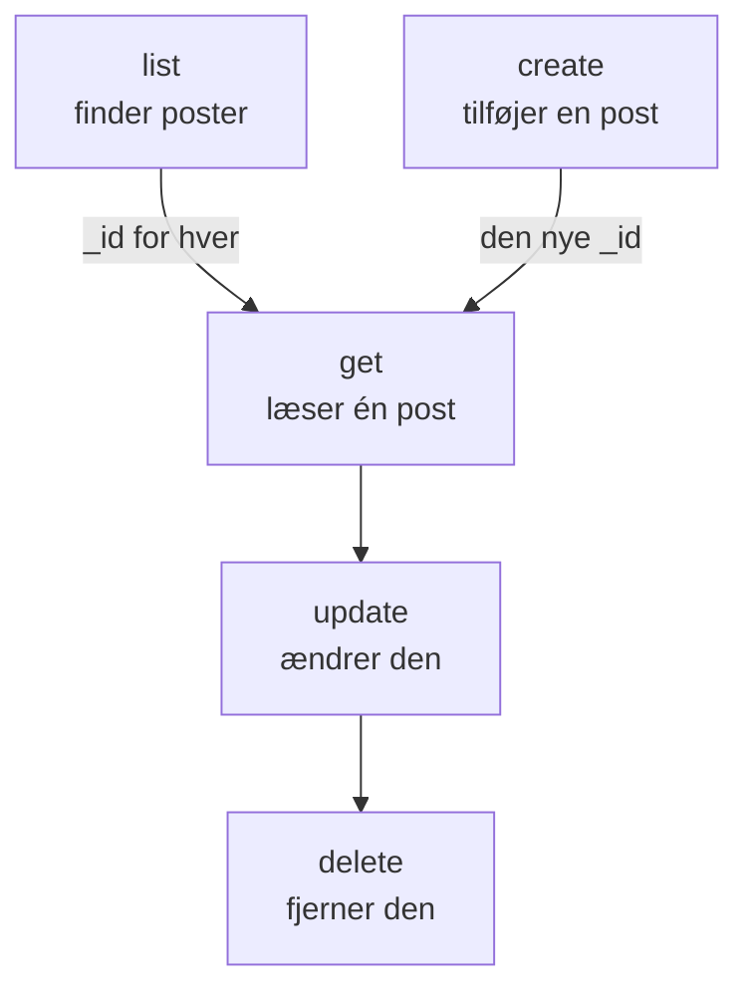

# Ressourceoperationer

Hver slags post er sin egen kommando, for eksempel `incident`, `monitor` eller `status-page`, med de operationer, som API'et tager for den: for de fleste `list`, `get`, `create`, `update`, `delete` og `count`. Denne side viser hver operation med filtre, sider og de flag, en post skrives med, og de kommandoer, der gør det, som dashboardets knapper gør.

:::cards
- [Find kommandoen til en post](#find-kommandoen-til-en-post): oneuptime resources viser dem alle.
- [Vis poster](#vis-poster): Filtrér, sortér og bladr.
- [Opret en post](#opret-en-post): Et flag for hvert felt, eller posten som JSON.
- [Bekræft, løs og tilføj noter](#bekræft-løs-og-tilføj-noter): Dashboardets knapper som kommandoer.
- [Slet en post](#slet-en-post): Med det samme og uden fortryd.
:::

## Sådan hænger operationerne sammen

At læse, ændre og slette en post kræver dens ID. At vise, tælle og oprette kræver ingen, og en liste eller en oprettelse giver dig de ID'er, de andre tager:



Et ID er et UUID, for eksempel `6f1c2a40-3b1e-4c55-9a0b-3e2f8d7c1a11`. Du kan også kopiere et fra postens side i OneUptime: se [Find en ressources ID](/docs/api-reference/api-reference#find-en-ressources-id).

## Find kommandoen til en post

```bash
oneuptime resources
```

Listen viser hver slags post med dens kommando, dens navne, dens type og dens API-sti. Der er to typer:

| Type | Hvad den indeholder |
| --- | --- |
| `database` | Poster, du administrerer: monitorer, hændelser, advarsler, statussider, teams og mere |
| `analytics` | Telemetri: logs, spans, metrikker, undtagelser og andre begivenheder |

Vis én type med `oneuptime resources --type database` eller `--type analytics`. [Kommandoreference](/docs/cli/command-reference#ressourcer) viser hver kommando.

En ressource tager de operationer, som API'et tager for den. De fleste tager alle seks; en, som OneUptime selv skriver, for eksempel en e-maillog, kan kun læses. `oneuptime <resource> --help` viser en ressources underkommandoer.

## Se en ressources felter

`fields` viser en ressources felter fra selve CLI'en, uden API-nøgle og uden anmodning:

```bash
oneuptime incident fields
```

Hvert felt har sin type, hvad det bruges til, om en oprettelse skal angive det, og det flag, der sætter det. Et felt, der indeholder et ID, nævner den ressource, ID'et hører til: `incidentSeverityId` tager ét fra `oneuptime incident-severity list`. Med `-o json` læser et script eller en AI-agent det samme, med de samme nøgler for hvert felt: `name`, `title`, `type`, `description`, `required`, `create`, `update`, `read`, `flag`, `emailFlag` og `relatedResource`.

## Vis poster

```bash
oneuptime <resource> list [--query <json>] [--limit <n>] [--skip <n>] [--sort <json>] [--fields <names>] [--all] [-o <format>]
```

| Indstilling | Hvad den gør | Standard |
| --- | --- | --- |
| `--query <json>` | Returnerer kun de poster, der matcher: se [Filtrér en liste](#filtrér-en-liste) | Hver post, nøglen må læse |
| `--limit <n>` | Det største antal poster, der returneres, op til 10.000 | `10` |
| `--skip <n>` | Hvor mange matchende poster der springes over først | `0` |
| `--sort <json>` | Rækkefølgen, for eksempel `{"createdAt":"ASC"}`, eller `"DESC"` for de nyeste først | De nyeste først |
| `--fields <names>` | De felter, der skal returneres, adskilt af kommaer, for eksempel `title,createdAt` | Hvert felt, nøglen må læse |
| `--all` | Hver post, der matcher, side efter side, i stedet for `--limit` og `--skip`. Kun poster | |
| `-o, --output <format>` | `table`, `json` eller `wide` | `table` i en terminal, `json` i en pipe |

```bash
# The ten newest incidents
oneuptime incident list

# The oldest monitors first, 50 at a time: the second page
oneuptime monitor list --sort '{"createdAt":"ASC"}' --limit 50 --skip 50

# Every field of each incident, as JSON
oneuptime incident list -o json

# The title, the state and the creation date of every incident
oneuptime incident list --all --fields title,currentIncidentState.name,createdAt -o json
```

En liste beder OneUptime om hvert felt i hver post, som nøglen må læse. `--fields` beder i stedet om dem, den nævner, og efter et punktum om et felt i en tilknyttet post, som i `currentIncidentState.name`. En tabel viser seks felter; JSON viser dem alle (se [Outputformater](/docs/cli/output-formats)). `--all` læser hver side, 100 poster ad gangen, op til 100.000; `count` fortæller, hvor mange der er.

Etiketter vises efter navn i stedet for de nyeste først: etiketter, hvis navn begynder med et tal, kommer først, i rækkefølge efter tallet (`2. Team` før `10. Owner`), derefter de øvrige alfabetisk. Vil du have dem i en anden rækkefølge, så angiv `--sort`.

### Filtrér en liste

`--query` tager det samme filter som API'et: et felt med en værdi matcher den værdi, og et objekt med en `_type` sammenligner.

| Filter | Matcher |
| --- | --- |
| `{"title":"Checkout API is down"}` | Poster med præcis den værdi |
| `{"title":{"_type":"Search","value":"checkout"}}` | Tekst, der indeholder værdien |
| `{"createdAt":{"_type":"GreaterThan","value":"2026-10-01T00:00:00.000Z"}}` | Senere datoer eller større tal |
| `{"currentIncidentState":{"isResolvedState":false}}` | Et felt i en post, som ressourcen nævner: her hændelser, der ikke er løst |

```bash
oneuptime incident list --query '{"title":{"_type":"Search","value":"checkout"}}'
```

[Filtrér, sortér og bladr](/docs/api-reference/api-reference#filtrér-sortér-og-bladr) i API-referencen viser hver `_type`.

## Læs en post

```bash
oneuptime <resource> get <id> [--fields <names>] [-o <format>]
```

```bash
oneuptime incident get 6f1c2a40-3b1e-4c55-9a0b-3e2f8d7c1a11
```

En tabel viser én række for hvert felt i posten, med hver værdi skåret af ved 60 tegn; `-o json` viser værdierne hele. Et ID, der ikke nævner nogen post, din nøgle må læse, får svaret `Not found`, og kommandoen afslutter med koden `3`.

## Opret en post

```bash
oneuptime <resource> create [--<field> <value>]... [--data <json>] [--file <path>] [-o <format>]
```

Hvert felt, en oprettelse tager, har et flag: `--title <text>`, `--incident-severity-id <id>`, `--labels <ids>` for ID'er adskilt af kommaer, `--is-visible-on-status-page [true|false]` for et ja-eller-nej-felt, sandt når det angives alene, og `--monitor-steps <json>` for et felt, der indeholder JSON. `oneuptime <resource> create --help` viser dem, og [`fields`](#se-en-ressources-felter) fortæller, hvad hvert bruges til. Projektet kommer fra API-nøglen, så en post nævner det aldrig.

```bash
# A manual monitor
oneuptime monitor create --name "Checkout API" --monitor-type Manual

# An incident with one of your severities
oneuptime incident create --title "Checkout API is down" --incident-severity-id <severity-id>

# The same incident, from a file
oneuptime incident create --file incident.json
```

`--data` tager posten som JSON, og `--file` læser den fra en JSON-fil, med API'ets felter: [API-referencen](/reference) viser hver ressources. Angiver du begge, bruges filen, og flag lægges oven på dem begge.

Et felt, der nævner en person ved bruger-ID, har et andet flag, der nævner personen ved e-mailadresse: `--user-email` ved siden af `--user-id`, `--owner-user-emails` ved siden af `--owner-users`. CLI'en finder personen blandt medlemmerne af API-nøglens projekt og de personer, der er inviteret til det. Et teammedlem, der nævnes ved en adresse, som ingen i projektet har, inviteres til det, som når du inviterer personen fra dashboardet:

```bash
oneuptime team-member create --team-id <team-id> --user-email alice@example.com
```

CLI'en udskriver den nye post med dens `_id`. En hændelse starter i dit projekts oprettet-tilstand, medmindre `currentIncidentStateId` nævner en anden: se [Den tilstand, en ny post starter i](/docs/api-reference/api-reference#den-tilstand-en-ny-post-starter-i). Sådan finder du ID'erne for dine alvorlighedsgrader:

```bash
oneuptime incident-severity list -o json | jq -r '.[] | "\(._id)  \(.name)"'
```

> [!TIP]
> På Windows skal du angive felterne med deres flag, eller lægge JSON'en i en fil og bruge `--file`: PowerShell og kommandoprompten sætter anførselstegn om JSON på kommandolinjen på en anden måde end Bash.

## Opdatér en post

```bash
oneuptime <resource> update <id> [--<field> <value>]... [--data <json>] [--file <path>] [-o <format>]
```

Angiv kun de felter, der skal ændres, med deres flag eller som JSON:

```bash
# Rename a monitor
oneuptime monitor update <monitor-id> --name "Checkout API (EU)"

# Record an incident's root cause
oneuptime incident update <incident-id> --root-cause "A full disk on the primary database"
```

OneUptime svarer på en opdatering med et tomt objekt: CLI'en udskriver en tom linje, eller `{}` med `-o json`. Kør `get` for at se posten, som den er nu. For at flytte en hændelse til en anden tilstand angiver du `--current-incident-state-id`: ændringen registreres på dens tidslinje, som dashboardet gør, og en tilstand før den aktuelle afvises. [`acknowledge` og `resolve`](#bekræft-løs-og-tilføj-noter) finder tilstanden for dig. Sådan finder du ID'et for løst-tilstanden, den første i dit projekts rækkefølge:

```bash
oneuptime incident-state list --query '{"isResolvedState":true}' --sort '{"order":"ASC"}' --limit 1 -o json | jq -r '.[0]._id'
```

## Bekræft, løs og tilføj noter

Hændelser, advarsler, deres episoder og vedligeholdelseshændelser har kommandoer for det, som dashboardets knapper gør på dem:

| Kommando | Hvad den gør | Ressourcer |
| --- | --- | --- |
| `acknowledge <id>` | Flytter posten til dit projekts bekræftet-tilstand | `incident`, `alert`, `incident-episode`, `alert-episode` |
| `resolve <id>` | Flytter den til dit projekts løst-tilstand | De samme fire |
| `start <id>` | Flytter begivenheden til dit projekts igangværende tilstand | `scheduled-maintenance-event` |
| `end <id>` | Flytter den til dit projekts afsluttet-tilstand | `scheduled-maintenance-event` |
| `add-note <id> --note <markdown>` | Tilføjer en note, som kun dem, der kan se posten, kan læse, eller med `--public` en på postens statussider | Alle fem |

```bash
oneuptime incident acknowledge 6f1c2a40-3b1e-4c55-9a0b-3e2f8d7c1a11
oneuptime incident add-note 6f1c2a40-3b1e-4c55-9a0b-3e2f8d7c1a11 --note "Rolled back the 14:05 deploy."
oneuptime incident resolve 6f1c2a40-3b1e-4c55-9a0b-3e2f8d7c1a11
```

`acknowledge` svarer `Incident 6f1c2a40-3b1e-4c55-9a0b-3e2f8d7c1a11 acknowledged: it is in Acknowledged now.` En post, der allerede er i den tilstand eller videre, forbliver, som den er: kommandoen siger det og afslutter med `0`. Med `-o json` svarer den med postens `_id`, `action`, om noget blev ændret (`changed`), og tilstanden `state`, posten er i. Advarsler og advarselsepisoder tager kun interne noter.

## Slet en post

```bash
oneuptime <resource> delete <id>
```

```bash
oneuptime monitor delete 6f1c2a40-3b1e-4c55-9a0b-3e2f8d7c1a11
```

Den svarer `Monitor 6f1c2a40-3b1e-4c55-9a0b-3e2f8d7c1a11 deleted successfully.` Med `-o json` svarer den med postens `_id` og `"deleted": true`.

> [!CAUTION]
> `delete` fjerner posten med det samme. CLI'en beder dig ikke bekræfte, og det kan ikke fortrydes. Den accepterer `--force` til scripts, der er skrevet med det, og `--force` ændrer intet.

## Tæl poster

```bash
oneuptime <resource> count [--query <json>]
```

```bash
# Every incident
oneuptime incident count

# Incidents that are not resolved
oneuptime incident count --query '{"currentIncidentState":{"isResolvedState":false}}'
```

CLI'en udskriver ét tal, det samme i en tabel og i JSON, så et script kan læse det, som det er.

## Fejlfinding

:::details Meddelelsen "Not found: API error (404)"
Posten findes ikke, ligger i et andet projekt, eller nøglen må ikke læse den: OneUptime svarer det samme i hvert tilfælde. Tjek ID'et med `list` og nøglens tilladelser. Kommandoen afslutter med koden `3`.
:::

:::details Meddelelsen "Left out fields this API key may not read"
En liste eller en læsning beder om hvert felt i posten, og OneUptime afviser et felt, som nøglen ikke må læse: CLI'en spørger igen uden feltet og nævner de udeladte felter på standard-fejl. Giv nøglen en tilladelse, der læser dem, eller nævn de felter, du har brug for, med `--fields`: et nævnt felt, som nøglen ikke må læse, stopper kommandoen med `API error (422)`.
:::

:::details Meddelelsen "Error: Invalid JSON"
Værdien af `--query`, `--sort` eller `--data` er ikke JSON. Sæt den i enkelte anførselstegn i Bash og zsh; angiv på Windows felterne med deres flag, eller læg en post i en fil, og brug `--file`.
:::

:::details API error (400) ved en oprettelse eller en opdatering
OneUptime har afvist et felt: meddelelsen nævner det, og `oneuptime <resource> fields` viser felterne med de flag, der sætter dem. En kommando, der slet ikke angiver noget felt, afvises, før den sendes, med de flag, der skal angives.
:::

:::details Meddelelsen "No one in this project, or invited to it, has the email address"
Et e-mailflag nævner en person, der hverken er medlem af API-nøglens projekt eller inviteret til det. Invitér personen med `oneuptime team-member create --team-id <team-id> --user-email <email>`, eller nævn personen ved bruger-ID.
:::

## Næste skridt

:::cards
- [Outputformater](/docs/cli/output-formats): Læs svarene som tabeller eller som JSON.
- [Scripting og CI/CD](/docs/cli/scripting): Brug disse operationer i scripts og pipelines.
- [Kommandoreference](/docs/cli/command-reference): Hver kommando, indstilling og standardværdi.
:::
