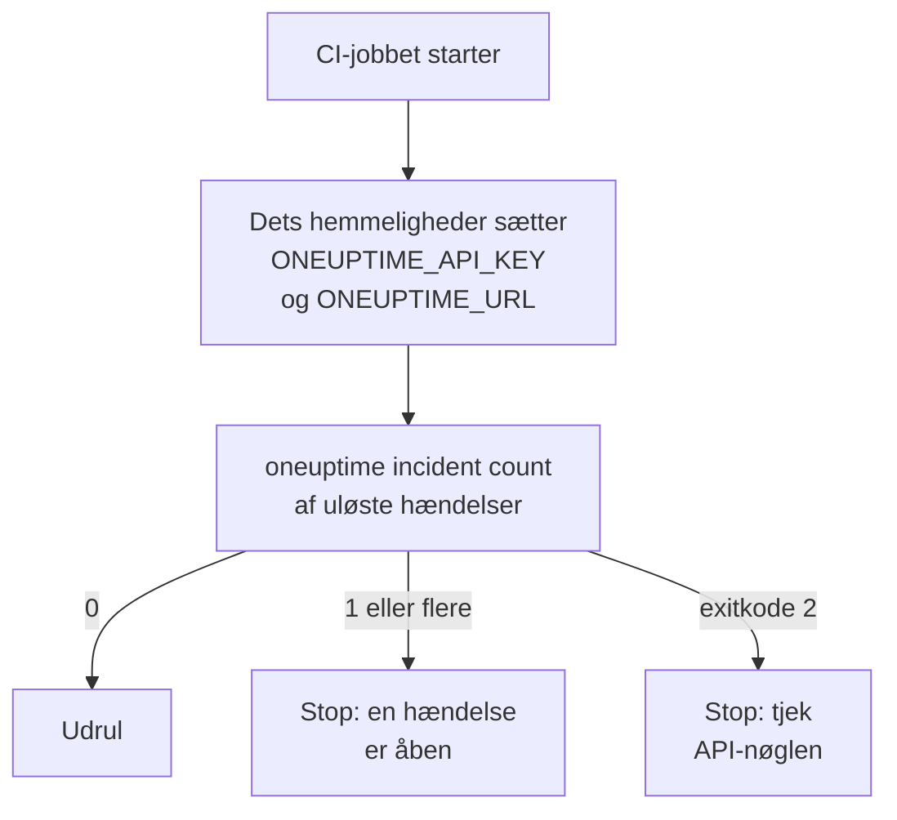

# Scripting og CI/CD

CLI'en virker på samme måde i et script som i en terminal. Giv den en API-nøgle i miljøvariabler, læs dens svar som JSON, og lad dens exitkode fortælle scriptet, hvad der skete. Denne side viser hver af delene og komplette pipelines til GitHub Actions, GitLab CI og Docker.

:::cards
- [Giv et script dets API-nøgle](#giv-et-script-dets-api-nøgle): To miljøvariabler, ingen gemt kontekst.
- [Exitkoder](#exitkoder): 0, når det lykkedes, og hvorfor det ellers ikke gjorde.
- [Læs svar med jq](#læs-svar-med-jq): ID'er, titler og datoer ud af JSON'en.
- [Eksempler på pipelines](#eksempler-på-pipelines): GitHub Actions, GitLab CI og Docker.
:::

## Sådan bruger et script CLI'en

En udrulning kan først spørge OneUptime, om en hændelse er åben, og stoppe, hvis der er en:



## Giv et script dets API-nøgle

Sæt `ONEUPTIME_API_KEY` og `ONEUPTIME_URL` fra dit CI-systems hemmeligheder. CLI'en behøver så hverken `login` eller en konfigurationsfil. Et flag går stadig forud for dem for én kommando, og de går forud for gemte kontekster.

```bash
export ONEUPTIME_API_KEY="$CI_ONEUPTIME_API_KEY"
export ONEUPTIME_URL="https://oneuptime.com"
oneuptime incident count
```

> [!TIP]
> Giv hver pipeline sin egen API-nøgle med kun den adgang, den har brug for: et tjek, der kun læser, har brug for en nøgle, der kun læser. Slet nøglen i OneUptime, når pipelinen nedlægges.

Kører én maskine job for flere projekter, så gem en kontekst for hvert og nævn den i hver kommando, så et job aldrig bruger et andets aktuelle kontekst:

```bash
oneuptime --context production incident count
oneuptime --context staging monitor count
```

## Exitkoder

| Kode | Betydning | For eksempel |
| --- | --- | --- |
| `0` | Det lykkedes | En liste, også en, der ikke finder noget |
| `1` | Det mislykkedes | OneUptime afviste anmodningen, for eksempel `API error (422)`; ugyldig JSON; en manglende eller ukendt indstilling; en kontekst, der ikke er gemt |
| `2` | Ingen brugbar API-nøgle | Ingen legitimationsoplysninger fundet; en ugyldig API-nøgle; en nøgle under sit abonnement (`402`); `401` |
| `3` | Ikke fundet | OneUptime svarede `404`: posten findes ikke, ligger i et andet projekt, eller nøglen må ikke læse den |

`whoami` og `context current` afslutter med `0`, også når intet er gemt: de rapporterer, hvad der er sat, de tjekker det ikke. Et script skelner tilfældene på koden:

```bash
oneuptime incident get "$INCIDENT_ID" -o json > incident.json
case $? in
  0) echo "Saved the incident to incident.json" ;;
  2) echo "Check ONEUPTIME_API_KEY and ONEUPTIME_URL" >&2; exit 1 ;;
  3) echo "There is no incident $INCIDENT_ID" >&2; exit 1 ;;
  *) echo "OneUptime refused the request" >&2; exit 1 ;;
esac
```

Fejlmeddelelser går til standard-fejl, så `incident.json` kun indeholder svaret.

## Læs svar med jq

Skriv `-o json` i scripts. I en pipe udskriver CLI'en alligevel JSON, men flaget holder scriptet kørende, uanset hvor det kører:

```bash
# The title of each incident
oneuptime incident list -o json | jq -r '.[].title'

# The ID of a new monitor
MONITOR_ID=$(oneuptime monitor create --data '{"name":"Checkout API","monitorType":"Manual"}' -o json | jq -r '._id')

# When each incident was created: dates come as objects
oneuptime incident list -o json | jq -r '.[] | "\(.createdAt.value)  \(.title)"'

# The newest 100 incidents as CSV
oneuptime incident list --limit 100 -o json | jq -r '.[] | [._id, .title, .createdAt.value] | @csv'
```

En optælling udskriver ét tal, klar til at sammenligne:

```bash
OPEN=$(oneuptime incident count --query '{"currentIncidentState":{"isResolvedState":false}}')
echo "$OPEN incidents are open"
```

## Opret poster fra filer

Hold poster som JSON-filer ved siden af din kode, og opret dem derfra:

```json title="monitors/checkout-api.json"
{
  "name": "Checkout API",
  "monitorType": "Manual"
}
```

```bash
oneuptime monitor create --file monitors/checkout-api.json
```

Mange poster fra ét JSON-array, én oprettelse for hver:

```bash
jq -c '.[]' monitors.json | while IFS= read -r monitor; do
  oneuptime monitor create --data "$monitor" -o json | jq -r '._id'
done
```

> [!NOTE]
> Hver kørsel opretter nye poster. Vil du holde monitorer og statussider i takt med filer, kun ændre det, der ændrede sig, og fjerne det, der er væk, så brug [Terraform-provideren](/docs/terraform/index).

## Eksempler på pipelines

:::tabs
@tab GitHub Actions
```yaml title=".github/workflows/deploy.yml"
name: Deploy
on:
  push:
    branches: [main]

jobs:
  deploy:
    runs-on: ubuntu-latest
    steps:
      - uses: actions/checkout@v4
      - uses: actions/setup-node@v4
        with:
          node-version: lts/*
      - name: Install the OneUptime CLI
        run: npm install -g @oneuptime/cli
      - name: Stop while an incident is open
        env:
          ONEUPTIME_API_KEY: ${{ secrets.ONEUPTIME_API_KEY }}
          ONEUPTIME_URL: https://oneuptime.com
        run: |
          OPEN=$(oneuptime incident count --query '{"currentIncidentState":{"isResolvedState":false}}')
          if [ "$OPEN" -gt 0 ]; then
            echo "$OPEN incidents are open: not deploying."
            exit 1
          fi
      - name: Deploy
        run: ./deploy.sh
```
@tab GitLab CI
```yaml title=".gitlab-ci.yml"
check-incidents:
  stage: test
  image: node:lts
  variables:
    ONEUPTIME_URL: https://oneuptime.com
  script:
    - npm install -g @oneuptime/cli
    - OPEN=$(oneuptime incident count --query '{"currentIncidentState":{"isResolvedState":false}}')
    - echo "$OPEN incidents are open"
    - test "$OPEN" -eq 0
```
@tab Docker
```dockerfile title="Dockerfile"
FROM node:lts-slim
RUN npm install -g @oneuptime/cli
ENTRYPOINT ["oneuptime"]
```
:::

I GitHub Actions tilføjer du `ONEUPTIME_API_KEY` under repositoriets **Settings → Secrets and variables → Actions**; i GitLab tilføjer du den som en maskeret CI/CD-variabel. Med Docker-imaget sender du variablerne med til hver kørsel:

```bash
docker build -t oneuptime-cli .
docker run --rm -e ONEUPTIME_API_KEY -e ONEUPTIME_URL oneuptime-cli incident count
```

## Næste skridt

:::cards
- [Godkendelse](/docs/cli/authentication): Hvilken nøgle en kommando bruger, når flere er sat.
- [Outputformater](/docs/cli/output-formats): Den JSON, dine scripts læser.
- [Ressourceoperationer](/docs/cli/resource-operations): Filtre, sider og en posts felter.
- [Terraform-provider](/docs/terraform/index): Hold OneUptimes konfiguration i filer.
:::
