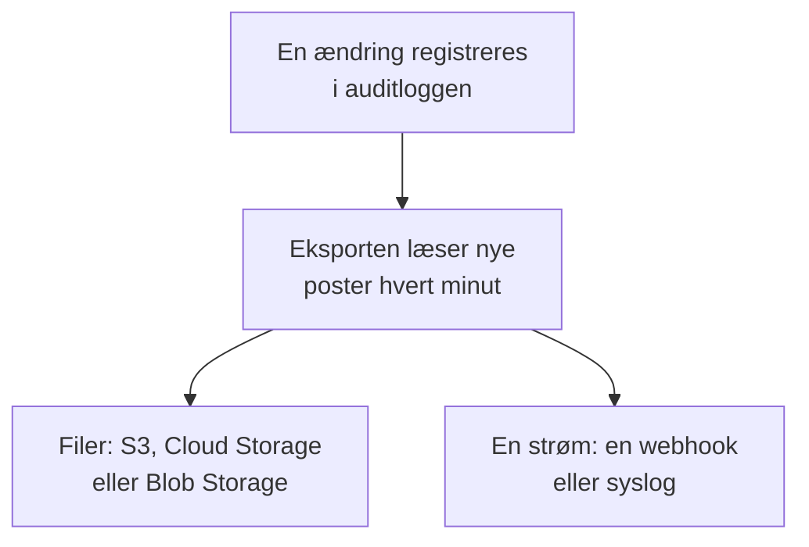

# Eksport af auditlog

Send auditloggen, efterhånden som den registreres, til lager eller en tjeneste efter eget valg: Amazon S3 eller S3-kompatibelt lager, Google Cloud Storage, Azure Blob Storage, en webhook eller syslog. Gem posterne der, så længe dine compliance-gennemgange kræver det, og søg i dem i dit SIEM. Et projekts ejere og administratorer eksporterer dets auditlog fra projektindstillingerne, og master-admins eksporterer alle projekters fra Admin Dashboard. Den er en del af Enterprise-planen i OneUptime Cloud og af Enterprise Edition, når du selv hoster.

:::cards
- [Opsæt en eksport](#opsæt-en-eksport): Vælg en destination, test den, gem den.
- [Hvad der sendes](#hvad-der-sendes): Ét JSON-objekt pr. post, i et stabilt skema.
- [Hvornår poster sendes](#hvornår-poster-sendes): Hvert minut, hver post én gang, i rækkefølge.
- [Når en destination fejler](#når-en-destination-fejler): Nye forsøg, fejlen, og intet springes over.
:::

## Sådan når en post din destination



- **Én eksport, én destination.** Et projekt kan have flere eksporter, og hver sender alle poster til sin egen destination.
- **Et projekts, eller instansens.** Et projekts eksport sender det projekts poster. En eksport, der er opsat i Admin Dashboard, sender posterne fra alle projekter, der registrerer auditlogs.
- **Fra den gemmes.** En eksport sender det, der registreres, efter den er gemt, medmindre du sætter **Eksportér fra** til en tidligere dato.

## Før du går i gang

- **I OneUptime Cloud: Enterprise-planen.** På andre planer viser siden, hvad funktionen gør, og hvordan du får den.
- **Når du selv hoster: Enterprise Edition**, med en licens, der omfatter auditlogs. Se [Enterprise Edition](/docs/self-hosted/enterprise).
- **Auditlogning slået til** i hvert projekt, du eksporterer. Se [Auditlogs](/docs/configuration/audit-logs).
- **En Project Owner eller Project Admin** for at eksportere et projekts auditlog, eller en master-admin for at eksportere instansens.

## Opsæt en eksport

:::steps
### Åbn eksportsiden

For et projekt skal du gå til **Projektindstillinger → Auditlogs → Eksport**. For hele instansen skal du gå til **Indstillinger → Eksport af auditlog** i Admin Dashboard.

### Vælg en destination

Klik på **Tilføj eksport**, og vælg en af de seks destinationer nedenfor. En eksports destination kan ikke ændres senere.

### Udfyld, hvordan den nås

Udfyld det, destinationen beder om. Indstillinger, som de fleste lader stå, venter under **Flere felter**, og **Opsætningsvejledning** åbner destinationens afsnit på denne side.

### Send en test

Klik på **Skriv en testfil** eller **Send en testpost**. Et lager får filen `oneuptime-audit-log-export-test.ndjson.gz` i sin mappe, og en webhook eller syslog får én post, hvis handling er `Test`. En mislykket test siger, hvad der skal rettes.

### Start eksporten

Klik på **Næste**, giv eksporten et navn, og klik på **Start eksport**. De første poster kommer frem inden for få minutter.
:::

Eksportens række viser, hvordan det går: **Eksporterer**, **Fejler**, **Sat på pause**, **Venter på poster** eller **Starter**. **Send en test** sender en test med de gemte indstillinger, og **Rediger** ændrer dem: En loginoplysning, du lader stå tom, beholder den gemte.

## Destinationer

| Destination | Hvad der kommer frem | Logger ind med |
| --- | --- | --- |
| [Amazon S3](#amazon-s3) | Komprimerede NDJSON-filer | En adgangsnøgle |
| [S3-kompatibelt lager](#s3-kompatibelt-lager) | Komprimerede NDJSON-filer | En adgangsnøgle |
| [Google Cloud Storage](#google-cloud-storage) | Komprimerede NDJSON-filer | En nøgle til en tjenestekonto |
| [Azure Blob Storage](#azure-blob-storage) | Komprimerede NDJSON-filer | Et SAS-token eller en adgangsnøgle |
| [Webhook](#webhook) | HTTPS-anmodninger | En valgfri header og signeringshemmelighed |
| [Syslog](#syslog) | RFC 5424-meddelelser | Ingenting |

### Amazon S3

| Felt | Hvad du skal angive |
| --- | --- |
| **Bucket** | Den bucket, filerne skrives til. |
| **Region** | Bucketens region. Den står først på `us-east-1`. |
| **Adgangsnøgle-id** | En adgangsnøgle, der må skrive objekter til bucketen. |
| **Hemmelig adgangsnøgle** | Nøglens hemmelighed. |
| **Mappe** | Under **Flere felter**. Står den tom, havner filerne i `oneuptime/audit-logs/`. |

Nøglen behøver kun `s3:PutObject` på mappen:

```json
{
  "Version": "2012-10-17",
  "Statement": [
    {
      "Effect": "Allow",
      "Action": "s3:PutObject",
      "Resource": "arn:aws:s3:::my-audit-logs/oneuptime/audit-logs/*"
    }
  ]
}
```

### S3-kompatibelt lager

De samme felter som for Amazon S3, efter et **Endpoint**: lagerets S3-adresse, som `https://minio.example.com:9000` eller `https://<account>.r2.cloudflarestorage.com`. Sæt **Region** til den, lageret forventer: `us-east-1` for MinIO og Wasabis standard, `auto` for Cloudflare R2.

### Google Cloud Storage

Angiv **Bucket**, og indsæt en **Nøgle til tjenestekonto** (JSON), hvis tjenestekonto har rollen Storage Object Creator på bucketen. **Mappe** venter under **Flere felter**.

### Azure Blob Storage

Angiv **Lagerkonto** og **Container**, og vælg under **Log ind med**, hvordan eksporten logger ind: med et **SAS-token** med tilladelserne Create og Write på containeren eller med en **Adgangsnøgle** til lagerkontoen. Et SAS-token kan begrænses til denne container, så det er det sikreste valg. **Cloud** og **Mappe** venter under **Flere felter**.

### Webhook

OneUptime sender hver batch med POST til **URL**, som et JSON-array (`application/json`) eller én post pr. linje (`application/x-ndjson`), som **Format for indhold** angiver, med disse headere:

| Header | Værdi |
| --- | --- |
| `X-OneUptime-Event` | `audit-log-export` |
| `X-OneUptime-Batch-Id` | Id'et for batchens første post: Den samme batch, sendt igen, har det samme id. |
| `X-OneUptime-Entry-Count` | Hvor mange poster indholdet rummer. |
| `X-OneUptime-Signature` | `sha256=` og HMAC-SHA256 af indholdet, med **Signeringshemmelighed**, når en er angivet. |

**Loginoplysning**, som `Bearer <token>`, sendes i den header, du vælger under **Headernavn**, `Authorization`, medmindre du ændrer den. **Format for indhold**, **Headernavn** og **Signeringshemmelighed** venter under **Flere felter**. Ethvert 2xx-svar tæller som en levering. En `413` deler batchen i to, og ethvert andet afslag sender hele batchen igen senere.

### Syslog

Hver post er én RFC 5424-meddelelse til **Vært** og **Port**, over TLS på port `6514`, medmindre **Protokol** angiver TCP, med facility 13 (log audit) og severity 6 (informational):

```text
<110>1 2026-10-24T09:15:03.000Z oneuptime.example.com oneuptime - audit-log - {"schemaVersion":1,"id":"..."}
```

Meddelelser adskilles med oktettælling (RFC 5425), medmindre **Meddelelsesadskillelse** angiver én meddelelse pr. linje. En modtager, hvis certifikat en privat CA har signeret, skal have den CA's certifikat i **CA-certifikat**. Begge venter under **Flere felter**.

## Hvad der sendes

Hver post er ét JSON-objekt, med nøglerne altid i denne rækkefølge:

| Nøgle | Hvad den indeholder |
| --- | --- |
| `schemaVersion` | `1`. En ændring af skemaet kommer med en ny version. |
| `id` | Postens id. Den samme post, sendt to gange, har det samme id. |
| `createdAt` | Hvornår ændringen blev registreret, i UTC. |
| `projectId` | Det projekt, ændringen blev foretaget i. |
| `action` | `Create`, `Update`, `Delete` eller `Download`. |
| `resourceType`, `resourceId`, `resourceName` | Hvad der blev ændret. |
| `rootResourceType`, `rootResourceId` | Den ressource, den hører til, som et SLO for dets regel. |
| `userId`, `userName`, `userEmail`, `userType` | Hvem der foretog ændringen. |
| `apiKeyId`, `apiKeyName` | Den API-nøgle, den blev foretaget med, hvis nogen. |
| `mcpOAuthGrantId`, `mcpClientName` | Den MCP-klient, den blev foretaget gennem, hvis nogen. |
| `workflowId`, `workflowName` | Det workflow, der foretog den, hvis nogen. |
| `changes` | Hvert ændret felt: `field`, med `oldValue` og `newValue`. |

En fil rummer én post pr. linje, komprimeret med gzip, og arkiveres under timen for dens første post: `oneuptime/audit-logs/2026/10/24/09/20261024T091503Z_<first entry id>.ndjson.gz`.

Nøgler, tokens og adgangskoder forlader aldrig OneUptime: De registreres som `[REDACTED]`, og felter, som ingen må læse, udelades af alle poster.

## Hvornår poster sendes

- **Hvert minut.** Poster, der blev registreret for mere end et minut siden, læses med de ældste først og sendes i batches: op til 5.000 poster eller 16 MB pr. fil og 500 poster pr. webhook-anmodning eller syslog-forbindelse.
- **Filer skrives ikke for hver post.** En fil skrives, når en batch er fuld, eller dens første post er fem minutter gammel.
- **Hver post én gang, i rækkefølge.** Efter hver levering husker eksporten den sidst sendte post, så en genstart eller en anden worker fortsætter derfra.
- **En gentagelse kan genkendes.** En batch, der sendes igen efter et nedbrud, skriver det samme filnavn eller har det samme `X-OneUptime-Batch-Id`, og hver post har sit `id`.

## Når en destination fejler

En batch forsøges tre gange med få sekunders mellemrum, og derefter venter eksporten, før den prøver igen: et minut, så to, fire og så videre, op til en time. Dens række siger **Fejler**, og **Vis fejl** viser, hvad destinationen svarede, og hvornår næste forsøg kommer.

Intet springes over: Posterne venter i auditloggen, og den næste levering, der lykkes, indhenter fra den ældste. En post, der er ældre end opbevaringen for dens projekts auditlog, slettes, før den kan sendes, så ret en eksport, der fejler, inden for den tid.

Slå **Eksport** fra under **Rediger** for at sætte en eksport på pause: Den beholder sin plads, og når den slås til igen, sender den, hvad der blev registreret i mellemtiden. I OneUptime Cloud holder et projekt, der forlader Enterprise-planen, op med at eksportere, og dets eksporter venter under opgraderingskortet, hvor de kan slås fra eller slettes. Når du selv hoster, stopper eksporten, så længe licensen ikke omfatter auditlogs, og fortsætter, hvor den slap, så snart en licens gør.

## Fejlfinding

:::details Testen siger, at adgang nægtes
Nøglen, tokenet eller tjenestekontoen må ikke skrive, hvor eksporten skriver. Giv den tilladelse til at oprette objekter i mappen, som hver destinations afsnit ovenfor viser, og send så testen igen.
:::

:::details Testen kan ikke nå adressen
Et projekts eksport i OneUptime Cloud kan ikke nå en privat netværksadresse. Når du selv hoster, kan den, medmindre `DATA_SOURCE_BLOCK_PRIVATE_ADDRESSES` er `true`, og en eksport, der er opsat i Admin Dashboard, kan altid. Loopback- og link-local-adresser nås aldrig.
:::

:::details Intet kommer frem
Tjek, at auditlogning er slået til i projektet, og at nogen har ændret noget, efter eksporten blev gemt. Et lager modtager først en fil, når en batch er fuld eller fem minutter gammel.
:::

## Næste skridt

:::cards
- [Auditlogs](/docs/configuration/audit-logs): Hvad der registreres, og hvor længe det gemmes.
- [Brugere, teams og tilladelser](/docs/permissions/index): Bestem, hvem der må opsætte en eksport.
- [Enterprise Edition](/docs/self-hosted/enterprise): Auditlogs på en selvhostet installation.
:::
