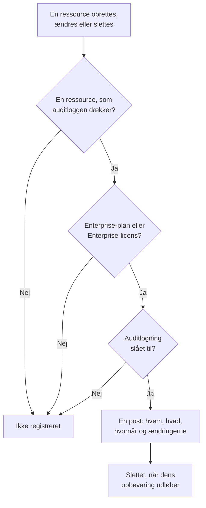

# Auditlogs

Auditloggen registrerer, hvem der ændrede hvad i dit projekt: hver oprettelse, ændring og sletning af de ressourcer, den dækker, med værdierne før og efter, og hver gang nogen logger ind eller ud. Brug den til at finde ud af, hvem der slog en monitor fra eller ændrede en API-nøgle, hvem der loggede ind og hvorfra, og til at føre dokumentation til compliance-gennemgange. Den er en del af Enterprise-planen i OneUptime Cloud og af Enterprise Edition, når du selv hoster.

:::cards
- [Slå auditlogning til](#slå-auditlogning-til): Den er slået fra fra start i alle projekter.
- [Læs auditloggen](#læs-auditloggen): Hvem ændrede hvad, og hvornår.
- [Hvad registreres](#hvad-registreres): De ressourcer og handlinger, den dækker.
- [Logins og sessioner](#logins-og-sessioner): Hvem der loggede ind, og hvordan hver session sluttede.
- [Hvor længe poster gemmes](#hvor-længe-poster-gemmes): Fra 7 til 180 dage.
:::

## Sådan bliver en ændring til en post

- **Den er slået fra fra start.** Et projekt registrerer intet, før nogen slår auditlogning til, og intet fra før det øjeblik.
- **Den registrerer, hvad folk gør.** En ændring foretaget af en person, en API-nøgle, en MCP-klient eller en arbejdsgang registreres. En ændring, OneUptime selv foretager, som fra et baggrundsjob, udelades, medmindre du slår **Gem systemhændelser** til.
- **Poster kan ikke ændres.** Ingen kan redigere eller slette en post, hverken i dashboardet eller via API'et. En post forsvinder først, når dens opbevaring udløber.

## Før du går i gang

- **I OneUptime Cloud: Enterprise-planen.** På andre planer viser auditloggens sider, hvad funktionen gør, og hvordan du får den.
- **Når du selv hoster: Enterprise Edition**, med en licens, der omfatter auditlogs. Se [Enterprise Edition](/docs/self-hosted/enterprise).
- **En rolle, der må læse auditloggen.** Projektejer, Projektadministrator, Indstillingsadministrator eller tilladelsen **Read Audit Log**. At slå auditlogning til og ændre dens indstillinger kræver en Projektejer, en Projektadministrator eller tilladelse til at redigere projektet.

## Slå auditlogning til

:::steps
### Åbn auditloggens indstillinger

Gå til **Projektindstillinger → Auditlogs → Indstillinger**. **Auditlogs** er foldet sammen i sidemenuen fra start: klik på det for at åbne det.

### Rediger indstillingerne

Klik på **Rediger indstillinger for auditlogs**.

### Slå den til

Slå **Aktivér revisionslogs** til, angiv **Opbevaring (dage)**, og vælg, om du vil **Gem systemhændelser**. Klik på **Gem ændringer**.
:::

| Indstilling | Startværdi | Hvad den gør |
| --- | --- | --- |
| **Aktivér revisionslogs** | Fra | Registrerer fra nu af ændringer i projektets ressourcer. |
| **Opbevaring (dage)** | 7 | Hvor mange dage hver post gemmes: fra 7 til 180. |
| **Gem systemhændelser** | Fra | Registrerer også de ændringer, OneUptime selv foretager, og som ingen person eller nøgle har startet. |

En ændring af disse indstillinger træder i kraft inden for et minut.

## Læs auditloggen

**Projektindstillinger → Auditlogs → Auditlogs** viser hver post i projektet, de nyeste først:

| Kolonne | Hvad den viser |
| --- | --- |
| **Hvornår** | Hvor længe siden, med dato og klokkeslæt. |
| **Handling** | `Create`, `Update` eller `Delete`, `Download` for en pakkeopsamlingsfil, som nogen har downloadet, eller `Sign In`, `Sign-In Failed`, `Sign Out`, `Session Timeout` eller `Session Revoked` for et login eller en session. |
| **Ressource** | Ressourcens navn, som åbner den, så længe den findes, og dens type. |
| **Aktør** | Hvem der foretog ændringen: en person, en API-nøgle, en arbejdsgang eller `System` for en ændring, OneUptime selv foretog. En persons ændring via en MCP-klient nævner hvilken. En arbejdsgangs ændring siger, hvad den kørte som, og med hvis tilladelser. |
| **Ændringer** | Hvor mange felter der blev ændret, eller registreret ved en oprettelse eller sletning. For et login eller en session, hvordan der blev logget ind, hvorfor det mislykkedes, eller hvorfor sessionen sluttede. Klik for at se hvert felt. |

Filtrér efter **Ressourcetype**, **Ressourcenavn**, **Handling**, **Bruger-e-mail**, **Arbejdsgang kørt som**, **Arbejdsgangens tilladelser givet af** eller **Tid**. En ændring viser kun de felter, der blev ændret, før og efter, og en gemning, der ikke ændrer noget, tilføjer ingen post.

En ressource uden sit eget navn får navn efter det, der navngiver den i OneUptime: en undtagelse efter sin type og begyndelsen af sin meddelelse, med id'er, adresser og alt, der ligner en hemmelighed, maskeret, en kørsel af en runbook efter sin runbook, telefonnummeret på en politik for indgående opkald efter nummeret, og en skabelon eller et domæne efter sit eget navn.

Monitorer, hændelser, alarmer, statussider, SLO'er og mange andre ressourcer har også deres egen side **Auditlogs** i et sammenfoldet afsnit af deres sidemenu, som **Avanceret**. Den viser kun den ressources poster, sammen med posterne for det, der hører til den: et SLO's side viser også dets regler og ejere.

## Hvad registreres

Alt, hvad folk opretter, ændrer eller sletter i et projekt, registreres: monitorer, hændelser, alarmer, statussider, arbejdsgange og deres trin, køer, dashboards, vagtpolitikker, teams og hvem der er med i dem, API-nøgler og alle indstillinger. **Ressourcetype** siger, hvad en post handler om, for eksempel `Monitor`, `Workflow` eller `Queue`.

| Registreres ikke | Hvorfor |
| --- | --- |
| Logge over beskeder | Hver af dem er allerede registreringen af en e-mail, sms, et opkald, en pushnotifikation eller en chatbesked, som OneUptime har sendt eller modtaget. |
| Registreringer af kørsler | Hver af dem er allerede registreringen af en arbejdsgangskørsel, en vagteskalering, en scanning, en import eller en AI-kørsel. |
| Det, agenter og telemetri rapporterer | Fundne ressourcer, målinger og forbrug ændrer sig ved hver rapport, ikke fordi nogen har ændret dem. |
| Aktivitetsfeeds | Et feed viser ændringer, som auditloggen allerede registrerer. |
| OneUptimes arbejdstilstand | Jobs i kø og anden tilstand, som OneUptime holder, mens det arbejder. |
| En persons egen notifikationsopsætning | Hver persons adresser, numre og personlige vagtregler er kun deres egne. |
| En persons egne præferencer | De produkter, hver person fastgør til sin egen øverste bjælke, er kun deres egne, og kun de ser dem. |

Det registreres også, når en administrator tilføjer eller fjerner en notifikationsmetode eller en personlig vagtregel på en andens konto, uden selve adressen eller nummeret.

Felter, som kun OneUptime skriver, for eksempel hvornår en vært sidst blev set, udelades af alle poster, og det samme gør felter, som ingen må læse. Når OneUptime skriver et af dem, fordi nogen bad om det, for eksempel når en undtagelse flettes ind i en anden, eller en webhook-URL nulstilles, registrerer posten det som deres ændring. Nøgler, tokens og adgangskoder registreres som `[REDACTED]`: posten viser, at de er ændret, aldrig deres værdi. En arbejdsgangs trin registreres som det, der ændrede sig, med navnene på et trins indstillinger, men aldrig det, der blev skrevet i dem, og når et trin flyttes på lærredet, registreres det ikke.

Det, OneUptime gør, fordi nogen bad om det, registreres også som deres ændring, uanset om projektet gemmer systemhændelser:

- At starte, godkende, fuldføre, springe over og annullere en kørsel af en runbook. Dens trin registreres som det, der blev gjort ved hvert af dem, for eksempel `Approved "Restart the API" (step 3)`, aldrig med det, et trin skrev ud.
- Det, en regel ændrer, når nogen kører den: de etiketter og ejere, den tilføjer, de poster, en privatlivsregel gør private, de enheder, en regel for tildeling af lokation flytter, de enheder og monitorer, en regel for automatisk import opretter, og det, en monitorregel på en statusside eller et SLO ændrer på siden eller SLO'et.
- At købe, tilknytte og frigive telefonnummeret på en politik for indgående opkald.
- At løse en dataalarm, som nogen markerer som forventet eller som ikke et problem.
- At nulstille linket til et kalenderfeed.
- De teams, nogen bliver medlem af, når de logger ind med SSO.

Det, en regel gør af sig selv, er OneUptimes egen ændring og registreres, når **Gem systemhændelser** er slået til: de etiketter og ejere, en regel tilføjer, når en post oprettes, og en post, den da gør privat; de enheder og monitorer, en regel for automatisk import opretter ud fra nye scanningsresultater; og det, en monitorregel på en statusside eller et SLO ændrer, når en regel, en monitor eller en etiket gemmes.

Når nogen nulstiller AI-agenten for en vært, en klynge eller en cloudkonto, registreres det på ressourcens egen side **Auditlogs** som deres ændring af `aiAgentResetAt`: hvem, og hvornår. Det samme gælder, når nogen laver en nøgle til en cloudkontos AI-agent: nøglerne vises som ændret, aldrig med en nøgle eller en hash. Det, en agent rapporterer, når den forbinder og melder sig, er udeladt som før.

## Logins og sessioner

Hver gang et medlem af projektet logger ind på OneUptime, registrerer auditloggen det, og igen når den session slutter. Et login gælder OneUptime, ikke ét projekt, så alle projekter, personen er medlem af, registrerer det.

| Handling | Hvornår det registreres |
| --- | --- |
| `Sign In` | Nogen logger ind: med en adgangskode eller et login-link, en adgangsnøgle, Google, Microsoft, Vercel eller single sign-on. |
| `Sign-In Failed` | Nogen forsøger at logge ind på en eksisterende konto og mislykkes: en forkert adgangskode, godkendelseskode, backupkode eller sikkerhedsnøgle, en blokeret eller ubekræftet konto, eller et single sign-on, som OneUptime afviste. |
| `Sign Out` | Personen logger ud. |
| `Session Timeout` | OneUptime afslutter sessionen, fordi tiden er gået: den inaktivitetsperiode eller sessionslængde, en serveradministrator har angivet, eller 30 dage uden brug. |
| `Session Revoked` | OneUptime afslutter sessionen, fordi adgangskoden blev ændret, kontoen blev blokeret, eller en serveradministrator nulstillede eller krævede tofaktorgodkendelse. |

En posts **Ressource** er sessionen, navngivet efter den enhed, den loggede ind fra, for eksempel `Chrome 130 on macOS`. Postens **Aktør** er den person, sessionen tilhører, så filtrering efter **Bruger-e-mail** finder alle deres logins og sessioner. Detaljerne viser, hvordan personen loggede ind og med hvilken anden faktor, IP-adressen og stedet, og for en afsluttet session, hvornår den loggede ind, hvornår den sidst blev brugt, og hvornår den udløb. Et projekts egen SSO-udbyder nævnes kun i det projekts auditlog.

En `Sign-In Failed`-post handler om forsøget og er navngivet efter den enhed, det kom fra. Postens **Aktør** er den konto, forsøget blev gjort på: den, der gjorde forsøget, har ikke bevist, at vedkommende er den person. Detaljerne viser, hvorfor det mislykkedes, hvordan der blev forsøgt at logge ind, IP-adressen og stedet, men aldrig hvad der blev indtastet. Et forsøg på en e-mailadresse, som ingen konto har, registreres ikke, og at et forsøg registreres, ændrer hverken, hvad login-siden svarer, eller hvor hurtigt. For at en strøm af forsøg ikke kan fylde auditloggen, registreres de første 10 mislykkede forsøg på en konto inden for en time enkeltvis. Resten tælles, og kontoens næste post viser, hvor mange forsøg den står for, og hvornår det første af dem blev gjort.

Læserne af en privat statusside registreres også, kun i statussidens projekt: hvert login med en adgangskode, et login-link eller statussidens single sign-on, hver udlogning, og hver session, som OneUptime afslutter, fordi læserens adgangskode blev ændret, eller fordi statussiden ikke længere accepterer den måde, den loggede ind på. Deres poster findes også på statussidens egen side **Auditlogs**. Deres **Aktør** er læseren, vist med e-mailadressen, og deres **Ressource** er læserens session.

Logins og sessioner registreres, uanset om projektet gemmer systemhændelser. En udløbet sessionslængde eller 30 dage uden brug registreres inden for få minutter. En udløbet inaktivitetsperiode i browseren, eller i en version af mobilappen nyere end 1.6.0, registreres inden for 35 minutter, uanset om personen kommer tilbage. I mobilappen version 1.6.0 og tidligere registreres den, næste gang appen kontakter OneUptime.

## Hvor længe poster gemmes

Hver post gemmes i den **Opbevaring (dage)**, projektet havde, da den blev registreret, og slettes derefter. En ny opbevaring gælder for nye poster: de allerede registrerede poster beholder deres datoer. Også gennem API'et er en opbevaring et helt antal dage fra 7 til 180: enhver anden værdi afvises.

For at gemme poster i mere end 180 dage sender du dem, efterhånden som de registreres, til dit eget lager eller SIEM: se [Eksport af auditlog](/docs/configuration/audit-log-export). Du kan også læse dem via API'et med en API-nøgle, der har **Read Audit Log**, og gemme dem, hvor du har brug for dem. Se [OneUptime API-reference](/docs/api-reference/api-reference).

## Når planen eller licensen ikke længere omfatter auditlogs

- **I OneUptime Cloud** holder et projekt, der forlader Enterprise-planen, op med at registrere, og dets auditlogsider viser opgraderingskortet, indtil det er tilbage på planen.
- **Når du selv hoster**, holder auditlogning op med at registrere, når Enterprise-prøveperioden eller henstandsperioden slutter uden en licens, eller når licensen ikke omfatter auditlogs. Auditloggen viser det med rødt. Allerede registrerede poster beholdes, og registreringen genoptages med de samme indstillinger, så snart en licens aktiveres. Se [Når en licens udløber eller mangler](/docs/self-hosted/enterprise#når-en-licens-udløber-eller-mangler).

## Fejlfinding

:::details Auditloggen er tom
Auditlogning er slået fra fra start og registrerer intet fra før, den blev slået til. Hvis listen siger, at auditlogning er slået fra, så følg dens link til indstillingerne, og slå den til. Ellers ændrer du en monitor eller en hændelse og opdaterer listen.
:::

:::details En ændring mangler i auditloggen
Tjek, at ressourcen står under [Hvad registreres](#hvad-registreres), og at ændringen blev foretaget, efter auditlogning blev slået til. En ændring, OneUptime selv foretog, registreres kun med **Gem systemhændelser** slået til.
:::

## Næste skridt

:::cards
- [Eksport af auditlog](/docs/configuration/audit-log-export): Send auditloggen til dit eget lager eller SIEM.
- [Brugere, teams og tilladelser](/docs/permissions/index): Bestem, hvem der må læse auditloggen.
- [Projektindstillinger](/docs/configuration/project-settings): Projektets øvrige indstillinger.
- [Fakturering og forbrug](/docs/configuration/billing): Skift projektets plan.
- [Enterprise Edition](/docs/self-hosted/enterprise): Auditlogs på en selvhostet installation.
:::
