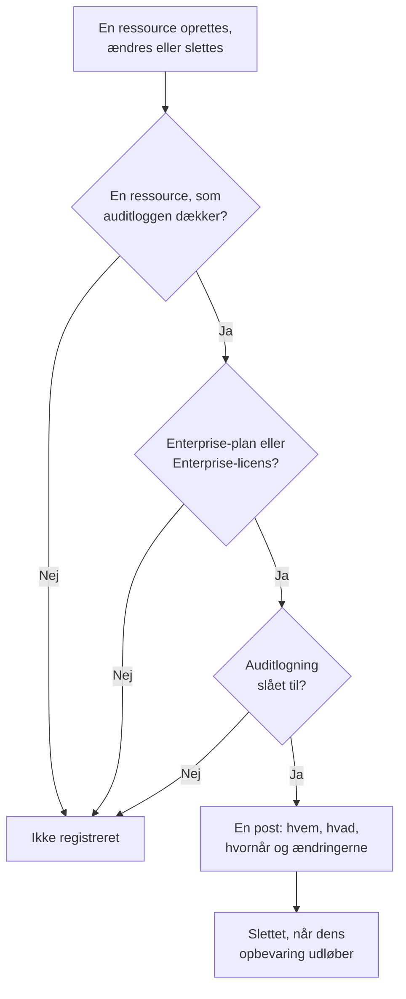

# Auditlogs

Auditloggen registrerer, hvem der ændrede hvad i dit projekt: hver oprettelse, ændring og sletning af de ressourcer, den dækker, med værdierne før og efter. Brug den til at finde ud af, hvem der slog en monitor fra eller ændrede en API-nøgle, og til at føre dokumentation til compliance-gennemgange. Den er en del af Enterprise-planen i OneUptime Cloud og af Enterprise Edition, når du selv hoster.

:::cards
- [Slå auditlogning til](#slå-auditlogning-til): Den er slået fra fra start i alle projekter.
- [Læs auditloggen](#læs-auditloggen): Hvem ændrede hvad, og hvornår.
- [Hvad registreres](#hvad-registreres): De ressourcer og handlinger, den dækker.
- [Hvor længe poster gemmes](#hvor-længe-poster-gemmes): Fra 7 til 180 dage.
:::

## Sådan bliver en ændring til en post

- **Den er slået fra fra start.** Et projekt registrerer intet, før nogen slår auditlogning til, og intet fra før det øjeblik.
- **Den registrerer, hvad folk gør.** En ændring foretaget af en person, en API-nøgle, en MCP-klient eller en workflow registreres. En ændring, OneUptime selv foretager, som fra et baggrundsjob, udelades, medmindre du slår **Gem systemhændelser** til.
- **Poster kan ikke ændres.** Ingen kan redigere eller slette en post, hverken i dashboardet eller via API'et. En post forsvinder først, når dens opbevaring udløber.

## Før du går i gang

- **I OneUptime Cloud: Enterprise-planen.** På andre planer viser auditloggens sider, hvad funktionen gør, og hvordan du får den.
- **Når du selv hoster: Enterprise Edition**, med en licens, der omfatter auditlogs. Se [Enterprise Edition](/docs/self-hosted/enterprise).
- **En rolle, der må læse auditloggen.** Project Owner, Project Admin, Settings Admin eller tilladelsen **Read Audit Log**. At slå auditlogning til og ændre dens indstillinger kræver en Project Owner, en Project Admin eller tilladelse til at redigere projektet.

## Slå auditlogning til

:::steps
### Åbn auditloggens indstillinger

Gå til **Projektindstillinger → Auditlogs → Indstillinger**. **Auditlogs** er foldet sammen i sidemenuen fra start: klik på det for at åbne det.

### Rediger indstillingerne

Klik på **Edit Audit Log Settings**.

### Slå den til

Slå **Aktivér revisionslogs** til, angiv **Opbevaring (dage)**, og vælg, om du vil **Gem systemhændelser**. Klik på **Gem ændringer**.
:::

| Indstilling | Startværdi | Hvad den gør |
| --- | --- | --- |
| **Aktivér revisionslogs** | Fra | Registrerer fra nu af ændringer i projektets ressourcer. |
| **Opbevaring (dage)** | 7 | Hvor mange dage hver post gemmes: fra 7 til 180. |
| **Gem systemhændelser** | Fra | Registrerer også de ændringer, OneUptime selv foretager, og som ingen person eller nøgle har startet. |

En ændring af disse indstillinger træder i kraft inden for et minut.

## Læs auditloggen

**Projektindstillinger → Auditlogs → Auditlogs** viser hver post i projektet, de nyeste først:

| Kolonne | Hvad den viser |
| --- | --- |
| **Hvornår** | Hvor længe siden, med dato og klokkeslæt. |
| **Handling** | `Create`, `Update` eller `Delete`, eller `Download` for en pakkeopsamlingsfil, som nogen har downloadet. |
| **Ressource** | Ressourcens navn, som åbner den, så længe den findes, og dens type. |
| **Aktør** | Hvem der foretog ændringen: en person, en API-nøgle, en workflow eller `System` for en ændring, OneUptime selv foretog. En persons ændring via en MCP-klient nævner hvilken. |
| **Ændringer** | Hvor mange felter der blev ændret, eller registreret ved en oprettelse eller sletning. Klik for at se hvert felt. |

Filtrér efter **Ressourcetype**, **Ressourcenavn**, **Handling**, **Bruger-e-mail** eller **Tid**. En ændring viser kun de felter, der blev ændret, før og efter, og en gemning, der ikke ændrer noget, tilføjer ingen post.

En ressource uden sit eget navn får navn efter det, der navngiver den i OneUptime: en undtagelse efter sin type og begyndelsen af sin meddelelse, med id'er, adresser og alt, der ligner en hemmelighed, maskeret, en kørsel af en runbook efter sin runbook, og en skabelon eller et domæne efter sit eget navn.

Monitorer, hændelser, alarmer, statussider, SLO'er og mange andre ressourcer har også deres egen side **Auditlogs** i et sammenfoldet afsnit af deres sidemenu, som **Avanceret**. Den viser kun den ressources poster, sammen med posterne for det, der hører til den: et SLO's side viser også dets regler og ejere.

## Hvad registreres

Alt, hvad folk opretter, ændrer eller sletter i et projekt, registreres: monitorer, hændelser, alarmer, statussider, workflows og deres trin, køer, dashboards, vagtpolitikker, teams og hvem der er med i dem, API-nøgler og alle indstillinger. **Ressourcetype** siger, hvad en post handler om, for eksempel `Monitor`, `Workflow` eller `Queue`.

| Registreres ikke | Hvorfor |
| --- | --- |
| Logge over beskeder | Hver af dem er allerede registreringen af en e-mail, sms, et opkald, en pushnotifikation eller en chatbesked, som OneUptime har sendt eller modtaget. |
| Registreringer af kørsler | Hver af dem er allerede registreringen af en workflowkørsel, en vagteskalering, en scanning, en import eller en AI-kørsel. |
| Det, agenter og telemetri rapporterer | Fundne ressourcer, målinger og forbrug ændrer sig ved hver rapport, ikke fordi nogen har ændret dem. |
| Aktivitetsfeeds | Et feed viser ændringer, som auditloggen allerede registrerer. |
| OneUptimes arbejdstilstand | Sessioner, jobs i kø og anden tilstand, som OneUptime holder, mens det arbejder. |
| En persons egen notifikationsopsætning | Hver persons adresser, numre og personlige vagtregler er kun deres egne. |

Det registreres også, når en administrator tilføjer eller fjerner en notifikationsmetode eller en personlig vagtregel på en andens konto, uden selve adressen eller nummeret.

Felter, som kun OneUptime skriver, for eksempel hvornår en vært sidst blev set, udelades af alle poster, og det samme gør felter, som ingen må læse. Når OneUptime skriver et af dem, fordi nogen bad om det, for eksempel når en undtagelse flettes ind i en anden, eller en webhook-URL nulstilles, registrerer posten det som deres ændring. Nøgler, tokens og adgangskoder registreres som `[REDACTED]`: posten viser, at de er ændret, aldrig deres værdi. Et workflows trin registreres som det, der ændrede sig, med navnene på et trins indstillinger, men aldrig det, der blev skrevet i dem, og når et trin flyttes på lærredet, registreres det ikke.

Det, OneUptime gør, fordi nogen bad om det, registreres også som deres ændring, uanset om projektet gemmer systemhændelser: at starte, godkende, fuldføre, springe over og annullere en kørsel af en runbook, de etiketter en etiketregel tilføjer, når nogen kører den på de poster, der allerede findes, at nulstille linket til et kalenderfeed og de teams, nogen bliver medlem af, når de logger ind med SSO. En runbook-kørsels trin registreres som det, der blev gjort ved hvert af dem, for eksempel `Approved "Restart the API" (step 3)`, aldrig med det, et trin skrev ud. Etiketter, som en regel tilføjer, når en post oprettes, er OneUptimes egen ændring og registreres, når **Gem systemhændelser** er slået til.

## Hvor længe poster gemmes

Hver post gemmes i den **Opbevaring (dage)**, projektet havde, da den blev registreret, og slettes derefter. En ny opbevaring gælder for nye poster: de allerede registrerede poster beholder deres datoer.

For at gemme poster i mere end 180 dage sender du dem, efterhånden som de registreres, til dit eget lager eller SIEM: se [Eksport af auditlog](/docs/configuration/audit-log-export). Du kan også læse dem via API'et med en API-nøgle, der har **Read Audit Log**, og gemme dem, hvor du har brug for dem. Se [OneUptime API-reference](/docs/api-reference/api-reference).

## Når planen eller licensen ikke længere omfatter auditlogs

- **I OneUptime Cloud** holder et projekt, der forlader Enterprise-planen, op med at registrere, og dets auditlogsider viser opgraderingskortet, indtil det er tilbage på planen.
- **Når du selv hoster**, holder auditlogning op med at registrere, når Enterprise-prøveperioden eller henstandsperioden slutter uden en licens, eller når licensen ikke omfatter auditlogs. Auditloggen viser det med rødt. Allerede registrerede poster beholdes, og registreringen genoptages med de samme indstillinger, så snart en licens aktiveres. Se [Når en licens udløber eller mangler](/docs/self-hosted/enterprise#når-en-licens-udløber-eller-mangler).

## Fejlfinding

:::details Auditloggen er tom
Auditlogning er slået fra fra start og registrerer intet fra før, den blev slået til. Hvis listen siger, at auditlogning er slået fra, så følg dens link til indstillingerne, og slå den til. Ellers ændrer du en monitor eller en hændelse og opdaterer listen.
:::

:::details En ændring mangler i auditloggen
Tjek, at ressourcen står under [Hvad registreres](#hvad-registreres), og at ændringen blev foretaget, efter auditlogning blev slået til. En ændring, OneUptime selv foretog, registreres kun med **Gem systemhændelser** slået til.
:::

## Næste skridt

:::cards
- [Eksport af auditlog](/docs/configuration/audit-log-export): Send auditloggen til dit eget lager eller SIEM.
- [Brugere, teams og tilladelser](/docs/permissions/index): Bestem, hvem der må læse auditloggen.
- [Projektindstillinger](/docs/configuration/project-settings): Projektets øvrige indstillinger.
- [Fakturering og forbrug](/docs/configuration/billing): Skift projektets plan.
- [Enterprise Edition](/docs/self-hosted/enterprise): Auditlogs på en selvhostet installation.
:::
