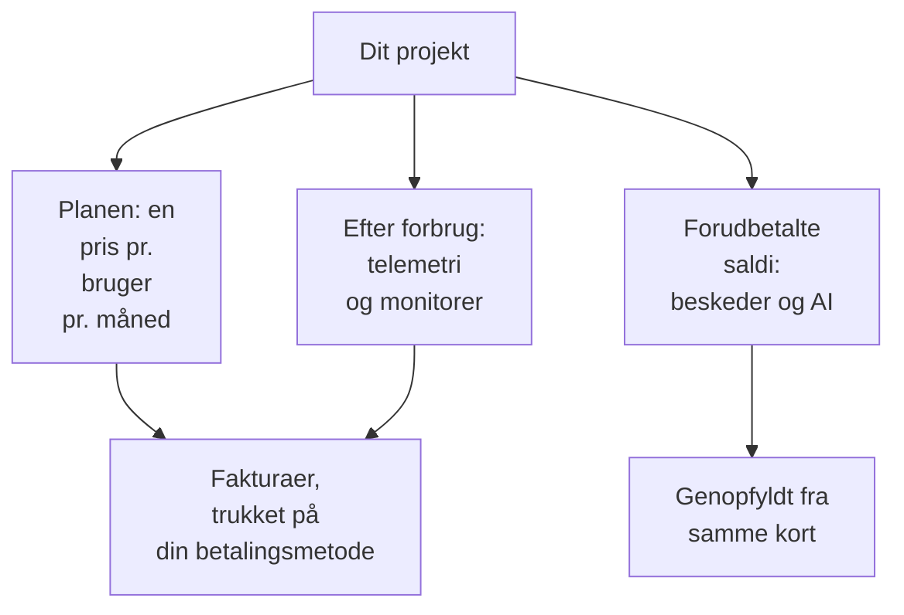

# Fakturering og forbrug

I OneUptime Cloud betaler et projekt for sin plan, pr. bruger, og for det, det bruger: telemetri, aktive monitorer og de beskeder og det AI-arbejde, det betaler fra forudbetalte saldi. Denne side viser, hvor du ser og ændrer hver af dem, og hvem der må. En selvhostet installation har ingen fakturering og ingen af disse sider.

:::cards
- [Din plan og dine pladser](#din-plan-og-dine-pladser): Hvad planen koster, og hvem der tæller som en plads.
- [Betalingsmetoder](#betalingsmetoder): Det kort, dine fakturaer trækkes på.
- [Fakturaer](#fakturaer): Betal dem, download dem, og se, hvad du har brugt.
- [Forudbetalte saldi](#forudbetalte-saldi): Beskeder og AI, genopfyldt manuelt eller automatisk.
:::

## Hvad et projekt betaler for

| Hvad | Hvordan det prissættes |
| --- | --- |
| Planen | En pris pr. bruger pr. måned, faktureret månedligt eller årligt. Hver person i projektet er en plads. |
| Telemetri | $0.10 pr. indtaget GB, med 15 dages opbevaring. Længere opbevaring koster mere, og opbevaring under 7 dage faktureres som 7 dage: se [Hvad opbevaring koster](/docs/telemetry/data-retention#hvad-opbevaring-koster). |
| Session replays | $2 pr. GB, med 15 dages opbevaring. |
| Aktive monitorer | $1 pr. monitor pr. måned. Enhver monitor undtagen en manuel er aktiv, også mens den er slået fra. |
| SMS, opkald, WhatsApp og Telegram | Betales fra projektets saldo, efterhånden som hver besked sendes. |
| OneUptime AI | Betales fra projektets AI-kreditter, medmindre den kører på din egen LLM-udbyder. |

[Prissiden](https://oneuptime.com/pricing) sammenligner planerne.

## Før du går i gang

- **OneUptime Cloud.** Afsnittet **Fakturering og fakturaer** i **Projektindstillinger** findes kun i OneUptime Cloud og er foldet sammen fra start: klik på titlen for at åbne det.
- **En rolle, der må læse faktureringen.** Project Owners, folk med **Manage Billing** og de tre faktureringsroller læser alle faktureringssider. Se [Hvem må hvad](#hvem-må-hvad).

## Din plan og dine pladser

Gå til **Projektindstillinger → Fakturering og fakturaer → Fakturering**. Kortet **Aktuel plan** viser projektets plan og prisen pr. bruger, og **Pladser**: én for hver person i projektet.

En person tæller som en plads, fra du inviterer personen, allerede før den accepterer, indtil du fjerner den. For at ændre antallet af pladser inviterer eller fjerner du folk: se [Inviter personer](/docs/permissions/inviting-people).

## Skift plan

:::steps
### Tilføj først en betalingsmetode

Et planskift kræver en betalingsmetode. Uden en åbner **Change Plan** i stedet **Add a Payment Method**: se [Betalingsmetoder](#betalingsmetoder).

### Klik på Change Plan

Klik på **Change Plan** på kortet **Aktuel plan**. **Årlig plan** er slået til fra start: slå den fra for at se månedspriserne.

### Vælg planen

Hver plan viser sin pris pr. bruger. Noten under planerne siger, hvad der sker med din prøveperiode: **Your free trial carries over**, så længe projektet stadig er i sin prøveperiode, og **Changing plan does not start a free trial**, når det ikke længere er.

### Gem ændringen

Klik på **Gem ændringer**. En betalt plan faktureres fra det øjeblik, du skifter til den, og hver person, du inviterer på den, faktureres, når du inviterer personen.
:::

API-nøgler virker kun på Growth-planen eller en højere plan, og under Scale-planen fjerner SCIM-forbindelser kun folk. En plan, der stopper dem, siger hvor mange, før du vælger den, og siden **Fakturering** viser **Ikke inkluderet i dette abonnement**, så længe de er stoppet. Intet slettes: de virker igen på en plan, der omfatter dem.

> [!NOTE]
> Har du købt OneUptime via en forhandler eller en cloud-markedsplads (AWS Marketplace, Microsoft Marketplace, Google Cloud Marketplace eller Vercel Marketplace)? Siden **Fakturering** siger det. En forhandler skifter din plan for dig, og en markedsplads fakturerer projektets plan og forbrug på din cloud-regning.

## Betalingsmetoder

Kortet **Betalingsmetoder** viser projektets kort. Fakturaer trækkes automatisk på standardkortet.

:::steps
### Klik på Tilføj betalingsmetode

Klik på **Tilføj betalingsmetode** på kortet **Betalingsmetoder**.

### Indtast kortet

Indtast betalingsoplysningerne, og klik på **Save payment method**. Den metode, du tilføjer, bliver standard, og når du tilføjer en, slås betaling efter forbrug til. Det ændrer ikke din plan.
:::

- **Indstil som standard** gør en anden metode på listen til den, fakturaer trækkes på.
- **Re-sync Autopay**, på standardmetoden, retter en fornyelse, der stadig trækker på et ældre kort.
- Projektet beholder mindst én betalingsmetode: tilføj en anden, før du sletter den sidste.

## Faktureringsadresse og faktura-e-mail

Kortet **Virksomhedsoplysninger / faktureringsadresse** rummer det, dine fakturaer siger om dig. Klik på **Opdater**, og udfyld to trin:

| Trin | Felter |
| --- | --- |
| **Faktureringsadresse** | **Virksomhedsoplysninger / faktureringsadresse**: virksomhedens juridiske navn, adresse og moms- eller skatte-ID. **Land**: dit faktureringsland. |
| **Fakturaer** | **E-mail til økonomi/regnskab**: hvor fakturaer, kvitteringer og faktureringsbeskeder sendes hen, flere adresser adskilt af kommaer. **Send fakturaer via e-mail**: send hver faktura dertil, så snart den udstedes. |

## Fakturaer

**Projektindstillinger → Fakturering og fakturaer → Fakturaer** viser projektets fakturaer, hver med **Fakturanummer**, **Fakturadato**, **Beløb** og **Fakturastatus**.

- **Betal faktura** betaler en faktura, der stadig er ubetalt.
- **Download** åbner fakturaen som PDF. På en faktura, der stadig er ubetalt, ligger den i rækkens menu **⋯**.

Når din bank stadig behandler en betaling, siger OneUptime det: nogle banker er op til 2 dage om at bekræfte en kortbetaling, og fakturaen opdaterer sig selv. Betal den ikke igen.

## Brugshistorik

**Projektindstillinger → Fakturering og fakturaer → Brugshistorik** viser den telemetri, projektet har sendt, én række pr. produkt, tjeneste og dag:

| Kolonne | Hvad den viser |
| --- | --- |
| **Produkt** | Logs, traces, metrikker og de andre slags telemetri. |
| **Dag** | Den dag, den blev sendt. |
| **Tjeneste** | Tjenesten, eller værten, klyngen eller den anden ressource, der sendte den. |
| **Indtaget data (i GB)** | Hvor meget der kom ind. |
| **Dataopbevaring (i dage)** | Hvor længe den opbevares. |
| **Samlede omkostninger** | Hvad den kostede, i amerikanske dollar. |

En dags forbrug vises, når dagen er slut. Filtrér efter **Produkt**, **Dag** eller **Tjeneste** for at finde det, der er vokset.

## Forudbetalte saldi

SMS, opkald, WhatsApp- og Telegram-beskeder betales fra projektets saldo, og OneUptime AI fra dets AI-kreditter. Du fylder hver af dem op på forhånd:

| Saldo | Hvor |
| --- | --- |
| SMS, opkald, WhatsApp og Telegram | **Projektindstillinger → Notifikationer → Notifikationsindstillinger** |
| OneUptime AI | **Projektindstillinger → AI → AI-kreditter** |

:::steps
### Genoplad nu

Klik på **Genoplad saldo** på sidens kort **Aktuel saldo**. Indtast et beløb fra $20 til $1,000, og klik på **Genoplad**. Beløbet trækkes på projektets kort.

### Eller lad den genopfylde sig selv

Klik på **Rediger Automatisk genopfyldning** på kortet **Automatisk genopfyldning**, og slå **Aktivér automatisk genopfyldning** til. Den er slået fra fra start. Når den er slået til, lægger OneUptime $20 til, hver gang saldoen falder til $10, eller de beløb, du vælger.
:::

Når en saldo ikke kan betale, sendes beskeden ikke, eller OneUptime AI stopper, og projektets ejere får en e-mail. Se [Når en tilkaldelse ikke sendes](/docs/on-call/escalation-rules#når-et-tilkald-ikke-sendes) og [Når AI-kreditterne slipper op](/docs/ai/ai-sre#når-ai-kreditterne-slipper-op).

## Hvem må hvad

| For at | Kræver det |
| --- | --- |
| Læse faktureringssiderne: planen, fakturaer, forbrug, saldi og betalingsmetoder | Project Owner, **Manage Billing**, **Billing Admin**, **Billing Member** eller **Billing Viewer** |
| Downloade en faktura | Project Owner, Project Admin, **Manage Billing**, **Read Invoices**, **Billing Admin** eller **Billing Member** |
| Ændre faktureringsadressen og faktura-e-mailen | Project Owner, **Manage Billing**, **Billing Admin** eller **Billing Member** |
| Slå SMS, opkald, WhatsApp eller Telegram til eller fra | Project Owner, **Manage Billing** eller **Billing Admin** |
| Tilføje en betalingsmetode | Project Owner, **Manage Billing** eller **Create Payment Method** |
| Betale en faktura | Project Owner, **Manage Billing** eller **Edit Invoices** |
| Skifte plan, genoplade en saldo eller ændre automatisk genopfyldning | Project Owner eller **Manage Billing** |

En knap, du ikke må bruge, vises låst og siger, hvem der må. Se [Brugere, teams og tilladelser](/docs/permissions/index#teams) for faktureringsrollerne.

## Indstillinger, der kræver en plan

I OneUptime Cloud kræver disse administrationsindstillinger en plan. En side, hvis plan du ikke har, viser, hvad funktionen gør, og hvilken plan den kræver.

| Indstilling | Den plan, den kræver |
| --- | --- |
| Etiketter | Growth |
| API-nøgler | Growth |
| Dine egne SMTP-servere og Twilio-konti | Growth |
| Dine egne LLM-udbydere | Growth |
| Forbinde MCP-klienter | Growth |
| Oprette teams | Scale |
| SSO, OIDC og SCIM | Scale |
| Tilsidesættelser af opbevaring | Scale |
| Auditlogs | Enterprise |

## Opsig planen

For at holde op med at betale for et projekt sletter du det: faktureringen stopper, når det er slettet. Se [Slet projektet](/docs/configuration/project-settings#slet-projektet). Et projekt købt via en forhandler opsiges hos forhandleren, og et købt via en cloud-markedsplads på markedspladsen.

## Fejlfinding

:::details "Add a payment method in Project Settings > Billing and Invoices > Billing before using paid monitoring or telemetry"
Et projekt på Free-planen skal have en betalingsmetode, før det opretter aktive monitorer eller sender telemetri, fordi de betales efter forbrug. Tilføj en under [Betalingsmetoder](#betalingsmetoder). Manuelle monitorer forbliver gratis.
:::

:::details Et rødt banner siger, at der er ubetalte fakturaer
Et projekt med ubetalte fakturaer bliver inaktivt og slettes, hvis de forbliver ubetalte. Åbn **Fakturaer**, og klik på **Betal faktura** på hver, der stadig er ubetalt.
:::

:::details Change Plan åbner Add a Payment Method
Projektet har endnu ingen betalingsmetode. Tilføj en, og skift så plan.
:::

:::details Brugshistorikken er tom
Forbrug tælles pr. dag, og en dag vises, når den er slut. Et projekt, der ikke har sendt telemetri, har ingen rækker.
:::

## Næste skridt

:::cards
- [Projektindstillinger](/docs/configuration/project-settings): Alt andet, der gælder for hele projektet.
- [Inviter personer](/docs/permissions/inviting-people): Tilføj de folk, dine pladser er til.
- [Dataopbevaring](/docs/telemetry/data-retention): Opbevar telemetri så længe som nødvendigt, og ikke længere.
- [Drop-filtre og scrub-regler](/docs/telemetry/drop-filters-and-scrub-rules): Hold op med at betale for telemetri, du ikke bruger.
:::
