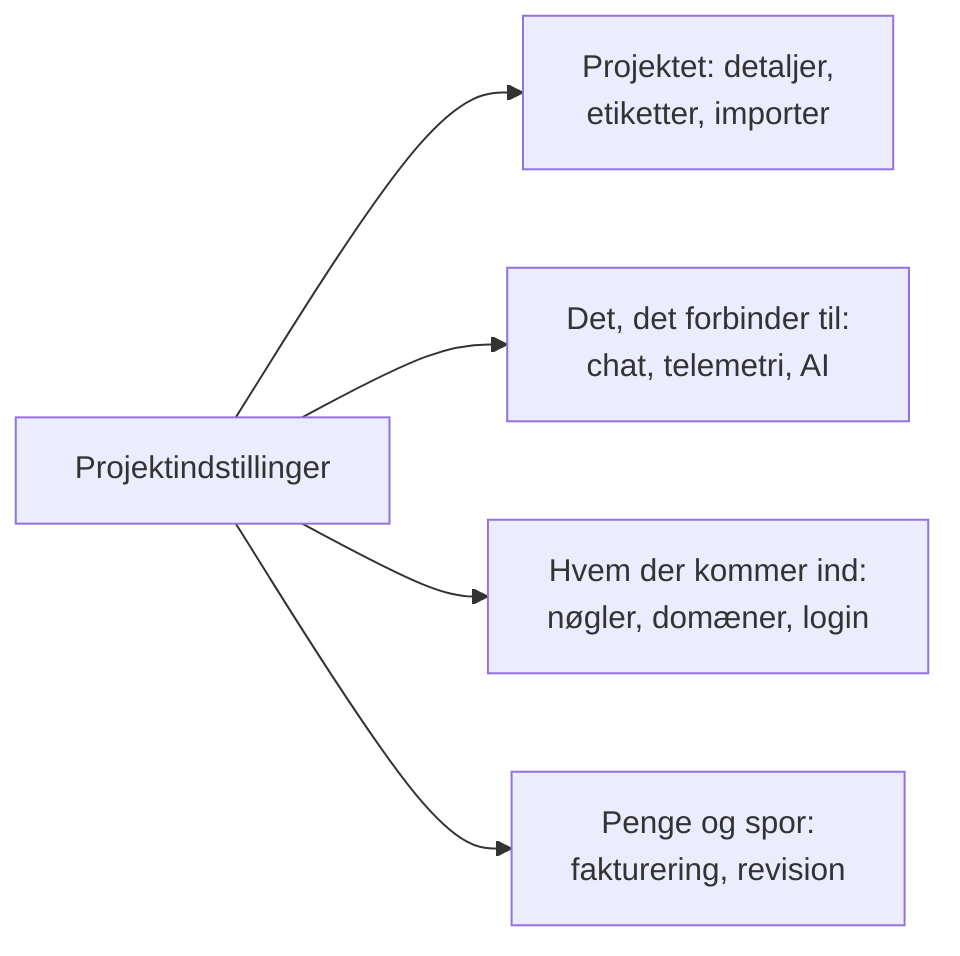

# Projektindstillinger

Projektindstillinger rummer det, der gælder for hele projektet: navnet, de værktøjer, det er forbundet til, nøglerne, hvordan folk logger ind, faktureringen og revisionssporet. Det meste sætter du op én gang og vender sjældent tilbage til. Denne side er et kort over det og dækker de indstillinger, der ikke har en side for sig selv: projektets detaljer, etiketter, funktionsflag og sletning af projektet.

:::cards
- [Find en indstilling](#find-en-indstilling): Hvad hvert afsnit i sidemenuen rummer.
- [Projektets detaljer](#projektets-detaljer): Navnet, ID'et og supportadgang.
- [Etiketter](#etiketter): Mærker til ressourcer, tilladelser og regler.
- [Slet projektet](#slet-projektet): Hvad det kræver, og hvad der forsvinder med det.
:::

## Åbn projektindstillinger

Gå til **Produkter → Indstillinger → Projektindstillinger**. Sidemenuen grupperer siderne i afsnit, og kun **Grundlæggende** er åbent fra start: klik på et afsnits titel for at åbne det. Et afsnit åbner af sig selv på enhver side i det.

## Før du går i gang

- **En rolle, der må ændre projektet.** Project Owners og Project Admins ændrer de fleste af disse indstillinger. Fakturering, notifikationskanaler og sletning af projektet kræver mere, som hvert afsnit siger.
- **I OneUptime Cloud: den plan, der omfatter en indstilling.** Nogle indstillinger kræver en plan: se [Indstillinger, der kræver en plan](/docs/configuration/billing#indstillinger-der-kræver-en-plan).

## Find en indstilling

| Afsnit | Sider | Hvor du læser mere |
| --- | --- | --- |
| **Grundlæggende** | **Projekt**, **Etiketter** | [Projektets detaljer](#projektets-detaljer), [Etiketter](#etiketter) |
| **Arbejdsområde** | **Slack**, **Microsoft Teams**, **Video Calls** | [Slack](/docs/workspace-connections/slack), [Microsoft Teams](/docs/workspace-connections/microsoft-teams), [Videoopkald](/docs/workspace-connections/video-calls) |
| **Telemetri og APM** | **Indtagelsesnøgler**, **Dataopbevaring** | [Indtagelsesnøgler](/docs/telemetry/ingestion-keys), [Dataopbevaring](/docs/telemetry/data-retention) |
| **Notifikationer** | **Notifikationsindstillinger**, **Notifikationslogs**, **Mobilapps** | [Notifikationer](#notifikationer) |
| **AI** | **AI Features**, **LLM-udbydere**, **Eksterne MCP-servere**, **AI-kreditter**, **AI-logs**, **MCP-server** | [LLM-udbydere](/docs/ai/llm-provider), [Eksterne MCP-servere](/docs/ai/external-mcp-servers), [MCP-server](/docs/ai/mcp-server), [AI SRE](/docs/ai/ai-sre#omkostningsstyring) |
| **Avanceret** | **Domæner**, **API-nøgler**, **Funktionsflag**, **Importér fra et andet værktøj** | [Egne domæner](/docs/status-pages/branding-and-domains#brugerdefinerede-domæner), [API-nøgler](/docs/permissions/index#api-nøgler), [Funktionsflag](#funktionsflag), [Skift fra Opsgenie](/docs/moving-to-oneuptime/opsgenie) og de andre flyttevejledninger |
| **Sikkerhed** | **SSO**, **SCIM** | [SSO](/docs/identity/sso), [SCIM](/docs/identity/scim) |
| **Fakturering og fakturaer** | **Fakturering**, **Brugshistorik**, **Fakturaer** | [Fakturering og forbrug](/docs/configuration/billing) |
| **Auditlogs** | **Auditlogs**, **Indstillinger**, **Eksport** | [Auditlogs](/docs/configuration/audit-logs), [Eksport af auditlog](/docs/configuration/audit-log-export) |
| **Farezone** | **Farezone** | [Slet projektet](#slet-projektet) |

**Fakturering og fakturaer** og **AI-kreditter** findes kun i OneUptime Cloud: en selvhostet installation har ingen fakturering.

## Projektets detaljer

**Projektindstillinger → Grundlæggende → Projekt** rummer to kort.

**Projektdetaljer** viser projektets navn og ID:

- **Projektnavn**: klik på **Rediger Projekt** for at omdøbe projektet. Et navn har mindst 2 tegn. Omdøbning kræver en Project Owner eller tilladelse til at redigere projektet eller administrere fakturering.
- **Projekt-ID**: kopiér det til API'et, CLI'en og Terraform, eller når du skriver til support.
- **Data Residency**: i OneUptime Cloud, hvor dit projekts data skal ligge, når OneUptime har registreret det. Kun OneUptime angiver det.

**Kundesupportadgang** afgør i OneUptime Cloud, om OneUptimes supportteam må åbne projektet. Slå **Giv OneUptime-support adgang til dette projekt** til, når du vil have hjælp: OneUptime spørger først, fordi support så kan se og ændre alt i projektet, og du klikker på **Giv support adgang**. Slå det fra, når de er færdige: det gemmes med det samme. Project Owners og Project Admins ændrer det.

## Etiketter

Etiketter er mærker, du sætter på monitorer, hændelser, statussider og andre ressourcer. De filtrerer og grupperer lister, og de begrænser, hvor langt et teams tilladelser og projektets regler rækker.

:::steps
### Åbn etiketter

Gå til **Projektindstillinger → Grundlæggende → Etiketter**.

### Opret en etiket

Klik på **Opret Mærkat**. Giv den et **Navn** og, hvis du vil, en **Beskrivelse**. **Mærkatfarve** er allerede valgt, en farve ingen etiket på siden bruger endnu: vælg en anden, hvis du foretrækker det. Klik på **Opret Mærkat** for at gemme den.
:::

I OneUptime Cloud kræver det Growth-planen at oprette og ændre etiketter. Se [Etiketter](/docs/permissions/index#labels) for, hvordan etiketter begrænser tilladelser, og [Etiket- og ejerregler](/docs/configuration/label-and-owner-rules) for at sætte etiketter på ressourcer, når de oprettes.

I en liste vises en posts etiketter under hinanden; er der flere end fire, vises de første tre med et link til resten. Overalt hvor etiketter står opført (i lister, på en posts side og i hver etiketvælger), står de i naturlig rækkefølge: etiketter, hvis navn begynder med et tal, kommer først, i rækkefølge efter tallet (`2. Team` før `10. Owner`), derefter de øvrige alfabetisk, uanset store og små bogstaver. Vil du bestemme rækkefølgen af dine etiketter, så begynd deres navne med et tal, som `1. Category` og `2. Subcategory`.

### Arkivér en etiket

For at udfase en etiket skal du arkivere den fra rækkens menu **⋯** i stedet for at slette den. Alt, der har etiketten, beholder den, og du kan stadig filtrere efter den, men ingen kan tilføje den til noget igen: Hver etiketvælger udelader den, og API'et, Terraform og MCP afviser den. Dialogen viser de regler og tilladelser, der er sat op til at bruge etiketten, og som bliver ved med at bruge den, indtil du ændrer dem. Arkiverede etiketter vises for sig, i den sammenfoldede sektion **Arkiverede etiketter**, hvor **Fjern fra arkiv** sætter en tilbage. **Slet** viser først alt, som etiketten ville blive fjernet fra, og tilbyder **Arkivér i stedet**.

## Notifikationer

**Projektindstillinger → Notifikationer** rummer, hvordan projektet sender notifikationer:

- **Notifikationsindstillinger**: kortet **Notifikationskanaler** slår SMS, telefonopkald, WhatsApp og Telegram til eller fra for projektet. Alle fire er slået fra fra start. En Project Owner, en **Billing Admin** eller en med **Manage Billing** slår dem til. Siden rummer også projektets egne mailservere under **Brugerdefinerede SMTP-konfigurationer** (se [SMTP](/docs/emails/smtp)) og dets egen Twilio-konto (se [Twilio-integration](/docs/self-hosted/twilio-integration)). I OneUptime Cloud rummer den saldoen, som disse beskeder betales fra: se [Forudbetalte saldi](/docs/configuration/billing#forudbetalte-saldi).
- **Notifikationslogs**: hver notifikation, projektet har sendt, med én fane pr. kanal: **E-mail**, **SMS**, **WhatsApp**, **Telegram**, **Webhook**, **Kald**, **Push** og **Arbejdsområde**.
- **Mobilapps**: hvor du får apps til iOS og Android. Se [Apps – Oversigt](/docs/mobile-desktop-apps/index).

## Funktionsflag

**Projektindstillinger → Avanceret → Funktionsflag** slår valgfrie funktioner til eller fra for projektet. Hver er en kontakt, der gemmes, når du slår den om. I dag rummer siden **Monitorgrupper**, slået fra i et nyt projekt: slå det til for at føje monitorgrupper til menuen Monitorer. At slå det fra sletter ingen gruppe. Se [Monitorgrupper](/docs/monitor/monitor-groups).

## Slet projektet

At slette et projekt sletter alt i det, for alle medlemmer: monitorer, hændelser, statussider, vagtopsætning og telemetri. Intet bringer det tilbage.

:::steps
### Åbn farezonen

Gå til **Projektindstillinger → Farezone**.

### Klik på Slet Projekt

Klik på **Slet Projekt**. En dialog beder dig bekræfte.

### Skriv projektets navn

Skriv navnet præcis, som det er. **Slet Projekt** forbliver låst, indtil du gør det. I OneUptime Cloud spørger dialogen også, hvorfor du forlader os: svaret er valgfrit.

### Bekræft

Klik på **Slet Projekt**. OneUptime sletter projektet og tager dig ud af det.
:::

> [!CAUTION]
> Sletning af projektet kan ikke fortrydes. Det kræver en Project Owner eller tilladelse til at slette projektet.

I OneUptime Cloud opsiger du et projekts plan ved at slette projektet: faktureringen stopper, når projektet er slettet. Et projekt, der faktureres via en cloud-markedsplads, får en sidste opkrævning for sit forbrug, og købet på markedspladsen forbliver aktivt, indtil du opsiger det dér.

## Fejlfinding

:::details Et afsnit i sidemenuen ser ud til at mangle
Alle afsnit undtagen **Grundlæggende** er foldet sammen fra start. Klik på afsnittets titel for at åbne det. På en selvhostet installation findes hverken afsnittet **Fakturering og fakturaer** eller siden **AI-kreditter**.
:::

:::details Rediger Projekt er låst
Omdøbning kræver en Project Owner eller tilladelse til at redigere projektet eller administrere fakturering. Den låste knap nævner den tilladelse, du mangler.
:::

:::details Slet Projekt forbliver låst i dialogen
Skriv projektets navn præcis, som dialogen viser det: store og små bogstaver tæller.
:::

## Næste skridt

:::cards
- [Inviter personer](/docs/permissions/inviting-people): Få dit team ind i projektet.
- [Fakturering og forbrug](/docs/configuration/billing): Din plan, betalingsmetoder, fakturaer og forbrug.
- [Auditlogs](/docs/configuration/audit-logs): Se, hvem der ændrede hvad i projektet.
- [SSO](/docs/identity/sso): Lad folk logge ind med din identitetsudbyder.
:::
