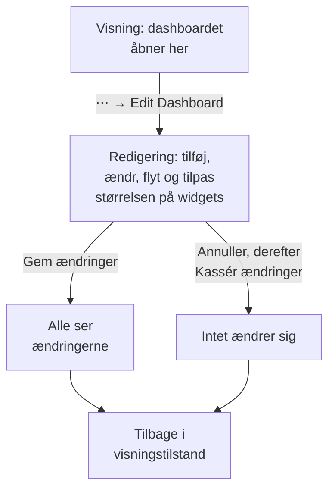

# Opret et dashboard

For at oprette et dashboard åbner du **Produkter → Dashboards** og klikker på **Opret dashboard**. Dialogboksen **Opret et dashboard** spørger, hvordan du vil starte, og derefter om et navn. **Start fra bunden** giver dig et tomt dashboard; en skabelon bygger sine widgets, og ofte sine variabler, for dig og udfylder sit navn (nummereret, som i "Kubernetes Dashboard 2", når projektet allerede har et). Klik på **Opret dashboard**, og det nye dashboard åbner. Et tomt dashboard åbner på sit lærred med en knap **Tilføj widget** til den første widget.

:::cards
- [Opret dashboardet](#opret-dashboardet): Start fra bunden eller fra en skabelon.
- [Rediger og gem](#rediger-og-gem): Intet ændrer sig for nogen, før du klikker på Gem ændringer.
- [Tilføj en widget](#tilføj-en-widget): Vælg den i kataloget, sæt den op, og sæt den på plads.
- [Zoom ind på en spids](#zoom-ind-på-en-spids): Træk hen over et diagram for at læse hele dashboardet i det øjeblik.
:::

## Før du begynder

Projektejere og -administratorer kan oprette og redigere alle dashboards. Alle andre skal have en teamtilladelse: `CreateDashboard` for at oprette dashboards og `EditDashboard` for at ændre dem. Projektmedlemmer og seere kan læse dashboards uden nogen af dem. Den, der ikke må redigere et dashboard, kan stadig åbne dets menu **⋯**, hvor **Rediger dashboard** er låst og fortæller, hvilken tilladelse der kræves.

## Opret dashboardet

:::steps
### Vælg, hvordan du starter

Åbn **Produkter → Dashboards**, og klik på **Opret dashboard**. Dialogboksen **Opret et dashboard** åbner på **Start fra bunden**, et tomt dashboard til dine egne widgets. Under den viser **Eller start fra en skabelon** seks skabeloner under **Anbefalet**.

### Vælg en skabelon

Klik på en skabelon for at se, hvad den tilføjer: dens widgets, navngivet som i **Tilføj widget**, og de variabler, du indsnævrer den med i dens værktøjslinje. For de andre vælger du en kategori ved siden af søgefeltet, eller **Alle skabeloner**, eller skriver i **Søg i skabeloner…**: hvert ord, du skriver, skal passe. Klik derefter på **Brug denne skabelon**, eller dobbeltklik på skabelonen. I søgefeltet vælger piletasterne en skabelon, og **Enter** bruger den.

### Navngiv dashboardet

En skabelons navn er udfyldt, nummereret forbi de navne, projektet allerede har. **Start fra bunden** lader det være tomt: skriv et. Beskrivelsen er valgfri, foldet sammen under **Flere felter**, og du kan tilføje den senere på dashboardets side **Oversigt**. **Tilbage** fører dig tilbage til skabelonerne, som du forlod dem.

### Opret det

Klik på **Opret dashboard**. Det nye dashboard åbner: med en skabelons widgets med det samme, eller med et tomt lærred med **Tilføj widget** på.
:::

Skabelonerne, efter den kategori, vælgeren viser dem under:

| Kategori | Skabeloner |
| --- | --- |
| Overvågning og APM | Monitor Dashboard, Metrics Dashboard, Real User Monitoring Dashboard, SLO Dashboard |
| Hændelseshåndtering | Incident Dashboard, Alert Dashboard |
| Infrastruktur | Kubernetes Dashboard, Kubernetes Cost Dashboard, Hosts Dashboard, Proxmox Dashboard, VMware Dashboard, Ceph Dashboard, Storage Array Dashboard, Docker Swarm Dashboard, Network Dashboard |

**Anbefalet** rummer Monitor Dashboard, Incident Dashboard, Alert Dashboard, Kubernetes Dashboard, Hosts Dashboard og Metrics Dashboard. En skabelon er et udgangspunkt, ikke et link: når dashboardet er oprettet, ændrer du det, som du vil. Skabelonen opdaterer det ikke senere.

## Rediger og gem

Et dashboard åbner i visningstilstand, til læsning. For at ændre det åbner du menuen **⋯** i dets værktøjslinje og vælger **Rediger dashboard**. Værktøjslinjen viser **Redigerer** ved siden af navnet og bytter tidsintervallet og de andre kontroller ud med **Tilføj widget**, **Variabler**, **Annuller** og **Gem ændringer**, med en række nedenunder til dashboardets **Standardtidsrum** og **Standard automatisk opdatering**.

Dine ændringer er kun dine, indtil du gemmer dem. Intet gemmes, mens du redigerer, så andre ser stadig dashboardet, som det var.

- **Gem ændringer** gemmer widgets, deres placeringer og størrelser, variablerne samt standardtidsrummet og den automatiske standardopdatering på én gang og går tilbage til visningstilstand. Hvis gemningen afvises, for eksempel fordi du har mistet tilladelsen i mellemtiden, bliver du i redigeringstilstand med dine ændringer, og årsagen står over gitteret.
- **Annuller** spørger først, fordi den smider dine ændringer væk: **Kassér ændringer** går tilbage til dashboardet, som det blev gemt, og **Fortsæt med at redigere** fører dig tilbage til dit arbejde.

Mens du redigerer, holder den automatiske opdatering pause, og et zoomet tidsinterval går tilbage til det interval, du valgte.

## Tilføj en widget

:::steps
### Åbn widgetkataloget

Klik på **Tilføj widget**: i værktøjslinjen, mens du redigerer, eller på lærredet i et tomt dashboard. Kataloget grupperer sine widgets efter, hvad de viser. Skriv i søgefeltet for at finde en efter navn eller formål ("error budget", "pods"), og tryk på Enter for at tilføje det første resultat.

### Vælg en widget

Klik på den. Widgetten lander på det første ledige sted i gitteret, hvor den passer, og dens indstillinger åbner.

### Angiv, hvad den viser

Indstillingsdialogen viser en **Live Preview** af widgetten over dens indstillinger, og forhåndsvisningen følger hver ændring, du laver. Vælg, hvad widgetten læser (en metrikforespørgsel, et filter, en tekst), og hvordan den ser ud, og klik så på **Færdig**.

### Sæt den på plads

Træk widgetten for at flytte den, og træk i dens kanter eller hjørner for at ændre størrelsen. Se [Widgets i gitteret](#widgets-i-gitteret).
:::

[Dashboard-widgets](/docs/dashboards/widgets) gennemgår hver widget og dens indstillinger.

## Widgets i gitteret

Lærredet er et gitter, der er tolv kolonner bredt. Widgets klikker fast i det, og siden vokser nedad, efterhånden som du tilføjer rækker. Mens du trækker en widget, viser en stiplet kontur, hvor den lander, med dens kolonne og række; mens du ændrer størrelsen på en, viser konturen dens størrelse i gitterenheder. Widgets, der er i vejen, flytter sig, så to widgets aldrig overlapper hinanden.

Hver slags widget har en mindste størrelse, så det, den tegner, forbliver læseligt: et diagram er mindst seks kolonner bredt og tre rækker højt, mens et enkelt tal passer i én celle.

For at ændre en widget senere klikker du på den, mens du redigerer. Dens indstillinger åbner igen, med to knapper mere nederst:

- **Duplicate Widget** tilføjer en kopi med de samme indstillinger på det første ledige sted.
- **Slet widget** fjerner den, når du har bekræftet.

## Tidsinterval og automatisk opdatering

I visningstilstand angiver værktøjslinjens tidsintervalvælger det vindue, som alle diagram-, tal-, log- og trace-widgets læser. Vælg en forudindstilling fra de seneste 5 minutter til de seneste 3 måneder, eller en brugerdefineret start og slutning. Dashboardet åbner på sit standardtidsrum: den seneste time, medmindre en, der redigerer det, vælger et andet.

Lister over hændelser, advarsler, overvågninger og ressourcer viser deres aktuelle tilstand, uanset tidsintervallet.

Ved siden af tidsintervallet læser menuen for automatisk opdatering hver widget igen med 5 sekunders, 10 sekunders, 30 sekunders, 1 minuts, 5 minutters eller 15 minutters mellemrum og viser en nedtælling til næste opdatering. Lad den være slået fra, mens du undersøger noget, så visningen holder sig stille. Dashboardet åbner med sin automatiske standardopdatering: slået fra, medmindre en, der redigerer det, vælger en anden.

Tidsintervalvælgeren, variablerne og den automatiske opdatering vises, så snart dashboardet har en widget.

### Dashboardets standarder

Mens du redigerer dashboardet, angiver rækken under værktøjslinjens knapper, hvad alle åbner det med: **Standardtidsrum**, en forudindstilling fra de seneste 5 minutter til de seneste 3 måneder, og **Standard automatisk opdatering**. **Gem ændringer** gemmer dem sammen med resten af dashboardet, både for dit team og for de besøgende på dets offentlige link. En brugerdefineret start og slutning kan ikke være en standard: dashboardet ville blive stående på det øjeblik for altid. Rækken vises, så snart dashboardet har en widget.

Dashboards, der er gemt før disse indstillinger, åbner på den seneste time med den automatiske opdatering, de havde. Gennem API'et og Terraform ligger begge i dashboardets `dashboardViewConfig`: `timeRange`, en forudindstilling stavet som i API-referencen, for eksempel `Past 1 Day`, og `refreshInterval`, for eksempel `1m`. Enhver anden værdi afvises.

### Dine egne valg

Det tidsinterval og den automatiske opdatering, du vælger i visningstilstand, gælder kun for dig, og din browser husker dem for hvert dashboard: en genindlæsning, en genstart af browseren eller af en vægskærm åbner dashboardet, som du forlod det. Kun en forudindstilling huskes. Et brugerdefineret interval eller en zoom varer, indtil du forlader siden, så dashboardet aldrig hænger fast i et øjeblik i fortiden.

Det første valg i hver vælger nævner dashboardets standard, som i Standard (Past 1 Day). Vælg det for at gå tilbage til standarden: din browser glemmer dit valg, og dashboardet følger igen sin standard, også når nogen ændrer den senere. Når du selv gemmer nye standarder, ser du dem med det samme.

### Zoom ind på en spids

Du behøver ikke gribe til tidsintervalvælgeren for at se på en spids. Træk hen over det interessante stykke af et linje- eller arealdiagram, og **hele dashboardet** flytter til det vindue, præcis som hvis du havde valgt det i tidsintervalvælgeren: hver widget, der bruger tidsintervallet, forespørger igen sammen med det, så du læser ét øjeblik på tværs af hele dashboardet i stedet for ét diagram i en anden skala end naboerne. Live-lister bliver ved med at vise, hvad der sker nu, som de altid gør.

**Dobbeltklik på et vilkårligt diagram** for at fortryde: dashboardet går tilbage til det interval, det havde, før du begyndte at zoome, uanset hvor mange gange du har boret dig ned. En knap **Nulstil zoom** vises ved siden af tidsintervalvælgeren, mens en zoom er aktiv, og et dobbeltklik på et dashboard, der ikke er zoomet, gør ingenting.

Et zoomet vindue ligger fast, så det holder op med at rykke fremad, mens den automatiske opdatering er slået til; det er med vilje, for et vindue, der gled væk under dig midt i en undersøgelse, ville være værre. Nulstil zoomen for at få det til at rykke igen.

Zoom virker kun i visningstilstand; i redigeringstilstand flytter og tilpasser træk i stedet widgets. Søjlediagrammer zoomer på samme måde (træk hen over søjlerne), og et dobbeltklik på et af dem nulstiller dashboardet som ethvert andet diagram. Kun et træk zoomer: et almindeligt klik på et diagram ændrer aldrig dashboardets tidsinterval. De samme bevægelser virker på diagrammerne overalt i OneUptime; se [Zoom ind på et tidsinterval](/docs/telemetry/charts-and-time-ranges).

## Fuld skærm

**⋯ → Fuld skærm** viser dashboardets widgets på hele skærmen, til en vægskærm eller et møde. Tryk på Esc for at forlade den.

## Tips til dashboards, der ældes godt

- **Ét emne pr. dashboard.** Nogle få fokuserede dashboards slår én side med alt, hvad du holder øje med.
- **Sæt den vigtigste widget øverst.** Folk læser oppefra og ned, så lad det første, de ser, besvare "er det sundt?"
- **Navngiv sektionerne med Tekst-widgets.** En kort overskrift med få rækkers mellemrum ("Latenstid", "Fejl", "Kapacitet") gør siden nem at skimme, selv fra den anden ende af rummet.
- **Brug variabler i stedet for kopier.** Hvis du er ved at bygge det samme dashboard til en anden tjeneste, så tilføj i stedet en variabel `service`. Se [Dashboard-variabler & filtre](/docs/dashboards/variables).
- **Tag en kopi før en stor ændring.** **Duplikér Dashboard**, på dashboardets side **Indstillinger**, laver en sikker kopi, som du kan afprøve dine idéer på.

## Næste trin

:::cards
- [Dashboard-widgets](/docs/dashboards/widgets): Hver widget, dens indstillinger, og hvilken du skal vælge.
- [Dashboard-variabler & filtre](/docs/dashboards/variables): Ét dashboard til hver tjeneste, vært eller kunde.
- [Deling & offentlige dashboards](/docs/dashboards/sharing): Del dashboardet uden for dit team.
- [Dashboard-konfiguration & tilladelser](/docs/dashboards/configuration): Ejere, etiketter, arkivering og hvem der må hvad.
:::
