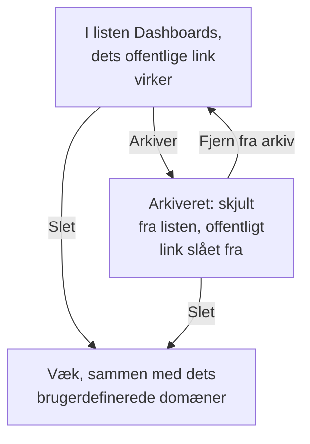

# Dashboard-konfiguration & tilladelser

Når du har et dashboard, der er værd at beholde, gennemgår denne side, hvem der må læse og ændre det, hvordan ejere og etiketter organiserer dine dashboards, og hvordan du kopierer, eksporterer, arkiverer og sletter et.

:::cards
- [Hvem der må hvad](#hvem-der-må-hvad): Tilladelserne bag hver handling, og hvem der har dem.
- [Ejere](#ejere): De brugere og teams, et dashboard tilhører.
- [Duplikering af et dashboard](#duplikering-af-et-dashboard): En sikker kopi, nummereret for dig.
- [Arkivering af et dashboard](#arkivering-af-et-dashboard): Læg et dashboard væk uden at slette det.
:::

## Hvem der må hvad

Dashboards følger dit projekts [tilladelser](/docs/permissions/index). Hver handling kræver en af disse, givet gennem et team:

| For at | Kræves |
| --- | --- |
| Læse dashboards | `ReadDashboard`, eller en projektrolle: Project Owner, Project Admin, Project Member, Viewer eller en Settings-rolle |
| Oprette dashboards | `CreateDashboard`, Project Owner eller Project Admin |
| Ændre et dashboard: dets widgets, variabler, deling og branding, og arkivere det | `EditDashboard`, Project Owner eller Project Admin |
| Slette et dashboard | `DeleteDashboard`, Project Owner eller Project Admin |
| Tilføje og fjerne ejere | Tilladelserne for dashboard-ejere, Project Owner, Project Admin eller Project Member |
| Tilføje og ændre brugerdefinerede domæner | Tilladelserne for dashboard-domæner, Project Owner, Project Admin, Project Member, Settings Admin eller Settings Member |
| Oprette ejerregler og etiketregler | Tilladelserne for regler, Project Owner eller Project Admin |

Et Project Member læser altså alle dashboards, men skal have `CreateDashboard` og `EditDashboard` for at bygge dem. Læsning, redigering og sletning kan hver især begrænses til de dashboards, et team ejer, eller til dashboards med bestemte etiketter: se [Omfang: hvor langt en tilladt rettighed rækker](/docs/permissions/index#omfang-hvor-langt-en-tilladt-rettighed-rækker).

Tildel dem på et teams side **Tilladelser**: åbn **Produkter → Teams**, og vælg teamet.

Hvem der kan se et dashboard uden for projektet, er et separat spørgsmål, som besvares på dets side **Deling**: se [Adgang til offentlige dashboards](#adgang-til-offentlige-dashboards).

## Ejere

Et dashboards **ejere** er de brugere og teams, det tilhører. Tilføj dem på dashboardets side **Ejere**, eller vælg flere dashboards i listen **Dashboards**, og tilføj ejere til dem alle på én gang.

Ejere indsnævrer adgangen, når du beder om det: en teamtilladelse, der er afgrænset til de dashboards, teamet ejer, når kun de dashboards, der har det team, eller den person, der handler, som ejer. Ejerskab i sig selv giver ingenting.

Listen **Dashboards** viser hvert dashboards ejere, og dens filter **Ejer** finder de dashboards, en person eller et team ejer.

## Etiketter

Etiketter er mærker til at organisere dashboards. Tilføj dem på dashboardets side **Oversigt**, hvor du også redigerer dets navn og beskrivelse, eller til flere dashboards på én gang fra listen **Dashboards**.

Almindelige mønstre:

- **Efter team**: `team:platform`, `team:checkout`, `team:growth`.
- **Efter miljø**: `env:prod`, `env:staging`.
- **Efter formål**: `purpose:oncall`, `purpose:exec`, `purpose:investigation`.

Filteret **Etiketter** på listen **Dashboards** er den hurtigste måde at finde et dashboard på i et projekt, der har samlet mange. Etiketter begrænser også tilladelser: en teamtilladelse, der er begrænset til bestemte etiketter, når kun de dashboards, der har en af dem.

## Ejer- og etiketregler

I stedet for at tilføje ejere og etiketter manuelt kan du lade regler gøre det. Under **Indstillinger** i sidemenuen **Dashboards** tilføjer **Ejerregler** ejere og **Etiketregler** etiketter til hvert nyt dashboard, der matcher dem: efter de etiketter, det allerede har, eller efter et mønster i dets navn eller beskrivelse. [Etiket- og ejerregler](/docs/configuration/label-and-owner-rules) forklarer, hvordan regler matcher, og hvordan du kører en på de dashboards, du allerede har.

## Adgang til offentlige dashboards

Hvem der kan se et dashboard uden for projektet, er ét valg på dets side **Deling** (også **⋯ → Del** på selve dashboardet; se [Deling & offentlige dashboards](/docs/dashboards/sharing)):

1. **Kun personer i dette projekt** (standard): dashboardet har intet offentligt link; dets offentlige adresse viser en side med "ikke fundet".
2. **Alle med linket**: alle, der har det offentlige link, kan se det uden at logge ind.
3. **Alle med linket og en adgangskode**: besøgende indtaster en adgangskode, før dashboardet vises.

Under **Yderligere indstillinger** på samme side afviser **IP-tilladelsesliste** (abonnementet Scale) anmodninger til det offentlige link fra enhver IP-adresse, der ikke står på den. Den mest aflåste offentlige opsætning er **Alle med linket og en adgangskode** med en IP-tilladelsesliste: nyttigt til partnerportaler, hvor du vil have begge lag.

## Duplikering af et dashboard

For at kopiere et dashboard åbner du det, går til dets side **Indstillinger** og klikker på **Duplikér Dashboard**. Kopiens navn udfyldes for dig: dashboardets navn, nummereret forbi de navne, projektet allerede har ("Checkout API" kopieres som "Checkout API 2", og en kopi af den som "Checkout API 3"). Ret det, hvis du vil, bekræft med **Duplikér Dashboard**, og kopien åbner. Den har dashboardets widgets, variabler, beskrivelse og etiketter. Branding og brugerdefinerede domæner bliver hos originalen, og offentlig deling starter altid slået fra, så du kan beslutte, om den skal slås til.

Det er det rette træk, når du vil forgrene en skabelon (som "vores vagtdashboard") til en kopi for en bestemt tjeneste.

## Eksport og import

Et dashboard rejser som JSON:

- **Eksportér Dashboard** på dashboardets side **Indstillinger** downloader det som en JSON-fil. For at eksportere flere vælger du dem i listen **Dashboards** og vælger **Eksportér JSON**.
- **Importér JSON** over listen **Dashboards** opretter dashboards ud fra sådan en fil, i dette projekt eller i et andet.

En eksport indeholder dashboardets egne indstillinger, herunder dets widgets og variabler. Dets ejere og etiketter udelades, og widgets, der peger på dette projekts ressourcer, for eksempel et SLO eller en datakilde, kan kræve, at de vælges igen i et andet projekt.

## Arkivering af et dashboard

Arkivér et dashboard, du ikke bruger mere, men vil beholde. Et arkiveret dashboard forsvinder fra listen **Dashboards**, og hvis det er offentligt, holder dets offentlige link op med at virke: dets URL og brugerdefinerede domæner svarer "Dashboard not found". Dets widgets, variabler, branding, domæner og offentlige indstillinger bevares alle, så når du fjerner det fra arkivet, er det præcis, som det var, offentligt link inklusive.

For at arkivere ét dashboard åbner du det, går til dets side **Indstillinger** og klikker på **Arkiver**. For at arkivere flere vælger du dem i listen **Dashboards** og vælger **Arkiver**. For at hente et tilbage åbner du **Dashboards → Avanceret → Arkiveret**, vælger det og vælger **Fjern fra arkiv**, eller du åbner det og klikker på **Fjern fra arkiv** i banneret øverst på dets sider.

Arkivering er det reversible alternativ til sletning: brug det først, når du er i tvivl.

## Sletning af et dashboard

Åbn dashboardets side **Slet**. Sletning kan ikke fortrydes: dashboardet, dets widgets og variabler og alle brugerdefinerede domæner, der er knyttet til det, fjernes. Din telemetri berøres ikke.

Hvis dashboardet er offentligt på et brugerdefineret domæne, holder adressen op med at svare, så snart du sletter det. For at blive ved med at servere adressen tilføjer du domænet til et andet dashboard, efter at du har slettet dette: et domæne tilhører ét dashboard ad gangen.

## Auditlogs

Dashboardets side **Auditlogs** viser hver ændring, der er foretaget på dashboardet, og hvem der foretog den. Auditlogs er en del af Enterprise-abonnementet og [Enterprise Edition](/docs/self-hosted/enterprise).

## Dataopbevaring og sikkerhedskopier

Dashboards udløber ikke i sig selv. De data, de viser, følger dit projekts opbevaringsindstillinger: med tidsintervallet sat til de seneste 3 måneder viser et projekt, der beholder sine logs i 15 dage, de seneste 15 dage af dem.

Hvis du selv hoster OneUptime, er en regelmæssig sikkerhedskopi af databasen nok: et dashboards konfiguration gemmes sammen med resten af dit projekt. På OneUptime Cloud klares sikkerhedskopier for dig. For at få din egen kopi eksporterer du dashboardet som JSON eller læser det gennem [OneUptime API](/docs/api-reference/api-reference).

## Næste trin

:::cards
- [Deling & offentlige dashboards](/docs/dashboards/sharing): Offentlige links, adgangskoder, IP-tilladelseslister og brugerdefinerede domæner.
- [Brugere, teams og tilladelser](/docs/permissions/index): Teams, roller, omfang og blokeringer.
- [Dashboard-variabler & filtre](/docs/dashboards/variables): Ét dashboard til hver tjeneste.
- [Dashboards – Oversigt](/docs/dashboards/index): Det store billede.
:::
