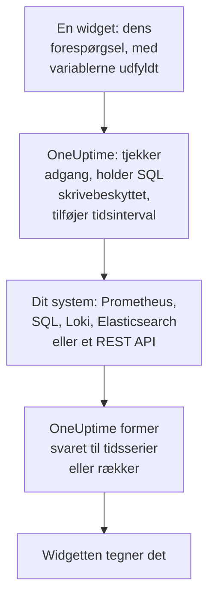

# Eksterne datakilder

En ekstern datakilde forbinder et system uden for OneUptime, for eksempel Prometheus, en SQL-database, ClickHouse, Loki, Elasticsearch eller et REST API, så dine dashboards kan vise dets data ved siden af dine egne. Du forbinder systemet én gang; derefter kører hver widget en skrivebeskyttet forespørgsel i systemets eget sprog.

:::cards
- [Forbind en datakilde](#forbind-en-datakilde): Vælg typen, og angiv så, hvor den er, og hvordan der logges ind.
- [Skriv en forespørgsel](#skriv-en-forespørgsel): PromQL, SQL, LogQL, Query DSL eller en anmodning.
- [Grænser](#grænser): De timeouts og lofter, der beskytter begge sider.
- [Sikkerhed](#sikkerhed): Skrivebeskyttede forespørgsler og loginoplysninger, der kun kan skrives.
:::

## Sådan kører en forespørgsel

Widgetten sender sin forespørgsel til OneUptime med variablerne allerede udfyldt. OneUptime kontrollerer, at du må læse datakilden, udfylder tidsintervallet og spørger dit system med de loginoplysninger, det opbevarer. Det former svaret til tidsserier eller rækker, som widgetten tegner.



## Før du begynder

- **Et abonnement, der omfatter det.** På OneUptime Cloud kræver oprettelse og ændring af datakilder abonnementet **Growth**. Sletning af en virker på alle abonnementer.
- **En tilladelse til at tilføje dem.** Projektejere og -administratorer kan tilføje datakilder; alle andre skal have `CreateDataSource`, med `EditDataSource` og `DeleteDataSource` til at ændre og fjerne dem. Alle, der kan læse projektets datakilder, også medlemmer og seere, ser deres widgets' data.
- **En skrivebeskyttet konto.** Dashboards læser kun. Forbind databaser med en konto, der kun kan læse, og HTTP-kilder med et token, der kun kan forespørge.
- **En vej ind.** Det er OneUptimes API-server, der forbinder til dit system, så den skal kunne nå det: se [Sikkerhed](#sikkerhed) for de adresser, der afvises.

## Understøttede systemer

| Type | Forespørgselssprog | Virker med |
| --- | --- | --- |
| Prometheus | PromQL | Prometheus, Thanos, Cortex, Mimir, VictoriaMetrics |
| PostgreSQL | SQL | PostgreSQL, TimescaleDB, CockroachDB |
| MySQL | SQL | MySQL, MariaDB |
| Microsoft SQL Server | T-SQL | SQL Server, Azure SQL |
| ClickHouse | SQL | ClickHouse, via dets HTTP-grænseflade |
| Grafana Loki | LogQL | Loki og Loki-kompatible endpoints |
| Elasticsearch | Query DSL (JSON) | Elasticsearch, OpenSearch |
| REST API | Anmodning (JSON) | Ethvert HTTP(S)-API, der svarer med JSON |

## Forbind en datakilde

:::steps
### Åbn datakilderne

Åbn **Produkter → Dashboards**, fold **Indstillinger** ud i sidemenuen, og klik på **Datakilder**.

### Vælg typen

Klik på **Opret Data Source**. Dialogen **Choose a Data Source Type** grupperer typerne efter, hvad de indeholder: metrikker, logs, databaser, søgning og API'er. Klik på en.

### Giv den et navn

Under **Grundlæggende oplysninger** giver du den et **Navn**, for eksempel "Produktions-Prometheus", og en **Beskrivelse**, hvis du vil.

### Angiv, hvor den er

Under **Forbindelse** får en HTTP-kilde den **URL**, den svarer på. En database får sin **Database Host**, sin **Database Port** (lad den være tom for 5432, 3306, 1433 eller 8123) og sit **Databasenavn**.

### Angiv, hvordan der logges ind

Under **Godkendelse** indtaster du et **Brugernavn** og en **Adgangskode** eller, for en HTTP-kilde, et **API-token**, der sendes som bearer-token. **Flere felter** indeholder **Custom HTTP Headers**, for eksempel `{ "X-Scope-OrgID": "tenant-1" }`, og **Additional Options**: `sslEnabled` og `sslRejectUnauthorized` til databaser og `elasticsearchIndex` til Elasticsearch, som uden den læser alle indeks (`*`).

### Test den

Klik på **Opret Data Source** og derefter på **Test** i dens række. OneUptime forbinder med de oplysninger, du har givet, og fortæller, om det virkede, eller hvad der gik galt.
:::

For at ændre en datakilde senere åbner du den fra listen. **Rediger** på **Data Source Details** ændrer alt undtagen dens hemmeligheder; **Opdater legitimationsoplysninger** erstatter adgangskoden, tokenet eller headerne og lader de felter, du lader stå tomme, være, som de var; **Test** tjekker den igen.

## Brug den i en widget

Rediger et dashboard, klik på **Tilføj widget**, og vælg en widget fra gruppen Eksterne datakilder: et **Diagram**, en **Værdi**, en **Måler** eller en **Tabel**. I dens indstillinger:

- Vælg **Data Source**, og skriv **Forespørgsel**. Editoren navngiver forespørgselssproget og viser et eksempel for typen.
- På et diagram lægger **Tilføj forespørgsel** flere forespørgsler på de samme akser, og **Legend (optional)** navngiver hver serie ud fra dens etiketter: `{{instance}} — errors` skriver seriens etiket `instance` forrest.
- På en værdi eller en måler gør **Reduce** punkterne til ét tal: den seneste værdi (standard), den første, gennemsnittet, summen, minimum eller maksimum. **Unit** tilføjer et suffiks og skalerer de kendte enheder: `Bytes` læses som 1.5 MB, `ms` som 2.4 s.
- På en tabel virker enhver skrivebeskyttet forespørgsel, og dens rækker vises, som de kommer tilbage.

## Skriv en forespørgsel

Hver type tager sit eget sprog, med de samme regler for, hvad der kommer tilbage:

- **Diagrammer, værdier og målere har brug for tidsserier.** En SQL-forespørgsel returnerer en tidskolonne med navnet `time`, `timestamp`, `date` eller `ts` og en numerisk kolonne `value` (eller dens første numeriske kolonne); alle andre kolonner bliver til serie-etiketter. Elasticsearch har brug for en aggregering `date_histogram`, og Loki for en metrikforespørgsel som `rate()` eller `count_over_time()`.
- **Tabeller viser rækker**, som forespørgslen returnerer dem: SQL-rækker, Prometheus-serier, Loki-loglinjer, Elasticsearch-hits eller objekterne ved et REST API's `rowsPath`.

:::tabs
@tab Prometheus
```text title="PromQL"
sum by (job) (rate(http_requests_total{job=~"{{job}}"}[5m]))
```
@tab SQL
```sql title="SQL"
SELECT date_trunc('minute', created_at) AS time, COUNT(*) AS value
FROM orders
WHERE created_at BETWEEN $__startTime AND $__endTime
GROUP BY 1
ORDER BY 1
```
@tab Loki
```text title="LogQL"
sum by (app) (rate({app="api"} |= "error" [5m]))
```
@tab Elasticsearch
```json title="Query DSL"
{
  "query": { "range": { "@timestamp": { "gte": "$__startTime", "lte": "$__endTime" } } },
  "aggs": {
    "over_time": {
      "date_histogram": { "field": "@timestamp", "fixed_interval": "1m" }
    }
  }
}
```
@tab REST API
```json title="Request"
{
  "path": "/api/stats?from=$__startTimeMs&to=$__endTimeMs",
  "method": "GET",
  "rowsPath": "data.items",
  "timestampField": "time",
  "valueField": "count",
  "seriesField": "service"
}
```
:::

### Tidsmakroer

Prometheus og Loki får dashboardets tidsinterval med hver anmodning, så deres forespørgsler behøver ikke mere. De andre typer placerer tidsintervallet, hvor du skriver en makro:

| Makro | Bliver til | I |
| --- | --- | --- |
| `$__startTime`, `$__endTime` | Intervallets start og slutning i UTC: `'2026-10-13 09:00:00'` i SQL, ellers ISO 8601 | SQL, Elasticsearch, REST API |
| `$__startTimeMs`, `$__endTimeMs` | Det samme, som millisekunder siden 1970 | SQL, Elasticsearch, REST API |
| `$__rangeSeconds` | Intervallets længde i sekunder | SQL |

SQL-makroer skrives i UTC, så kør dine databasesessioner i UTC, eller omregn i forespørgslen.

### Dashboard-variabler

Skriv `{{name}}` hvor som helst i en forespørgsel, så sætter widgetten variablens værdi ind der, før den sender forespørgslen. Flere værdier af en flervalgsvariabel sættes sammen med `|`, hvilket er det, en matcher med regulære udtryk i PromQL eller LogQL har brug for: `job=~"{{job}}"`. En variabel uden noget valgt lader pladsholderen stå, som den er skrevet, så fejlen nævner den. [Dashboard-variabler & filtre](/docs/dashboards/variables) viser, hvordan du tilføjer en.

## Grænser

Hver forespørgsel er afgrænset, så et dashboard med tyve widgets, der opdateres hvert minut, ikke kan overbelaste OneUptime eller dit system:

| Grænse | Værdi |
| --- | --- |
| Forbindelse | 10 sekunder |
| Kørsel af en forespørgsel | 30 sekunder |
| Punkter i et tidsseriesvar | 11.000 |
| Rækker i en tabel | 1.000 |
| Serier i ét svar | 100 |
| Svar fra en HTTP-kilde | 20 MB |

Intervalforespørgsler til Prometheus og Loki beder om omkring 250 punkter over tidsintervallet, ikke tættere end 10 sekunder og ikke længere fra hinanden end et døgn.

## Sikkerhed

- **SQL forbliver skrivebeskyttet.** En forespørgsel skal være én sætning, der starter med `SELECT`, `WITH`, `SHOW`, `EXPLAIN`, `DESCRIBE` eller `DESC`. Ord, der skriver eller ændrer en session, for eksempel `INSERT`, `UPDATE`, `DELETE`, `DROP`, `INTO` eller `SET`, afvises overalt uden for strenge og citerede navne, så sæt en kolonne, der hedder som et af dem, i anførselstegn. Skriv et anførselstegn i en streng som to anførselstegn (`''`): en omvendt skråstreg før et anførselstegn afvises. Sessioner i PostgreSQL, MySQL og ClickHouse er også skrivebeskyttede. SQL Server har ingen skrivebeskyttet session, så forbind den med et skrivebeskyttet login.
- **Loginoplysninger kan kun skrives.** **Adgangskode**, **API-token** og **Custom HTTP Headers** krypteres, når de er gemt, og API'et returnerer dem aldrig, heller ikke til dig.
- **Adresser kontrolleres.** Loopback-, link-local- (hvor cloud-metadata ligger) og andre reserverede adresser afvises overalt. Private adresser afvises på OneUptime Cloud og tillades på en selvhostet installation, medmindre `DATA_SOURCE_BLOCK_PRIVATE_ADDRESSES` er `true`: se [Adgang til privat netværk](/docs/self-hosted/private-network-access).
- **Offentlige dashboards kører dem aldrig.** Widgets fra Eksterne datakilder udelades fra et [offentligt dashboard](/docs/dashboards/sharing), forespørgsler og det hele.

## Fejlfinding

:::details Test siger, at der ikke kan oprettes forbindelse
Tjek URL'en, eller værten og porten, fra der, hvor OneUptime kører: en firewall, en privat adresse på OneUptime Cloud eller en database, der kun lytter på sin egen maskine, ser ens ud herfra. For en database, der kræver TLS, tilføjer du `{ "sslEnabled": true }` under **Additional Options**.
:::

:::details "Only read-only queries are allowed"
Forespørgslen starter ikke med `SELECT`, `WITH`, `SHOW`, `EXPLAIN`, `DESCRIBE` eller `DESC`. Send én sætning, der kun læser: en anden sætning efter et `;` afvises også, som "Only a single SQL statement is allowed per query."
:::

:::details "Query contains a keyword that is not allowed"
Et ord, der skriver, står uden for en streng, ofte som kolonnenavn, for eksempel `delete` eller `set`. Sæt det i anførselstegn, som databasen gør: `"delete"` i PostgreSQL, `[delete]` i SQL Server og i backticks i MySQL og ClickHouse.
:::

:::details Diagrammet forbliver tomt, men tabellen viser rækker
Forespørgslen returnerer rækker, men ingen tidsserier. Kald tidskolonnen `time` og tallet `value` i SQL, tilføj en aggregering `date_histogram` i Elasticsearch, eller gør en Loki-logforespørgsel til en metrikforespørgsel med `rate()` eller `count_over_time()`.
:::

:::details Nogle data mangler
Svaret ramte en [grænse](#grænser). Indsnævr tidsintervallet, filtrér forespørgslen, eller aggregér den til færre serier.
:::

## Næste trin

:::cards
- [Dashboard-widgets](/docs/dashboards/widgets): Hver widget, inklusive gruppen Eksterne datakilder.
- [Dashboard-variabler & filtre](/docs/dashboards/variables): Variabler, du kan bruge i dine forespørgsler.
- [Adgang til privat netværk](/docs/self-hosted/private-network-access): Nå systemer på et privat netværk fra en selvhostet installation.
- [Dashboard-konfiguration & tilladelser](/docs/dashboards/configuration): Hvem der må tilføje datakilder, og hvem der læser dem.
:::
