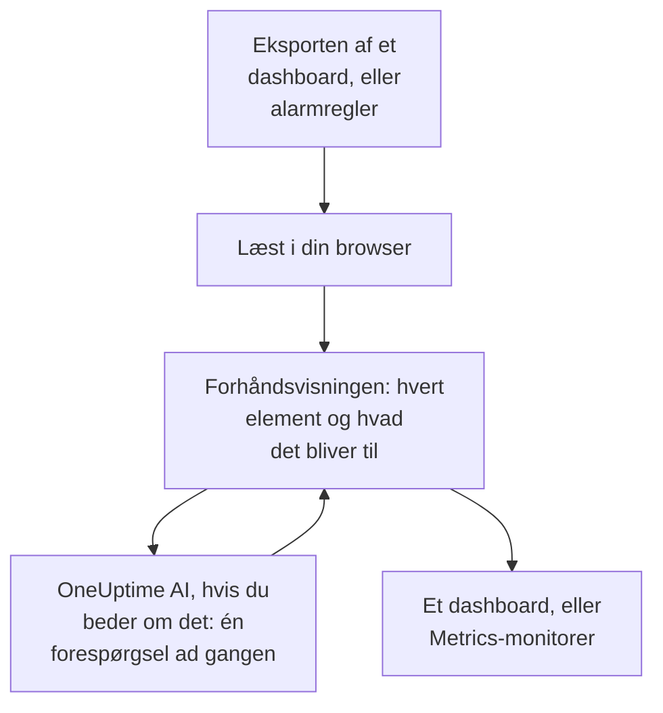

# Import fra Grafana og Datadog

Hent et dashboard, du har bygget i Grafana eller Datadog, eller de alarmregler, du har skrevet til Prometheus, Grafana eller Datadog, ind i OneUptime. Du indsætter eller uploader filen, ser hvad hvert panel og hver regel bliver til, og først derefter opretter du dashboardet eller monitorerne.

:::cards
- [Importér et dashboard](#importér-et-dashboard): JSON-modellen fra et Grafana-dashboard eller eksporten af et Datadog-dashboard.
- [Importér alarmregler](#importér-alarmregler): Prometheus-regelfiler, Grafana-alarmregler og Datadog-monitorer.
- [Sådan omdannes hvert element](#sådan-omdannes-hvert-element): Præcist, omtrentligt eller slet ikke, og hvorfor.
- [Omdan en forespørgsel med OneUptime AI](#omdan-en-forespørgsel-med-oneuptime-ai): Til en forespørgsel, som ingen regel omdanner.
:::

## Sådan foregår en import

OneUptime læser filen i din browser og omdanner hvert panel, hver widget, hver variabel og hver regel for sig. Forhåndsvisningen viser dem alle med det, hver af dem bliver til. Intet oprettes, før du vælger at oprette det, og så oprettes det med dine egne tilladelser, sådan som dashboard- og monitorformularerne opretter det.

## Før du begynder

- De importerede widgets og monitorer læser dette projekts egne metrikker med PromQL. Send dem med Prometheus remote write, OpenTelemetry eller Datadog Agent, så beholder de de navne, de har der.
- At importere et dashboard kræver en rolle, der må oprette dashboards, og at importere alarmregler en rolle, der må oprette monitorer.
- En fil må fylde op til 10 MB, og op til 500 af dens paneler eller regler læses.

## Importér et dashboard

:::steps
### Åbn dashboardimporten

Åbn **Produkter → Dashboards**, og derefter **Flere indstillinger → Import from Grafana or Datadog**.

### Indsæt dashboardet

Kopiér JSON-modellen fra dashboardets indstillinger i Grafana. Eksportér dashboardets JSON i Datadog. Indsæt det, eller vælg **Upload a File**, og vælg derefter **Forhåndsvisning**.

### Opret dashboardet

Tjek hvad hvert panel og hver variabel bliver til, giv dashboardet et navn, og vælg **Opret dashboard**. Det nye dashboard åbnes.
:::

Grafanas PromQL beholdes, som det er skrevet: OneUptime udfylder `$__interval`, `$__rate_interval` og `$__range`, som Grafana gør, og en variabel på All matcher alle værdier. En Datadog-forespørgsel bliver til PromQL over de metrikker, Datadog Agent har sendt: `avg:system.cpu.user{host:web-1}` læser `system_cpu_user{host="web-1"}`.

## Importér alarmregler

:::steps
### Åbn alarmimporten

Åbn **Produkter → Monitorer**, og derefter **Flere indstillinger → Import Alerts**.

### Indsæt reglerne

Indsæt en Prometheus-regelfil eller en PrometheusRule-ressource, Grafanas eksport af dets alarmregler eller Datadog-monitorer eksporteret som JSON, og vælg derefter **Forhåndsvisning**.

### Opret monitorerne

Fjern fluebenet ved de regler, du ikke vil have, vælg under **When a rule fires**, hvad en udløst regel åbner, og vælg **Opret monitorer**.
:::

Hver regel bliver til en Metrics-monitor med én PromQL-forespørgsel, reglens betingelse og dens tidsvindue. Den åbner en alarm, eller en hændelse, for hver serie, der overskrider grænsen, og løser den, når serien kommer sig. Titel og beskrivelse kommer fra reglens resumé eller besked, med seriens etiketter udfyldt.

## Sådan omdannes hvert element

| Status | Hvad den betyder |
| --- | --- |
| **Converted exactly** | Det læser de samme data og viser dem på samme måde. |
| **Converted approximately** | Det oprettes, og dets noter siger, hvad der er anderledes. |
| **Not converted** | Der oprettes intet for det, og dets noter siger hvorfor. |

Optageregler, alarmregler over logs, Datadog-widgets, der læser logs, traces eller hændelser, og Datadogs anomali-, afviger- og prognosemonitorer omdannes ikke.

## Omdan en forespørgsel med OneUptime AI

En forespørgsel, som ingen regel omdanner, viser **Convert with OneUptime AI**, som kræver, at AI er slået til for projektet. Kun den forespørgsel, med navnene på dashboardets variabler, sendes til dit projekts AI-udbyder. Svaret kontrolleres som enhver forespørgsel og vises for dig: vælg **Use This Query** for at bruge det. Intet oprettes, før du opretter dashboardet eller monitorerne.

## Næste skridt

:::cards
- [Dashboard-widgets](/docs/dashboards/widgets): Ændr, hvad en importeret widget viser.
- [Dashboard-variabler & filtre](/docs/dashboards/variables): De variabler, en import har oprettet.
- [Metrik-monitor](/docs/monitor/metrics-monitor): De monitorer, en import har oprettet.
- [PromQL](/docs/telemetry/promql): Det sprog, de importerede widgets og monitorer læser.
:::
