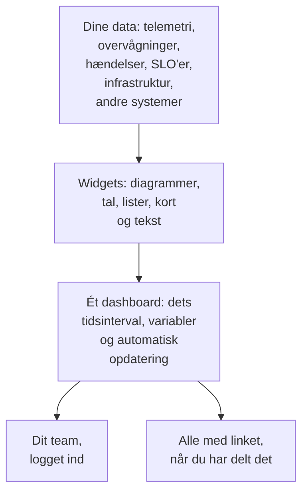

# Dashboards – Oversigt

Et dashboard er én side med widgets, som du selv arrangerer: diagrammer over dine metrikker, logs og traces, lister over hændelser, advarsler og overvågninger, dine SLO'er og din infrastruktur, ja endda data fra systemer uden for OneUptime. Byg et til vagtskærmen, til et teams morgentjek eller som en side til dine kunder, og del det med dit projekt eller med alle, der har linket.

:::cards
- [Sådan fungerer et dashboard](#sådan-fungerer-et-dashboard): Hvor dataene kommer fra, og hvem der ser dem.
- [Find dine dashboards](#find-dine-dashboards): Listen Dashboards og hvert dashboards egne sider.
- [Byg dit første dashboard](#byg-dit-første-dashboard): Fra en skabelon til en delt side i fem trin.
- [Et eksempel: et vagtdashboard](#et-eksempel-et-vagtdashboard): Én side, der virker for alle tjenester.
:::

## Sådan fungerer et dashboard

Hver widget læser fra én kilde, inden for dashboardets tidsinterval og filtreret af dets variabler. Alle, der åbner dashboardet, ser de samme widgets: dit team, når det logger ind, og besøgende via det offentlige link, når du har delt det.

| Begreb | Hvad det betyder |
| --- | --- |
| Dashboard | Én side: et navn, et gitter af widgets, et tidsinterval, variabler og en indstilling for automatisk opdatering. |
| Widget | Én flise i gitteret: et diagram, et tal, en liste, et kort, et ur eller en tekstblok. |
| Variabel | En vælger i værktøjslinjen, der indsnævrer hver widget, som understøtter den, til én tjeneste, vært eller kunde. |
| Tidsinterval | Det vindue, som alle diagrammer og tal læser. Et dashboard åbner på sin standard, den seneste time, medmindre en, der redigerer det, vælger en anden, og hver seer kan vælge sit eget. |
| Automatisk opdatering | Hvor ofte widgets læser deres data igen: slået fra, eller fra hvert 5. sekund til hvert 15. minut. |
| Visning og redigering | Et dashboard åbner til læsning. Redigering er et særskilt trin, der slutter med, at du gemmer eller kasserer dine ændringer. |

## Hvad dashboards er gode til

- **En "er alt i orden?"-side** til vagthavende, et teams standup eller en skærm på væggen.
- **At se sammenhænge**: en CPU-spids ved siden af en stigende latenstid og en åben hændelse er tydelig på én side, og nem at overse fordelt på tre.
- **Undersøgelser**: læg de diagrammer, du hele tiden åbner igen, side om side, og træk hen over en spids for at læse alle widgets i det øjeblik.
- **Deling uden for teamet**: en ydeevneside til en kunde eller partner, beskyttet af en adgangskode eller en IP-tilladelsesliste, hvis du vil.

## Find dine dashboards

Åbn **Produkter → Dashboards**. Listen **Dashboards** viser projektets dashboards med deres beskrivelser, etiketter og ejere. Søg efter navn eller beskrivelse, indsnævr listen med filtrene **Ejer** og **Etiketter**, eller vælg flere dashboards for at ændre deres etiketter eller ejere, arkivere dem eller eksportere dem som JSON.

Listens sidemenu har de sider, der passer på alle dine dashboards:

| Side | Hvad du gør der |
| --- | --- |
| **Dashboards** | Projektets dashboards. Opret et, eller hent dashboards ind med **Importér JSON**. |
| **Indstillinger → Ejerregler** | Tilføj automatisk ejere til nye dashboards. |
| **Indstillinger → Etiketregler** | Tilføj automatisk etiketter til nye dashboards. |
| **Indstillinger → Datakilder** | Forbind Prometheus, SQL-databaser, ClickHouse, Loki, Elasticsearch eller et REST API. |
| **Avanceret → Arkiveret** | Dashboards, du har arkiveret. Fjern dem fra arkivet her. |

Åbn et dashboard, og dets egen sidemenu har disse sider. Alle sektioner undtagen **Grundlæggende** starter sammenfoldet: klik på titlen for at åbne den.

| Side | Hvad du gør der |
| --- | --- |
| **Dashboard** | Selve dashboardet. Læs det, eller rediger det fra dets **⋯**-menu. |
| **Oversigt** | Dets navn, beskrivelse og etiketter. |
| **Deling** | Hvem der kan se det, dets offentlige link og en IP-tilladelsesliste under Yderligere indstillinger. |
| **Ejere** | De brugere og teams, der ejer det. |
| **Branding** | Sidetitel, beskrivelse, logo, tema og favicon for det offentlige dashboard. |
| **Brugerdefinerede domæner** | Host det offentlige dashboard på dit eget domæne. |
| **Indstillinger** | Duplikér, eksportér eller arkivér dashboardet. |
| **Auditlogs** | Hver ændring, der er foretaget på dashboardet, og hvem der foretog den. |
| **Slet** | Slet dashboardet for altid. |

## Byg dit første dashboard

:::steps
1. **Opret** — vælg en skabelon, eller **Start fra bunden**. En skabelon udfylder navnet og åbner med sine widgets; et dashboard fra bunden åbner uden indhold, med **Tilføj widget** på lærredet.
2. **Tilføj widgets** — vælg en widget i kataloget, angiv i dens indstillinger, hvad den læser, og træk den så på plads og tilpas størrelsen.
3. **Tilføj variabler, hvis du har brug for dem** — en variabel `service` lader for eksempel ét dashboard vise en hvilken som helst tjeneste.
4. **Gem** — klik på **Gem ændringer**. Intet, du ændrer under redigeringen, bevares, før du gør det.
5. **(Valgfrit) Del offentligt** — vælg **⋯ → Del** på dashboardet, og vælg, hvem der kan se det: alle med linket, eller alle med linket og en adgangskode.
:::

[Opret et dashboard](/docs/dashboards/authoring) gennemgår hvert trin.

## Et eksempel: et vagtdashboard

Målet: én side for checkout-tjenesten med dens latenstid, fejlrate, åbne hændelser og nyeste logs, som også virker for alle andre tjenester.

1. Klik på **Opret dashboard**, vælg **Start fra bunden**, og giv dashboardet navnet "Checkout-vagt".
2. Klik på **Tilføj widget**, og tilføj et **Diagram** over din metrik for anmodningernes latenstid, aggregeret som P95.
3. Ved siden af tilføjer du en **Værdi** for din fejlrate, med en advarselstærskel på 1 og en kritisk tærskel på 5.
4. Nedenunder tilføjer du en **Hændelsesliste** filtreret på uløste hændelser, og en **Logstrøm** med tjenestens logs.
5. Åbn **Variabler**, tilføj en variabel med navnet `service` med kilden Telemetry Attribute og attributnøglen `service.name`, og giv den standardværdien `checkout`.
6. Klik på **Gem ændringer**. Vælg `payments` i værktøjslinjens vælger `service`: diagrammet, værdien og logstrømmen skifter til tjenesten payments, og hændelseslisten bliver ved med at vise alle uløste hændelser.

## Sådan passer dashboards ind i resten af OneUptime

- **Overvågninger og telemetri** er der, hvor dataene kommer fra. Alle metrikker, logs og traces, du sender, kan komme på en widget.
- **Hændelser og advarsler** vises i widgets **Hændelsesliste** og **Advarselsliste**. Et dashboard viser dem kun: du arbejder med dem på deres egne sider.
- **Statussider** fortæller dine kunder, om din tjeneste kører. Dashboards viser i detaljer, hvordan den opfører sig. De to arbejder side om side.
- **Workflows** handler på det, der sker. Dashboards er der, hvor du læser det.

## Næste trin

:::cards
- [Opret et dashboard](/docs/dashboards/authoring): Opret et dashboard, rediger det, og gem dine ændringer.
- [Dashboard-widgets](/docs/dashboards/widgets): Hver widget, og hvilken du skal vælge.
- [Dashboard-variabler & filtre](/docs/dashboards/variables): Ét dashboard til hver tjeneste, vært eller kunde.
- [Deling & offentlige dashboards](/docs/dashboards/sharing): Offentlige links, adgangskoder, IP-tilladelseslister og brugerdefinerede domæner.
:::
