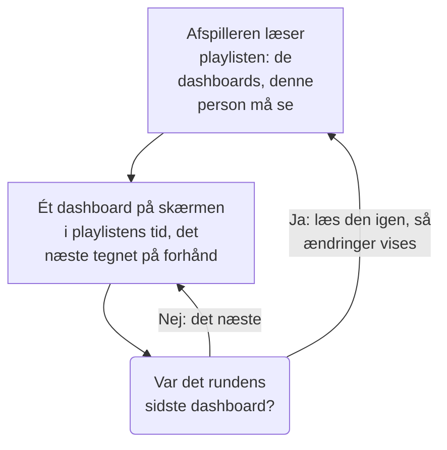

# Dashboard-playlister

En playliste viser en række dashboards efter hinanden på en skærm, som ingen rører, for eksempel en NOC-væg eller et teams tv: hvert dashboard i den tid, du vælger, igen og igen, indtil nogen sætter den på pause. Lav playlisten én gang, åbn dens afspiller på skærmen, og lad den køre.

:::cards
- [Sådan afspilles en playliste](#sådan-afspilles-en-playliste): Rækkefølgen, turene og hvad hvert dashboard viser.
- [Opret en playliste](#opret-en-playliste): Et navn, dens dashboards i rækkefølge og hvor længe hvert vises.
- [Afspil den på en skærm](#afspil-den-på-en-skærm): Afspillerens bjælke, dens knapper og dens taster.
- [Hvem ser hvad](#hvem-ser-hvad): Tilladelserne, og de dashboards en person ikke må læse.
:::

## Sådan afspilles en playliste

Afspilleren viser playlistens første dashboard, derefter det næste, når dets tid er gået, og starter forfra med det første efter det sidste. Hvert dashboard åbner, som dets redaktører har gemt det: med sit eget standardtidsinterval, sin egen automatiske opdatering og sine egne variabler, uanset hvad afspillerens adresse siger. Mens ét dashboard er på skærmen, tegner afspilleren det næste uden for synsfeltet, så skærmen aldrig bliver tom mellem to af dem.

En playliste nævner sine dashboards og kopierer dem aldrig: en ændring, som en redaktør gemmer i et dashboard, er på skærmen, næste gang det er dets tur. Afspilleren læser playlisten igen før hver runde, så et dashboard, der er tilføjet, flyttet eller fjernet, vises inden for en runde uden at genindlæse skærmen; mislykkes den læsning, afspiller skærmen den runde, den har, igen.

## Opret en playliste

:::steps
### Åbn Playlister
Åbn **Produkter → Dashboards**, og derefter **Playlister** i sidemenuen. Listen viser, hvor mange dashboards hver playliste har, og hvor længe hvert vises, med **Afspil** på hver række.

### Giv den et navn
Klik på **Opret Playliste**, og giv den et **Navn**, der siger, hvor den afspilles, for eksempel "NOC-væg".

### Tilføj dens dashboards
Under **Dashboards** vælger du hvert dashboard i **Tilføj et dashboard**, i den rækkefølge skærmen viser dem. Knapperne på et dashboards række flytter det op eller ned eller fjerner det. Arkiverede dashboards tilbydes ikke.

### Vælg, hvor længe hvert vises
**Vis hvert dashboard i** starter på et minut; vælg en tid fra 15 sekunder til en time. Klik på **Opret Playliste**.
:::

Playlistens side viser dens dashboards i rækkefølge, hvor længe hvert vises, og **Afspillerlink**. **Rediger playliste** ændrer navnet, dashboards, deres rækkefølge og tiden. **Slet Dashboard-playliste**, nederst på siden, sletter playlisten og aldrig dens dashboards.

Gennem API'et og Terraform er en playliste et `name`, dens `dashboards` som en liste som `[{"dashboardId": "<id>"}]` i den rækkefølge, de vises, højst 100, og `intervalInSeconds`, et vilkårligt helt antal sekunder fra 10 til 86400 (et døgn). En værdi uden for disse afvises med en besked om, hvad der er galt.

## Afspil den på en skærm

Klik på **Afspil** på playlistens række eller på dens side. Afspilleren fylder browservinduet, oven på resten af OneUptime; **Fuld skærm** fylder hele skærmen. For at starte en skærm af sig selv åbner du **Afspillerlink** på den og gemmer et bogmærke: linket åbner afspilleren med det samme.

Afspillerens bjælke nævner dashboardet på skærmen, playlisten, hvor runden er ("2 af 5"), og det dashboard, der kommer bagefter. En linje under bjælken fyldes, mens et dashboard har sin tur. Bjælkens knapper går til det forrige dashboard, sætter på pause eller afspiller og går til det næste; på en computer gør disse taster det samme:

| Taster | Hvad den gør |
| --- | --- |
| `Space` | **Sæt på pause eller afspil**. På pause bliver dashboardet på skærmen, og bjælken viser **Sat på pause**. |
| `Right Arrow` | **Næste dashboard**. |
| `Left Arrow` | **Forrige dashboard**. |
| `F` | **Fuld skærm**, eller ud af den igen. |
| `Esc` | **Forlad afspilleren**, tilbage til playlistens side. I fuld skærm forlader det første `Esc` kun fuld skærm. |
| `?` | **Vis tastaturgenveje**. |

Et dashboard, du går til, det næste eller det forrige, får en hel tur. På en side, der læses fra højre mod venstre, for eksempel på persisk, bytter pilene om: `Left Arrow` går til det næste dashboard. Mens den afspiller, holder afspilleren skærmen vågen, hvor browseren tillader det.

## Hvem ser hvad

Playlister har deres egne tilladelser, som gives gennem et team ligesom dashboards' egne:

| For at | Kræves |
| --- | --- |
| Se og afspille playlister | `ReadDashboardPlaylist`, eller en projektrolle: Project Owner, Project Admin, Project Member, Viewer eller en Settings-rolle |
| Oprette playlister | `CreateDashboardPlaylist`, Project Owner eller Project Admin |
| Ændre en playliste: dens navn, dashboards og tid | `EditDashboardPlaylist`, Project Owner eller Project Admin |
| Slette en playliste | `DeleteDashboardPlaylist`, Project Owner eller Project Admin |

En playliste viser aldrig nogen et dashboard, de ikke må læse. Afspilleren afspiller kun de dashboards, som den person, der er logget ind på skærmen, må læse, og som ikke er arkiveret, og springer resten over: et slettet dashboard, et arkiveret eller et, som personens tilladelser holder dem fra. Playlistens side siger, hvorfor den springer hvert af dem over. Når en playliste gemmes, beholder den de dashboards, som redaktøren ikke selv kan se, så intet går tabt, som en anden har lagt i den.

| Når afspilleren finder | Viser den |
| --- | --- |
| Dashboards, den må vise | Hvert på skift. |
| Intet dashboard, den må vise | **Intet at vise endnu**, og den kigger igen hvert minut. |
| Playlisten slettet, eller ikke personens at læse | **Playlisten blev ikke fundet**. |
| En læsning, der mislykkedes | **Playlisten kunne ikke indlæses**, og den prøver igen hvert minut, eller ved **Prøv igen**. |

> [!NOTE]
> Afspilleren er til en person, der er logget ind på OneUptime. For at køre en playliste på en skærm skal du logge ind på den skærm med en konto, der må læse playlisten og dens dashboards, for eksempel et teammedlem med rollen Viewer.

## Næste trin

:::cards
- [Opret et dashboard](/docs/dashboards/authoring): Byg de dashboards, en playliste viser.
- [Dashboard-variabler & filtre](/docs/dashboards/variables): Det gemte valg, hvert dashboard åbner med.
- [Deling & offentlige dashboards](/docs/dashboards/sharing): Vis ét dashboard til folk, der ikke logger ind.
- [Dashboard-konfiguration & tilladelser](/docs/dashboards/configuration): Ejere, etiketter og hvem der må læse et dashboard.
:::
