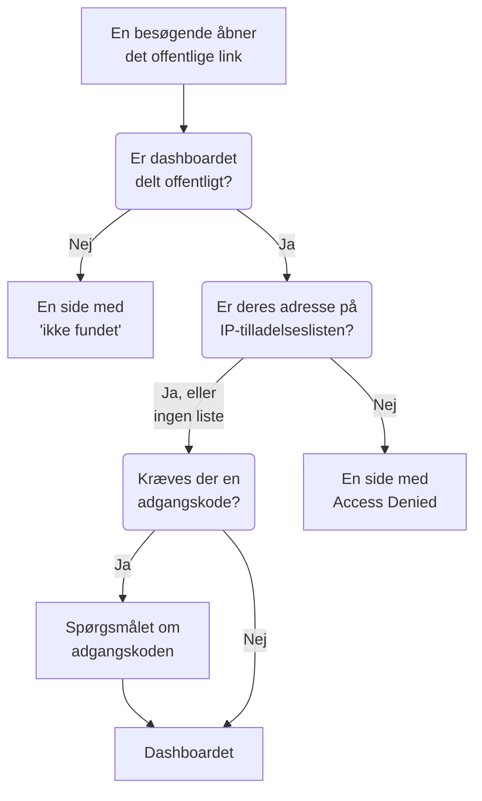

# Deling & offentlige dashboards

Som standard er et dashboard privat for dit projekt: kun personer, der logger ind i dit projekt, kan se det. Du kan også dele det via et offentligt link, beskytte linket med en adgangskode, begrænse det til bestemte IP-adresser og hoste det på dit eget domæne. Denne side dækker alle fire.

:::cards
- [Hvem der kan se et dashboard](#hvem-der-kan-se-et-dashboard): Ét valg ud af tre, med det abonnement, hvert valg kræver.
- [Deling med en adgangskode](#deling-med-en-adgangskode): Del linket, og derefter adgangskoden, med de personer, der skal se det.
- [IP-tilladelsesliste](#ip-tilladelsesliste): Åbn det offentlige link kun for dit kontor eller din VPN.
- [Brugerdefinerede domæner](#brugerdefinerede-domæner): Server dashboardet på dit eget domæne, med et gratis certifikat.
:::

## Hvad en besøgende kommer igennem

En besøgende, der åbner et dashboards offentlige link, møder hver af disse kontroller efter tur. Projektmedlemmer, der logger ind i OneUptime, ser dashboardet inde i produktet, uanset hvad du vælger her.



## Hvem der kan se et dashboard

Åbn dashboardet, og vælg **⋯ → Del**, eller åbn **Deling** i dashboardets sidemenu. Kortet **Hvem der kan se dette dashboard** er ét valg:

- **Kun personer i dette projekt** (standard): medlemmer ser dashboardet, når de logger ind i OneUptime. Det har intet offentligt link: dets offentlige adresse viser den samme side med "ikke fundet" som en adresse uden dashboard, og intet om dashboardet, ikke engang dets navn.
- **Alle med linket**: dashboardet er offentligt. Alle, der har linket, kan se det uden at logge ind.
- **Alle med linket og en adgangskode**: besøgende åbner linket og indtaster derefter én adgangskode, som du deler med dem. Ingen behøver en konto.

Når du vælger en mulighed, bliver du bedt om at bekræfte med en forklaring af, hvad der ændrer sig for besøgende, og derefter træder den i kraft med det samme. Vælger du **Alle med linket og en adgangskode**, beder den samme dialog om adgangskoden, når dashboardet ikke har nogen; så længe det er valget, erstatter **Skift adgangskode** den. Så længe dashboardet er offentligt, står de adresser, besøgende åbner det på, under valget: først dets brugerdefinerede domæner, derefter dets offentlige link, hver med **Kopiér link**. Et brugerdefineret domæne, der ikke er live endnu, er markeret med **Ikke live endnu**, med årsagen.

Inden for projektet styrer ejere og etiketter, hvem der ser hvad: se [Dashboard-konfiguration & tilladelser](/docs/dashboards/configuration). Den, der kan se dashboardet, men ikke redigere det, ser valget og kan kopiere det offentlige link, men kan ikke ændre det.

På OneUptime Cloud kræver deling af et dashboard abonnementet **Growth**: på et lavere abonnement viser de to offentlige valg det abonnement, de kræver, og kan ikke vælges. At gøre et dashboard privat igen (**Kun personer i dette projekt**) virker på alle abonnementer, så et dashboard, der stod offentligt, da en prøveperiode sluttede, eller efter et skift til et lavere abonnement, altid kan holde op med at være delt; dialogen siger, at det kræver **Growth** at dele det igen. Skift mellem **Alle med linket** og **Alle med linket og en adgangskode**, og ændring af adgangskoden, virker på alle abonnementer. Et dashboard, der oprettes via API'et eller Terraform, er underlagt de samme abonnementer: oprettet offentligt kræver det **Growth**, og oprettet med en IP-tilladelsesliste **Scale**.

Valget gemmes i tre kolonner, som API'et og Terraform læser og skriver som før: `isPublicDashboard`, `enableMasterPassword` og `masterPassword`. Kun et offentligt dashboard har et offentligt link, og dets besøgende bliver bedt om adgangskoden, når `enableMasterPassword` er slået til. Et offentligt dashboard med `enableMasterPassword` slået til, men uden en angivet adgangskode, lukker ingen ind via sit offentlige link: siden **Deling** viser det som **Alle med linket og en adgangskode**, siger, at ingen kan åbne linket endnu, og tilbyder **Angiv adgangskode**. Når du vælger **Kun personer i dette projekt**, slås `enableMasterPassword` også fra, og adgangskoden bevares, så en ny deling med adgangskode kan genbruge den.

## Offentlige dashboards

Et offentligt dashboard:

- Åbner altid til læsning. Besøgende kan ikke redigere det og ser aldrig dets redigeringskontroller.
- Indeholder de variabler, du har tilføjet. Besøgende vælger i de samme vælgere, som dit team bruger, og kan ændre tidsintervallet, zoome, slå automatisk opdatering til og gå i fuld skærm. Det åbner med dashboardets standardtidsrum og automatiske standardopdatering, og hver besøgendes browser husker vedkommendes egne valg.
- Lader besøgende [sortere dets lister og tabeller](/docs/dashboards/widgets#sortering-af-lister-og-tabeller) ved at klikke på en kolonneoverskrift, sådan som dit team gør. Hver besøgendes browser husker deres egen sortering, og OneUptime sorterer selv hele listen, altid kun efter en af widgettens egne kolonner.
- Bruger den branding, du angiver på dashboardets side **Branding**: sidetitel, beskrivelse, logo, tema, favicon.
- Lader hver besøgende skifte mellem det lyse og det mørke dashboard med en sol- eller måneknap i dets værktøjslinje; [Tema](#tema) forklarer hvordan.

Behandl deling af et dashboard som udgivelse af en webside. Alle widgets på det bliver læsbare for alle med linket. Se, hvad der er på lærredet, før du deler det.

Hver widget offentliggør kun det, den tegner, og kun for de ressourcer, den er peget mod. En SLO-widget offentliggør for eksempel det SLO's nøgletal, men aldrig dets definition: se [SLO](/docs/dashboards/widgets#slo). Widgets med en ekstern **Data Source** er undtagelsen: de fjernes helt fra et offentligt dashboard i stedet for at blive gengivet, fordi deres konfiguration er selve forespørgslen. Nogle få andre widgets kan ikke vises uden en indlogget session og skriver det på deres plads: [På et offentligt dashboard](/docs/dashboards/widgets#på-et-offentligt-dashboard) viser hvilke.

## Deling med en adgangskode

Vælg **Alle med linket og en adgangskode**, og indtast adgangskoden i dialogen. Besøgende ser et spørgsmål om adgangskoden, før dashboardet vises. Spørgsmålet viser dashboardets navn, sidetitel og favicon, i dashboardets tema, og intet andet: dets beskrivelse, logo og widgets vises, når adgangskoden er indtastet. Adgangskoden gemmes som en hash: ingen kan læse den tilbage. En ny adgangskode virker med det samme; de, der har indtastet den gamle, kan blive ved med at se dashboardet i op til 7 dage.

Brug en adgangskode, når:

- Du vil dele med en partner eller kunde, men ikke vil have, at URL'en er brugbar, hvis den slipper ud.
- Dashboardet er "halvoffentligt": åbent nok til, at du ikke vil invitere hver seer som teammedlem, men ikke åbent nok til at lægge det på det åbne internet.

For en stærkere adgangskontrol (separate konti pr. seer, et revisionsspor over, hvem der så hvad) holder du dashboardet på **Kun personer i dette projekt** og inviterer i stedet seerne som skrivebeskyttede teammedlemmer.

## IP-tilladelsesliste

Under **Yderligere indstillinger** på siden **Deling** begrænser sektionen **IP-tilladelsesliste** (kolonnen `ipWhitelist`) det offentlige link til de IP-adresser eller IPv4-intervaller, du angiver, én pr. linje, for eksempel `203.0.113.7` eller `10.0.0.0/8`. Den gælder med eller uden adgangskoden; projektmedlemmer, der logger ind, påvirkes ikke. Lad den være tom for at tillade alle adresser. Den gemmes for sig, adskilt fra valget, og at ændre den kræver abonnementet **Scale** på OneUptime Cloud; at tømme den virker på alle abonnementer. Så længe en liste gælder, viser den sammenfoldede overskrift for **Yderligere indstillinger** **IP-tilladelsesliste** med antallet af poster, den indeholder. Ved selvhosting er det en del af Enterprise Edition at ændre den: på Community Edition gælder en liste, der allerede er angivet, fortsat og kan kun fjernes.

Brug den, når:

- Dashboardet kun skal kunne nås fra dit kontor eller din VPN.
- En leverandørportal kun skal kunne nås fra deres kendte IP'er.
- Du vil have ekstra beskyttelse oven på en adgangskode.

Anmodninger fra enhver anden IP afvises med en side med **Access Denied**, der intet viser om dashboardet: hverken dets navn, dets branding eller dets spørgsmål om adgangskoden. En linje, der hverken er en IP-adresse eller et IPv4-interval, afvises, når du gemmer, fordi serveren ville springe den over.

## Brugerdefinerede domæner

Fra start serveres et offentligt dashboard på sit offentlige link, på OneUptimes egen adresse. For at hoste det på dit eget underdomæne som `dashboard.acme.com` åbner du **Branding → Brugerdefinerede domæner** i dashboardets sidemenu. Det virker præcis som en statussides side **Brugerdefinerede domæner**.

Kortet hedder **Brugerdefinerede domæner** og fortæller, hvad du skal gøre: peg hvert domænes CNAME-post på din installations CNAME-post til dashboards, så udsteder OneUptime domænets SSL-certifikat og fornyer det for dig. Tabellen har to kolonner, **Domæne** og **Status**.

At lægge dashboardet på dit eget domæne tager tre trin, og kun de to første er dine:

1. **Tilføj domænet**: et underdomæne og et af dine bekræftede domæner.
2. **Tilføj dets CNAME-post** hos din DNS-udbyder. Dialogen **DNS-opsætning** åbner med posten, så snart du tilføjer domænet.
3. **Det gratis SSL-certifikat udstedes automatisk**, så snart posten er fundet. Der er ingen knap at trykke på.

Når det er bekræftet, kan dashboardet nås på både dit brugerdefinerede domæne og den oprindelige URL.

### Tilføj domænet

Klik på **Opret Dashboard Domæne**. Dialogen er én side:

- **Underdomæne**: kun etiketten, med pladsholderen `dashboard (leave blank for root)`. Indtast blot `dashboard`, ikke hele værtsnavnet. Lad det være tomt, eller indtast `@` for at bruge roddomænet (apex).
- **Domæne**: de domæner, der er bekræftet under **Projektindstillinger → Avanceret → Domæner**, hvor du med en TXT-post beviser, at et domæne er dit. Et domæne, du ikke har bekræftet, står ikke på listen, fordi det ville blive afvist. Linket **Tilføj et domæne** ved siden af feltet åbner den side i en ny fane.
- **Flere felter**: foldet sammen. Så længe det er foldet sammen, siger overskriften, hvilket certifikat domænet vil bruge: "Vi udsteder et gratis SSL-certifikat til dette domæne og fornyer det automatisk." Åbn det kun for at bruge dit eget certifikat (se nedenfor).

Klik på **Opret Dashboard Domæne**. Dialogen lukker, og det nye domænes **DNS-opsætning** åbner. Et domænes fulde navn ligger fast, når du tilføjer det, så **Rediger** ændrer kun dets certifikat. For at bruge et andet underdomæne tilføjer du det domæne og sletter det gamle.

### DNS-opsætning og Tjek nu

Dialogen **DNS-opsætning** viser den post, du skal tilføje hos din DNS-udbyder, ét felt pr. række, hvert med en kopiknap: **Type** `CNAME`, **Navn** det fulde domæne, du tilføjede, og **Værdi** din installations CNAME-post til dashboards. For et roddomæne, uden underdomæne, tilføjer dialogen en bemærkning: mange DNS-udbydere tillader ikke en CNAME-post dér, så brug i stedet din udbyders ALIAS-, ANAME- eller CNAME-flattening-post med den samme værdi.

OneUptime tjekker hvert ubekræftet domæne hvert 15. minut, og når tjekket finder posten, bestiller det domænets gratis Let's Encrypt-certifikat i samme tjek, uanset om du kommer tilbage. For at tjekke med det samme klikker du på **Tjek nu**:

- **Posten er ikke fundet endnu.** Dialogen forbliver åben og siger, hvilken post den ledte efter. En ny DNS-post kan tage et stykke tid om at dukke op. Klik på **Tjek nu** igen senere, eller overlad det til tjekket hvert 15. minut.
- **Posten er fundet.** Dialogen siger "Din CNAME-post er bekræftet." og hvad der derefter sker med certifikatet. Det gratis certifikat bestilles i det øjeblik og er som regel aktivt inden for 15 minutter.

Indtil et domæne er bekræftet og dets certifikat er på plads, har dets række en handling **DNS-opsætning**, der åbner den samme dialog. På et bekræftet domæne, hvis certifikatbestilling bliver ved med at fejle, eller hvis certifikat er udløbet, bestiller **Tjek nu** dér igen og viser, hvorfor den seneste bestilling fejlede. Den bestiller højst én gang pr. domæne hvert 15. minut; ind imellem bliver OneUptime selv ved med at prøve igen og venter lidt længere efter hver fejl i træk. Fornyelse sker automatisk, i god tid før certifikatet udløber, og et mislykket DNS-tjek fjerner aldrig et certifikat, der stadig er gyldigt.

### Sådan læser du kolonnen Status

Kolonnen **Status** fortæller, hvor hvert domæne er på vejen mod HTTPS, i én af syv tilstande, de samme som for statussider. Når en bestilling er fejlet, står årsagen på linjen nedenunder.

| Hvad kolonnen Status siger | Hvad det betyder |
| --- | --- |
| Venter på DNS: tilføj CNAME-posten. | CNAME-posten er ikke fundet endnu. Åbn **DNS-opsætning** for at se posten, tilføj den hos din DNS-udbyder, og klik derefter på **Tjek nu**, eller vent på tjekket hvert 15. minut. |
| Udsteder et gratis certifikat, normalt inden for 15 minutter. | Posten er bekræftet, og certifikatet er ved at blive bestilt eller skrevet. Der er intet at gøre. |
| Kunne endnu ikke udstede et gratis certifikat. Vi bliver ved med at prøve. | Posten er bekræftet, men bestillingen af dens certifikat fejlede, af årsagen på linjen nedenunder. Ret årsagen, åbn derefter **DNS-opsætning**, og klik på **Tjek nu** for at bestille igen med det samme. |
| Certifikatet er udløbet. Vi bliver ved med at prøve at forny det. | Domænets certifikat er udløbet, fordi fornyelserne fejlede. Åbn **DNS-opsætning**, og klik på **Tjek nu** for at forny det med det samme og se hvorfor. |
| Certifikat udstedt, fornyes automatisk. | Færdig. Domænet serverer sit certifikat over HTTPS, og OneUptime fornyer det. |
| Certifikat udstedt, men fornyelsen mislykkedes. Vi bliver ved med at prøve. | Domænet serverer stadig et gyldigt certifikat, men den seneste fornyelse fejlede, af årsagen på linjen nedenunder. OneUptime prøver igen i god tid, før certifikatet udløber. |
| Bruger dit uploadede certifikat. | Posten er bekræftet, og domænet serveres med det certifikat, du har uploadet. |

Hvis en bestilling fejler, er de almindelige årsager en CAA-post på dit domæne, der ikke tillader `letsencrypt.org`, og, på en selvhostet installation, en server, som Let's Encrypt ikke kan nå på port 80.

### Dit eget certifikat, og genudstedelse

For i stedet at bruge dit eget certifikat åbner du **Flere felter**, når du tilføjer domænet, slår **Upload brugerdefineret certifikat** til og indsætter **Certifikat** og dets **Privat certifikatnøgle**. OneUptime serverer det inden for 15 minutter i stedet for at bestille et Let's Encrypt-certifikat, og det træder i stedet for ethvert Let's Encrypt-certifikat, domænet havde før. Fornyelse af et uploadet certifikat er op til dig: rediger domænet, og indsæt det nye. Hvis domænet havde et gratis certifikat før, bliver OneUptime ved med at forny det, mens dit er i brug, så det går med det samme at skifte tilbage.

Når der er bestilt et gratis certifikat til et domæne, viser rækken **Reissue SSL**, som beder Let's Encrypt om et helt nyt certifikat, når du vil have et før den automatiske fornyelse. Hvert domæne kan genudstedes én gang hver 24. time.

På en selvhostet installation slås brugerdefinerede domæner til dashboards til med miljøvariablen `DASHBOARD_CNAME_RECORD` (`dashboard.cnameRecord` i Helm-chartet), som er det mål, dine CNAME-poster peger på. Uden den siger kortet og dialogen **DNS-opsætning** "Custom Domains not enabled for this OneUptime installation" i stedet for at vise en post, og OneUptime bekræfter ikke domæner og bestiller ikke certifikater til dashboards.

### Hvem der kan tjekke og genudstede

**Tjek nu**, bestilling af et domænes certifikat og **Reissue SSL** ændrer domænet, så de kræver tilladelse til at redigere det: **Edit Dashboard Domain**, eller en rolle, der omfatter den (Project Owner, Project Admin, Project Member, Settings Admin eller Settings Member).

Den, der kun kan læse domænet, for eksempel en Viewer eller en Settings Viewer, ser stadig kolonnen **Status** og den post, der skal tilføjes, i **DNS-opsætning**. For dem er **Tjek nu** og **Reissue SSL** låst og fortæller, hvilken tilladelse der kræves. OneUptime bliver under alle omstændigheder selv ved med at tjekke hvert domæne og bestille dets certifikat.

Det samme gælder API-nøgler. En nøgle, der kun kan læse dashboard-domæner, kan ikke kalde `verify-cname`, `order-ssl` eller `reissue-ssl` på `/dashboard-domain`. Giv den **Read Dashboard Domain** og **Edit Dashboard Domain**, hvis den har brug for det.

Et domæne tilhører ét dashboard i projektet ad gangen. Du kan knytte mere end ét brugerdefineret domæne til et enkelt dashboard, hvis du serverer det samme indhold for flere målgrupper: et kundevendt dashboard med dit eget brand, et partnerdashboard med begges brand eller en offentlig sundhedsside med sin egen URL.

## Branding

På dashboardets side **Branding** kan du konfigurere:

- **Sidetitel**: det, der vises i browserfanen og øverst på siden.
- **Sidebeskrivelse**: den beskrivelse, som søgemaskiner og forhåndsvisninger på sociale medier bruger.
- **Logo**: et billede, der vises i det offentlige dashboards header.
- **Tema**: lyst, mørkt eller som hver besøgendes enhed er indstillet; se [Tema](#tema).
- **Favicon**: det lille ikon i browserfanen.

Logoet og faviconet er filer, der er uploadet i dashboardets eget projekt, og det kontrolleres, hver gang et af dem gemmes: fra dashboardet, API'et, Terraform eller et workflow. En fil, der er uploadet i et andet projekt, afvises med de ord, som en fil, der ikke længere findes, får: "The logo's file could not be found. Upload the logo again." eller "The favicon's file could not be found. Upload the favicon again." Det offentlige dashboard viser kun billeder fra sit eget projekt.

Sidetitlen og beskrivelsen står også øverst i dashboardets værktøjslinje for dit team, i stedet for dets navn og beskrivelse. Logoet, temaet og faviconet gælder kun for det offentlige dashboard.

Besøgende ser først brandingen, når de må se dashboardet. Før adgangskoden er indtastet, viser et dashboard, der er delt med en adgangskode, kun sin sidetitel, sit favicon og sit tema, og søgemaskiner og link-forhåndsvisninger ser sidetitlen, men ikke sidebeskrivelsen. Et dashboard med en IP-tilladelsesliste viser kun sin branding for adresserne på listen, og søgemaskiner og link-forhåndsvisninger ser intet af den.

### Tema

Kortet **Tema**, lige under logoet, bestemmer, hvordan det offentlige dashboard ser ud for dets besøgende. Vælg et af dets tre valg, så gemmes det med det samme; der er ingen knap **Rediger**.

| Valg | Hvad de besøgende ser |
| ------ | ----------------- |
| **Lyst** | Det lyse dashboard, uanset hvordan deres enhed er indstillet. Dashboards, der blev oprettet, før indstillingen fandtes, er **Lyst**, så de ser ud, som de altid har gjort. |
| **Mørkt** | Det mørke dashboard, uanset hvordan deres enhed er indstillet. |
| **Som hver besøgendes enhed** | Lyst eller mørkt, som deres enhed er indstillet, og dashboardet skifter med enheden, mens det er åbent. |

Uanset hvad du vælger, lader en sol- eller måneknap i dashboardets værktøjslinje hver besøgende skifte til det lyse eller det mørke dashboard eller tilbage til det tema, du har angivet, og deres browser husker valget for hvert offentligt dashboard på den adresse. På det mørke dashboard står logoet på en lys baggrund, så et logo, der er lavet til en hvid side, stadig kan ses.

Et dashboard, der oprettes fra nu af, starter med **Som hver besøgendes enhed**. Gennem API'et og Terraform hedder feltet `theme`, en af `Light`, `Dark` eller `System` (**Som hver besøgendes enhed**), skrevet præcis sådan; enhver anden værdi afvises. En Terraform-konfiguration, der ikke angiver noget `theme`, får `Light`, så en konfiguration, der er skrevet før indstillingen, aldrig planlægger en ændring på et dashboard, den styrer.

Temaet står i dashboardets HTML, så dashboardet tegnes i det fra starten: et mørkt dashboard blinker ikke hvidt, mens det indlæses, og dets spørgsmål om adgangskoden tegnes også i det. Alle widgets følger det; et HTML-widgets egen kode kan style det mørke tema, som [HTML](/docs/dashboards/widgets#html) beskriver. Siderne **Access Denied** og "ikke fundet" viser intet af et dashboard, så de følger den besøgende: deres eget valg, ellers deres enhed.

## Indlejring

Du kan indlejre et offentligt dashboard på dit eget site med en iframe, på dets offentlige link eller på et af dets brugerdefinerede domæner:

```html title="embed.html"
<iframe
  src="https://dashboard.acme.com"
  width="100%"
  height="800"
  frameborder="0"
></iframe>
```

Hvis dashboardet er delt med en adgangskode, ser besøgende spørgsmålet om adgangskoden inde i iframen.

For at give et indlejret dashboard dit websteds udseende tilføjer du `?theme=light` eller `?theme=dark` til dets adresse, som i `https://dashboard.acme.com/?theme=dark`: dashboardet tegnes så i det tema for alle, der åbner den adresse, uanset dets eget tema og den besøgendes valg, og dets værktøjslinje har ingen temaknap. `?theme=system` følger hver besøgendes enhed. Temaet bevares gennem spørgsmålet om adgangskoden.

## Send et link

Det offentlige link åbner dashboardet med dets gemte standardværdier. For at sende et link, der åbner på en bestemt værdi, føjer du variablen til det som `?var-<name>=<value>`, som adresselinjen gør, når en besøgende vælger en værdi; flere værdier adskilles af kommaer. For at åbne det med et eget tidsinterval eller en egen automatisk opdatering tilføjer du `range` og `refresh` på samme måde: `?range=1d&refresh=1m` åbner på det seneste døgn og opdaterer hvert minut, som en vægskærm måske skal. `range` tager `5m`, `15m`, `30m`, `1h`, `2h`, `3h`, `1d`, `2d`, `7d`, `14d`, `1mo` eller `3mo`, og `refresh` tager `off`, `5s`, `10s`, `30s`, `1m`, `5m` eller `15m`. De går forud for dashboardets standarder og den besøgendes egne valg, og besøgende kan stadig ændre dem. For at åbne dashboardet i et tema tilføjer du `theme=light`, `theme=dark` eller `theme=system`, som [Indlejring](#indlejring) beskriver.

## Næste trin

:::cards
- [Dashboard-konfiguration & tilladelser](/docs/dashboards/configuration): Ejere, etiketter og hvem der må ændre delingen.
- [Dashboard-variabler & filtre](/docs/dashboards/variables): De vælgere, besøgende bruger, og links, der bevarer et valg.
- [Dashboard-widgets](/docs/dashboards/widgets): Hvad hver widget offentliggør på et offentligt dashboard.
- [Statussider – Oversigt](/docs/status-pages/index): Fortæl kunderne, om din tjeneste kører.
:::
