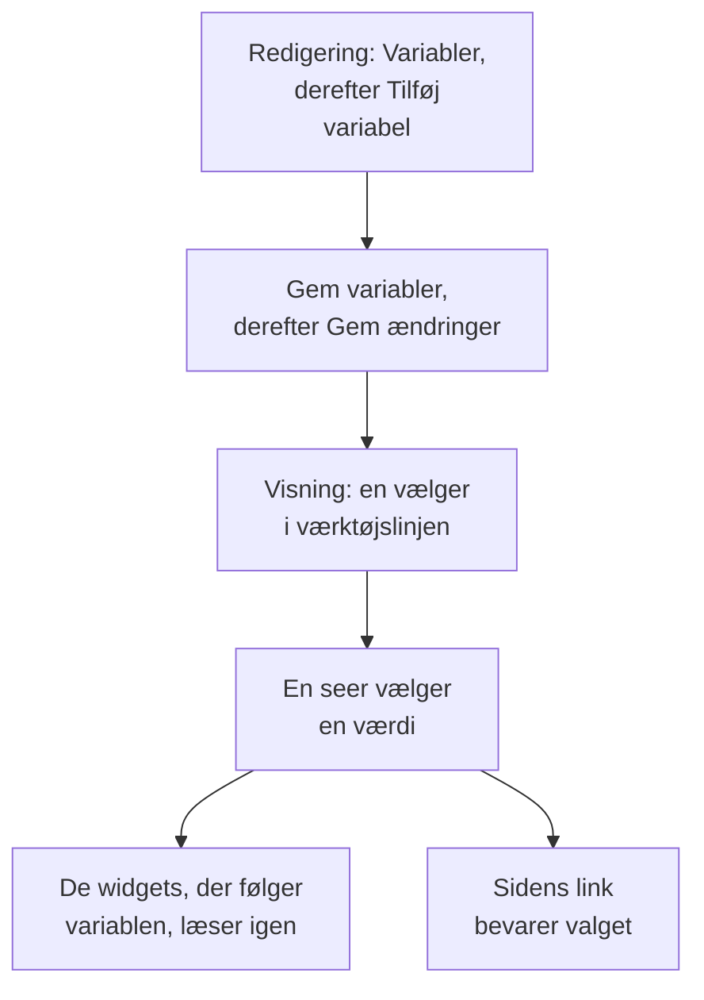

# Dashboard-variabler & filtre

En variabel er en vælger i dashboardets værktøjslinje. Tilføj en variabel `service`, og de samme diagrammer viser `checkout`, `payments` eller `search`: seerne vælger i værktøjslinjen i stedet for, at du bygger tre næsten ens dashboards.

:::cards
- [Tilføj en variabel](#tilføj-en-variabel): Giv den et navn, vælg, hvor dens værdier kommer fra, og gem.
- [Variabelkilder](#variabelkilder): Telemetry Attribute, Project Labels, Custom List og Text Input.
- [Sådan bruger widgets en variabel](#sådan-bruger-widgets-en-variabel): Hvilke widgets følger hvilke variabler.
- [Links, der bevarer valget](#links-der-bevarer-valget): Send et link, der åbner på den samme tjeneste.
:::

## Sådan fungerer en variabel

Du definerer variabler, mens du redigerer dashboardet, og de gemmes sammen med det. I visningstilstand er hver variabel en vælger i værktøjslinjen. Når en seer vælger en værdi, læser hver widget, der følger variablen, sine data igen, og sidens link bevarer valget.



## Tilføj en variabel

:::steps
### Åbn variabeldialogen

Åbn dashboardet, vælg **⋯ → Rediger dashboard**, og klik på **Variabler** i værktøjslinjen. Dialogen **Dashboard-variabler** viser dashboardets variabler; knappen i værktøjslinjen tæller dem.

### Tilføj en

Klik på **Tilføj variabel**. En ny variabel læser en telemetriattribut; vælg en anden **Kilde**, hvis du har brug for det.

### Udfyld den

Giv den et **Navn**, som widgets og links bruger, for eksempel `service`: bogstaver, cifre og understreger, der starter med et bogstav eller en understreg og adskiller sig fra dashboardets andre navne. Tilføj en **Mærkat** til værktøjslinjen, hvis du vil, en **Standard** at starte på, og sæt flueben ved **Tillad flere valg** for at lade seerne vælge flere værdier.

### Gem den

Klik på **Gem variabler** og derefter på **Gem ændringer** i værktøjslinjen. Variablens vælger vises i værktøjslinjen, når dashboardet er tilbage i visningstilstand.
:::

For at ændre eller fjerne en variabel senere åbner du dialogen igen: ret dens felter, eller klik på skraldespanden ved siden af.

## Variabelkilder

**Kilde** afgør, hvor en variabels værdier kommer fra, og hvilke widgets der følger den.

| Kilde | Hvor værdierne kommer fra | Flervalg |
| --- | --- | --- |
| Telemetry Attribute | Værdierne af én attributnøgle i dine metrikker, for eksempel `service.name` | Ja |
| Project Labels | De projektetiketter, du tillader, fra 1 til 1.000 | Ja |
| Custom List | Værdier, du skriver, adskilt af kommaer, for eksempel `prod, staging` | Ja |
| Text Input | Hvad seeren end skriver | Nej |

### Telemetry Attribute

Angiv **Attributnøgle**, for eksempel `service.name`, `host.name` eller `k8s.namespace.name`; feltet foreslår de nøgler, din telemetri har. Vælgeren tilbyder op til 100 værdier af den nøgle, læst fra dine metrikker fra det seneste døgn, så en ny tjeneste dukker op i den, uden at du redigerer dashboardet.

Det er den mest brugte kilde, fordi den ikke behøver sin egen liste: værdierne er dem, du allerede sender.

### Project Labels

Vælg eksisterende projektetiketter, der skal tilbydes som en rulleliste på dashboardet. Opret for eksempel en variabel med navnet `UNIT`, sæt dens kilde til **Projektetiketter**, og vælg etiketterne `0660` og `0661`.

Dashboardet gemmer de valgte etiketters id'er og visningsnavne. Filtreringen bruger id'erne, så omdøbning af en projektetiket ødelægger ikke dens binding. Visningsnavnene gemmes sammen med dashboardet; vælg en omdøbt etiket igen i variabeleditoren for at opdatere dens viste navn. Offentlige dashboards viser de samme gemte valg.

I en widget **Overvågningsliste** åbner du **Filtre → Etiketvariabel** og vælger `UNIT`. Når du vælger `0660`, vises nu de overvågninger, der har den etiket. Andre widgets påvirkes ikke, medmindre de udtrykkeligt understøtter og binder variablen: **SLO-liste** har den samme indstilling **Etiketvariabel**.

Faste widgetfiltre gælder fortsat. Med en fast etiket `network` og `UNIT` sat til `0660` skal en overvågning for eksempel have begge etiketter. Flere valgte enheder matcher enhver af de valgte enheder. Når du vælger **Alle**, fjernes kun variablens betingelse, og de faste filtre for etiket, status og overvågningstype bevares.

En manglende variabel eller et valg uden for de konfigurerede valgmuligheder viser en fejl. En valgt etiket uden matchende overvågninger viser den tomme liste. Fjern udtrykkeligt widgettens binding, når den ikke længere er nødvendig.

### Custom List og Text Input

En Custom List tilbyder de værdier, du skriver, adskilt af kommaer. Et Text Input lader seeren skrive en hvilken som helst værdi, for eksempel en IP-adresse eller et anmodnings-id. Ingen af dem filtrerer en widget af sig selv: deres værdier sættes ind, hvor du skriver `{{name}}` (se nedenfor).

En Query-variabel fra et ældre dashboard bevares og viser et tekstfelt i værktøjslinjen: OneUptime indlæser ikke længere dens værdier fra en forespørgsel.

## Flervalg og standardværdier

Med flueben ved **Tillad flere valg** vælger seerne en eller flere værdier, og widgets viser enhver af dem. Et tomt valg betyder **Alle**, og en flervalgsvariabel starter altid på **Alle**, så dens **Standard** er nedtonet.

En enkeltvalgsvariabel starter på sin **Standard**, eller på **Alle**, når den ikke har nogen. **Alle** fjerner variablens filter, så widgets viser alt.

Brug flervalg til at sammenligne "checkout og payments sammen" uden at forlade dashboardet. Undgå det, hvor tallene ikke kan lægges sammen på tværs af værdier, for eksempel et gennemsnit af gennemsnit.

## Sådan bruger widgets en variabel

Hver kilde når widgets på sin egen måde:

- Variabler af typen **Telemetriattribut** filtrerer widgets, uden at du skal indstille noget på dem: alle metrikdiagrammer, værdier, målere og tabeller; **Logdiagram**, **Logstrøm**, **Spordiagram** og **Sportabel**; og de infrastrukturlister, hvis ressourcer har attributten, for eksempel `host.name` på værtslister og `k8s.namespace.name` på Kubernetes-lister. Et diagram over en metrik uden attributten viser ingen data, så længe en værdi er valgt: vælg **Alle** for at se det igen. **Sporliste** og hændelses- og advarselslisterne følger dem ikke.
- Variabler af typen **Projektetiketter** filtrerer en **Overvågningsliste** eller en **SLO-liste**, hvis **Etiketvariabel** nævner dem.
- **Enhver variabel** kan skrives ind i tekst som `{{name}}`: i en [HTML-widget](/docs/dashboards/widgets#html), i forespørgslen til en [ekstern datakilde](/docs/dashboards/data-sources), og i titlen på en **Overvågningsliste** eller en **SLO-liste**. En titel som `{{UNIT}} NETWORK` viser `0660 NETWORK`, `0660, 0661 NETWORK` eller `All NETWORK`. En titel styrer kun den viste tekst; konfigurér **Etiketvariabel** for at filtrere overvågningsforespørgslen.

[SLO-widgetten](/docs/dashboards/widgets#slo) kan følge en Telemetry Attribute-variabel på nøglen `sloName`, så seerne vælger, hvilket SLO den viser.

## Links, der bevarer valget

Sidens link bærer hver variabels valg som `?var-<name>=<value>`, med flere værdier adskilt af kommaer, så et link, du kopierer, åbner med det samme valg, også et udtrykkeligt **Alle**. Et link som dette åbner på tjenesten payments:

```text title="A dashboard link with a variable"
https://oneuptime.com/dashboard/<project-id>/dashboards/<dashboard-id>?var-service=payments
```

Linket bærer også det tidsinterval og den automatiske opdatering, du har valgt, som `range` og `refresh`, så dem, du sender det til, ser det samme som dig. [Send et link](/docs/dashboards/sharing#send-et-link) nævner deres værdier.

## Et eksempel: ét dashboard til hver tjeneste

Et tjenestedashboard har som regel:

1. En variabel `service`, kilde Telemetry Attribute, attributnøgle `service.name`, med din travleste tjeneste som standard. Lad flervalg være slået fra, så diagrammerne viser én tjeneste ad gangen.
2. En variabel `namespace`, kilde Telemetry Attribute, attributnøgle `k8s.namespace.name`, med flervalg slået til for at sammenligne navnerum.
3. En variabel `environment`, kilde Custom List, værdier `prod, staging`, brugt som `{{environment}}` i en datakildes forespørgsel.
4. Widgets, der læser de attributter: diagrammer og værdier for tjenestens metrikker, en logstrøm og en liste over Kubernetes-pods.

Resultatet: ét dashboard til hver tjeneste, med tre vælgere øverst.

## Næste trin

:::cards
- [Dashboard-widgets](/docs/dashboards/widgets): Hvilke widgets følger hvilke variabler.
- [Eksterne datakilder](/docs/dashboards/data-sources): Sæt en variabel ind i en PromQL- eller SQL-forespørgsel.
- [Deling & offentlige dashboards](/docs/dashboards/sharing): Variabler på et offentligt dashboard.
- [Opret et dashboard](/docs/dashboards/authoring): Redigeringstilstand, gemning og tidsintervallet.
:::
