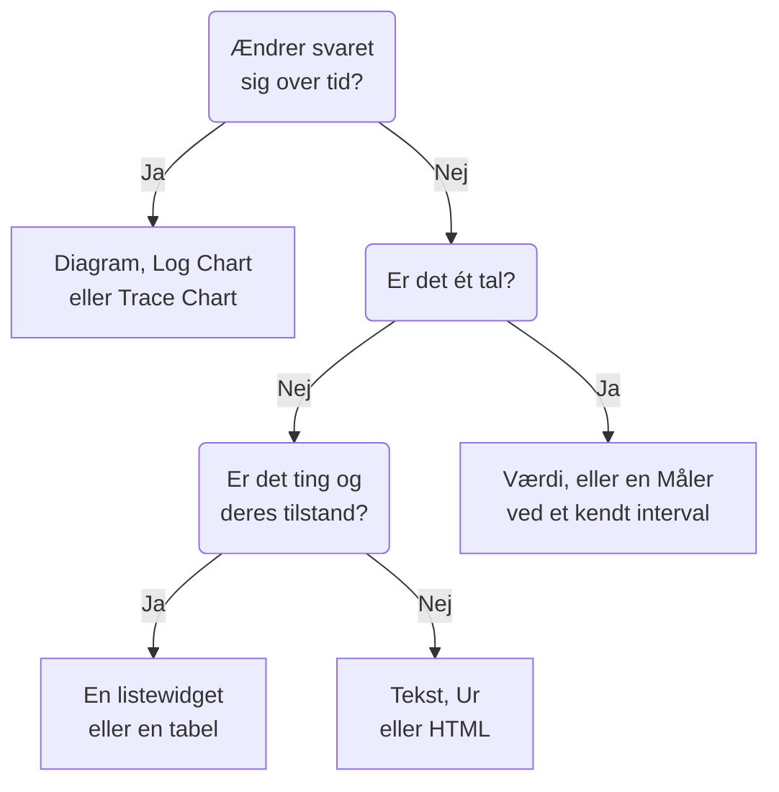

# Dashboard-widgets

En widget er én flise på et dashboard. Denne side gennemgår hver widget i kataloget **Tilføj widget**, hvad den viser, og de indstillinger, der betyder noget, i katalogets egne grupper. For at placere widgets i gitteret og gemme dem, se [Opret et dashboard](/docs/dashboards/authoring).

:::cards
- [Hvilken widget skal jeg bruge?](#hvilken-widget-skal-jeg-bruge): Vælg ud fra det spørgsmål, flisen besvarer.
- [Diagrammer og tal](#diagrammer-og-tal): Diagram, Værdi, Måler og Tabel, ud fra en metrikforespørgsel.
- [Logs, traces og sikkerhed](#logs-traces-og-sikkerhed): Volumendiagrammer, live-strømme og lister.
- [Sortering af lister og tabeller](#sortering-af-lister-og-tabeller): Sortér efter en kolonne, og vælg den rækkefølge, alle ser.
- [Når en widget ikke kan vises](#når-en-widget-ikke-kan-vises): Hvad en ødelagt widget viser, og hvordan du retter den.
:::

## Hvilken widget skal jeg bruge?

Start med det spørgsmål, flisen skal besvare:

| Spørgsmålet | Widgetten |
| --- | --- |
| Hvordan har en metrik ændret sig over tid? | **Diagram** |
| Hvor mange logs, af hvilken alvorlighed, over tid? | **Logdiagram** |
| Hvor hurtige er anmodningerne, og hvor mange fejler, over tid? | **Spordiagram** |
| Hvad er ét bestemt tal lige nu? | **Værdi**, eller **Måler** når det har et kendt interval |
| Hvilke værter, tjenester eller endpoints skiller sig ud? | **Tabel** eller **Sportabel** |
| Hvad sker der lige nu? | **Logstrøm**, **Sporliste**, **Hændelsesliste** eller **Advarselsliste** |
| Er alle vores sites oppe? | **Overvågningsliste** |
| Holder vi den pålidelighed, vi har lovet? | **SLO** eller **SLO-liste** |
| Hvilken tilstand er vores klynger og værter i? | En widget fra gruppen Infrastruktur |
| Hvor i verden er vores netværk, og hvad er nede? | **Netværkskort** |
| En overskrift, en note, klokken på et andet kontor? | **Tekst** eller **Ur** |
| Data, der ligger uden for OneUptime? | En widget fra gruppen Eksterne datakilder |
| Noget, ingen widget dækker? | **HTML**, når du er sikker på, at ingen anden widget gør det |



De fleste dashboards blander nogle få: et diagram øverst, en værdi eller to ved siden af, en tekstoverskrift og en liste eller to nedenunder.

## Diagrammer og tal

Disse fire widgets læser en metrikforespørgsel, bygget som metrikudforskeren bygger en: vælg en metrik og en aggregering, tilføj attributfiltre, og gruppér efter en attribut for at få én serie pr. værdi.

### Diagram

En tidsserie med en eller flere metrikforespørgsler over dashboardets tidsinterval. **Chart Type** tegner den som et linje-, søjle-, areal-, stablet areal- eller cirkeldiagram. **Additional Queries** lægger flere metrikker på de samme akser, og **Formulas** kombinerer dem med `+`, `-`, `*`, `/`, `%`, `^` og parenteser, som i `(1 - a) * 100`. Hver forespørgsels visningsindstillinger tilføjer en forklaring og en enhed, en farve, advarsels- og kritiske linjer og en rate pr. sekund for tællere, der kun vokser.

Brug den, når linjens form fortæller historien: latenstid, fejl, gennemløb eller køens længde.

### Værdi

Ét stort tal med en sparkline: forespørgslens værdi over hele tidsintervallet, lagt sammen for en sum eller en optælling, den højeste for et maksimum, den laveste for et minimum og ellers gennemsnittet. En pil sammenligner anden halvdel af intervallet med første, hver halvdel beregnet på samme måde, farvet efter **Trend Direction**: om en højere værdi er bedre eller dårligere, eller udledt af metrikkens navn. Peg på pilen for at se begge halvdeles værdier, og på sparklinen for at aflæse et punkts værdi og tidspunkt. **Warning Threshold** gør baggrunden gul og **Critical Threshold** rød, når værdien når dem.

Brug den, når ét tal besvarer spørgsmålet: fejlraten, P95-latenstiden eller antal anmodninger håndteret i dag.

### Måler

En skive mellem et minimum og et maksimum, 0 og 100 medmindre du angiver dem, med en gul zone fra **Warning Threshold** og en rød zone fra **Critical Threshold**.

Brug den, når værdien lever i et kendt interval: CPU- eller diskforbrug i procent, eller en køs kapacitet.

### Tabel

Metrikværdier som rækker. **Group By Attributes** giver én række pr. værdi, for eksempel én pr. `host.name`; uden den er hver række et tidsrum. **Metrics & Columns** angiver kolonnerne: metrikker og formler over dem, som tilgængelighed i procent. Når du grupperer, gør **Reduce across time** hver rækkes serie til én værdi: den seneste værdi, gennemsnittet, summen, minimum eller maksimum.

Slå **Farv efter tærskler** til i en kolonne for at farve dens værdier: En værdi, der når **Advarselstærskel**, bliver ravgul med en trekant, og en, der når **Kritisk tærskel**, bliver rød og fed med en cirkel. En procentkolonne starter ved 80 og 90. For en kolonne, hvor lave værdier er problemet, som ledig diskplads, skal du vælge **Lavere er værre** under **Retning**.

Tærskler læser det tal, tabellen viser, så en udnyttelsesmetrik, der sendes som en brøkdel af 1, som `system.cpu.utilization`, vises og sammenlignes som en procentdel. Under **Tærskelfarver** udfylder **Farvet baggrund** hele cellen i stedet for at farve tallet.

Brug den til en opdeling i stedet for en tendens: de mest støjende værter, fejl pr. tjeneste, anmodninger pr. endpoint.

## Tekst, ur og HTML

Disse widgets har ikke brug for nogen datakilde.

### Tekst

En linje eller en tekstblok, til en overskrift, en note eller links til dine runbooks. Slå **Markdown** til for at tegne overskrifter, links, lister, kode og tabeller; ellers vises teksten, som den er skrevet, med fed, kursiv eller understregning, hvis du vil.

### Ur

Det aktuelle klokkeslæt i en hvilken som helst tidszone, som cifre eller som en analog urskive, med en etiket som "Kontoret i Sydney". Uden tidszone viser det hver seers egen. Tilføj et pr. kontor for at se, hvem der er vågen.

### HTML

Din egen HTML, CSS og JavaScript, tegnet som en widget. Dens indstillinger er HTML-brødteksten, et valgfrit stylesheet, et valgfrit script og tre tilladelseskontakter.

Brug den, når du har brug for noget, ingen indbygget widget dækker: et indlejret badge fra en tredjepart, en tabel hentet fra et internt API, en tilpasset forklaring eller et sæt stylede links til dine egne værktøjer.

#### Hvad den kan og ikke kan

Widgetten gengives i en sandboxet ramme på sin egen isolerede oprindelse. Inde i den ramme kan din kode mere eller mindre hvad som helst: bygge DOM, køre timere, hente fra enhver URL, tegne på et canvas.

Det, den ikke kan, er at nå OneUptime-siden omkring den. Den har ingen adgang til dashboardets DOM, cookies, lokale lager eller API-session, og den kan ikke få browserfanen til at navigere væk. Det gælder, uanset om dashboardet er privat eller delt offentligt.

To konsekvenser, der er værd at kende, før du indsætter noget:

- Et `fetch` fra widgetten er en anmodning på tværs af oprindelser fra en uigennemsigtig oprindelse, så den server, du kalder, skal tillade den med CORS. Det understøttes ikke at kalde OneUptime API herfra.
- Widgetten starter gennemsigtig. Angiv en baggrund på `body` i din CSS, hvis du vil have den til at fylde kortet. I det mørke tema starter dens tekst lys, og dens element `<html>` har klassen `dark`: start en CSS-regel med `html.dark` for kun at style det mørke tema.

#### Brug af dashboard-variabler

Skriv `{{variableName}}` hvor som helst i HTML, CSS eller JavaScript, så erstattes det med variablens aktuelle værdi, før widgetten gengives. Når der vælges en ny værdi, gengives widgetten igen. En pladsholder, der nævner en variabel, som ikke findes, bliver stående, som den er.

Scripts får de samme værdier, plus dashboardets tidsinterval, på `window.ONEUPTIME`:

```javascript title="window.ONEUPTIME"
window.ONEUPTIME.variables.environment; // current value, or "" if unset
window.ONEUPTIME.startDate; // ISO 8601 string, start of the dashboard's time range
window.ONEUPTIME.endDate; // ISO 8601 string, end of it
```

Widgetten genindlæses, hver gang dashboardet opdateres, så en widget, der henter sine egne data, følger med opdateringsintervallet.

#### Tilladelser

**Run JavaScript** (slået til som standard) kører dit script. Slå den fra for kun at gengive markup og typografier: scriptet udelades så helt fra widgetten i stedet for blot at blive blokeret.

**Open links in a new tab** (slået til som standard) lader links og `window.open` åbne en browserfane. Links åbner altid i en ny fane; widgetten kan aldrig få selve dashboardet til at navigere.

**Allow forms to submit** (slået fra som standard) lader en `<form>` inde i widgetten blive sendt.

Den, der kan redigere dashboardet, bestemmer, hvad denne widget kører, og alle, der ser dashboardet, kører det: på et offentligt dashboard gælder det også anonyme besøgende. Behandl redigeringsadgang til et dashboard med en HTML-widget, som du ville behandle adgang til enhver anden kode, du udgiver.

## Logs, traces og sikkerhed

| Widget | Hvad den viser | Indstillinger, der betyder noget |
| --- | --- | --- |
| **Logdiagram** | Logvolumen over tid, én serie pr. alvorlighed, som søjler, linjer eller arealer. | Alvorligheder, tekst som brødteksten indeholder, attributfiltre. |
| **Logstrøm** | De seneste loglinjer, der matcher et filter. | Alvorlighed, tekst som brødteksten indeholder, attributfiltre som `@service.name:checkout`, hvor mange rækker. |
| **Spordiagram** | Antal anmodninger, antal fejl eller svartid (gennemsnit, minimum, maksimum, P50 til P99) over tid. | Metrikken, hvilke spans der tælles, og en attribut at dele serierne op efter. |
| **Sporliste** | De seneste traces med deres varighed og status. | Status, hvor mange rækker. |
| **Sportabel** | De største span-navne, statusser eller attributværdier efter antal anmodninger, med median-, gennemsnits-, minimums- og maksimumssvartider. | Hvad rækkerne grupperes efter, og hvilke spans der tælles. |
| **Sikkerhedshændelser** | De seneste sikkerhedshændelser med alvorlighed, hændelsesklasse og vært. | Alvorligheder, hændelsesklasser, tekst som meddelelsen indeholder. |
| **Flow af sikkerhedshændelser** | Et flow af sikkerhedshændelser fra deres kilde, gennem deres hændelsesklasse, til deres alvorlighed. | Alvorligheder, hvor mange hændelser. |

Trace-widgets tæller kun rod-spans, som trace-udforskeren gør, medmindre du medtager underordnede spans i deres indstillinger. Et almindeligt mønster er et latenstidsdiagram øverst med en liste over langsomme traces nedenunder.

## Hændelser, advarsler og overvågninger

| Widget | Hvad den viser | Filtre |
| --- | --- | --- |
| **Hændelsesliste** | Hændelser med deres tilstand og alvorlighed. | Uløste, kvitterede eller løste; alvorlighed, tilstand, overvågninger og etiketter. |
| **Advarselsliste** | Advarsler med deres tilstand og alvorlighed. | Uløste, kvitterede eller løste; alvorlighed, tilstand, overvågninger og etiketter. |
| **Overvågningsliste** | Overvågninger med deres aktuelle status. | Driftsklar eller ej, status, overvågningstype og etiketter, eller en **Etiketvariabel**, som seerne vælger i værktøjslinjen. |

Som de fleste listewidgets kan disse tre tegne en honeycomb af celler farvet efter status i stedet for en tabel: vælg det under **Visningstilstand**. De viser den aktuelle tilstand, uanset dashboardets tidsinterval.

## Serviceniveaumål

### SLO

Ét serviceniveaumål (SLO), tegnet enten som ét tal eller som en linje over tid.

**Indstillinger**: hvilket SLO, eller det SLO, der er valgt i en dashboard-variabel; hvilket af dets tre tal (SLI, Error Budget Remaining eller Burn Rate); visning som Tile eller Diagram; og en valgfri titel.

- **Tile** viser det aktuelle tal, plus en anden linje, hvor der er en: målet under SLI, de resterende minutter under fejlbudgettet. En statusmærkat farver det hele.
- **Diagram** tegner det samme tal over dashboardets tidsinterval, med målet markeret som en stiplet linje på SLI-serien. Historikken skrives med få minutters mellemrum af evalueringsworkeren, så et helt nyt SLO vises som et tomt diagram, indtil det er blevet evalueret første gang.

Brug den, når dashboardet besvarer "holder vi det, vi har lovet?" snarere end "hvad sker der lige nu?".

SLO-widgetten virker på [offentlige dashboards](/docs/dashboards/sharing). Det, der offentliggøres, er SLO'ets nøgletal (navn, mål, aktuel SLI, resterende fejlbudget, burn rate og status), uanset hvilket af dem widgetten tegner. Definitionen forbliver privat: de overvågninger, det holder øje med, dets etiketter, beskrivelse, forespørgsel og evalueringsplan sendes aldrig til en offentlig seer. En Tile-widget offentliggør kun disse aktuelle tal; en Diagram-widget offentliggør også historikken for den ene serie, den tegner, og intet andet.

### SLO List

Hvert SLO med dets status, SLI, fejlbudget og burn rate, med det mindste resterende budget først. Filtrér den efter status eller etiketter, eller med en **Etiketvariabel**, som seerne vælger i værktøjslinjen. [SLO-metrikker og -dashboards](/docs/slo/metrics) viser begge SLO-widgets i brug.

## Infrastruktur

Hver af disse widgets viser de ressourcer, en agent eller en collector rapporterer til OneUptime. Indsnævr dem efter klynge, vært eller navnerum i deres filtre, og vis dem som en liste eller som en honeycomb.

| Gruppe | Widgets | Udfyldes af |
| --- | --- | --- |
| **Værter** | **Værter**, med deres forbindelsesstatus, OS, CPU og hukommelse | Enhver OpenTelemetry-collector, der sender `host.name` |
| **Kubernetes** | **Pods**, **Noder**, **Navnerum**, **Udrulninger**, **StatefulSets**, **DaemonSets**, **Job**, **CronJobs** | [Kubernetes-agent](/docs/monitor/kubernetes-agent) |
| **Docker** | **Værter**, **Containere**, **Billeder**, **Netværk**, **Diskenheder** | Docker-agenten |
| **Docker Swarm** | **Noder**, **Tjenester** | Docker Swarm-agenten |
| **Podman** | **Værter**, **Containere**, **Billeder**, **Netværk**, **Diskenheder** | Podman-agenten |
| **Proxmox** | **Noder**, **Gæster** | Proxmox-agenten |
| **VMware** | **Værter**, **Virtuelle maskiner** | VMware-agenten, eller et vCenter, du forbinder |
| **Ceph** | **OSD'er**, som en væg farvet efter tilstand, og **Pools** | Ceph-agenten |
| **Lagerarrays** | **Diskenheder**, og **Hardware** som en væg farvet efter status | Storage Array-agenten |

Brug dem til én side, der blander tilstanden af din infrastruktur med telemetrien fra de arbejdsbelastninger, der kører på den.

### Network Map

Dine netværkssites tegnet på verdenskortet, hvert fastgjort på sin egen breddegrad og længdegrad og farvet efter den overvågningsstatus, der er samlet på det. Sites tæt på hinanden deler en markør med antallet skrevet indeni; en markør, der står for præcis ét site, åbner det site, når du klikker på den.

Kortet indrammer sig selv om de sites, det har tegnet: et netværk inden for ét land fylder rammen med det land, og ét spredt over flere kontinenter åbner på hele verden. Der er ingen knapper til at zoome eller panorere: en dashboardflise er et billede, og siden Network Map under Network er der, hvor du går hierarkiet igennem.

Over kortet står, hvor mange sites der er nede, for en rød prik på to pixels blandt to hundrede grønne er ikke noget, nogen læser på dashboardafstand. Under det fortæller en dækningslinje, hvad kortet ikke viser: sites uden koordinater, og om rækkegrænsen blev nået.

**Indstillinger**: titel, kort- eller listevisning, højeste antal tegnede sites, om sitenavne skal skrives, og filtre efter sitetype og efter status. Sitenavne forsvinder automatisk, når kortet bliver for fyldt til, at de kan læses; værktøjstippet navngiver stadig hver markør.

Et site vises kun, hvis det har koordinater. Tilføj breddegrad og længdegrad på sitet (eller importér dem fra en CSV) for at fastgøre det.

## Eksterne datakilder

Gruppen Eksterne datakilder tegner et **Diagram**, en **Værdi**, en **Måler** eller en **Tabel** ud fra et system, som OneUptime ikke ejer: Prometheus, PostgreSQL, MySQL, SQL Server, ClickHouse, Loki, Elasticsearch eller et hvilket som helst REST API. Du forbinder systemet én gang og skriver derefter hver widgets forespørgsel i systemets eget sprog. [Eksterne datakilder](/docs/dashboards/data-sources) viser hvordan.

## Sortering af lister og tabeller

Klik på overskriften på en kolonne for at sortere en liste eller en tabel efter den: et første klik sorterer, som tabellen nedenfor siger, det næste klik den anden vej, og det efterfølgende sætter widgetten tilbage i sin egen rækkefølge. På den kolonne, widgetten allerede er sorteret efter, vender et klik rækkefølgen om. En pil markerer den kolonne, rækkerne er sorteret efter.

| Kolonne | Første klik | Næste klik |
| --- | --- | --- |
| En status, en tilstand eller en alvorlighed | Værste først | Bedste først |
| Et tidspunkt | Nyeste først | Ældste først |
| Et tal | Højeste først | Laveste først |
| Tekst | A til Å | Å til A |

Værst følger dit projekts egen rækkefølge: en monitorstatus efter dens prioritet, en hændelses eller en advarsels alvorlighed og tilstand efter den rækkefølge, du har dem i, og en ressource, der er nede, ikke klar eller slukket, før en sund. En pods fase sorteres Failed, så Unknown, så Pending, så Running og Succeeded. En SLO's SLI og fejlbudget samt en Proxmox-gæsts VMID sorteres med de laveste først.

Hele listen sorteres, ikke kun rækkerne på skærmen: en liste, der viser 25 rækker, sorteret med de værste først, viser de 25 værste af dem alle. Rækker, der står lige, beholder widgettens egen rækkefølge. En kolonne, en liste ikke kan sorteres efter som helhed, som en sikkerhedshændelses besked, sorterer ikke.

### Din egen sortering

Din sortering er kun din: din browser husker den for den widget på det dashboard, så en genindlæsning eller en vægskærms genstart beholder den, og ingen andre ser den. Det klik, der sætter widgetten tilbage i sin egen rækkefølge, glemmer din sortering, og widgetten følger derefter sin egen rækkefølge, også når en redaktør ændrer den senere.

### Den rækkefølge, alle ser

For at vælge den rækkefølge, en widget åbner i for alle, redigerer du den og vælger rækkefølgen under **Sortér**, eller du klikker på en kolonneoverskrift i dens **Live Preview**, og klikker så på **Gem ændringer**. Du ser den nye rækkefølge med det samme; en seer, der har sorteret widgetten på sin egen måde, beholder sin sortering.

Dashboardskabelonerne åbner deres lister over værter, noder, pods, Swarm-tjenester og netværksenheder med de værste først.

Gennem API'et og Terraform er rækkefølgen widgettens `arguments.sort`: en kolonne og en retning, for eksempel `status:desc`. En listewidget afviser en kolonne, den ikke har, og fejlen opremser de sorteringer, den har.

## På et offentligt dashboard

Et [offentligt dashboard](/docs/dashboards/sharing) tegner de fleste widgets for sine besøgende, og hver viser kun det, den er sat op til at vise. Nogle få kan ikke vises uden en indlogget session:

- **Logdiagram**, **Spordiagram**, **Sportabel**, **Sikkerhedshændelser** og **Flow af sikkerhedshændelser** skriver på deres plads, at de ikke er tilgængelige på offentlige dashboards.
- Widgets fra Eksterne datakilder udelades helt fra et offentligt dashboard, fordi deres indstillinger er selve forespørgslen.

## Når en widget ikke kan vises

En widget, der ikke kan tegnes, viser **Denne widget kunne ikke vises** på sin egen plads, og resten af dashboardet bliver ved med at virke. Det sker, når OneUptime ikke har nogen widget af dens type (en, der er fjernet, stavet forkert, da dashboardet blev skrevet via API'et, eller tilføjet af en nyere version), eller når widgetten fejler, mens den tegnes, for eksempel fordi dens gemte indstillinger er ufuldstændige.

Hvis du kan redigere dashboardet, så klik på **Rediger widget** på den. Dashboardet skifter til redigeringstilstand med widgettens indstillinger åbne: ret dem, eller klik på **Slet widget**, og derefter på **Gem ændringer**. En widget, der fejlede, mens den blev tegnet, tilbyder også **Prøv igen**, og tegnes igen ved næste automatiske opdatering, eller når du ændrer tidsintervallet.

Besøgende på et offentligt dashboard får kun at vide, at widgetten ikke kunne vises.

## Næste trin

:::cards
- [Dashboard-variabler & filtre](/docs/dashboards/variables): Lad seerne rette widgets mod en tjeneste, en vært eller en kunde.
- [Eksterne datakilder](/docs/dashboards/data-sources): Vis Prometheus, SQL, Loki og mere ved siden af dine egne data.
- [Opret et dashboard](/docs/dashboards/authoring): Tilføj, arrangér og gem widgets.
- [Deling & offentlige dashboards](/docs/dashboards/sharing): Del dashboardet uden for dit team.
:::
