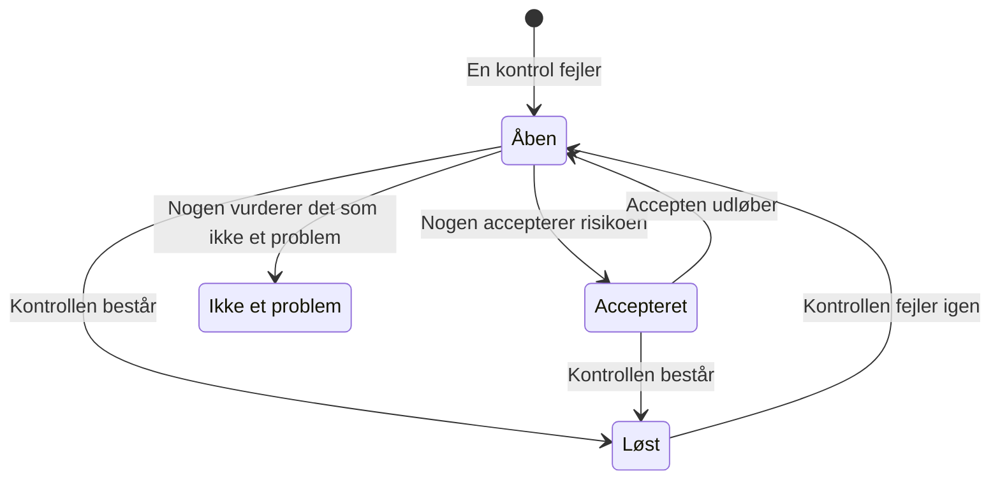

# Datasikkerhedskontroller og problemer

Datasikkerhed kører 32 kontroller på hvert datalager, fordelt på ni grupper. En kontrol læser det, der vides om ét datalager - hvordan det er konfigureret, hvad der er fundet i det, hvem der kan nå det, hvor det ligger - og består, fejler eller kan ikke afgøre det. En kontrol, der fejler, åbner ét problem på det datalager, og problemet lukker af sig selv, når kontrollen består. Denne side viser alle kontroller, hvordan et problems alvorlighed og risikoscore beregnes, og hvad der sker med et problem i løbet af dets levetid.

:::cards
- [Sådan afgør en kontrol](#sådan-afgør-en-kontrol): Bestået, fejlet eller kan ikke afgøre, og hvor slem en fejl er.
- [Alle kontroller](#alle-kontroller): Alle 32, med hvad hver enkelt kontrollerer, og hvordan det rettes.
- [Risikoscore](#risikoscore): Hvordan problemer ordnes inden for en alvorlighed.
- [Hvad der sker med et problem](#hvad-der-sker-med-et-problem): Åben, løst, accepteret, ikke et problem.
- [Ret det herfra](#ret-det-herfra): Bloker en offentlig bucket, eller stop delingen af et snapshot, med ét klik.
:::

## Sådan afgør en kontrol

Hver kontrol læser fakta om et datalager og svarer på en af fire måder:

| Svar | Hvad det betyder | Hvad der sker med problemet |
| --- | --- | --- |
| Bestået | Kontrollen finder ikke noget galt. | Et åbent eller accepteret problem løses. |
| Fejlet | Kontrollen finder problemet og siger i én sætning, hvad den så: problemets bevis. | Et problem åbnes, eller det åbne opdateres. |
| Kan ikke afgøre | En oplysning kunne ikke læses: en tilladelse, rollen ikke har, et kald, der fejlede. | Intet ændres: et åbent problem forbliver åbent, fordi ingen må konkludere, at et problem er løst, når OneUptime ikke kunne se efter. |
| Gælder ikke | Datalagerets type har ingen sådan indstilling. | Et åbent problem løses. |

### Alvorligheden følger dataene

Det samme problem betyder mere for mere følsomme data. Hver kontrol angiver en alvorlighed for hvert følsomhedsniveau, og et problem får den, der gælder for dets datalager: en offentlig bucket med kortnumre er Kritisk, en offentlig bucket med billeder til et website kun Lav. En tankestreg betyder slet intet problem. Et datalagers følsomhed kommer fra dets fund (se [Følsomme datatyper](/docs/data-security/data-types#følsomhed)), så indholdsprøver gør alvorlighederne rigtige.

Nogle få kontroller sætter i stedet alvorligheden ud fra det, de så. **Der er gemt hemmeligheder i det** er Høj på ethvert datalager og Kritisk på et datalager, der er offentligt eller delt med andre konti.

## Alle kontroller

Alvorligheden angives for data med følsomheden Begrænset, Fortrolig, Intern og Offentlig, i den rækkefølge. Hvert problems side viser den fulde rettelse for dets eget datalager - trinnene i konsollen, CLI-kommandoen og, hvor det passer, Terraform - med datalagerets navn og region udfyldt.

### Eksponering

| Kontrol | Kører på | Hvad den kontrollerer | Alvorlighed | Sådan rettes det |
| --- | --- | --- | --- | --- |
| Alle på internettet kan læse det (`public-read`) | Objektlager, datavarehus, søgning | Datalagerets politik, ACL eller IAM-bindinger lader alle læse dets data uden at logge ind. | Kritisk / Kritisk / Høj / Lav | Fjern alle tildelinger til anonyme principals eller principals for alle godkendte brugere. Filer, der skal være offentlige, hører hjemme i et datalager, der er markeret **Offentlig med vilje**, og som ikke indeholder andet. |
| Alle på internettet kan ændre det (`public-write`) | Objektlager, datavarehus, søgning | Datalagerets politik, ACL eller IAM-bindinger lader alle skrive eller slette dets data. | Kritisk / Kritisk / Kritisk / Høj | Fjern alle skrive- eller slettetildelinger til anonyme principals eller principals for alle godkendte brugere. |
| Offentlig adgang er ikke blokeret (`public-access-not-blocked`) | AWS S3 Bucket | S3 Block Public Access er ikke helt slået til for bucketen eller dens konto, så én ændring af politikken kan gøre den offentlig. | Høj / Middel / Lav / — | Slå alle fire Block Public Access-indstillinger til for bucketen. |
| Databasen accepterer forbindelser fra internettet (`internet-reachable`) | Database, datavarehus, søgning, cache | Databasen har et offentligt endpoint, eller offentlig netværksadgang er slået til. | Høj / Høj / Middel / Lav | Slå det offentlige endpoint fra, og nå databasen via et privat netværk eller en bastion. |
| Dens firewall lukker alle adresser ind (`open-to-all-addresses`) | Database, datavarehus, søgning, cache | En firewallregel eller et autoriseret netværk tillader 0.0.0.0/0 eller hele adresseområdet. | Kritisk / Kritisk / Høj / Middel | Erstat reglen, der tillader alt, med de adresser eller netværk, der har brug for adgang. |
| Et snapshot af det kan gendannes af alle (`snapshot-public`) | Database, snapshot | Et databasesnapshot er delt offentligt, så enhver cloud-konto kan gendanne en fuld kopi. | Kritisk / Kritisk / Kritisk / Høj | Gør snapshottet privat. |
| Et snapshot af det er delt med andre konti (`snapshot-shared-externally`) | Database, snapshot | Et databasesnapshot er delt med konti uden for dine forbundne konti. | Høj / Høj / Middel / Lav | Stop delingen af snapshottet med de konti, der ikke skal have det. |
| Konti uden for din organisation kan nå det (`shared-with-external-accounts`) | Alle datalagre undtagen telemetri | Datalagerets politik giver adgang til konti, tenants eller projekter, der ikke er forbundet til OneUptime. | Høj / Høj / Middel / Lav | Gennemgå hver ekstern principal, og fjern dem, der ikke har brug for adgang. |

### Kryptering

| Kontrol | Kører på | Hvad den kontrollerer | Alvorlighed | Sådan rettes det |
| --- | --- | --- | --- | --- |
| Dets data er ikke krypteret i hvile (`not-encrypted-at-rest`) | Alle datalagre undtagen telemetri | Lagerkryptering er slået fra. | Høj / Middel / Lav / — | Slå kryptering i hvile til. En RDS-instans kan ikke krypteres på stedet: gendan en krypteret kopi af dens snapshot. |
| Begrænsede data er ikke under din egen nøgle (`no-customer-managed-key`) | Alle datalagre undtagen telemetri | Datalageret indeholder data med følsomheden Begrænset, men er krypteret med udbyderens standardnøgle, ikke med en kundeadministreret nøgle. | Middel / — / — / — | Kryptér datalageret med en nøgle, du administrerer i din nøgletjeneste. |
| Ukrypterede forbindelser er tilladt (`encryption-in-transit-not-enforced`) | Alle datalagre undtagen telemetri | Datalageret accepterer forbindelser, der ikke bruger TLS. | Høj / Middel / Lav / — | Kræv TLS for alle forbindelser. På S3 afviser du alle forespørgsler, hvor `aws:SecureTransport` er false. |
| Det accepterer TLS ældre end 1.2 (`weak-tls`) | Alle datalagre undtagen telemetri | Den laveste TLS-version er 1.0 eller 1.1. | Middel / Middel / Lav / — | Sæt den laveste TLS-version til 1.2 eller nyere. |

### Gendannelse

| Kontrol | Kører på | Hvad den kontrollerer | Alvorlighed | Sådan rettes det |
| --- | --- | --- | --- | --- |
| Det har ingen backup eller beholder den i under 7 dage (`no-backups`) | Database, datavarehus | Automatisk backup er slået fra eller beholdes i færre end 7 dage. | Høj / Middel / Lav / — | Slå automatisk backup til, og behold den i mindst 7 dage. |
| Gendannelse til et tidspunkt er slået fra (`no-point-in-time-recovery`) | AWS DynamoDB Table, Azure Cosmos DB Account | Tabellen eller databasen kan ikke gendannes til et øjeblik før en fejl. | Middel / Lav / — / — | Slå gendannelse til et tidspunkt til. |
| Det kan slettes i ét trin (`deletion-protection-off`) | Database, datavarehus | Sletningsbeskyttelse er slået fra. | Middel / Lav / — / — | Slå sletningsbeskyttelse til. |
| Slettede eller overskrevne filer kan ikke gendannes (`deleted-data-not-recoverable`) | Objektlager | Versionering og blød sletning er begge slået fra. | Middel / Lav / — / — | Slå versionering eller blød sletning til. |

### Synlighed

| Kontrol | Kører på | Hvad den kontrollerer | Alvorlighed | Sådan rettes det |
| --- | --- | --- | --- | --- |
| Ingen ville vide, hvem der læste det (`access-not-logged`) | Alle datalagre undtagen telemetri | Læsninger af datalageret logges ikke: ingen adgangslogs, ingen revisionslogs for dataadgang. | Høj / Middel / Lav / — | Slå adgangs- eller revisionslogning til for læsninger: S3-serveradgangslogs eller CloudTrail-datahændelser, Azure StorageRead-diagnosticeringslogs, Cloud Storage Data Access-revisionslogs. |

### Adgang

| Kontrol | Kører på | Hvad den kontrollerer | Alvorlighed | Sådan rettes det |
| --- | --- | --- | --- | --- |
| Alle med kontonøglen kan læse alt (`shared-key-access`) | Azure Storage Account | Lagerkontoen tillader adgang med delt nøgle, som omgår Microsoft Entra ID og ikke efterlader noget revisionsspor pr. person. | Middel / Lav / — / — | Flyt programmerne til Microsoft Entra ID, og slå derefter adgang med lagerkontonøgle fra. |
| Objekter kan have deres egne adgangsregler (`object-acls-enabled`) | AWS S3 Bucket, Google Cloud Storage Bucket | Objekt-ACL'er er slået til, så ét objekt kan gøres offentligt, mens bucketen ser privat ud. | Lav / Lav / — / — | På S3 sætter du Object Ownership til Bucket owner enforced. På Cloud Storage slår du ensartet adgang på bucketniveau til. |
| Mere end 25 identiteter kan læse begrænsede data (`many-readers`) | Alle datalagre undtagen telemetri | Flere identiteter, end de fleste teams kan gennemgå, har læseadgang til datalageret. | Middel / — / — / — | Åbn datalagerets side **Hvem kan nå det**, og fjern den adgang, der ikke bruges eller er bredere end nødvendigt. |

### Datahygiejne

| Kontrol | Kører på | Hvad den kontrollerer | Alvorlighed | Sådan rettes det |
| --- | --- | --- | --- | --- |
| Der er gemt hemmeligheder i det (`secrets-stored`) | Alle datalagre undtagen telemetri | Der blev fundet adgangskoder, API-nøgler, tokens eller private nøgler i datalagerets data. | Høj / Høj / Høj / Høj | Rotér hver fundet hemmelighed, som om den var lækket. Flyt hemmeligheder til en secret manager, og slet dem fra datalageret. |
| Sikkerhedskoder til kort gemmes (`card-security-codes-stored`) | Alle datalagre undtagen telemetri | Der blev fundet CVV- eller CVC-koder. PCI DSS forbyder at gemme dem, efter at en betaling er godkendt, krypteret eller ej. | Kritisk / Kritisk / Kritisk / Kritisk | Stop den kode, der skriver dem, slet de gemte koder, og tjek, at ingen er tilbage i backups. |
| Kortnumre gemmes læsbart (`card-numbers-readable`) | Alle datalagre undtagen telemetri | Der blev fundet fulde kortnumre i læsbar form. PCI DSS kræver, at de er ulæselige, uanset hvor de gemmes. | Høj / Høj / Høj / Høj | Tokenisér kortnumre hos din betalingsudbyder, eller kryptér dem på feltniveau, og slet de læsbare kopier. |
| Adgangskoder gemmes i klartekst (`plaintext-passwords`) | Alle datalagre undtagen telemetri | Et adgangskodefelt indeholder værdier, der ikke er adgangskode-hashes (bcrypt, argon2, scrypt eller PBKDF2). | Kritisk / Kritisk / Kritisk / Kritisk | Hash adgangskoder med bcrypt, scrypt eller argon2, migrér de gemte, og få alle konti til at nulstille deres adgangskode. |
| Produktionsdata blev kopieret til et datalager uden for produktion (`production-data-in-non-production`) | Alle datalagre undtagen telemetri | Værdier fundet i et produktionsdatalager blev også fundet her, i et udviklings-, test- eller stagingdatalager. | Høj / Middel / — / — | Erstat kopien med maskerede eller syntetiske data, og slet de rigtige data fra datalageret uden for produktion. |
| Følsomme data, som ingen har brugt i 90 dage (`stale-sensitive-data`) | Alle datalagre undtagen telemetri | Datalageret indeholder følsomme data og har ikke haft nogen læsninger eller skrivninger i 90 dage. | Middel / Lav / — / — | Bekræft, at dataene ikke længere er nødvendige, og arkivér dem derefter med en opbevaringsdato, eller slet dem. |
| Ingen ejer dette følsomme datalager (`no-owner`) | Alle datalagre | Datalageret indeholder følsomme data og har ingen ejer. | Middel / Lav / — / — | Tilføj en ejer på datalagerets side **Ejere** eller en ejerregel, der matcher dets tags. |

### Telemetri

| Kontrol | Kører på | Hvad den kontrollerer | Alvorlighed | Sådan rettes det |
| --- | --- | --- | --- | --- |
| Følsomme data når din telemetri (`sensitive-data-in-telemetry`) | Telemetri | Logs, traces, undtagelser, afspilninger eller AI-samtaler indeholder følsomme data, som ingen rensningsregel maskerer. | Høj / Middel / Lav / — | Tryk på **Rens** på hvert fund for at maskere dataene ved indtagelse, og ret derefter den kode, der skriver dem. |
| Hemmeligheder når din telemetri (`secrets-in-telemetry`) | Telemetri | Adgangskoder, API-nøgler eller tokens optræder i logs, traces, undtagelser eller AI-samtaler. | Kritisk / Kritisk / Kritisk / Kritisk | Rotér først hemmeligheden, tryk derefter på **Rens**, og ret den kode, der skriver den. |

### Residens

| Kontrol | Kører på | Hvad den kontrollerer | Alvorlighed | Sådan rettes det |
| --- | --- | --- | --- | --- |
| Data gemmes uden for de regioner, de må ligge i (`residency-violation`) | Alle datalagre undtagen telemetri | Datalagerets region, eller en region, dets data replikeres til, bryder en residensregel. | Høj / Høj / Middel / — | Flyt dataene til en tilladt region, eller stop med at kopiere dem til den anden. Er overførslen lovlig, så acceptér problemet, og notér hvorfor. |

### AI

| Kontrol | Kører på | Hvad den kontrollerer | Alvorlighed | Sådan rettes det |
| --- | --- | --- | --- | --- |
| Følsomme data sendes til en AI-udbyder (`sensitive-data-to-ai`) | AI-samtaler | AI-samtaler, der er registreret i OneUptime, sender følsomme data til en modeludbyder. | Kritisk / Høj / Lav / — | Fjern følsomme værdier, før prompts sendes, eller send disse kald til en model, du selv hoster. |
| Begrænsede data ligger i et datalager, der bruges til AI (`sensitive-data-in-ai-store`) | Alle datalagre undtagen telemetri | Et datalager, der er tagget som data til AI-træning eller -opslag, indeholder data med følsomheden Begrænset. | Høj / Middel / — / — | Fjern eller maskér de begrænsede data, før de bruges til at træne eller forankre en model. |

## Risikoscore

Alvorligheden siger, hvor slemt et problem er. Risikoscoren, fra 0 til 100, ordner problemerne inden for én alvorlighed ud fra det, der gør det samme problem værre:

```text
risk = severity + 10 × exposure + 6 × volume + 5 × activity + 4 × production, at most 100
```

| Faktor | Point |
| --- | --- |
| Alvorlighed | 75 for Kritisk, 50 for Høj, 25 for Middel, 0 for Lav |
| Eksponering | 10 for Offentlig, 8 for Andre konti, 6 for Kan nås fra internettet, 3 for Ukendt, 0 for Privat |
| Volumen | Op til 6 efter datalagerets anslåede antal følsomme poster på en logaritmisk skala: 1 for 10 poster, 3 for 1.000, 5 for en million, 6 for ti millioner eller flere |
| Aktivitet | 5, når Security Operations har set detektioner på datalageret inden for den seneste uge |
| Produktion | 4 for et datalager i produktion |

Tillæggene giver højst 25 point, så et problem scorer aldrig lavere end et problem med en lavere alvorlighed. En offentlig produktionsbucket med en million poster med begrænsede data scorer 75 + 10 + 5 + 4 = 94 for et kritisk problem. Hvert problem viser de faktorer, der bidrog til dets score, med deres point, og datalageret viser scoren for sit værste åbne problem.

Et datalagers miljø - Produktion, Staging, Udvikling, Test eller Ukendt - kommer fra dets tags (`env`, `environment`, `stage`, `tier` og lignende) eller, uden et sådant, fra ordene i dets navn, f.eks. `prod`, `staging`, `dev` eller `qa`. Angiv det på datalageret, når ingen af dem siger det.

## Hvad der sker med et problem



OneUptime åbner, opdaterer og løser problemer, efterhånden som kontrollerne kører. Det, et menneske gør ved et problem, er at beslutte, hvad der skal ske derefter:

| Status | Hvordan det kommer dertil | Hvad der følger |
| --- | --- | --- |
| **Åben** | Dets kontrol fejler på datalageret nu. | Det tæller med på oversigten, i datalagerets resumé og i compliance-opgørelsen, indtil kontrollen består. |
| **Løst** | Dets kontrol bestod ved en senere kørsel, gælder ikke længere eller blev slået fra. Et menneske kan også vælge **Markér som løst**: datalageret kontrolleres så igen med det samme. | Det åbnes igen, hvis kontrollen fejler igen, og problemet tæller, hvor ofte det er blevet genåbnet. |
| **Accepteret** | Et menneske valgte **Accepter risiko** med en **Årsag** og en dato i **Accepteret indtil**, højst et år ude i fremtiden. | Det forbliver lukket indtil den dato og åbnes derefter igen, hvis kontrollen stadig fejler. Acceptér det så igen, hvis begrundelsen stadig holder. |
| **Ikke et problem** | Et menneske valgte **Ikke et problem**: fundet var forkert. | Det forbliver lukket, også mens kontrollen fejler. **Genåbn** sætter det tilbage til Åben. |

Security Members, Security Admins, Project Admins og Project Owners kan ændre et problems status og tildele det til en person eller et team med **Tildel**. Hver ændring skrives i problemets **Tidslinje**: hvornår det blev åbnet, hver ændring af alvorlighed, hver statusændring og hvem der foretog den, de nye kontroller, der blev bedt om, og hvad integrationerne gjorde.

Et problem, der åbnes igen, beholder sin historik. Accepterede risici gennemgås igen hver dag, så en accept udløber til tiden, også når intet er blevet scannet.

## Ret det herfra

Et åbent problem om en offentlig bucket eller et delt snapshot kan rettes fra dets side. Over trinnene i konsollen tilbyder **Ret det herfra** den ændring, der retter det:

| Problemet | Dets datalager | Knappen | Hvad den ændrer |
| --- | --- | --- | --- |
| `public-read`, `public-write` eller `public-access-not-blocked` | En S3-bucket, en Azure-lagerkonto eller en Cloud Storage-bucket | **Bloker offentlig adgang** | Slår bucketens fire Block Public Access-indstillinger til, slår lagerkontoens anonyme blobadgang fra eller håndhæver bucketens forebyggelse af offentlig adgang |
| `snapshot-public` eller `snapshot-shared-externally` | Et RDS-snapshot, en RDS-database eller en Aurora- eller DocumentDB-klynge | **Tilbagekald deling** | Stopper delingen af snapshottet, eller af hvert delt manuelt snapshot af databasen, med alle og med konti uden for dem, du har forbundet |

Den spørger først og fortæller, hvad der ændres, og hvad der holder op med at virke. Den ændrer, hvordan datalageret deles, aldrig dets data, og ændrer intet, der allerede er lukket. Et datalager, der er markeret **Offentlig med vilje**, blokeres aldrig.

Den handler via datalagerets cloudforbindelse, så forbindelsen skal have **Datasikkerhedsrespons** slået til og sin opsætningskommando kørt igen (se [Konfigurer Datasikkerhed](/docs/data-security/setup#lad-datasikkerhed-lukke-en-eksponering)). Indtil da fortæller panelet, hvad der skal slås til. Datalageret kontrolleres igen lige bagefter, og problemet løses af sig selv, når dets kontrol består. Problemets **Tidslinje** og datalagerets **Tidslinje** fortæller, hvad der blev gjort, og hvem der gjorde det.

## Indstillinger for kontroller

**Datasikkerhed → Indstillinger → Tjek** viser alle kontroller efter gruppe med det, de leder efter, og den alvorlighed, en fejl får for hver følsomhed. Hver kontrol kan tilpasses for projektet, og hver ændring gemmes med det samme:

- **Dens kontakt** slår kontrollen fra, når den ikke passer til den måde, du arbejder på. Dens åbne og accepterede problemer løses og siger, at kontrollen ikke længere kører.
- **Dens alvorlighed** er **Efter følsomhed** fra start eller én alvorlighed, som hver fejl i kontrollen får, uanset hvad dens datalager indeholder.

For kun at gøre en kontrol tavs på ét datalager accepterer du risikoen på det datalagers problem eller markerer problemet som ikke et problem. For et fund, der er forkert, snarere end et problem, der ikke betyder noget, markerer du i stedet fundet som ikke følsomt (se [Følsomme datatyper](/docs/data-security/data-types#ikke-følsom-og-aldrig-følsom)).

**Kontrollér nu** på et datalager læser dets konfiguration igen og kører dets kontroller. **Scan nu** tager prøver af dets indhold, og dets kontroller kører, når scanningen er færdig.

## Næste trin

:::cards
- [Datasikkerhedsintegrationer](/docs/data-security/integrations): Sikkerhedssager, advarsler og e-mails til ejere, når et problem åbnes.
- [Datastrømme, adgang og residens](/docs/data-security/flows-access-residency): Den adgang, de kopier og de regioner, som flere kontroller læser.
- [Compliance i Datasikkerhed](/docs/data-security/compliance): De krav i compliancerammerne, som hver kontrol er bevis for.
:::
