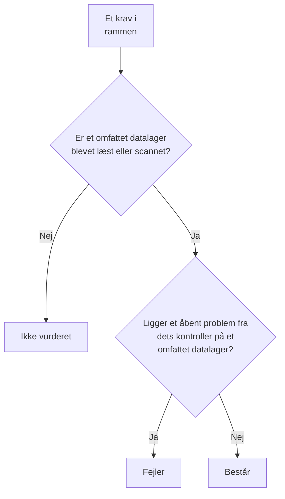

# Overholdelse i Datasikkerhed

Datasikkerhed scorer ni compliancerammer ud fra det, dens scanninger fandt. Hver ramme dækker de datalagre, dens regler handler om - GDPR de datalagre, der indeholder persondata, PCI DSS de datalagre, hvor der blev fundet kortdata, SOC 2 hvert datalager - og hvert af dens krav er opfyldt eller fejler ud fra de kontroller, der er bevis for det. **Datasikkerhed → Overholdelse** viser hver rammes score, hvor mange datalagre den dækker, og hvert krav med, hvor mange åbne problemer der får det til at fejle. En score er bevis til en revision, ikke et certifikat: den siger, hvad OneUptime kan se af de datalagre, den læser.

:::cards
- [Rammerne](#rammerne): De ni, og hvilke datalagre hver af dem dækker.
- [Sådan scores en ramme](#sådan-scores-en-ramme): Krav, der består, fejler eller ikke er vurderet.
- [Krav og deres kontroller](#krav-og-deres-kontroller): Hvert krav og de kontroller, der er bevis for det.
- [Fortegnelse over behandlingsaktiviteter](#fortegnelse-over-behandlingsaktiviteter): GDPR artikel 30, skrevet ud fra dine datalagre.
:::

## Rammerne

| Ramme | Fulde navn | Omfattede datalagre |
| --- | --- | --- |
| GDPR | EU's databeskyttelsesforordning | Datalagre, der indeholder persondata. |
| CCPA | California Consumer Privacy Act, som ændret ved CPRA | Datalagre, der indeholder personoplysninger. |
| HIPAA | HIPAA Security Rule | Datalagre, der indeholder helbredsdata. |
| PCI DSS | PCI DSS v4.0 | Datalagre, hvor der blev fundet kortnumre. |
| SOC 2 | SOC 2 Trust Services Criteria | Hvert datalager. |
| ISO 27001 | ISO/IEC 27001:2022 | Hvert datalager. |
| NIST CSF | NIST Cybersecurity Framework 2.0 | Hvert datalager. |
| LGPD | Brasiliens generelle lov om databeskyttelse | Datalagre, der indeholder persondata om personer i Brasilien. |
| DPDP | Indiens Digital Personal Data Protection Act, 2023 | Datalagre, der indeholder persondata om personer i Indien. |

## Hvilke datalagre en ramme dækker

Et datalagers omfang kommer fra de data, der er fundet i det, så det ændrer sig, efterhånden som scanningerne finder mere:

- **SOC 2, ISO 27001 og NIST CSF** er sikkerhedsrammer: de dækker hvert datalager, uanset hvad det indeholder.
- **GDPR, CCPA, HIPAA og PCI DSS** dækker de datalagre, der indeholder en datatype, de beskytter. Persondata bringer GDPR og CCPA ind, helbredsdata også HIPAA, og kortnumre, kortsikkerhedskoder og kortudløbsdatoer bringer PCI DSS ind. Et datalager, der kun indeholder hemmeligheder eller forretningsdokumenter, er ikke omfattet af nogen af dem.
- **LGPD og DPDP** er landes egne love: de dækker de datalagre, der indeholder persondata om personer i Brasilien eller Indien, aflæst ud fra datatyper, der hører til det land, f.eks. et brasiliansk CPF eller et indisk Aadhaar-nummer.

[Følsomme datatyper](/docs/data-security/data-types#indbyggede-datatyper) viser hver datatype med dens land.

## Sådan scores en ramme

- **Et krav består**, når intet åbent problem fra de kontroller, der er knyttet til det, ligger på et datalager i rammens omfang, og det **fejler**, når et gør.
- **Det er ikke vurderet**, så længe intet omfattet datalager har fået sin konfiguration læst eller sit indhold scannet.
- **To krav opfyldes af Datasikkerhed selv**: GDPR artikel 30, fortegnelser over behandlingsaktiviteter, og ISO 27001 A.5.12, klassificering af information. De består, når hvert omfattet datalager er blevet læst eller scannet, og fejler, så længe et ikke er.
- **Scoren** er den andel af en rammes vurderede krav, der består, som en hel procentdel. En ramme, hvor intet er vurderet, har ingen score.

Kun åbne problemer tæller. Et problem, hvis risiko er accepteret, eller som ikke er et problem, får ikke sine krav til at fejle, så en accepteret risiko er en beslutning, som din revision kan se på problemet: hvem der accepterede den, hvorfor, og indtil hvornår.

## Krav og deres kontroller

### GDPR

| Krav | Hvad det kræver | Kontroller |
| --- | --- | --- |
| Art. 5(1)(c) | Dataminimering | `production-data-in-non-production`, `stale-sensitive-data`, `sensitive-data-in-telemetry`, `sensitive-data-to-ai`, `sensitive-data-in-ai-store` |
| Art. 5(1)(e) | Opbevaringsbegrænsning | `stale-sensitive-data` |
| Art. 25 | Databeskyttelse gennem design og standardindstillinger | `production-data-in-non-production`, `stale-sensitive-data`, `sensitive-data-in-telemetry`, `sensitive-data-to-ai`, `sensitive-data-in-ai-store` |
| Art. 28 | Databehandlere | `sensitive-data-to-ai` |
| Art. 30 | Fortegnelser over behandlingsaktiviteter | Opfyldes af Datasikkerhed selv |
| Art. 32 | Behandlingssikkerhed | `public-read`, `public-write`, `public-access-not-blocked`, `internet-reachable`, `open-to-all-addresses`, `snapshot-public`, `snapshot-shared-externally`, `shared-with-external-accounts`, `not-encrypted-at-rest`, `no-customer-managed-key`, `encryption-in-transit-not-enforced`, `weak-tls`, `no-backups`, `no-point-in-time-recovery`, `deletion-protection-off`, `deleted-data-not-recoverable`, `access-not-logged`, `shared-key-access`, `object-acls-enabled`, `many-readers`, `secrets-stored`, `plaintext-passwords`, `secrets-in-telemetry` |
| Arts. 44-49 | Overførsler til tredjelande | `residency-violation` |

### CCPA

| Krav | Hvad det kræver | Kontroller |
| --- | --- | --- |
| 1798.100(c) | Indsamling begrænset til det nødvendige | `production-data-in-non-production`, `stale-sensitive-data`, `sensitive-data-in-telemetry`, `sensitive-data-to-ai`, `sensitive-data-in-ai-store` |
| 1798.150 | Rimelige sikkerhedsprocedurer | `public-read`, `public-write`, `public-access-not-blocked`, `internet-reachable`, `open-to-all-addresses`, `snapshot-public`, `snapshot-shared-externally`, `shared-with-external-accounts`, `shared-key-access`, `object-acls-enabled`, `many-readers` |

### HIPAA

| Krav | Hvad det kræver | Kontroller |
| --- | --- | --- |
| 164.308(a)(7) | Beredskabsplan | `no-backups`, `no-point-in-time-recovery`, `deletion-protection-off`, `deleted-data-not-recoverable` |
| 164.312(a)(1) | Adgangskontrol | `public-read`, `public-write`, `public-access-not-blocked`, `internet-reachable`, `open-to-all-addresses`, `snapshot-public`, `snapshot-shared-externally`, `shared-with-external-accounts`, `shared-key-access`, `object-acls-enabled`, `many-readers` |
| 164.312(a)(2)(iv) | Kryptering og dekryptering | `not-encrypted-at-rest`, `no-customer-managed-key` |
| 164.312(b) | Revisionskontroller | `access-not-logged` |
| 164.312(e)(1) | Transmissionssikkerhed | `encryption-in-transit-not-enforced`, `weak-tls` |

### PCI DSS

| Krav | Hvad det kræver | Kontroller |
| --- | --- | --- |
| 3.3.1 | Følsomme godkendelsesdata gemmes ikke efter autorisation | `card-security-codes-stored` |
| 3.4.1 | Kortnumre maskeres, når de vises | `card-numbers-readable`, `sensitive-data-in-telemetry` |
| 3.5.1 | Kortnumre er ulæselige, uanset hvor de gemmes | `not-encrypted-at-rest`, `no-customer-managed-key`, `card-numbers-readable` |
| 4.2.1 | Stærk kryptografi beskytter kortdata under overførsel | `encryption-in-transit-not-enforced`, `weak-tls` |
| 7.2 | Adgang defineres og tildeles efter behov | `public-read`, `public-write`, `public-access-not-blocked`, `internet-reachable`, `open-to-all-addresses`, `snapshot-public`, `snapshot-shared-externally`, `shared-with-external-accounts`, `shared-key-access`, `object-acls-enabled`, `many-readers` |
| 8.3.2 | Godkendelsesfaktorer er ulæselige, når de gemmes | `plaintext-passwords` |
| 10.2 | Revisionslogs registrerer adgang til kortdata | `access-not-logged` |

### SOC 2

| Krav | Hvad det kræver | Kontroller |
| --- | --- | --- |
| A1.2 | Backup og gendannelse | `no-backups`, `no-point-in-time-recovery`, `deletion-protection-off`, `deleted-data-not-recoverable` |
| CC6.1 | Logisk adgangssikkerhed | `public-read`, `public-write`, `public-access-not-blocked`, `internet-reachable`, `open-to-all-addresses`, `snapshot-public`, `snapshot-shared-externally`, `shared-with-external-accounts`, `not-encrypted-at-rest`, `no-customer-managed-key`, `shared-key-access`, `object-acls-enabled`, `many-readers`, `secrets-stored`, `plaintext-passwords`, `secrets-in-telemetry` |
| CC6.7 | Overførsel af information | `encryption-in-transit-not-enforced`, `weak-tls` |
| CC7.2 | Overvågning af systemkomponenter | `access-not-logged` |

### ISO 27001

| Krav | Hvad det kræver | Kontroller |
| --- | --- | --- |
| A.5.9 | Fortegnelse over information og andre tilknyttede aktiver | `no-owner` |
| A.5.12 | Klassificering af information | Opfyldes af Datasikkerhed selv |
| A.5.15 | Adgangsstyring | `public-read`, `public-write`, `public-access-not-blocked`, `internet-reachable`, `open-to-all-addresses`, `snapshot-public`, `snapshot-shared-externally`, `shared-with-external-accounts`, `shared-key-access`, `object-acls-enabled`, `many-readers` |
| A.5.34 | Privatliv og beskyttelse af personhenførbare oplysninger | `production-data-in-non-production`, `stale-sensitive-data`, `sensitive-data-in-telemetry`, `sensitive-data-to-ai`, `sensitive-data-in-ai-store` |
| A.8.11 | Datamaskering | `production-data-in-non-production`, `stale-sensitive-data`, `sensitive-data-in-telemetry`, `sensitive-data-to-ai`, `sensitive-data-in-ai-store` |
| A.8.12 | Forebyggelse af datalækage | `secrets-stored`, `secrets-in-telemetry` |
| A.8.13 | Backup af information | `no-backups`, `no-point-in-time-recovery`, `deletion-protection-off`, `deleted-data-not-recoverable` |
| A.8.15 | Logning | `access-not-logged` |
| A.8.24 | Brug af kryptografi | `not-encrypted-at-rest`, `no-customer-managed-key`, `encryption-in-transit-not-enforced`, `weak-tls`, `plaintext-passwords` |

### NIST CSF

| Krav | Hvad det kræver | Kontroller |
| --- | --- | --- |
| ID.AM-07 | Fortegnelser over data og metadata vedligeholdes | `no-owner` |
| PR.AA-05 | Adgangstilladelser administreres | `public-read`, `public-write`, `public-access-not-blocked`, `internet-reachable`, `open-to-all-addresses`, `snapshot-public`, `snapshot-shared-externally`, `shared-with-external-accounts`, `shared-key-access`, `object-acls-enabled`, `many-readers` |
| PR.DS-01 | Data i hvile beskyttes | `not-encrypted-at-rest`, `no-customer-managed-key`, `secrets-stored`, `secrets-in-telemetry` |
| PR.DS-02 | Data under overførsel beskyttes | `encryption-in-transit-not-enforced`, `weak-tls` |
| PR.DS-11 | Backups af data opbevares og testes | `no-backups`, `no-point-in-time-recovery`, `deletion-protection-off`, `deleted-data-not-recoverable` |
| DE.CM-09 | Data og brugen af dem overvåges | `access-not-logged` |

### LGPD

| Krav | Hvad det kræver | Kontroller |
| --- | --- | --- |
| Art. 6 | Nødvendighed og formålsbegrænsning | `production-data-in-non-production`, `stale-sensitive-data`, `sensitive-data-in-telemetry`, `sensitive-data-to-ai`, `sensitive-data-in-ai-store` |
| Art. 33 | International overførsel af data | `residency-violation` |
| Art. 46 | Sikkerhedsforanstaltninger | `public-read`, `public-write`, `public-access-not-blocked`, `internet-reachable`, `open-to-all-addresses`, `snapshot-public`, `snapshot-shared-externally`, `shared-with-external-accounts`, `not-encrypted-at-rest`, `no-customer-managed-key`, `shared-key-access`, `object-acls-enabled`, `many-readers` |

### DPDP

| Krav | Hvad det kræver | Kontroller |
| --- | --- | --- |
| Sec. 8(5) | Rimelige sikkerhedsforanstaltninger | `public-read`, `public-write`, `public-access-not-blocked`, `internet-reachable`, `open-to-all-addresses`, `snapshot-public`, `snapshot-shared-externally`, `shared-with-external-accounts`, `not-encrypted-at-rest`, `no-customer-managed-key`, `shared-key-access`, `object-acls-enabled`, `many-readers` |
| Sec. 8(7) | Sletning, når formålet er opfyldt | `production-data-in-non-production`, `stale-sensitive-data`, `sensitive-data-in-telemetry`, `sensitive-data-to-ai`, `sensitive-data-in-ai-store` |
| Sec. 16 | Overførsel uden for Indien | `residency-violation` |

## Fortegnelse over behandlingsaktiviteter

GDPR artikel 30 kræver, at du fører en fortegnelse over dine behandlingsaktiviteter. Datasikkerhed skriver den del af den, der handler om, hvor persondata opbevares: én række for hvert datalager, der indeholder persondata.

| Kolonne | Hvor den kommer fra |
| --- | --- |
| Datalager, type, udbyder og region | Discovery |
| Miljø | Datalagerets tags eller navn, eller det, du angiver |
| Følsomhed, kategorier og datatyper | Det, scanningerne fandt, eller den følsomhed, du angiver |
| Ejere | Datalagerets ejere, personer og medlemmerne af dets teams |
| Formål | Det, du skriver i datalagerets **Formål**: hvorfor det indeholder persondata |
| Opbevaring | Det, du skriver i datalagerets **Opbevaring**: hvor længe data opbevares i det |
| Rammer | De rammer, som dets datatyper gør det omfattet af |

Udfyld **Formål** og **Opbevaring** under hvert datalagers **Indstillinger**: det er de to ting, ingen scanning kan vide. Fortegnelsen og scorerne kan også hentes fra Datasikkerheds API på `/data-security/record-of-processing` og `/data-security/compliance` af alle, der må læse datalagre (se [Datasikkerhedsintegrationer](/docs/data-security/integrations#api-terraform-og-mcp)).

## Næste trin

:::cards
- [Datasikkerhedskontroller og problemer](/docs/data-security/checks-and-issues): Kontrollerne bag hvert krav, og hvordan de rettes.
- [Datastrømme, adgang og residens](/docs/data-security/flows-access-residency): Residensregler til overførsler under GDPR, LGPD og DPDP.
- [Følsomme datatyper](/docs/data-security/data-types): De datatyper, der gør et datalager omfattet af en ramme.
:::
