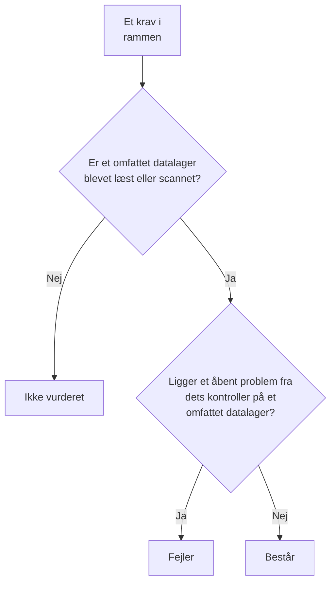

# Overholdelse i Datasikkerhed

Datasikkerhed scorer ni compliancerammer ud fra det, dens scanninger fandt. Hver ramme dækker de datalagre, dens regler handler om - GDPR de datalagre, der indeholder persondata, PCI DSS de datalagre, hvor der blev fundet kortdata, SOC 2 hvert datalager - og hvert af dens krav er opfyldt eller fejler ud fra de kontroller, der er bevis for det. **Datasikkerhed → Overholdelse** viser hver rammes score, hvor mange datalagre den dækker, og hvert krav med, hvor mange åbne problemer der får det til at fejle. Hver ressource, der indeholder datalagre - en Kubernetes-klynge, en Docker- eller Podman-vært, en database, en tjeneste eller en cloud-ressource - har sin egen udgave af siden, hvor det, der ikke gælder for den, kan slås fra. En score er bevis til en revision, ikke et certifikat: den siger, hvad OneUptime kan se af de datalagre, den læser.

:::cards
- [Rammerne](#rammerne): De ni, og hvilke datalagre hver af dem dækker.
- [Sådan scores en ramme](#sådan-scores-en-ramme): Krav, der består, fejler eller ikke er vurderet.
- [På en ressources side](#på-en-ressources-side): Overholdelse for én klynge, vært, database, tjeneste eller cloud-ressource, og hvad der er slået fra for den.
- [Krav og deres kontroller](#krav-og-deres-kontroller): Hvert krav og de kontroller, der er bevis for det.
- [Fortegnelse over behandlingsaktiviteter](#fortegnelse-over-behandlingsaktiviteter): GDPR artikel 30, skrevet ud fra dine datalagre, med OneUptime AI's kladder, som du bekræfter.
- [Konsekvensanalyser](#konsekvensanalyser): En konsekvensanalyse vedrørende databeskyttelse for hvert datalager, der har brug for en.
- [Revisionsbevis](#revisionsbevis): Det, en revisor læser under hvert krav, eksporteret med din fortegnelse og problemhistorik.
:::

## Rammerne

| Ramme | Fulde navn | Omfattede datalagre |
| --- | --- | --- |
| GDPR | EU's databeskyttelsesforordning | Datalagre, der indeholder persondata. |
| CCPA | California Consumer Privacy Act, som ændret ved CPRA | Datalagre, der indeholder personoplysninger. |
| HIPAA | HIPAA Security Rule | Datalagre, der indeholder helbredsdata. |
| PCI DSS | PCI DSS v4.0 | Datalagre, hvor der blev fundet kortnumre. |
| SOC 2 | SOC 2 Trust Services Criteria | Hvert datalager. |
| ISO 27001 | ISO/IEC 27001:2022 | Hvert datalager. |
| NIST CSF | NIST Cybersecurity Framework 2.0 | Hvert datalager. |
| LGPD | Brasiliens generelle lov om databeskyttelse | Datalagre, der indeholder persondata om personer i Brasilien. |
| DPDP | Indiens Digital Personal Data Protection Act, 2023 | Datalagre, der indeholder persondata om personer i Indien. |

## Hvilke datalagre en ramme dækker

Et datalagers omfang kommer fra de data, der er fundet i det, så det ændrer sig, efterhånden som scanningerne finder mere:

- **SOC 2, ISO 27001 og NIST CSF** er sikkerhedsrammer: de dækker hvert datalager, uanset hvad det indeholder.
- **GDPR, CCPA, HIPAA og PCI DSS** dækker de datalagre, der indeholder en datatype, de beskytter. Persondata bringer GDPR og CCPA ind, helbredsdata også HIPAA, og kortnumre, kortsikkerhedskoder og kortudløbsdatoer bringer PCI DSS ind. Et datalager, der kun indeholder hemmeligheder eller forretningsdokumenter, er ikke omfattet af nogen af dem.
- **LGPD og DPDP** er landes egne love: de dækker de datalagre, der indeholder persondata om personer i Brasilien eller Indien, aflæst ud fra datatyper, der hører til det land, f.eks. et brasiliansk CPF eller et indisk Aadhaar-nummer.

[Følsomme datatyper](/docs/data-security/data-types#indbyggede-datatyper) viser hver datatype med dens land.

## Sådan scores en ramme

- **Et krav består**, når intet åbent problem fra de kontroller, der er knyttet til det, ligger på et datalager i rammens omfang, og det **fejler**, når et gør.
- **Det er ikke vurderet**, så længe intet omfattet datalager har fået sin konfiguration læst eller sit indhold scannet.
- **To krav opfyldes af Datasikkerhed selv**: GDPR artikel 30, fortegnelser over behandlingsaktiviteter, og ISO 27001 A.5.12, klassificering af information. De består, når hvert omfattet datalager er blevet læst eller scannet, og fejler, så længe et ikke er.
- **Det er slået fra**, når hvert omfattet datalager tilhører en ressource, der har slået kravet fra (se [På en ressources side](#på-en-ressources-side)).
- **Scoren** er den andel af en rammes vurderede krav, der består, som en hel procentdel: et krav, der er slået fra, tæller hverken for eller imod. En ramme, hvor intet er vurderet, har ingen score.

Kun åbne problemer tæller. Et problem, hvis risiko er accepteret, eller som ikke er et problem, får ikke sine krav til at fejle, så en accepteret risiko er en beslutning, som din revision kan se på problemet: hvem der accepterede den, hvorfor, og indtil hvornår.

## På en ressources side

En ressources menu får en **Sikkerhed**-sektion, foldet sammen, indtil du åbner den, når ressourcen indeholder et datalager, som Datasikkerhed kender, i et projekt, der bruger Datasikkerhed, og for den, der må læse datalagre:

| Ressource | Dens datalagre |
| --- | --- |
| Kubernetes-klynge | De databaser, der kører på den |
| Docker- eller Podman-vært | De databaser, der kører på den |
| Database | Selve databasen |
| Tjeneste | Dens telemetri: de logs, traces og undtagelser, den sender |
| Cloud-ressource | Ressourcen selv: en bucket, en database eller et datavarehus |

- **Datasikkerhed** viser disse datalagre, de mest risikable først, og de åbne problemer på dem. Hvert af dem åbnes i Datasikkerhed, hvor det behandles.
- **Overholdelse** scorer rammerne ud fra disse datalagre alene. De rammer, som deres data gør dem omfattet af, kommer først; dem, der er slået fra, og dem, som ingen af datalagrene indeholder data til, er foldet sammen nedenunder.

Hver ramme har en kontakt, **Gælder her**, og det har hvert af dens krav også. Slår du en fra, holdes ressourcens datalagre uden for den ramme eller det krav, både på ressourcens side og på **Datasikkerhed → Overholdelse**, som viser, hvor mange datalagre der er slået fra på deres ressourcer. Slår du den til igen, kommer de med igen. Hver kontakt gemmes med det samme, og hver ændring registreres i projektets [Auditlogs](/docs/configuration/audit-logs).

Slår du en fra, spørger siden derefter under den: **Hvorfor gælder dette ikke her?** En årsag er valgfri: skriv en kort årsag, og vælg **Gem årsag**, eller **Ikke nu** for at lade være. Fra da af står der, hvem der slog den fra og hvornår, og årsagen, med **Tilføj årsag** eller **Rediger årsag** til at skrive eller ændre den senere. Ligesom kontakten registreres årsagen i auditloggen.

**Datasikkerhed → Overholdelse** viser det samme for hver ressource. En valgt ramme viser under **Slået fra for hele rammen** de ressourcer, der har slået hele rammen fra, og hvert krav nævner under sin status de ressourcer, der har slået netop det krav fra: hver med et link til sin egen overholdelsesside og med, hvem der slog det fra, hvornår og hvorfor. Sidens **Eksportér CSV** har dem i kolonnen `Turned Off On`, og **Eksportér JSON** i listen `turnedOff`.

Et datalager følger én ressources kontakter. En database, der kører på en Kubernetes-klynge eller på en Docker- eller Podman-vært, følger den klynges eller værts kontakter: slå en ramme fra for klyngen, og den er slået fra for hver database på den. Databasens egen overholdelsesside siger det og linker dertil, med kontakterne låst.

Sikkerhedsmedlemmer, Sikkerhedsadministratorer, Projektadministratorer og Projektejere kan slå rammer og krav til og fra, ligesom de kan tilpasse en kontrol. Sikkerhedsseere ser, hvad der er slået fra, og hvorfor.

## Krav og deres kontroller

### GDPR

| Krav | Hvad det kræver | Kontroller |
| --- | --- | --- |
| Art. 5(1)(c) | Dataminimering | `production-data-in-non-production`, `stale-sensitive-data`, `new-personal-data-column`, `sensitive-data-in-telemetry`, `sensitive-data-to-ai`, `sensitive-data-in-ai-store` |
| Art. 5(1)(e) | Opbevaringsbegrænsning | `stale-sensitive-data` |
| Art. 25 | Databeskyttelse gennem design og standardindstillinger | `production-data-in-non-production`, `stale-sensitive-data`, `new-personal-data-column`, `sensitive-data-in-telemetry`, `sensitive-data-to-ai`, `sensitive-data-in-ai-store` |
| Art. 28 | Databehandlere | `sensitive-data-to-ai` |
| Art. 30 | Fortegnelser over behandlingsaktiviteter | Opfyldes af Datasikkerhed selv |
| Art. 32 | Behandlingssikkerhed | `public-read`, `public-write`, `public-access-not-blocked`, `internet-reachable`, `open-to-all-addresses`, `snapshot-public`, `snapshot-shared-externally`, `shared-with-external-accounts`, `not-encrypted-at-rest`, `no-customer-managed-key`, `encryption-in-transit-not-enforced`, `weak-tls`, `no-backups`, `no-point-in-time-recovery`, `deletion-protection-off`, `deleted-data-not-recoverable`, `access-not-logged`, `shared-key-access`, `object-acls-enabled`, `many-readers`, `unused-access`, `secrets-stored`, `plaintext-passwords`, `secrets-in-telemetry` |
| Arts. 44-49 | Overførsler til tredjelande | `residency-violation` |

### CCPA

| Krav | Hvad det kræver | Kontroller |
| --- | --- | --- |
| 1798.100(c) | Indsamling begrænset til det nødvendige | `production-data-in-non-production`, `stale-sensitive-data`, `new-personal-data-column`, `sensitive-data-in-telemetry`, `sensitive-data-to-ai`, `sensitive-data-in-ai-store` |
| 1798.150 | Rimelige sikkerhedsprocedurer | `public-read`, `public-write`, `public-access-not-blocked`, `internet-reachable`, `open-to-all-addresses`, `snapshot-public`, `snapshot-shared-externally`, `shared-with-external-accounts`, `shared-key-access`, `object-acls-enabled`, `many-readers` |

### HIPAA

| Krav | Hvad det kræver | Kontroller |
| --- | --- | --- |
| 164.308(a)(4) | Styring af adgang til information | `unused-access` |
| 164.308(a)(7) | Beredskabsplan | `no-backups`, `no-point-in-time-recovery`, `deletion-protection-off`, `deleted-data-not-recoverable` |
| 164.312(a)(1) | Adgangskontrol | `public-read`, `public-write`, `public-access-not-blocked`, `internet-reachable`, `open-to-all-addresses`, `snapshot-public`, `snapshot-shared-externally`, `shared-with-external-accounts`, `shared-key-access`, `object-acls-enabled`, `many-readers` |
| 164.312(a)(2)(iv) | Kryptering og dekryptering | `not-encrypted-at-rest`, `no-customer-managed-key` |
| 164.312(b) | Revisionskontroller | `access-not-logged` |
| 164.312(e)(1) | Transmissionssikkerhed | `encryption-in-transit-not-enforced`, `weak-tls` |

### PCI DSS

| Krav | Hvad det kræver | Kontroller |
| --- | --- | --- |
| 3.3.1 | Følsomme godkendelsesdata gemmes ikke efter autorisation | `card-security-codes-stored` |
| 3.4.1 | Kortnumre maskeres, når de vises | `card-numbers-readable`, `sensitive-data-in-telemetry` |
| 3.5.1 | Kortnumre er ulæselige, uanset hvor de gemmes | `not-encrypted-at-rest`, `no-customer-managed-key`, `card-numbers-readable` |
| 4.2.1 | Stærk kryptografi beskytter kortdata under overførsel | `encryption-in-transit-not-enforced`, `weak-tls` |
| 7.2 | Adgang defineres og tildeles efter behov | `public-read`, `public-write`, `public-access-not-blocked`, `internet-reachable`, `open-to-all-addresses`, `snapshot-public`, `snapshot-shared-externally`, `shared-with-external-accounts`, `shared-key-access`, `object-acls-enabled`, `many-readers` |
| 7.2.4 | Konti og deres adgang gennemgås | `unused-access` |
| 8.3.2 | Godkendelsesfaktorer er ulæselige, når de gemmes | `plaintext-passwords` |
| 10.2 | Revisionslogs registrerer adgang til kortdata | `access-not-logged` |

### SOC 2

| Krav | Hvad det kræver | Kontroller |
| --- | --- | --- |
| A1.2 | Backup og gendannelse | `no-backups`, `no-point-in-time-recovery`, `deletion-protection-off`, `deleted-data-not-recoverable` |
| CC6.1 | Logisk adgangssikkerhed | `public-read`, `public-write`, `public-access-not-blocked`, `internet-reachable`, `open-to-all-addresses`, `snapshot-public`, `snapshot-shared-externally`, `shared-with-external-accounts`, `not-encrypted-at-rest`, `no-customer-managed-key`, `shared-key-access`, `object-acls-enabled`, `many-readers`, `secrets-stored`, `plaintext-passwords`, `secrets-in-telemetry` |
| CC6.2 | Adgang fjernes, når den ikke længere er nødvendig | `unused-access` |
| CC6.7 | Overførsel af information | `encryption-in-transit-not-enforced`, `weak-tls` |
| CC7.2 | Overvågning af systemkomponenter | `access-not-logged` |

### ISO 27001

| Krav | Hvad det kræver | Kontroller |
| --- | --- | --- |
| A.5.9 | Fortegnelse over information og andre tilknyttede aktiver | `no-owner` |
| A.5.12 | Klassificering af information | Opfyldes af Datasikkerhed selv |
| A.5.15 | Adgangsstyring | `public-read`, `public-write`, `public-access-not-blocked`, `internet-reachable`, `open-to-all-addresses`, `snapshot-public`, `snapshot-shared-externally`, `shared-with-external-accounts`, `shared-key-access`, `object-acls-enabled`, `many-readers` |
| A.5.18 | Adgangsrettigheder | `unused-access` |
| A.5.34 | Privatliv og beskyttelse af personhenførbare oplysninger | `production-data-in-non-production`, `stale-sensitive-data`, `new-personal-data-column`, `sensitive-data-in-telemetry`, `sensitive-data-to-ai`, `sensitive-data-in-ai-store` |
| A.8.11 | Datamaskering | `production-data-in-non-production`, `stale-sensitive-data`, `new-personal-data-column`, `sensitive-data-in-telemetry`, `sensitive-data-to-ai`, `sensitive-data-in-ai-store` |
| A.8.12 | Forebyggelse af datalækage | `secrets-stored`, `secrets-in-telemetry` |
| A.8.13 | Backup af information | `no-backups`, `no-point-in-time-recovery`, `deletion-protection-off`, `deleted-data-not-recoverable` |
| A.8.15 | Logning | `access-not-logged` |
| A.8.24 | Brug af kryptografi | `not-encrypted-at-rest`, `no-customer-managed-key`, `encryption-in-transit-not-enforced`, `weak-tls`, `plaintext-passwords` |

### NIST CSF

| Krav | Hvad det kræver | Kontroller |
| --- | --- | --- |
| ID.AM-07 | Fortegnelser over data og metadata vedligeholdes | `no-owner` |
| PR.AA-05 | Adgangstilladelser administreres | `public-read`, `public-write`, `public-access-not-blocked`, `internet-reachable`, `open-to-all-addresses`, `snapshot-public`, `snapshot-shared-externally`, `shared-with-external-accounts`, `shared-key-access`, `object-acls-enabled`, `many-readers`, `unused-access` |
| PR.DS-01 | Data i hvile beskyttes | `not-encrypted-at-rest`, `no-customer-managed-key`, `secrets-stored`, `secrets-in-telemetry` |
| PR.DS-02 | Data under overførsel beskyttes | `encryption-in-transit-not-enforced`, `weak-tls` |
| PR.DS-11 | Backups af data opbevares og testes | `no-backups`, `no-point-in-time-recovery`, `deletion-protection-off`, `deleted-data-not-recoverable` |
| DE.CM-09 | Data og brugen af dem overvåges | `access-not-logged` |

### LGPD

| Krav | Hvad det kræver | Kontroller |
| --- | --- | --- |
| Art. 6 | Nødvendighed og formålsbegrænsning | `production-data-in-non-production`, `stale-sensitive-data`, `new-personal-data-column`, `sensitive-data-in-telemetry`, `sensitive-data-to-ai`, `sensitive-data-in-ai-store` |
| Art. 33 | International overførsel af data | `residency-violation` |
| Art. 46 | Sikkerhedsforanstaltninger | `public-read`, `public-write`, `public-access-not-blocked`, `internet-reachable`, `open-to-all-addresses`, `snapshot-public`, `snapshot-shared-externally`, `shared-with-external-accounts`, `not-encrypted-at-rest`, `no-customer-managed-key`, `shared-key-access`, `object-acls-enabled`, `many-readers` |

### DPDP

| Krav | Hvad det kræver | Kontroller |
| --- | --- | --- |
| Sec. 8(5) | Rimelige sikkerhedsforanstaltninger | `public-read`, `public-write`, `public-access-not-blocked`, `internet-reachable`, `open-to-all-addresses`, `snapshot-public`, `snapshot-shared-externally`, `shared-with-external-accounts`, `not-encrypted-at-rest`, `no-customer-managed-key`, `shared-key-access`, `object-acls-enabled`, `many-readers` |
| Sec. 8(7) | Sletning, når formålet er opfyldt | `production-data-in-non-production`, `stale-sensitive-data`, `new-personal-data-column`, `sensitive-data-in-telemetry`, `sensitive-data-to-ai`, `sensitive-data-in-ai-store` |
| Sec. 16 | Overførsel uden for Indien | `residency-violation` |

## Fortegnelse over behandlingsaktiviteter

GDPR artikel 30 kræver, at du fører en fortegnelse over dine behandlingsaktiviteter. Datasikkerhed skriver den del af den, der handler om, hvor persondata opbevares: én række for hvert datalager, der indeholder persondata. Det er kortet **Fortegnelse over behandlingsaktiviteter** nederst på **Datasikkerhed → Overholdelse**, med **Eksportér CSV** og **Eksportér JSON**.

| Kolonne | Hvor den kommer fra |
| --- | --- |
| Datalager, type, udbyder og region | Discovery |
| Miljø | Datalagerets tags eller navn, eller det, du angiver |
| Følsomhed, kategorier og datatyper | Det, scanningerne fandt, eller den følsomhed, du angiver |
| Ejere | Datalagerets ejere, personer og medlemmerne af dets teams |
| Formål | Det, du skriver eller bekræfter i datalagerets **Formål**: hvorfor det indeholder persondata. OneUptime udfylder det for de datalagre, det opbevarer for din sikkerhed |
| Opbevaring | Det, du skriver eller bekræfter i datalagerets **Opbevaring**: hvor længe data opbevares i det. OneUptime udfylder det for de datalagre, det opbevarer for din sikkerhed, og for en tjenestes telemetri ud fra dit projekts opbevaring af telemetri |
| Hvem kan læse | Hvem der kan læse et datalager, som OneUptime opbevarer for din sikkerhed |
| Rammer | De rammer, som dets datatyper gør det omfattet af |
| Angivet af | OneUptime, for de datalagre, det opbevarer for din sikkerhed |
| Retsgrundlag | Det, du skriver eller bekræfter: datalagerets retsgrundlag efter GDPR artikel 6, ét af samtykke, kontrakt, retlig forpligtelse, vitale interesser, opgave i samfundets interesse og legitime interesser. Legitime interesser for de datalagre, OneUptime opbevarer for din sikkerhed |
| Registrerede | Det, du skriver eller bekræfter: hvem datalagerets data handler om, f.eks. kunder, brugere, medarbejdere eller patienter |
| Modtagere | Udledt af datalagerets datastrømme: de eksterne værter og AI-udbydere, som dets data sendes til, og de datalagre, der har en kopi af dem |
| Overførsler | Udledt af datalagerets region, de regioner, clouden kopierer det til, og regionerne for dets kopier, holdt op mod de lande, de registrerede befinder sig i: hver overførsel ud af de lande, eller hvorfor den ikke kendes |
| Konsekvensanalyse | Om datalageret har brug for en konsekvensanalyse vedrørende databeskyttelse, og hvor den står: ikke nødvendig, påkrævet, kladde eller redigeret |
| Venter på gennemsyn | De felter, hvis kladde venter på en person. En kladde er aldrig i fortegnelsen, heller ikke i dens eksporter, før nogen bekræfter den |

For et datalager, som Datasikkerhed har fundet, kan ingen scanning vide, hvorfor det indeholder persondata, hvor længe, på hvilket grundlag eller om hvem: skriv det under dets **Indstillinger**, eller bekræft OneUptime AI's kladder. Fortegnelsen og scorerne kan også hentes fra Datasikkerheds API på `/data-security/record-of-processing`, `/data-security/compliance` og, for én ressource, `/data-security/resource-compliance` af alle, der må læse datalagre (se [Datasikkerhedsintegrationer](/docs/data-security/integrations#api-terraform-og-mcp)).

### OneUptime AI's kladder

OneUptime AI skriver kladder til et datalagers **Formål**, **Opbevaring**, **Retsgrundlag** og **Registrerede** ud fra det, Datasikkerhed ved om det: de fundne datatyper, dets navn, tags og beskrivelse, de tjenester, der bruger det, og hvad deres teams har skrevet, at de er til, hvor dets data sendes hen, og hvor de opbevares. Den ser aldrig en værdi fra dine data (se [OneUptime AI i Datasikkerhed](/docs/data-security/ai)).

- **En kladde er markeret Kladde** og siger hvorfor, med de fakta, den bygger på, ét klik væk. Den er ikke i fortegnelsen, før du trykker på **Bekræft** eller bruger **Rediger** til at skrive den om med dine egne ord.
- **Dine ord bliver aldrig overskrevet af en kladde.** Der skrives aldrig igen kladde til et felt, du har skrevet. En kladde, du har bekræftet, får kun en ny kladde, når et faktum, den bygger på, ændrer sig, og så foreslås den i stedet for at blive brugt: markeret **Ændring foreslået**, med det, der er ændret, **Brug ny kladde** og **Behold nuværende**.
- **Gennemse kladder** på kortet **Fortegnelse over behandlingsaktiviteter** gennemgår de datalagre, hvis kladder venter på dig, ét ad gangen. Et datalagers **Indstillinger** har de samme felter, med **Skriv kladde med OneUptime AI** til de tomme.
- **Af sig selv** skriver OneUptime AI én gang om dagen kladder til de tomme felter i de mest risikable datalagre, mens **Arbejd med nye problemer** er slået til under **Datasikkerhed → AI**, som dine AI-regler tillader.

Opbevaringen af en tjenestes telemetri, modtagerne og overførslerne udledes af almindelig kode og får aldrig en kladde. Kladderne er et udgangspunkt, ikke juridisk rådgivning: få dem kontrolleret af den, der står til ansvar for jeres overholdelse.

### Datalagre, som OneUptime opbevarer for din sikkerhed

Fire datalagre indeholder IP-adresser og brugernavne med vilje for at beskytte dit netværk: **Sikkerhedshændelser**, **Network Flows**, **Sikkerhedsadresseboks** og **Sikkerhedsbrugerboks**. Fortegnelsen viser hvert af dem, som dit projekt har. OneUptime angiver dem i stedet for at finde dem: hvad de indeholder, er kendt fra starten, så ingen scanning læser dem, ingen kontrol gælder for dem, og at de indeholder disse adresser og navne, er aldrig et problem, for det er det, de er til. De viser **Angivet af OneUptime** under **Datalagre**, og **Oversigt** og rammernes scorer udelader dem.

| Datalager | Hvad det indeholder | Opbevaring | Hvem kan læse det |
| --- | --- | --- | --- |
| Sikkerhedshændelser | IP-adresser, brugernavne og e-mailadresser på den, der handlede, og det, der blev berørt | Dit projekts [opbevaring af telemetri](/docs/telemetry/data-retention), læst hver gang fortegnelsen læses, så en ændring gælder med det samme | Projektejere, Projektadministratorer, Sikkerhedsadministratorer, Sikkerhedsmedlemmer, Sikkerhedsseere og alle med Read Security Event |
| Network Flows | IP-adresserne på dem, der kommunikerede med hinanden | 30 dage efter, at et flow ankommer | Alle, der må læse netværksenheder |
| Sikkerhedsadresseboks | IP-adressen bag hvert token, som en IP-adresseregel, der hasher, efterlod i de logs og traces, [Sikkerhedshændelser](/docs/telemetry/security-events) læser | 30 dage efter, at en adresse sidst blev set | Kun scanningerne i Sikkerhedshændelser, inde i OneUptime: ingen person, side, eksport, API eller AI-værktøj |
| Sikkerhedsbrugerboks | Brugeren bag hvert token, som en regel, der hasher, efterlod, hvor [Sikkerhedshændelser](/docs/telemetry/security-events) læser en bruger i dine logs og traces | 30 dage efter, at en bruger sidst blev set | Kun scanningerne i Sikkerhedshændelser, inde i OneUptime: ingen person, side, eksport, API eller AI-værktøj |

Formålet med hvert af dem er "Net- og informationssikkerhed (GDPR betragtning 49)". Vil du skrive dit eget formål eller din egen opbevaring, så brug **Rediger fortegnelse** under datalagerets **Indstillinger**: et felt, der står tomt, beholder OneUptimes.

Et datalager vises, så længe dit projekt opbevarer dets data: adresseboksen, så længe en aktiveret IP-adresseregel hasher logs eller traces, som Sikkerhedshændelser læser, og brugerboksen, så længe en aktiveret regel med et hvilket som helst andet mønster gør det, hver i 31 dage derefter (se [Rens følsomme data](/docs/telemetry/drop-filters-and-scrub-rules#rens-følsomme-data)). Når dets data er væk, arkiveres datalageret, og det vender tilbage med dit formål og din opbevaring, hvis dataene gør det.

## Konsekvensanalyser

GDPR artikel 35 kræver en konsekvensanalyse vedrørende databeskyttelse før behandling, der sandsynligvis indebærer en høj risiko. Datasikkerhed angiver, hvilke datalagre der har brug for en: et datalager, der indeholder særlige kategorier af personoplysninger, f.eks. helbredsdata, data om mange personer (omkring 100.000 poster eller flere), eller data, der forlader de registreredes lande.

Et datalagers **Konsekvensanalyse**, i dets menu under **Indstillinger**, siger, hvorfor datalageret har brug for en, eller at det ikke har. **Skriv kladde til analysen** beder OneUptime AI om de fire dele, artikel 35(7) kræver, ud fra datalagerets fortegnelse, dets åbne problemer og dem, der er rettet for nylig, hvor eksponeret det er, hvor mange der kan nå det, og dets kryptering:

| Del | Artikel |
| --- | --- |
| Behandlingen og dens formål | Art. 35(7)(a) |
| Nødvendighed og proportionalitet | Art. 35(7)(b) |
| Risici for de registrerede | Art. 35(7)(c) |
| Foranstaltninger til at imødegå risiciene | Art. 35(7)(d) |

Hver del siger, hvem der skrev den og hvornår, med de fakta, en del med en kladde bygger på. **Rediger** gør en del til din, og der skrives aldrig igen kladde til den; **Skriv ny kladde** skriver kun kladder til de dele, ingen har redigeret. En del, der er skrevet ud fra fakta, som siden er ændret, siger det. **Eksportér PDF** og **Eksportér Markdown** downloader analysen.

## Revisionsbevis

**Revisionsbevis** på den ramme, du vælger under **Datasikkerhed → Overholdelse**, er det, en revisor læser under hvert af dens krav, over de seneste 30, 90, 180 eller 365 dage:

- datalagrene inden for kravets omfang, og hvordan dets kontroller står;
- de problemer fra dets kontroller, der blev åbnet og rettet i perioden, og hvor hurtigt de blev rettet;
- de risici, der er accepteret under det, med deres begrundelser og udløb;
- de ressourcer, der har slået det fra, og hvorfor.

**Skriv kladde til revisionsbeviset** beder OneUptime AI om et afsnit under hvert krav, holdt til disse fakta; **Rediger** gør et afsnit til dit, og der skrives aldrig igen kladde til det. Et krav uden afsnit viser sit bevis, som det er. **Eksportér PDF** og **Eksportér Markdown** downloader revisionsbeviset med to bilag: fortegnelsen over behandlingsaktiviteter for datalagrene inden for omfanget og den problemhistorik, det henviser til.

## Næste trin

:::cards
- [Datasikkerhedskontroller og problemer](/docs/data-security/checks-and-issues): Kontrollerne bag hvert krav, og hvordan de rettes.
- [Datastrømme, adgang og residens](/docs/data-security/flows-access-residency): Residensregler til overførsler under GDPR, LGPD og DPDP.
- [Følsomme datatyper](/docs/data-security/data-types): De datatyper, der gør et datalager omfattet af en ramme.
:::
