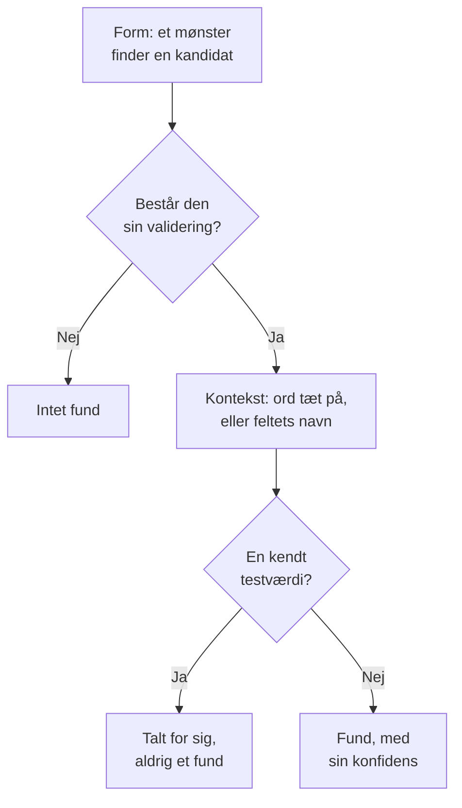

# Følsomme datatyper

Datasikkerhed kender 143 slags følsomme data: kortnumre, bankkonti, nationale ID-numre fra 43 lande, sundhedsidentifikatorer, API-nøgler og tokens og de særlige kategorier af personoplysninger. Hver af dem har en kategori, en følsomhed og, når den hører til ét land, det land. Denne side fortæller, hvordan en værdi findes, og viser alle datatyper, så du kan se, hvorfor noget blev fundet, og beslutte, hvad du vil gøre ved det.

:::cards
- [Sådan findes en værdi](#sådan-findes-en-værdi): Form, validering, kontekst, testværdier, konfidens.
- [Felter og kolonner](#felter-og-kolonner): Hvordan en hel kolonne eller attribut vurderes.
- [Navne og gadeadresser i fritekst](#navne-og-gadeadresser-i-fritekst): Den lille model inde i scanneren og dens scorer.
- [Alle datatyper](#indbyggede-datatyper): Alle 143, efter kategori.
- [Dine egne datatyper](#dine-egne-datatyper): Medarbejder-ID'er, policenumre og feltet Test det.
- [Datatyper, som OneUptime AI finder](#datatyper-som-oneuptime-ai-finder): Dine egne datatyper, fundet i de felter, som ingen detektor kunne placere.
- [OneUptime AI's vurderinger](#oneuptime-ais-vurderinger): En vurdering af hvert fund, der venter på dig, med dit teams beslutninger som præcedens.
:::

## Sådan findes en værdi



Alt, der scannes - en loglinje, en CSV-celle, en databaserække, de første byte af et objekt - gennemgår de samme trin:

1. **Form.** Hver datatype har mønstre, der finder kandidater: seksten cifre, `AKIA` og seksten bogstaver, et ord, et `@` og et domæne. Et mønster matcher aldrig inde i et længere token, så et kortnummer findes ikke inde i en længere række cifre.
2. **Validering.** En kandidat skal overholde sin types egne regler: en kontrolsum (Luhn for kort, mod 97 for IBAN'er, Verhoeff for Aadhaar-numre, kontrolcifret i de fleste nationale ID-numre), en rigtig dato, et kendt præfiks, tilstrækkelig tilfældighed for en hemmelighed. En kandidat, der fejler, er slet ikke et fund. Pladsholdere som `000000000` og `123456789` fejler for alle numeriske typer.
3. **Kontekst.** Ord tæt på en kandidat - som standard op til 64 tegn før den og 32 efter den - der siger, hvad den er, hæver dens konfidens ét niveau, og det samme gør et felt, hvis navn peger på typen. Ord, der siger, at den er noget andet, f.eks. et ordre- eller forsendelsesnummer, sænker den ét niveau. Et nummer uden kontrolsum og med en almindelig form, f.eks. et pasnummer eller en bankkonto, tæller kun ved siden af ord, der navngiver det.
4. **Kendte testværdier.** Offentliggjorte testkortnumre (f.eks. Stripes `4242 4242 4242 4242`), eksempel-IBAN'er, adresser på `example.com` og andre reserverede domæner, IP-adresser til dokumentation, de eksempel-ID'er, som myndighedernes dokumentation trykker, testnøgler som `sk_test_` og pladsholdernøgler tælles for sig. De giver aldrig et fund, så et datalager fuldt af dem fremstår som et testmiljø, ikke som et brud.
5. **Konfidens.** Det, der er tilbage, er et fund, så sikkert som dets beviser tillader.

| Konfidens | Hvad det betyder |
| --- | --- |
| **Høj** | Værdien bestod sin validering, og ord omkring den eller det felt, den står i, siger, hvad den er - eller, for et felt, de fleste af dets værdier er af den type. |
| **Middel** | Værdien bestod sin validering uden noget omkring den, der bekræfter den, eller feltets navn siger, hvad det indeholder, og nogle værdier stemmer overens. |
| **Lav** | Formen matcher, men intet bekræfter den. |

Kun fund med Høj og Middel tæller: de gør et datalager følsomt og kan åbne et problem. Fund med Lav vises på datalageret, foldet sammen, så et menneske kan vurdere dem: **Bekræft** på et fund, der er rigtigt, gør det til Høj, og det forbliver Høj i senere scanninger.

Når to datatyper gør krav på de samme tegn, vinder det sikreste fund: den højeste konfidens, derefter den detektor, hvis egne regler beviser mest, og derefter det længste match.

En værdi læses også, som folk skriver den. En URL's procent-escapes læses, så en IP-adresse eller en e-mailadresse i en forespørgselsstreng, såsom `jane%40example.com`, findes. Et kortnummers cifre læses i enhver skrift, såsom cifre i fuld bredde (`４１１１ １１１１ １１１１ １１１１`) eller arabisk-indiske cifre, først hver skrift for sig og derefter sammen. En e-mailadresse findes i enhver skrift, såsom `张伟@example.com` eller `почта@пример.рф`, og en IPv6-adresse lige efter en nøgles kolon, såsom `ip:2001:db8::1`. Hvert fund er værdien, som den er skrevet, så en rensningsregel skjuler den dér.

En lang værdi læses i vinduer på 64 KB, der overlapper med 4 KB, så en værdi findes hel, uanset hvor den står, og der læses højst 4 MB af én værdi.

## Felter og kolonner

En kolonne, et JSON-felt eller en logattribut vurderes som en helhed. Dens navn antyder en datatype, og dens prøvetagne værdier beviser en. Andelen af dens værdier, der indeholder typen, afgør, hvor sikkert fundet er:

| Værdier, der indeholder typen | Konfidens |
| --- | --- |
| 60 % eller mere | Høj |
| 25 % eller mere | Høj, når feltets navn peger på typen, ellers Middel |
| Færre | Middel, når feltets navn peger på typen, ellers Lav: nogle få e-mails i en kolonne med noget andet |

Et felt, hvis værdier i gennemsnit er længere end 80 tegn, er fritekst - noter, beskeder, beskrivelser - og forventes ikke at indeholde én type. Dets fund beholder den konfidens, hvert match fik for sig selv, og siger, at de blev fundet i fritekst. Op til 1.000 værdier af et felt klassificeres og op til 16 KB af hver.

Et felts navn deles op i ord - `customerEmail`, `customer_email` og `customer-email` er alle "customer email" - og en types navnehint matcher, når dets ord står i den rækkefølge, lige efter hinanden: "date of birth" matcher `customer_date_of_birth`, ikke `birth_city`. Kun den sidste del af en sti med punktummer er feltets eget navn, sammen med delen før, når den sidste er et generisk ord som `number`, `id` eller `value`: `customer.address.city` er ikke en gadeadresse, og `card.number` er stadig et kortnummer.

Nogle datatyper kan ikke kendes på deres værdier: intet mønster skelner en persons navn fra en gade eller en religion fra ethvert andet ord. De findes alene ud fra feltets navn, når feltet har værdier: Personnavn, Brugernavn, Køn, Nationalitet, Helbredsoplysninger, Racemæssig eller etnisk oprindelse, Religiøs overbevisning, Seksuel orientering, Politisk holdning, Fagforeningsmedlemskab, Biometriske data, Genetiske data og Straffeoplysninger. Et navn, et brugernavn, et køn eller en nationalitet er så Høj, når 60 % eller mere af værdierne ligner et, og ellers Middel. I fritekst findes personers navne og gadeadresser også af en lille model: se [Navne og gadeadresser i fritekst](#navne-og-gadeadresser-i-fritekst).

Et felt, hvis navn siger, at det indeholder en adgangskode - `password`, `passwordHash`, `pwd`, ikke `password_changed_at` - bør indeholde en hash: bcrypt, argon2, scrypt, PBKDF2 eller et andet skema, som et datalager sandsynligvis bruger. Tomme værdier, pladsholdere som `********` og krypterede værdier sættes til side. Når flere af resten ikke er hashes end er, indeholder feltet selve adgangskoderne, som intet mønster kan se, og datalageret fejler [Adgangskoder gemmes i klartekst](/docs/data-security/checks-and-issues#datahygiejne).

### Felter, som ingen detektor kunne placere

En kolonne eller et felt, hvis navn ikke peger på nogen datatype, og hvis værdier ikke matcher nogen detektor, vides ikke at være sikkert: det kan være dit eget kundenummer eller en kolonne navngivet på et andet sprog. Med projektets **Aktivér AI** slået til gemmer en indholdsscanning sådanne felter, højst 200 pr. scanning, og OneUptime AI bliver spurgt, hvilken af projektets datatyper hvert felt indeholder, højst 40 felter fra et datalager ad gangen. Den får feltets navn, navnene på felterne ved siden af og formerne på dets værdier - hvert bogstav skrevet som `a` eller `A` og hvert ciffer som `9`, så `AB-1234` bliver `AA-9999` - aldrig en værdi. Der spørges ikke om fritekst, felter med færre end 5 værdier, små heltal og felter navngivet som et id, et tidspunkt eller en status.

En telemetriscanning gemmer på samme måde de attributter, som ingen detektor placerede, fra en tjenestes logs, spans, metrikker og resten af dens telemetri, højst 50 pr. tjeneste ved hver scanning. Den gemmer aldrig OneUptimes egne attributter, de attributter, som OpenTelemetrys konventioner skriver på hver post for at sige, hvor den kommer fra, såsom tjenesten, værten eller poden, eller fritekst, såsom brødteksten i en log.

Hver type, OneUptime AI nævner, er et fund med Lav, markeret **Foreslået af OneUptime AI** med sin begrundelse, skrevet på dit projekts sprog og vist på tværs af fundets række. Som ethvert fund med Lav tæller det ikke, før et menneske vælger **Bekræft** på datalagerets side **Indhold**; **Markér som ikke følsom** afviser det. Der spørges ikke igen om et felt, der har fået svar, i 30 dage, og aldrig igen om et felt, som et menneske har vurderet.

## Navne og gadeadresser i fritekst

Intet mønster skelner en persons navn fra ethvert andet ord. Derfor læses fritekst - en supportnote, en loglinje, en undtagelsesbesked, en prompt - også af en lille sprogmodel, der finder personers navne og gadeadresser. Modellen kører inde i scanneren, på OneUptimes workers og på dine sonder: teksten forlader aldrig scanneren, intet downloades, mens den kører, og der skrives ingen prompt. Den er ikke OneUptime AI, og OneUptime AI's kontakter slår den hverken til eller fra: det gør **Find navne og gadeadresser**.

- **Hvad den læser.** Et felt, hvis værdier i gennemsnit er længere end 80 tegn; et felt, hvis navn siger, at en person har skrevet fritekst i det, uanset hvor korte værdierne er, f.eks. `delivery_note`, `comentario`, `Lieferhinweis` eller `opmerking` (se [Korte værdier](#korte-værdier)); og i telemetri hver logbrødtekst, undtagelsesbesked, stack trace og AI-samtale, uanset hvor kort. Den læser op til 100 forskellige værdier af et felt, 32 KB tekst i alt og op til 16 KB af én værdi.
- **Hvad den finder.** Et **Personnavn** (`person-name`) og en **Gadeadresse** (`postal-address`): et sted, som modellen læser ved siden af et husnummer, f.eks. `14 Calle Mayor`, sammen med det postnummer og den by, der følger efter. En by eller et land alene er ikke en gadeadresse.
- **Hvor sikker den er.** Et navn eller en adresse, som modellen finder, er Middel alene. Det er Høj, når feltets navn siger, at feltet indeholder navne eller adresser, eller når ord tæt på siger det, f.eks. "customer", "Kunde" eller "dirección". Det er Lav, når modellen er usikker på det, med en score under 0,6. Hvert fund beholder den konfidens, det fik for sig selv, så ét navn blandt tusind loglinjer er stadig Middel.
- **Testværdier.** Pladsholdere som `Jane Doe`, `John Smith`, `Max Mustermann` og `123 Main Street` tælles for sig, ligesom alle typers testværdier.
- **Hvad den gemmer.** Dens prøver maskeres som et navn, der er fundet ud fra et felts navn: det første tegn og fire stjerner, `M****`. Der laves aldrig fingeraftryk af dem. På datalagerets side **Indhold** står der ved et sådant fund **Fundet i fritekst af scannerens model**.
- **Dens poster og dens regler.** Et fund, den har gjort, viser de poster, det blev fundet i, med hver linje beskåret omkring navnet eller adressen og hvert navn og hver adresse i den maskeret, og Rens beviser en regel på disse poster, ligesom ved ethvert fund: de læses igen med modellen, med op til 20 sekunder af dens tid hver gang. En post, den ikke havde tid til, vises ikke, og listen siger, hvor mange værdier den ikke havde tid til. Hvor modellen ikke kan køre, siger listen det, og der bevises ingen regel for fundet.

| Model | Licens | Størrelse | Revision | Målte sprog |
| --- | --- | --- | --- | --- |
| [openmasq/ner-multilingual](https://huggingface.co/openmasq/ner-multilingual): flersproget BERT med seks lag, int8-ONNX | Apache 2.0 | 98 MB | `8cf7273` | Engelsk, spansk, tysk, fransk, italiensk, portugisisk, nederlandsk |

### Hvor godt den finder dem

Den blev målt gennem scannerens egen kode på et testsæt, der blev skrevet til formålet: 392 opdigtede sætninger på syv sprog - loglinjer, supportnoter, e-mails, prompts - hvoraf 168 hverken indeholder et navn eller en adresse. Et fund er rigtigt, når det overlapper et navn eller en adresse af sin type. Kravene blev fastlagt, før nogen model blev målt: en præcision på mindst 0,90 for hver type på tværs af alle sprog og 0,85 på hvert sprog, en recall på mindst 0,70 og højst 20 falske fund pr. 1.000 værdier, der hverken indeholder det ene eller det andet. Af de fire målte modeller klarede to kravene, og den mindre af de to blev valgt. En test fastholder disse scorer: en ændring af modellen eller scanneren, der sænker en af dem, får testen til at fejle.

| Sprog | Navne: præcision | Navne: recall | Adresser: præcision | Adresser: recall |
| --- | --- | --- | --- | --- |
| Engelsk | 0,96 | 0,96 | 1,00 | 1,00 |
| Spansk | 0,96 | 0,96 | 1,00 | 1,00 |
| Tysk | 1,00 | 0,93 | 1,00 | 1,00 |
| Fransk | 0,96 | 0,96 | 1,00 | 1,00 |
| Italiensk | 0,96 | 0,96 | 1,00 | 1,00 |
| Portugisisk | 0,93 | 0,89 | 1,00 | 1,00 |
| Nederlandsk | 0,96 | 0,89 | 1,00 | 1,00 |
| Alle syv | 0,96 | 0,94 | 1,00 | 1,00 |

På testsættets 168 sætninger, der hverken indeholder det ene eller det andet, laver den 18 falske fund pr. 1.000. På et udsnit af et offentligt benchmark, [gretelai/synthetic_pii_finance_multilingual](https://huggingface.co/datasets/gretelai/synthetic_pii_finance_multilingual) (Apache 2.0): 15 finansielle dokumenter på hvert af syv sprog, hvis etiketter er lavet maskinelt og ikke er fuldstændige, så læs resultaterne sammen med tabellen ovenfor og ikke alene:

| Sprog | Navne: præcision | Navne: recall | Adresser: præcision | Adresser: recall |
| --- | --- | --- | --- | --- |
| Engelsk | 0,91 | 0,90 | 0,83 | 1,00 |
| Spansk | 0,89 | 0,37 | 0,58 | 0,70 |
| Tysk | 0,93 | 0,58 | 0,75 | 0,70 |
| Fransk | 0,84 | 0,50 | 0,42 | 0,83 |
| Italiensk | 0,73 | 0,61 | 0,79 | 0,69 |
| Nederlandsk | 0,91 | 0,49 | 1,00 | 0,89 |
| Svensk | 1,00 | 0,61 | 1,00 | 0,93 |
| Alle syv | 0,89 | 0,54 | 0,77 | 0,82 |

De fire målte modeller på det skrevne testsæt, efter hinanden på samme maskine, hver tidtaget på én kerne med onnxruntimes native kode. OneUptime kører den valgte model med WebAssembly-udgaven af onnxruntime, der kører i alle images og er cirka fem til otte gange langsommere:

| Model | Licens | Størrelse | Navne: præcision / recall | Adresser: præcision / recall | Falske fund pr. 1.000 | Tid pr. 1.000 værdier på 75 / 1.181 tegn |
| --- | --- | --- | --- | --- | --- | --- |
| openmasq/ner-multilingual (valgt) | Apache 2.0 | 98 MB | 0,963 / 0,939 | 1,000 / 1,000 | 18 | 5,9 s / 82 s |
| Wismut/nym-pii-multilingual-small | MIT | 121 MB | 0,995 / 0,974 | 0,985 / 1,000 | 12 | 7,4 s / 103 s |
| jkomyno/minilmv2-l6-h384-ner-en-it-q8 | MIT | 34 MB | 0,704 / 0,929 | 0,839 / 1,000 | 369 | 3,7 s / 68 s |
| balticml/mmbert-small-pii-redaction | Apache 2.0 | 38 MB | 0,712 / 0,995 | 0,762 / 0,992 | 589 | 7,8 s / 159 s |

### Korte værdier

Et kort felt læses kun, når dets navn siger, at en person har skrevet fritekst i det. Reglen blev målt, før den blev valgt, på 49 kolonner i en database på de syv sprog, 588 værdier i alt: produktnavne, titler, etiketter, stillingsbetegnelser og butiksnavne, hvor et mærkes, en figurs eller en gades navn ikke er et fund, og korte leveringsbeskeder, supportkommentarer og kundebemærkninger med 91 navne og 28 gadeadresser. Den første regel, der blev overvejet - at læse hvert felt på fire eller flere ord - læste 108 af katalogets værdier og lavede 53 falske navne ud af dem, f.eks. `Ralph Lauren` i navnet på en poloshirt og `Tom Sawyer` i titlen på en bog:

| Regel | Læste katalogværdier | Navne: præcision | Navne: recall | Adresser: præcision | Falske fund pr. 1.000 |
| --- | --- | --- | --- | --- | --- |
| Felter på fire eller flere ord (ikke valgt) | 108 | 0,62 | 0,99 | 1,00 | 222 |
| Felter, hvis navn peger på fritekst (valgt) | 0 | 0,98 | 0,99 | 1,00 | 14 |

Den valgte regel, efter sprog. En test fastholder disse scorer og de krav, modellen blev valgt efter:

| Sprog | Navne: præcision | Navne: recall | Adresser: præcision | Adresser: recall |
| --- | --- | --- | --- | --- |
| Engelsk | 1,00 | 1,00 | 1,00 | 1,00 |
| Spansk | 1,00 | 1,00 | 1,00 | 1,00 |
| Tysk | 1,00 | 1,00 | 1,00 | 1,00 |
| Fransk | 1,00 | 1,00 | 1,00 | 1,00 |
| Italiensk | 1,00 | 1,00 | 1,00 | 1,00 |
| Portugisisk | 0,86 | 0,92 | 1,00 | 1,00 |
| Nederlandsk | 1,00 | 1,00 | 1,00 | 1,00 |
| Alle syv | 0,98 | 0,99 | 1,00 | 1,00 |

Det er feltets eget navn, der tæller: `orders.delivery_note` læses, `notes.author` gør ikke, og det gør heller ikke et navn, der ender på et id, et antal, en type, en status eller et tidspunkt, f.eks. `message_id`. En beskrivelse læses ikke på grund af sit navn: et produkts beskrivelse er katalogtekst.

### Hvor den kører, og hvad den koster

- **I alle images.** App-imaget, som kører workerne, og sonde-imaget indeholder modellen, dens ordforråd og runtimen, inklusive air-gapped- og Iron Bank-images: cirka 114 MB på disken. Filerne hentes, når imaget bygges, fra en fastlåst revision og kontrolleres mod deres SHA-256. Intet downloades, mens en scanning kører.
- **Hukommelse.** Modellen indlæses første gang, en scanning har brug for den, én gang pr. proces: cirka 550 MB, som frigives igen efter 10 minutter uden en scanning.
- **Tid.** På én kerne mellem 30 sekunder og et minut pr. 1.000 værdier på længde med en loglinje og cirka 9 minutter pr. 1.000 værdier på 1.200 tegn. En indholdsscanning af et datalager giver den op til 2 minutter. Den timevise telemetriscanning giver den op til 1 minut i alt og 6 sekunder pr. datalager og tager et nyt udvalg af datalagre hver time.
- **På skift.** Hver indholdsscannings model begynder, hvor den forriges stoppede: ved den første tabel eller container, hvis fritekst den ikke læste, og med de objekter i en bucket, den ikke havde tid til, og som læses igen før alle andre. Det, den begyndte på og ikke kunne gøre færdig, tages ikke først igen, så intet optager modellens tid scanning efter scanning, og hver tabel og hvert objekt får sin tur, uanset hvor meget fritekst datalageret indeholder.
- **Når dens tid løber ud**, afsluttes scanningen med det, modellen nåede at læse, og scanningens advarsler siger, hvor mange af fritekstværdierne modellen læste, aldrig hvad de indeholdt. En worker eller en sonde uden model scanner som før og siger hvorfor:

```text
Names and street addresses were looked for in 120 of 500 free-text values: this store's 6 seconds of model time ran out.
Names and street addresses in free text were not looked for: the model's model_quantized.onnx is not installed on this probe.
```

En scannings detaljer viser disse og alle andre advarsler fra en indholds- eller telemetriscanning på læserens sprog.

**Find navne og gadeadresser** er slået til for alle projekter: indholdsscanninger af buckets, databaser og BigQuery-datasæt læser fritekst med modellen, på workers og på sonder. Indstillingen under den, **Find navne og gadeadresser i telemetri**, er slået fra: at læse hver logbrødtekst, undtagelse og samtale i et travlt projekt med 200 tjenester én gang tager cirka 48 minutter på én kerne, og scanningens minut i timen læser cirka 4 % af det. Slå den til, så hver timevis scanning læser en del af dem. Begge findes på **Datasikkerhed → Indstillinger → Scanningsindstillinger** under **Hvad Datasikkerhed læser**. **Test det** kører i din browser uden modellen: det, modellen ville finde, vises ikke der. Modellen ville lægge cirka 113 MB til downloaden, 67 MB komprimeret, og cirka 440 MB til fanens hukommelse, så den kører kun i scanneren.

## Følsomhed

| Følsomhed | Hvad det betyder |
| --- | --- |
| **Begrænset** | Der følger skade, hvis det lækker: hemmeligheder, kortnumre, patientjournaler, ID-numre udstedt af myndigheder. |
| **Fortrolig** | Personoplysninger og dokumenter, der er mærket fortrolige. |
| **Intern** | Virksomhedens egne data, ikke beregnet til udenforstående. |
| **Offentlig** | Der blev ikke fundet noget følsomt. |

Et datalager er lige så følsomt som den mest følsomme datatype, der er fundet i det med mindst Middel konfidens. Testværdier og fund, der er markeret som ikke følsomme, tæller ikke, og et datalager, hvor intet blev fundet, har følsomheden Offentlig. For at behandle et datalager som mere eller mindre følsomt, end dets fund siger, sætter du selv dets følsomhed i datalagerets **Indstillinger**: kontrollerne bruger så den.

## Kategorier

| Kategori | Hvad den dækker | Personoplysninger |
| --- | --- | --- |
| Hemmeligheder og legitimationsoplysninger | Adgangskoder, API-nøgler, tokens og private nøgler, der giver adgang til andre systemer. | Nej |
| Økonomi | Kortnumre, bankkonti, IBAN'er og kryptowallets. | Ja |
| Helbred | Journalnumre, sundhedsidentifikatorer, diagnoser og recepter. | Ja |
| Offentlige ID-numre | Nationale identitets-, skatte-, pas- og socialsikringsnumre. | Ja |
| Særlig kategori | Det, GDPR artikel 9 beskytter mest: etnicitet, religion, seksuel orientering, politik, fagforeningsmedlemskab, biometriske og genetiske data. | Ja |
| Kontakt og identitet | Hvem nogen er, og hvordan de kan kontaktes: e-mail, telefon, adresse, fødselsdato, IP-adresse. | Ja |
| Forretningsfortroligt | Dokumenter, der er mærket fortrolige, kun til intern brug eller privilegerede. | Nej |

Personoplysninger er data om en person i den betydning, GDPR, CCPA, LGPD og DPDP giver det. Et datalager, der kun indeholder hemmeligheder og forretningsdokumenter, er uden for en privatlivsrammes anvendelsesområde, men aldrig uden for en sikkerhedsrammes (se [Compliance i Datasikkerhed](/docs/data-security/compliance)).

## Indbyggede datatyper

En datatype, der hører til ét land, angiver det som en ISO 3166-1-kode: residensregler og de landespecifikke rammer læser den (se [Residens](/docs/data-security/flows-access-residency#residensregler)). ID'et er det, som API'et og fund navngiver typen med.

### Kontakt og identitet

| Datatype | ID | Hvad det er | Følsomhed | Land |
| --- | --- | --- | --- | --- |
| E-mailadresse | `email-address` | En persons e-mailadresse. | Fortrolig | — |
| Telefonnummer | `phone-number` | Et telefonnummer i internationalt eller nationalt format. | Fortrolig | — |
| Personnavn | `person-name` | En persons fornavn, efternavn eller fulde navn, fundet ud fra feltets navn eller af scannerens model i fritekst. | Fortrolig | — |
| Gadeadresse | `postal-address` | En gadeadresse: et nummer, et gadenavn og en gadetype. | Fortrolig | — |
| Postnummer | `postal-code` | Et postnummer. Alene indsnævrer det, hvor nogen bor. | Intern | — |
| Fødselsdato | `date-of-birth` | En dato ved siden af ord, der siger, at det er nogens fødselsdato. | Fortrolig | — |
| IP-adresse | `ip-address` | En offentlig IPv4- eller IPv6-adresse, som GDPR behandler som personoplysninger. | Fortrolig | — |
| MAC-adresse | `mac-address` | Et netværkskorts hardwareadresse, som identificerer en enhed. | Fortrolig | — |
| Reklame-ID | `advertising-id` | Et mobilt reklame-ID (IDFA, GAID, AAID), der sporer én enhed. | Fortrolig | — |
| Præcis placering | `geolocation` | En breddegrad og en længdegrad, der er præcise nok til at finde en bygning. | Fortrolig | — |
| Brugernavn | `username` | En persons login- eller kontonavn, fundet ud fra feltets navn. | Fortrolig | — |
| Køn | `gender` | En persons køn, fundet ud fra feltets navn. | Fortrolig | — |
| Nationalitet | `nationality` | En persons nationalitet eller statsborgerskab, fundet ud fra feltets navn. | Fortrolig | — |
| Stelnummer | `vehicle-identification-number` | Et VIN på 17 tegn med et gyldigt kontrolciffer. | Fortrolig | — |

### Offentlige ID-numre

| Datatype | ID | Hvad det er | Følsomhed | Land |
| --- | --- | --- | --- | --- |
| Amerikansk Social Security-nummer | `us-ssn` | Et amerikansk Social Security-nummer. | Begrænset | US |
| Amerikansk skatteyder-ID (ITIN) | `us-itin` | Et amerikansk Individual Taxpayer Identification Number. | Begrænset | US |
| Amerikansk arbejdsgiver-ID (EIN) | `us-ein` | Et amerikansk Employer Identification Number, ved siden af ord, der siger det. | Fortrolig | US |
| Amerikansk pasnummer | `us-passport` | Et amerikansk pasnummer, ved siden af ord, der siger det. | Begrænset | US |
| Amerikansk kørekortnummer | `us-drivers-license` | Et amerikansk kørekortnummer, ved siden af ord, der siger det. | Begrænset | US |
| Britisk National Insurance-nummer | `uk-nino` | Et britisk National Insurance-nummer. | Begrænset | GB |
| Britisk pasnummer | `uk-passport` | Et britisk pasnummer, ved siden af ord, der siger det. | Begrænset | GB |
| Britisk kørekortnummer | `uk-driving-licence` | Et britisk kørekortnummer på 16 tegn. | Begrænset | GB |
| Canadisk Social Insurance-nummer | `ca-sin` | Et canadisk Social Insurance Number med et gyldigt kontrolciffer. | Begrænset | CA |
| Mexicansk CURP | `mx-curp` | En mexicansk Clave Única de Registro de Población. | Begrænset | MX |
| Mexicansk RFC | `mx-rfc` | Et mexicansk skatte-ID, Registro Federal de Contribuyentes. | Begrænset | MX |
| Brasiliansk CPF | `br-cpf` | Et brasiliansk Cadastro de Pessoas Físicas-nummer. | Begrænset | BR |
| Brasiliansk CNPJ | `br-cnpj` | Et brasiliansk virksomhedsregistreringsnummer (CNPJ). | Fortrolig | BR |
| Argentinsk CUIT / CUIL | `ar-cuit` | En argentinsk skatte- eller arbejdsidentifikationskode. | Begrænset | AR |
| Chilensk RUT | `cl-rut` | Et chilensk Rol Único Tributario med et gyldigt kontrolciffer. | Begrænset | CL |
| Spansk DNI | `es-dni` | Et spansk nummer på et nationalt identitetsdokument med kontrolbogstav. | Begrænset | ES |
| Spansk NIE | `es-nie` | Et spansk identitetsnummer for udlændinge med kontrolbogstav. | Begrænset | ES |
| Portugisisk NIF | `pt-nif` | Et portugisisk skatteidentifikationsnummer. | Begrænset | PT |
| Fransk socialsikringsnummer (NIR) | `fr-nir` | Et fransk INSEE-nummer med dets tocifrede nøgle. | Begrænset | FR |
| Tysk skatte-ID | `de-tax-id` | En tysk Steuerliche Identifikationsnummer. | Begrænset | DE |
| Italiensk codice fiscale | `it-codice-fiscale` | En italiensk skattekode med et gyldigt kontroltegn. | Begrænset | IT |
| Hollandsk BSN | `nl-bsn` | Et hollandsk borgerservicenummer, der består elvetesten. | Begrænset | NL |
| Belgisk nationalregisternummer | `be-national-number` | Et belgisk nationalregisternummer. | Begrænset | BE |
| Polsk PESEL | `pl-pesel` | Et polsk nationalt identifikationsnummer. | Begrænset | PL |
| Svensk personnummer | `se-personnummer` | Et svensk personnummer med et gyldigt kontrolciffer. | Begrænset | SE |
| Norsk fødselsnummer | `no-fodselsnummer` | Et norsk fødselsnummer med begge kontrolcifre. | Begrænset | NO |
| Dansk CPR-nummer | `dk-cpr` | Et dansk CPR-nummer, ved siden af ord, der siger det. | Begrænset | DK |
| Finsk personnummer | `fi-hetu` | En finsk henkilötunnus med dens kontroltegn. | Begrænset | FI |
| Irsk PPS-nummer | `ie-ppsn` | Et irsk Personal Public Service Number. | Begrænset | IE |
| Schweizisk AHV-nummer | `ch-ahv` | Et schweizisk socialsikringsnummer (AHV / AVS). | Begrænset | CH |
| Rumænsk CNP | `ro-cnp` | En rumænsk personlig numerisk kode. | Begrænset | RO |
| Bulgarsk EGN | `bg-egn` | Et bulgarsk ensartet borgernummer. | Begrænset | BG |
| Kroatisk OIB | `hr-oib` | Et kroatisk personligt identifikationsnummer. | Begrænset | HR |
| Græsk AMKA | `gr-amka` | Et græsk socialsikringsnummer. | Begrænset | GR |
| Tyrkisk identitetsnummer | `tr-tckn` | Et tyrkisk T.C. Kimlik-nummer. | Begrænset | TR |
| Israelsk identitetsnummer | `il-teudat-zehut` | Et israelsk Teudat Zehut-nummer. | Begrænset | IL |
| Sydafrikansk ID-nummer | `za-id` | Et sydafrikansk identitetsnummer med en gyldig dato og et gyldigt kontrolciffer. | Begrænset | ZA |
| Emirates ID (UAE) | `ae-emirates-id` | Et identitetskortnummer fra De Forenede Arabiske Emirater. | Begrænset | AE |
| Saudiarabisk nationalt ID | `sa-national-id` | Et saudiarabisk nationalt ID- eller iqama-nummer. | Begrænset | SA |
| Indisk Aadhaar-nummer | `in-aadhaar` | Et 12-cifret Aadhaar-nummer, der består Verhoeff-kontrollen. | Begrænset | IN |
| Indisk PAN | `in-pan` | Et indisk Permanent Account Number. | Begrænset | IN |
| Kinesisk borgeridentitetsnummer | `cn-resident-id` | Et kinesisk identitetskortnummer for indbyggere på 18 tegn. | Begrænset | CN |
| Japansk My Number | `jp-my-number` | Et japansk individuelt nummer med et gyldigt kontrolciffer. | Begrænset | JP |
| Sydkoreansk folkeregisternummer | `kr-rrn` | Et koreansk folkeregisternummer. | Begrænset | KR |
| Singaporeansk NRIC / FIN | `sg-nric` | Et singaporeansk identitetskortnummer eller udenlandsk identifikationsnummer. | Begrænset | SG |
| Hongkongsk identitetskortnummer | `hk-hkid` | Et hongkongsk identitetskortnummer med dets kontrolciffer. | Begrænset | HK |
| Taiwansk nationalt ID | `tw-national-id` | Et taiwansk nationalt identifikationsnummer. | Begrænset | TW |
| Thailandsk nationalt ID | `th-national-id` | Et thailandsk borgeridentifikationsnummer. | Begrænset | TH |
| Malaysisk MyKad-nummer | `my-mykad` | Et malaysisk identitetskortnummer. | Begrænset | MY |
| Indonesisk NIK | `id-nik` | Et indonesisk befolkningsidentitetsnummer. | Begrænset | ID |
| Australsk skattenummer | `au-tfn` | Et australsk tax file number med en gyldig kontrol. | Begrænset | AU |
| Newzealandsk IRD-nummer | `nz-ird` | Et newzealandsk Inland Revenue-nummer med et gyldigt kontrolciffer. | Begrænset | NZ |
| Russisk SNILS | `ru-snils` | Et russisk forsikringskontonummer med dets kontrolnummer. | Begrænset | RU |
| Russisk INN | `ru-inn` | Et russisk skatteyderidentifikationsnummer. | Begrænset | RU |
| Pasnummer | `passport-number` | Et pasnummer fra et hvilket som helst land, ved siden af ord, der siger det. | Begrænset | — |

### Økonomi

| Datatype | ID | Hvad det er | Følsomhed | Land |
| --- | --- | --- | --- | --- |
| Kortnummer | `credit-card-number` | Et betalingskortnummer, der består Luhn-kontrollen og hører til et kortmærke. | Begrænset | — |
| Kortets sikkerhedskode | `card-verification-code` | En CVV eller CVC, som PCI DSS forbyder at gemme, efter at en betaling er godkendt. | Begrænset | — |
| Kortets udløbsdato | `card-expiration-date` | Et korts udløbsdato, ved siden af ord, der siger det. | Fortrolig | — |
| IBAN | `iban` | Et internationalt bankkontonummer, der består mod-97-kontrollen. | Begrænset | — |
| Bankkontonummer | `bank-account-number` | Et bankkontonummer, ved siden af ord, der siger det. | Begrænset | — |
| SWIFT-/BIC-kode | `swift-bic` | En banks SWIFT- eller BIC-kode, ved siden af ord, der siger det. | Intern | — |
| Amerikansk bankroutingnummer | `us-bank-routing-number` | Et ABA-routingnummer med en gyldig kontrolsum, ved siden af ord, der siger det. | Intern | US |
| Britisk sort code | `uk-sort-code` | En britisk banks sort code, ved siden af ord, der siger det. | Intern | GB |
| Indisk IFSC | `in-ifsc` | En indisk Financial System Code, der navngiver en bankfilial. | Intern | IN |
| Australsk BSB | `au-bsb` | Et australsk bank-state-branch-nummer, ved siden af ord, der siger det. | Intern | AU |
| Bitcoin-adresse | `bitcoin-address` | En Bitcoin-adresse med en gyldig kontrolsum. | Fortrolig | — |
| Ethereum-adresse | `ethereum-address` | En Ethereum-adresse, ved siden af ord, der siger det. | Fortrolig | — |

### Helbred

| Datatype | ID | Hvad det er | Følsomhed | Land |
| --- | --- | --- | --- | --- |
| Britisk NHS-nummer | `uk-nhs-number` | Et britisk National Health Service-nummer med et gyldigt kontrolciffer. | Begrænset | GB |
| Amerikansk Medicare-modtager-ID | `us-medicare-mbi` | En amerikansk Medicare Beneficiary Identifier. | Begrænset | US |
| Australsk Medicare-nummer | `au-medicare-number` | Et australsk Medicare-kortnummer med et gyldigt kontrolciffer. | Begrænset | AU |
| Tysk sygesikringsnummer | `de-health-insurance-number` | Et tysk Krankenversichertennummer med et gyldigt kontrolciffer. | Begrænset | DE |
| Journalnummer | `medical-record-number` | En patients journalnummer, ved siden af ord, der siger det. | Begrænset | — |
| Medlems-ID for sygeforsikring | `health-plan-id` | Et medlems- eller policenummer for en sygeforsikring, ved siden af ord, der siger det. | Begrænset | — |
| Diagnosekode (ICD-10) | `diagnosis-code` | En ICD-10-diagnosekode, ved siden af ord, der siger det. | Begrænset | — |
| Lægemiddelkode (NDC) | `drug-code` | En amerikansk National Drug Code, ved siden af ord, der siger det. | Fortrolig | — |
| Amerikansk DEA-nummer | `us-dea-number` | En ordinerende læges Drug Enforcement Administration-nummer med et gyldigt kontrolciffer. | Fortrolig | US |
| Amerikansk behandler-ID (NPI) | `us-npi` | En National Provider Identifier. Den navngiver en sundhedsudbyder, ikke en patient. | Intern | US |
| Helbredsoplysninger | `health-information` | Diagnoser, tilstande, medicin og andre helbredsdetaljer, fundet ud fra feltets navn. | Begrænset | — |

### Hemmeligheder og legitimationsoplysninger

| Datatype | ID | Hvad det er | Følsomhed | Land |
| --- | --- | --- | --- | --- |
| AWS-adgangsnøgle-ID | `aws-access-key-id` | Den offentlige halvdel af en AWS-adgangsnøgle. Sammen med sin hemmelighed signerer den AWS-forespørgsler. | Begrænset | — |
| Hemmelig AWS-adgangsnøgle | `aws-secret-access-key` | Den hemmelige halvdel af en AWS-adgangsnøgle, ved siden af ord, der siger det. | Begrænset | — |
| Google API-nøgle | `google-api-key` | En API-nøgle til Google Cloud eller Maps. | Begrænset | — |
| Google-tjenestekontonøgle | `google-service-account-key` | En nøglefil til en Google Cloud-tjenestekonto med dens private nøgle. | Begrænset | — |
| Google OAuth-klienthemmelighed | `google-oauth-client-secret` | En Google OAuth-klienthemmelighed. | Begrænset | — |
| Azure-lagerkontonøgle | `azure-storage-account-key` | En Azure-lagerkontonøgle eller en forbindelsesstreng, der indeholder en. | Begrænset | — |
| Azure SAS-token | `azure-sas-token` | En Azure shared access signature, som giver adgang uden login. | Begrænset | — |
| Azure-klienthemmelighed | `azure-client-secret` | En klienthemmelighed til et Microsoft Entra ID-program. | Begrænset | — |
| GitHub-token | `github-token` | Et GitHub-token af typen personal access, OAuth, app eller fine-grained. | Begrænset | — |
| GitLab-token | `gitlab-token` | Et GitLab personal access token. | Begrænset | — |
| Slack-token | `slack-token` | Et Slack-token til en bot, en bruger eller en app. | Begrænset | — |
| Slack-webhook-URL | `slack-webhook-url` | En indgående Slack-webhook, som lader enhver poste i en kanal. | Begrænset | — |
| Hemmelig Stripe-nøgle | `stripe-secret-key` | En hemmelig eller begrænset Stripe-nøgle til live, som kan flytte penge. | Begrænset | — |
| Twilio API-nøgle | `twilio-api-key` | Et Twilio API-nøgle-SID med hemmelighed. | Begrænset | — |
| SendGrid API-nøgle | `sendgrid-api-key` | En SendGrid API-nøgle. | Begrænset | — |
| Mailgun API-nøgle | `mailgun-api-key` | En Mailgun API-nøgle. | Begrænset | — |
| Mailchimp API-nøgle | `mailchimp-api-key` | En Mailchimp API-nøgle. | Begrænset | — |
| OpenAI API-nøgle | `openai-api-key` | En OpenAI API-nøgle, som bruger af kontoens kredit. | Begrænset | — |
| Anthropic API-nøgle | `anthropic-api-key` | En Anthropic API-nøgle. | Begrænset | — |
| Hugging Face-token | `huggingface-token` | Et Hugging Face-token. | Begrænset | — |
| npm-token | `npm-token` | Et npm-adgangstoken, som kan udgive pakker. | Begrænset | — |
| PyPI-token | `pypi-token` | Et PyPI-uploadtoken. | Begrænset | — |
| Docker Hub-token | `docker-hub-token` | Et Docker Hub personal access token. | Begrænset | — |
| Shopify-token | `shopify-token` | Et Shopify-adgangstoken eller -app-token. | Begrænset | — |
| Square-token | `square-token` | Et Square-adgangstoken eller en Square-hemmelighed. | Begrænset | — |
| Braintree-adgangstoken | `braintree-access-token` | Et Braintree-adgangstoken til produktion. | Begrænset | — |
| DigitalOcean-token | `digitalocean-token` | Et DigitalOcean personal access token. | Begrænset | — |
| New Relic API-nøgle | `new-relic-api-key` | En API-nøgle til en New Relic-bruger. | Begrænset | — |
| Datadog API-nøgle | `datadog-api-key` | En Datadog API- eller applikationsnøgle, ved siden af ord, der siger det. | Begrænset | — |
| HashiCorp Vault-token | `vault-token` | Et tjenestetoken til HashiCorp Vault. | Begrænset | — |
| Terraform Cloud-token | `terraform-cloud-token` | Et API-token til Terraform Cloud eller Enterprise. | Begrænset | — |
| Atlassian API-token | `atlassian-api-token` | Et Atlassian API-token. | Begrænset | — |
| Linear API-nøgle | `linear-api-key` | En Linear API-nøgle. | Begrænset | — |
| JSON web token | `json-web-token` | Et signeret JWT, ofte et sessions- eller adgangstoken. | Begrænset | — |
| Privat nøgle | `private-key` | En PEM-, OpenSSH- eller PGP-blok med en privat nøgle. | Begrænset | — |
| Adgangskode i en URL | `password-in-url` | En URL, der indeholder et brugernavn og en adgangskode, f.eks. en forbindelsesstreng til en database. | Begrænset | — |
| Adgangskode i en forbindelsesstreng | `connection-string-password` | En værdi for Password= eller Pwd= i en forbindelsesstreng. | Begrænset | — |
| Authorization-header | `authorization-header` | En Basic- eller Bearer-legitimation, kopieret fra en HTTP Authorization-header. | Begrænset | — |
| Adgangskode eller hemmelighed | `generic-secret` | En værdi, der er tildelt en adgangskode, en hemmelighed, en API-nøgle eller et token, og som ser tilfældig nok ud til at være ægte. | Begrænset | — |
| Privat Bitcoin-nøgle | `bitcoin-private-key` | En privat Bitcoin-nøgle i wallet import format med en gyldig kontrolsum. | Begrænset | — |

### Særlig kategori

| Datatype | ID | Hvad det er | Følsomhed | Land |
| --- | --- | --- | --- | --- |
| Racemæssig eller etnisk oprindelse | `racial-or-ethnic-origin` | Race eller etnicitet, fundet ud fra feltets navn. | Begrænset | — |
| Religiøs overbevisning | `religious-belief` | Religion eller overbevisning, fundet ud fra feltets navn. | Begrænset | — |
| Seksuel orientering | `sexual-orientation` | Seksuel orientering, fundet ud fra feltets navn. | Begrænset | — |
| Politisk holdning | `political-opinion` | Politiske holdninger eller partimedlemskab, fundet ud fra feltets navn. | Begrænset | — |
| Fagforeningsmedlemskab | `trade-union-membership` | Fagforeningsmedlemskab, fundet ud fra feltets navn. | Begrænset | — |
| Biometriske data | `biometric-data` | Fingeraftryk, ansigtsskabeloner, stemmeaftryk og andre biometriske data, fundet ud fra feltets navn. | Begrænset | — |
| Genetiske data | `genetic-data` | DNA- og genomdata, fundet ud fra feltets navn. | Begrænset | — |
| Straffeoplysninger | `criminal-record` | Straffedomme og lovovertrædelser (GDPR artikel 10), fundet ud fra feltets navn. | Begrænset | — |

### Forretningsfortroligt

| Datatype | ID | Hvad det er | Følsomhed | Land |
| --- | --- | --- | --- | --- |
| Juridisk privilegeret dokument | `privileged-document` | Et dokument, der er mærket som omfattet af advokatprivilegium eller som juridisk privilegeret. | Begrænset | — |
| Dokument mærket fortroligt | `confidential-document` | Et dokument, der er mærket fortroligt, strengt fortroligt eller forretningshemmelighed. | Fortrolig | — |
| Dokument mærket internt | `internal-document` | Et dokument, der er mærket kun til intern brug eller ikke til distribution. | Intern | — |

## Dine egne datatyper

Tilføj en datatype for det, kun din virksomhed har: et medarbejder-ID, et policenummer, en projektkode. Gå til **Datasikkerhed → Indstillinger → Datatyper**, og tilføj den under **Dine datatyper**. Den scannes præcis som de indbyggede, i buckets, databaser og telemetri, fra og med den næste scanning.

:::steps
### Sig, hvad den er

Giv den et **Navn**, f.eks. Medarbejder-ID, en **Kategori** og en **Følsomhed**: hvor følsomt et datalager, der indeholder den, er. En **Beskrivelse** siger, hvad den er, til den, der læser et fund af den.

### Sig, hvordan den findes

Angiv et **Mønster**: et regulært udtryk i JavaScript for én værdi, f.eks. `EMP-\d{6}`. Tilføj de **Feltnavne**, der indeholder den, f.eks. `employee id`, og de **Nøgleord**, der, tæt på en værdi, bekræfter, at den er af denne type. Lad mønsteret være tomt for kun at finde typen ud fra feltnavne.

### Test den

Indsæt eksempeltekst i **Test det** for at se, hvad din datatype finder i den. Den kører scannerens egen kode på teksten i din browser: teksten sendes aldrig til OneUptime, og kun de første 64 KB testes.
:::

Under **Flere felter** matcher **Ignorer store/små bogstaver** mønsteret uden hensyn til store og små bogstaver, **Kræver et nøgleord** tæller kun en værdi, når et nøgleord står tæt på den, eller feltets navn siger, at den er af denne type, og **Kontrolsum** kræver, at en værdi består en kontrol: **Ingen**, **Luhn** (det kontrolciffer, kortnumre har), **Mod97** (kontrolcifrene i en IBAN) eller **Verhoeff** (kontrolcifret i et Aadhaar-nummer).

Et mønster kontrolleres, når du gemmer det: det skal kunne kompileres, må ikke matche tom tekst og skal køre på en tid, der vokser lineært med teksten. Det køres af en matcher, der aldrig backtracker, så intet mønster kan holde en scanning fast, uanset hvordan det er skrevet. En type kan have højst 50 nøgleord og 50 feltnavne.

En værdi af din type er Middel alene og Høj med et nøgleord tæt på, når den består en kontrolsum, og Lav alene og Middel med et nøgleord, når den ikke har nogen. I en kolonne afgør andelen af værdier, der matcher, ligesom for alle typer.

### Beskriv det

Øverst i formularen for en ny datatype udfylder **Beskriv det** formularen for dig. Skriv, hvordan dataene ser ud, for eksempel "vores medarbejdernumre ser ud som EMP-123456, nogle gange uden bindestregen", tilføj nogle eksempler, hvis du vil, ét pr. linje, og vælg **Udfyld formularen**. OneUptime AI får din sætning og formerne af dine eksempler, aldrig selve eksemplerne: de bliver i din browser, hvor **Test det** viser, hvor mange af dem mønsteret finder. Læs, hvad den udfyldte, ret det, du vil, og gem: intet gemmes, før du gør det, og mønsteret kontrolleres som et, du selv har skrevet. Beskriv det kræver, at **Aktivér AI** er slået til for projektet.

## Datatyper, som OneUptime AI finder

De felter, som ingen detektor kunne placere, rummer ofte en datatype, der er din virksomheds egen, gemt mange steder under navne, der siger det samme: et forsikringsselskabs policenumre i kolonner med navnene `policy_no`, `policyNumber` og `police_nr` i alle dets databaser. Med **Aktivér AI** slået til for projektet finder OneUptime AI sådan en datatype i de felter, dine scanninger gemte, og spørger dig først, når dine egne scanninger har bevist den.

:::steps
### Den finder en gruppe felter

Tre eller flere felter i to eller flere datalagre danner en gruppe, når de fleste af deres værdier har én form, med eller uden skilletegnene mellem dens dele, og deres navne deler et ord, der siger, hvad de indeholder. En form uden cifre, en dato, et klokkeslæt eller et decimaltal danner aldrig en gruppe, og et ord som `id`, `no` eller `number` siger intet i sig selv.

### Den udkaster en datatype

OneUptime AI udkaster en datatype for hver ny gruppe, højst 3 ad gangen, ud fra felternes navne og formerne af deres værdier, aldrig ud fra en værdi. Udkastet skal bestå det, en gemt type skal bestå, og finde de former, det blev udkastet ud fra. Et udkast, der ikke gør det, bliver bedt om én gang til, med årsagen.

### Dine næste scanninger beviser den

Udkastet kører i den næste scanning af hvert datalager i dets gruppe, i op til 48 timer eller ét scanningsinterval, alt efter hvad der er længst. Det laver intet fund: hver scanning tæller, hvor mange værdier det ville finde, i gruppens felter og i alle andre felter i de samme datalagre. Det tilbydes, når det finder mindst 80 % af sine felters værdier og højst 1 % af de øvrige værdier. Et felt et andet sted, hvor det finder næsten alle værdier, indeholder de samme data under et andet navn: det nævnes og tælles ikke imod udkastet.
:::

Hvert udkast tælles samtidig også i en indsnævret udgave: uden for gruppens felter finder et indsnævret udkast kun en værdi ved siden af et af sine nøgleord eller under et feltnavn, der nævner det. Et udkast, der finder for meget andre steder, tilbydes indsnævret, når det er nok. Et udkast, der ikke er nok på nogen af de to måder, droppes, og dets gruppe udkastes ikke igen i 30 dage.

Hver datatype, den tilbyder, venter under **Datatyper til gennemsyn**, øverst på **Datasikkerhed → Indstillinger → Datatyper** og på **Datasikkerhed → AI**, med det, dine scanninger talte, for eksempel "Matcher 98 % af værdierne i disse 11 felter og 0,1 % af værdierne andre steder i de samme datalagre." **Tilføj datatype** åbner formularen for en datatype udfyldt med den, så du kan rette og teste den; når du gemmer, tilføjes typen, som scanninger finder fra deres næste kørsel. **Ikke en datatype** afviser den: den tilbydes aldrig igen for de felter. At tilføje en kræver en rolle, der må oprette datatyper.

## Ikke følsom og aldrig følsom

En scanning kan finde noget, der ikke er det, det ligner: en kolonne med ordrenumre, der består Luhn-kontrollen, eller din egen supportadresse i hver loglinje. Fortæl OneUptime det, så holder det op med at tælle:

- **Markér fundet som ikke følsomt.** På datalagerets side **Indhold** vælger du **Markér som ikke følsom** på fundet og angiver hvorfor. Det tæller ikke længere med i datalagerets følsomhed eller dets kontroller, og datalageret kontrolleres igen med det samme. Fundet bliver på datalageret, markeret, med din begrundelse, så den næste person kan se, hvad der blev besluttet.
- **Føj værdien til Aldrig følsom** i Datasikkerheds indstillinger for en værdi, der aldrig er et fund nogen steder, f.eks. `support@yourcompany.com`. Værdier sammenlignes, efter at scanneren har normaliseret dem, uden hensyn til store og små bogstaver.
- **Slå en indbygget datatype fra.** Under **Indbyggede datatyper** på **Datasikkerhed → Indstillinger → Datatyper** har hver datatype en kontakt, som gemmes i det øjeblik, den slås om. Ingen scanning i projektet leder efter en type, der er slået fra.

## OneUptime AI's vurderinger

Med projektets **Aktivér AI** slået til og **Arbejd med nye problemer** slået til under **Datasikkerhed → AI** giver OneUptime AI sin vurdering af hvert fund, der venter på en person, efter hver scanning af dets datalager. Et fund venter, når scanningen ikke var sikker på det - et fund med Lav eller et af OneUptime AI's forslag - eller når et fund med Middel eller Høj viser tegn på et forkert match:

- det meste af det, der matchede, var kendte testværdier;
- feltets navn peger på en anden datatype og ikke på denne;
- et id-felt, f.eks. `order_number`, `invoice_no` eller `ref_id`, indeholder en type, der kontrolleres med Luhn-algoritmen, som hver tiende tilfældige talrække består, og feltets navn peger ikke på den type.

Vurderingen er **Bekræft det**, **Ikke følsom** eller **Kan ikke afgøres**, med en begrundelse på dit projekts sprog. Den vises på tværs af fundets række på datalagerets side **Indhold** og på **I din telemetri**, sammen med de beslutninger fra dit team, som den bygger på, f.eks. "Dit team markerede `order_number` som ikke følsomt i 4 datalagre". **Vis beslutningerne** viser hver af dem: datalageret, feltet og den begrundelse, dit team gav.

### Dit teams beslutninger som præcedens

OneUptime AI får dit teams tidligere beslutninger om fund af samme datatype, højst ti. Først kommer dem i et felt med samme navn, i et hvilket som helst datalager: `order_number`, `orderNumber` og `public.orders.order_number` er alle "order number". Det samme sted kommer først, derefter den nyeste beslutning. Så kommer felter, hvis navne eller de begrundelser, der blev givet for dem, siger det samme, f.eks. `order_ref` med begrundelsen "Shopify-ordrenumre". Den får at vide, hvor hvert fund var, hvad der blev besluttet, og den begrundelse, der blev givet, uden de værdier, en begrundelse måtte indeholde. Den får aldrig en værdi, en maskeret prøve eller en post.

Et fund i fritekst, f.eks. en logtekst eller en besked, har intet feltnavn at sammenligne efter. Dets præcedens er det samme sted i et andet datalager, f.eks. en anden tjenestes logtekst.

### Hvad OneUptime AI beslutter af sig selv

- **Den markerer aldrig et fund som ikke følsomt**, uanset hvad en regel siger. Det gør en person, med sin egen begrundelse. Hvor vurderingen er **Ikke følsom**, starter **Markér som ikke følsom** med det udkast til en begrundelse, som OneUptime AI har skrevet, og som du kan ændre.
- **Den bekræfter kun et fund af sig selv, hvor en AI-regel siger det**: en AI-regel for Datasikkerhed, hvis **Vurdér** er **Automatisk**, for datalageret og datatypen. Det kræver også dit teams egen bekræftelse af et lignende fund eller et felt, der er navngivet efter typen. Bekræftelsen står på datalagerets **Tidslinje** og under **Udført af AI** på **Datasikkerhed → AI**, og **Fortryd** tager den tilbage.

Ellers venter vurderingen på fundets række. Hvor projektet har AI-regler, får et fund kun en vurdering, når en regel for dets datalager og datatype har **Vurdér** slået til; en regel, der er begrænset til bestemte kontroller eller alvorligheder, handler om problemer og vurderer ingen fund. OneUptime AI vurderer højst 40 af et datalagers fund efter en scanning, først dem, den aldrig har vurderet, og resten efter den næste scanning. Efter en senere scanning spørges der kun igen om et fund, når det, dets vurdering bygger på, er ændret, f.eks. ved en ny beslutning om et lignende fund.

## Lignende fund

Når du har bekræftet et fund eller markeret det som ikke følsomt, viser **Anvend på lignende fund** de lignende fund, som ingen har taget stilling til endnu: samme datatype, i et felt med samme navn, i dette datalager og i alle andre datalagre, du må læse. Hvert af dem er markeret. Fjern markeringen ved dem, du vil vurdere hver for sig, så får resten den samme beslutning, med din begrundelse, som din egen ændring; et fund, du ikke må ændre, forbliver, som det var. **Ikke nu** lader dem alle være, som de er. Et fund i fritekst har aldrig lignende fund: det, én tekst indeholder, siger intet om en anden.

## Hvad dine beslutninger siger om scanningerne

Når dit team markerer fund som ikke følsomme, foreslår OneUptime AI ændringer af scanningerne under **Venter på dig** på **Datasikkerhed → AI**:

- **Slå en indbygget datatype fra**, når alle dens fund er markeret som ikke følsomme: mindst 3 fund i mindst 2 datalagre. Et fund, som OneUptime AI kun har foreslået, tæller ikke.
- **Udelad en placering fra et datalagers scanninger**, når alle fund dér er markeret som ikke følsomme, mindst 2 af dem. Det foreslås for en databasekolonne eller en telemetriattribut, som en scanning kan udelade for sig.

Hvert forslag venter altid på, at en person godkender det: en scanning, der holder op med at lede, overser de rigtige data, der kommer senere. Der foreslås aldrig noget til **Aldrig følsom**, fordi den indeholder værdier, og OneUptime AI ser aldrig en værdi.

## Næste trin

:::cards
- [Datasikkerhedskontroller og problemer](/docs/data-security/checks-and-issues): Hvad et datalagers følsomhed ændrer ved dets problemer.
- [Følsomme data i telemetri](/docs/data-security/telemetry): De datatyper, der findes i dine logs, traces og prompts.
- [Compliance i Datasikkerhed](/docs/data-security/compliance): De rammer, som hver datatype bringer ind i anvendelsesområdet.
:::
