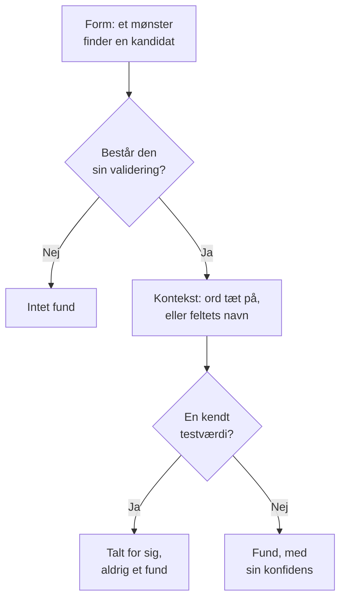

# Følsomme datatyper

Datasikkerhed kender 143 slags følsomme data: kortnumre, bankkonti, nationale ID-numre fra 43 lande, sundhedsidentifikatorer, API-nøgler og tokens og de særlige kategorier af personoplysninger. Hver af dem har en kategori, en følsomhed og, når den hører til ét land, det land. Denne side fortæller, hvordan en værdi findes, og viser alle datatyper, så du kan se, hvorfor noget blev fundet, og beslutte, hvad du vil gøre ved det.

:::cards
- [Sådan findes en værdi](#sådan-findes-en-værdi): Form, validering, kontekst, testværdier, konfidens.
- [Felter og kolonner](#felter-og-kolonner): Hvordan en hel kolonne eller attribut vurderes.
- [Alle datatyper](#indbyggede-datatyper): Alle 143, efter kategori.
- [Dine egne datatyper](#dine-egne-datatyper): Medarbejder-ID'er, policenumre og feltet Test det.
:::

## Sådan findes en værdi

Alt, der scannes - en loglinje, en CSV-celle, en databaserække, de første byte af et objekt - gennemgår de samme trin:

1. **Form.** Hver datatype har mønstre, der finder kandidater: seksten cifre, `AKIA` og seksten bogstaver, et ord, et `@` og et domæne. Et mønster matcher aldrig inde i et længere token, så et kortnummer findes ikke inde i en længere række cifre.
2. **Validering.** En kandidat skal overholde sin types egne regler: en kontrolsum (Luhn for kort, mod 97 for IBAN'er, Verhoeff for Aadhaar-numre, kontrolcifret i de fleste nationale ID-numre), en rigtig dato, et kendt præfiks, tilstrækkelig tilfældighed for en hemmelighed. En kandidat, der fejler, er slet ikke et fund. Pladsholdere som `000000000` og `123456789` fejler for alle numeriske typer.
3. **Kontekst.** Ord tæt på en kandidat - som standard op til 64 tegn før den og 32 efter den - der siger, hvad den er, hæver dens konfidens ét niveau, og det samme gør et felt, hvis navn peger på typen. Ord, der siger, at den er noget andet, f.eks. et ordre- eller forsendelsesnummer, sænker den ét niveau. Et nummer uden kontrolsum og med en almindelig form, f.eks. et pasnummer eller en bankkonto, tæller kun ved siden af ord, der navngiver det.
4. **Kendte testværdier.** Offentliggjorte testkortnumre (f.eks. Stripes `4242 4242 4242 4242`), eksempel-IBAN'er, adresser på `example.com` og andre reserverede domæner, IP-adresser til dokumentation, de eksempel-ID'er, som myndighedernes dokumentation trykker, testnøgler som `sk_test_` og pladsholdernøgler tælles for sig. De giver aldrig et fund, så et datalager fuldt af dem fremstår som et testmiljø, ikke som et brud.
5. **Konfidens.** Det, der er tilbage, er et fund, så sikkert som dets beviser tillader.

| Konfidens | Hvad det betyder |
| --- | --- |
| **Høj** | Værdien bestod sin validering, og ord omkring den eller det felt, den står i, siger, hvad den er - eller, for et felt, de fleste af dets værdier er af den type. |
| **Middel** | Værdien bestod sin validering uden noget omkring den, der bekræfter den, eller feltets navn siger, hvad det indeholder, og nogle værdier stemmer overens. |
| **Lav** | Formen matcher, men intet bekræfter den. |

Kun fund med Høj og Middel tæller: de gør et datalager følsomt og kan åbne et problem. Fund med Lav vises på datalageret, foldet sammen, så et menneske kan vurdere dem.

Når to datatyper gør krav på de samme tegn, vinder det sikreste fund: den højeste konfidens, derefter den detektor, hvis egne regler beviser mest, og derefter det længste match.

En lang værdi læses i vinduer på 64 KB, der overlapper med 4 KB, så en værdi findes hel, uanset hvor den står, og der læses højst 4 MB af én værdi.

## Felter og kolonner

En kolonne, et JSON-felt eller en logattribut vurderes som en helhed. Dens navn antyder en datatype, og dens prøvetagne værdier beviser en. Andelen af dens værdier, der indeholder typen, afgør, hvor sikkert fundet er:

| Værdier, der indeholder typen | Konfidens |
| --- | --- |
| 60 % eller mere | Høj |
| 25 % eller mere | Høj, når feltets navn peger på typen, ellers Middel |
| Færre | Middel, når feltets navn peger på typen, ellers Lav: nogle få e-mails i en kolonne med noget andet |

Et felt, hvis værdier i gennemsnit er længere end 80 tegn, er fritekst - noter, beskeder, beskrivelser - og forventes ikke at indeholde én type. Dets fund beholder den konfidens, hvert match fik for sig selv, og siger, at de blev fundet i fritekst. Op til 1.000 værdier af et felt klassificeres og op til 16 KB af hver.

Et felts navn deles op i ord - `customerEmail`, `customer_email` og `customer-email` er alle "customer email" - og en types navnehint matcher, når dets ord står i den rækkefølge, lige efter hinanden: "date of birth" matcher `customer_date_of_birth`, ikke `birth_city`. Kun den sidste del af en sti med punktummer er feltets eget navn, sammen med delen før, når den sidste er et generisk ord som `number`, `id` eller `value`: `customer.address.city` er ikke en gadeadresse, og `card.number` er stadig et kortnummer.

Nogle datatyper kan ikke kendes på deres værdier: intet mønster skelner en persons navn fra en gade eller en religion fra ethvert andet ord. De findes alene ud fra feltets navn, når feltet har værdier: Personnavn, Brugernavn, Køn, Nationalitet, Helbredsoplysninger, Racemæssig eller etnisk oprindelse, Religiøs overbevisning, Seksuel orientering, Politisk holdning, Fagforeningsmedlemskab, Biometriske data, Genetiske data og Straffeoplysninger. Et navn, et brugernavn, et køn eller en nationalitet er så Høj, når 60 % eller mere af værdierne ligner et, og ellers Middel.

Et felt, hvis navn siger, at det indeholder en adgangskode - `password`, `passwordHash`, `pwd`, ikke `password_changed_at` - bør indeholde en hash: bcrypt, argon2, scrypt, PBKDF2 eller et andet skema, som et datalager sandsynligvis bruger. Tomme værdier, pladsholdere som `********` og krypterede værdier sættes til side. Når flere af resten ikke er hashes end er, indeholder feltet selve adgangskoderne, som intet mønster kan se, og datalageret fejler [Adgangskoder gemmes i klartekst](/docs/data-security/checks-and-issues#datahygiejne).

## Følsomhed

| Følsomhed | Hvad det betyder |
| --- | --- |
| **Begrænset** | Der følger skade, hvis det lækker: hemmeligheder, kortnumre, patientjournaler, ID-numre udstedt af myndigheder. |
| **Fortrolig** | Personoplysninger og dokumenter, der er mærket fortrolige. |
| **Intern** | Virksomhedens egne data, ikke beregnet til udenforstående. |
| **Offentlig** | Der blev ikke fundet noget følsomt. |

Et datalager er lige så følsomt som den mest følsomme datatype, der er fundet i det med mindst Middel konfidens. Testværdier og fund, der er markeret som ikke følsomme, tæller ikke, og et datalager, hvor intet blev fundet, har følsomheden Offentlig. For at behandle et datalager som mere eller mindre følsomt, end dets fund siger, sætter du selv dets følsomhed i datalagerets **Indstillinger**: kontrollerne bruger så den.

## Kategorier

| Kategori | Hvad den dækker | Personoplysninger |
| --- | --- | --- |
| Hemmeligheder og legitimationsoplysninger | Adgangskoder, API-nøgler, tokens og private nøgler, der giver adgang til andre systemer. | Nej |
| Økonomi | Kortnumre, bankkonti, IBAN'er og kryptowallets. | Ja |
| Helbred | Journalnumre, sundhedsidentifikatorer, diagnoser og recepter. | Ja |
| Offentlige ID-numre | Nationale identitets-, skatte-, pas- og socialsikringsnumre. | Ja |
| Særlig kategori | Det, GDPR artikel 9 beskytter mest: etnicitet, religion, seksuel orientering, politik, fagforeningsmedlemskab, biometriske og genetiske data. | Ja |
| Kontakt og identitet | Hvem nogen er, og hvordan de kan kontaktes: e-mail, telefon, adresse, fødselsdato, IP-adresse. | Ja |
| Forretningsfortroligt | Dokumenter, der er mærket fortrolige, kun til intern brug eller privilegerede. | Nej |

Personoplysninger er data om en person i den betydning, GDPR, CCPA, LGPD og DPDP giver det. Et datalager, der kun indeholder hemmeligheder og forretningsdokumenter, er uden for en privatlivsrammes anvendelsesområde, men aldrig uden for en sikkerhedsrammes (se [Compliance i Datasikkerhed](/docs/data-security/compliance)).

## Indbyggede datatyper

En datatype, der hører til ét land, angiver det som en ISO 3166-1-kode: residensregler og de landespecifikke rammer læser den (se [Residens](/docs/data-security/flows-access-residency#residensregler)). ID'et er det, som API'et og fund navngiver typen med.

### Kontakt og identitet

| Datatype | ID | Hvad det er | Følsomhed | Land |
| --- | --- | --- | --- | --- |
| E-mailadresse | `email-address` | En persons e-mailadresse. | Fortrolig | — |
| Telefonnummer | `phone-number` | Et telefonnummer i internationalt eller nationalt format. | Fortrolig | — |
| Personnavn | `person-name` | En persons fornavn, efternavn eller fulde navn, fundet ud fra feltets navn. | Fortrolig | — |
| Gadeadresse | `postal-address` | En gadeadresse: et nummer, et gadenavn og en gadetype. | Fortrolig | — |
| Postnummer | `postal-code` | Et postnummer. Alene indsnævrer det, hvor nogen bor. | Intern | — |
| Fødselsdato | `date-of-birth` | En dato ved siden af ord, der siger, at det er nogens fødselsdato. | Fortrolig | — |
| IP-adresse | `ip-address` | En offentlig IPv4- eller IPv6-adresse, som GDPR behandler som personoplysninger. | Fortrolig | — |
| MAC-adresse | `mac-address` | Et netværkskorts hardwareadresse, som identificerer en enhed. | Fortrolig | — |
| Reklame-ID | `advertising-id` | Et mobilt reklame-ID (IDFA, GAID, AAID), der sporer én enhed. | Fortrolig | — |
| Præcis placering | `geolocation` | En breddegrad og en længdegrad, der er præcise nok til at finde en bygning. | Fortrolig | — |
| Brugernavn | `username` | En persons login- eller kontonavn, fundet ud fra feltets navn. | Fortrolig | — |
| Køn | `gender` | En persons køn, fundet ud fra feltets navn. | Fortrolig | — |
| Nationalitet | `nationality` | En persons nationalitet eller statsborgerskab, fundet ud fra feltets navn. | Fortrolig | — |
| Stelnummer | `vehicle-identification-number` | Et VIN på 17 tegn med et gyldigt kontrolciffer. | Fortrolig | — |

### Offentlige ID-numre

| Datatype | ID | Hvad det er | Følsomhed | Land |
| --- | --- | --- | --- | --- |
| Amerikansk Social Security-nummer | `us-ssn` | Et amerikansk Social Security-nummer. | Begrænset | US |
| Amerikansk skatteyder-ID (ITIN) | `us-itin` | Et amerikansk Individual Taxpayer Identification Number. | Begrænset | US |
| Amerikansk arbejdsgiver-ID (EIN) | `us-ein` | Et amerikansk Employer Identification Number, ved siden af ord, der siger det. | Fortrolig | US |
| Amerikansk pasnummer | `us-passport` | Et amerikansk pasnummer, ved siden af ord, der siger det. | Begrænset | US |
| Amerikansk kørekortnummer | `us-drivers-license` | Et amerikansk kørekortnummer, ved siden af ord, der siger det. | Begrænset | US |
| Britisk National Insurance-nummer | `uk-nino` | Et britisk National Insurance-nummer. | Begrænset | GB |
| Britisk pasnummer | `uk-passport` | Et britisk pasnummer, ved siden af ord, der siger det. | Begrænset | GB |
| Britisk kørekortnummer | `uk-driving-licence` | Et britisk kørekortnummer på 16 tegn. | Begrænset | GB |
| Canadisk Social Insurance-nummer | `ca-sin` | Et canadisk Social Insurance Number med et gyldigt kontrolciffer. | Begrænset | CA |
| Mexicansk CURP | `mx-curp` | En mexicansk Clave Única de Registro de Población. | Begrænset | MX |
| Mexicansk RFC | `mx-rfc` | Et mexicansk skatte-ID, Registro Federal de Contribuyentes. | Begrænset | MX |
| Brasiliansk CPF | `br-cpf` | Et brasiliansk Cadastro de Pessoas Físicas-nummer. | Begrænset | BR |
| Brasiliansk CNPJ | `br-cnpj` | Et brasiliansk virksomhedsregistreringsnummer (CNPJ). | Fortrolig | BR |
| Argentinsk CUIT / CUIL | `ar-cuit` | En argentinsk skatte- eller arbejdsidentifikationskode. | Begrænset | AR |
| Chilensk RUT | `cl-rut` | Et chilensk Rol Único Tributario med et gyldigt kontrolciffer. | Begrænset | CL |
| Spansk DNI | `es-dni` | Et spansk nummer på et nationalt identitetsdokument med kontrolbogstav. | Begrænset | ES |
| Spansk NIE | `es-nie` | Et spansk identitetsnummer for udlændinge med kontrolbogstav. | Begrænset | ES |
| Portugisisk NIF | `pt-nif` | Et portugisisk skatteidentifikationsnummer. | Begrænset | PT |
| Fransk socialsikringsnummer (NIR) | `fr-nir` | Et fransk INSEE-nummer med dets tocifrede nøgle. | Begrænset | FR |
| Tysk skatte-ID | `de-tax-id` | En tysk Steuerliche Identifikationsnummer. | Begrænset | DE |
| Italiensk codice fiscale | `it-codice-fiscale` | En italiensk skattekode med et gyldigt kontroltegn. | Begrænset | IT |
| Hollandsk BSN | `nl-bsn` | Et hollandsk borgerservicenummer, der består elvetesten. | Begrænset | NL |
| Belgisk nationalregisternummer | `be-national-number` | Et belgisk nationalregisternummer. | Begrænset | BE |
| Polsk PESEL | `pl-pesel` | Et polsk nationalt identifikationsnummer. | Begrænset | PL |
| Svensk personnummer | `se-personnummer` | Et svensk personnummer med et gyldigt kontrolciffer. | Begrænset | SE |
| Norsk fødselsnummer | `no-fodselsnummer` | Et norsk fødselsnummer med begge kontrolcifre. | Begrænset | NO |
| Dansk CPR-nummer | `dk-cpr` | Et dansk CPR-nummer, ved siden af ord, der siger det. | Begrænset | DK |
| Finsk personnummer | `fi-hetu` | En finsk henkilötunnus med dens kontroltegn. | Begrænset | FI |
| Irsk PPS-nummer | `ie-ppsn` | Et irsk Personal Public Service Number. | Begrænset | IE |
| Schweizisk AHV-nummer | `ch-ahv` | Et schweizisk socialsikringsnummer (AHV / AVS). | Begrænset | CH |
| Rumænsk CNP | `ro-cnp` | En rumænsk personlig numerisk kode. | Begrænset | RO |
| Bulgarsk EGN | `bg-egn` | Et bulgarsk ensartet borgernummer. | Begrænset | BG |
| Kroatisk OIB | `hr-oib` | Et kroatisk personligt identifikationsnummer. | Begrænset | HR |
| Græsk AMKA | `gr-amka` | Et græsk socialsikringsnummer. | Begrænset | GR |
| Tyrkisk identitetsnummer | `tr-tckn` | Et tyrkisk T.C. Kimlik-nummer. | Begrænset | TR |
| Israelsk identitetsnummer | `il-teudat-zehut` | Et israelsk Teudat Zehut-nummer. | Begrænset | IL |
| Sydafrikansk ID-nummer | `za-id` | Et sydafrikansk identitetsnummer med en gyldig dato og et gyldigt kontrolciffer. | Begrænset | ZA |
| Emirates ID (UAE) | `ae-emirates-id` | Et identitetskortnummer fra De Forenede Arabiske Emirater. | Begrænset | AE |
| Saudiarabisk nationalt ID | `sa-national-id` | Et saudiarabisk nationalt ID- eller iqama-nummer. | Begrænset | SA |
| Indisk Aadhaar-nummer | `in-aadhaar` | Et 12-cifret Aadhaar-nummer, der består Verhoeff-kontrollen. | Begrænset | IN |
| Indisk PAN | `in-pan` | Et indisk Permanent Account Number. | Begrænset | IN |
| Kinesisk borgeridentitetsnummer | `cn-resident-id` | Et kinesisk identitetskortnummer for indbyggere på 18 tegn. | Begrænset | CN |
| Japansk My Number | `jp-my-number` | Et japansk individuelt nummer med et gyldigt kontrolciffer. | Begrænset | JP |
| Sydkoreansk folkeregisternummer | `kr-rrn` | Et koreansk folkeregisternummer. | Begrænset | KR |
| Singaporeansk NRIC / FIN | `sg-nric` | Et singaporeansk identitetskortnummer eller udenlandsk identifikationsnummer. | Begrænset | SG |
| Hongkongsk identitetskortnummer | `hk-hkid` | Et hongkongsk identitetskortnummer med dets kontrolciffer. | Begrænset | HK |
| Taiwansk nationalt ID | `tw-national-id` | Et taiwansk nationalt identifikationsnummer. | Begrænset | TW |
| Thailandsk nationalt ID | `th-national-id` | Et thailandsk borgeridentifikationsnummer. | Begrænset | TH |
| Malaysisk MyKad-nummer | `my-mykad` | Et malaysisk identitetskortnummer. | Begrænset | MY |
| Indonesisk NIK | `id-nik` | Et indonesisk befolkningsidentitetsnummer. | Begrænset | ID |
| Australsk skattenummer | `au-tfn` | Et australsk tax file number med en gyldig kontrol. | Begrænset | AU |
| Newzealandsk IRD-nummer | `nz-ird` | Et newzealandsk Inland Revenue-nummer med et gyldigt kontrolciffer. | Begrænset | NZ |
| Russisk SNILS | `ru-snils` | Et russisk forsikringskontonummer med dets kontrolnummer. | Begrænset | RU |
| Russisk INN | `ru-inn` | Et russisk skatteyderidentifikationsnummer. | Begrænset | RU |
| Pasnummer | `passport-number` | Et pasnummer fra et hvilket som helst land, ved siden af ord, der siger det. | Begrænset | — |

### Økonomi

| Datatype | ID | Hvad det er | Følsomhed | Land |
| --- | --- | --- | --- | --- |
| Kortnummer | `credit-card-number` | Et betalingskortnummer, der består Luhn-kontrollen og hører til et kortmærke. | Begrænset | — |
| Kortets sikkerhedskode | `card-verification-code` | En CVV eller CVC, som PCI DSS forbyder at gemme, efter at en betaling er godkendt. | Begrænset | — |
| Kortets udløbsdato | `card-expiration-date` | Et korts udløbsdato, ved siden af ord, der siger det. | Fortrolig | — |
| IBAN | `iban` | Et internationalt bankkontonummer, der består mod-97-kontrollen. | Begrænset | — |
| Bankkontonummer | `bank-account-number` | Et bankkontonummer, ved siden af ord, der siger det. | Begrænset | — |
| SWIFT-/BIC-kode | `swift-bic` | En banks SWIFT- eller BIC-kode, ved siden af ord, der siger det. | Intern | — |
| Amerikansk bankroutingnummer | `us-bank-routing-number` | Et ABA-routingnummer med en gyldig kontrolsum, ved siden af ord, der siger det. | Intern | US |
| Britisk sort code | `uk-sort-code` | En britisk banks sort code, ved siden af ord, der siger det. | Intern | GB |
| Indisk IFSC | `in-ifsc` | En indisk Financial System Code, der navngiver en bankfilial. | Intern | IN |
| Australsk BSB | `au-bsb` | Et australsk bank-state-branch-nummer, ved siden af ord, der siger det. | Intern | AU |
| Bitcoin-adresse | `bitcoin-address` | En Bitcoin-adresse med en gyldig kontrolsum. | Fortrolig | — |
| Ethereum-adresse | `ethereum-address` | En Ethereum-adresse, ved siden af ord, der siger det. | Fortrolig | — |

### Helbred

| Datatype | ID | Hvad det er | Følsomhed | Land |
| --- | --- | --- | --- | --- |
| Britisk NHS-nummer | `uk-nhs-number` | Et britisk National Health Service-nummer med et gyldigt kontrolciffer. | Begrænset | GB |
| Amerikansk Medicare-modtager-ID | `us-medicare-mbi` | En amerikansk Medicare Beneficiary Identifier. | Begrænset | US |
| Australsk Medicare-nummer | `au-medicare-number` | Et australsk Medicare-kortnummer med et gyldigt kontrolciffer. | Begrænset | AU |
| Tysk sygesikringsnummer | `de-health-insurance-number` | Et tysk Krankenversichertennummer med et gyldigt kontrolciffer. | Begrænset | DE |
| Journalnummer | `medical-record-number` | En patients journalnummer, ved siden af ord, der siger det. | Begrænset | — |
| Medlems-ID for sygeforsikring | `health-plan-id` | Et medlems- eller policenummer for en sygeforsikring, ved siden af ord, der siger det. | Begrænset | — |
| Diagnosekode (ICD-10) | `diagnosis-code` | En ICD-10-diagnosekode, ved siden af ord, der siger det. | Begrænset | — |
| Lægemiddelkode (NDC) | `drug-code` | En amerikansk National Drug Code, ved siden af ord, der siger det. | Fortrolig | — |
| Amerikansk DEA-nummer | `us-dea-number` | En ordinerende læges Drug Enforcement Administration-nummer med et gyldigt kontrolciffer. | Fortrolig | US |
| Amerikansk behandler-ID (NPI) | `us-npi` | En National Provider Identifier. Den navngiver en sundhedsudbyder, ikke en patient. | Intern | US |
| Helbredsoplysninger | `health-information` | Diagnoser, tilstande, medicin og andre helbredsdetaljer, fundet ud fra feltets navn. | Begrænset | — |

### Hemmeligheder og legitimationsoplysninger

| Datatype | ID | Hvad det er | Følsomhed | Land |
| --- | --- | --- | --- | --- |
| AWS-adgangsnøgle-ID | `aws-access-key-id` | Den offentlige halvdel af en AWS-adgangsnøgle. Sammen med sin hemmelighed signerer den AWS-forespørgsler. | Begrænset | — |
| Hemmelig AWS-adgangsnøgle | `aws-secret-access-key` | Den hemmelige halvdel af en AWS-adgangsnøgle, ved siden af ord, der siger det. | Begrænset | — |
| Google API-nøgle | `google-api-key` | En API-nøgle til Google Cloud eller Maps. | Begrænset | — |
| Google-tjenestekontonøgle | `google-service-account-key` | En nøglefil til en Google Cloud-tjenestekonto med dens private nøgle. | Begrænset | — |
| Google OAuth-klienthemmelighed | `google-oauth-client-secret` | En Google OAuth-klienthemmelighed. | Begrænset | — |
| Azure-lagerkontonøgle | `azure-storage-account-key` | En Azure-lagerkontonøgle eller en forbindelsesstreng, der indeholder en. | Begrænset | — |
| Azure SAS-token | `azure-sas-token` | En Azure shared access signature, som giver adgang uden login. | Begrænset | — |
| Azure-klienthemmelighed | `azure-client-secret` | En klienthemmelighed til et Microsoft Entra ID-program. | Begrænset | — |
| GitHub-token | `github-token` | Et GitHub-token af typen personal access, OAuth, app eller fine-grained. | Begrænset | — |
| GitLab-token | `gitlab-token` | Et GitLab personal access token. | Begrænset | — |
| Slack-token | `slack-token` | Et Slack-token til en bot, en bruger eller en app. | Begrænset | — |
| Slack-webhook-URL | `slack-webhook-url` | En indgående Slack-webhook, som lader enhver poste i en kanal. | Begrænset | — |
| Hemmelig Stripe-nøgle | `stripe-secret-key` | En hemmelig eller begrænset Stripe-nøgle til live, som kan flytte penge. | Begrænset | — |
| Twilio API-nøgle | `twilio-api-key` | Et Twilio API-nøgle-SID med hemmelighed. | Begrænset | — |
| SendGrid API-nøgle | `sendgrid-api-key` | En SendGrid API-nøgle. | Begrænset | — |
| Mailgun API-nøgle | `mailgun-api-key` | En Mailgun API-nøgle. | Begrænset | — |
| Mailchimp API-nøgle | `mailchimp-api-key` | En Mailchimp API-nøgle. | Begrænset | — |
| OpenAI API-nøgle | `openai-api-key` | En OpenAI API-nøgle, som bruger af kontoens kredit. | Begrænset | — |
| Anthropic API-nøgle | `anthropic-api-key` | En Anthropic API-nøgle. | Begrænset | — |
| Hugging Face-token | `huggingface-token` | Et Hugging Face-token. | Begrænset | — |
| npm-token | `npm-token` | Et npm-adgangstoken, som kan udgive pakker. | Begrænset | — |
| PyPI-token | `pypi-token` | Et PyPI-uploadtoken. | Begrænset | — |
| Docker Hub-token | `docker-hub-token` | Et Docker Hub personal access token. | Begrænset | — |
| Shopify-token | `shopify-token` | Et Shopify-adgangstoken eller -app-token. | Begrænset | — |
| Square-token | `square-token` | Et Square-adgangstoken eller en Square-hemmelighed. | Begrænset | — |
| Braintree-adgangstoken | `braintree-access-token` | Et Braintree-adgangstoken til produktion. | Begrænset | — |
| DigitalOcean-token | `digitalocean-token` | Et DigitalOcean personal access token. | Begrænset | — |
| New Relic API-nøgle | `new-relic-api-key` | En API-nøgle til en New Relic-bruger. | Begrænset | — |
| Datadog API-nøgle | `datadog-api-key` | En Datadog API- eller applikationsnøgle, ved siden af ord, der siger det. | Begrænset | — |
| HashiCorp Vault-token | `vault-token` | Et tjenestetoken til HashiCorp Vault. | Begrænset | — |
| Terraform Cloud-token | `terraform-cloud-token` | Et API-token til Terraform Cloud eller Enterprise. | Begrænset | — |
| Atlassian API-token | `atlassian-api-token` | Et Atlassian API-token. | Begrænset | — |
| Linear API-nøgle | `linear-api-key` | En Linear API-nøgle. | Begrænset | — |
| JSON web token | `json-web-token` | Et signeret JWT, ofte et sessions- eller adgangstoken. | Begrænset | — |
| Privat nøgle | `private-key` | En PEM-, OpenSSH- eller PGP-blok med en privat nøgle. | Begrænset | — |
| Adgangskode i en URL | `password-in-url` | En URL, der indeholder et brugernavn og en adgangskode, f.eks. en forbindelsesstreng til en database. | Begrænset | — |
| Adgangskode i en forbindelsesstreng | `connection-string-password` | En værdi for Password= eller Pwd= i en forbindelsesstreng. | Begrænset | — |
| Authorization-header | `authorization-header` | En Basic- eller Bearer-legitimation, kopieret fra en HTTP Authorization-header. | Begrænset | — |
| Adgangskode eller hemmelighed | `generic-secret` | En værdi, der er tildelt en adgangskode, en hemmelighed, en API-nøgle eller et token, og som ser tilfældig nok ud til at være ægte. | Begrænset | — |
| Privat Bitcoin-nøgle | `bitcoin-private-key` | En privat Bitcoin-nøgle i wallet import format med en gyldig kontrolsum. | Begrænset | — |

### Særlig kategori

| Datatype | ID | Hvad det er | Følsomhed | Land |
| --- | --- | --- | --- | --- |
| Racemæssig eller etnisk oprindelse | `racial-or-ethnic-origin` | Race eller etnicitet, fundet ud fra feltets navn. | Begrænset | — |
| Religiøs overbevisning | `religious-belief` | Religion eller overbevisning, fundet ud fra feltets navn. | Begrænset | — |
| Seksuel orientering | `sexual-orientation` | Seksuel orientering, fundet ud fra feltets navn. | Begrænset | — |
| Politisk holdning | `political-opinion` | Politiske holdninger eller partimedlemskab, fundet ud fra feltets navn. | Begrænset | — |
| Fagforeningsmedlemskab | `trade-union-membership` | Fagforeningsmedlemskab, fundet ud fra feltets navn. | Begrænset | — |
| Biometriske data | `biometric-data` | Fingeraftryk, ansigtsskabeloner, stemmeaftryk og andre biometriske data, fundet ud fra feltets navn. | Begrænset | — |
| Genetiske data | `genetic-data` | DNA- og genomdata, fundet ud fra feltets navn. | Begrænset | — |
| Straffeoplysninger | `criminal-record` | Straffedomme og lovovertrædelser (GDPR artikel 10), fundet ud fra feltets navn. | Begrænset | — |

### Forretningsfortroligt

| Datatype | ID | Hvad det er | Følsomhed | Land |
| --- | --- | --- | --- | --- |
| Juridisk privilegeret dokument | `privileged-document` | Et dokument, der er mærket som omfattet af advokatprivilegium eller som juridisk privilegeret. | Begrænset | — |
| Dokument mærket fortroligt | `confidential-document` | Et dokument, der er mærket fortroligt, strengt fortroligt eller forretningshemmelighed. | Fortrolig | — |
| Dokument mærket internt | `internal-document` | Et dokument, der er mærket kun til intern brug eller ikke til distribution. | Intern | — |

## Dine egne datatyper

Tilføj en datatype for det, kun din virksomhed har: et medarbejder-ID, et policenummer, en projektkode. Gå til **Datasikkerhed → Indstillinger → Datatyper**, og tilføj den under **Dine datatyper**. Den scannes præcis som de indbyggede, i buckets, databaser og telemetri, fra og med den næste scanning.

:::steps
### Sig, hvad den er

Giv den et **Navn**, f.eks. Medarbejder-ID, en **Kategori** og en **Følsomhed**: hvor følsomt et datalager, der indeholder den, er. En **Beskrivelse** siger, hvad den er, til den, der læser et fund af den.

### Sig, hvordan den findes

Angiv et **Mønster**: et regulært udtryk i JavaScript for én værdi, f.eks. `EMP-\d{6}`. Tilføj de **Feltnavne**, der indeholder den, f.eks. `employee id`, og de **Nøgleord**, der, tæt på en værdi, bekræfter, at den er af denne type. Lad mønsteret være tomt for kun at finde typen ud fra feltnavne.

### Test den

Indsæt eksempeltekst i **Test det** for at se, hvad din datatype finder i den. Den kører scannerens egen kode på teksten i din browser: teksten sendes aldrig til OneUptime, og kun de første 64 KB testes.
:::

Under **Flere felter** matcher **Ignorer store/små bogstaver** mønsteret uden hensyn til store og små bogstaver, **Kræver et nøgleord** tæller kun en værdi, når et nøgleord står tæt på den, eller feltets navn siger, at den er af denne type, og **Kontrolsum** kræver, at en værdi består en kontrol: **Ingen**, **Luhn** (det kontrolciffer, kortnumre har), **Mod97** (kontrolcifrene i en IBAN) eller **Verhoeff** (kontrolcifret i et Aadhaar-nummer).

Et mønster kontrolleres, når du gemmer det: det skal kunne kompileres, må ikke matche tom tekst og skal køre på en tid, der vokser lineært med teksten. Det køres af en matcher, der aldrig backtracker, så intet mønster kan holde en scanning fast, uanset hvordan det er skrevet. En type kan have højst 50 nøgleord og 50 feltnavne.

En værdi af din type er Middel alene og Høj med et nøgleord tæt på, når den består en kontrolsum, og Lav alene og Middel med et nøgleord, når den ikke har nogen. I en kolonne afgør andelen af værdier, der matcher, ligesom for alle typer.

## Ikke følsom og aldrig følsom

En scanning kan finde noget, der ikke er det, det ligner: en kolonne med ordrenumre, der består Luhn-kontrollen, eller din egen supportadresse i hver loglinje. Fortæl OneUptime det, så holder det op med at tælle:

- **Markér fundet som ikke følsomt.** På datalagerets side **Indhold** vælger du **Markér som ikke følsom** på fundet og angiver hvorfor. Det tæller ikke længere med i datalagerets følsomhed eller dets kontroller, og datalageret kontrolleres igen med det samme. Fundet bliver på datalageret, markeret, med din begrundelse, så den næste person kan se, hvad der blev besluttet.
- **Føj værdien til Aldrig følsom** i Datasikkerheds indstillinger for en værdi, der aldrig er et fund nogen steder, f.eks. `support@yourcompany.com`. Værdier sammenlignes, efter at scanneren har normaliseret dem, uden hensyn til store og små bogstaver.
- **Slå en indbygget datatype fra.** Under **Indbyggede datatyper** på **Datasikkerhed → Indstillinger → Datatyper** har hver datatype en kontakt, som gemmes i det øjeblik, den slås om. Ingen scanning i projektet leder efter en type, der er slået fra.

## Næste trin

:::cards
- [Datasikkerhedskontroller og problemer](/docs/data-security/checks-and-issues): Hvad et datalagers følsomhed ændrer ved dets problemer.
- [Følsomme data i telemetri](/docs/data-security/telemetry): De datatyper, der findes i dine logs, traces og prompts.
- [Compliance i Datasikkerhed](/docs/data-security/compliance): De rammer, som hver datatype bringer ind i anvendelsesområdet.
:::
