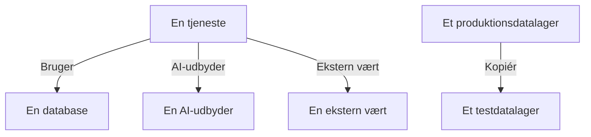

# Datastrømme, adgang og residens

At vide, hvad et datalager indeholder, er kun halvdelen. Datasikkerhed finder også ud af, hvor de data ender - hvilke tjenester der bruger datalageret, hvilke AI-udbydere og eksterne værter dataene når, og hvor de er kopieret hen - hvem der kan nå hvert datalager, og om det ligger i de regioner, det må. Det hele kommer fra beviser, OneUptime allerede har: dine traces, din clouds egne adgangsindstillinger og fingeraftryk af det, scanningerne fandt.

:::cards
- [Datastrømme](#datastrømme): Tjenester, AI-udbydere, eksterne værter og kopier.
- [Hvem kan nå et datalager](#hvem-kan-nå-et-datalager): Hver tildeling, din cloud rapporterer, og hvor eksponeret datalageret er.
- [Residensregler](#residensregler): De regioner, hver slags data må ligge i.
:::

## Datastrømme

| Datastrøm | Hvad den betyder | Hvor den kommer fra |
| --- | --- | --- |
| **Bruger** | En tjeneste taler med et datalager. | Tjenestekortet, som OneUptime udleder af dine tjenesters klient-spans hvert tiende minut. Hver database på det knyttes til sit datalager via navn, adresse eller endpoint, så en database, som ingen anden kilde viser, bliver et datalager for sig. |
| **AI-udbyder** | En tjeneste sender data til en AI-udbyder. | AI-kaldene i tjenestens traces fra de seneste 7 dage, som navngiver den udbyder, de når. |
| **Ekstern vært** | En tjeneste kalder en vært uden for dine systemer. | Tjenestekortets eksterne tjenester, ud fra den adresse, de kaldes på. |
| **Kopiér** | Et datalager indeholder værdier fra et andet. | Fingeraftryk af de værdier, hver scanning fandt: to datalagre deler data, når deres fingeraftryk af én datatype overlapper med halvdelen eller mere. |

En datastrøm bærer de datatyper, dens kilde indeholder, og deres følsomhed. En datastrøm er bekræftet, når en scanning har bevist, at dataene er der, ikke kun at der er en vej til dem: en kopi er det altid, og en datastrøm til en AI-udbyder er det, når tjenestens AI-samtaler indeholder data på niveauet Fortrolig eller Begrænset. En datastrøm, der ikke ses igen i 30 dage, fjernes.

To kontroller læser datastrømmene. [Produktionsdata blev kopieret til et datalager uden for produktion](/docs/data-security/checks-and-issues#datahygiejne) fejler på destinationen for en kopi. En kopi går fra produktionsdatalageret, når kun det ene af de to er i produktion, og ellers fra det datalager, OneUptime fandt først. [Følsomme data sendes til en AI-udbyder](/docs/data-security/checks-and-issues#ai) fejler på en tjenestes AI-samtaler, når de indeholder følsomme data, og nævner de udbydere, de nåede.

### Sådan forbliver fingeraftryk private

En kopi findes uden nogen af de to datalagres værdier. For hver datatype, en scanning finder med sikkerheden Høj, skitserer den de værdier, den læste, som en MinHash: 128 pladser, hver den mindste værdi af én hashfunktion over værdierne, hvoraf kun de laveste 16 bit gemmes. To skitser stemmer overens på omtrent lige så mange pladser, som deres to sæt værdier overlapper, så en sammenligning af skitser anslår, hvor meget af det ene datalager der ligger i det andet.

- **Værdierne hashes med en nøgle, som er projektets egen** (HMAC-SHA256), så ingen uden nøglen kan afprøve en kendt værdi mod en skitse, og to projekters skitser kan aldrig sammenlignes.
- **Kun 16 bit af hvert minimum forlader scanningen.** Ingen værdi, og ingen hash af en værdi, kan læses tilbage fra en skitse.
- **En skitse handler om en datatype, ikke et felt.** Et datalager har én for hver datatype, der er fundet i det med sikkerheden Høj, og intet mere.

## Hvem kan nå et datalager

Konfigurationslæsningen gør hver clouds egne adgangsindstillinger - bucket-politikker og ACL'er, rolletildelinger i Azure, IAM-bindinger i Google Cloud, snapshot-delinger - til én liste over, hvem der kan nå datalageret, på dets side **Hvem kan nå det**:

| Kolonne | Hvad den siger |
| --- | --- |
| **Principal** | Hvem eller hvad der har adgang, som cloud'en navngiver det: `*`, et konto-id, en ARN, en e-mail, en tjenestekonto. |
| **Principaltype** | Public, Konto, Rolle, Bruger, Gruppe, Service Principal, Tjenestekonto eller Tjeneste. |
| **Adgangsniveau** | Læsning, Skrivning eller Administrator. |
| **Tildelt via** | Hvad der giver adgangen: en bucket-politik, en ACL, en rolletildeling, en IAM-binding eller en snapshot-deling. |
| **Ekstern** | Principalen er uden for de konti, abonnementer og projekter, der er forbundet til OneUptime. |
| **Public** | Principalen er hvem som helst på internettet. |

Listen læses igen ved hver konfigurationslæsning, og en tildeling, som cloud'en ikke længere rapporterer, fjernes. [Mere end 25 identiteter kan læse Begrænsede data](/docs/data-security/checks-and-issues#adgang) tæller læserne på den. De tjenester, der bruger et datalager, er dets datastrømme af typen **Bruger**.

Ud fra det, den læser, får hvert datalager en eksponering:

| Eksponering | Hvad den betyder |
| --- | --- |
| **Public** | Hvem som helst på internettet kan læse det. |
| **Andre konti** | Konti uden for dem, du har forbundet, kan nå det. |
| **Kan nås fra internettet** | Dets netværksendpoint accepterer forbindelser fra internettet. |
| **Privat** | Kun dine egne konti og netværk når det. |
| **Ukendt** | OneUptime kunne ikke læse nok af dets konfiguration til at afgøre det. |

Public slår delt, og delt slår nåbar: en offentlig bucket, der også er delt med en anden konto, er Public. Eksponering lægges til et problems [risikoscore](/docs/data-security/checks-and-issues#risikoscore).

## Residensregler

En residensregel angiver, hvor en slags data må ligge. Tilføj en under **Datasikkerhed → Indstillinger → Residensregler**:

| Felt | Hvad det gør |
| --- | --- |
| **Navn** | Hvad reglen er, f.eks. EU-persondata bliver i EU. |
| **Tilladte regioner** | De regioner, dataene må gemmes og kopieres i, skrevet sådan som din cloud navngiver dem. En regel uden nogen kontrollerer intet. |
| **Datakategorier** | De kategorier af data, den dækker. Tom dækker enhver slags persondata. |
| **Data om personer i** | Kun data om personer i disse lande, som ISO 3166-1-koder, f.eks. `DE` eller `IN`. Tom dækker data om personer hvor som helst. |
| **Beskrivelse** | Hvad reglen er til, f.eks. vores EU-kunders data gemmes kun i EU. |
| **Aktiveret** | Om datalagre kontrolleres mod reglen. |

Et datalager bryder en regel, når det indeholder data, reglen dækker, og dets egen region eller en region, dets data kopieres til, ikke matcher nogen af de tilladte regioner. Kopier er de regioner, et datalagers data replikeres til: S3-replikering, en storage accounts georedundante kopi, en databases replikaer. Datalageret fejler så [Data er gemt uden for de regioner, de må ligge i](/docs/data-security/checks-and-issues#residens), med regionen og den regel, det brød.

### Regioner og jokertegn

En `*` i en tilladt region står for vilkårlige tegn, store og små bogstaver regnes for ens, og mønsteret skal matche hele regionen:

| Tilladt region | Matcher | Matcher ikke |
| --- | --- | --- |
| `eu-*` (AWS) | `eu-west-1`, `eu-central-1` | `us-east-1`, `us-eu-1` |
| `europe-*` (Google Cloud) | `europe-west1`, `europe-north1` | `us-central1` |
| `westeurope` (Azure) | `westeurope` | `northeurope` |

Angiv ét mønster for hver cloud, du bruger: `eu-*`, `europe-*`, `westeurope` og `northeurope` holder tilsammen data i Europa på alle tre.

### Hvis data et datalager indeholder

OneUptime aflæser ud fra selve dataene, hvis data et datalager indeholder. En datatype, der hører til ét land, siger, at dens personer er i det land: et tysk skatte-ID siger `DE`, et indisk Aadhaar-nummer `IN`, et britisk NHS-nummer `GB`. Datalageret angiver de lande som de registreredes lande, og en regel, der er begrænset til personer i bestemte lande, dækker kun de datalagre, der indeholder deres data. [Følsomme datatyper](/docs/data-security/data-types#indbyggede-datatyper) nævner landet for hver datatype, der har et.

## Næste trin

:::cards
- [Datasikkerhedskontroller og problemer](/docs/data-security/checks-and-issues): Hver kontrol, som disse datastrømme, tildelinger og regler leverer til.
- [Overholdelse i Datasikkerhed](/docs/data-security/compliance): Hvordan residens og adgang tæller med i GDPR, LGPD og DPDP.
- [Topologi](/docs/telemetry/topology): Det tjenestekort, datastrømmene kommer fra.
:::
