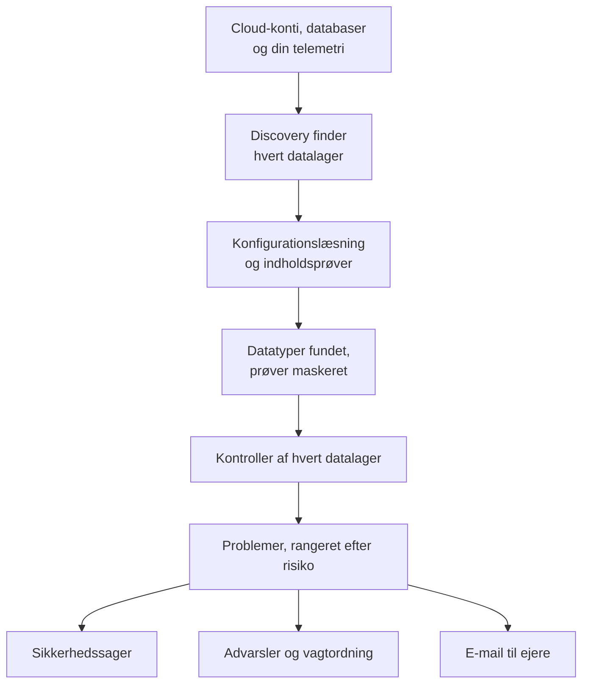

# Datasikkerhed

Datasikkerhed finder de følsomme data, din virksomhed opbevarer - i cloud-buckets, databaser og datavarehuse og i den telemetri, du sender til OneUptime - og fortæller dig, hvad der er galt med måden, de opbevares på. Den finder datalagrene på egen hånd, læser, hvordan hvert enkelt er sat op, tager prøver af det, de indeholder, og åbner et problem for hver fejl, rangeret efter risiko.

Den besvarer fire spørgsmål:

:::cards
- [Hvor er vores følsomme data?](/docs/data-security/data-types): 143 datatyper, fra kortnumre og nationale ID-numre til API-nøgler, fundet i buckets, tabeller og telemetri.
- [Er de eksponeret?](/docs/data-security/checks-and-issues): 32 kontroller af hvert datalager: offentlig adgang, kryptering, backup, logning, hemmeligheder og kopier.
- [Hvem kan nå dem, og hvor ender de?](/docs/data-security/flows-access-residency): Hvem der kan læse hvert datalager, hvilke tjenester der bruger det, og hvilke AI-udbydere og værter dets data når.
- [Lever de op til vores regler?](/docs/data-security/compliance): Residensregler og ni compliancerammer, scoret ud fra det, scanningerne fandt.
:::

## Sådan virker det

1. **Discovery** finder de datalagre, OneUptime allerede kender til: dit cloud-inventar, de databaser, som produktet Database overvåger, de databaser, dine tjenester taler med på tjenestekortet, og hver tjenestes telemetri. Du tilføjer kun et datalager manuelt, når ingen kilde viser det.
2. **Konfigurationslæsningen** spørger hver cloud, hvordan hvert datalager er sat op: hvem der kan nå det, og hvordan det er krypteret, sikkerhedskopieret og logget. Den læser indstillinger, aldrig data.
3. **Indholdsprøver** læser lidt af det, et datalager indeholder, hvor du tillader det: nogle få objekter af hver slags i en bucket, nogle rækker fra hver tabel og de nyeste poster i hver tjenestes telemetri.
4. **Klassificering** finder følsomme værdier i prøverne og gemmer antal og maskerede prøver, aldrig en værdi.
5. **Tjek** afgør, hvad der er galt med hvert datalager, og hvor slemt det er for de data, det indeholder. Hver kontrol, der fejler, åbner et problem, som lukker af sig selv, når kontrollen består.

## Hvad der er anderledes

- **Din telemetri er et datalager.** Hver tjenestes logs, traces, undtagelser, sessionsafspilninger og AI-samtaler kontrolleres som en bucket, hver time. En e-mailadresse i en loglinje er et fund, og **Rens** maskerer den ved indtagelse fra da af. Se [Følsomme data i telemetri](/docs/data-security/telemetry).
- **Datastrømme kommer fra reel trafik.** Tjenestekortet siger, hvilken tjeneste der bruger hvilken database, AI-kald navngiver den udbyder, de når, og kopier af produktionsdata findes ved at sammenligne fingeraftryk. Se [Datastrømme, adgang og residens](/docs/data-security/flows-access-residency).
- **Beviser maskeres altid.** Et fund gemmer antal og højst tre maskerede prøver, f.eks. `j***@e******.com`, maskeret inde i scanneren, før noget forlader den. Slår du prøver fra, gemmer det kun antal.
- **Scanneren er open source.** Hver datatypes mønster, kontrolsum, kontekstord og testværdier ligger i OneUptimes kildekode, så du kan læse præcis, hvad der udgør et fund. Den samme kode kører på OneUptimes workers, på en sonde og i feltet **Test det**.
- **Den fungerer sammen med resten af OneUptime.** Et kritisk problem åbner en sikkerhedssag på datalageret, så [Security Operations](/docs/telemetry/security-cases) behandler det som enhver anden trussel. Den kan udløse en advarsel, der tilkalder den, der har vagt, og den sender e-mail til datalagerets ejere. Se [Datasikkerhedsintegrationer](/docs/data-security/integrations).
- **OneUptime AI hjælper med at rette det.** **Forklar med AI** fortæller et datalagers ejer, hvad der er galt, og hvordan det rettes i deres cloud, og **Ret med AI** åbner en pull request i din infrastrukturkode.

## Før du begynder

- **En rolle, der kan sætte det op.** Project Owners, Project Admins og Security Admins ændrer Datasikkerheds indstillinger. Security Members behandler problemer og scanner datalagre, og Security Viewers læser, hvad den har fundet. Andre roller ser intet af det, medmindre deres team får dens tilladelser: hvilke buckets der indeholder kortnumre, er præcis det, en angriber vil vide. Se [Roller](/docs/permissions/reference#roller).
- **En cloud-konto at læse eller en database.** Datasikkerhed læser en cloud-konto via en [cloudforbindelse](/docs/telemetry/cloud-accounts) og en database, du selv driver, via en skrivebeskyttet forbindelsesstreng. Telemetri kræver intet: den scannes hver time.

## Kom hurtigt i gang

:::steps
### Forbind en cloud-konto

Gå til **Cloud → Forbind**, og vælg din cloud. Er kontoen allerede forbundet, så vælg i stedet **Rediger** på dens forbindelse. [Forbind en cloud-konto](/docs/telemetry/cloud-accounts) gennemgår hver cloud.

### Vælg niveauet for datasikkerhed

Under **Flere felter** sætter du **Datasikkerhed** til **Kun konfiguration** for at kontrollere, hvordan hvert datalager er sat op, eller til **Konfiguration og indholdsprøver** for også at finde de følsomme data i dem. Den kommando, formularen viser, ændrer sig efter dit valg: kør den i din clouds shell, som formularen siger. [Konfigurer Datasikkerhed](/docs/data-security/setup) viser præcis, hvad hvert niveau giver adgang til, og [Forbind en cloud-konto](/docs/telemetry/cloud-accounts#datasikkerhed) viser hvert niveaus kommando.

### Gennemgå problemerne

Åbn **Datasikkerhed**. Datalagre vises under **Datalagre**, efterhånden som discovery finder dem, hvert 15. minut, og en forbindelses konfiguration læses inden for en time. Problemer åbnes under **Problemer**, så snart en læsning eller en scanning er færdig, hver med sin risikoscore, og **Oversigt** viser de fem mest risikable. Hvert problem siger, hvad der er galt, hvorfor det betyder noget, og hvordan det rettes, med kommandoerne til din cloud.
:::

## Hvad der tæller som et datalager

| Hvor | Datalagre | Indholdsprøver |
| --- | --- | --- |
| AWS | AWS S3 Bucket, AWS RDS Instance, AWS Aurora Cluster, AWS RDS Snapshot, AWS DynamoDB Table, AWS Redshift Cluster, AWS DocumentDB Cluster, AWS OpenSearch Domain, AWS ElastiCache Cluster, AWS EFS File System | AWS S3 Bucket |
| Azure | Azure Storage Account, Azure SQL Database, Azure Cosmos DB Account, Azure PostgreSQL Server, Azure MySQL Server | Azure Storage Account |
| Google Cloud | Google Cloud Storage Bucket, Google Cloud SQL Instance, Google BigQuery Dataset, Google Firestore Database, Google Spanner Instance, Google Bigtable Instance | Google Cloud Storage Bucket, Google BigQuery Dataset |
| Databaser, du selv driver | PostgreSQL, MySQL, MongoDB, SQL Server, Oracle, Redis, Elasticsearch | PostgreSQL, MySQL |
| OneUptime | Logs, traces, undtagelser, sessionsafspilninger, AI-samtaler | Logs, traces, undtagelser, sessionsafspilninger, AI-samtaler |

Hvert datalager får de kontroller, der gælder for dets type. Et datalager, hvis indhold der ikke kan tages prøver af, kontrolleres stadig: en offentlig bucket eller en ukrypteret database er et problem, uanset hvad den indeholder.

Et datalager arkiveres med sin historik, når dets kilde ikke længere viser det: **Arkiverede datalagre**, nederst i Datasikkerheds menu, gemmer det. Det kommer tilbage af sig selv, hvis kilden viser det igen.

Et datalagers **Tidslinje** fortæller, hvad der er sket med det, og hvem der gjorde det: hvornår det blev fundet eller tilføjet, hver ændring af dets indstillinger og ejere, hvornår det blev arkiveret eller kom tilbage, og hver eksponering, der blev lukket fra et problem eller en playbook.

## Hvor ofte det kører

| Hvad | Hvornår |
| --- | --- |
| Find nye datalagre | Hvert 15. minut |
| Læs en cloudforbindelses konfiguration | Én gang om dagen og inden for en time, efter at CloudTrail har registreret en ændring af et AWS-datalagers adgang, kryptering, backup eller deling |
| Tag prøver af et datalagers indhold | Hver 24. time, eller så ofte som **Scan hver (timer)** angiver |
| Tag prøver af hver tjenestes telemetri | Hver time, af den seneste time |
| Kontrollér hvert datalager igen | Efter hver læsning og scanning, efter at du har ændret noget, en kontrol afhænger af, og én gang om dagen |

**Scan nu** på et datalager tager straks prøver af dets indhold, og **Kontrollér nu** læser dets konfiguration igen.

## Næste trin

:::cards
- [Konfigurer Datasikkerhed](/docs/data-security/setup): De tre niveauer, de tilladelser hvert af dem giver, og scanning af dine egne databaser.
- [Følsomme datatyper](/docs/data-security/data-types): Hvordan en værdi findes, og hver datatype, Datasikkerhed kender.
- [Datasikkerhedskontroller og problemer](/docs/data-security/checks-and-issues): Hver kontrol, risikoscoren, og hvad der sker med et problem.
- [Datasikkerhedsintegrationer](/docs/data-security/integrations): Sikkerhedssager, advarsler, ejere, workflows og OneUptime AI.
:::
