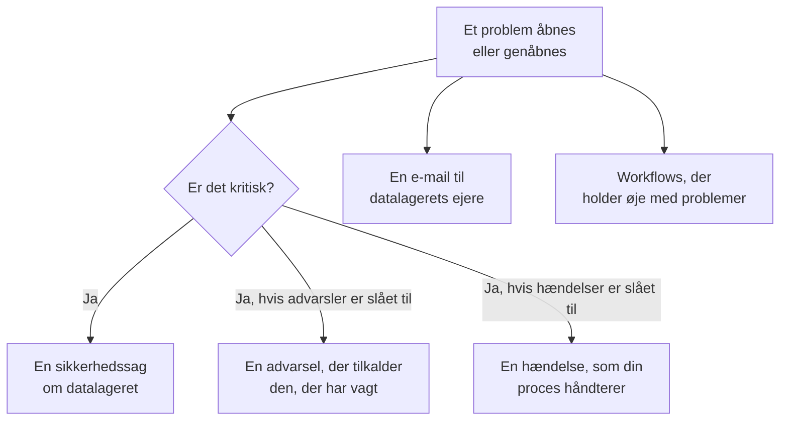

# Datasikkerhedsintegrationer

Datasikkerhed har ingen personsøger eller sikkerhedskø af sin egen. Den giver det, den finder, videre til de dele af OneUptime, der allerede har det: et kritisk problem bliver til en sikkerhedssag, det kan tilkalde den, der har vagt, eller erklære en hændelse, og hvert nyt problem sendes på e-mail til datalagerets ejere. Workflows, OneUptime AI, API'et, Terraform og MCP-serveren når alt, hvad den gemmer.

:::cards
- [Security Operations](#security-operations): En sikkerhedssag for hvert datalager med et kritisk problem.
- [Advarsler og vagtordning](#advarsler-og-vagtordning): Tilkald den, der har vagt, når et kritisk problem åbnes.
- [Hændelser](#hændelser): Erklær en hændelse for et sikkerhedsbrud, som din hændelsesproces skal håndtere.
- [Ejere](#ejere): Hvem der ejer hvert datalager, angivet manuelt eller af regler, og den e-mail, de får.
- [OneUptime AI](#oneuptime-ai): Forklar et problem, åbn en pull request, der retter det, eller spørg Spørg AI om dine data.
- [Luk en eksponering](#luk-en-eksponering): Bloker offentlig adgang, eller stop deling, fra et problem eller en playbook.
:::

## Sådan virker det

Hver af disse kører, når en evaluering åbner et problem eller åbner det igen. Hver af dem er best effort: problemet er allerede åbent og står på sin tidslinje, så en integration, der fejler, logges og springes over i stedet for at blive forsøgt igen og give en ekstra sag eller en ekstra tilkaldelse. Det, hver af dem gjorde, skrives på problemets **Tidslinje**, og problemets side linker til den sag, den advarsel og den hændelse, det startede.

| Indstilling | Standard | Hvad den gør |
| --- | --- | --- |
| **Åbn sikkerhedssager** | Til | Et kritisk problem åbner en sikkerhedssag, grupperet efter datalager. |
| **Udløs advarsler** | Fra | Et kritisk problem udløser en advarsel, som tilkalder den, der har vagt. |
| **Advarselsalvor** | Tom | Alvorligheden af de advarsler. Tom er projektets mest alvorlige. |
| **Erklær hændelser** | Fra | Et kritisk problem erklærer en hændelse, som din hændelsesproces håndterer. |
| **Hændelsesalvor** | Tom | Alvorligheden af de hændelser. Tom er projektets mest alvorlige. |
| **Underret ejere** | Til | Hvert nyt problem sendes på e-mail til datalagerets ejere. |

## Security Operations

Hvert datalager er en entitet for sig i Security Operations, af typen **Datalager**. Med **Åbn sikkerhedssager** slået til sendes et kritisk problem til Security Operations som en detektion om datalageret:

- dens kilde er **Datasikkerhed**, og dens regel er opkaldt efter kontrollen, f.eks. `Data Security: public-read`;
- den er kritisk, så den sag, den åbner, får projektets prioritet Kritisk;
- den grupperes efter datalageret: et andet kritisk problem på det samme datalager føjes til den åbne sag om det i stedet for at åbne en ny.

Derfra behandles sagen som enhver anden: den tildeles, får noter, lukkes og besvares af projektets playbooks. Datalagerets detektioner tæller med i dets risiko under [Entitetsrisiko](/docs/telemetry/security-entity-risk), ligesom enhver entitets gør. Se [Sikkerhedssager og playbooks](/docs/telemetry/security-cases).

## Advarsler og vagtordning

Med **Udløs advarsler** slået til udløser et kritisk problem en advarsel, der er navngivet "Data Security:" efterfulgt af problemets titel og datalager. Advarslen tilkalder den, der har vagt, via sine egne regler, ligesom enhver anden advarsel (se [Advarsler](/docs/alerts/index) og [Vagtordning](/docs/on-call/index)). Et problem har højst én åben advarsel ad gangen, uanset hvor ofte det evalueres. **Advarselsalvor** angiver advarslens alvorlighed; står den tom, er det projektets mest alvorlige.

En advarsel slutter sammen med sit problem: når problemet ikke længere er åbent - dets kontrol består, eller en person markerer det som løst, accepterer dets risiko eller siger, at det ikke er et problem - løses advarslen, og det står på problemets **Tidslinje**. Et problem, der åbnes igen, udløser en ny advarsel.

Advarsler er slået fra som standard, fordi de fleste teams helst vil se et datasikkerhedsfund i en sikkerhedssag først. Slå dem til, når en offentlig bucket med kortnumre skal vække nogen.

## Hændelser

Med **Erklær hændelser** slået til erklærer et kritisk problem en hændelse, navngivet ligesom dets advarsel, for et sikkerhedsbrud, som din hændelsesproces skal håndtere: vagtordning, workspace-kanaler, statussider og en postmortem (se [Hændelser](/docs/incidents/index)). Et problem har højst én åben hændelse ad gangen. **Hændelsesalvor** angiver hændelsens alvorlighed; står den tom, er det projektets mest alvorlige.

Datasikkerhed løser aldrig en hændelse, heller ikke når dens problem er løst: en hændelse kan have en statusside og en postmortem, så den, der håndterer den, lukker den. En sikkerhedssag er den anden vej til en hændelse: **Erklær hændelse** på sagen åbner én, der er knyttet til den (se [Erklær en hændelse](/docs/telemetry/security-cases#erklær-en-hændelse)).

## Ejere

Et datalagers ejere er personer og teams, på datalagerets side **Ejere**. Det er dem, et problem er til: de får e-mailen, og **Ingen ejer dette følsomme datalager** fejler på et følsomt datalager, der ikke har nogen.

Med **Underret ejere** slået til sender hver evaluering, der åbner problemer på et datalager, én e-mail til dets ejere - de personer, der ejer det, og medlemmerne af de teams, der gør, op til 50 - med en titel, der siger, hvor mange nye problemer datalageret har, f.eks. "Data Security: 2 new issues on orders-db". Den viser hvert nyt problems alvorlighed og titel og datalagerets følsomhed og linker til datalageret. Den indeholder aldrig en prøve.

### Ejerregler og etiketregler

Regler angiver ejere og etiketter for dig, efterhånden som datalagre findes:

| Regel | Hvor | Hvad den gør |
| --- | --- | --- |
| **Ejerregler** | **Datasikkerhed → Regler → Ejerregler** | Tilføjer ejerbrugere og -teams til hvert datalager, der matcher |
| **Etiketregler** | **Datasikkerhed → Regler → Etiketregler** | Tilføjer etiketter til hvert datalager, der matcher |

En regel matcher et datalager ud fra dets etiketter, ud fra et mønster for dets navn eller beskrivelse eller ud fra **Cloud-tag-mønster**: et mønster, der matches mod hvert af datalagerets cloud-tags, skrevet `key=value`. `^team=payments$` matcher hvert datalager med tagget `team=payments`, og `^env=` hvert datalager med et `env`-tag. Et nyt datalager får projektets regler, i det øjeblik det findes, og en ejerregels **Underret ejere** angiver, om de ejere, den tilføjer, får besked. [Etiket- og ejerregler](/docs/configuration/label-and-owner-rules) forklarer, hvordan hver regel matcher, og hvornår regler kører.

## Workflows

**Datalager** og **Datasikkerhedsproblem** er workflow-udløsere, hver med **Ved oprettelse**, **Ved opdatering**, **Ved oprettelse eller opdatering** og **Ved sletning**. Vælg dem i panelet **Tilføj udløser** under **OneUptime-ressourcer**.

- **Datasikkerhedsproblem → Ved oprettelse** kører, når et problem åbnes for første gang. Læs dets alvorlighed i en blok af typen **Hvis / Ellers**, og send de kritiske til en kanal, eller opret en ticket i dit sagsstyringsværktøj.
- **Datasikkerhedsproblem → Ved opdatering**, med **Felter, der skal overvåges** sat til dets status, kører, når et problem løses, accepteres eller åbnes igen.
- **Datalager → Ved oprettelse** kører, når discovery finder et datalager, f.eks. for at fortælle et team om hver ny bucket.

Se [Workflow-udløsere](/docs/workflows/triggers) for de felter, hver udløser sender videre.

## OneUptime AI

To handlinger på et problem beder OneUptime AI om hjælp. Begge sender OneUptime AI problemets titel og alvorlighed, datalagerets navn, type, region og cloud-id, dets følsomhed og datatyper, beviserne, hvorfor kontrollen betyder noget, og rettelsen til datalagerets cloud - aldrig et funds prøver. Begge kører under projektets kontakter og grænser for OneUptime AI.

- **Forklar med AI** skriver til datalagerets ejer, hvad der er galt, hvad der kan ske, og de præcise trin til at rette det i deres cloud. Forklaringen gemmes på problemets **Tidslinje**. Alle, der kan læse Datasikkerhed, kan spørge.
- **Ret med AI** beder OneUptime AI om at rette problemet i din infrastrukturkode - Terraform, CloudFormation, Bicep eller lignende - med den mindste ændring, der får kontrollen til at bestå, og om at åbne en pull request. Det kræver, at det repository, der indeholder datalagerets infrastrukturkode, er forbundet under **Kode**: vælg det under **Repositorium**, når projektet har flere. Pull requesten vises under **Kode** (se [Kode](/docs/ai/ai-agent)). Security Members og derover kan spørge.

### Spørg AI

**Spørg AI** læser også Datasikkerhed. Spørg på enhver side i Datasikkerhed, hvilke datalagre der indeholder kortnumre, hvad der skal rettes først, eller hvilke datalagre en rolle kunne nå, hvis den blev lækket; på et datalagers eller et problems side læser den først den post. Den svarer med tre læseværktøjer, der kører med dine egne tilladelser:

| Værktøj | Hvad det læser |
| --- | --- |
| `query_data_stores` | Datalagrene, de mest risikable først, efter følsomhed, datatype, eksponering, udbyder eller navn - eller ét datalager med det, der blev fundet hvor, hvem der kan nå det, og dets åbne problemer |
| `query_data_security_issues` | Problemerne, de mest risikable først, efter status, alvorlighed, datalager eller kontrol - eller ét problem med dets beviser og rettelsen til dets cloud |
| `query_data_store_access` | Hvem der kan nå et datalager, eller hvert datalager, én principal kan nå |

De læser datatyper, placeringer og antal, aldrig et funds prøver, maskerede eller ej. Spørg AI ændrer intet i Datasikkerhed.

## Luk en eksponering

To ændringer lukker et cloud-datalagers eksponering, hver gennem datalagerets cloudforbindelse med **Datasikkerhedsrespons** slået til (se [Konfigurer Datasikkerhed](/docs/data-security/setup#lad-datasikkerhed-lukke-en-eksponering)):

- **Bloker offentlig adgang** på en S3-bucket, en Azure storage account eller en Cloud Storage-bucket.
- **Tilbagekald deling** på et RDS-snapshot eller på de delte manuelle snapshots af en RDS-database, en Aurora-klynge eller en DocumentDB-klynge.

En person kører en af dem fra et åbent problem, den retter, med **Ret det herfra** (se [Datasikkerhedskontroller og problemer](/docs/data-security/checks-and-issues#ret-det-herfra)). En playbook i Security Operations kører dem som trin i kategorien **Inddæm**, **Bloker offentlig adgang til datalagre** og **Tilbagekald deling af datalager**: på hvert datalager, sagen handler om, højst 10, hvert et trin, der starter med **Kræver godkendelse** slået til. Et datalager markeret **Offentlig med vilje** blokeres aldrig. Uanset hvad fortæller datalagerets tidslinje, hvad der blev gjort, og datalageret kontrolleres straks igen, så problemet løses, når ændringen er slået igennem.

## API, Terraform og MCP

Alt, hvad Datasikkerhed gemmer, er en post i OneUptime-API'et, som læses med de samme tilladelser som i dashboardet (se [API-referencen](/docs/api-reference/api-reference)):

| Poster | API-sti |
| --- | --- |
| Datalagre, deres tidslinjer, deres fund og hvem der kan nå dem | `/data-store`, `/data-store-feed`, `/data-store-finding`, `/data-store-access` |
| Problemer, deres tidslinjer og datastrømme | `/data-security-issue`, `/data-security-issue-feed`, `/data-security-flow` |
| Scanninger | `/data-security-scan` |
| Brugerdefinerede datatyper, kontrolindstillinger og residensregler | `/data-security-custom-data-type`, `/data-security-check-setting`, `/data-security-residency-rule` |
| Projektets indstillinger | `/data-security-setting` |
| Ejere, ejerregler og etiketregler | `/data-store-owner-user`, `/data-store-owner-team`, `/data-store-owner-rule`, `/data-store-label-rule` |

Nogle få svar beregnes på forespørgsel i stedet for at blive gemt. Hver af dem er en `POST`:

| Sti | Hvad den gør |
| --- | --- |
| `/data-security/overview` | Tallene i Oversigt: datalagre efter følsomhed og kategori, åbne problemer efter alvorlighed, de mest risikable problemer og de seneste 30 dage af dem |
| `/data-security/compliance` | Hver rammes score og krav |
| `/data-security/record-of-processing` | GDPR-fortegnelsen over behandlingsaktiviteter, en række for hvert datalager, der indeholder persondata |
| `/data-store/<id>/scan-now` | **Scan nu**: tager prøver af datalagerets indhold nu |
| `/data-store/<id>/check-now` | **Kontrollér nu**: læser datalagerets konfiguration igen og kører dets kontroller |
| `/data-store-finding/<id>/scrub` | **Rens** på et telemetrifund |
| `/data-security-issue/<id>/explain` | **Forklar med AI** på et problem |
| `/data-security-issue/<id>/fix-with-ai` | **Ret med AI** på et problem |
| `/data-store/<id>/response-actions` | Hvilke responshandlinger datalageret kan udføre nu, og hvorfor ikke |
| `/data-store/<id>/respond` | **Bloker offentlig adgang** eller **Tilbagekald deling** på datalageret, med det problem, den blev kørt fra |

[Terraform-provideren](/docs/terraform/index) har en ressource for hver slags post, du opretter - datalagre, du selv tilføjer, brugerdefinerede datatyper, kontrolindstillinger, residensregler, ejer- og etiketregler - opkaldt efter posten, f.eks. `oneuptime_residency_rule`.

[MCP-serveren](/docs/ai/mcp-server) har værktøjer til at oprette, hente, liste, opdatere, slette og tælle disse poster: Data Store, Data Store Finding, Data Store Access Entry, Data Flow, Data Security Issue, Data Security Scan, Custom Data Type, Check Setting, Residency Rule og Data Security Setting. En AI-assistent kan så spørge, hvilke datalagre der indeholder kortnumre, eller hvad der er åbent på en bucket, med dine tilladelser.

## Næste trin

:::cards
- [Sikkerhedssager og playbooks (SOAR)](/docs/telemetry/security-cases): Behandl de sager, Datasikkerhed åbner.
- [Etiket- og ejerregler](/docs/configuration/label-and-owner-rules): Hvordan regler matcher, og hvornår de kører.
- [Workflow-udløsere](/docs/workflows/triggers): Kør et workflow, når et problem åbnes, eller et datalager findes.
- [Datasikkerhedskontroller og problemer](/docs/data-security/checks-and-issues): Hvad hvert problem betyder, og hvordan det rettes.
:::
