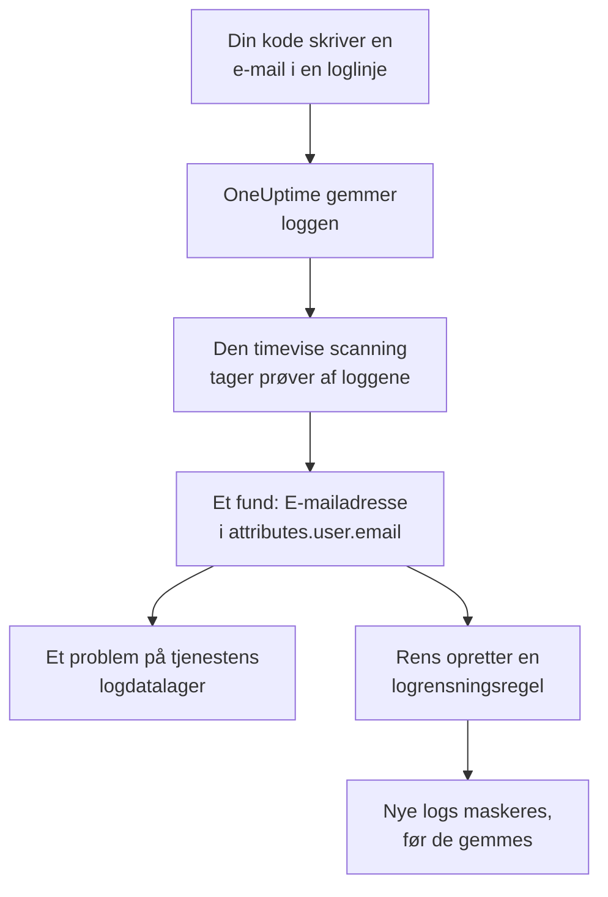

# Følsomme data i telemetri

Telemetri indeholder alt, hvad din kode skriver: en e-mailadresse i en loglinje, et kortnummer i en span-attribut, et token i en stack trace, en kundes spørgsmål i en prompt, en brugers IP-adresse i en metriks label. Datasikkerhed behandler hver tjenestes logs, traces, metrikker, undtagelser og AI-samtaler og hver RUM-applikations sessioner som datalagre for sig. Den tager prøver af dem hver time, finder følsomme data i dem, ligesom den gør i en bucket, og **Rens** gør et fund til en regel, der fra da af maskerer de data ved indtagelse.

Der er intet at sætte op: hver tjenestes telemetri scannes hver time, medmindre **Scan telemetri** er slået fra i projektets indstillinger. Vil du udelade én tjenestes logs, spor eller et andet af dens signaler, så slå **Scan indhold** fra i det datalagers **Indstillinger**: fra næste scanning læses intet af det.

:::cards
- [Hvad der læses](#hvad-der-læses): Attributterne, brødteksterne, beskederne og prompterne i hvert signal.
- [Sådan tager en scanning prøver](#sådan-tager-en-scanning-prøver): De nyeste poster fra hver tjeneste, hver time.
- [Rens](#rens): Maskér et fund ved indtagelse med ét klik.
- [Kassér denne metrik](#kassér-denne-metrik): Stop med at gemme de metrikker, hvis navne indeholder følsomme data.
- [Hvad der tæller som renset](#hvad-der-tæller-som-renset): Når en rensningsregel allerede dækker et fund.
:::

## Sådan virker det

Et fund, som en rensningsregel dækker, markeres som renset: det, der er tilbage af de data, er gamle data, der venter på, at deres opbevaring udløber, ikke en lækage, der stadig flyder. De to telemetrikontroller tæller kun det, ingen regel dækker, så deres problem løses, når hvert fund er renset (se [Telemetrikontroller](/docs/data-security/checks-and-issues#telemetri)).

## Hvad der læses

| Datalager | Hvad der læses | Hvor et fund peger hen |
| --- | --- | --- |
| Logs | Hver attribut og brødteksten | `attributes.<key>`, `body` |
| Traces | Hver span-attribut og attributterne i hver span-hændelse | `attributes.<key>`, `events.<event>.<key>` |
| Undtagelser | Beskeden, stack tracen og attributterne | `message`, `stackTrace`, `attributes.<key>` |
| AI-samtaler | Prompterne og svarene i hvert AI-kald, under de nøgler, GenAI-konventionerne lægger dem i, og hver anden attribut | Den nøgle, de ligger i, f.eks. `gen_ai.input.messages` eller `gen_ai.prompt[].content` |
| Sessionsafspilninger | Attributterne på en RUM-applikations spans og logs, dens sessioners attributter, de egenskaber, `identify()` gav dens brugere, og den brugerreference, den har fået oplyst | `spans.attributes.<key>`, `logs.attributes.<key>`, `sessions.attributes.<key>`, `sessions.identifiedUserTraits.<key>`, `sessions.identifiedUserLabel` |
| Metrikker | Hver attribut på et datapunkt, også dets ressources, og metrikkernes navne | `attributes.<key>`, `attributes.resource.<key>`, `name` |

Nummererede nøgler samles i én placering: `gen_ai.prompt.3.content` er `gen_ai.prompt[].content`, så de tyve beskeder i en chat er ét fund, ikke tyve. Attributter, som OneUptime selv tilføjer, og som starter med `oneuptime.`, læses ikke.

### Metrikker

En metriks attributter er dens seriers labels. De er de samme på hvert datapunkt i en serie, så en metrik, der skriver tusind punkter i minuttet, rummer måske kun tre værdier, og en label, der lækker en brugers e-mail, tilføjer en serie, ikke et punkt. Derfor tages der prøver af en metrik efter dens serier, ikke efter dens punkter:

- **Ét punkt fra hver serie.** Hver metrik læses i det nyeste minut, den skrev i den seneste time: ét datapunkt fra hver af op til 100 af minuttets serier, uanset hvor ofte metrikken sendes, så en travl serie aldrig fortrænger en stille. En værdi klassificeres én gang, uanset hvor mange serier der gentager den, så et fund tæller de forskellige værdier på sin placering.
- **Nye metrikker først, derefter resten på skift.** Hvilke metrikker en tjeneste skrev, og hvornår hver af dem første gang skrev i det seneste døgn, kommer fra den minutvise opsummering, som metriktabellen fører, aldrig fra selve punkterne. Hver scanning læser en tjenestes travleste metrikker, dem med størst sandsynlighed for mange serier. Derefter kommer de metrikker, den begyndte at skrive i de seneste 2 timer, fordi et nyt læk som regel kommer fra ny kode, og så de næste af dens andre metrikker i en fast rækkefølge, fra hvor den seneste scanning stoppede. Nye metrikker får højst halvdelen af de pladser, så de andre altid beholder deres.
- **Hver metrik inden for en fast tid.** For en tjeneste med M metrikker, hvoraf hver scanning læser 10, læses hver af dem mindst én gang hver M ÷ 5 timer, rundet op: 60 timer for en tjeneste med 300 metrikker. Så længe den bliver ved med at starte nye metrikker hver time, er det højst det dobbelte.
- **Hver metriks eget interval.** Metrikkerne læses samlet, hver over sit eget interval af tabellens primærnøgle. En metrik, hvis nyeste minut rummer mere end 16.384 punkter, f.eks. en med hver brugers e-mail som label, læses for sig, og læsningen stopper ved dens første punkter, så den ikke koster mere end nogen anden metrik.

Et fund angiver attributten, f.eks. `attributes.user.email`, eller `name` for data i en metriks navn. Dets poster er de datapunkter, det blev fundet i: hver viser sin metrik og attributtens værdi, maskeret, og åbner i **Metrikker** på den metrik, grupperet efter den attribut. Hvor en metriks navn indeholder følsomme data, maskeres navnet også, og posten åbner i stedet tjenestens metrikker.

### Hvorfor en afspilnings optagelse aldrig læses

En sessionsafspilnings optagelse indeholder teksten på de sider, folk så. Det kræver en tilladelse for sig at se den, og et fund læst ud af den ville vise maskeret sidetekst til alle, der kan læse Datasikkerhed. Derfor læses en afspilning kun via sine attributter: de spans, logs og sessionsdetaljer, der ligger ved siden af optagelsen. Optageren maskerer allerede det, den optager i browseren, og logrensningsregler kører også over optagelser (se [Sessionsafspilning](/docs/telemetry/session-replay)).

### AI-samtaler

Et AI-kalds prompt rummer hele chatten før personens nyeste besked, så op til 16.384 tegn af hver værdi i et AI-kald læses. Når AI-samtaler indeholder følsomme data, følger to ting mere: den AI-udbyder, kaldene gik til, er en datastrøm for de data, og [Følsomme data sendes til en AI-udbyder](/docs/data-security/checks-and-issues#ai) fejler på datalageret.

Samtalerne fra et [AI-værktøj i virksomheden](/docs/telemetry/ai-company-tools) udelades. Kun Projektejere og Projektadministratorer må læse dem, og et fund havner der, hvor alle, der læser Datasikkerhed, læser det, så de tjenesters spans læses aldrig, og deres AI-samtaler rapporteres som ikke læst.

## Sådan tager en scanning prøver

Hver time læses hvert signals nyeste poster fra den seneste time, og de klassificeres felt for felt ligesom ethvert andet datalagers (se [Felter og kolonner](/docs/data-security/data-types#felter-og-kolonner)):

| Grænse | Værdi |
| --- | --- |
| Poster fra hver tjeneste og hvert signal | **Prøvestørrelse for telemetri**, 500 som standard, aldrig mere end 1.000 |
| Tjenester eller RUM-applikationer, der læses pr. signal | De 200 travleste |
| Poster i én læsning | 5.000, delt mellem tjenesterne; 500 for AI-kald |
| Tegn i en logbrødtekst, en undtagelsesbesked eller en stack trace | 8.192 |
| Tegn i en attributværdi | 4.096 |
| Tegn i en værdi i et AI-kald | 16.384 |
| Attributter i én post | 128; 64 for et AI-kald |
| Hændelser i ét span og attributter i én hændelse | 16 og 32 |
| Placeringer i ét datalager | 500 |
| Metrikker, der læses i én scanning | 100, delt mellem tjenesterne, mindst én fra hver; højst 10 fra én tjeneste, halvdelen dens travleste og halvdelen dens nye og andre på skift |
| En ny metrik | En metrik, hvis første punkt i de seneste 24 timer kom i de seneste 2 timer |
| Serier i én metrik | Ét datapunkt fra hver, fra dens nyeste minut, højst 100 |

Hver værdi afkortes i databasen, så ingen lang værdi forlader den, og hver læsning stopper efter 30 sekunder. En læsning, der fejler, noteres som en advarsel på de datalagre, den gjaldt; scanningen fortsætter med den næste.

For at udelade noget tilføjer du det til datalagerets **Scanningsundtagelser**: en placering angivet fuldt ud (`attributes.http.url`), alt under en placering (`attributes.http`) eller en attributnøgle angivet alene (`http.url`).

## Rens

**Rens** på et fund opretter den regel, der fra da af skjuler den datatype på den placering, eller peger på den aktiverede regel, der allerede gør det:

:::steps
### Åbn fundet

Åbn problemet - **Hvor det blev fundet** viser hvert fund bag det - eller **Datasikkerhed > I din telemetri**, hvor **Vis poster** åbner de poster, et fund blev fundet i, ved siden af listen.

### Tryk på Rens

Klik på **Rens**. OneUptime opretter en logrensningsregel for logs og en RUM-applikations logs, en trace-rensningsregel for spans, undtagelser og AI-kald, på den del af posten, fundet ligger i, og en metrik-pipelineregel for en metriks attribut.

### Ret også koden

Reglen maskerer nye data, før de gemmes. Data, der allerede er gemt, bliver liggende, indtil deres opbevaring udløber, så ret den kode, der skriver dem: fundet nævner tjenesten og attributten.
:::

Reglen er opkaldt efter det, den skjuler, f.eks. "Data Security: Email address in attributes.user.email", og står sammen med dine andre rensningsregler (se [Drop-filtre og rensningsregler](/docs/telemetry/drop-filters-and-scrub-rules#rens-følsomme-data)). Den er en af disse:

| Fund | Regel, som Rens opretter |
| --- | --- |
| E-mailadresse, kortnummer, amerikansk socialsikringsnummer, telefonnummer eller IP-adresse | Typens indbyggede mønster. Kortnumre, socialsikringsnumre og telefonnumre maskeres, resten erstattes helt. |
| En værdi under en nøgle, der ligner noget følsomt, f.eks. `password` eller `token` | En regel af typen **Følsomme attributnøgler**, som erstatter hele værdien af hver sådan attribut |
| Enhver anden datatype, et mønster kan finde | En regel af typen **Brugerdefineret regex**, lavet ud fra datatypens egne mønstre, som erstatter hver værdi af samme form |
| Enhver datatype i en metriks attribut | En metrik-pipelineregel af typen **Redigér attribut bort** for tjenesten, som erstatter attributtens værdier af datatypens form med `[REDACTED]`, eller hver værdi af attributten, hvor intet mønster finder datatypen |

Nogle fund kan ikke renses af en regel, og **Rens** siger hvorfor. En metriks attribut kan altid renses, da dens regel kan skjule hver værdi af attributten:

- En datatype, der kun findes ud fra feltnavne, f.eks. en persons navn: intet mønster kan finde den. Omdøb attributten til en nøgle, som en regel for følsomme nøgler skjuler, eller stop med at sende den.
- En datatype, der kun kan skelnes fra andre værdier ved ordene omkring den, f.eks. et routingnummer: en regel ville skjule langt mere end den datatype.
- En dokumentmærkning: at skjule ordet ville ikke skjule dokumentet.
- En af dine egne datatyper: tilføj selv en brugerdefineret rensningsregel med dens mønster.
- En sessions egne detaljer (`sessions.*`): indtagelse af sessionsafspilninger kører ingen rensningsregler.
- En metriks navn (`name`): den kode, der opretter metrikken, sætter det, og en pipelineregel kan kun omdøbe en metrik som helhed. Omdøb metrikken, og send det, der varierer i dens navn, som en attribut i stedet. Indtil da kan **Kassér denne metrik** stoppe med at gemme de metrikker.

**Rens** opretter reglen som dig, med dine egne tilladelser: Projektejere og Projektadministratorer kan trykke på den, og det kan et team også, der må oprette logrensningsregler, trace-rensningsregler for spans, undtagelser og AI-kald og metrik-pipelineregler for metrikker.

## Kassér denne metrik

Ingen regel fjerner dataene fra en metriks navn, så indtil koden, der navngiver metrikken, er rettet, bliver dataene ved med at komme. **Kassér denne metrik** på et fund i en metriks navn stopper med at gemme de metrikker, hvis navne indeholder dem, på bekostning af deres data, så det sker kun, når du beder om det:

- **Én tjenestes metrikker.** Den opretter en metrik-pipelineregel af typen **Kassér** for fundets tjeneste: hvert nyt datapunkt fra en metrik, hvis navn indeholder den datatype, kasseres, før det gemmes. Dens filter er det mønster, **Rens** bruger for typen, så en type, som intet mønster kan finde, som en persons navn, kan ikke kasseres, og dialogen siger hvorfor.
- **Sagt, før det sker.** Dialogen siger, at de datapunkter går tabt for altid, hvor mange af tjenestens metrikker skrevet det seneste døgn der har sådan et navn, hvilke monitorer og dashboards der læser dem og derfor ikke får nye data, at det, der allerede er gemt, bliver, indtil opbevaringen udløber, og hvordan det fortrydes. Intet kasseres, før du har markeret, at du forstår det.
- **Som dig, og registreret.** Reglen oprettes med din egen tilladelse til at oprette metrik-pipelineregler: Projektejere og Projektadministratorer kan oprette den, og det kan et team også, der må oprette metrik-pipelineregler. Auditloggen registrerer, hvem der oprettede den.
- **Fortrydes ved at slette reglen.** Reglen navngives efter det, den kasserer, for eksempel "Data Security: drop metrics named with Email address", og står sammen med dine andre metrik-pipelineregler under **Metrikker → Indstillinger → Pipelineregler**. Slet den eller slå den fra, og de metrikker gemmes igen fra da af. Det, der blev kasseret i mellemtiden, kommer ikke tilbage.

Fundet markeres så som **Kasseret** og tæller som renset: intet mere af de data gemmes.

## Hvad der tæller som renset

Et fund markeres kun som renset, når indtagelsen ville køre en aktiveret regel over det, og reglen ville finde dets datatype:

- **De rigtige poster.** Logregler dækker logs og en RUM-applikations logs. Trace-regler dækker spans, undtagelser og AI-kald: en undtagelse er en kopi af sit spans undtagelseshændelse, så de regler, der renser hændelser, renser den.
- **Den rigtige del.** Reglens **Felter, der skal renses** omfatter den del af posten, fundet ligger i, eller reglen lader dem stå på standard.
- **Et mønster, der finder typen.** En indbygget **Mønstertype** finder sin egen datatype: **E-mailadresse** finder e-mailadresser, **Kreditkortnummer** kortnumre, **SSN (CPR-nummer)** amerikanske socialsikringsnumre, **Telefonnummer** telefonnumre og **IP-adresse** IP-adresser. **Følsomme attributnøgler** dækker hver værdi under en nøgle, der ligner noget følsomt, uanset hvad værdien er.
- **Dine egne brugerdefinerede mønstre tæller aldrig.** En **Brugerdefineret regex** dækker kun et fund, når den er præcis det mønster, **Rens** opretter for dets type. Et fund gemmer kun maskerede prøver, som intet mønster kan afprøves på, så OneUptime kan ikke bevise, at dit mønster skjuler dataene, og et fund, der fejlagtigt kaldes renset, er en lækage, ingen kigger på.
- **En metriks attribut.** En metrik-pipelineregel af typen **Redigér attribut bort** eller **Fjern attribut** for den attributs nøgle, for fundets tjeneste eller hele projektet, dækker det, når den ikke har noget filter, eller præcis det filter, **Rens** opretter. Et filter, du selv har skrevet, tæller aldrig, af samme grund.
- **En metriks navn.** En metrik-pipelineregel af typen **Kassér** for fundets tjeneste eller hele projektet dækker det, når den har præcis det filter, **Kassér denne metrik** opretter, eller slet intet filter, hvor den ikke gemmer nogen af tjenestens metrikker. Sådan en regel uden filter dækker hvert fund i de metrikker.

En regel, der er slået fra, eller som intet renser, tæller aldrig. Dækningen beregnes igen efter hver scanning, så en regel, du tilføjer eller fjerner manuelt, ændrer inden for en time, hvad der er markeret som renset.

## Næste trin

:::cards
- [Drop-filtre og rensningsregler](/docs/telemetry/drop-filters-and-scrub-rules): Hver indstilling for rensningsregler og de regler, du selv skriver.
- [Datasikkerhedskontroller og problemer](/docs/data-security/checks-and-issues): De to telemetrikontroller og AI-kontrollerne.
- [Datastrømme, adgang og residens](/docs/data-security/flows-access-residency): De AI-udbydere og værter, dine tjenester sender data til.
:::
